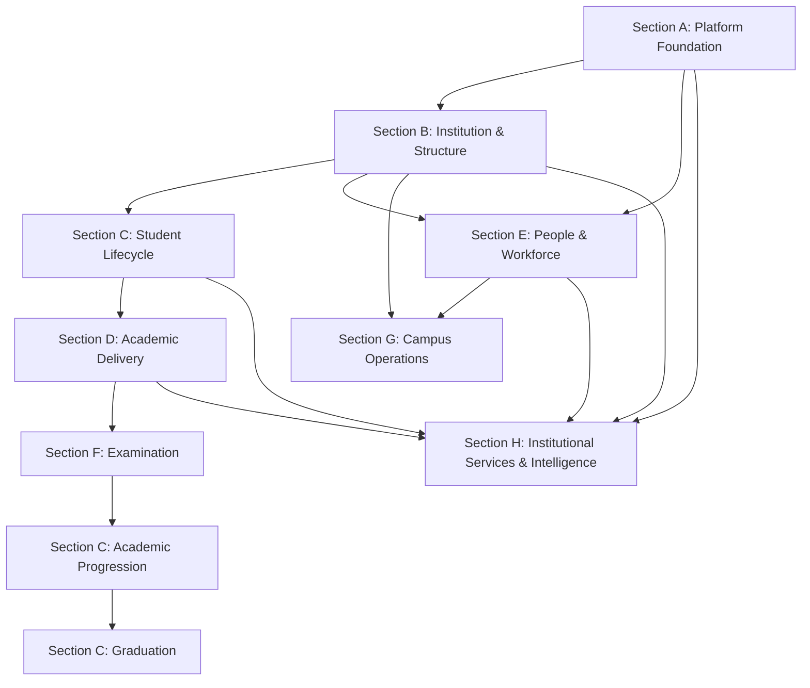

# SutraERP Architecture Dependency Map

## 1. Purpose

Dependency management is crucial for maintaining systemic integrity across SutraERP's multi-layered architecture. Without clear boundaries, design decisions can conflict, leading to implementation bugs, architectural drift, and integration friction.

Every architecture document has explicit **upstream dependencies** (documents that set constraints and rules) and **downstream consumers** (documents that build upon those rules). To ensure consistency:
* **Downstream documents must never redefine or override upstream decisions.**
* Changes to upstream documents automatically invalidate downstream assumptions, requiring a coordinated review and update cycle.

---

## 2. Architecture Dependency Hierarchy

```
Baseline (Core constraints & goals)
   ↓
Level 0 (System context & external interfaces)
   ↓
Level 1 (Locked platform-wide patterns & tenancy)
   ↓
Level 2 (Domain workflows & boundaries)
   ↓
Level 3 (Cross-domain integrations & Sagas)
   ↓
Level 4 (Developer interface contracts & API schemas)
   ↓
Level 5 (Role-based access permissions & workspace actions)
   ↓
Level 6 (Granular UI/UX step-by-step navigation workflows)
```

### Responsibilities of Every Level

* **Baseline**: Establishes the non-negotiable business rules, target users, high-level features, and technical constraints.
* **Level 0**: Details the interface boundaries between SutraERP and external systems (e.g. payment gateways, SMS servers).
* **Level 1**: Defines system-wide patterns including multi-tenancy models, database partitions, authorization policies, event routing rules, and protocol choices.
* **Level 2**: Identifies and organizes business domains, mapping entity lifecycles, states, domain boundaries, and local synchronous contracts.
* **Level 3**: Establishes transactional boundaries (Sagas) and message sequence layouts between separate business domains.
* **Level 4**: Defines concrete technical API schemas, data transfer object (DTO) shapes, and database constraints.
* **Level 5**: Maps system permissions, user personas, roles, and concrete audit trails for operations.
* **Level 6**: Specifies complete step-by-step user-system interaction screen loops and UI error messaging rules.

---

## 3. Level Dependencies

| Level | Depends On | Used By | Owner | Purpose |
| :--- | :--- | :--- | :--- | :--- |
| **Baseline** | None | Level 0, Level 1 | Dhruv | Establishes project scope and non-functional goals |
| **Level 0** | Baseline | Level 1, Level 2 | Dhruv | Defines system boundaries with external systems |
| **Level 1** | Baseline | Level 2, Level 3 | Dhruv | Defines platform-wide technical patterns |
| **Level 2** | Level 1 | Level 3, Level 4, Level 5 | Dhruv / Pallav | Designs domain workflows and business rules |
| **Level 3** | Level 2 | Level 4 | Pallav | Outlines cross-domain interaction models |
| **Level 4** | Level 3 | Level 5, Level 6 | Development Team | Provides API and module schemas for coding |
| **Level 5** | Level 2, Level 4 | Level 6 | Product Owner | Maps permissions and RBAC access parameters |
| **Level 6** | Level 5 | UI/UX Developers | UX Designer | Outlines exact user-system interface steps |

---

## 4. Level 2 Section Dependencies



* **Platform Foundation (Section A)**: Core tenancy, authorization, workflow engine, events, and master data. Every domain depends on this.
* **Institution & Structure (Section B)**: Institutional hierarchy and calendars. Establishes the structural foundation.
* **Student Lifecycle (Section C)**: Student recruitment, registration, lifecycle, academic progression, and graduation.
* **Academic Delivery (Section D)**: Course management, timetabling, faculty assignments, and attendance logs.
* **Examination (Section F)**: Marks registries, grading rules, and academic checks.
* **Academic Progression (Section C)**: Calculated states based on examination results, determining promotion or detention.
* **Graduation (Section C)**: Core student exit and transcript validation workflows.
* **People & Workforce (Section E)**: Workforce management and employee payroll/lifecycle. Depends on Platform + Institution structures.
* **Campus Operations (Section G)**: Logistics, libraries, transport, and hostels. Depends on Institution and People.
* **Institutional Services (Section H)**: Document repositories, global notification queues, directories, and dashboards. These services depend on other domains but own no canonical business entities.

---

## 5. Individual Domain Dependency Matrix

| Document | Depends On | Consumed By | Owner | Status |
| :--- | :--- | :--- | :--- | :--- |
| **L2-A01 Platform & Tenant** | Baseline, Level 1 | All Level 2 Domains | Dhruv | Draft |
| **L2-A02 Person & Identity** | L2-A01 | L2-A03, L2-C06, L2-E01 | Dhruv | Draft |
| **L2-A03 Authentication** | L2-A02 | L2-A04 | Dhruv | Draft |
| **L2-A04 Authorization & Policy** | L2-A03 | All Level 2 Domains | Dhruv | Draft |
| **L2-A05 Workflow Engine** | L1 Architecture | All Domains | Dhruv | Draft |
| **L2-A06 Event Infrastructure** | L1 Architecture | All Domains | Dhruv | Draft |
| **L2-A07 Audit Infrastructure** | L1 Architecture | All Domains | Dhruv | Draft |
| **L2-A08 Module Registry** | L2-A01 | All Domains | Dhruv | Draft |
| **L2-A09 Master Data** | L1 Architecture | All Domains | Dhruv | Draft |
| **L2-A00 Platform Foundation Review** | All Section A | Section B, C, D, E, F, G, H | Dhruv | Draft |
| **L2-B01 Institution** | L1 Architecture | L2-B02, L2-B03, L2-B04, L2-E01 | Dhruv | Draft |
| **L2-B02 Organisation** | L2-B01 | All Domains | Dhruv | Draft |
| **L2-B03 Campus & Infrastructure** | L2-B01 | L2-G01 | Dhruv | Draft |
| **L2-B04 Academic Structure** | L2-B01 | L2-B05, L2-D01 | Dhruv | Draft |
| **L2-B05 Academic Year & Period** | L2-B04 | L2-D01, L2-C03 | Dhruv | Draft |
| **L2-B06 Operational Readiness** | All Section B | All Domains | Dhruv | Draft |
| **L2-B00 Institution & Structure Review** | All Section B | Section C, D, G, H | Dhruv | Draft |
| **L2-C01 Admissions** | Section A, Section B | L2-C02 | Pallav | Draft |
| **L2-C02 Student Lifecycle & Activation** | L2-C01 | L2-C03, L2-C07, L2-G03 | Pallav | Draft |
| **L2-C03 Student Academic Registration** | L2-C02, Section D | L2-C04 | Pallav | Draft |
| **L2-C04 Student Academic Progression** | L2-C03, L2-F02 | L2-C05 | Pallav | Draft |
| **L2-C05 Graduation & Student Exit** | L2-C04 | None | Pallav | Draft |
| **L2-C06 Guardian Workflows** | L2-A02 | L2-C02 | Pallav | Draft |
| **L2-C07 Scholarship Workflows** | L2-C02 | L2-F01 | Pallav | Draft |
| **L2-C00 Student Lifecycle Review** | All Section C | Section F, Section H | Pallav | Draft |
| **L2-D01 Course & Course Offering** | Section B | L2-D02, L2-C03 | Pallav | Draft |
| **L2-D02 Faculty Academic Assignment** | L2-D01, Section E | L2-D03 | Pallav | Draft |
| **L2-D03 Timetable Workflows** | L2-D02 | L2-D04 | Pallav | Draft |
| **L2-D04 Teaching Session & Attendance** | L2-D03 | L2-D05 | Pallav | Draft |
| **L2-D05 Academic Monitoring** | L2-D04 | None | Pallav | Draft |
| **L2-D00 Academic Delivery Review** | All Section D | Section C, Section F | Pallav | Draft |
| **L2-E01 Workforce & Engagement** | Section A, Section B | L2-E02, L2-E04, L2-E05 | Dhruv | Draft |
| **L2-E02 Position & Assignment** | L2-E01 | L2-E03, L2-D02 | Dhruv | Draft |
| **L2-E03 Faculty Workforce** | L2-E02 | L2-D02 | Dhruv | Draft |
| **L2-E04 HR Workflows** | L2-E01 | L2-E06 | Dhruv | Draft |
| **L2-E05 Leave Workflows** | L2-E01 | L2-E06, L2-D02 | Dhruv | Draft |
| **L2-E06 Payroll Workflows** | L2-E04, L2-E05 | None | Dhruv | Draft |
| **L2-E00 People & Workforce Review** | All Section E | Section D, Section G | Dhruv | Draft |
| **L2-F01 Finance Domain** | Section A, B, C | L2-F03 | Team 1 | Draft |
| **L2-F02 Examination Domain** | Section C, D | L2-F03, L2-C04 | Team 1 | Draft |
| **L2-F03 Team 1 Contract Boundary Review** | L2-F01, L2-F02 | All Section F | Pallav | Draft |
| **L2-F00 Finance & Examination Review** | All Section F | L2-99 Review | Team 1 | Draft |
| **L2-G01 Facilities** | Section B | L2-G02 | Pallav | Draft |
| **L2-G02 Lab Management** | L2-G01 | None | Pallav | Draft |
| **L2-G03 Hostel** | Section C | None | Pallav | Draft |
| **L2-G04 Transport** | Section C | None | Pallav | Draft |
| **L2-G05 Library** | Section C | None | Pallav | Draft |
| **L2-G06 Medical** | Section A | None | Pallav | Draft |
| **L2-G07 Security Operations** | Section B | None | Pallav | Draft |
| **L2-G08 Housekeeping Operations** | Section B | None | Pallav | Draft |
| **L2-G00 Campus Operations Review** | All Section G | L2-99 Review | Pallav | Draft |
| **L2-H01 Document Domain** | Section A | None | Pallav | Draft |
| **L2-H02 Notification** | Section A | None | Pallav | Draft |
| **L2-H03 Directory** | Section A, B | None | Pallav | Draft |
| **L2-H04 Placement** | Section C | None | Pallav | Draft |
| **L2-H05 Research** | Section E | None | Pallav | Draft |
| **L2-H06 Alumni** | Section C | None | Pallav | Draft |
| **L2-H07 Dashboard** | All Domains | None | Pallav | Draft |
| **L2-H08 Reporting** | All Domains | None | Pallav | Draft |
| **L2-H00 Services & Intelligence Review** | All Section H | L2-99 Review | Pallav | Draft |

---

## 6. Repository Update Rules

Whenever an architectural document is completed or updated, the repository index state must be updated in a precise sequence:

```
Step 1: Complete and review the Architecture Document
  ↓
Step 2: Perform Self Review against baseline patterns
  ↓
Step 3: Commit document change to working branch
  ↓
Step 4: Open Pull Request to main
  ↓
Step 5: Architectural Review by Lead Architect (Dhruv)
  ↓
Step 6: Merge PR into main branch
  ↓
Step 7: Update governance files:
        1. ARCHITECTURE_INDEX.md (Update Status and Version)
        2. CHANGELOG.md (Record the additions/changes)
        3. docs/level-2/Level 2 matrix.md (Update checkboxes/status)
        4. DEPENDENCY_MAP.md (Only if upstream/downstream dependencies changed)
```

---

## 7. Living Documents

Living documents are designed to track progress, governance indexes, and project status. They are expected to change frequently as new files are drafted, reviewed, or promoted.
* **[ARCHITECTURE_INDEX.md](file:///g:/Pravaha/ERP_Planning/ARCHITECTURE_INDEX.md)**: Stores ownership records, active versions, and lifecycle status for all docs.
* **[CHANGELOG.md](file:///g:/Pravaha/ERP_Planning/CHANGELOG.md)**: Tracks repository-wide changes, folder structural moves, templates, and baseline adjustments.
* **[Level 2 matrix.md](file:///g:/Pravaha/ERP_Planning/docs/level-2/Level%202%20matrix.md)**: Tracks execution progress, review status, and checkboxes for Level 2.
* **[DEPENDENCY_MAP.md](file:///g:/Pravaha/ERP_Planning/DEPENDENCY_MAP.md)**: Tracks upstream and downstream dependencies and context constraints.

---

## 8. Stable Documents

Stable documents represent locked blueprints and static guidelines. They should almost never change unless the core architecture direction or team composition shifts.
* **Baseline Architecture**: Defines the core constraints and objectives of the system.
* **Level 1 Locked Architecture**: Defines high-level platform tiers and DB design patterns.
* **[README.md](file:///g:/Pravaha/ERP_Planning/README.md)**: Repository navigation hub. Only updated to link new governance logs.
* **[SutraERP_Level2_Collaboration_Guide_v1.1.md](file:///g:/Pravaha/ERP_Planning/docs/collaboration/SutraERP_Level2_Collaboration_Guide_v1.1.md)**: Enforces branching, reviews, timelines, and meeting sequences.

---

## 9. ChatGPT Context Strategy

To maximize the quality of LLM assistance and avoid context window pollution or contradictions, use this strict context loading strategy:

### Permanent Context
Always upload these documents to provide the system constraints, directory structure, governance policies, and locked patterns:
1. `README.md`
2. `docs/baseline/SutraERP_Architecture_Workflow_Context_Baseline.md`
3. `docs/level-1/SutraERP_Level_1_Architecture_Locked.md`
4. `docs/collaboration/SutraERP_Level2_Collaboration_Guide_v1.1.md`
5. `DEPENDENCY_MAP.md`

### Working Context
Only upload the target document you are editing alongside its immediate context:
1. The document being created or edited (e.g., `L2-A02`).
2. Immediate upstream dependencies (e.g., upload `L2-A01` when editing `L2-A02`).
3. Relevant templates or review reports.

### Repository Context
Never upload these unless explicitly requested:
1. Presentations (heavy HTML slide files).
2. Assets (images/diagrams).
3. Archives (deprecated logs).
4. Unrelated level folders.

---

## 10. GitHub Workflow

```
Feature Branch (dhruv or pallav)
  ↓
Commit (One document per commit)
  ↓
Pull Request (Target main)
  ↓
Review (Peer and Lead Architect feedback)
  ↓
Approval (Sign-off from Dhruv)
  ↓
Merge (Approved branch into main)
  ↓
Update Governance Documents (Update index, matrix, changelog, dependency map)
  ↓
Architecture Locked (Ready for developers to implement)
```

---

## 11. Pull Request Checklist

Before submitting a Pull Request, verify:
* [ ] **Architecture Unchanged**: No existing locked architecture rules are violated.
* [ ] **Dependencies Updated**: Verified all upstream dependencies are satisfied.
* [ ] **Architecture Index Updated**: The document's status is correctly mapped in `ARCHITECTURE_INDEX.md`.
* [ ] **Changelog Updated**: Added a record of this release in `CHANGELOG.md`.
* [ ] **Level Matrix Updated**: The checkmark/status in `docs/level-2/Level 2 matrix.md` is updated.
* [ ] **Dependency Map Updated**: If dependency rules changed, `DEPENDENCY_MAP.md` is updated.
* [ ] **Status Changed**: Document status updated from `Draft` to `Review` or `Locked`.
* [ ] **Version Updated**: Document version incremented according to versioning rules.

---

## 12. Future Growth

* **Adding Levels**: Introduce new folders in `docs/` (e.g., `level-3`, `level-4`) matching templates. Update `DEPENDENCY_MAP.md` section 3 table.
* **Adding Domains**: Add the domain to `Level 2 matrix.md` and `ARCHITECTURE_INDEX.md`. Map its dependencies in `DEPENDENCY_MAP.md` sections 4 and 5.
* **Adding Modules / Cross-Domain Workflows**: Generate Level 3 documents using templates and link them within the consumer matrices. Ensure downstream technical designs in Level 4 do not redefine Level 2 flows.
