# SutraERP Level 1 Architecture

**Version:** 2.1
**Status:** LOCKED
**Last Amended:** 2026-08-04 — Section 25 replaced: obsolete two-team ownership model removed in favour of Section-based ownership per TEAM_ASSIGNMENTS.md (INT-003); StudentContext gate corrected to the five terminal states and Suspended added (INT-007); Tenant lifecycle expanded to match L2-A01 (INT-006); Level 2 Dependency Order replaced with the canonical directed matrix from DEPENDENCY_MAP.md (INT-004)
**Previously Amended:** 2026-08-03 — Institute lifecycle extended (INT-008); Campus ownership split into Institutional vs Physical (INT-001); residual Graduation terminology replaced by Qualification Completion (INT-021/INT-033)
**Scope:** Canonical Institutional Lifecycle
**Purpose:** Define the complete institutional business architecture, ownership boundaries, lifecycle rules, and multi-domain responsibilities before Level 2 domain design.

---

# 1. Architectural Vision

SutraERP is a modular, multi-tenant, domain-driven ERP platform for educational institutions.

Level 1 defines the canonical business architecture of the platform.

It intentionally avoids implementation details and instead establishes:

- Business lifecycle
- Domain ownership
- Canonical entities
- Integration boundaries
- Institutional operating model
- Multi-domain responsibilities

Every L2 Domain Workflow Architecture document, L3 Business Scenario Architecture document, L4 System Behavior Specification, L5 Solution Architecture, and L6 UI / UX Architecture artifact must conform to this document.

---

# 2. Core Design Principles

## 2.1 Domain Driven Ownership

Every business capability belongs to exactly one owning domain.

Only the owning domain may create or modify its authoritative business data.

Other domains interact through:

- Synchronous Contracts
- Domain Events

Direct database access between domains is prohibited.

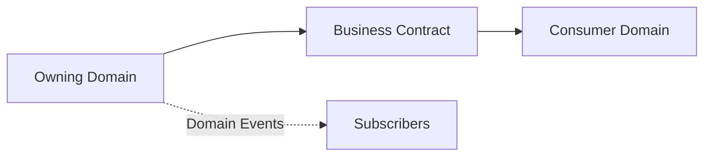

**Locked Rule**

A domain owns both its data and its lifecycle.

---

## 2.2 Canonical Entity Model

Business entities must have exactly one canonical owner.

Examples:

| Entity | Canonical Owner |
|---------|-----------------|
| Person | Identity |
| Institute | Institution |
| Student Context | Student Lifecycle |
| Programme | Academic Structure |
| Academic Year | Academic Calendar |
| Examination Result | Examination |
| Financial Ledger | Finance |

Duplicate business identities across modules are prohibited.

---

## 2.3 Separation of Business and Operations

Business identity and operational execution are separate concerns.

Example:

```text
Course
↓

Course Offering
↓

Teaching Session
↓

Attendance
```

A Course represents curriculum.

A Course Offering represents a scheduled academic delivery.

Attendance belongs to the Teaching Session rather than the Course itself.

---

## 2.4 Event Driven Collaboration

Business domains collaborate using events.

Example

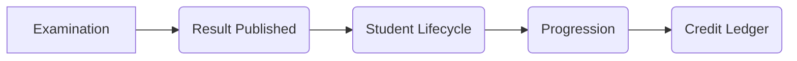

The Examination domain never updates Student Lifecycle directly.

---

## 2.5 Configurable Business Processes

Business policies are configurable.

Examples include:

- Approval Workflows
- Promotion Rules
- Attendance Policies
- Examination Eligibility
- Qualification Completion Requirements
- MEME Policies

Policies are evaluated through the Workflow Engine rather than embedded into business logic.

---

# 3. Institutional Operating Model

## 3.1 Institutional Hierarchy

(Multi-tenant isolation across separate Tenants is defined in
`L2-A01_Platform_Tenant_Foundation_Architecture.md` §2.6-2.7. This
section defines the hierarchy depth *within* a single Tenant.)

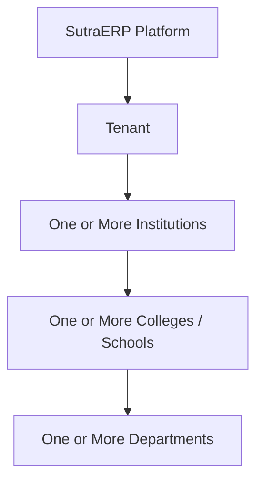

Definitions

### Platform

Owns SaaS infrastructure.

### Tenant

Security and isolation boundary.

### Institute

Legal educational organization.

### College / School

Independent academic operating unit.

### Department

Academic organizational unit.

---

Example

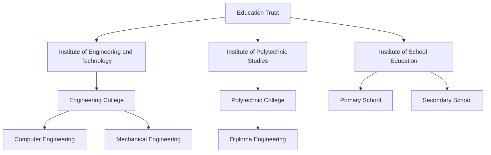

This example shows one Tenant (the Trust) operating three separate
Institutions, each independently recognised (for example, under
different regulatory approvals for degree-Engineering, Diploma, and
school education), each with its own College(s)/School and Department
structure. A Tenant is not required to have more than one Institution —
one Institution is equally valid — but the architecture must not assume
exactly one.

**Locked Rule**

Tenant and Institute are separate architectural concepts.

---

## 3.2 Physical vs Organizational Structure

Physical campuses are different from organizational units.

```text
Institute

├── Engineering College

│      ├── Computer Department

│      └── Mechanical Department

│

└── School

       ├── Primary

       └── Secondary
```

Physical locations

```text
Main Campus

City Campus

Research Campus
```

The relationship is

```text
Organisation Unit

≠

Physical Campus
```

Operational modules reference canonical Campus IDs.

---

## 3.3 Shared and Scoped Data

Some data is shared across the Institute.

Examples

- Person
- Identity
- Tenant
- Institute
- Global Master Data

Operational data is always College or School scoped.

Examples

- Admissions
- Students
- Academic Year
- Courses
- Attendance
- Examination
- Finance

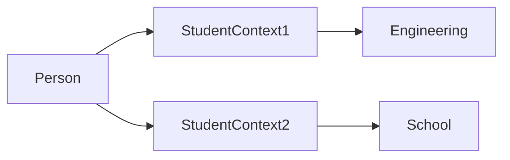

**Locked Rule**

Shared identity does not imply shared operational data.

---

## 3.4 Canonical Person Model

Every real individual has one Person record inside an Institute.

A Person may own multiple Personas.

Example

```text
Person

├── Student

├── Faculty

├── Parent

├── Alumni

└── Employee
```

Each Persona owns its own lifecycle.

---

## 3.5 Student Context

A Student Persona may have multiple historical Student Contexts.

Only one Student Context may remain ACTIVE within an Institute.

Example

```text
Person

↓

Student

├── School

│     QUALIFICATION COMPLETED

│

└── Engineering

      ACTIVE
```

Invalid

```text
Engineering

ACTIVE

School

ACTIVE
```

A previous Student Context must transition into one of the following terminal states before another becomes ACTIVE.

- Qualification Completed
- Withdrawn
- Transferred
- Discontinued
- Terminated

Pending Activation, Active and Suspended are non-terminal and do not satisfy
this gate. This enumeration is canonical and is reproduced verbatim in
`L2-C02_Student_Lifecycle_and_Activation.md` section 11.10.1.

**Locked Rule**

Maximum one ACTIVE Student Context per Institute.

---

# 4. NEP 2020 Architectural Principles

NEP 2020 is implemented as an architectural extension rather than a standalone module.

Core capabilities

- Flexible Curriculum
- Major / Minor
- Honours
- Choice Based Credit Registration
- Academic Credit Ledger
- Academic Bank of Credits
- Multiple Entry Multiple Exit
- APAAR Identity Integration

These capabilities extend:

- Academic Structure
- Student Lifecycle
- Academic Delivery
- Examination
- Identity

They never replace existing domains.

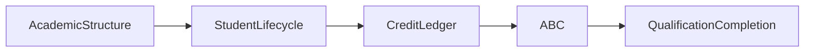

**Locked Rules**

- Academic Credit Ledger is the canonical institutional credit record.
- ABC synchronization is an external integration.
- MEME is governed by institutional policy.
- Flexible Curriculum belongs to Academic Structure.
- CBCR belongs to Student Lifecycle.
- APAAR belongs to Identity.
- NEP is a multi-domain capability.

---

# 5. Canonical Institutional Lifecycle

The institutional lifecycle defines the highest-level business journey within SutraERP.

Every Level 2 workflow shall derive from this lifecycle.

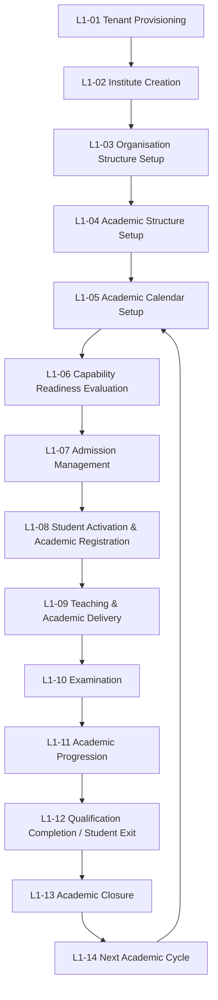

The lifecycle repeats for every Academic Year while preserving historical academic records.

---

# 6. Lifecycle Overview

## L1-01 Tenant Provisioning

Creates an isolated SaaS environment.

Owner

Platform

Primary Output

- Tenant
- Platform Configuration
- Identity Infrastructure

---

## L1-02 Institute Creation

Registers an educational institution inside an existing Tenant.

Owner

Institution

Primary Output

- Institute
- Institute Profile
- Institutional Policies

---

## L1-03 Organisation Structure Setup

Defines the organisational hierarchy.

Owner

Organisation

Primary Output

- Colleges
- Schools
- Departments
- Campuses
- Administrative Units

---

## L1-04 Academic Structure Setup

Defines the academic model.

Owner

Academic Structure

Primary Output

- Programmes
- Programme Versions
- Curriculum
- Major
- Minor
- Honours
- Elective Basket
- Course Basket
- Courses

---

## L1-05 Academic Calendar Setup

Defines academic operating periods.

Owner

Academic Calendar

Primary Output

- Academic Year
- Academic Period
- Calendar Events
- Holidays
- Examination Windows

---

## L1-06 Capability Readiness Evaluation

Determines whether academic operations may begin.

Owner

Platform Governance

Readiness evaluates

- Academic Calendar
- Faculty Assignment
- Course Offerings
- Infrastructure
- Required Policies

Outputs

READY

or

NOT READY

---

## L1-07 Admission Management

Manages student admissions.

Owner

Admissions

Outputs

- Applicants
- Admission Decisions
- Approved Candidates

Admission does not create an Active Student.

---

## L1-08 Student Activation & Academic Registration

Converts an approved applicant into an operational student.

Owner

Student Lifecycle

Outputs

- Student Context
- Academic Placement
- Academic Registration
- CBCR Registration

---

## L1-09 Teaching & Academic Delivery

Executes academic delivery.

Owner

Academics

Outputs

- Course Offerings
- Faculty Assignment
- Timetable
- Teaching Sessions
- Attendance
- Continuous Assessment

---

## L1-10 Examination

Conducts assessment and publishes official academic results.

Owner

Examination

Outputs

- Eligibility
- Evaluation
- Grades
- Credits Earned
- Official Results

---

## L1-11 Academic Progression

Determines future academic status.

Owner

Student Lifecycle

Outputs

- Promotion
- Repeat
- Detention
- Backlog
- Qualification Eligibility
- Academic Credit Ledger Update
- ABC Synchronization

---

## L1-12 Qualification Completion / Student Exit

Closes the Student Context.

Owner

Student Lifecycle

Possible outcomes

- Certificate
- Diploma
- Advanced Diploma
- Degree
- Degree with Research
- Withdrawal
- Transfer
- Discontinuation
- Termination

NEP enables Multiple Entry Multiple Exit.

Credits remain preserved.

---

## L1-13 Academic Closure

Officially closes Academic Periods and Academic Years.

Owner

Academic Calendar

Outputs

- Closed Academic Year
- Archived Academic Records
- Controlled Corrections

---

## L1-14 Next Academic Cycle

Prepares the next Academic Year.

Owner

Academic Calendar

Creates

- New Academic Year
- New Academic Periods
- New Course Offerings

Historical academic data remains immutable.

---

# 7. Lifecycle Decision Points

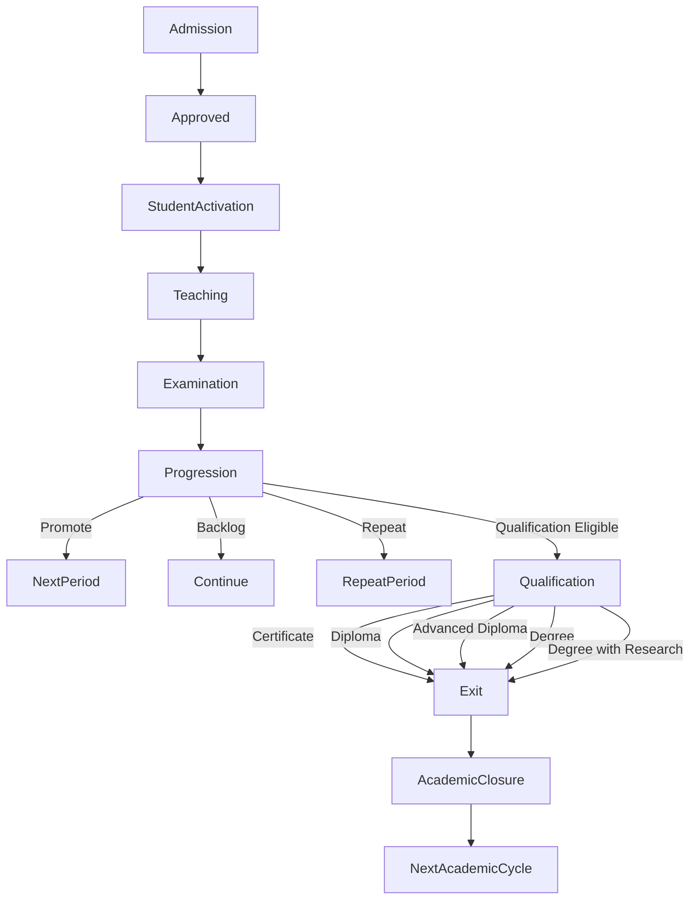

---

# 8. NEP 2020 Lifecycle Extension

The traditional Graduation model is replaced by Qualification Completion.

Qualification Completion evaluates academic credits instead of only programme completion.

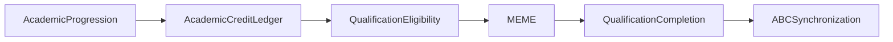

Institutional policy determines:

- Qualification thresholds
- Exit eligibility
- Re-entry eligibility
- Credit validity
- Credit expiry (if applicable)

---

# 9. Multi-Domain Lifecycle Ownership

| Lifecycle Stage | Owner |
|----------------|-------|
| Tenant | Platform |
| Institute | Institution |
| Organisation | Organisation |
| Academic Structure | Academic Structure |
| Calendar | Academic Calendar |
| Admissions | Admissions |
| Student Activation | Student Lifecycle |
| Teaching | Academics |
| Examination | Examination |
| Progression | Student Lifecycle |
| Academic Credit Ledger | Student Lifecycle |
| Qualification Completion | Student Lifecycle |
| Academic Closure | Academic Calendar |

**Locked Rules**

- Examination never promotes a student.
- Student Lifecycle never publishes examination results.
- Academics never modifies official results.
- Finance never activates a student.
- Academic Credit Ledger is updated only after official progression.
- ABC remains an external integration.

---

# 10. L1-01 — Tenant Provisioning

## Purpose

Provision a secure and isolated SutraERP environment for a customer organization.

---

## Owner

Platform Domain

---

## Primary Actors

- Platform Administrator
- Automated Provisioning Service

---

## Inputs

- Tenant Registration Request
- Subscription Plan
- Initial Configuration

---

## Outputs

- Tenant
- Identity Namespace
- Module Registry
- Audit Infrastructure
- Default Platform Configuration

---

## Lifecycle

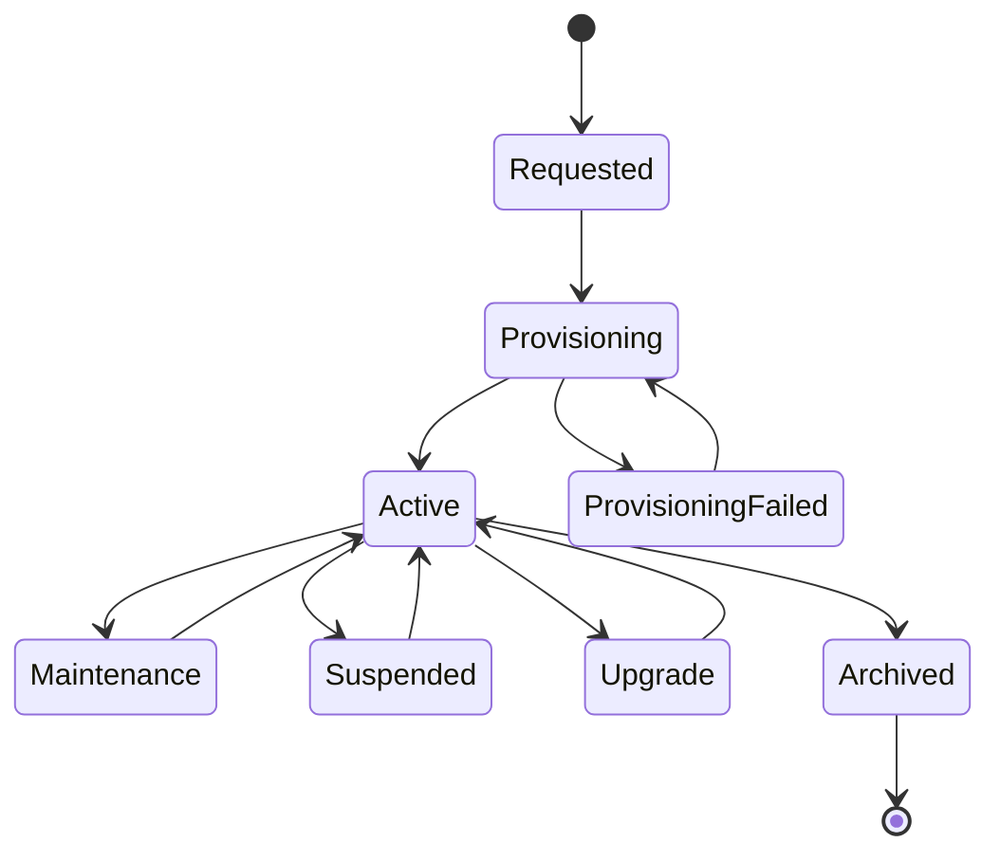

| State | Description | Terminal |
|---|---|---|
| Requested | Tenant registration accepted but provisioning has not started. | No |
| Provisioning | Platform initialization is in progress. | No |
| Provisioning Failed | Provisioning terminated unsuccessfully; may retry Provisioning. | No |
| Active | Tenant is fully operational. | No |
| Maintenance | Controlled maintenance operations are being performed. | No |
| Suspended | Business execution is temporarily disabled while preserving all data. | No |
| Upgrade | A controlled platform upgrade is being applied to the Tenant. | No |
| Archived | Tenant is permanently retired and retained for history or regulation. | Yes |

This enumeration is canonical and is reproduced in
`L2-A01_Platform_Tenant_Foundation_Architecture.md` sections 5.4, 5.5 and 5.8.

---

## Provisioning Workflow

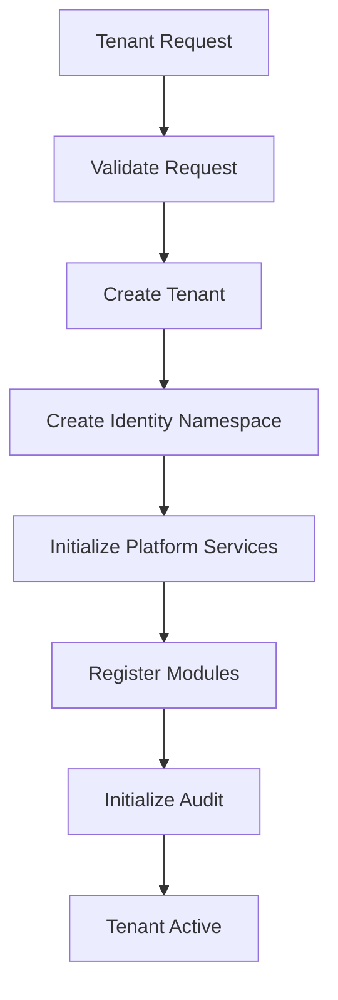

---

## Business Rules

- Every Tenant is globally unique.
- Tenant is the security boundary.
- Tenant owns all institutional resources.
- Modules are registered during provisioning.
- Tenant deletion is never physical.

---

## Canonical Entities

- Tenant
- Module Registry
- Identity Namespace

---

## Multi-Domain Contracts

Consumes

None

Publishes

- TenantCreated
- TenantActivated

---

## Locked Decisions

- Tenant is immutable after creation.
- Tenant is never merged.
- Tenant owns security isolation.

---

# 11. L1-02 — Institute Creation

## Purpose

Create an educational institution inside an active Tenant.

---

## Owner

Institution Domain

---

## Primary Actors

- Platform Administrator
- Institute Administrator

---

## Inputs

- Active Tenant
- Institute Information

---

## Outputs

- Institute
- Institute Profile
- Institutional Policies

---

## Lifecycle

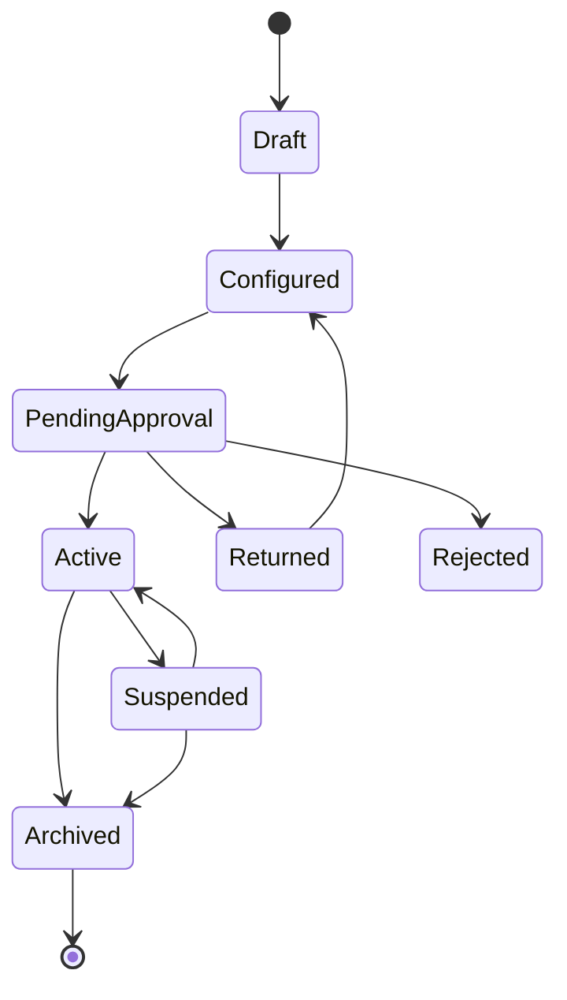

State meanings:

| State | Meaning | Operational |
|---|---|---|
| Draft | Institute record created; configuration incomplete. | No |
| Configured | Mandatory Institute Configuration complete and validated; ready to submit for approval. | No |
| PendingApproval | Activation request submitted and awaiting approval. | No |
| Returned | Activation request returned for correction; re-enters Configured. | No |
| Rejected | Activation request denied. Terminal for that request. | No |
| Active | Institute is an operational business entity. | Yes |
| Suspended | Institute temporarily disabled; history preserved, reversible to Active. | No |
| Archived | Institute permanently retired; read-only. Terminal. | No |

Amendment note (2026-08-03, closes integrity finding INT-008): `Configured`, `Suspended` and `Archived` are added to this lifecycle with the explicit transitions shown above. They were already implemented in `L2-B01_Institution_Workflow.md`; this amendment grants them L1 authority so B01 is a strict extension of L1 rather than a divergent state machine. `Draft`, `PendingApproval`, `Active`, `Returned` and `Rejected` are unchanged.

---

## Workflow

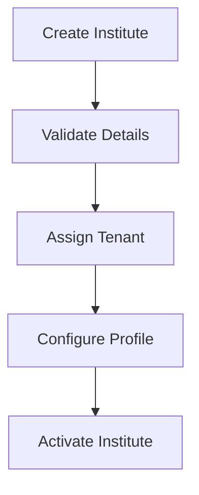

---

## Business Rules

- One Institute belongs to exactly one Tenant.
- Institute owns institutional policies.
- Institute owns organizational hierarchy.

---

## Canonical Entities

- Institute
- Institute Policy
- Institute Profile

---

## Contracts

Publishes

- InstituteCreated
- InstituteActivated

Consumes

- TenantActive

---

## Locked Decisions

- Tenant and Institute remain separate.
- Institute identity is immutable.
- The Institute lifecycle is exactly Draft, Configured, PendingApproval, Returned, Rejected, Active, Suspended, Archived. No L2 document may add, remove or rename an Institute lifecycle state without an L1 amendment.
- Suspension is reversible; Archival is terminal and read-only.
- Rejected and Archived are terminal states.

---

# 12. L1-03 — Organisation Structure Setup

## Purpose

Define the institutional organizational hierarchy.

---

## Owner

Organisation Domain

---

## Primary Actors

- Registrar
- Institute Administrator

---

## Inputs

- Active Institute

---

## Outputs

- Colleges
- Schools
- Departments
- Campuses
- Administrative Units

---

## Canonical Hierarchy

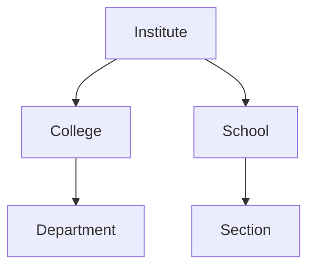

---

## Physical Hierarchy

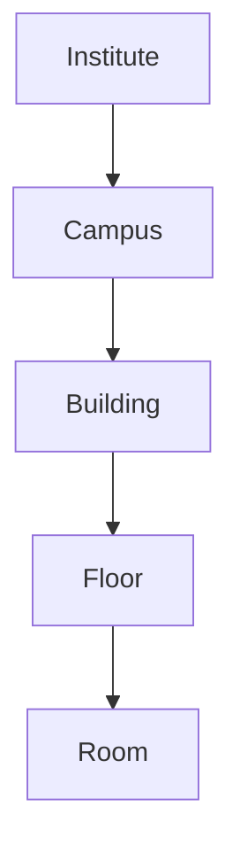

---

## Business Rules

- Organisation hierarchy is independent of physical infrastructure.
- Campuses may serve multiple Colleges.
- Departments never own physical locations.

---

## Canonical Entities

- Organisation Unit
- Department
- Campus

---

## Contracts

Publishes

- OrganisationCreated

Consumes

- InstituteActivated

---

## Locked Decisions

Organisation and Infrastructure remain separate domains.

---

# 13. L1-04 — Academic Structure Setup

## Purpose

Define the academic model of an institution.

---

## Owner

Academic Structure Domain

---

## Inputs

- Active College
- Institutional Academic Policies

---

## Outputs

- Programmes
- Programme Versions
- Curriculum
- Courses
- Elective Baskets

---

## College Model

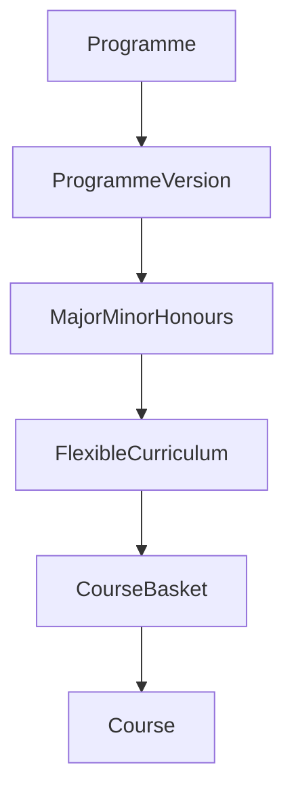

---

## School Model

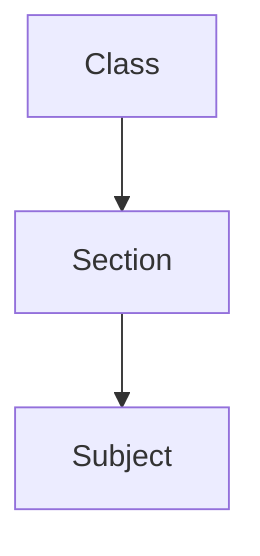

---

## NEP Extension

Academic Structure additionally supports

- Major
- Minor
- Honours
- Multidisciplinary Curriculum
- Flexible Curriculum
- Elective Basket
- Skill Credits

---

## Business Rules

- Curriculum never changes in place.
- Every curriculum revision creates a Programme Version.
- Programme Versions remain historically immutable.

---

## Canonical Entities

- Programme
- Programme Version
- Course Basket
- Course
- Credit Definition

---

## Contracts

Publishes

- ProgrammeCreated
- CurriculumPublished

Consumes

- OrganisationReady

---

## Locked Decisions

Programme Version is the canonical curriculum version.

Flexible Curriculum belongs to Academic Structure.

---

# 14. L1-05 — Academic Calendar Setup

## Purpose

Create and manage institutional academic calendars.

---

## Owner

Academic Calendar Domain

---

## Inputs

- Academic Structure
- Institutional Policies

---

## Outputs

- Academic Year
- Academic Period
- Academic Calendar

---

## Calendar Model

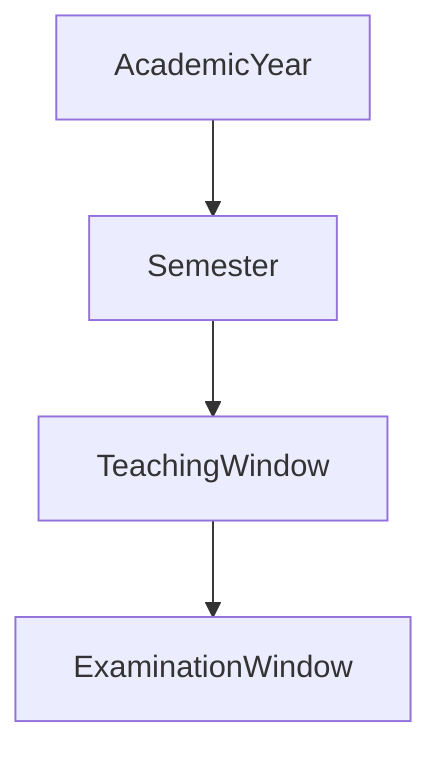

School implementations replace Semester with Term.

---

## Lifecycle

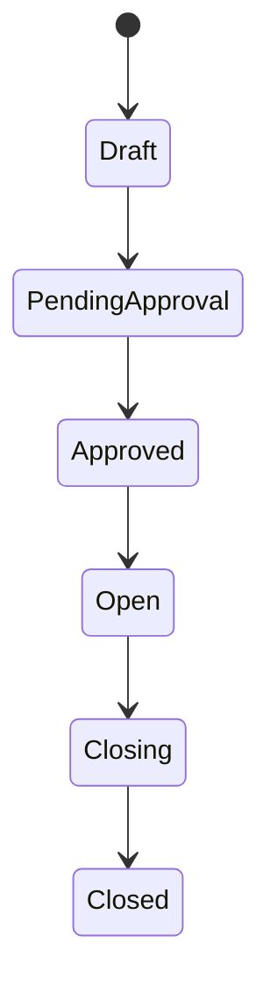

---

## Business Rules

- Academic Year is College scoped.
- Academic Period belongs to one Academic Year.
- Approved and Open are different states.
- Closed periods are immutable.

---

## Contracts

Publishes

- AcademicYearOpened
- AcademicPeriodOpened
- AcademicYearClosed

Consumes

- CurriculumPublished

---

## Locked Decisions

Academic Calendar is the authoritative owner of Academic Year and Academic Period.

Academic Years are never cloned using database copy operations.

---

# 15. L1-06 — Capability Readiness Evaluation

## Purpose

Determine whether a business operation may begin by evaluating all mandatory prerequisites.

Capability Readiness is evaluated dynamically for each requested business operation.

No global "Institute Ready" flag exists.

> **Amended 2026-08-13 under approved integrity finding INT-302.** This L1 capability is the runtime, operation-specific readiness evaluator. It produces a non-persisted `READY` or `NOT READY` result from current rules and dependencies. `L2-A10` separately owns **Operational Readiness Governance & Certification**: persisted assessments, evidence references, findings, improvement plans, and certificates. An A10 certificate is governance evidence that may be consumed by this evaluation; it is never a global readiness flag and never replaces this dynamic decision.

---

## Owner

Platform Governance

---

## Primary Actors

- Registrar
- Academic Administrator
- System

---

## Inputs

- Academic Calendar
- Academic Structure
- Infrastructure
- Faculty Assignment
- Institutional Policies

---

## Outputs

- READY
- NOT READY

---

## Readiness Workflow

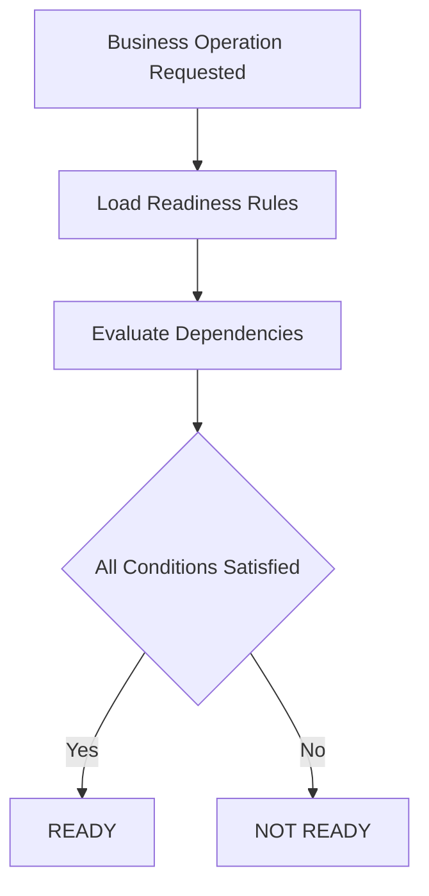

---

## Example

Teaching Readiness

```text
Academic Year          ✓

Academic Period        ✓

Course Offering        ✓

Faculty Assignment     ✓

Teaching Space         ✗

Result

NOT READY
```

---

## Business Rules

Capability Readiness Evaluation

- is calculated
- is not stored
- is capability specific
- supports caching but never trusts cached values as authoritative

---

## Canonical Entities

- Readiness Rule
- Readiness Result

---

## Contracts

Consumes

- Academic Calendar
- Academics
- Infrastructure
- Workflow Engine

Publishes

- OperationReady
- OperationBlocked

---

## Locked Decisions

Capability readiness is evaluated dynamically for each requested operation; governance certification is separate evidence and is not an authoritative runtime result.

---

# 16. L1-07 — Admission Management

## Purpose

Manage the complete applicant admission lifecycle.

Admission is College or School scoped.

Admission never creates an Active Student.

---

## Owner

Admissions Domain

---

## Primary Actors

- Applicant
- Admission Officer
- Registrar

---

## Inputs

- Admission Cycle
- Application
- Documents

---

## Outputs

- Admission Decision
- Approved Candidate

---

## Admission Workflow

```mermaid
flowchart TD

Application

-->DocumentVerification

-->EligibilityVerification

-->Review

-->Decision

Decision --> Approved

Decision --> Waitlisted

Decision --> Rejected
```

---

## Canonical Person Resolution

```mermaid
flowchart TD

Applicant

-->SearchPerson

SearchPerson

-->|Found| LinkPerson

SearchPerson

-->|Not Found| CreatePerson

LinkPerson --> ContinueAdmission

CreatePerson --> ContinueAdmission
```

---

## Business Rules

- Admission is Institution scoped through College / School.
- Canonical Person lookup is mandatory.
- Duplicate Person creation is prohibited.
- Approval does not activate a Student.

---

## Canonical Entities

- Admission Cycle
- Application
- Admission Decision

---

## Contracts

Consumes

- Identity
- Document Management

Publishes

- AdmissionApproved
- AdmissionRejected
- AdmissionCompleted

---

## Locked Decisions

Admission and Student Lifecycle remain independent.

---

# 17. L1-08 — Student Activation & Academic Registration

## Purpose

Convert an approved applicant into an operational student.

This is the canonical entry point into the Student Lifecycle.

---

## Owner

Student Lifecycle Domain

---

## Inputs

- Approved Admission
- Required Documents
- Financial Clearance

---

## Outputs

- Student Context
- Academic Registration
- Active Student

---

## Student Activation Workflow

```mermaid
flowchart TD

AdmissionApproved

-->VerifyDocuments

-->VerifyFinance

-->CreateStudentContext

-->ActivateStudent
```

---

## Academic Registration

### College

```mermaid
flowchart TD

Student

-->Programme

-->ProgrammeVersion

-->FlexibleCurriculum

-->ChoiceBasedRegistration

-->CourseBasket

-->CourseEnrollment
```

### School

```mermaid
flowchart TD

Student

-->Class

-->Section

-->SubjectAllocation
```

---

## Student Context Rule

```mermaid
stateDiagram-v2

[*] --> PendingActivation

PendingActivation --> Active

Active --> Suspended

Suspended --> Active

Active --> QualificationCompleted

Active --> Withdrawn

Active --> Transferred

Active --> Discontinued

Active --> Terminated

QualificationCompleted --> [*]

Withdrawn --> [*]

Transferred --> [*]

Discontinued --> [*]

Terminated --> [*]
```

Only one Student Context may remain Active within an Institute.

| State | Terminal |
|---|---|
| Pending Activation | No |
| Active | No |
| Suspended | No |
| Qualification Completed | Yes |
| Withdrawn | Yes |
| Transferred | Yes |
| Discontinued | Yes |
| Terminated | Yes |

Suspended is reversible to Active. A new Student Context may only be opened for
an Institute once every prior Context for that Institute is terminal.

---

## Business Rules

Student Lifecycle owns

- Student Context
- Academic Registration
- Progression
- Qualification Completion
- Academic Credit Ledger

Student Lifecycle never owns

- Attendance
- Timetable
- Examination Result
- Finance

---

## NEP Extension

Student Registration additionally supports

- Choice Based Credit Registration
- Flexible Curriculum
- Major / Minor
- Academic Credit Ledger Initialization

---

## Contracts

Consumes

- Admission
- Finance
- Identity

Publishes

- StudentActivated
- StudentRegistered

---

## Locked Decisions

Student Lifecycle is the canonical owner of Student Context.

---

# 18. L1-09 — Teaching & Academic Delivery

## Purpose

Deliver academic learning activities.

---

## Owner

Academics Domain

---

## Inputs

- Course Offerings
- Faculty
- Student Registration

---

## Outputs

- Teaching Sessions
- Attendance
- Internal Assessment

---

## Workflow

```mermaid
flowchart TD

CourseOffering

-->FacultyAssignment

-->Timetable

-->TeachingSession

-->Attendance

-->InternalAssessment

-->AcademicMonitoring
```

---

## Academic Delivery Model

```mermaid
flowchart TD

Course

-->CourseOffering

-->TeachingSession

-->Attendance
```

---

## Business Rules

Academics owns

- Course Offering
- Timetable
- Attendance
- Internal Assessment

Academics never owns

- Student Promotion
- Examination Result
- Credit Ledger

---

## Contracts

Consumes

- Academic Structure
- Student Lifecycle
- Infrastructure

Publishes

- AttendanceFinalized
- InternalAssessmentCompleted

---

## Locked Decisions

Course Offering is the canonical academic delivery entity.

---

# 19. L1-10 — Examination

## Purpose

Evaluate academic performance and publish official academic results.

---

## Owner

Examination Domain

---

## Inputs

- Student Registration
- Attendance
- Internal Assessment

---

## Outputs

- Grades
- Credits Earned
- Official Result

---

## Workflow

```mermaid
flowchart TD

Eligibility

-->HallTicket

-->Examination

-->Evaluation

-->Moderation

-->Approval

-->OfficialResult
```

---

## Result Publication

```mermaid
flowchart TD

OfficialResult

-->StudentLifecycle

-->Progression

-->AcademicCreditLedger
```

---

## Business Rules

Examination owns

- Grade
- Result
- Credits Awarded
- Official Academic Status

Examination never owns

- Promotion
- Student Status
- Qualification Completion

---

## Contracts

Consumes

- Academics
- Student Lifecycle

Publishes

- ExaminationResultPublished

---

## Locked Decisions

Official Result is immutable after publication unless a controlled correction workflow is executed.

Credits awarded by Examination become inputs to Student Lifecycle for progression and Academic Credit Ledger updates.

---

# 20. L1-11 — Academic Progression

## Purpose

Evaluate a student's academic performance after the publication of official examination results and determine the next academic state.

Academic Progression is the authoritative process responsible for advancing, retaining, or completing a student's academic journey.

Progression is owned by the Student Lifecycle Domain.

---

## Owner

Student Lifecycle Domain

---

## Primary Actors

- Registrar
- Academic Administrator
- System

---

## Inputs

- Official Examination Result
- Academic Policies
- Programme Rules
- Student Academic Context
- Academic Credit Ledger

---

## Outputs

- Progression Decision
- Updated Student Context
- Academic Credit Ledger Update
- Qualification Eligibility

---

## Academic Progression Workflow

```mermaid
flowchart TD

A[Official Result Published]

-->B[Load Student Context]

-->C[Load Academic Credit Ledger]

-->D[Apply Progression Policy]

-->E{Decision}

E --> Promote

E --> ContinueBacklog

E --> RepeatPeriod

E --> Detained

E --> QualificationEligible

Promote --> UpdateLedger

ContinueBacklog --> UpdateLedger

RepeatPeriod --> UpdateLedger

QualificationEligible --> QualificationCompletion
```

---

## Progression Decisions

Possible decisions include

- Promote
- Continue with Backlog
- Repeat Academic Period
- Detained
- Manual Review
- Qualification Eligible

Qualification Eligible replaces the traditional concept of Programme Completed.

---

## Progression Hierarchy

Policies may be configured at multiple organizational levels.

```mermaid
flowchart TD

Institute

-->College

-->Programme

-->ProgrammeVersion
```

Lower levels may override inherited policies where permitted.

---

## Academic Credit Ledger

The Academic Credit Ledger represents the canonical academic credit history of a student.

It records

- Credits Attempted
- Credits Earned
- Credits Transferred
- Credits Consumed
- Qualification Credits
- Remaining Credits

The Academic Credit Ledger is owned exclusively by Student Lifecycle.

---

## Academic Credit Ledger Workflow

```mermaid
flowchart TD

OfficialResult

-->Progression

-->CreditCalculation

-->LedgerUpdate

-->QualificationEvaluation

-->ABCSynchronization
```

---

## NEP Extension

Progression additionally evaluates

- Credit Completion
- Qualification Thresholds
- Multiple Entry Multiple Exit Eligibility
- Credit Transfer
- ABC Synchronization

---

## Business Rules

Progression never modifies Examination Results.

Progression only consumes published official results.

Academic Credit Ledger updates occur only after progression has completed successfully.

---

## Canonical Entities

- Progression Decision
- Academic Credit Ledger
- Qualification Status

---

## Multi-Domain Contracts

Consumes

- Examination
- Academic Structure
- Workflow Engine

Publishes

- StudentPromoted
- StudentRepeated
- QualificationEligible
- AcademicCreditLedgerUpdated

---

## Locked Decisions

Student Lifecycle is the canonical owner of Academic Progression.

Academic Credit Ledger is the authoritative institutional credit record.

Examination credits become immutable inputs to progression.

---

# 21. L1-12 — Qualification Completion / Student Exit

## Purpose

Complete or terminate a Student Context after academic progression determines that the student is eligible for qualification or institutional exit.

This replaces the traditional Graduation-centric lifecycle.

---

## Owner

Student Lifecycle Domain

---

## Inputs

- Qualification Eligibility
- Institutional Exit Policy
- Academic Credit Ledger
- Clearance Status

---

## Outputs

- Closed Student Context
- Alumni Persona
- Exit Record
- Qualification Record

---

## Qualification Workflow

```mermaid
flowchart TD

QualificationEligible

-->QualificationAudit

-->PolicyValidation

-->ClearanceEvaluation

-->QualificationApproval

-->CloseStudentContext

-->CreateAlumniPersona
```

---

## Qualification Types

Supported qualification outcomes

- Certificate
- Diploma
- Advanced Diploma
- Bachelor's Degree
- Bachelor's Degree with Research
- Postgraduate Degree
- Doctoral Degree

Institution-specific qualifications may extend this list.

---

## Student Exit Types

Administrative exits include

- Withdrawn
- Transferred
- Discontinued
- Terminated

Each exit type preserves historical academic records.

---

## Multiple Entry Multiple Exit (MEME)

Students may exit after achieving institution-defined qualification thresholds.

```mermaid
flowchart TD

CreditThresholdReached

-->QualificationDecision

QualificationDecision

-->Exit

Exit

-->AcademicCreditLedger

AcademicCreditLedger

-->FutureReEntry
```

Re-entry uses the preserved Academic Credit Ledger.

No academic history is recreated.

---

## Clearance Evaluation

Clearance is policy driven.

```mermaid
flowchart TD

StudentExit

-->EvaluateApplicableModules

-->Library

-->Finance

-->Hostel

-->Transport

-->QualificationApproval
```

Only applicable operational modules participate.

---

## Business Rules

Student history is immutable.

Qualification never deletes academic records.

Alumni Persona is created only after successful qualification.

Administrative exits do not create Alumni Personas.

---

## Canonical Entities

- Qualification
- Exit Record
- Alumni Persona

---

## Multi-Domain Contracts

Consumes

- Academic Credit Ledger
- Finance
- Library
- Hostel
- Transport

Publishes

- StudentExited
- QualificationAwarded
- AlumniTransitionCompleted
- AlumniProfileCreated

---

## Locked Decisions

Qualification Completion replaces Graduation as the canonical lifecycle stage.

MEME is governed entirely by institutional policy.

Academic Credit Ledger survives every qualification and exit.

---

# 22. L1-13 — Academic Closure

## Purpose

Officially close Academic Periods and Academic Years after all mandatory academic activities have been completed.

---

## Owner

Academic Calendar Domain

---

## Inputs

- Teaching Completion
- Attendance Finalization
- Examination Completion
- Progression Completion

---

## Outputs

- Closed Academic Period
- Closed Academic Year
- Archived Academic Records

---

## Academic Closure Workflow

```mermaid
flowchart TD

TeachingCompleted

-->AttendanceFinalized

-->ExaminationResultPublished

-->ProgressionCompleted

-->ClosureApproval

-->AcademicYearClosed
```

---

## Controlled Corrections

Closed Academic Years remain immutable.

Corrections follow an approval workflow.

```mermaid
flowchart TD

CorrectionRequest

-->Approval

-->TargetedCorrection

-->AuditLog
```

Academic Year status never returns to OPEN.

---

## Locked Decisions

Closed Academic Periods remain historically immutable.

All corrections are fully audited.

---

# 23. L1-14 — Next Academic Cycle

## Purpose

Prepare the next Academic Year while preserving historical institutional data.

---

## Owner

Academic Calendar Domain

---

## Workflow

```mermaid
flowchart TD

AcademicYearClosed

-->CreateAcademicYear

-->CreateAcademicPeriods

-->GenerateCourseOfferings

-->AssignFaculty

-->OperationalReadiness

-->Teaching
```

---

## Reuse Strategy

| Entity | Strategy |
|---------|----------|
| Institute | Reuse |
| College | Reuse |
| Programme | Reuse |
| Programme Version | Reuse or New Version |
| Academic Year | New |
| Academic Period | New |
| Course Offering | New |
| Timetable | New |
| Attendance | Never Copy |
| Examination Transactions | Never Copy |

---

## Business Rules

Historical transactions are never duplicated.

Only structural entities may be reused.

Academic Year creation always generates new operational records.

---

## Locked Decisions

Database cloning is prohibited.

Historical operational records remain immutable.

Only canonical master data is eligible for reuse.

---

# 24. Domain Ownership Matrix

The following matrix defines the canonical ownership of every major business capability within SutraERP.

Ownership implies:

- Creation
- Modification
- Lifecycle Management
- Business Validation
- Authoritative Data

No other domain may directly modify these entities.

| Business Capability | Owner Domain |
|---------------------|--------------|
| Tenant | Platform |
| Platform Configuration | Platform |
| Institute | Institution |
| Organisation Structure | Organisation |
| Institutional Campus (identity, Institution association, institutional status) | Organisation |
| Physical Infrastructure Campus (site boundary, buildings, floors, spaces) | Infrastructure |
| Department | Organisation |
| Academic Structure | Academic Structure |
| Programme | Academic Structure |
| Programme Version | Academic Structure |
| Flexible Curriculum | Academic Structure |
| Course | Academic Structure |
| Course Basket | Academic Structure |
| Academic Calendar | Academic Calendar |
| Academic Year | Academic Calendar |
| Academic Period | Academic Calendar |
| Admissions | Admissions |
| Applicant | Admissions |
| Student Context | Student Lifecycle |
| Academic Registration | Student Lifecycle |
| Academic Progression | Student Lifecycle |
| Academic Credit Ledger | Student Lifecycle |
| Qualification Completion | Student Lifecycle |
| Alumni | Student Lifecycle |
| Teaching | Academics |
| Course Offering | Academics |
| Timetable | Academics |
| Attendance | Academics |
| Internal Assessment | Academics |
| Examination | Examination |
| Examination Result | Examination |
| Official Grade | Examination |
| Financial Ledger | Finance |
| Fee Collection | Finance |
| Library | Library |
| Hostel | Hostel |
| Transport | Transport |
| Human Resource | HR |
| Identity | Identity |
| Workflow | Workflow Engine |
| Notifications | Communication |
| Documents | Document Management |

---

# 25. Section Ownership

Implementation and architectural responsibilities are organised by
architecture Section. Each Section has exactly one primary architect.

`architecture/L2_Domain_Workflow_Architecture/TEAM_ASSIGNMENTS.md` is the
canonical, current source for who holds each Section. The domain groupings
below define the architectural boundary, not a fixed roster, and remain valid
even if the named architect changes.

## Section Ownership Matrix

| Section | Domain | Primary Architect |
|---------|--------|-------------------|
| A | Platform Foundation | Dhruv |
| B | Institution & Structure | Pallav |
| C | Student Lifecycle | Varad |
| D | Academic Delivery | Pallav |
| E | People & Workforce | Varad |
| F | Finance | Chetan |
| G | Campus Operations | Devang |
| H | Institutional Services & Intelligence | Dhruv |
| I | Examination | Devang |
| J | Enterprise Resource Management | Chetan |

## Domain to Section Mapping

| Domain | Owning Section |
|--------|----------------|
| Platform | A |
| Identity | A |
| Workflow Engine | A |
| Institution | B |
| Organisation | B |
| Academic Structure | B |
| Academic Calendar | B |
| Student Lifecycle | C |
| Academics | D |
| Human Resource | E |
| Finance | F |
| Library | G |
| Hostel | G |
| Transport | G |
| Infrastructure | G |
| Communication | H |
| Document Management | H |
| Examination | I |
| Procurement | J |
| Inventory | J |

**Locked Rule**

Ownership is assigned by Section. The legacy two-team split is obsolete and
must not be reintroduced in any architecture document, generated artifact, or
implementation plan.

## Academic Result Ownership Flow

```mermaid
flowchart LR

AcademicDelivery["Section D: Academic Delivery"]

-->Academics

Academics

-->Examination

Examination

-->OfficialResult

OfficialResult

-->StudentLifecycle

StudentLifecycle

-->AcademicCreditLedger

AcademicCreditLedger

-->QualificationCompletion

QualificationCompletion

-->Alumni

style AcademicDelivery fill:#dff0d8
style Examination fill:#f2dede
```

---

# 26. Multi-Domain Communication

Domains communicate only through published contracts.

Two communication models are supported.

## Synchronous Contracts

Used when an immediate response is required.

Examples

- Student → Finance
- Examination → Attendance
- Student → Identity

---

## Domain Events

Used for completed business facts.

Examples

```text
AdmissionApproved

StudentActivated

AttendanceFinalized

ExaminationResultPublished

AcademicCreditLedgerUpdated

QualificationAwarded

StudentExited
```

---

## Prohibited Communication

The following patterns are prohibited.

```text
Direct SQL

Shared Database Writes

Hidden API Calls

Circular Dependencies

Duplicate Business Logic
```

---

## Canonical Communication Pattern

```mermaid
flowchart LR

DomainA

-->BusinessContract

BusinessContract

-->DomainB

DomainA

-.DomainEvent.->Subscribers
```

---

# 27. Architectural Constraints

The following constraints are mandatory throughout the platform.

## Identity

- Person is canonical.
- APAAR extends Person.
- Duplicate identities are prohibited.

---

## Academic

- Programme Version is immutable.
- Curriculum changes create new versions.
- Academic Year is never modified after closure.

---

## Student

- One ACTIVE Student Context per Institute.
- Student history is immutable.
- Progression is historical.

---

## Examination

- Official Result is immutable.
- Controlled correction workflow required.

---

## Finance

- Finance never activates students.
- Student Lifecycle requests financial status through contracts.

---

## Infrastructure

- Physical spaces are canonical.
- Operational modules never duplicate rooms or laboratories.

---

## NEP

- Flexible Curriculum belongs to Academic Structure.
- CBCR belongs to Student Lifecycle.
- Academic Credit Ledger belongs to Student Lifecycle.
- ABC is an external integration.
- MEME follows institutional policy.

---

# 28. Canonical Business Events

The following business events represent completed business facts.

```text
TenantCreated

InstituteCreated

OrganisationCreated

ProgrammePublished

AcademicYearOpened

AdmissionApproved

StudentActivated

StudentRegistered

AttendanceFinalized

InternalAssessmentCompleted

ExaminationResultPublished

AcademicCreditLedgerUpdated

StudentPromoted

QualificationEligible

QualificationAwarded

StudentExited

AcademicYearClosed
```

Business events are immutable.

---

# 29. Final Lock Decisions

The following architectural decisions are permanently locked.

| Decision | Status |
|----------|--------|
| Tenant separate from Institute | LOCKED |
| Domain Driven Ownership | LOCKED |
| Multi-domain direct writes prohibited | LOCKED |
| Canonical Person | LOCKED |
| Single ACTIVE Student Context | LOCKED |
| Historical Student Contexts preserved | LOCKED |
| Academic Year separate from Academic Period | LOCKED |
| Programme Version immutable | LOCKED |
| Curriculum versioned | LOCKED |
| Course Offering is canonical delivery unit | LOCKED |
| Capability Readiness evaluated dynamically per requested operation; no global readiness flag | LOCKED |
| Attendance corrections controlled | LOCKED |
| Examination owns Official Result | LOCKED |
| Student Lifecycle owns Progression | LOCKED |
| Academic Credit Ledger is canonical | LOCKED |
| Qualification Completion replaces Graduation | LOCKED |
| Multiple Entry Multiple Exit supported | LOCKED |
| Flexible Curriculum supported | LOCKED |
| Major / Minor supported | LOCKED |
| Choice Based Credit Registration supported | LOCKED |
| APAAR Integration supported | LOCKED |
| Academic Bank of Credits via integration | LOCKED |
| Closed Academic Years immutable | LOCKED |
| Academic Year cloning prohibited | LOCKED |

---

# 30. Level 1 Completion

This document defines the canonical business architecture of SutraERP.

It establishes:

- Institutional Operating Model
- Business Lifecycle
- Domain Ownership
- Canonical Entities
- Integration Principles
- Governance Rules
- Architectural Constraints

Level 2 documents inherit this architecture.

No Level 2 workflow may violate a locked decision defined in this document.

---

## Level 2 Dependency Order

> **Corrected 2026-08-05 under integrity finding INT-004.** This section previously
> described a single serial chain that ended with Communication and then the Workflow
> Engine. That was wrong in two ways: the Workflow Engine is `L2-A05`, inside Section A,
> which is foundational and therefore upstream of everything; and the chain placed
> Examination before Finance, the reverse of the canonical matrix. `DEPENDENCY_MAP.md`
> is the repository's declared foundational dependency register and governs. The
> directed matrix below is reproduced from it verbatim.

Dependencies form a **directed graph, not a queue.** A section may be built once every
section it depends on exists.

| Section | Foundational Depends On |
|----------|-------------------------|
| Section A - Platform Foundation | L0 |
| Section B - Institution & Structure | Section A |
| Section C - Student Lifecycle | Sections A, B |
| Section D - Academic Delivery | Sections A, B, C, E, G |
| Section E - People & Workforce | Sections A, B |
| Section F - Finance | Sections A, B, C |
| Section G - Campus Operations | Sections A, B, E |
| Section H - Institutional Services & Intelligence | All Sections |
| Section I - Examination | Sections C, D, F |
| Section J - Enterprise Resource Management | Sections A, B, C, D, E, F, G, I |

```mermaid
flowchart TD

L0["L0 Business Vision"] --> A["A - Platform Foundation<br/>(incl. Workflow Engine A05)"]

A --> B["B - Institution & Structure"]
A --> C["C - Student Lifecycle"]
A --> E["E - People & Workforce"]
B --> C
B --> E
B --> F["F - Finance"]
C --> F
A --> G["G - Campus Operations"]
B --> G
E --> G
C --> D["D - Academic Delivery"]
E --> D
G --> D
C --> I["I - Examination"]
D --> I
F --> I
I --> J["J - Enterprise Resource Management"]
F --> J
G --> J
D --> J
J --> H["H - Institutional Services & Intelligence"]
I --> H
```

**Locked Rule**

Section A is foundational. Every other section depends on it, directly or transitively.
The Workflow Engine is part of Section A and is therefore available before any domain
that requires approvals, not after them.

Runtime event feedback does not reverse a foundational dependency. Student Lifecycle may
consume published examination results without Examination becoming upstream of Section C.
Dependency classes are defined in `DEPENDENCY_MAP.md`.

---

# Architecture Status

**Version:** 2.1

**Status:** LOCKED

**Architecture State:** Production Baseline

**Supersedes:** Level 1 Architecture v1.x

**Next Stage:** Level 2 Domain Workflows
