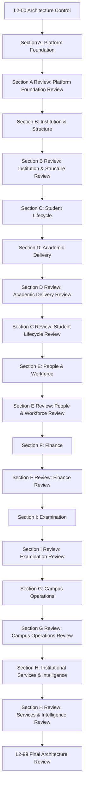

# SutraERP - L2 Domain Workflow Matrix

> Purpose: Define the planned L2 domain workflow specifications, ownership, lifecycle boundaries, and review flow.
>
> This file is a planning and control matrix. It does not mean the listed L2 documents already exist as individual files.
>
> This level does NOT include:
> - UI / screens
> - APIs
> - database schema
> - implementation code
> - DTOs
> - event payloads
> - L3 scenario orchestration

---

# L2-00 - Architecture Control

Purpose:
- L2 planning
- progress tracking
- discrepancy resolution
- dependency sequencing
- final L2 review planning

Status: [ ] In Progress

---

# SECTION A - Platform Foundation

Purpose: Core platform infrastructure used by every business domain.

## L2-A01 - Platform & Tenant Workflows
Status: [Approved]

## L2-A02 - Person & Identity Workflows
Status: [Approved]

## L2-A03 - Authentication Workflows
Status: [Approved]

## L2-A04 - Authorization & Policy Workflows
Status: [Approved]

## L2-A05 - Workflow Engine Workflows
Status: [Approved]

## L2-A06 - Event Infrastructure Workflows
Status: [Approved]

## L2-A07 - Audit Infrastructure Workflows
Status: [ ]

## L2-A08 - Module Registry & Configuration Workflows
Status: [ ]

## L2-A09 - Master Data Workflows
Status: [ ]

### L2-A00 - Platform Foundation Review
Status: [ ]

---

# SECTION B - Institution & Structure

Purpose: Institutional hierarchy and academic foundation.

## L2-B01 - Institution Workflows
Status: [Approved]

## L2-B02 - Organisation Workflows
Status: [Approved]

## L2-B03 - Campus Workflows
Status: [ ]

## L2-B04 - Curriculum Framework Workflows
Status: [ ]

## L2-B05 - Academic Calendar Workflows
Status: [ ]

## L2-B06 - Operational Readiness Workflows
Status: [ ]

### L2-B00 - Institution & Structure Review
Status: [ ]

---

# SECTION C - Student Lifecycle

Purpose: Complete student lifecycle from admission through qualification completion, exit, and alumni transition.

## L2-C01 - Admissions Workflows
Status: [Approved]

## L2-C02 - Student Lifecycle & Activation Workflows
Status: [ ]

## L2-C03 - Student Academic Registration Workflows
Status: [ ]

## L2-C04 - Student Academic Progression Workflows
Status: [ ]

## L2-C05 - Qualification Completion & Student Exit Workflows
Status: [ ]

## L2-C06 - Guardian Workflows
Status: [ ]

## L2-C07 - Scholarship Eligibility Workflows
Status: [ ]

## L2-C08 - Alumni Transition Workflows
Status: [ ]

### L2-C00 - Student Lifecycle Review
Status: [ ]

---

# SECTION D - Academic Delivery

Purpose: Teaching operations and academic execution.

## L2-D01 - Course Offering Workflows
Status: [ ]

## L2-D02 - Faculty Academic Assignment Workflows
Status: [ ]

## L2-D03 - Timetable Workflows
Status: [ ]

## L2-D04 - Teaching Session & Attendance Workflows
Status: [ ]

## L2-D05 - Academic Monitoring Workflows
Status: [ ]

## L2-D06 - Open Electives & MOOCs Workflows
Status: [ ]

### L2-D00 - Academic Delivery Review
Status: [ ]

---

# SECTION E - People & Workforce

Purpose: Workforce management and employee lifecycle.

## L2-E01 - Workforce & Engagement Workflows
Status: [ ]

## L2-E02 - Position & Assignment Workflows
Status: [ ]

## L2-E03 - Faculty Workforce Workflows
Status: [ ]

## L2-E04 - HR Workflows
Status: [ ]

## L2-E05 - Leave Management Workflows
Status: [ ]

## L2-E06 - Payroll Workflows
Status: [ ]

### L2-E00 - People & Workforce Review
Status: [ ]

---

# SECTION F - Finance

Purpose: Financial business domains.

## L2-F01 - Finance Domain Workflows
Status: [ ]

## L2-F02 - Scholarship Financial Processing Workflows
Status: [ ]

### L2-F00 - Finance Review
Status: [ ]

---

# SECTION G - Campus Operations

Purpose: Operational institutional services.

## L2-G01 - Facilities Workflows
Status: [ ]

## L2-G02 - Lab Management Workflows
Status: [ ]

## L2-G03 - Hostel Workflows
Status: [ ]

## L2-G04 - Transport Workflows
Status: [ ]

## L2-G05 - Library Workflows
Status: [ ]

## L2-G06 - Medical Workflows
Status: [ ]

## L2-G07 - Security Operations Workflows
Status: [ ]

## L2-G08 - Housekeeping Operations Workflows
Status: [ ]

## L2-G09 - Teacher Guardian Scheme (TGS) Workflows
Status: [ ]

## L2-G10 - Infrastructure Management Workflows
Status: [ ]

### L2-G00 - Campus Operations Review
Status: [ ]

---

# SECTION H - Institutional Services & Intelligence

Purpose: Supporting institutional services and read-model surfaces.

## L2-H01 - APAAR & DigiLocker Workflows
Status: [ ]

## L2-H02 - Notification Workflows
Status: [ ]

## L2-H03 - Directory Workflows
Status: [ ]

## L2-H04 - Placement Workflows
Status: [ ]

## L2-H05 - Research Workflows
Status: [ ]

## L2-H07 - Dashboard Workflows
Status: [ ]

## L2-H08 - NEP, NAAC & AISHE Reporting Workflows
Status: [ ]

## L2-H09 - Accreditation & Compliance Workflows
Status: [ ]

## L2-H10 - External Education Integration Workflows
Status: [ ]

### L2-H00 - Services & Intelligence Review
Status: [ ]

---

# SECTION I - Examination

Purpose: Assessment, examination, and academic evaluation.

## L2-I01 - Examination Domain Workflows
Status: [ ]

## L2-I02 - Assessment, Results & Grade Processing Workflows
Status: [ ]

### L2-I00 - Examination Review
Status: [ ]

---

# Final Review

## L2-99 - Complete L2 Architecture Review

Purpose:
- cross-domain consistency
- ownership validation
- dependency validation
- contradiction removal
- L2 lock readiness

Status: [ ]

---

# Suggested Chat Order

