# SutraERP - L2 Domain Workflow Matrix

> Purpose: Define the planned L2 domain workflow specifications, ownership, lifecycle boundaries, and review flow.
>
> This file is a planning and control matrix. It does not mean the listed L2 documents already exist as individual files.
>
> This level does NOT include:
> - UI / screens
> - APIs
> - database schema
> - implementation code
> - DTOs
> - event payloads
> - L3 Business Scenario Architecture orchestration

---

# L2-00 - Architecture Control

Purpose:
- L2 planning
- progress tracking
- discrepancy resolution
- dependency sequencing
- final L2 review planning

Status: [ ] In Progress

---

# SECTION A - Platform Foundation

Purpose: Core platform infrastructure used by every business domain.

## L2-A01 - Platform & Tenant Workflows
Status: [Draft]
Owner: Dhruv

## L2-A02 - Person & Identity Workflows
Status: [Draft]
Owner: Dhruv

## L2-A03 - Authentication Workflows
Status: [Draft]
Owner: Dhruv

## L2-A04 - Authorization & Policy Workflows
Status: [Draft]
Owner: Dhruv

## L2-A05 - Workflow Engine Workflows
Status: [Draft]
Owner: Dhruv

## L2-A06 - Event Infrastructure Workflows
Status: [Draft]
Owner: Dhruv

## L2-A07 - Audit Infrastructure Workflows
Status: [Draft]
Owner: Dhruv

## L2-A08 - Module Registry & Configuration Workflows
Status: [Draft]
Owner: Dhruv

## L2-A09 - Master Data Workflows
Status: [Draft]
Owner: Dhruv

## L2-A10 - Operational Readiness Workflows
Status: [Draft]
Owner: Dhruv

### L2-A00 - Platform Foundation Review
Status: [Approved Baseline]
Owner: Dhruv

---

# SECTION B - Institution & Structure

Purpose: Institutional hierarchy and academic foundation.

## L2-B01 - Institution Workflows
Status: [Locked]
Owner: Pallav

## L2-B02 - Organisation Workflows
Status: [Architecture Locked]
Owner: Pallav

## L2-B03 - Campus Workflows
Status: [Architecture Locked]
Owner: Pallav

## L2-B04 - Curriculum Framework Workflows
Status: [Architecture Locked]
Owner: Pallav

## L2-B05 - Academic Calendar Workflows
Status: [Architecture Locked]
Owner: Pallav

### L2-B00 - Institution & Structure Review
Status: [Locked]
Owner: Pallav

---

# SECTION C - Student Lifecycle

Purpose: Complete student lifecycle from admission through qualification completion, exit, and alumni transition.

## L2-C01 - Admissions Workflows
Status: [Draft]
Owner: Varad

## L2-C02 - Student Lifecycle & Activation Workflows
Status: [Locked]
Owner: Varad

## L2-C03 - Academic Registration Workflows
Status: [Draft]
Owner: Varad

## L2-C04 - Student Academic Progression Workflows
Status: [Draft]
Owner: Varad

## L2-C05 - Qualification Completion & Student Exit Workflows
Status: [Draft]
Owner: Varad

## L2-C06 - Guardian Workflows
Status: [Draft]
Owner: Varad

## L2-C07 - Scholarship Eligibility Workflows
Status: [Draft]
Owner: Varad

## L2-C08 - Alumni Transition Workflows
Status: [Draft]
Owner: Varad

### L2-C00 - Student Lifecycle Review
Status: [Draft]
Owner: Varad

---

# SECTION D - Academic Delivery

Purpose: Teaching operations and academic execution.

## L2-D01 - Course & Course Offering Workflows
Status: [Architecture Locked]
Owner: Pallav

## L2-D02 - Faculty Academic Assignment Workflows
Status: [Approved Baseline]
Owner: Pallav

## L2-D03 - Timetable Workflows
Status: [Architecture Locked]
Owner: Pallav

## L2-D04 - Teaching Session & Attendance Workflows
Status: [Architecture Locked]
Owner: Pallav

## L2-D05 - Academic Monitoring Workflows
Status: [Architecture Approved]
Owner: Pallav

## L2-D06 - Open Electives & MOOCs Workflows
Status: [Architecture Locked]
Owner: Pallav

## L2-D07 - Internal Assessment Workflows
Status: [Architecture Locked]
Owner: Pallav

### L2-D00 - Academic Delivery Review
Status: [Certified & Locked]
Owner: Pallav

---

# SECTION E - People & Workforce

Purpose: Workforce management and employee lifecycle.

## L2-E01 - Workforce & Engagement Workflows
Status: [Draft]
Owner: Varad

## L2-E02 - Position & Assignment Workflows
Status: [Draft]
Owner: Varad

## L2-E03 - Faculty Workforce Workflows
Status: [Architecture Baseline]
Owner: Varad

## L2-E04 - HR Workflows
Status: [Draft]
Owner: Varad

## L2-E05 - Leave Management Workflows
Status: [Draft]
Owner: Varad

## L2-E06 - Payroll Workflows
Status: [Architecture Locked]
Owner: Varad

## L2-E07 - Employee Profile Workflows
Status: [Architecture Baseline]
Owner: Varad

### L2-E00 - People & Workforce Review
Status: [Locked]
Owner: Varad

---

# SECTION F - Finance

Purpose: Financial business domains.

## L2-F00 - Finance Domain Model & Foundation
Status: [Draft]
Owner: Chetan

## L2-F01 - Student Charge & Fee Management
Status: [Draft]
Owner: Chetan

## L2-F02 - Payment Management Architecture
Status: [Draft]
Owner: Chetan

## L2-F03 - Refund Management
Status: [Draft]
Owner: Chetan

## L2-F04 - Financial Adjustment Management
Status: [Draft]
Owner: Chetan

## L2-F05 - Accounting & General Ledger Management
Status: [Draft]
Owner: Chetan

## L2-F06 - Budget & Cost Center Management
Status: [Draft]
Owner: Chetan

## L2-F07 - Accounts Receivable Management
Status: [Draft]
Owner: Chetan

## L2-F08 - Accounts Payable Management
Status: [Draft]
Owner: Chetan

## L2-F09 - Financial Period & Closing
Status: [Draft]
Owner: Chetan

## L2-F10 - Treasury & Banking
Status: [Draft]
Owner: Chetan

## L2-F11 - Scholarship & Financial Aid
Status: [Draft]
Owner: Chetan

## L2-F12 - Asset Financial Accounting Workflows
Status: [Draft]
Owner: Chetan

## L2-F13 - Financial Reporting & Analytics Workflows
Status: [Draft]
Owner: Chetan

## L2-F14 - Procurement Finance Consumption Workflows
Status: [Draft]
Owner: Chetan

---

# SECTION G - Campus Operations

Purpose: Operational institutional services.

## L2-G01 - Facilities Management Workflows
Status: [Draft]
Owner: Devang

## L2-G02 - Laboratory Management Workflows
Status: [Draft]
Owner: Devang

## L2-G03 - Hostel Workflows
Status: [Draft]
Owner: Devang

## L2-G04 - Transport Workflows
Status: [Draft]
Owner: Devang

## L2-G05 - Library Workflows
Status: [Draft]
Owner: Devang

## L2-G06 - Medical Workflows
Status: [Draft]
Owner: Devang

## L2-G07 - Security Operations Workflows
Status: [Draft]
Owner: Devang

## L2-G08 - Housekeeping Operations & Service Governance Workflows
Status: [Draft]
Owner: Devang

## L2-G09 - Teacher Guardian Scheme (TGS) Workflows
Status: [Architecture Locked]
Owner: Devang

## L2-G10 - Infrastructure Management Workflows
Status: [Draft]
Owner: Devang

### L2-G00 - Campus Operations Review
Status: [Draft]
Owner: Devang

---

# SECTION H - Institutional Services & Intelligence

Purpose: Supporting institutional services and read-model surfaces.

## L2-H01 - APAAR & DigiLocker Workflows
Status: [Locked]
Owner: Dhruv

## L2-H02 - Notification Workflows
Status: [Architecture Baseline]
Owner: Dhruv

## L2-H03 - Enterprise Directory & Search Workflows
Status: [Draft]
Owner: Dhruv

## L2-H04 - Placement Workflows
Status: [Architecture Baseline]
Owner: Dhruv

## L2-H05 - Research Workflows
Status: [Architecture Baseline]
Owner: Dhruv

## L2-H06 - Alumni Workflows
Status: [Draft]
Owner: Dhruv

## L2-H07 - Enterprise Dashboard Workflows
Status: [Architecture Locked]
Owner: Dhruv

## L2-H08 - NEP, NAAC & AISHE Reporting Workflows
Status: [Architecture Locked]
Owner: Dhruv

## L2-H09 - Accreditation & Compliance Workflows
Status: [Draft]
Owner: Dhruv

## L2-H10 - External Education Integration Workflows
Status: [Architecture Locked]
Owner: Dhruv

### L2-H00 - Services & Intelligence Review
Status: [Locked]
Owner: Dhruv

---

# SECTION I - Examination

Purpose: Assessment, examination, and academic evaluation.

## L2-I01 - Examination Policy & Configuration Workflows
Status: [Draft]
Owner: Devang

## L2-I02 - Examination Session Management Workflows
Status: [Draft]
Owner: Devang

## L2-I03 - Examination Planning & Scheduling Workflows
Status: [Draft]
Owner: Devang

## L2-I04 - Examination Registration Workflows
Status: [Draft]
Owner: Devang

## L2-I05 - Hall Ticket Management Workflows
Status: [Draft]
Owner: Devang

## L2-I06 - Practical & Viva Examination Conduct Workflows
Status: [Draft]
Owner: Devang

## L2-I07 - Theory Examination Conduct Workflows
Status: [Draft]
Owner: Devang

## L2-I08 - Marks Collection & Evaluation Workflows
Status: [Draft]
Owner: Devang

## L2-I09 - Result Processing & Computation Workflows
Status: [Draft]
Owner: Devang

## L2-I10 - Result Publication Workflows
Status: [Draft]
Owner: Devang

## L2-I11 - Revaluation & Rechecking Workflows
Status: [Draft]
Owner: Devang

## L2-I12 - Supplementary / Backlog / Improvement Examination Execution Workflows
Status: [Draft]
Owner: Devang

## L2-I13 - Academic Completion, CGPA & Completion Evidence Workflows
Status: [Draft]
Owner: Devang

## L2-I14 - Malpractice & Examination Committee Workflows
Status: [Draft]
Owner: Devang

## L2-I15 - Examination Exception & Contingency Workflows
Status: [Draft]
Owner: Devang

## L2-I16 - Examination Session Closure & Archival Workflows
Status: [Draft]
Owner: Devang

### L2-I00 - Examination Review
Status: [Draft]
Owner: Devang

---

# SECTION J - Enterprise Resource Management

Purpose: Physical-resource lifecycle, procurement, inventory, asset, warehouse, verification, and disposal governance.

## L2-J00 - Enterprise Resource Management Architecture & Governance
Status: [Trust Certification Ready]
Owner: Chetan

## L2-J01 - Procurement Planning & Sourcing Workflows
Status: [Trust Certification Ready]
Owner: Chetan

## L2-J02 - Vendor & Supplier Management Workflows
Status: [Trust Certification Ready]
Owner: Chetan

## L2-J03 - Purchase Requisition & Approval Workflows
Status: [Trust Certification Ready]
Owner: Chetan

## L2-J04 - Purchase Order Management
Status: [Trust Certification Ready]
Owner: Chetan

## L2-J05 - Goods Receipt, Inspection & Acceptance
Status: [Trust Certification Ready]
Owner: Chetan

## L2-J06 - Inventory & Warehouse Management
Status: [Trust Certification Ready]
Owner: Chetan

## L2-J07 - Stock Operations & Distribution
Status: [Trust Certification Ready]
Owner: Chetan

## L2-J08 - Asset Lifecycle Management
Status: [Trust Certification Ready]
Owner: Chetan

## L2-J09 - Physical Verification, Audit & Reconciliation
Status: [Trust Certification Ready]
Owner: Chetan

## L2-J10 - Disposal, Scrap & Write-Off
Status: [Trust Certification Ready]
Owner: Chetan

### Section J Review - Governed by L2-J00 and L2-J01 to L2-J10
Status: [Trust Certification Ready]
Owner: Chetan

---

# Final Review

## L2-99 - Complete L2 Architecture Review

Purpose:
- multi-domain consistency
- ownership validation
- dependency validation
- contradiction removal
- L2 lock readiness

Status: [ ]

---

# Suggested Chat Order

```mermaid
flowchart TD
    A[L2-00 Architecture Control] --> B[Section A: Platform Foundation]
    B --> A10[Section A: Operational Readiness]
    A10 --> C[Section A Review: Platform Foundation Review]
    C --> D[Section B: Institution & Structure]
    D --> E[Section B Review: Institution & Structure Review]
    E --> F[Section C: Student Lifecycle]
    F --> G[Section D: Academic Delivery]
    G --> D7[L2-D07: Internal Assessment]
    D7 --> H[Section D Review: Academic Delivery Review]
    H --> I[Section C Review: Student Lifecycle Review]
    I --> J[Section E: People & Workforce]
    J --> K[Section E Review: People & Workforce Review]
    K --> L[Section F: Finance]
    L --> F0[L2-F00: Finance Foundation]
    F0 --> F1[L2-F01]
    F1 --> F2[L2-F02]
    F2 --> F3[L2-F03]
    F3 --> F4[L2-F04]
    F4 --> F5[L2-F05]
    F5 --> F6[L2-F06]
    F6 --> F7[L2-F07]
    F7 --> F8[L2-F08]
    F8 --> F9[L2-F09]
    F9 --> F10[L2-F10]
    F10 --> F11[L2-F11]
    F11 --> F12[L2-F12]
    F12 --> F13[L2-F13]
    F13 --> F14[L2-F14]
    F14 --> M[Section I: Examination]
    M --> M_REV[Section I Review: Examination Review]
    M_REV --> N[Section G: Campus Operations]
    N --> N_REV[Section G Review: Campus Operations Review]
    N_REV --> O[Section H: Institutional Services & Intelligence]
    O --> O_REV[Section H Review: Services & Intelligence Review]
    O_REV --> P[Section J: Enterprise Resource Management]
    P --> P_REV[Section J Review: Governed by L2-J00 and J01-J10]
    P_REV --> T[L2-99 Final Architecture Review]
```

