## Canonical Section Crosswalk

> Added 2026-08-04 under integrity finding INT-018. `governance/constitution/Volume_3_Architecture_Framework.md` section 18 requires every L2 document to define eleven sections. This document uses its own numbered-section convention; the table below maps the required sections to where they actually live. No content was moved.

| Required section (Volume 3 §18) | Location in this document |
|---|---|
| Purpose | Purpose |
| Scope | Scope; Out of Scope; Policy Scope |
| Actors | — not present — |
| Entities | Aggregate Landscape; Aggregate Relationships; Aggregate Specifications |
| Business Rules | Business Rules; Login Business Rules |
| Workflow | L2-A03 — Authentication Workflows; Aggregate to Workflow Matrix; Core Authentication Workflows |
| State Machine | Credential Lifecycle States |
| Contracts | Authentication Domain Contracts; Repository Contracts; Event Contracts |
| Events | Aggregate to Event Matrix; Event to Consumer Matrix; Authentication Domain Events |
| Dependencies | Upstream Dependencies; Downstream Dependencies; Dependency Matrix |
| Locked Decisions | Architectural Decision Records (ADR) |

> **Gap:** 1 required section(s) have no counterpart in this document: Actors. Recorded, not authored.

---

# L2-A03 — Authentication Workflows

---

# Document Information

| Property | Value |
|----------|-------|
| Document ID | L2-A03 |
| Architecture Level | Level 2 |
| Domain | Platform Foundation |
| Module | Authentication |
| Status | Draft |
| Version | 1.0.0 |
| Owner | Dhruv |
| Architecture Layer | Foundation |
| Parent Architecture | L2-A02 — Person & Identity Workflows |
| Child Architectures | L2-A04 Authorization & Policy Workflows, All Business Domains |

---

# Purpose

L2-A03 defines the canonical authentication architecture of the SutraERP platform.

The Authentication domain is responsible for verifying the identity of users, systems, and external providers before they are permitted to establish authenticated sessions within the platform.

This document defines the complete authentication lifecycle, authentication workflows, credential management architecture, session lifecycle, multi-factor authentication architecture, trusted device management, authentication provider abstraction, authentication events, audit responsibilities, and multi-domain contracts required to authenticate identities securely across all tenants.

Authentication is a platform capability shared by every business domain within SutraERP.

This document establishes a single enterprise authentication model that is reusable, secure, extensible, provider-independent, and compliant with the architectural principles defined by the Platform Foundation.

---

# Scope

This document defines the architecture for:

- Authentication Domain
- Authentication Aggregate Ownership
- Credential Lifecycle
- Authentication Session Lifecycle
- Refresh Token Lifecycle
- Trusted Device Lifecycle
- MFA Enrollment
- Authentication Provider Architecture
- Authentication Method Architecture
- Authentication Policy Evaluation
- Login Workflows
- Logout Workflows
- Password Management
- Credential Recovery
- Device Trust Management
- Authentication Event Model
- Authentication Audit Architecture
- Multi-Domain Authentication Contracts
- CQRS Responsibilities
- Multi-Tenant Authentication Architecture
- Authentication Security Principles
- Authentication Governance

---

# Out of Scope

The following responsibilities are intentionally excluded from this architecture.

| Capability | Canonical Owner |
|------------|-----------------|
| Platform Foundation | L2-A01 |
| Tenant Foundation | L2-A01 |
| Person Lifecycle | L2-A02 |
| Identity Lifecycle | L2-A02 |
| User Account Lifecycle | L2-A02 |
| Identity Resolution | L2-A02 |
| Person Profile Management | L2-A02 |
| Workspace Ownership | L2-A04 |
| Authorization | L2-A04 |
| Roles | L2-A04 |
| Permissions | L2-A04 |
| Access Evaluation | L2-A04 |
| Policy Enforcement | L2-A04 |
| Business Domain Security | Individual Business Domains |

Authentication verifies identity.

Authorization determines what an authenticated identity is permitted to perform.

Workspace selection is stored in the session after successful login or workspace switching, but it never affects authorization decisions.

Business domains remain responsible for enforcing business-specific authorization decisions using the contracts exposed by L2-A04.

---

# Architectural Position

Within the SutraERP architecture, Authentication is a foundational platform domain positioned between Identity Management and Authorization.

Authentication consumes canonical identities managed by L2-A02 and establishes authenticated execution contexts that are subsequently evaluated by L2-A04 for authorization.

The Authentication domain does not own person records, identity information, roles, permissions, or business access policies.
It also does not own workspace definitions, workspace lifecycle, or workspace authorization.

Instead, it provides secure identity verification services that enable downstream domains to execute authenticated business operations.

```text
                    L2-A01 Platform Foundation
                               │
                               ▼
                L2-A02 Person & Identity
                               │
                (Identity Reference Only)
                               │
                               ▼
                L2-A03 Authentication
            Identity Verification Layer
                               │
      ┌────────────────────────┴────────────────────────┐
      │                                                 │
      ▼                                                 ▼
Authentication Session                          Authentication Events
      │
      ▼
             L2-A04 Authorization & Policy
                      Access Decisions
                              │
                              ▼
                 All Business Domains
```

Authentication establishes trust.

Authorization evaluates trust.

Business domains execute business operations.

Each responsibility has exactly one canonical owner.

---

# Canonical Ownership

The Authentication domain is the exclusive owner of the following platform capabilities.

## Aggregates

- Credential
- Authentication Session
- Refresh Token
- Trusted Device
- Authentication Provider
- Authentication Method
- MFA Enrollment
- Authentication Policy
- Authentication Attempt
- Active Workspace Reference

---

## Lifecycle Ownership

Authentication exclusively owns:

- Credential lifecycle
- Authentication lifecycle
- Session lifecycle
- Refresh token lifecycle
- Trusted device lifecycle
- MFA enrollment lifecycle
- Authentication provider lifecycle
- Active workspace persistence within the session

No other domain may directly create, modify, expire, revoke, or manage these aggregates outside the published architectural contracts.

---

## Authentication Responsibilities

The Authentication domain is responsible for:

- Identity verification
- Credential validation
- Authentication provider orchestration
- Session establishment
- Session termination
- Session renewal
- Credential rotation
- Credential recovery
- Trusted device verification
- MFA verification
- Authentication policy evaluation
- Authentication audit publication
- Authentication event publication
- Active workspace persistence

---

## Explicit Non-Ownership

Authentication shall never own:

- Person
- Identity
- User Account
- Roles
- Permissions
- Organizational Membership
- Business Access Policies
- Workspace
- Workspace Configuration
- Institutional Data
- Student Data
- Employee Data
- Authorization Decisions

Those capabilities remain under their respective canonical domains.

---

# Architectural Principles

In addition to the platform principles defined within L2-A01, the Authentication domain shall adhere to the following principles.

## AP1. Identity Verification Only

Authentication shall verify identities but shall never determine business permissions.

---

## AP2. Single Authentication Boundary

Every request entering the platform shall pass through exactly one authentication boundary before business execution begins.

---

## AP3. Canonical Identity Consumption

Authentication shall consume canonical identities published by L2-A02 and shall never create duplicate identity records.

---

## AP4. Provider Independence

Authentication workflows shall remain independent of individual authentication technologies.

Password authentication, LDAP, Active Directory, OpenID Connect (OIDC), OAuth-based identity providers, SAML, Passkeys, WebAuthn, and future authentication providers shall execute through the same logical architecture without requiring changes to business workflows.

---

## AP5. Authentication Before Authorization

Authentication shall always complete before authorization evaluation begins.

Authorization processing shall never be embedded within authentication workflows.

---

## AP6. Tenant Isolation

Authentication operations shall execute entirely within a single tenant boundary.

Authentication artifacts shall never be shared across tenants unless explicitly supported by platform-level federation contracts.

---

## AP7. Policy-Driven Authentication

Authentication behavior shall be governed by configurable authentication policies rather than hard-coded business rules.

Examples include:

- MFA requirements
- Session limits
- Trusted device policies
- Concurrent session limits
- Credential expiration
- Password complexity
- Authentication provider selection

---

## AP8. Audit by Default

Every authentication operation shall produce auditable events that support compliance, security investigations, and operational monitoring.

---

## AP9. Security by Design

Authentication workflows shall minimize credential exposure, reduce attack surfaces, and ensure that security controls are embedded within architectural responsibilities rather than implemented as optional extensions.

---

## AP10. Technology Independence

This architecture defines logical authentication responsibilities and domain contracts.

Implementation technologies, protocols, storage mechanisms, security libraries, and runtime frameworks are implementation concerns and remain outside the scope of this document.

---

# Domain Vision

The Authentication domain establishes a unified, secure, extensible, and provider-independent authentication framework for every actor interacting with the SutraERP platform.

It enables users, institutions, external identity providers, and system integrations to authenticate through a consistent architectural model while preserving strict tenant isolation, security governance, and platform-wide interoperability.

Authentication serves as the trusted gateway through which all authenticated execution begins, providing a secure foundation for authorization, business operations, and multi-domain collaboration.

---

# Architectural Objectives

The Authentication domain exists to achieve the following objectives.

- Establish a single canonical authentication architecture for the entire platform.
- Eliminate duplicate authentication implementations across business domains.
- Provide secure identity verification independent of authentication technology.
- Support multiple authentication providers through a unified provider abstraction.
- Enable adaptive multi-factor authentication using configurable policies.
- Manage authentication sessions consistently across all tenants.
- Provide trusted device management without coupling business domains to authentication mechanisms.
- Publish reliable authentication events for downstream consumers.
- Ensure authentication workflows remain independent of authorization decisions.
- Support enterprise-grade scalability, extensibility, and future authentication technologies without requiring architectural redesign.
- Maintain complete auditability for all authentication operations.
- Preserve strict architectural ownership boundaries with L2-A02 and L2-A04.

---

# Success Criteria

This architecture shall be considered successful when:

- Authentication is implemented once and consumed consistently across the platform.
- Every authenticated session originates from a canonical authentication workflow.
- Authentication providers can be introduced or replaced without affecting downstream business domains.
- Authentication responsibilities remain fully independent from identity management and authorization.
- All authentication operations execute within tenant boundaries.
- Authentication events are published consistently for audit and downstream processing.
- Business domains depend only on authenticated execution contexts rather than authentication implementations.
- The platform can support future authentication technologies without requiring changes to core authentication workflows.

# Domain Model

The Authentication domain is responsible for establishing trust between an actor requesting access and the SutraERP platform.

It provides a canonical authentication framework that verifies identities, establishes authenticated sessions, manages credentials, coordinates authentication providers, enforces authentication policies, and publishes authentication events consumed throughout the platform.

Authentication is a platform capability rather than a business capability.

It operates independently of institutional, academic, financial, examination, or operational domains while providing secure authentication services to each of them.

The Authentication domain consumes canonical identity information from L2-A02 and produces authenticated execution contexts that are evaluated by L2-A04 before business operations commence.

---

# Domain Responsibilities

The Authentication domain is responsible for the following business capabilities.

## Identity Verification

Verify that an authentication request originates from the legitimate owner of the referenced identity.

Authentication never creates or modifies identity information.

---

## Credential Management

Manage the complete lifecycle of authentication credentials including creation, validation, rotation, expiration, recovery, suspension, and revocation.

---

## Authentication Session Management

Establish, maintain, renew, terminate, and revoke authenticated sessions throughout their lifecycle.

---

## Multi-Factor Authentication

Manage enrollment, verification, enforcement, and recovery of multi-factor authentication methods using configurable authentication policies.

---

## Trusted Device Management

Manage trusted devices used during authentication while maintaining tenant isolation and security governance.

---

## Authentication Provider Orchestration

Authenticate users through multiple authentication providers using a unified provider abstraction.

Supported providers may include:

- Local Authentication
- LDAP
- Microsoft Active Directory
- OpenID Connect (OIDC)
- OAuth Identity Providers
- SAML
- Passkeys
- WebAuthn
- Custom Enterprise Providers

The Authentication domain remains independent of provider-specific implementations.

---

## Authentication Policy Enforcement

Evaluate authentication policies before granting authenticated sessions.

Examples include:

- MFA requirements
- Concurrent session limits
- Device trust requirements
- Credential expiration
- Password policies
- Provider selection
- Risk-based authentication requirements

Authentication policies govern identity verification only.

Authorization policies remain outside the scope of this domain.

---

## Authentication Audit

Publish authentication events that support:

- Security auditing
- Compliance
- Monitoring
- Operational diagnostics
- Threat investigation

---

# Domain Non-Responsibilities

The Authentication domain intentionally excludes the following responsibilities.

## Identity Ownership

Authentication consumes identities.

Authentication never owns:

- Person
- Identity
- User Account
- Identity Status
- Profile Information

These remain under L2-A02.

---

## Authorization

Authentication never evaluates:

- Roles
- Permissions
- Privileges
- Access Rights
- Business Policies

These remain under L2-A04.

---

## Business Operations

Authentication does not own:

- Student Operations
- Admissions
- Finance
- Examination
- HR
- Library
- Hostel
- Transport
- Academic Operations

Business domains consume authenticated execution contexts without depending upon authentication implementation details.

---

# Domain Boundaries

The Authentication domain exists between Identity Management and Authorization.

```text
                 Identity Domain (L2-A02)
                         │
             Canonical Identity Reference
                         │
                         ▼
              Authentication Domain (L2-A03)
        ┌────────────────────────────────────┐
        │ Credential Verification            │
        │ Authentication Providers           │
        │ MFA                               │
        │ Trusted Devices                   │
        │ Session Management                │
        │ Authentication Policies           │
        └────────────────────────────────────┘
                         │
               Authentication Session
                         │
                         ▼
             Authorization Domain (L2-A04)
                         │
                 Access Decision
                         │
                         ▼
                Business Domains
```

The Authentication domain never bypasses Identity Management or Authorization.

---

# Upstream Dependencies

Authentication consumes services provided by the following domains.

| Domain | Consumed Capability |
|---------|---------------------|
| L2-A01 | Tenant Context |
| L2-A01 | Platform Configuration |
| L2-A01 | Execution Context |
| L2-A02 | Person Reference |
| L2-A02 | Identity Reference |
| L2-A02 | User Account |
| L2-A02 | Account Status |
| L2-A02 | Identity Status |

Authentication assumes these upstream contracts remain canonical.

---

# Downstream Dependencies

The following domains consume Authentication.

| Domain | Consumed Capability |
|---------|---------------------|
| L2-A04 | Authentication Session |
| L2-A04 | Authentication Events |
| All Business Domains | Authenticated Execution Context |
| Audit Infrastructure | Authentication Audit Events |
| Event Infrastructure | Authentication Domain Events |

Business domains never authenticate users directly.

They consume authenticated execution contexts published by this domain.

---

# Ubiquitous Language

The following terms establish the canonical language for the Authentication domain.

| Term | Definition |
|------|------------|
| Authentication | Process of verifying an identity before granting an authenticated session. |
| Credential | Authentication artifact used to verify an identity. |
| Authentication Method | Logical mechanism used to authenticate an identity. |
| Authentication Provider | External or internal system responsible for credential verification. |
| Authentication Session | Trusted execution context established after successful authentication. |
| Refresh Token | Authentication artifact used to renew authenticated sessions. |
| Trusted Device | Device recognized by the platform for policy-driven authentication decisions. |
| Authentication Policy | Configuration governing authentication behaviour. |
| Authentication Attempt | Individual authentication request submitted to the platform. |
| Multi-Factor Authentication | Verification using multiple independent authentication factors. |
| Authentication Failure | Authentication request that fails identity verification. |
| Session Revocation | Explicit termination of an authenticated session before expiration. |
| Credential Rotation | Controlled replacement of authentication credentials. |
| Authentication Event | Domain event published during authentication lifecycle execution. |

These definitions shall remain consistent throughout every downstream architecture.

---

# Bounded Context

Authentication operates as an independent bounded context within the Platform Foundation.

It owns every concept required to establish authenticated trust while remaining isolated from identity ownership and authorization evaluation.

```text
                 Authentication Bounded Context

         +------------------------------------------+
         |                                          |
         | Credentials                              |
         | Authentication Sessions                  |
         | Authentication Providers                 |
         | Authentication Policies                  |
         | Trusted Devices                          |
         | MFA                                      |
         | Refresh Tokens                           |
         | Authentication Attempts                  |
         |                                          |
         +------------------------------------------+

Consumes
    ▲
    │
L2-A02 Identity

Publishes
    │
    ▼
Authentication Session

Consumed By
    ▼
L2-A04 Authorization
```

This bounded context exposes authentication contracts while hiding all internal authentication implementation details.

---

# Aggregate Landscape

The Authentication domain consists of the following canonical aggregates.

| Aggregate | Purpose |
|-----------|---------|
| Credential | Owns authentication credentials and credential lifecycle. |
| Authentication Session | Owns authenticated execution sessions. |
| Refresh Token | Owns session renewal lifecycle. |
| Trusted Device | Owns trusted device registration and lifecycle. |
| Authentication Provider | Represents provider abstraction responsible for authentication execution. |
| Authentication Method | Represents supported authentication mechanisms independent of providers. |
| MFA Enrollment | Owns enrollment and verification lifecycle for multi-factor authentication. |
| Authentication Policy | Owns configurable authentication rules. |
| Authentication Attempt | Records and governs authentication execution attempts. |

Each aggregate owns exactly one business responsibility.

Aggregate boundaries shall never overlap.

---

# Aggregate Relationships

```text
                   Authentication Policy
                            │
                            ▼
                 Authentication Attempt
                            │
             ┌──────────────┼──────────────┐
             ▼              ▼              ▼
      Authentication   Authentication   Credential
          Method          Provider
             │              │
             └──────┬───────┘
                    ▼
             Identity Verification
                    │
                    ▼
              Authentication Session
                    │
         ┌──────────┴───────────┐
         ▼                      ▼
   Refresh Token         Trusted Device
                    │
                    ▼
              MFA Enrollment
```

The relationships represent orchestration dependencies rather than ownership inheritance.

Each aggregate maintains independent lifecycle management while collaborating through published domain events.

---

# Authentication Domain Contracts

This section formalizes the supporting architectural contracts for the Authentication domain.

It complements the workflow, lifecycle, event, and policy sections already defined in this document without changing ownership boundaries.

---

# Value Objects

Authentication uses immutable value objects to preserve business meaning without transferring aggregate ownership.

| Value Object | Purpose | Immutability | Used By |
|--------------|---------|--------------|---------|
| CredentialHash | Represents the protected credential value. | Immutable after issuance. | Credential, Authentication Attempt |
| CredentialVersion | Identifies a specific credential generation. | Immutable. | Credential, Refresh Token |
| AuthenticationContext | Carries the canonical authentication execution context. | Immutable for the duration of the request. | AuthenticationService, Policy Evaluation, Audit, Authorization |
| SessionIdentifier | Identifies a single authenticated session. | Immutable. | Authentication Session, Refresh Token, Audit |
| RefreshTokenIdentifier | Identifies a refresh token instance. | Immutable. | Refresh Token, Session Renewal |
| DeviceFingerprint | Identifies a trusted device in a tenant scope. | Immutable for a given registration record. | Trusted Device, Risk Evaluation |
| AuthenticationMethodId | Identifies the selected authentication method. | Immutable. | Authentication Method, Provider Selection |
| ProviderIdentifier | Identifies the selected authentication provider. | Immutable. | Authentication Provider, Provider Selection |
| AuthenticationResult | Captures the terminal outcome of an authentication attempt. | Immutable. | Authentication Attempt, Audit, Read Models |
| AuthenticationLevel | Represents the assurance level achieved by the request. | Immutable for the request context. | Authentication Context, Policy Evaluation, Authorization |
| AuthenticationFactor | Represents one verification factor within MFA. | Immutable per enrollment record. | MFA Enrollment, Authentication Challenge |
| CorrelationId | Links all events and decisions from one workflow. | Immutable. | Authentication Attempt, Audit, Monitoring |
| AuthenticationRiskScore | Represents the evaluated risk level for the request. | Immutable for the request decision. | Policy Evaluation, MFA Escalation, Audit |
| AuthenticationChallenge | Represents the additional verification required by policy. | Immutable for the challenge instance. | Authentication Attempt, MFA, Policy Evaluation |
| PolicyScope | Identifies the scope in which a policy applies. | Immutable. | Authentication Policy, Provider Selection |
| PolicyPriority | Identifies policy precedence inside a scope. | Immutable. | Authentication Policy, Provider Selection |

AuthenticationContext is the canonical request-scoped value object for the domain.
AuthenticationContext is a Value Object, not an Aggregate. It is immutable and never owns lifecycle.

It conceptually contains:

- Tenant
- Identity
- Session
- Authentication Method
- Authentication Provider
- Authentication Time
- Authentication Level
- MFA Status
- Correlation Id
- Risk Score

---

# Authentication Domain Services

Authentication Domain Services orchestrate authentication behavior that spans multiple aggregates while preserving aggregate ownership.

Domain Services coordinate business behaviour across aggregates but never own business state and never replace Aggregate responsibilities.

| Service | Purpose | Responsibilities | Consumed Aggregates | Published Events | Multi-domain Interactions |
|---------|---------|------------------|---------------------|------------------|---------------------------|
| AuthenticationService | Orchestrates the end-to-end authentication process. | Evaluates request context, coordinates policy evaluation, selects method and provider, and finalizes the authentication outcome. | Credential, Authentication Attempt, Authentication Policy, Authentication Method, Authentication Provider, MFA Enrollment, Trusted Device, Authentication Session | AuthenticationStarted, AuthenticationSucceeded, AuthenticationFailed, AuthenticationChallenged, AuthenticationCompleted | Consumes identity references from L2-A02 and produces authenticated execution context for L2-A04 and downstream business domains. |
| CredentialValidationService | Applies credential eligibility rules. | Validates credential state, expiration, rotation eligibility, and revocation constraints before authentication proceeds. | Credential, Authentication Policy, Authentication Attempt | CredentialActivated, CredentialSuspended, AuthCredentialExpired, CredentialRevoked, CredentialRotated | Uses canonical identity and tenant context from L2-A02 and L2-A01. |
| SessionService | Governs authenticated session behavior. | Establishes, renews, suspends, terminates, and revokes sessions within policy constraints. | Authentication Session, Refresh Token, Trusted Device, Authentication Policy | AuthSessionCreated, SessionActivated, SessionRenewed, SessionSuspended, SessionResumed, AuthSessionExpired, SessionTerminated, SessionRevoked | Publishes authenticated context, including the active workspace reference, to L2-A04 and session-aware business domains. |
| TrustedDeviceService | Governs trusted device recognition. | Registers devices, confirms trust, suspends trust, expires trust, and removes trust records. | Trusted Device, Authentication Policy, Authentication Attempt | TrustedDeviceRegistered, TrustedDeviceVerified, TrustedDeviceSuspended, TrustedDeviceExpired, TrustedDeviceRemoved | Consumes tenant and identity context from L2-A01 and L2-A02. |
| MFAService | Governs multi-factor enrollment and verification. | Enrolls factors, verifies factor ownership, activates factors, and manages factor replacement or retirement. | MFA Enrollment, Authentication Policy, Authentication Context | MFAEnrollmentStarted, MFAEnrollmentVerified, MFAActivated, MFAChallengeStarted, MFAChallengeSucceeded, MFAChallengeFailed, MFADisabled | Supports downstream authorization strength requirements without owning authorization policy. |
| ProviderSelectionService | Selects the appropriate authentication provider. | Applies provider priority, fallback, maintenance, availability, and recovery rules. | Authentication Provider, Authentication Method, Authentication Policy | AuthenticationStarted, AuthenticationFailed, AuthenticationCompleted | Consumes provider availability signals and tenant configuration from platform contracts. |
| AuthenticationPolicyEvaluationService | Evaluates effective policy for the request. | Resolves policy scope, priority, and adaptive challenge requirements. | Authentication Policy, Authentication Context, Authentication Attempt, Trusted Device | AuthenticationChallenged, AuthenticationCompleted | Consumes tenant defaults from L2-A01 and identity context from L2-A02. |
| AuthenticationAuditService | Preserves immutable audit meaning. | Correlates authentication facts, assembles audit context, and ensures every significant authentication decision is auditable. | Authentication Attempt, Authentication Session, Credential, Refresh Token, Trusted Device, MFA Enrollment, Authentication Policy | AuthenticationStarted, AuthenticationSucceeded, AuthenticationFailed, AuthenticationChallenged, AuthenticationCompleted | Publishes audit facts to the platform audit contract and monitoring surfaces. |
| AuthenticationAttemptService | Governs attempt lifecycle. | Records and owns the authentication attempt business record, manages terminal outcomes, and preserves attempt traceability. | Authentication Attempt, Authentication Context, Authentication Policy, Credential | AuthenticationAttemptReceived, AuthenticationAttemptProcessing, AuthenticationAttemptCompleted, AuthenticationAttemptArchived | Supports security monitoring, audit, and downstream anomaly detection. |

---

# Repository Contracts

Repository contracts define canonical access boundaries for Authentication aggregates.

| Repository | Responsibilities | Aggregate Access | Query Responsibility | Command Responsibility |
|------------|------------------|------------------|---------------------|------------------------|
| CredentialRepository | Persists and retrieves credentials within tenant scope. | Credential | Find by identity, status, version, and lifecycle state. | Save credential state changes and enforce aggregate concurrency. |
| AuthenticationSessionRepository | Persists authenticated session state. | Authentication Session | Find by identity, tenant, session status, and time window. | Save session lifecycle changes and preserve session integrity. |
| RefreshTokenRepository | Persists refresh token lifecycle state. | Refresh Token | Find by session, token version, status, and expiration. | Save token rotation and revocation changes. |
| TrustedDeviceRepository | Persists trusted device trust records. | Trusted Device | Find by identity, tenant, fingerprint, and trust status. | Save trust registration, suspension, and removal changes. |
| AuthenticationPolicyRepository | Persists authentication policy definitions and versions. | Authentication Policy | Find by scope, priority, version, and activation state. | Save policy versioning and activation changes. |
| AuthenticationAttemptRepository | Persists authentication attempt history. | Authentication Attempt | Find by correlation, identity, session, and outcome. | Save attempt intake and completion records. |
| MFAEnrollmentRepository | Persists enrolled factor state. | MFA Enrollment | Find by identity, factor, and verification status. | Save enrollment, verification, replacement, and disablement changes. |
| AuthenticationProviderRepository | Persists provider configuration state. | Authentication Provider | Find by tenant, priority, availability, and lifecycle status. | Save provider activation, maintenance, and retirement changes. |
| AuthenticationMethodRepository | Persists supported method state. | Authentication Method | Find by method type, provider association, and availability. | Save method registration and lifecycle changes. |

Repository contracts never cross aggregate boundaries during command handling.

---

# Aggregate Specifications

## Credential Aggregate

### Purpose

The Credential aggregate owns the canonical authentication proof associated with a single identity.

### Responsibilities

- Establish and maintain authentication credentials.
- Govern credential rotation, expiration, suspension, revocation, and archival.
- Preserve credential lineage across versions.

### Business Ownership

- Credential identity and lifecycle
- Credential status and versioning
- Credential recovery eligibility
- Credential audit reference

### Aggregate Root

Credential

### Conceptual Attributes

| Attribute | Description |
|-----------|-------------|
| CredentialId | Canonical credential identifier. |
| TenantId | Owning tenant. |
| IdentityId | Referenced identity. |
| CredentialType | Business classification of the credential. |
| CredentialStatus | Current lifecycle state. |
| CredentialVersion | Current version identifier. |
| IssuedAt | Credential issuance time. |
| ExpiresAt | Credential expiry time. |
| RevokedAt | Revocation time when applicable. |
| CorrelationId | Request correlation reference. |

### Relationships

- Depends on the canonical Identity reference from L2-A02.
- Uses Authentication Policy for credential governance.
- Contributes to Authentication Attempt evaluation.

### Business Invariants

- IdentityId is immutable.
- CredentialType is immutable.
- CredentialVersion advances only through rotation.
- Revoked credentials cannot authenticate.
- Expired credentials cannot reactivate.
- Archived credentials are immutable.

### Owned Commands

| Command | Purpose |
|---------|---------|
| CreateCredential | Create a new credential record. |
| RotateCredential | Replace an existing credential. |
| SuspendCredential | Temporarily disable a credential. |
| RevokeCredential | Permanently invalidate a credential. |
| ExpireCredential | Mark a credential as expired. |

### Published Events

| Event | Purpose |
|-------|---------|
| CredentialCreated | Credential became available as a managed record. |
| CredentialActivated | Credential became usable for authentication. |
| CredentialRotated | Credential was replaced by a later version. |
| CredentialSuspended | Credential was temporarily disabled. |
| CredentialReactivated | Credential was restored after suspension. |
| AuthCredentialExpired | Credential validity ended. |
| CredentialRevoked | Credential was permanently invalidated. |
| CredentialArchived | Credential entered immutable history. |

### Lifecycle Ownership

Credential owns the lifecycle from pending activation through active, suspended, expired, revoked, and archived states.

### Validation Rules

- The owning identity must exist in L2-A02.
- Credential type must be recognized by the Authentication Method model.
- Activation must satisfy applicable Authentication Policy.
- Rotation must preserve credential lineage.

### Business Constraints

- A revoked credential cannot be reused.
- An expired credential cannot return to active service without a new lifecycle event.
- A credential cannot move across identities or tenants.

### Multi-Domain Dependencies

- L2-A01 for tenant context and platform defaults.
- L2-A02 for identity reference and account eligibility.
- L2-A04 for authenticated execution context consumption.

---

## Authentication Session Aggregate

### Purpose

The Authentication Session aggregate owns the trusted execution context established after successful authentication.

### Responsibilities

- Establish authenticated session context.
- Govern session continuity, renewal, suspension, and termination.
- Preserve the link between session state and authentication assurance.

### Business Ownership

- Session identity and status
- Session classification
- Session assurance level
- Session renewal eligibility
- Session termination history

### Aggregate Root

Authentication Session

### Conceptual Attributes

| Attribute | Description |
|-----------|-------------|
| SessionId | Canonical session identifier. |
| TenantId | Owning tenant. |
| IdentityId | Referenced identity. |
| SessionClassification | Interactive, API, Integration, Background, or Service. |
| AuthenticationLevel | Assurance level established for the session. |
| ActiveWorkspaceId | Selected workspace reference for the session. |
| SessionStatus | Current lifecycle state. |
| StartedAt | Session creation timestamp. |
| LastAuthenticatedAt | Last successful authentication timestamp. |
| ExpiresAt | Session expiration timestamp. |
| CorrelationId | Workflow correlation reference. |

### Relationships

- Depends on a valid Credential or equivalent authentication proof.
- References Refresh Token instances for renewal.
- Considers Trusted Device and MFA Enrollment during policy evaluation.

### Business Invariants

- One tenant owns one session record.
- One identity owns one session context record.
- One session stores at most one active workspace reference.
- Closed sessions are immutable.
- A refresh token belongs to exactly one session.
- A terminated session cannot renew.
- Session classification is immutable after creation.

### Owned Commands

| Command | Purpose |
|---------|---------|
| CreateSession | Establish a trusted session. |
| RenewSession | Extend the session. |
| SuspendSession | Temporarily pause the session. |
| ResumeSession | Restore a suspended session. |
| TerminateSession | Close the session. |
| RevokeSession | Administratively end the session. |
| SwitchWorkspace | Update the active workspace reference stored in the session. |

### Published Events

| Event | Purpose |
|-------|---------|
| AuthSessionCreated | Session was established. |
| SessionActivated | Session became usable. |
| SessionRenewed | Session lifetime was extended. |
| SessionSuspended | Session was temporarily disabled. |
| SessionResumed | Session was restored. |
| AuthSessionExpired | Session ended by policy or time. |
| SessionTerminated | Session was closed. |
| SessionRevoked | Session was forcibly terminated. |
| WorkspaceSwitched | Active workspace reference changed for the session. |

### Lifecycle Ownership

Authentication Session owns the lifecycle from created through active, idle, suspended, renewed, expired, and closed states.

### Validation Rules

- The identity must be eligible for authentication.
- The tenant context must be resolved before session creation.
- Renewal must respect concurrent session policy.
- Suspension and termination must preserve audit continuity.

### Business Constraints

- A session cannot migrate between tenants.
- A closed session cannot re-open.
- Session renewal cannot outlive policy limits.

### Multi-Domain Dependencies

- L2-A01 for tenant and execution context.
- L2-A02 for identity eligibility.
- L2-A04 for session consumption after authentication.
- Refresh Token, Trusted Device, and MFA Enrollment for renewal and challenge decisions.

---

## Refresh Token Aggregate

### Purpose

The Refresh Token aggregate owns controlled renewal tokens for a single session.

### Responsibilities

- Issue and rotate refresh tokens.
- Prevent token reuse after rotation or revocation.
- Preserve renewal traceability.

### Business Ownership

- Token identity and version
- Token status
- Token issuance and expiry
- Rotation history

### Aggregate Root

Refresh Token

### Conceptual Attributes

| Attribute | Description |
|-----------|-------------|
| RefreshTokenId | Canonical refresh token identifier. |
| TenantId | Owning tenant. |
| SessionId | Owning session. |
| IdentityId | Referenced identity. |
| TokenVersion | Token generation number. |
| TokenStatus | Current lifecycle state. |
| IssuedAt | Token issuance timestamp. |
| ExpiresAt | Token expiry timestamp. |
| RotatedAt | Rotation timestamp when applicable. |
| CorrelationId | Workflow correlation reference. |

### Relationships

- Belongs to exactly one Authentication Session.
- Exists only while the parent session remains eligible for renewal.
- Feeds session renewal and revocation decisions.

### Business Invariants

- One refresh token belongs to one session.
- Rotation invalidates the prior token version.
- Expired tokens cannot renew sessions.
- Revoked tokens cannot be reused.
- Archived tokens remain immutable history.

### Owned Commands

| Command | Purpose |
|---------|---------|
| GenerateRefreshToken | Issue a new refresh token. |
| RotateRefreshToken | Replace the current token. |
| RevokeRefreshToken | Invalidate a token. |

### Published Events

| Event | Purpose |
|-------|---------|
| RefreshTokenGenerated | Token was issued. |
| RefreshTokenRotated | Token was replaced. |
| RefreshTokenExpired | Token reached expiry. |
| RefreshTokenRevoked | Token was invalidated. |

### Lifecycle Ownership

Refresh Token owns the lifecycle from generated through active, rotated, expired, revoked, and archived states.

### Validation Rules

- A refresh token must reference an active or renewable session.
- Rotation must be atomic at the business level.
- Renewal must respect the session policy.

### Business Constraints

- A refresh token may never authenticate independently.
- A rotated token must supersede the previous token version.
- A token cannot cross session boundaries.

### Multi-Domain Dependencies

- L2-A01 for tenant context.
- L2-A02 for identity reference.
- Authentication Session for renewal scope.
- L2-A04 for downstream authenticated access.

---

## Trusted Device Aggregate

### Purpose

The Trusted Device aggregate owns trust recognition for a device within a tenant and identity scope.

### Responsibilities

- Register trusted devices.
- Verify device trust.
- Suspend or remove device trust.
- Preserve device trust history for policy evaluation.

### Business Ownership

- Device trust status
- Device fingerprint recognition
- Trust duration and expiry
- Trust history and audit reference

### Aggregate Root

Trusted Device

### Conceptual Attributes

| Attribute | Description |
|-----------|-------------|
| TrustedDeviceId | Canonical device trust identifier. |
| TenantId | Owning tenant. |
| IdentityId | Referenced identity. |
| DeviceFingerprint | Canonical device fingerprint. |
| TrustStatus | Current trust lifecycle state. |
| RegisteredAt | Registration timestamp. |
| VerifiedAt | Trust verification timestamp. |
| ExpiresAt | Trust expiry timestamp. |
| SuspendedAt | Suspension timestamp when applicable. |
| CorrelationId | Workflow correlation reference. |

### Relationships

- Belongs to one tenant and one identity.
- Influences risk evaluation and challenge escalation.
- Does not replace credential verification.

### Business Invariants

- Trusted Device belongs to one tenant.
- Trusted Device belongs to one identity.
- DeviceFingerprint is immutable after registration.
- Suspended or removed trust cannot authenticate.
- Expired trust cannot reassert itself without re-registration.

### Owned Commands

| Command | Purpose |
|---------|---------|
| RegisterTrustedDevice | Create a trusted device record. |
| VerifyTrustedDevice | Confirm device trust. |
| SuspendTrustedDevice | Temporarily remove trust. |
| RemoveTrustedDevice | Remove the trust record. |

### Published Events

| Event | Purpose |
|-------|---------|
| TrustedDeviceRegistered | Device trust was registered. |
| TrustedDeviceVerified | Device trust was confirmed. |
| TrustedDeviceSuspended | Trust was suspended. |
| TrustedDeviceExpired | Trust duration ended. |
| TrustedDeviceRemoved | Trust was removed. |

### Lifecycle Ownership

Trusted Device owns the lifecycle from registered through pending verification, trusted, suspended, expired, removed, and archived states.

### Validation Rules

- The device must be associated with a known tenant and identity.
- Verification must satisfy current policy requirements.
- Trust duration must respect tenant policy.

### Business Constraints

- Device trust cannot be shared across identities.
- A removed device requires a new registration to return.
- Trusted device status never substitutes for authentication.

### Multi-Domain Dependencies

- L2-A01 for tenant isolation.
- L2-A02 for identity reference.
- Authentication Policy for trust duration and verification rules.
- Authentication Attempt for challenge correlation.

---

## Authentication Provider Aggregate

### Purpose

The Authentication Provider aggregate owns the canonical provider selection and lifecycle model for authentication execution.

### Responsibilities

- Register providers.
- Govern provider availability, maintenance, fallback, and recovery.
- Preserve selection priority and tenant-specific enablement.

### Business Ownership

- Provider lifecycle
- Provider availability
- Provider priority
- Provider maintenance state
- Provider recovery state

### Aggregate Root

Authentication Provider

### Conceptual Attributes

| Attribute | Description |
|-----------|-------------|
| ProviderId | Canonical provider identifier. |
| TenantId | Owning tenant. |
| ProviderType | Provider family classification. |
| ProviderStatus | Current lifecycle state. |
| ProviderPriority | Selection priority. |
| AvailabilityState | Available, unavailable, or maintenance. |
| RegisteredAt | Registration timestamp. |
| LastVerifiedAt | Last provider verification timestamp. |
| CorrelationId | Workflow correlation reference. |

### Relationships

- Selected through Authentication Policy.
- Supports one or more Authentication Methods.
- Does not own credentials or identities.

### Business Invariants

- Provider configuration is tenant scoped.
- Provider priority is deterministic within a selection scope.
- Unavailable or disabled providers cannot be selected.
- Maintenance state excludes normal authentication routing.
- Retired providers remain immutable history.

### Owned Commands

| Command | Purpose |
|---------|---------|
| RegisterAuthenticationProvider | Add a provider definition. |
| EnableAuthenticationProvider | Make a provider selectable. |
| DisableAuthenticationProvider | Remove a provider from selection. |
| PlaceProviderInMaintenance | Move a provider to maintenance. |
| RecoverAuthenticationProvider | Restore provider availability. |
| RetireAuthenticationProvider | Permanently retire a provider. |

### Published Events

| Event | Purpose |
|-------|---------|
| AuthenticationProviderRegistered | Provider was added. |
| AuthenticationProviderEnabled | Provider became selectable. |
| AuthenticationProviderDisabled | Provider was removed from selection. |
| AuthenticationProviderPlacedInMaintenance | Provider entered maintenance. |
| AuthenticationProviderRecovered | Provider returned to service. |
| AuthenticationProviderRetired | Provider was retired. |

### Lifecycle Ownership

Authentication Provider owns the lifecycle from registered through configured, validated, available, unavailable, maintenance, and retired states.

### Validation Rules

- Provider registration must preserve tenant isolation.
- Disabled or unavailable providers cannot be selected.
- Recovery must revalidate provider availability before selection.

### Business Constraints

- Provider selection order must remain deterministic.
- Fallback selection must respect policy.
- A retired provider cannot be reactivated without a new registration path.

### Multi-Domain Dependencies

- L2-A01 for tenant configuration and platform defaults.
- Authentication Policy for selection and fallback rules.
- External identity provider contracts for provider integration.

---

## Authentication Method Aggregate

### Purpose

The Authentication Method aggregate owns the canonical business definition of how authentication is performed.

### Responsibilities

- Define supported authentication methods.
- Classify methods by assurance and usage context.
- Preserve method availability across providers.

### Business Ownership

- Authentication method definition
- Method availability
- Method classification
- Method assurance mapping

### Aggregate Root

Authentication Method

### Conceptual Attributes

| Attribute | Description |
|-----------|-------------|
| AuthenticationMethodId | Canonical method identifier. |
| MethodName | Business name of the method. |
| MethodType | Knowledge, possession, inherence, federation, or recovery. |
| MethodStatus | Current lifecycle state. |
| AssuredLevel | Authentication strength level associated with the method. |
| ProviderReference | Associated provider reference when applicable. |
| CorrelationId | Workflow correlation reference. |

### Relationships

- Resolved by Authentication Policy.
- Executed through an Authentication Provider.
- Contributes to the Authentication Strength Model.

### Business Invariants

- Method identity is immutable.
- Method classification is immutable after registration.
- Method availability is governed by policy.
- Disabled methods cannot be selected.
- Retired methods remain immutable history.

### Owned Commands

| Command | Purpose |
|---------|---------|
| RegisterAuthenticationMethod | Add a method definition. |
| EnableAuthenticationMethod | Make a method selectable. |
| DisableAuthenticationMethod | Remove a method from selection. |
| RetireAuthenticationMethod | Permanently retire a method. |

### Published Events

| Event | Purpose |
|-------|---------|
| AuthenticationMethodRegistered | Method was added. |
| AuthenticationMethodEnabled | Method became selectable. |
| AuthenticationMethodDisabled | Method was removed from selection. |
| AuthenticationMethodRetired | Method was retired. |

### Lifecycle Ownership

Authentication Method owns the lifecycle from registered through enabled, disabled, unavailable, and retired states.

### Validation Rules

- Method selection must satisfy policy and provider availability.
- Method availability must be tenant scoped.
- Method retirement must preserve historical traceability.

### Business Constraints

- Authentication methods do not own credentials or sessions.
- A method cannot bypass provider and policy evaluation.

### Multi-Domain Dependencies

- L2-A01 for tenant context.
- Authentication Provider for execution selection.
- Authentication Policy for method eligibility.
- L2-A04 for assurance-level consumption.

---

## Authentication Policy Aggregate

### Purpose

The Authentication Policy aggregate owns the canonical rules that govern authentication behavior.

### Responsibilities

- Define policy scope, priority, and versioning.
- Govern adaptive challenge and assurance decisions.
- Preserve deterministic evaluation across tenants.

### Business Ownership

- Policy definition
- Policy versioning
- Policy priority
- Policy scope
- Policy activation state

### Authentication Strength

Authentication Strength is determined exclusively through Authentication Policies.

Authentication Methods contribute evidence.

Authentication Providers perform verification.

Authentication itself does not hardcode strength rules.

Authorization consumes the resulting authentication strength but does not calculate it.

### Aggregate Root

Authentication Policy

### Conceptual Attributes

| Attribute | Description |
|-----------|-------------|
| PolicyId | Canonical policy identifier. |
| TenantId | Owning tenant. |
| PolicyScope | Scope in which the policy applies. |
| PolicyPriority | Deterministic priority within scope. |
| PolicyVersion | Immutable policy version. |
| PolicyStatus | Current lifecycle state. |
| EffectiveFrom | Policy start time. |
| EffectiveTo | Policy end time. |
| CorrelationId | Workflow correlation reference. |

### Relationships

- Consumes platform defaults from L2-A01.
- Consumes identity and category context from L2-A02.
- Influences Credential, Session, Provider, Method, and Trusted Device behavior.

### Business Invariants

- Policy versions are immutable.
- Only one active version may exist for a given active scope and priority.
- Policy scope is immutable once activated.
- Policy evaluation is deterministic for the same context and version.
- Retired policies remain immutable history.

### Owned Commands

| Command | Purpose |
|---------|---------|
| CreateAuthenticationPolicy | Create a new policy definition. |
| ActivateAuthenticationPolicy | Activate a policy version. |
| VersionAuthenticationPolicy | Publish a new policy version. |
| RetireAuthenticationPolicy | Retire an obsolete policy. |

### Published Events

| Event | Purpose |
|-------|---------|
| AuthenticationPolicyCreated | Policy was created. |
| AuthenticationPolicyActivated | Policy version became active. |
| AuthenticationPolicyVersioned | Policy version was replaced. |
| AuthenticationPolicyRetired | Policy was retired. |

### Lifecycle Ownership

Authentication Policy owns the lifecycle from created through active, superseded, inactive, and retired states.

### Validation Rules

- Policy activation must not create conflicting active versions.
- Policy scope must remain tenant isolated.
- Policy changes must preserve audit traceability.

### Business Constraints

- A policy cannot silently override a higher-priority active policy.
- Policy evaluation never mutates identity or authorization ownership.

### Multi-Domain Dependencies

- L2-A01 for tenant defaults and platform context.
- L2-A02 for identity category and contextual resolution.
- L2-A04 for post-authentication authorization consistency.
- Audit infrastructure for policy traceability.

---

## Authentication Attempt Aggregate

### Purpose

The Authentication Attempt aggregate owns the canonical record of an authentication request and its terminal outcome.

### Responsibilities

- Record every authentication request.
- Preserve the decision trail for success, failure, or challenge.
- Support security analytics, auditing, and traceability.

### Business Ownership

- Attempt identity and outcome
- Attempt status and chronology
- Correlation history
- Challenge state

### Aggregate Root

Authentication Attempt

### Conceptual Attributes

| Attribute | Description |
|-----------|-------------|
| AuthenticationAttemptId | Canonical attempt identifier. |
| TenantId | Owning tenant. |
| IdentityId | Referenced identity when known. |
| SessionId | Referenced session when established. |
| AuthenticationContext | Request context snapshot. |
| AttemptStatus | Current lifecycle state. |
| AuthenticationResult | Terminal outcome. |
| RiskScore | Evaluated risk score. |
| CorrelationId | Workflow correlation reference. |

### Relationships

- Captures the result of credential, provider, method, policy, and MFA evaluation.
- Feeds audit, monitoring, and anomaly detection.
- Supports downstream session creation only after successful completion.

### Business Invariants

- Every authentication request produces one attempt record.
- Attempts are immutable after completion.
- A completed attempt cannot be rewritten.
- Challenge outcomes must preserve the original attempt trail.
- Terminal outcomes are mutually exclusive.

### Owned Commands

| Command | Purpose |
|---------|---------|
| AuthenticateIdentity | Start authentication evaluation. |
| ChallengeAuthentication | Escalate to additional verification. |
| RecordAuthenticationAttempt | Capture an attempt record. |
| CompleteAuthenticationAttempt | Finalize the attempt. |

### Published Events

| Event | Purpose |
|-------|---------|
| AuthenticationAttemptReceived | Request was accepted. |
| AuthenticationAttemptProcessing | Evaluation started. |
| AuthenticationAttemptCompleted | Terminal evaluation finished. |
| AuthenticationAttemptArchived | Attempt moved to immutable history. |

### Lifecycle Ownership

Authentication Attempt owns the lifecycle from received through processing, challenge, success, failure, completed, and archived states.

### Validation Rules

- The attempt must retain the full request context snapshot.
- Terminal state selection must be deterministic.
- Completion must follow the final outcome only once.

### Business Constraints

- Attempts never own credentials, sessions, or identities.
- An attempt cannot outlive tenant isolation boundaries.

### Multi-Domain Dependencies

- L2-A01 for tenant and execution context.
- L2-A02 for identity resolution.
- Authentication Policy for challenge and retry rules.
- Audit and monitoring for security oversight.

---

## MFA Enrollment Aggregate

### Purpose

The MFA Enrollment aggregate owns the canonical enrollment record for multi-factor authentication.

### Responsibilities

- Enroll a factor for a canonical identity.
- Verify factor ownership and activation readiness.
- Govern factor replacement, suspension, and disablement.

### Business Ownership

- Factor enrollment
- Factor verification state
- Factor replacement history
- MFA activation eligibility

### Aggregate Root

MFA Enrollment

### Conceptual Attributes

| Attribute | Description |
|-----------|-------------|
| MFAEnrollmentId | Canonical enrollment identifier. |
| TenantId | Owning tenant. |
| IdentityId | Referenced identity. |
| AuthenticationFactor | Enrolled factor. |
| EnrollmentStatus | Current lifecycle state. |
| VerifiedAt | Verification timestamp. |
| ActivatedAt | Activation timestamp. |
| ReplacedAt | Replacement timestamp when applicable. |
| CorrelationId | Workflow correlation reference. |

### Relationships

- Depends on a valid canonical identity.
- Contributes to authentication assurance and challenge escalation.
- Supports recovery and secondary verification.

### Business Invariants

- MFA enrollment belongs to one tenant.
- MFA enrollment belongs to one identity.
- The enrolled factor is immutable for a given verified record.
- A disabled enrollment cannot contribute to authentication.
- Replacement creates a new canonical enrollment record or version according to policy.

### Owned Commands

| Command | Purpose |
|---------|---------|
| EnrollMFAFactor | Create a factor enrollment. |
| VerifyMFAFactor | Confirm factor ownership. |
| DisableMFAFactor | Disable an enrolled factor. |
| ReplaceMFAFactor | Replace an enrolled factor. |

### Published Events

| Event | Purpose |
|-------|---------|
| MFAEnrollmentStarted | Enrollment was initiated. |
| MFAEnrollmentVerified | Enrollment was confirmed. |
| MFAActivated | MFA became active. |
| MFAChallengeStarted | Additional verification began. |
| MFAChallengeSucceeded | Challenge was satisfied. |
| MFAChallengeFailed | Challenge was not satisfied. |
| MFADisabled | Enrollment was disabled. |

### Lifecycle Ownership

MFA Enrollment owns the lifecycle from enrolled through pending verification, verified, active, suspended, replaced, disabled, and archived states.

### Validation Rules

- Enrollment must reference a known identity.
- Verification must satisfy policy and method requirements.
- Replacement must preserve audit lineage.

### Business Constraints

- MFA enrollment does not own identity or authorization.
- Enrollment state cannot bypass policy-based challenges.

### Multi-Domain Dependencies

- L2-A01 for tenant context.
- L2-A02 for identity reference.
- Authentication Policy for MFA requirements and exemptions.
- L2-A04 for assurance-level consumption.

---

# Command to Aggregate Matrix

| Command | Aggregate | Purpose |
|---------|-----------|---------|
| CreateCredential | Credential | Establish a new credential record. |
| RotateCredential | Credential | Replace an existing credential version. |
| SuspendCredential | Credential | Temporarily disable a credential. |
| RevokeCredential | Credential | Permanently invalidate a credential. |
| ExpireCredential | Credential | Mark a credential as expired. |
| CreateSession | Authentication Session | Establish a trusted session. |
| RenewSession | Authentication Session | Extend session validity. |
| SuspendSession | Authentication Session | Temporarily pause a session. |
| ResumeSession | Authentication Session | Restore a suspended session. |
| TerminateSession | Authentication Session | Close a session. |
| RevokeSession | Authentication Session | Administratively end a session. |
| GenerateRefreshToken | Refresh Token | Issue a renewal token. |
| RotateRefreshToken | Refresh Token | Replace a renewal token. |
| RevokeRefreshToken | Refresh Token | Invalidate a renewal token. |
| RegisterTrustedDevice | Trusted Device | Register a device trust record. |
| VerifyTrustedDevice | Trusted Device | Confirm device trust. |
| SuspendTrustedDevice | Trusted Device | Temporarily remove device trust. |
| RemoveTrustedDevice | Trusted Device | Remove device trust. |
| EnrollMFAFactor | MFA Enrollment | Register an MFA factor. |
| VerifyMFAFactor | MFA Enrollment | Confirm MFA factor ownership. |
| DisableMFAFactor | MFA Enrollment | Disable an MFA factor. |
| ReplaceMFAFactor | MFA Enrollment | Replace an MFA factor. |
| AuthenticateIdentity | Authentication Attempt | Start authentication processing. |
| LogoutIdentity | Authentication Session | End the authenticated session context. |
| ChallengeAuthentication | Authentication Attempt | Escalate authentication to an additional challenge. |
| RegisterAuthenticationProvider | Authentication Provider | Add a provider definition. |
| EnableAuthenticationProvider | Authentication Provider | Make a provider selectable. |
| DisableAuthenticationProvider | Authentication Provider | Remove a provider from selection. |
| PlaceProviderInMaintenance | Authentication Provider | Move a provider into maintenance. |
| RecoverAuthenticationProvider | Authentication Provider | Restore provider availability. |
| RetireAuthenticationProvider | Authentication Provider | Retire a provider permanently. |
| RegisterAuthenticationMethod | Authentication Method | Add a method definition. |
| EnableAuthenticationMethod | Authentication Method | Make a method selectable. |
| DisableAuthenticationMethod | Authentication Method | Remove a method from selection. |
| RetireAuthenticationMethod | Authentication Method | Retire a method permanently. |
| CreateAuthenticationPolicy | Authentication Policy | Create a policy definition. |
| ActivateAuthenticationPolicy | Authentication Policy | Activate a policy version. |
| VersionAuthenticationPolicy | Authentication Policy | Publish a new policy version. |
| RetireAuthenticationPolicy | Authentication Policy | Retire an obsolete policy. |
| RecordAuthenticationAttempt | Authentication Attempt | Capture an attempt record. |
| CompleteAuthenticationAttempt | Authentication Attempt | Finalize an attempt outcome. |

---

# Aggregate to Event Matrix

| Aggregate | Published Events | Consumers |
|-----------|------------------|-----------|
| Credential | CredentialCreated, CredentialActivated, CredentialRotated, CredentialSuspended, CredentialReactivated, AuthCredentialExpired, CredentialRevoked, CredentialArchived | Authentication Attempt, Read Models, Audit, Monitoring |
| Authentication Session | AuthSessionCreated, SessionActivated, SessionRenewed, SessionSuspended, SessionResumed, AuthSessionExpired, SessionTerminated, SessionRevoked | Authorization, Read Models, Audit, Monitoring, Business Domains |
| Refresh Token | RefreshTokenGenerated, RefreshTokenRotated, RefreshTokenExpired, RefreshTokenRevoked | Authentication Session, Read Models, Audit, Monitoring |
| Trusted Device | TrustedDeviceRegistered, TrustedDeviceVerified, TrustedDeviceSuspended, TrustedDeviceExpired, TrustedDeviceRemoved | Policy Evaluation, Authentication Attempt, Read Models, Audit, Monitoring |
| Authentication Provider | AuthenticationProviderRegistered, AuthenticationProviderEnabled, AuthenticationProviderDisabled, AuthenticationProviderPlacedInMaintenance, AuthenticationProviderRecovered, AuthenticationProviderRetired | Provider Selection, Policy Evaluation, Read Models, Audit, Monitoring |
| Authentication Method | AuthenticationMethodRegistered, AuthenticationMethodEnabled, AuthenticationMethodDisabled, AuthenticationMethodRetired | Provider Selection, Policy Evaluation, Read Models, Audit, Monitoring |
| Authentication Policy | AuthenticationPolicyCreated, AuthenticationPolicyActivated, AuthenticationPolicyVersioned, AuthenticationPolicyRetired | Policy Evaluation, Provider Selection, Read Models, Audit, Monitoring |
| Authentication Attempt | AuthenticationAttemptReceived, AuthenticationAttemptProcessing, AuthenticationAttemptCompleted, AuthenticationAttemptArchived | Read Models, Audit, Monitoring, Authorization, Business Domains |
| MFA Enrollment | MFAEnrollmentStarted, MFAEnrollmentVerified, MFAActivated, MFAChallengeStarted, MFAChallengeSucceeded, MFAChallengeFailed, MFADisabled | Authentication Attempt, Authorization, Read Models, Audit, Monitoring |

---

# Event to Consumer Matrix

| Event | Consumers |
|-------|-----------|
| CredentialCreated | Authentication Attempt, Read Models, Audit, Monitoring |
| CredentialActivated | Authentication Attempt, Read Models, Audit, Monitoring |
| CredentialRotated | Authentication Attempt, Read Models, Audit, Monitoring |
| CredentialSuspended | Authentication Attempt, Read Models, Audit, Monitoring |
| CredentialReactivated | Authentication Attempt, Read Models, Audit, Monitoring |
| AuthCredentialExpired | Authentication Attempt, Read Models, Audit, Monitoring |
| CredentialRevoked | Authentication Attempt, Read Models, Audit, Monitoring |
| CredentialArchived | Read Models, Audit |
| AuthSessionCreated | Authorization, Read Models, Audit, Monitoring, Business Domains |
| SessionActivated | Authorization, Read Models, Audit, Monitoring, Business Domains |
| SessionRenewed | Authorization, Read Models, Audit, Monitoring, Business Domains |
| SessionSuspended | Authorization, Read Models, Audit, Monitoring, Business Domains |
| SessionResumed | Authorization, Read Models, Audit, Monitoring, Business Domains |
| AuthSessionExpired | Authorization, Read Models, Audit, Monitoring, Business Domains |
| SessionTerminated | Authorization, Read Models, Audit, Monitoring, Business Domains |
| SessionRevoked | Authorization, Read Models, Audit, Monitoring, Business Domains |
| RefreshTokenGenerated | Authentication Session, Read Models, Audit, Monitoring |
| RefreshTokenRotated | Authentication Session, Read Models, Audit, Monitoring |
| RefreshTokenExpired | Authentication Session, Read Models, Audit, Monitoring |
| RefreshTokenRevoked | Authentication Session, Read Models, Audit, Monitoring |
| TrustedDeviceRegistered | Policy Evaluation, Authentication Attempt, Read Models, Audit, Monitoring |
| TrustedDeviceVerified | Policy Evaluation, Authentication Attempt, Read Models, Audit, Monitoring |
| TrustedDeviceSuspended | Policy Evaluation, Authentication Attempt, Read Models, Audit, Monitoring |
| TrustedDeviceExpired | Policy Evaluation, Authentication Attempt, Read Models, Audit, Monitoring |
| TrustedDeviceRemoved | Policy Evaluation, Authentication Attempt, Read Models, Audit, Monitoring |
| AuthenticationProviderRegistered | Provider Selection, Policy Evaluation, Read Models, Audit, Monitoring |
| AuthenticationProviderEnabled | Provider Selection, Policy Evaluation, Read Models, Audit, Monitoring |
| AuthenticationProviderDisabled | Provider Selection, Policy Evaluation, Read Models, Audit, Monitoring |
| AuthenticationProviderPlacedInMaintenance | Provider Selection, Policy Evaluation, Read Models, Audit, Monitoring |
| AuthenticationProviderRecovered | Provider Selection, Policy Evaluation, Read Models, Audit, Monitoring |
| AuthenticationProviderRetired | Provider Selection, Policy Evaluation, Read Models, Audit, Monitoring |
| AuthenticationMethodRegistered | Provider Selection, Policy Evaluation, Read Models, Audit, Monitoring |
| AuthenticationMethodEnabled | Provider Selection, Policy Evaluation, Read Models, Audit, Monitoring |
| AuthenticationMethodDisabled | Provider Selection, Policy Evaluation, Read Models, Audit, Monitoring |
| AuthenticationMethodRetired | Provider Selection, Policy Evaluation, Read Models, Audit, Monitoring |
| AuthenticationPolicyCreated | Policy Evaluation, Provider Selection, Read Models, Audit, Monitoring |
| AuthenticationPolicyActivated | Policy Evaluation, Provider Selection, Read Models, Audit, Monitoring |
| AuthenticationPolicyVersioned | Policy Evaluation, Provider Selection, Read Models, Audit, Monitoring |
| AuthenticationPolicyRetired | Policy Evaluation, Provider Selection, Read Models, Audit, Monitoring |
| AuthenticationAttemptReceived | Read Models, Audit, Monitoring, Authorization, Business Domains |
| AuthenticationAttemptProcessing | Read Models, Audit, Monitoring, Authorization, Business Domains |
| AuthenticationAttemptCompleted | Read Models, Audit, Monitoring, Authorization, Business Domains |
| AuthenticationAttemptArchived | Read Models, Audit, Monitoring, Authorization |
| AuthenticationStarted | Read Models, Audit, Monitoring, Notification |
| AuthenticationSucceeded | Authorization, Read Models, Audit, Monitoring, Notification, Business Domains |
| AuthenticationFailed | Read Models, Audit, Monitoring, Notification, Business Domains |
| AuthenticationChallenged | MFA, Read Models, Audit, Monitoring, Notification |
| AuthenticationCompleted | Authorization, Read Models, Audit, Monitoring, Business Domains |
| MFAEnrollmentStarted | Read Models, Audit, Monitoring, Notification |
| MFAEnrollmentVerified | Read Models, Audit, Monitoring, Notification |
| MFAActivated | Read Models, Audit, Monitoring, Authorization, Notification |
| MFAChallengeStarted | Read Models, Audit, Monitoring, Notification |
| MFAChallengeSucceeded | Read Models, Audit, Monitoring, Notification |
| MFAChallengeFailed | Read Models, Audit, Monitoring, Notification |
| MFADisabled | Read Models, Audit, Monitoring, Authorization, Notification |

---

# Aggregate to Workflow Matrix

| Aggregate | Workflows | Purpose |
|-----------|-----------|---------|
| Credential | Authentication Request, Login, Password Change, Password Reset, Account Authentication Restriction | Provide the trust artifact used to establish identity verification. |
| Authentication Session | Login, Session Creation, Session Renewal, Session Termination, Logout, Concurrent Session Management, Administrative Session Revocation, Global Authentication Termination | Maintain the authenticated execution context. |
| Refresh Token | Session Renewal, Session Termination, Login | Support controlled renewal of an authenticated session. |
| Trusted Device | Trusted Device Registration, Trusted Device Verification, Login, Authentication Challenge | Reduce friction while preserving policy-based challenge control. |
| Authentication Provider | Authentication Provider Selection, Login, Authentication Challenge | Route authentication to the appropriate provider. |
| Authentication Method | Authentication Request, Login, MFA Verification, Password Reset, Authentication Challenge | Define how a request is verified. |
| Authentication Policy | Authentication Request, Login, Session Creation, Session Renewal, Authentication Challenge, Provider Selection, Account Authentication Restriction, Concurrent Session Management | Govern the decision model for authentication behavior. |
| Authentication Attempt | Authentication Request, Login, Authentication Failure, Authentication Challenge | Preserve the authoritative attempt trail. |
| MFA Enrollment | MFA Enrollment, MFA Verification, Password Reset, Login | Establish and apply stronger authentication assurance. |

---

# State Transition Matrices

## Credential

| Current State | Action | Next State | Business Rule |
|---------------|--------|------------|---------------|
| Pending Activation | Activate | Active | Identity and policy checks must succeed. |
| Active | Rotate | Active | Rotation creates a later version and invalidates the prior version. |
| Active | Suspend | Suspended | Suspension preserves history and blocks authentication. |
| Suspended | Reactivate | Active | Reactivation requires policy approval. |
| Active | Expire | Expired | Expiry occurs when validity ends. |
| Active | Revoke | Revoked | Revocation is terminal. |
| Expired | Archive | Archived | Expired credentials are retained for audit. |
| Revoked | Archive | Archived | Revoked credentials are retained for audit. |

## Authentication Session

| Current State | Action | Next State | Business Rule |
|---------------|--------|------------|---------------|
| Created | Activate | Active | Session becomes available only after successful authentication. |
| Active | Renew | Renewed | Renewal must satisfy policy and token rules. |
| Renewed | Activate | Active | Renewed sessions return to active use. |
| Active | Suspend | Suspended | Suspended sessions remain traceable. |
| Suspended | Resume | Active | Resume requires policy validation. |
| Active | Expire | Expired | Expiration is policy or time driven. |
| Active | Terminate | Closed | Termination is terminal. |
| Expired | Close | Closed | Closed sessions remain immutable history. |

## Refresh Token

| Current State | Action | Next State | Business Rule |
|---------------|--------|------------|---------------|
| Generated | Activate | Active | Token is available only for the owning session. |
| Active | Rotate | Rotated | Rotation invalidates the previous token. |
| Rotated | Activate | Active | New token version becomes active. |
| Active | Expire | Expired | Expired tokens cannot renew sessions. |
| Active | Revoke | Revoked | Revocation is terminal. |
| Revoked | Archive | Archived | Revoked tokens are retained for audit. |
| Expired | Archive | Archived | Expired tokens are retained for audit. |

## Trusted Device

| Current State | Action | Next State | Business Rule |
|---------------|--------|------------|---------------|
| Registered | Verify | Pending Verification | Verification may require one or more checks. |
| Pending Verification | Confirm | Trusted | Trust is granted only after successful verification. |
| Trusted | Suspend | Suspended | Suspended trust cannot reduce policy requirements. |
| Suspended | Reinstate | Trusted | Reinstate requires policy approval. |
| Trusted | Expire | Expired | Expiry is policy governed. |
| Trusted | Remove | Removed | Removal is terminal. |
| Removed | Archive | Archived | Removed records are retained for audit. |
| Expired | Archive | Archived | Expired records are retained for audit. |

## Authentication Attempt

| Current State | Action | Next State | Business Rule |
|---------------|--------|------------|---------------|
| Received | Start Processing | Processing | Processing begins only after request validation. |
| Processing | Challenge | Challenge | Challenge requires policy escalation. |
| Challenge | Succeed | Success | Success requires all required factors. |
| Challenge | Fail | Failure | Failure is terminal for the challenge path. |
| Processing | Succeed | Success | Success requires complete verification. |
| Processing | Fail | Failure | Failure is terminal. |
| Success | Complete | Completed | Completed attempts are immutable. |
| Failure | Complete | Completed | Completed attempts are immutable. |
| Completed | Archive | Archived | Archived attempts are retained for audit. |

## MFA Enrollment

| Current State | Action | Next State | Business Rule |
|---------------|--------|------------|---------------|
| Enrolled | Verify | Pending Verification | Verification must confirm factor ownership. |
| Pending Verification | Confirm | Verified | Verification must satisfy policy. |
| Verified | Activate | Active | Activation requires a valid identity and policy. |
| Active | Suspend | Suspended | Suspended factors cannot satisfy MFA requirements. |
| Active | Replace | Replaced | Replacement creates a new factor lineage. |
| Suspended | Activate | Active | Reactivation requires policy approval. |
| Active | Disable | Disabled | Disablement is terminal. |
| Disabled | Archive | Archived | Disabled factors are retained for audit. |

## Authentication Provider

| Current State | Action | Next State | Business Rule |
|---------------|--------|------------|---------------|
| Registered | Configure | Configured | Configuration must satisfy tenant policy. |
| Configured | Validate | Validated | Validation confirms provider readiness. |
| Validated | Enable | Available | Enabled providers can be selected. |
| Available | Suspend | Unavailable | Unavailable providers are excluded from selection. |
| Available | Maintain | Maintenance | Maintenance temporarily removes the provider from routing. |
| Maintenance | Recover | Available | Recovery requires successful revalidation. |
| Unavailable | Recover | Available | Recovery requires successful revalidation. |
| Available | Retire | Retired | Retirement is terminal. |

---

# Risk-Based Authentication

Risk-based authentication adapts the challenge model to the current authentication context.

## Risk Evaluation

Risk evaluation considers the current authentication context, trust history, and policy scope before any assurance decision is finalized.

## Risk Factors

- Tenant security posture
- Identity category
- Authentication method
- Provider availability
- Session history
- Trusted device status
- Attempt history
- Correlation pattern

## Risk Levels

| Level | Meaning | Typical Outcome |
|-------|---------|-----------------|
| Low | Normal authentication pattern. | Proceed with standard authentication. |
| Moderate | Additional verification may be appropriate. | Require selective challenge. |
| High | Elevated risk requires stronger assurance. | Require MFA or stronger method. |
| Critical | Authentication appears materially unsafe. | Reject or escalate to administrative review. |

## Policy Decisions

- Accept authentication without additional challenge.
- Require MFA before session creation.
- Require a stronger authentication method.
- Restrict session duration or classification.
- Reject the request entirely.

## Challenge Escalation

Challenge escalation must remain policy driven and deterministic.

Escalation may move from credential verification to MFA, from MFA to stronger provider selection, or from normal session creation to restricted session classification.

---

# Session Classification

Authentication sessions are classified so policy can govern their duration, renewal, and assurance requirements.

Session Classification is immutable after session creation.

| Classification | Purpose | Behaviour |
|----------------|---------|-----------|
| Interactive Session | Human-driven access through a user-facing channel. | Supports normal login, renewal, and logout behavior. |
| API Session | Programmatic access with a bounded authentication context. | Supports token-based renewal and restricted interaction patterns. |
| Integration Session | Trust boundary for a partner or institutional integration. | Applies provider and policy constraints appropriate to the integration context. |
| Background Session | Non-interactive execution initiated by platform-controlled work. | Uses restricted renewal and tighter audit controls. |
| Service Session | System-controlled session used for platform service interaction. | Applies the strongest policy controls and narrowest access scope. |

Classification is owned by Authentication Session and governed by Authentication Policy.

---

# Authentication Strength Model

Authentication strength expresses the assurance level established by the completed authentication workflow.

| Level | Description | Example Business Meaning |
|------|-------------|--------------------------|
| Level 1 | Basic assurance. | Single-factor authentication that meets minimum tenant policy. |
| Level 2 | Elevated assurance. | Password plus MFA or equivalent step-up verification. |
| Level 3 | Strong assurance. | Hardware-backed or similarly strong authentication. |
| Level 4 | Enterprise assurance. | Federated or institutionally governed high-assurance authentication. |

The model remains technology independent and is governed by Authentication Policy rather than implementation details.
The minimum required Authentication Strength is determined entirely by Authentication Policies.

---

# Provider Strategy

Provider strategy determines how authentication providers are ordered, selected, failed over, maintained, and recovered.

## Selection Order

Provider selection follows a deterministic business sequence:

Eligible Providers
↓
Enabled Providers
↓
Healthy Providers
↓
Highest Priority
↓
Selected Provider
↓
Fallback Provider
↓
Authentication Failure

Provider selection must respect policy priority, provider availability, method compatibility, and tenant-specific enablement.

## Priority

Priority is deterministic within a tenant and within the applicable policy scope.

## Fallback

Fallback is allowed only when policy explicitly permits another eligible provider or method.

## Maintenance

Providers in maintenance are excluded from normal authentication routing but remain part of the canonical provider record.

## Unavailable

Unavailable providers are temporarily excluded from selection and may re-enter service after recovery.

## Disabled

Disabled providers are excluded from all normal selection flows until explicitly re-enabled.

## Failover

Failover must preserve tenant isolation and audit traceability.

## Recovery

Recovered providers must be revalidated before returning to normal routing.

---

# Credential Architecture

Credentials represent the primary authentication artifacts used to establish trust between an identity and the SutraERP platform.

The Credential aggregate owns the complete lifecycle of authentication credentials while remaining independent of authentication providers, authentication methods, and authorization policies.

Credentials are always associated with a canonical identity managed by L2-A02 but never own identity information.

---

# Credential Principles

The Credential architecture is governed by the following principles.

## CP1. Canonical Ownership

The Credential aggregate is the sole owner of authentication credentials.

No other aggregate may create, modify, revoke, rotate, or expire credentials directly.

---

## CP2. Identity Reference Only

Credentials reference canonical identities.

Credentials shall never duplicate:

- Person information
- Identity records
- User account information
- Organizational memberships

---

## CP3. Provider Independence

Credentials shall remain independent of authentication providers.

Whether authentication occurs through:

- Password
- LDAP
- Active Directory
- SAML
- OIDC
- Passkeys
- WebAuthn

the Credential aggregate maintains a consistent business model.

---

## CP4. Multiple Credential Support

A single identity may possess multiple credentials simultaneously.

Examples include:

- Password
- Passkey
- Recovery Credential
- External Identity Credential
- Temporary Credential

Each credential maintains an independent lifecycle.

---

## CP5. Policy-Driven Validation

Credential validation behavior shall be governed by Authentication Policies rather than embedded business logic.

---

# Credential Aggregate

This aggregate is defined in the Aggregate Specifications section. The surrounding credential architecture in this section only describes how credentials are used, governed, and visualized.

---

# Credential Lifecycle

```text
               Create
                  │
                  ▼
              Active
         ┌────────┼─────────┐
         ▼        ▼         ▼
     Rotate   Suspend   Expire
         │        │         │
         └────────┼─────────┘
                  ▼
              Reactivate
                  │
                  ▼
              Active
                  │
                  ▼
               Revoke
                  │
                  ▼
              Archived
```

Credential state transitions are governed by Authentication Policies.

---

# Credential States

| State | Description |
|--------|-------------|
| Pending Activation | Credential created but not yet activated. |
| Active | Credential available for authentication. |
| Suspended | Credential temporarily unavailable. |
| Expired | Credential validity period has elapsed. |
| Revoked | Credential permanently disabled. |
| Archived | Credential retained for audit purposes only. |

Credential states are immutable historical records.

State transitions generate Authentication Events.

---

# Credential Attributes

Every credential shall maintain the following conceptual attributes.

| Attribute | Description |
|-----------|-------------|
| CredentialId | Unique credential identifier |
| IdentityId | Canonical identity reference |
| CredentialType | Password, Passkey, External Provider, etc. |
| CredentialStatus | Current lifecycle state |
| CreatedAt | Creation timestamp |
| ActivatedAt | Activation timestamp |
| ExpiresAt | Expiration timestamp |
| RevokedAt | Revocation timestamp |
| RotationVersion | Credential generation number |
| ProviderReference | Authentication provider reference |
| PolicyReference | Authentication policy applied |

Implementation-specific storage details remain outside the scope of this architecture.

---

# Authentication Provider Architecture

Authentication Providers encapsulate the technology-specific mechanisms responsible for validating authentication requests.

The Authentication domain interacts only with provider contracts.

Provider implementation details remain isolated.

---

# Provider Principles

Authentication Providers shall satisfy the following principles.

## PP1. Pluggable

Providers may be added or removed without changing authentication workflows.

---

## PP2. Independent

Providers shall remain independent of credential ownership.

Credential lifecycle remains the responsibility of the Credential aggregate.

---

## PP3. Uniform Contract

Every provider shall expose the same logical authentication contract regardless of implementation technology.

---

## PP4. Tenant Configurable

Authentication Providers shall be enabled or disabled according to tenant configuration.

Different institutions may utilize different provider combinations.

---

# Supported Provider Types

The architecture supports, but is not limited to:

| Provider Type | Description |
|---------------|-------------|
| Local | Internal authentication provider |
| LDAP | Enterprise directory integration |
| Active Directory | Microsoft directory authentication |
| SAML | Federated identity provider |
| OIDC | OpenID Connect provider |
| OAuth Identity Provider | OAuth-based identity federation |
| Passkey Provider | Passwordless authentication |
| WebAuthn Provider | FIDO-compliant authentication |
| Custom Provider | Institution-specific authentication integration |

Future provider types shall integrate through the same abstraction.

---

# Provider Aggregate

This aggregate is defined in the Aggregate Specifications section. The surrounding provider architecture in this section only describes selection, configuration, and lifecycle context.

---

# Provider Lifecycle

```text
Register
    │
    ▼
Configured
    │
    ▼
Validated
    │
    ▼
Available
 ┌──┴─────────────┐
 ▼                ▼
Unavailable    Maintenance
 └──────┬────────┘
        ▼
 Available
        │
        ▼
Retired
```

Provider lifecycle affects authentication routing but never credential ownership.

---

# Authentication Method Architecture

Authentication Methods define *how* an identity is authenticated.

Authentication Providers define *who* performs authentication.

This distinction allows business workflows to remain provider-independent.

---

# Authentication Method Principles

Authentication Methods shall:

- Remain independent of provider technology.
- Be reusable across multiple providers.
- Support future authentication mechanisms.
- Execute through a common authentication workflow.
- Be governed by Authentication Policies.

---

# Supported Authentication Methods

The canonical Authentication Method model supports:

| Method | Description |
|---------|-------------|
| Password | Knowledge-based authentication |
| OTP | One-time password verification |
| TOTP | Time-based verification |
| Passkey | Passwordless authentication |
| WebAuthn | Hardware-backed authentication |
| Smart Card | Enterprise authentication |
| External Federation | External identity authentication |
| API Credential | System-to-system authentication |
| Recovery Authentication | Account recovery verification |

Additional methods may be introduced without modifying existing workflows.

---

# Authentication Method Selection

Authentication Methods are selected according to Authentication Policies.

Example policy decisions include:

- Require MFA for privileged users.
- Allow Passkeys for students.
- Require LDAP for institutional staff.
- Permit external federation for partner organizations.
- Restrict API credentials to system integrations.

Authentication workflows evaluate policy before selecting the authentication method.

---

# Authentication Architecture Overview

```text
                   Authentication Request
                             │
                             ▼
                 Authentication Policy Evaluation
                             │
                             ▼
                 Authentication Method Selection
                             │
                             ▼
                 Authentication Provider Selection
                             │
                             ▼
                    Credential Verification
                             │
                             ▼
                  Identity Validation (L2-A02)
                             │
                 ┌───────────┴───────────┐
                 ▼                       ▼
          Authentication          Authentication
             Failure                 Success
                                           │
                                           ▼
                              Authentication Session
```

This layered architecture ensures that authentication remains provider-independent, policy-driven, and extensible while preserving strict separation between Identity (L2-A02), Authentication (L2-A03), and Authorization (L2-A04).

---
# Lifecycle Architecture

The Authentication domain governs multiple independent yet coordinated lifecycle models.

Each lifecycle owns a distinct business capability and is managed by a dedicated aggregate.

Lifecycle independence ensures that changes to one authentication capability do not introduce unintended coupling with other authentication responsibilities.

The Authentication domain owns the following lifecycle models:

- Credential Lifecycle
- Authentication Session Lifecycle
- Refresh Token Lifecycle
- Trusted Device Lifecycle
- MFA Lifecycle
- Authentication Attempt Lifecycle

Each lifecycle is governed by Authentication Policies and publishes domain events for downstream consumers.

---

# Credential Lifecycle

This lifecycle is defined in the Aggregate Specifications section. The following diagram is retained as a visual model only.

## Credential Lifecycle States

```text
            Create
               │
               ▼
          Pending Activation
               │
               ▼
             Active
      ┌────────┼──────────┐
      ▼        ▼          ▼
 Rotate    Suspend     Expire
      │        │          │
      └────────┼──────────┘
               ▼
          Reactivated
               │
               ▼
            Active
               │
               ▼
            Revoke
               │
               ▼
           Archived
```

---

## Credential State Definitions

| State | Description |
|--------|-------------|
| Pending Activation | Credential exists but cannot authenticate. |
| Active | Credential is valid for authentication. |
| Suspended | Credential temporarily unavailable. |
| Expired | Credential validity period has elapsed. |
| Revoked | Credential permanently invalidated. |
| Archived | Credential retained only for audit purposes. |

Credential state transitions are irreversible where security requires.

---

# Authentication Session Lifecycle

This lifecycle is defined in the Aggregate Specifications section. The following diagram is retained as a visual model only.

---

## Session Objectives

Authentication Sessions provide:

- Trusted execution context
- Tenant isolation
- Session continuity
- Session expiration
- Session revocation
- Session renewal

---

## Session Lifecycle

```text
Authenticate
      │
      ▼
Session Created
      │
      ▼
 Active Session
 ┌────┼───────────┐
 ▼    ▼           ▼
Idle Renew     Suspend
 │    │           │
 └────┼───────────┘
      ▼
 Active Session
      │
      ▼
Expire / Logout
      │
      ▼
Closed
```

---

## Session States

| State | Description |
|--------|-------------|
| Created | Session initialized. |
| Active | Session currently authenticated. |
| Idle | Session temporarily inactive. |
| Suspended | Session disabled pending verification. |
| Renewed | Session lifetime extended. |
| Expired | Session automatically terminated. |
| Closed | Session permanently terminated. |

Session expiration policies are controlled by Authentication Policies.

---

# Refresh Token Lifecycle

This lifecycle is defined in the Aggregate Specifications section. The following diagram is retained as a visual model only.

---

## Lifecycle

```text
Generate
    │
    ▼
Active
 ┌──┼───────────┐
 ▼  ▼           ▼
Use Rotate   Expire
 │   │          │
 └───┼──────────┘
     ▼
 Active
     │
     ▼
Revoke
     │
     ▼
Archived
```

---

## Refresh Token Rules

- Refresh Tokens belong to exactly one Authentication Session.
- Rotation invalidates previous tokens.
- Expired tokens cannot be renewed.
- Revoked tokens cannot be reused.
- Every refresh operation is auditable.

---

# Trusted Device Lifecycle

This lifecycle is defined in the Aggregate Specifications section. The following diagram is retained as a visual model only.

---

## Lifecycle

```text
Register
    │
    ▼
Pending Verification
    │
    ▼
Trusted
 ┌──┼──────────┐
 ▼  ▼          ▼
Use Suspend  Expire
 │   │          │
 └───┼──────────┘
     ▼
 Trusted
     │
     ▼
Remove
     │
     ▼
Archived
```

---

## Trusted Device States

| State | Description |
|--------|-------------|
| Pending Verification | Device awaiting verification. |
| Trusted | Device recognized by platform. |
| Suspended | Trust temporarily removed. |
| Expired | Trust duration expired. |
| Removed | Device intentionally removed. |
| Archived | Historical record retained. |

Trusted Devices are evaluated during authentication but never grant authentication independently.

---

# MFA Lifecycle

This lifecycle is defined in the Aggregate Specifications section. The following diagram is retained as a visual model only.

---

## MFA Objectives

The MFA Lifecycle provides:

- Adaptive authentication
- Strong identity verification
- Recovery workflows
- Secure enrollment
- Secure factor replacement

---

## MFA Lifecycle

```text
Enroll
   │
   ▼
Pending Verification
   │
   ▼
Verified
   │
   ▼
Active
 ┌─┼────────────┐
 ▼ ▼            ▼
Use Suspend  Replace
 │ │            │
 └─┼────────────┘
   ▼
 Active
   │
   ▼
Disable
   │
   ▼
Archived
```

---

## MFA States

| State | Description |
|--------|-------------|
| Pending Verification | Enrollment awaiting confirmation. |
| Verified | Authentication factor successfully verified. |
| Active | Available for authentication. |
| Suspended | Temporarily unavailable. |
| Replaced | Superseded by another authentication factor. |
| Disabled | Permanently removed. |
| Archived | Historical record retained. |

Adaptive MFA policies determine when MFA verification is required.

---

# Authentication Attempt Lifecycle

This lifecycle is defined in the Aggregate Specifications section. The following diagram is retained as a visual model only.

---

## Lifecycle

```text
Received
    │
    ▼
Processing
 ┌──┼──────────────┐
 ▼  ▼              ▼
Success Failure Challenge
 │     │            │
 └─────┼────────────┘
       ▼
Completed
       │
       ▼
Archived
```

---

## Attempt States

| State | Description |
|--------|-------------|
| Received | Authentication request accepted. |
| Processing | Verification in progress. |
| Challenge | Additional verification required. |
| Success | Authentication successful. |
| Failure | Authentication unsuccessful. |
| Completed | Processing finalized. |
| Archived | Audit record retained. |

Authentication Attempts are immutable after completion.

---

# Lifecycle Coordination

Although each lifecycle is independently managed, they collaborate through domain events rather than direct state manipulation.

```text
Credential
     │
     ▼
Authentication Attempt
     │
     ▼
Authentication Session
     │
     ▼
Refresh Token
     │
     ▼
Trusted Device
     │
     ▼
MFA
```

No lifecycle directly owns another lifecycle.

Each aggregate publishes events that trigger downstream business behavior while preserving aggregate independence.

---

# Lifecycle Governance Principles

The Authentication domain shall enforce the following lifecycle governance principles.

## LG1. Independent Lifecycle Ownership

Each aggregate exclusively owns its lifecycle.

---

## LG2. Event-Driven Coordination

Lifecycle interactions shall occur through published domain events.

---

## LG3. Policy-Controlled Transitions

All lifecycle state transitions shall be validated against Authentication Policies.

---

## LG4. Immutable Audit Trail

Every lifecycle transition shall produce immutable audit events.

---

## LG5. Tenant Isolation

Lifecycle execution shall remain completely isolated within tenant boundaries.

---

## LG6. Security First

Lifecycle transitions shall prioritize security over operational convenience.

Compromised credentials, sessions, devices, or authentication factors shall always favor secure termination rather than continued operation.

---
# Core Authentication Workflows

Authentication Workflows define the canonical business processes through which identities establish, maintain, and terminate authenticated execution within the SutraERP platform.

Every authentication workflow shall execute through a consistent orchestration model regardless of the underlying authentication technology.

Authentication workflows consume canonical identities from L2-A02 and produce authenticated execution contexts consumed by L2-A04.

Authentication workflows never perform authorization decisions.

---

# Workflow Principles

All authentication workflows shall adhere to the following principles.

## AW1. Identity Before Authentication

Authentication begins only after a valid identity reference has been resolved.

Identity resolution remains the responsibility of L2-A02.

---

## AW2. Policy-Driven Execution

Authentication workflows shall evaluate Authentication Policies before processing authentication requests.

---

## AW3. Provider Independence

Authentication workflows shall remain identical regardless of authentication provider.

---

## AW4. Event Publication

Every workflow publishes Authentication Domain Events.

---

## AW5. Complete Auditability

Every authentication workflow produces immutable audit records.

---

# Authentication Request Workflow

The Authentication Request Workflow represents the common entry point for every authentication attempt.

## Workflow

```text
Authentication Request
        │
        ▼
Tenant Resolution
        │
        ▼
Identity Reference Resolution
        │
        ▼
Authentication Policy Evaluation
        │
        ▼
Authentication Method Selection
        │
        ▼
Authentication Provider Selection
        │
        ▼
Credential Verification
        │
        ▼
Authentication Decision
```

---

## Business Rules

- Every request belongs to exactly one tenant.
- Every request references one canonical identity.
- Authentication Policies shall execute before credential verification.
- Authentication Providers shall never bypass policy evaluation.
- Authentication Requests shall always generate Authentication Attempts.

---

# Login Workflow

The Login Workflow establishes a trusted authenticated session after successful identity verification.

---

## Workflow Overview

```text
User Login Request
        │
        ▼
Resolve Tenant
        │
        ▼
Resolve Identity
        │
        ▼
Validate Account Status
        │
        ▼
Evaluate Authentication Policy
        │
        ▼
Select Authentication Method
        │
        ▼
Verify Credential
        │
        ▼
MFA Required
   ┌────┴─────┐
   │          │
 No          Yes
   │          │
   │     Verify MFA
   │          │
   └────┬─────┘
        ▼
Create Authentication Session
        │
        ▼
Generate Refresh Token
        │
        ▼
Publish Authentication Events
        │
        ▼
Return Authenticated Context
```

---

## Login Outcomes

| Outcome | Description |
|----------|-------------|
| Successful Login | Authentication Session established. |
| Invalid Credential | Authentication rejected. |
| Suspended Credential | Authentication rejected. |
| Expired Credential | Authentication rejected. |
| Account Restricted | Authentication terminated. |
| MFA Failure | Authentication rejected. |
| Policy Violation | Authentication terminated. |

---

## Login Business Rules

- Authentication succeeds only after identity verification.
- Authentication Sessions are created only after successful authentication.
- Refresh Tokens are generated only for authenticated sessions.
- Authorization begins only after authentication completes.

---

# Logout Workflow

Logout terminates an authenticated session.

Logout does not modify identity information or credentials.

---

## Workflow

```text
Logout Request
      │
      ▼
Locate Session
      │
      ▼
Validate Session
      │
      ▼
Terminate Session
      │
      ▼
Invalidate Refresh Token
      │
      ▼
Publish Logout Event
      │
      ▼
Complete
```

---

## Logout Rules

- Logout affects only the requested session unless policy specifies global logout.
- Logout invalidates associated refresh tokens.
- Logout always generates audit events.
- Logout clears the active workspace reference with the session.

---

# Session Creation Workflow

Authentication Sessions are created immediately following successful authentication.

---

## Workflow

```text
Authentication Success
        │
        ▼
Create Session
        │
        ▼
Assign Session Identifier
        │
        ▼
Associate Identity
        │
        ▼
Associate Tenant
        │
        ▼
Apply Session Policy
        │
        ▼
Persist Active Workspace Reference
        │
        ▼
Activate Session
```

---

## Session Rules

- Session identifiers are globally unique.
- Sessions belong to exactly one tenant.
- Sessions belong to exactly one authenticated identity.
- Sessions may persist one active workspace reference selected by the Authorization domain.
- Session policies determine expiration.
- Sessions begin in Active state.

---

# Session Renewal Workflow

Session renewal extends authenticated execution without requiring complete re-authentication.

Renewal is performed using Refresh Tokens governed by Authentication Policies.

---

## Workflow

```text
Renew Session
      │
      ▼
Locate Refresh Token
      │
      ▼
Validate Token
      │
      ▼
Validate Session
      │
      ▼
Evaluate Renewal Policy
      │
      ▼
Rotate Refresh Token
      │
      ▼
Extend Session
      │
      ▼
Publish Renewal Event
```

---

## Renewal Rules

- Expired sessions cannot be renewed.
- Revoked refresh tokens cannot be reused.
- Refresh Tokens rotate after successful renewal.
- Renewal preserves authenticated identity.

---

# Session Termination Workflow

Sessions terminate due to:

- Logout
- Expiration
- Revocation
- Administrative action
- Policy enforcement

---

## Workflow

```text
Termination Trigger
        │
        ▼
Locate Session
        │
        ▼
Validate State
        │
        ▼
Terminate Session
        │
        ▼
Invalidate Tokens
        │
        ▼
Publish Session Closed Event
```

---

# Concurrent Session Management Workflow

The SutraERP Authentication architecture supports policy-driven concurrent sessions.

Session limits are determined by Authentication Policies.

Examples include:

- Student → 3 active sessions
- Faculty → 5 active sessions
- Finance Officer → 1 active session
- System Integration → Policy-defined

---

## Workflow

```text
Authentication Success
        │
        ▼
Retrieve Active Sessions
        │
        ▼
Evaluate Session Policy
        │
   ┌────┴────┐
   │         │
Allowed   Limit Exceeded
   │         │
   │    Apply Policy
   │         │
   └────┬────┘
        ▼
Create Session
```

---

## Policy Actions

When concurrent session limits are exceeded, Authentication Policies may:

- Reject authentication.
- Terminate oldest session.
- Terminate least recently used session.
- Require administrator approval.
- Require additional MFA verification.

Policy selection remains configurable.

---

# Authentication Failure Workflow

Authentication failures are treated as business events rather than exceptional conditions.

---

## Workflow

```text
Authentication Failure
        │
        ▼
Record Failure
        │
        ▼
Evaluate Failure Policy
        │
        ▼
Increment Failure Count
        │
        ▼
Publish Failure Event
        │
        ▼
Return Failure Response
```

---

## Failure Rules

- Every failure is audited.
- Failure history remains immutable.
- Failure counts contribute to policy evaluation.
- Excessive failures may trigger credential suspension or temporary authentication restrictions according to Authentication Policies.

---

# Authentication Challenge Workflow

Certain authentication requests require additional verification before authentication succeeds.

Examples include:

- Adaptive MFA
- Untrusted device
- Suspicious authentication pattern
- Sensitive authentication policy

---

## Workflow

```text
Authentication Request
        │
        ▼
Risk Evaluation
        │
        ▼
Challenge Required
    ┌───┴────┐
    │        │
 No        Yes
    │        │
    │   Execute Challenge
    │        │
    └───┬────┘
        ▼
Continue Authentication
```

Challenge execution remains policy-driven.

---

# Workflow Coordination

All authentication workflows collaborate through Authentication Domain Events.

```text
Authentication Request
           │
           ▼
Authentication Attempt
           │
           ▼
Credential Verification
           │
           ▼
Authentication Decision
     ┌─────┴─────────┐
     ▼               ▼
Failure         Success
                     │
                     ▼
           Authentication Session
                     │
                     ▼
             Refresh Token
                     │
                     ▼
           Authenticated Context
                     │
                     ▼
          Authorization (L2-A04)
```

No workflow directly invokes Authorization.

Authentication concludes when an authenticated execution context has been successfully established and published for downstream consumption.

---
# Advanced Authentication Workflows

Advanced Authentication Workflows support secure credential recovery, adaptive authentication, provider integration, and administrative authentication operations.

These workflows extend the core authentication lifecycle while remaining fully independent of Identity Management (L2-A02) and Authorization (L2-A04).

All advanced workflows are governed by Authentication Policies and publish Authentication Domain Events.

---

# Password Change Workflow

The Password Change Workflow allows an authenticated user to replace an existing credential with a new credential.

Password changes require an existing authenticated session unless administrative policies specify otherwise.

---

## Workflow

```text
Authenticated User
        │
        ▼
Password Change Request
        │
        ▼
Validate Session
        │
        ▼
Verify Existing Credential
        │
        ▼
Validate Password Policy
        │
        ▼
Create New Credential Version
        │
        ▼
Deactivate Previous Credential
        │
        ▼
Publish Credential Changed Event
        │
        ▼
Complete
```

---

## Business Rules

- Existing credential verification is mandatory.
- Password policies shall be evaluated before credential replacement.
- Credential rotation increments credential version.
- Previous credentials become inactive immediately.
- Password changes generate immutable audit events.

---

# Password Reset Workflow

Password Reset enables recovery when the user cannot authenticate using the existing credential.

Password Reset is an identity recovery workflow rather than an authentication workflow.

Authentication resumes only after credential replacement has completed.

---

## Workflow

```text
Password Reset Request
        │
        ▼
Resolve Identity
        │
        ▼
Evaluate Reset Policy
        │
        ▼
Verify Recovery Method
        │
        ▼
Recovery Successful
     ┌────┴─────┐
     │          │
    No         Yes
     │          │
 Reject      Create New Credential
                │
                ▼
Deactivate Previous Credential
                │
                ▼
Publish Credential Reset Event
                │
                ▼
Complete
```

---

## Business Rules

- Identity recovery must complete before credential replacement.
- Previous credentials are immediately invalidated.
- Existing authenticated sessions may be terminated according to Authentication Policy.
- Password Reset never modifies identity information.

---

# MFA Enrollment Workflow

MFA Enrollment registers one or more authentication factors for an identity.

Enrollment does not activate the factor until verification succeeds.

---

## Workflow

```text
Authenticated User
        │
        ▼
Enroll MFA Factor
        │
        ▼
Validate Enrollment Policy
        │
        ▼
Register Authentication Factor
        │
        ▼
Pending Verification
        │
        ▼
Verify Factor
        │
        ▼
Activate Factor
        │
        ▼
Publish MFA Enrolled Event
```

---

## Business Rules

- Enrollment requires an authenticated session.
- Authentication factors remain inactive until verified.
- Multiple authentication factors may exist simultaneously.
- Enrollment history remains immutable.

---

# Multi-Factor Verification Workflow

MFA Verification performs secondary identity verification during authentication.

MFA execution is determined entirely by Authentication Policies.

---

## Workflow

```text
Authentication Success
        │
        ▼
Evaluate MFA Policy
        │
        ▼
MFA Required
     ┌────┴─────┐
     │          │
    No         Yes
     │          │
 Continue   Select MFA Factor
                │
                ▼
Verify Authentication Factor
                │
         ┌──────┴──────┐
         ▼             ▼
     Failure       Success
         │             │
         ▼             ▼
 Reject      Continue Authentication
```

---

## Business Rules

- MFA execution is policy-driven.
- Successful credential verification does not bypass MFA.
- MFA failures are audited.
- Authentication completes only after all required factors succeed.

---

# Trusted Device Registration Workflow

Trusted Devices reduce repeated authentication challenges while preserving platform security.

Registration establishes trust but never authenticates users independently.

---

## Workflow

```text
Authentication Session
        │
        ▼
Register Device
        │
        ▼
Evaluate Device Policy
        │
        ▼
Generate Device Record
        │
        ▼
Verify Device
        │
        ▼
Mark Trusted
        │
        ▼
Publish Device Registered Event
```

---

## Business Rules

- Devices are associated with one authenticated identity.
- Trust duration is policy-driven.
- Device trust may expire automatically.
- Trusted Devices remain tenant-specific.

---

# Trusted Device Verification Workflow

Trusted Device Verification determines whether authentication policies may be relaxed for recognized devices.

---

## Workflow

```text
Authentication Request
        │
        ▼
Identify Device
        │
        ▼
Locate Trusted Device
        │
        ▼
Evaluate Device Policy
        │
        ▼
Trusted
    ┌────┴─────┐
    │          │
   No         Yes
    │          │
Full MFA   Reduced Challenge
```

---

## Business Rules

- Device trust never bypasses authentication.
- Authentication Policies determine permissible relaxations.
- Device trust does not override security policies.

---

# Authentication Provider Selection Workflow

Authentication Providers are selected dynamically according to Authentication Policies.

The workflow remains independent of provider technology.

---

## Workflow

```text
Authentication Request
        │
        ▼
Authentication Policy
        │
        ▼
Eligible Providers
        │
        ▼
Enabled Providers
        │
        ▼
Healthy Providers
        │
        ▼
Priority Evaluation
        │
        ▼
Selected Provider
        │
        ▼
Authenticate
        │
        ├──────────────► Success
        │
        └──────────────► Fallback Provider
                         │
                         ▼
                         Failure
```

Provider selection is deterministic and policy-driven.

The workflow evaluates policy constraints, then narrows the candidate set through availability and priority before selecting the provider that will execute authentication.

---

## Provider Selection Examples

| Authentication Method | Possible Provider |
|-----------------------|-------------------|
| Password | Local Provider |
| Password | LDAP |
| Password | Active Directory |
| OIDC | External Identity Provider |
| Passkey | WebAuthn Provider |
| Federation | SAML Provider |
| API Authentication | API Credential Provider |

Authentication workflows remain identical regardless of provider.

---

# Account Authentication Restriction Workflow

Authentication Policies may temporarily restrict authentication when repeated failures or security conditions are detected.

This workflow does not modify the User Account lifecycle owned by L2-A02.

Instead, it temporarily restricts authentication processing.

---

## Workflow

```text
Authentication Failure
        │
        ▼
Increment Failure Counter
        │
        ▼
Evaluate Restriction Policy
        │
        ▼
Threshold Reached
     ┌────┴─────┐
     │          │
    No         Yes
     │          │
 Continue   Apply Restriction
                │
                ▼
Publish Restriction Event
```

---

## Business Rules

- Restrictions are temporary unless overridden by policy.
- Restrictions affect authentication only.
- Identity status remains owned by L2-A02.
- Restriction history is fully auditable.

---

# Administrative Session Revocation Workflow

Administrative users may revoke active authentication sessions according to governance policies.

Administrative revocation terminates authenticated execution immediately.

---

## Workflow

```text
Administrative Request
        │
        ▼
Locate Active Session
        │
        ▼
Validate Administrative Authority
        │
        ▼
Terminate Session
        │
        ▼
Invalidate Refresh Tokens
        │
        ▼
Publish Session Revoked Event
```

---

## Business Rules

- Session revocation affects only authentication.
- Revoked sessions cannot be renewed.
- Associated Refresh Tokens are invalidated.
- Revocation events are published immediately.

---

# Global Authentication Termination Workflow

Certain security events require complete termination of all active sessions for an authenticated identity.

Examples include:

- Credential compromise
- Password reset
- Security incident
- Administrative enforcement
- Tenant security policy

---

## Workflow

```text
Security Trigger
        │
        ▼
Locate Active Sessions
        │
        ▼
Terminate Sessions
        │
        ▼
Invalidate Refresh Tokens
        │
        ▼
Revoke Trusted Device Trust (Optional)
        │
        ▼
Publish Global Logout Event
```

---

## Business Rules

- Global termination affects authentication sessions only.
- Identity records remain unchanged.
- Authorization state is indirectly terminated through session closure.
- Business domains receive session termination events through downstream contracts.

---

# Advanced Workflow Coordination

All advanced workflows collaborate through Authentication Domain Events while maintaining aggregate independence.

```text
Credential
     │
     ▼
Authentication Attempt
     │
     ▼
Authentication Provider
     │
     ▼
MFA Verification
     │
     ▼
Authentication Session
     │
     ▼
Trusted Device
     │
     ▼
Refresh Token
     │
     ▼
Authentication Events
```

Advanced workflows never directly manipulate Identity (L2-A02) or Authorization (L2-A04).

They produce authenticated execution contexts and domain events that enable downstream platform behavior while preserving strict architectural ownership boundaries.

---
# CQRS Architecture

The Authentication domain adopts the Command Query Responsibility Segregation (CQRS) architectural pattern to separate state-changing operations from information retrieval.

Authentication Commands are defined canonically in the Aggregate Specifications section and summarized in the Command to Aggregate Matrix.

Authentication Queries retrieve authentication information without changing business state.

This separation improves scalability, auditability, maintainability, and security while preserving aggregate consistency.

---

# CQRS Principles

The Authentication CQRS architecture follows the principles below.

## CQ1. Single Write Authority

Every Authentication Aggregate shall have exactly one write model responsible for state transitions.

---

## CQ2. Read Model Independence

Read models shall never modify business state.

---

## CQ3. Event-Driven Synchronization

Read models are synchronized through Authentication Domain Events.

---

## CQ4. Aggregate Integrity

Commands always execute against aggregate boundaries.

Commands shall never modify multiple aggregates directly.

---

## CQ5. Eventual Consistency

Read models may become eventually consistent with write models.

Business operations shall always rely on aggregate consistency rather than read model freshness.

---

# CQRS Architecture Overview

```text
                   Authentication Client
                           │
          ┌────────────────┴────────────────┐
          ▼                                 ▼
      Commands                         Queries
          │                                 │
          ▼                                 ▼
   Command Handlers                  Query Handlers
          │                                 │
          ▼                                 ▼
Authentication Aggregates          Authentication Read Models
          │                                 ▲
          ▼                                 │
Authentication Domain Events ───────────────┘
```

The write model remains the single source of truth.

Read models exist solely for optimized information retrieval.

---

# Command Model

Commands represent requests that intend to modify authentication state.

Commands always execute business validation before aggregate modification.

Commands never return business entities.

Instead, they return execution outcomes.

---

# Authentication Commands

Commands are defined in the Aggregate Specifications section and summarized in the Command to Aggregate Matrix.
CQRS does not redefine command intent; it references the canonical command names used by the write model.

---

# Command Processing Pipeline

Every Authentication Command follows the same processing model.

```text
Command Received
        │
        ▼
Validate Command
        │
        ▼
Resolve Aggregate
        │
        ▼
Evaluate Authentication Policy
        │
        ▼
Execute Business Rules
        │
        ▼
Update Aggregate
        │
        ▼
Publish Domain Events
        │
        ▼
Return Result
```

---

# Query Model

Queries retrieve authentication information without modifying business state.

Queries operate against optimized read models.

---

# Authentication Queries

## Credential Queries

| Query | Purpose |
|--------|---------|
| GetCredential | Retrieve credential information. |
| ListCredentials | Retrieve credential collection. |
| GetCredentialHistory | Retrieve credential history. |

---

## Session Queries

| Query | Purpose |
|--------|---------|
| GetSession | Retrieve session. |
| ListActiveSessions | Retrieve active sessions. |
| GetSessionHistory | Retrieve session history. |

---

## Refresh Token Queries

| Query | Purpose |
|--------|---------|
| GetRefreshToken | Retrieve refresh token. |
| ListRefreshTokens | Retrieve refresh token collection. |

---

## MFA Queries

| Query | Purpose |
|--------|---------|
| GetMFAEnrollment | Retrieve enrolled authentication factors. |
| ListMFAFactors | Retrieve authentication factor list. |

---

## Trusted Device Queries

| Query | Purpose |
|--------|---------|
| GetTrustedDevice | Retrieve trusted device. |
| ListTrustedDevices | Retrieve trusted devices. |

---

## Authentication Queries

| Query | Purpose |
|--------|---------|
| GetAuthenticationAttempt | Retrieve authentication attempt. |
| GetAuthenticationHistory | Retrieve authentication history. |
| GetAuthenticationAudit | Retrieve authentication audit information. |

---

# Read Models

Authentication Read Models provide optimized views for reporting and operational access.

Typical read models include:

| Read Model | Purpose |
|------------|---------|
| Session Read Model | Active authenticated sessions |
| Credential Read Model | Credential summary |
| MFA Read Model | Authentication factor status |
| Trusted Device Read Model | Trusted device overview |
| Authentication Attempt Read Model | Authentication attempt history |
| Authentication Audit Read Model | Security audit reporting |

Read Models are projections.

They never become authoritative business records.

---

# Write Models

Authentication Write Models maintain aggregate consistency.

Each aggregate owns one write model.

| Aggregate | Write Model |
|------------|-------------|
| Credential | Credential Aggregate |
| Authentication Session | Session Aggregate |
| Refresh Token | Refresh Token Aggregate |
| Trusted Device | Trusted Device Aggregate |
| MFA Enrollment | MFA Enrollment Aggregate |
| Authentication Provider | Provider Aggregate |
| Authentication Policy | Policy Aggregate |
| Authentication Attempt | Attempt Aggregate |

---

# Aggregate Consistency

Authentication Aggregates enforce business invariants.

Examples include:

- Credential cannot authenticate after revocation.
- Sessions cannot renew after expiration.
- Refresh Tokens rotate atomically.
- MFA enrollment requires verification before activation.
- Trusted Devices cannot bypass authentication policies.

Aggregate consistency is always stronger than projection consistency.

---

# Read Model Synchronization

Authentication Read Models are updated through Authentication Domain Events.

```text
Aggregate Updated
        │
        ▼
Publish Domain Event
        │
        ▼
Projection Handler
        │
        ▼
Update Read Model
        │
        ▼
Query Available
```

Read Models never update themselves directly.

---

# CQRS Security Principles

The Authentication domain enforces the following CQRS security principles.

## CSP1. Commands Require Validation

Every command undergoes authentication policy validation before execution.

---

## CSP2. Queries Never Modify State

Queries are strictly read-only.

---

## CSP3. Aggregate Isolation

Commands modify only one aggregate per transaction.

---

## CSP4. Audit by Default

Every successful command publishes immutable audit events.

---

## CSP5. Read Optimization

Read Models may be optimized independently without affecting aggregate consistency.

---

# CQRS Benefits

The CQRS architecture provides the following advantages for Authentication.

- Independent scaling of read and write workloads.
- Clear separation of business state and reporting.
- Simplified auditing.
- Improved aggregate consistency.
- Easier event publication.
- Better support for future authentication providers.
- Optimized operational dashboards.
- Reduced coupling between authentication workflows and reporting infrastructure.

The CQRS model forms the architectural foundation for the Authentication Event Model described in the next section.

---
# Authentication Domain Events

Authentication Domain Events represent immutable business facts published whenever significant authentication activities occur.

Events enable loose coupling between Authentication and downstream domains while preserving aggregate independence.

Authentication Events are business events rather than technical notifications.

Every event represents a completed business state transition.

---

# Event Principles

The Authentication Event Model follows the principles below.

## EP1. Events are Immutable

Published Authentication Events shall never be modified.

If business state changes, a new event shall be published.

---

## EP2. Events Represent Facts

Events describe completed business actions.

Examples:

- AuthenticationSucceeded
- CredentialRotated
- SessionRevoked

Events never describe intentions.

---

## EP3. Aggregate Ownership

Each Authentication Aggregate is responsible for publishing its own events.

No external aggregate may publish events on behalf of another aggregate.

---

## EP4. Business Language

Authentication Events shall use ubiquitous language defined by this architecture.

Events shall avoid implementation-specific terminology.

---

## EP5. Event Publication

Events shall be published only after successful aggregate state transitions.

Failed business operations shall not publish success events.

---

# Event Architecture

```text
Authentication Command
          │
          ▼
Authentication Aggregate
          │
          ▼
Business State Updated
          │
          ▼
Authentication Domain Event
          │
          ▼
Event Bus
 ┌────────┼─────────────┐
 ▼        ▼             ▼
Read   Audit      Downstream
Models  System      Domains
```

Events are the canonical integration mechanism for the Authentication domain.

---

# Credential Events

The Credential Aggregate publishes the following events.

| Event | Description |
|--------|-------------|
| CredentialCreated | New credential established. |
| CredentialActivated | Credential became available for authentication. |
| CredentialRotated | Credential replaced. |
| CredentialSuspended | Credential temporarily disabled. |
| CredentialReactivated | Suspended credential restored. |
| AuthCredentialExpired | Credential validity ended. |
| CredentialRevoked | Credential permanently invalidated. |
| CredentialArchived | Credential archived for audit. |

---

# Authentication Events

Authentication execution publishes:

| Event | Description |
|--------|-------------|
| AuthenticationStarted | Authentication request initiated. |
| AuthenticationSucceeded | Identity successfully authenticated. |
| AuthenticationFailed | Authentication unsuccessful. |
| AuthenticationChallenged | Additional verification required. |
| AuthenticationCompleted | Authentication workflow reached a terminal state. |

AuthenticationCompleted represents workflow completion rather than success.

AuthenticationCompleted is published after every terminal authentication outcome.

AuthenticationStarted
↓
AuthenticationSucceeded
↓
AuthenticationCompleted

AuthenticationStarted
↓
AuthenticationFailed
↓
AuthenticationCompleted

Consumers must inspect the terminal outcome event rather than assuming success from AuthenticationCompleted.

---

# Session Events

Authentication Sessions publish:

| Event | Description |
|--------|-------------|
| AuthSessionCreated | Session established. |
| SessionActivated | Session available for use. |
| SessionRenewed | Session extended. |
| SessionSuspended | Session temporarily disabled. |
| SessionResumed | Session restored. |
| AuthSessionExpired | Session automatically terminated. |
| SessionTerminated | Session closed. |
| SessionRevoked | Administrative termination. |

---

# Refresh Token Events

Refresh Token lifecycle publishes:

| Event | Description |
|--------|-------------|
| RefreshTokenGenerated | Refresh Token created. |
| RefreshTokenRotated | Refresh Token replaced. |
| RefreshTokenExpired | Refresh Token expired. |
| RefreshTokenRevoked | Refresh Token invalidated. |

---

# Trusted Device Events

Trusted Device lifecycle publishes:

| Event | Description |
|--------|-------------|
| TrustedDeviceRegistered | Device registered. |
| TrustedDeviceVerified | Device trust established. |
| TrustedDeviceSuspended | Device trust suspended. |
| TrustedDeviceExpired | Trust duration expired. |
| TrustedDeviceRemoved | Device removed. |

---

# MFA Events

MFA lifecycle publishes:

| Event | Description |
|--------|-------------|
| MFAEnrollmentStarted | Enrollment initiated. |
| MFAEnrollmentVerified | Enrollment verified. |
| MFAActivated | MFA enabled. |
| MFAChallengeStarted | Challenge initiated. |
| MFAChallengeSucceeded | Challenge successful. |
| MFAChallengeFailed | Challenge unsuccessful. |
| MFADisabled | Authentication factor disabled. |

---

# Authentication Attempt Events

Authentication Attempts publish:

| Event | Description |
|--------|-------------|
| AuthenticationAttemptReceived | Request accepted. |
| AuthenticationAttemptProcessing | Processing started. |
| AuthenticationAttemptCompleted | Processing completed. |
| AuthenticationAttemptArchived | Historical record archived. |

---

# Authentication Provider Events

Authentication Providers publish:

| Event | Description |
|--------|-------------|
| AuthenticationProviderRegistered | Provider registered. |
| AuthenticationProviderEnabled | Provider enabled for selection. |
| AuthenticationProviderDisabled | Provider disabled from selection. |
| AuthenticationProviderPlacedInMaintenance | Provider moved to maintenance. |
| AuthenticationProviderRecovered | Provider restored to service. |
| AuthenticationProviderRetired | Provider retired from service. |

---

# Authentication Method Events

Authentication Methods publish:

| Event | Description |
|--------|-------------|
| AuthenticationMethodRegistered | Method registered. |
| AuthenticationMethodEnabled | Method enabled for selection. |
| AuthenticationMethodDisabled | Method disabled from selection. |
| AuthenticationMethodRetired | Method retired from service. |

---

# Authentication Policy Events

Authentication Policies publish:

| Event | Description |
|--------|-------------|
| AuthenticationPolicyCreated | Policy created. |
| AuthenticationPolicyActivated | Policy version activated. |
| AuthenticationPolicyVersioned | Policy version published. |
| AuthenticationPolicyRetired | Policy retired from service. |

---

# Event Publishing Rules

Authentication Aggregates shall publish events according to the following rules.

| Rule | Description |
|------|-------------|
| Successful State Transition | Event published immediately after successful transition. |
| Failed Validation | No success event published. |
| Aggregate Consistency | Event published only after aggregate consistency achieved. |
| Immutable Publication | Published events cannot be modified. |
| Ordered Publication | Events maintain aggregate ordering. |

---

# Event Consumers

Authentication Events are consumed throughout the platform.

| Consumer | Purpose |
|-----------|---------|
| Authentication Read Models | Projection updates |
| Security Audit | Compliance reporting |
| Monitoring Platform | Operational monitoring |
| Notification Services | User notifications |
| Authorization (L2-A04) | Session awareness |
| Business Domains | Authenticated execution awareness |

Consumers shall never modify Authentication Aggregates.

---

# Event Contracts

Authentication publishes only business contracts.

Each published event shall contain sufficient contextual information for downstream consumers without exposing internal aggregate implementation.

Conceptually, every Authentication Event contains:

| Information | Purpose |
|-------------|---------|
| Event Identifier | Global uniqueness |
| Event Type | Business classification |
| Aggregate Identifier | Source aggregate |
| Aggregate Type | Owning aggregate |
| Tenant Identifier | Tenant isolation |
| Identity Reference | Canonical identity reference |
| Occurred Timestamp | Business chronology |
| Correlation Identifier | Workflow tracing |
| Event Version | Contract evolution |

Implementation serialization formats remain outside this architecture.

---

# Event Versioning

Authentication Events evolve through versioned business contracts.

Versioning principles include:

- Existing consumers remain supported.
- New attributes are additive where possible.
- Breaking changes require new event versions.
- Event semantics shall never change within the same version.

---

# Event Delivery Principles

Authentication Events shall satisfy the following architectural requirements.

## EDP1. Reliable Publication

Published events shall not be lost after successful aggregate persistence.

---

## EDP2. At-Least-Once Delivery

Consumers shall be designed to tolerate repeated event delivery.

---

## EDP3. Consumer Independence

Event consumers remain independent of publisher implementation.

---

## EDP4. Idempotent Consumption

Repeated processing of identical events shall not produce inconsistent business state.

---

## EDP5. Tenant Isolation

Events shall remain isolated within tenant boundaries unless platform-level contracts explicitly permit federation.

---

# Multi-Domain Event Flow

```text
                L2-A02
         Identity Reference
                │
                ▼
      Authentication Aggregate
                │
                ▼
     Authentication Domain Event
                │
        Event Infrastructure
                │
 ┌──────────────┼────────────────┐
 ▼              ▼                ▼
Read Models   Audit        L2-A04 Authorization
                                   │
                                   ▼
                          Business Domains
```

Authentication is the publisher of authentication facts.

Downstream domains consume those facts without acquiring ownership of Authentication Aggregates.

---

# Event Governance

Authentication Events shall comply with the following governance principles.

- Every business-significant state transition publishes an event.
- Events represent completed business facts.
- Event ownership remains with the originating aggregate.
- Events are immutable.
- Events are versioned.
- Events preserve tenant isolation.
- Consumers remain loosely coupled.
- Authentication remains the canonical source of authentication business events.

The Authentication Event Model forms the primary integration contract between L2-A03 and the remainder of the SutraERP platform.

---
# Authentication Policies

Authentication Policies govern how authentication decisions are made throughout the SutraERP platform.

Policies provide configurable business rules that determine authentication behaviour without embedding security logic into authentication workflows or aggregates.

All authentication decisions shall be evaluated against applicable Authentication Policies before an authenticated session is established.

Authentication Policies influence authentication only.

Authorization policies remain exclusively owned by L2-A04.

---

# Policy Principles

The Authentication Policy model is governed by the following principles.

## APY1. Configuration Over Code

Authentication behaviour shall be determined through configurable policies rather than hard-coded business rules.

---

## APY2. Tenant Isolation

Every tenant maintains independent Authentication Policies.

Policy evaluation shall never cross tenant boundaries.

---

## APY3. Centralized Governance

Authentication Policies shall be managed through a single canonical policy model.

Business domains shall never create authentication-specific policies.

---

## APY4. Deterministic Evaluation

Given the same authentication request and policy configuration, policy evaluation shall always produce the same result.

---

## APY5. Extensibility

New Authentication Policies may be introduced without modifying existing authentication workflows.

---

# Authentication Policy Aggregate

This aggregate is defined in the Aggregate Specifications section. The surrounding policy architecture in this section only describes how policies are scoped, evaluated, and consumed.

---

# Policy Scope

Authentication Policies may be applied at multiple levels.

| Scope | Description |
|---------|-------------|
| Platform | Global authentication defaults |
| Tenant | Institution-specific authentication rules |
| Identity Category | User category rules |
| Authentication Method | Method-specific rules |
| Authentication Provider | Provider-specific rules |
| Session | Session management rules |
| Trusted Device | Device trust rules |

Policies inherit from higher scopes unless overridden by lower scopes.

---

# Authentication Policy Categories

The Authentication domain defines the following policy categories.

## Credential Policies

Credential Policies govern credential lifecycle.

Examples include:

- Password complexity
- Credential expiration
- Credential reuse prevention
- Credential rotation frequency
- Recovery requirements

---

## Session Policies

Session Policies govern authenticated session behaviour.

Examples include:

- Session timeout
- Idle timeout
- Maximum session duration
- Concurrent session limits
- Automatic session renewal

---

## MFA Policies

MFA Policies determine secondary authentication requirements.

Examples include:

- Mandatory MFA
- Adaptive MFA
- MFA exemptions
- MFA factor priority
- Recovery factor requirements

---

## Trusted Device Policies

Trusted Device Policies govern recognition of previously verified devices.

Examples include:

- Trust duration
- Device verification requirements
- Device expiration
- Device suspension
- Device replacement

---

## Provider Policies

Provider Policies determine authentication provider behaviour.

Examples include:

- Preferred provider
- Provider priority
- Provider failover
- Provider availability
- Provider restrictions

---

## Authentication Attempt Policies

Authentication Attempt Policies govern authentication request behaviour.

Examples include:

- Maximum failed attempts
- Temporary authentication restriction
- Retry interval
- Challenge threshold
- Monitoring thresholds

---

# Policy Evaluation Workflow

Every authentication request follows a consistent policy evaluation model.

```text
Authentication Request
        │
        ▼
Resolve Tenant
        │
        ▼
Load Applicable Policies
        │
        ▼
Determine Policy Priority
        │
        ▼
Evaluate Policy Rules
        │
        ▼
Authentication Decision
```

Policy evaluation completes before authentication execution begins.

---

# Policy Resolution Hierarchy

Where multiple policies exist, the following precedence shall apply.

```text
Platform Policy
        │
        ▼
Tenant Policy
        │
        ▼
Identity Category Policy
        │
        ▼
Authentication Method Policy
        │
        ▼
Provider Policy
        │
        ▼
Effective Authentication Policy
```

More specific policies override more general policies.

---

# Adaptive Authentication Policies

The Authentication domain supports adaptive authentication through policy evaluation.

Adaptive policies may consider factors including:

- Authentication Method
- Device Trust
- Authentication History
- Concurrent Sessions
- Time Restrictions
- Tenant Configuration
- Identity Category

Adaptive policies determine the authentication challenge required.

They never perform authorization decisions.

---

# Concurrent Session Policy

Concurrent Session Policies determine how many authenticated sessions an identity may maintain simultaneously.

Example configuration:

| Identity Category | Maximum Sessions |
|-------------------|------------------|
| Student | 3 |
| Faculty | 5 |
| Employee | 3 |
| Finance Officer | 1 |
| System Integration | Policy Defined |

Policy actions when limits are exceeded may include:

- Reject Authentication
- Revoke Oldest Session
- Revoke Least Recently Used Session
- Require MFA
- Administrative Approval

---

# Authentication Challenge Policy

Authentication Challenge Policies determine when additional verification is required.

Possible triggers include:

- New Device
- Untrusted Device
- High-Risk Authentication Pattern
- Sensitive Authentication Method
- Tenant Security Requirement
- Administrative Enforcement

Challenge requirements remain configurable.

---

# Provider Selection Policy

Provider Selection Policies determine which Authentication Provider shall process authentication requests.

Example strategy:

```text
Authentication Request
        │
        ▼
Evaluate Tenant Policy
        │
        ▼
Preferred Provider Available
      ┌────┴────┐
      │         │
     Yes       No
      │         │
      ▼         ▼
Preferred   Fallback Provider
      │         │
      └────┬────┘
           ▼
Authentication Provider
```

Provider failover shall remain transparent to business workflows.

---

# Authentication Governance Rules

The Authentication domain enforces the following governance rules.

## AGR1. Policy Before Execution

Authentication execution shall never occur before policy evaluation completes.

---

## AGR2. No Hard-Coded Security Rules

Authentication workflows shall consume Authentication Policies rather than embedding business-specific security decisions.

---

## AGR3. Tenant Ownership

Each tenant governs its own authentication configuration while inheriting platform defaults.

---

## AGR4. Immutable Audit

Policy evaluation decisions shall be auditable.

---

## AGR5. Independent Evolution

Authentication Policies may evolve independently of authentication workflows.

---

# Tenant Isolation

Authentication operates under strict tenant isolation.

The following authentication resources remain tenant-specific:

- Credentials
- Sessions
- Trusted Devices
- MFA Enrollments
- Authentication Attempts
- Authentication Policies
- Authentication Events

No authentication artifact shall be shared across tenants unless explicitly supported by platform federation architecture.

---

# Authentication Audit Architecture

Authentication is a security-sensitive platform capability.

Every significant authentication activity shall produce immutable audit records.

Authentication Audit exists independently of operational logging.

---

# Auditable Authentication Activities

The following activities shall always be audited.

| Activity | Audit Required |
|-----------|----------------|
| Authentication Request | Yes |
| Authentication Success | Yes |
| Authentication Failure | Yes |
| Session Creation | Yes |
| Session Renewal | Yes |
| Session Termination | Yes |
| Credential Creation | Yes |
| Credential Rotation | Yes |
| Credential Revocation | Yes |
| Password Reset | Yes |
| MFA Enrollment | Yes |
| MFA Verification | Yes |
| Trusted Device Registration | Yes |
| Policy Evaluation | Yes |
| Administrative Revocation | Yes |

---

# Audit Information

Every Authentication Audit Record conceptually captures:

- Audit Identifier
- Tenant Identifier
- Identity Reference
- Authentication Attempt Identifier
- Aggregate Identifier
- Event Type
- Authentication Method
- Authentication Provider
- Timestamp
- Correlation Identifier
- Execution Outcome

Implementation-specific storage mechanisms remain outside the scope of this architecture.

---

# Authentication Policy Architecture

```text
              Authentication Request
                        │
                        ▼
              Authentication Policy
                        │
          ┌─────────────┼─────────────┐
          ▼             ▼             ▼
 Credential      Session Policy   Provider Policy
   Policy              │               │
          └─────────────┼─────────────┘
                        ▼
               Authentication Decision
                        │
                        ▼
             Authentication Workflow
                        │
                        ▼
              Authentication Events
                        │
                        ▼
                 Authentication Audit
```

Authentication Policies provide the decision-making layer for the entire Authentication domain while remaining completely independent from Identity Management (L2-A02) and Authorization (L2-A04).

---
# Multi-Domain Contracts

The Authentication domain collaborates with multiple platform domains through well-defined architectural contracts.

Multi-domain contracts ensure that Authentication remains loosely coupled while providing secure authentication services across the SutraERP platform.

Authentication never directly manipulates aggregates owned by other domains.

All interactions occur through published contracts, domain events, or application services.

---

## Non-Human Identity Governance

The Authentication domain shall explicitly govern non-human identities used by platform services, background jobs, integration agents, and external system actors.

The following rules apply:

- Service accounts and machine identities are non-human identities and shall be tenant-aware.
- API credentials shall be used only for system integrations and shall not be treated as human login credentials.
- Non-human identities shall follow the same canonical authentication, audit, and revocation boundary as human identities.
- Creation, rotation, suspension, and revocation of service identities shall remain policy governed and fully auditable.
- No business domain may directly assume a non-human identity without an approved platform authorization path.

---

# Contract Principles

Multi-domain interactions follow these principles.

## CDC1. Canonical Ownership

Each business capability has exactly one canonical owner.

Authentication shall consume external capabilities without assuming ownership.

---

## CDC2. Contract-Based Integration

Authentication communicates only through published contracts.

Internal implementation details shall never be exposed.

---

## CDC3. Loose Coupling

Authentication remains independent of downstream implementation changes.

---

## CDC4. Event-Driven Collaboration

Business state changes propagate through Domain Events whenever possible.

---

## CDC5. Tenant Isolation

Multi-domain contracts shall preserve tenant boundaries.

---

# L2-A01 Platform Foundation Contract

Authentication depends upon Platform Foundation for platform-level services.

## Consumed Capabilities

| Capability | Purpose |
|------------|---------|
| Tenant Context | Determines authentication tenant boundary |
| Platform Configuration | Global authentication defaults |
| Execution Context | Runtime execution environment |
| Time Services | Business timestamps |
| Configuration Services | Authentication configuration |

---

## Authentication Dependency

```text
L2-A01
 Platform Foundation
        │
        ▼
Tenant Resolution
        │
        ▼
Authentication Processing
```

Authentication cannot execute without a resolved tenant context.

---

# L2-A02 Person & Identity Contract

Authentication consumes canonical identity information from L2-A02.

Identity ownership never transfers to Authentication.

---

## Consumed Capabilities

| Capability | Purpose |
|------------|---------|
| Person Reference | Human reference |
| Identity Reference | Canonical identity |
| User Account | Authentication ownership reference |
| Identity Status | Identity availability |
| Account Status | Authentication eligibility |

---

## Authentication Interaction

```text
Authentication Request
         │
         ▼
Resolve Identity
         │
         ▼
Identity Validation (A02)
         │
         ▼
Authentication Continues
```

Authentication verifies identities.

Identity Management owns identities.

---

# L2-A04 Authorization Contract

Authorization consumes authenticated execution contexts published by Authentication.

Authentication never evaluates permissions.

---

## Published Capabilities

| Capability | Purpose |
|------------|---------|
| Authentication Session | Trusted execution context |
| Authentication Events | Authentication lifecycle notifications |
| Session State | Active authentication status |
| Authentication Context | Identity verification result |

## Authentication Context Ownership

Authentication Context is a Value Object.

It is immutable.

It has no lifecycle.

It owns no business state.

It is constructed during authentication.

It is discarded after use or embedded into Authentication Session.

It is never persisted as an Aggregate.

---

## Interaction

```text
Authentication Success
        │
        ▼
Authentication Session
        │
        ▼
L2-A04 Authorization
        │
        ▼
Access Decision
```

Authentication establishes trust.

Authorization evaluates trust.

---

# Business Domain Contract

Every business domain depends upon Authentication.

Business domains never authenticate users directly.

---

## Published Services

Authentication provides:

- Authentication Session
- Identity Verification Result
- Authentication Status
- Authentication Events

Business domains consume authenticated contexts without understanding authentication implementation.

---

# Notification Contract

Authentication publishes notification requests for significant authentication events.

Examples include:

- Password Changed
- Password Reset
- New Device Registered
- MFA Enabled
- Authentication Failure
- Session Revoked

Notification delivery remains outside Authentication ownership.

---

# Audit Contract

Authentication publishes immutable audit events.

Audit Infrastructure consumes:

- Authentication Events
- Credential Events
- Session Events
- MFA Events
- Device Events

Authentication does not own audit persistence.

---

# Monitoring Contract

Authentication exposes operational events for monitoring systems.

Examples include:

- Authentication Rate
- Authentication Failures
- Provider Availability
- Session Activity
- Credential Events

Monitoring remains observational.

Monitoring systems never modify Authentication Aggregates.

---

# External Identity Provider Contract

Authentication supports pluggable external providers through a unified provider abstraction.

Supported provider families include:

- LDAP
- Active Directory
- SAML
- OIDC
- OAuth Identity Providers
- Passkeys
- WebAuthn
- Custom Enterprise Providers

External providers integrate through Authentication Provider contracts.

Business workflows remain provider-independent.

---

# Dependency Matrix

| Dependency | Direction | Type |
|------------|-----------|------|
| L2-A01 Platform | Consumes | Required |
| L2-A02 Identity | Consumes | Required |
| L2-A04 Authorization | Publishes | Required |
| Business Domains | Publishes | Required |
| Audit Infrastructure | Publishes | Required |
| Monitoring | Publishes | Optional |
| Notification | Publishes | Optional |
| External Providers | Integrates | Optional |

---

# Architectural Decision Records (ADR)

The Authentication domain is governed by the following architectural decisions.

---

## ADR-01 — Authentication Owns Identity Verification Only

**Decision**

Authentication verifies identities but never owns identity information.

**Rationale**

Identity ownership belongs exclusively to L2-A02.

---

## ADR-02 — Authentication and Authorization Are Separate Domains

**Decision**

Authentication ends immediately after trusted identity verification.

Authorization begins only after an authenticated session has been established.

**Rationale**

Maintains Single Responsibility and clear bounded contexts.

---

## ADR-03 — Provider Independence

**Decision**

Authentication Providers are abstracted behind a common provider model.

**Rationale**

Allows future providers without architectural changes.

---

## ADR-04 — Policy-Driven Authentication

**Decision**

Authentication behavior shall be governed through Authentication Policies.

**Rationale**

Avoids hard-coded security rules and supports tenant configurability.

---

## ADR-05 — CQRS + Event-Driven Architecture

**Decision**

Authentication adopts CQRS and Domain Events as primary architectural patterns.

**Rationale**

Supports scalability, auditability, and loose coupling.

---

## ADR-06 — Tenant Isolation

**Decision**

All Authentication Aggregates remain tenant scoped.

**Rationale**

Supports secure multi-tenant architecture.

---

## ADR-07 — Provider-Agnostic Authentication Methods

**Decision**

Authentication Methods remain independent of Authentication Providers.

**Rationale**

Separates business authentication concepts from implementation technologies.

---

# Non-Functional Requirements

The Authentication domain shall satisfy the following architectural quality attributes.

## Security

- Secure identity verification.
- Credential confidentiality.
- MFA support.
- Trusted device management.
- Policy-driven authentication.

---

## Availability

Authentication shall support continuous platform availability.

Provider failures shall not compromise architectural integrity.

---

## Scalability

Authentication shall scale independently of business domains.

Read and write workloads may scale independently using CQRS.

---

## Reliability

Authentication workflows shall maintain aggregate consistency.

Authentication Events shall be reliably published.

---

## Extensibility

New:

- Authentication Methods
- Authentication Providers
- Authentication Policies

shall be introduced without modifying existing business workflows.

---

## Auditability

Every business-significant authentication operation shall be fully auditable.

---

## Maintainability

Authentication shall remain isolated from:

- Identity Management
- Authorization
- Business Domains

to reduce long-term maintenance complexity.

---

# Authentication Domain Summary

The Authentication domain serves as the trusted gateway into the SutraERP platform.

It consumes canonical identities from L2-A02, establishes authenticated execution contexts, publishes authentication events, and enables L2-A04 Authorization and downstream business domains to operate upon verified identities.

Authentication owns:

- Credentials
- Authentication Sessions
- Refresh Tokens
- Trusted Devices
- Authentication Providers
- Authentication Methods
- MFA Enrollment
- Authentication Policies
- Authentication Attempts

Authentication explicitly does **not** own:

- Persons
- Identities
- User Accounts
- Roles
- Permissions
- Authorization Decisions
- Business Access Policies

This separation preserves clear bounded contexts, supports enterprise-scale extensibility, and establishes Authentication as the canonical identity verification capability within the SutraERP Platform Foundation.

---
# Authentication Architecture Visual Models

This section consolidates the canonical architectural diagrams for the Authentication domain.

These diagrams are informative representations of the logical architecture defined throughout this document.

They do not introduce additional business rules.

---

# Authentication Domain Context

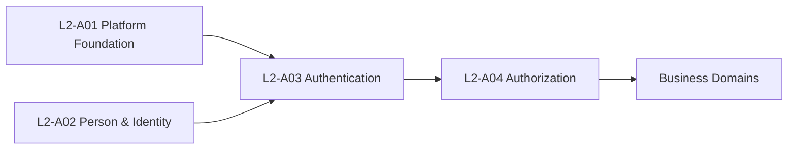

---

# Authentication Aggregate Landscape

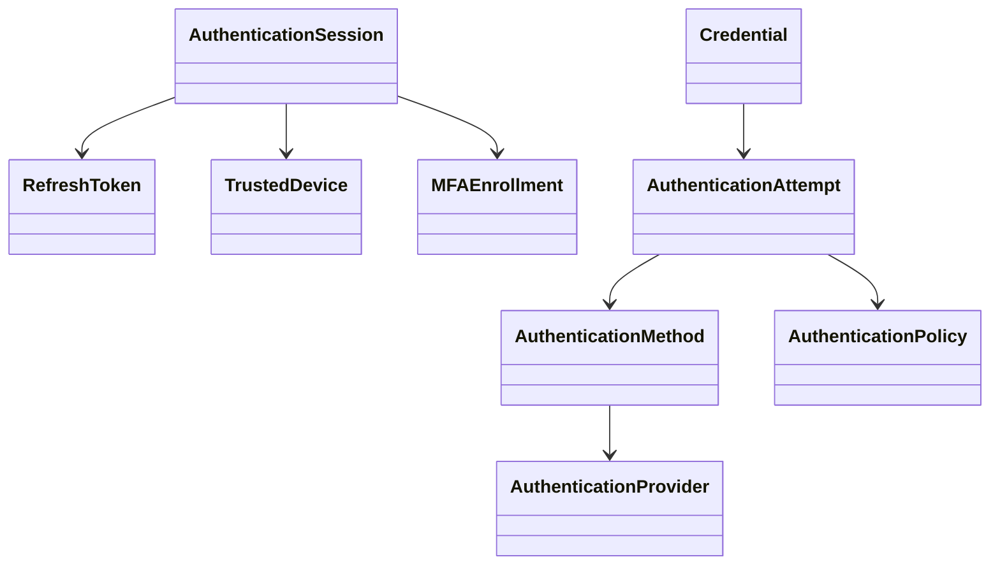

---

# Authentication Request Flow

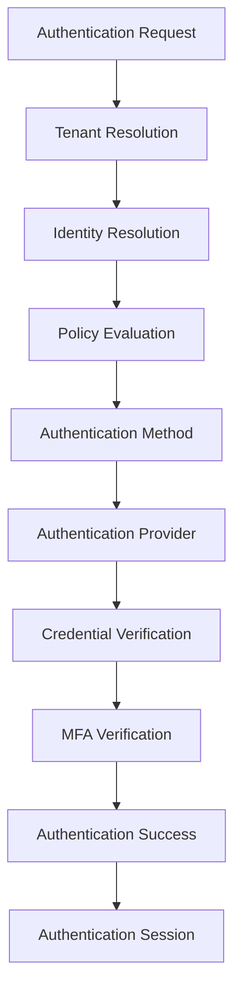

---

# Credential Lifecycle

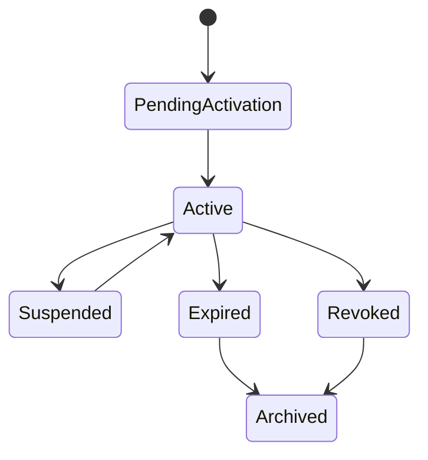

---

# Authentication Session Lifecycle

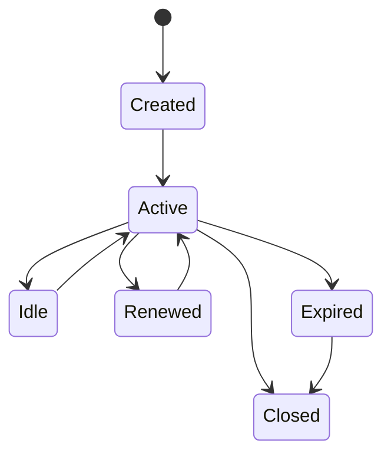

---

# Refresh Token Lifecycle

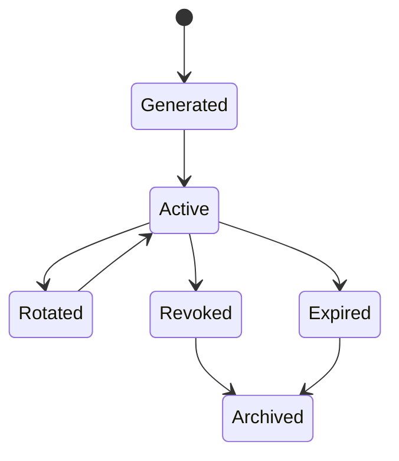

---

# Trusted Device Lifecycle

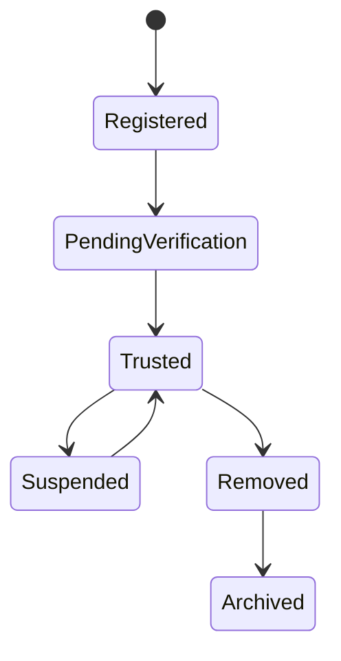

---

# MFA Lifecycle

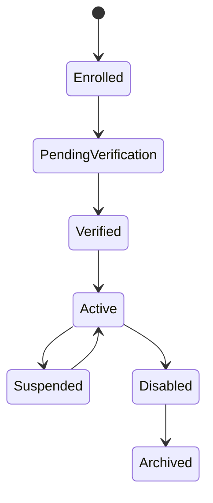

---

# Authentication Attempt Lifecycle

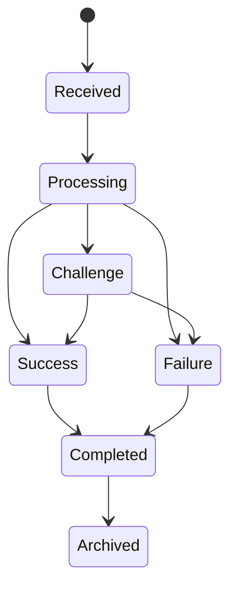

---

# Authentication Provider Selection

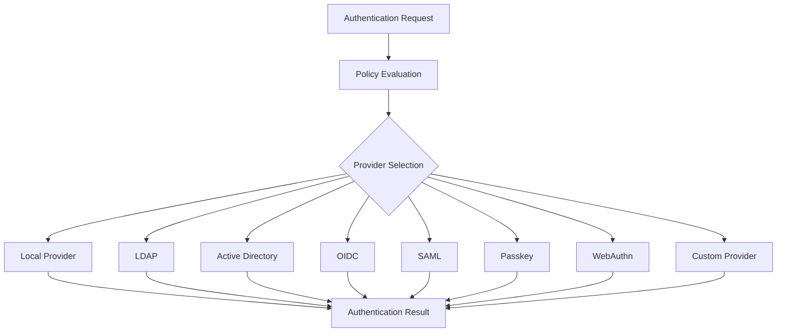

---

# CQRS Architecture

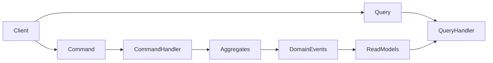

---

# Authentication Event Flow

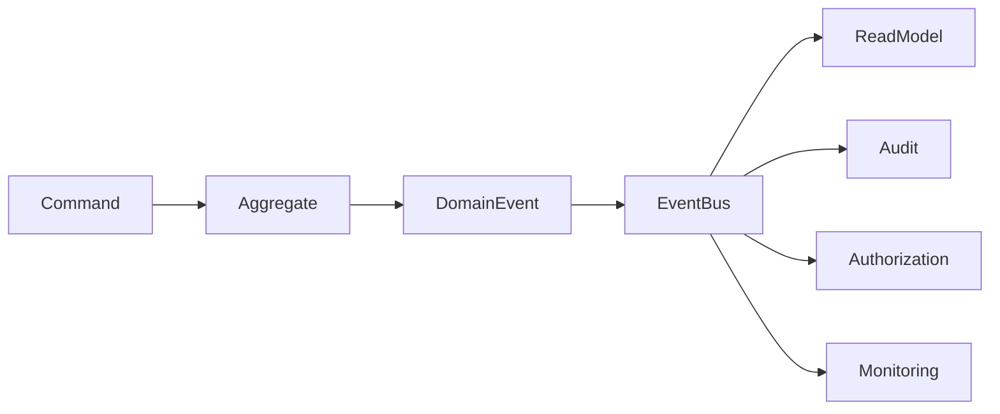

---

# Multi-Domain Interaction

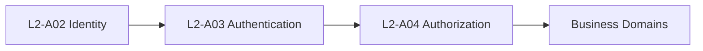

---

# Aggregate Dependency Model

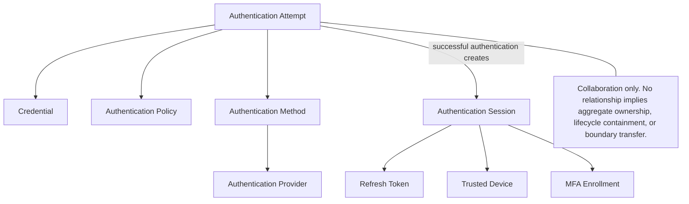

---

# Authentication Workflow Overview

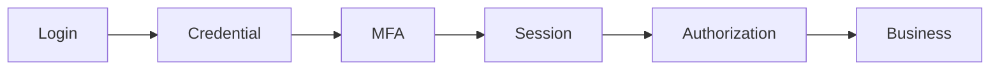

---

# Authentication Domain Ownership

```mermaid
mindmap
root((Authentication))

Credential

Authentication Session

Refresh Token

Trusted Device

Authentication Policy

Authentication Method

Authentication Provider

Authentication Attempt

MFA Enrollment
```

---

# Authentication Boundary

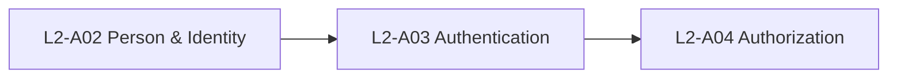

---

# Extension Points

The Authentication architecture is intentionally extensible.

Future extensions may include:

- Passwordless Authentication
- Hardware Security Keys
- Biometric Authentication
- Government Identity Providers
- Institutional Single Sign-On
- Risk-Based Authentication
- Continuous Authentication
- Behavioral Authentication
- AI-Based Threat Detection
- Federation Gateways

Future extensions shall integrate through Authentication Providers and Authentication Methods without modifying core authentication workflows.

---

# Glossary

| Term | Definition |
|------|------------|
| Authentication | Verification of identity before access is granted. |
| Authorization | Evaluation of permissions after authentication. |
| Credential | Authentication proof associated with an identity. |
| Authentication Provider | System responsible for credential verification. |
| Authentication Method | Logical authentication mechanism. |
| Authentication Session | Trusted execution context after successful authentication. |
| Refresh Token | Artifact used to renew authenticated sessions. |
| Trusted Device | Previously verified device used during authentication. |
| MFA | Multi-factor authentication using independent verification factors. |
| Authentication Policy | Configuration governing authentication behaviour. |

---

# Architecture Validation Checklist

The Authentication architecture satisfies the following architectural objectives.

| Validation Item | Status |
|-----------------|--------|
| Canonical Aggregate Ownership | ✓ |
| DDD Boundaries Defined | ✓ |
| CQRS Implemented | ✓ |
| Event-Driven Architecture | ✓ |
| Authentication Provider Independence | ✓ |
| Authentication Method Abstraction | ✓ |
| Adaptive MFA Support | ✓ |
| Trusted Device Architecture | ✓ |
| Session Lifecycle Defined | ✓ |
| Credential Lifecycle Defined | ✓ |
| Policy-Driven Authentication | ✓ |
| Tenant Isolation | ✓ |
| Multi-Domain Contracts | ✓ |
| Audit Architecture | ✓ |
| Future Extensibility | ✓ |

---

# Repository Compliance Checklist

This document complies with the SutraERP Level-2 Architecture Standards.

| Requirement | Status |
|------------|--------|
| Canonical Domain Ownership | ✓ |
| Aggregate-Based Modeling | ✓ |
| CQRS Pattern | ✓ |
| Domain Event Model | ✓ |
| Mermaid Architecture Diagrams | ✓ |
| Multi-Domain Contracts | ✓ |
| ADR Documentation | ✓ |
| Non-Functional Requirements | ✓ |
| Architecture Governance | ✓ |
| Extension Strategy | ✓ |

---

# End of Document

**Document ID:** L2-A03

**Title:** Authentication Workflows

**Architecture Layer:** Level 2 – Platform Foundation

**Canonical Owner:** Authentication Domain

**Status:** Draft
