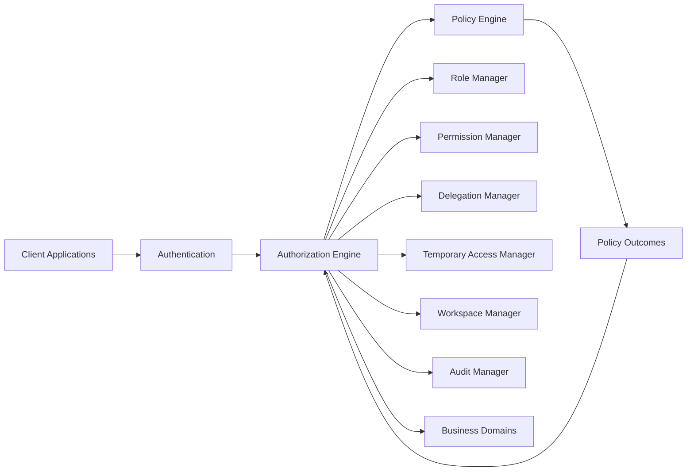
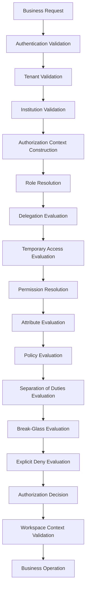
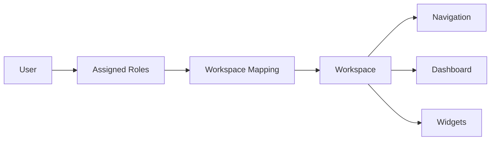
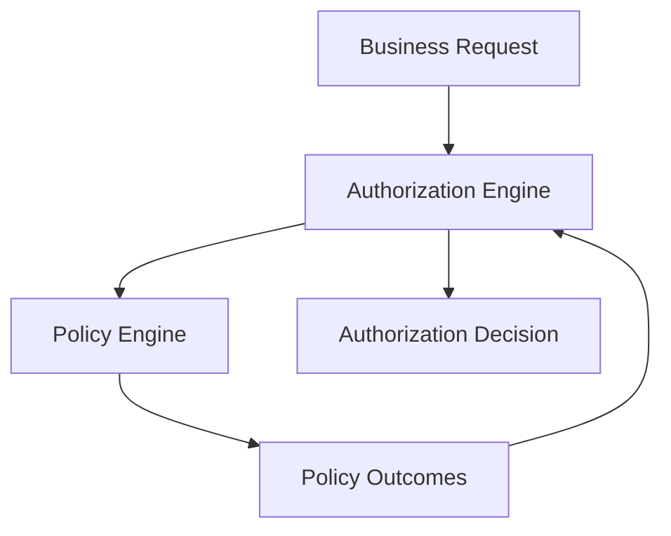
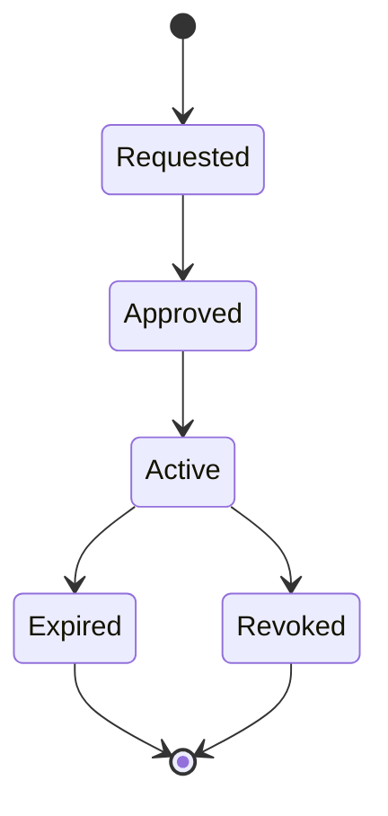
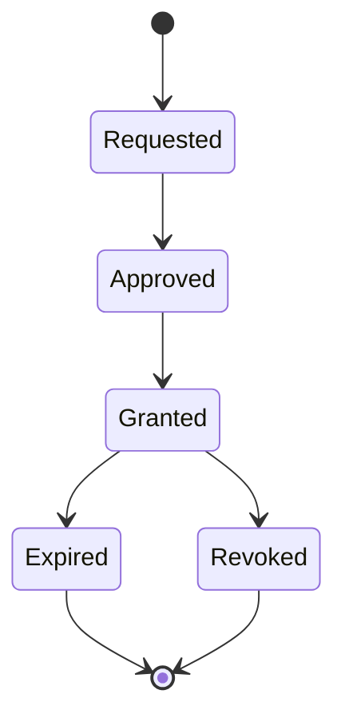
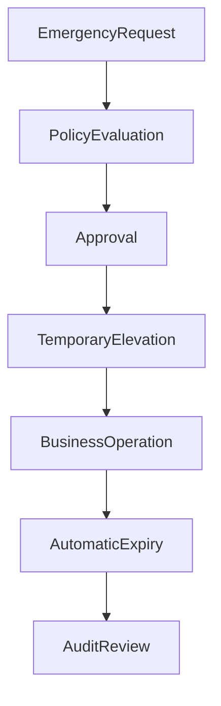
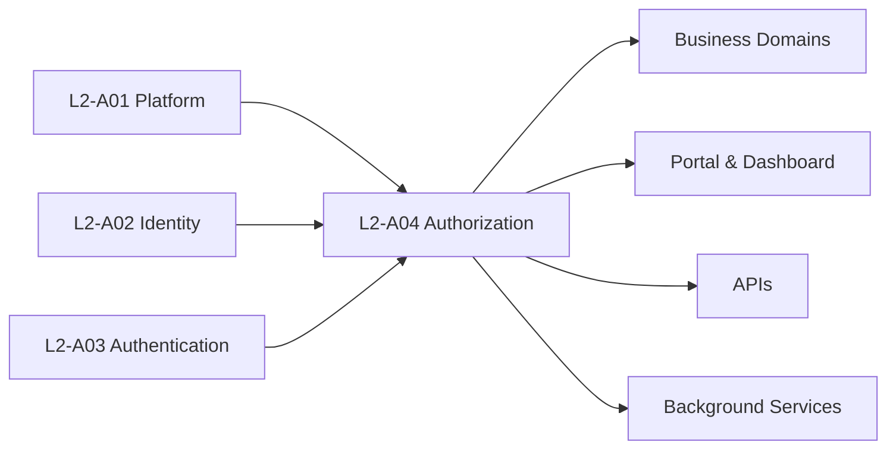

# L2-A04 — Authorization & Policy Workflows

---

## Canonical Section Crosswalk

> Added 2026-08-04 under integrity finding INT-018. `governance/constitution/Volume_3_Architecture_Framework.md` section 18 requires every L2 document to define eleven sections. This document uses its own numbered-section convention; the table below maps the required sections to where they actually live. No content was moved.

| Required section (Volume 3 §18) | Location in this document |
|---|---|
| Purpose | §1 Purpose |
| Scope | §2 Scope; §5 Out of Scope; §73 Resource Scope Evaluation |
| Actors | §23 Role Management; §24 Role Lifecycle; §25 Role Responsibilities |
| Entities | §9 Aggregate Ownership; §10 Aggregate Responsibilities; §11 Aggregate Relationships |
| Business Rules | §32 Role Invariants; §42 Permission Invariants; §51 Policy Invariants |
| Workflow | §61 Advanced Authorization Workflows; §98.8 Break-Glass Workflow; L2-A04 — Authorization & Policy Workflows |
| State Machine | §72 Resource State Evaluation |
| Contracts | §95 Architectural Contracts |
| Events | §78 Auditable Events; Administrative Events; Authorization Events |
| Dependencies | §13 Multi-Domain Dependencies |
| Locked Decisions | §100 Architectural Decisions |

---

# Document Metadata

| Attribute | Value |
|-----------|-------|
| Document ID | L2-A04 |
| Document Owner | Platform Foundation — Authorization |
| Document Name | Authorization and Policy Workflows |
| Layer | Level 2 – Core Platform Architecture |
| Domain | Platform Security & Authorization |
| Owner | Platform Foundation — Authorization |
| Depends On | L2-A01 Platform & Tenant Foundation, L2-A02 Person & Identity Workflows, L2-A03 Authentication Architecture |
| Referenced By | All Business Domains (Academic, Examination, Finance, HR, Library, Hostel, Transport, CRM, Analytics, Mobile, APIs, Dashboard, Reporting) |
| Status | Locked |
| Version | 1.1 — INT-301 ownership ruling |

---

# 1. Purpose

This document defines the complete authorization architecture of the SutraERP platform.

It establishes the architectural standards governing authorization decisions, access control, business permissions, policy evaluation, workspace management, delegation, temporary access, emergency access, and auditability across every module within the platform.

The authorization architecture provides a unified and reusable framework that ensures secure, consistent, auditable, and policy-driven access control while remaining independent from business domain implementations.

This document serves as the canonical reference for all authorization behaviour within SutraERP.

---

# 2. Scope

This document defines:

- Authorization Architecture
- Role Architecture
- Role Assignment Architecture
- Permission Architecture
- Workspace Architecture
- Policy Engine
- Authorization Engine
- Resource Authorization
- Delegation
- Temporary Access
- Separation of Duties (SoD)
- Break-Glass (Emergency Access)
- Authorization Audit
- Authorization Context
- Authorization Decision Model

This document does not define:

- Person Lifecycle
- Identity Lifecycle
- User Account Management
- Authentication
- Credentials
- Password Management
- Multi-Factor Authentication
- Session Authentication
- Business Module Security Rules
- UI Design
- Navigation Design
- Dashboard Design

These remain the responsibility of their respective architectural documents.

---

# 3. Architectural Responsibility

L2-A04 is the canonical owner of:

- Roles
- Role Assignments
- Permissions
- Authorization Policies
- Authorization Decisions
- Authorization Context
- Workspace
- Workspace Switching
- Delegation
- Temporary Access
- Break-Glass Access
- Separation of Duties Policies
- Authorization Audit
- Resource Authorization

No other architecture document shall redefine ownership of these concepts.

> **Canonical boundary approved 2026-08-13 under INT-301.** L2-A04 exclusively owns Role, Role Assignment, Authorization Delegation and authorization-policy lifecycles. L2-A02 owns Person, Identity, User Account and canonical identity/context references. L2-A03 owns Credential, Authentication Session, authentication factors/MFA Enrollment and Authentication Provider lifecycles. A04 consumes identity and authenticated-session references without changing their canonical state.
>
> **Delegation scope clarification, approved 2026-08-15 (RC-01).** The delegation owned exclusively here is *Authorization Delegation* — the temporary transfer of authorization-layer authority, and its reversion on expiry. It is not the only kind of delegation in the architecture. Organizational delegation of a position's responsibilities — acting, interim, concurrent and additional-charge assignment, and officiating duty — is `Assignment Delegation`, owned canonically by `L2-E02`. Assignment Delegation consumes A04 authorization primitives to take effect but does not own them, and A04 does not own the organizational assignment it derives from. The unqualified noun "Delegation" should not be read as claiming both.

Business domains consume this architecture but shall not redefine its core behaviour.

---

# 4. Architectural Objectives

The authorization architecture shall provide:

- Enterprise-grade authorization
- Multi-tenant isolation
- Policy-driven access control
- Fine-grained resource authorization
- Consistent authorization across all domains
- Secure delegation mechanisms
- Temporary access management
- Emergency access management
- Workspace-based user experience
- Complete auditability
- Future extensibility

The architecture must support institutions ranging from small colleges to multi-campus university groups without requiring structural redesign.

---

# 5. Out of Scope

The following responsibilities belong to other architecture documents:

### L2-A02 — Person & Identity

- Person
- Identity
- User Account
- Identity Relationships

### L2-A03 — Authentication

- Login
- Authentication
- MFA
- Sessions
- Credentials
- Password Policies
- Authentication Providers

### Business Domains

Business workflows determine *when* authorization is required.

This document defines *how* authorization decisions are evaluated.

---

# 6. Core Architectural Principles

The following principles are architectural invariants and shall remain true across the entire SutraERP platform.

## AP-01 — Authorization is Mandatory

Every business operation shall be authorized before execution.

No business module may bypass the authorization engine.

---

## AP-02 — Authentication and Authorization are Independent

Authentication proves identity.

Authorization determines permitted actions.

Successful authentication shall never imply authorization.

---

## AP-03 — Server-Side Enforcement

Authorization decisions shall always be enforced by the server.

Client-side visibility, navigation, menus, buttons, URLs, or APIs shall never be trusted as security boundaries.

---

## AP-04 — Permissions Protect Business Resources

Permissions authorize operations on business resources and business actions.

Permissions shall never be defined against UI pages or user interface components.

---

## AP-05 — Policy-Driven Authorization

Authorization decisions shall be determined through policy evaluation rather than hard-coded business logic.

Business domains consume authorization policies rather than implementing independent security logic.

---

## AP-06 — Explicit Deny Takes Precedence

Whenever conflicting authorization rules exist, Explicit Deny shall always override Allow.

This rule is mandatory across the entire platform.

---

## AP-07 — Workspace is a User Experience Context

Workspace provides contextual navigation and user experience.

Workspace shall never grant, remove, or modify permissions.

Changing workspace shall never change authorization outcomes.

---

## AP-08 — Roles Define Responsibility

Roles represent organizational responsibilities.

Roles determine permission assignments.

Roles do not determine user interface presentation.

---

## AP-09 — Workspace Does Not Replace Authorization

Workspace controls visibility.

Authorization controls access.

Even when users manually access protected URLs or APIs, authorization shall always be evaluated independently.

---

## AP-10 — Least Privilege

Users shall receive only the permissions required to perform their assigned responsibilities.

Temporary elevation shall remain time-bound and fully auditable.

---

## AP-11 — Complete Auditability

Every authorization decision shall be auditable.

Every permission grant, revoke, delegation, emergency access, policy evaluation, and authorization decision shall generate immutable audit records.

---

## AP-12 — Multi-Tenant Isolation

Authorization shall never cross tenant boundaries.

Users, permissions, policies, and authorization decisions shall always execute within the active tenant context.

---

## AP-13 — Consistent Authorization Model

The same authorization engine shall evaluate requests originating from:

- Web Applications
- Mobile Applications
- REST APIs
- Internal Services
- Scheduled Jobs
- Background Workers
- Integration Services

No channel shall implement independent authorization behaviour.

---

## AP-14 — Separation of Concerns

Identity, Authentication, Authorization, Workspace, Navigation, Dashboard, and Business Workflows are independent architectural concerns.

Each shall own only its designated responsibilities.

---

## AP-15 — Extensibility

The authorization architecture shall support future expansion without requiring structural redesign.

New business domains shall consume this architecture through configuration, policies, permissions, and roles rather than introducing new authorization models.

---

# 7. Architectural Position Within the Platform

The authorization architecture operates between Authentication and Business Domains.

Authentication establishes identity.

Authorization evaluates permissions and policies.

Business domains execute operations only after successful authorization.

Accordingly, all business modules, APIs, services, dashboards, portals, and future platform capabilities shall consume the authorization services defined within this document.

---

# 8. Domain Model

The Authorization domain is composed of a collection of independent but collaborating aggregates that collectively provide secure, policy-driven, and auditable authorization across the SutraERP platform.

Each aggregate owns its own lifecycle, business rules, and invariants while collaborating through well-defined relationships.

The Authorization domain intentionally separates security responsibilities from Identity, Authentication, Navigation, Dashboard, and Business Domains.

---

# 9. Aggregate Ownership

The following aggregates are owned exclusively by the Authorization domain.

| Aggregate | Responsibility |
|------------|----------------|
| Role | Defines organizational responsibilities and groups business permissions. |
| Role Assignment | Defines an approved, effective-dated assignment of a Role to an A02 Person/Identity reference within an authorization scope. |
| Permission | Defines business operations that may be performed on business resources. |
| Authorization Policy | Defines policy-driven authorization rules and evaluation logic. |
| Workspace | Defines user experience context including navigation, dashboards, and workspace configuration. |
| Delegation | Defines temporary delegation of responsibilities between authorized users. |
| Temporary Access Grant | Defines temporary permission elevation with automatic expiry. |
| Separation of Duties Policy | Defines configurable Maker–Checker and Four-Eyes authorization rules. |
| Break-Glass Session | Defines emergency authorization sessions with controlled privilege elevation and auditing. |

The following domain objects are produced or consumed during authorization evaluation but are not independent business aggregates.

| Domain Object | Responsibility |
|---------------|----------------|
| Authorization Context | Runtime evaluation context supplied to the Authorization Engine. |
| Authorization Decision | Result of policy evaluation returned by the Authorization Engine. |

---

# 10. Aggregate Responsibilities

## 10.1 Role

Role represents an organizational responsibility within an institution.

A role groups related permissions that together enable users to perform a specific business responsibility.

Examples include:

- Faculty
- Examination Coordinator
- Principal
- Librarian
- Finance Officer
- Hostel Warden

A Role never authenticates users.

A Role never owns user interface behaviour.

A Role never stores user identity.

Role Assignment is the separately governed A04 aggregate that binds a Role to an A02 Person/Identity reference, scope, effective period, status and assignment authority. It owns assignment approval, activation, suspension, expiry and revocation; it never owns the referenced Person or Identity.

---

## 10.2 Permission

Permission represents authorization to perform a business action on a business resource.

Permissions protect business capabilities rather than application pages.

Examples include:

- Student.View
- Student.Update
- Attendance.Mark
- Examination.PublishResults
- FinanceVoucher.Approve

Permissions remain independent from menus, screens, dashboards, URLs, and APIs.

---

## 10.3 Authorization Policy

Authorization Policies define how authorization decisions are evaluated.

Policies may evaluate:

- Roles
- Permissions
- Attributes
- Resource State
- Business Rules
- Time
- Institution
- Department
- Campus
- Delegation
- Temporary Access
- Risk Evaluation
- Explicit Deny
- Separation of Duties

Policies remain configurable without requiring software modification.

---

## 10.4 Workspace

Workspace defines the operational context in which a user performs a particular responsibility.

Workspace determines:

- Navigation
- Landing Page
- Dashboard
- Widget Visibility
- Menu Groups
- User Experience

Workspace never grants permissions.

Workspace never modifies authorization decisions.

Workspace exists solely to improve usability while remaining independent from authorization.

---

## 10.5 Delegation

Delegation represents temporary transfer of business responsibility from one authorized user to another.

Delegation remains fully policy-controlled, time-bound, and auditable.

Delegation never permanently changes assigned roles.

---

## 10.6 Temporary Access Grant

Temporary Access Grants provide short-lived authorization elevation for approved business situations.

Every grant shall include:

- Reason
- Scope
- Duration
- Approval
- Automatic Expiry
- Audit Record

Temporary access shall always follow the Principle of Least Privilege.

---

## 10.7 Separation of Duties Policy

Separation of Duties Policies define configurable authorization constraints that prevent conflicting business responsibilities from being executed by the same user within the same business process.

Examples include:

- Maker–Checker
- Four-Eyes Approval
- Dual Authorization
- Independent Verification

Platform defaults shall be provided while allowing institution-level configuration.

---

## 10.8 Break-Glass Session

Break-Glass Session represents controlled emergency authorization.

Emergency elevation shall be:

- Policy Driven
- Time Bound
- Fully Audited
- Automatically Revoked

Default platform behaviour:

- Enabled
- Policy-Based Approval
- Default Duration: 45 Minutes
- Automatic Expiry
- Immutable Audit Trail
- Administrator Notification

Break-Glass shall never become a permanent authorization mechanism.

---

# 11. Aggregate Relationships

The Authorization domain maintains the following logical relationships.

```text
Role
        │
        ├──────────────► Permission
        │
        ├──────────────► Workspace Mapping
        │
        ├──────────────► Delegation
        │
        └──────────────► Temporary Access Grant

Permission
        │
        ▼
Business Resource

Workspace Mapping
        │
        ▼
Workspace

Authorization Policy
        │
        ▼
Authorization Engine

Workspace
      │
      ├── Navigation
      ├── Dashboard
      └── Widgets

Break-Glass Session
        │
        ▼
Temporary Authorization

Separation of Duties Policy
        │
        ▼
Authorization Policy
```

---

# 12. Ownership Boundaries

The Authorization domain owns only authorization responsibilities.

The following concepts remain outside this domain.

| Concept | Owned By |
|----------|----------|
| Person | L2-A02 – Person & Identity |
| Identity | L2-A02 – Person & Identity |
| User Account | L2-A02 – Person & Identity |
| Authentication | L2-A03 – Authentication |
| Credentials | L2-A03 – Authentication |
| MFA | L2-A03 – Authentication |
| Session Authentication | L2-A03 – Authentication |
| Dashboard Rendering | Dashboard Domain |
| Navigation Rendering | Portal/UI Framework |
| Business Rules | Individual Business Domains |

The Authorization domain consumes these concepts but does not redefine or own them.

---

# 13. Multi-Domain Dependencies

The Authorization domain provides foundational services to every business domain.

Primary consumers include:

- Academic Management
- Admissions
- Examination
- Finance
- Human Resources
- Library
- Hostel
- Transport
- Inventory
- CRM
- Analytics
- Reporting
- Mobile Applications
- Public APIs
- Administrative Portals

All consuming domains shall use the centralized Authorization Engine and shall not implement independent authorization models.

# 14. Authorization Architecture

The SutraERP Authorization Architecture provides a centralized, policy-driven authorization framework that evaluates every protected business operation before execution.

Authorization is implemented as a reusable platform capability and is consumed uniformly by all applications, APIs, services, background processes, and future platform components.

The architecture is designed around separation of concerns, ensuring that Identity, Authentication, Authorization, Workspace, Navigation, and Business Domains remain independently evolvable.

---

# 15. Authorization Architecture Overview

The authorization architecture consists of the following major components.

| Component | Responsibility |
|-----------|----------------|
| Authorization Engine | Invokes the Policy Engine and produces Authorization Decisions. |
| Authorization Context | Provides complete runtime context for policy evaluation. |
| Role Manager | Resolves assigned organizational responsibilities. |
| Permission Manager | Resolves permissions granted through roles and temporary assignments. |
| Policy Engine | Evaluates Authorization Policies and returns Policy Outcomes. |
| Workspace Manager | Resolves available workspaces and manages active workspace switching. |
| Delegation Manager | Resolves active delegated responsibilities. |
| Temporary Access Manager | Resolves active temporary permission grants. |
| Break-Glass Manager | Manages emergency authorization sessions. |
| Separation of Duties Engine| Evaluates Separation of Duties constraints. |
| Audit Manager | Records immutable authorization events and decisions. |

Each component owns a clearly defined responsibility and collaborates through well-defined interfaces.

---

# 16. Authorization Processing Pipeline

Every protected operation shall be evaluated through a standardized authorization pipeline.

```text
Business Request
        │
        ▼
Authentication Validation
        │
        ▼
Tenant Validation
        │
        ▼
Institution Validation
        │
        ▼
Authorization Context Construction
        │
        ▼
Role Resolution
        │
        ▼
Delegation Evaluation
        │
        ▼
Temporary Access Evaluation
        │
        ▼
Permission Resolution
        │
        ▼
Attribute Evaluation
        │
        ▼
Policy Evaluation
        │
        ▼
Separation of Duties Evaluation
        │
        ▼
Break-Glass Evaluation
        │
        ▼
Explicit Deny Evaluation
        │
        ▼
Authorization Decision
        │
        ▼
Workspace Context Validation
        │
        ▼
Business Operation
```

Every authorization request shall follow this evaluation sequence.

Business modules shall not introduce independent authorization flows.

# 17. Authorization Context

Authorization Context represents the complete runtime information required by the Authorization Engine to evaluate a request.

Authorization Context is a runtime domain object.

It is neither persisted as a business aggregate nor managed independently.

---

## Authorization Context Components

The Authorization Context may include:

### Identity Context

- Person
- User Account
- Authentication Session (consumed from L2-A03 Authentication)

### Platform Context

- Tenant
- Institution
- Campus

### Authorization Context

- Assigned Roles
- Active Delegations
- Temporary Access Grants
- Active Break-Glass Session

### Workspace Context

- Active Workspace
- Available Workspaces

### Resource Context

- Business Resource
- Requested Action
- Resource State
- Resource Ownership

### Request Context

- Request Time
- Device Information
- Client Application
- Network Information
- Request Metadata

The Authorization Context provides a complete and consistent view of the current authorization environment.

---

# 18. Authorization Engine

The Authorization Engine is the central decision-making component responsible for evaluating whether a requested business operation may proceed.

The Authorization Engine shall never contain business-specific logic.

Business-specific rules shall be expressed through configurable policies.

Responsibilities include:

- Role Resolution
- Permission Resolution
- Policy Evaluation
- Delegation Evaluation
- Temporary Access Evaluation
- Separation of Duties Evaluation
- Break-Glass Evaluation
- Explicit Deny Evaluation
- Authorization Decision Generation

The Authorization Engine shall invoke the Policy Engine to evaluate authorization policies and shall produce a single deterministic Authorization Decision for every request.

---

# 19. Authorization Decision

Every authorization request shall produce a structured Authorization Decision.

The decision shall not be limited to a simple Allow or Deny result.

---

## Authorization Decision Model

Every decision shall include, where applicable:

- Decision Identifier
- Decision Outcome
- Decision Timestamp
- Evaluated Resource
- Requested Action
- Evaluated Policies
- Matching Roles
- Matching Permissions
- Delegation Applied
- Temporary Access Applied
- Break-Glass Status
- Separation of Duties Result
- Explicit Deny Result
- Active Workspace
- Decision Reason
- Audit Reference

This structured decision enables:

- Complete auditing
- Operational diagnostics
- Compliance reporting
- Security investigations
- Policy validation

---

# 20. Workspace Context Validation

Workspace Context Validation validates that the requested operation is being performed within the appropriate user workspace.

Workspace Context Validation is a presentation-context validator.

It is not an authorization engine.

---

## Responsibilities

Workspace Context Validation is responsible for:

- Validating active workspace context
- Determining workspace visibility
- Validating workspace-specific navigation
- Supporting controlled workspace switching
- Preventing accidental execution from an incorrect operational context

Workspace Context Validation shall never grant or revoke permissions.

Authorization decisions remain the exclusive responsibility of the Authorization Engine.

---

# 21. Workspace Switching

Users may possess multiple organizational responsibilities simultaneously.

Examples include:

- Faculty
- Examination Coordinator
- Mentor
- Department Head

Each responsibility may expose one or more Workspaces.

Workspace switching allows users to change their operational context without changing their assigned roles.

Workspace switching updates:

- Navigation
- Landing Page
- Dashboard
- Widgets
- Menu Visibility

Workspace switching shall never:

- Re-authenticate the user
- Change assigned roles
- Modify permissions
- Grant authorization
- Remove authorization

Authorization continues to be evaluated independently for every business request.

---

# 22. Workspace Resolution

Workspace availability is determined using:

- Assigned Roles
- Institution Configuration
- Workspace Mapping
- Administrative Policies

The Authorization domain resolves which Workspaces are available to the authenticated user.

The Portal and Dashboard domains consume this information to render the appropriate user experience.

The Authorization domain does not render user interfaces.

# 23. Role Management

Roles represent organizational responsibilities that group related business permissions.

Roles provide a stable authorization abstraction that remains independent from user identities, authentication mechanisms, and user interface presentation.

Roles shall be reusable across institutions while allowing institution-specific assignment and configuration.

---

# 24. Role Lifecycle

Every Role progresses through a controlled lifecycle.

```text
Create
    │
    ▼
Configure
    │
    ▼
Assign Permissions
    │
    ▼
Validate
    │
    ▼
Activate
    │
    ▼
Use
    │
    ▼
Modify
    │
    ▼
Suspend
    │
    ▼
Archive
```

Role archival shall never invalidate historical authorization audits.

Historical authorization decisions shall continue referencing archived roles.

---

# 25. Role Responsibilities

A Role is responsible for:

- Grouping business permissions
- Representing organizational responsibilities
- Supporting authorization policy evaluation
- Supporting workspace resolution
- Supporting delegation
- Supporting temporary access
- Supporting Separation of Duties evaluation

A Role is not responsible for:

- Authentication
- User identity
- Session management
- Navigation
- Dashboard rendering
- User interface behaviour

---

# 26. Role Categories

The platform supports multiple categories of roles.

## Platform Roles

Platform-wide responsibilities managed by the platform.

Examples include:

- Platform Administrator
- Platform Support
- Platform Auditor

Platform Roles remain platform-owned.

---

## Tenant Roles

Tenant-wide responsibilities shared across institutions within a tenant.

Examples include:

- Tenant Administrator
- Tenant Compliance Officer

---

## Institution Roles

Institution-specific organizational responsibilities.

Examples include:

- Principal
- Registrar
- Faculty
- Examination Coordinator
- Librarian
- Accountant

Institution Roles represent the majority of operational roles.

---

## Department Roles

Responsibilities limited to a department.

Examples include:

- Head of Department
- Department Coordinator
- Department Faculty

---

## Temporary Roles

Temporary organizational responsibilities granted through approved business processes.

Temporary Roles automatically expire according to policy.

---

## Delegated Roles

Responsibilities temporarily exercised on behalf of another authorized user.

Delegated Roles remain fully auditable.

Delegation never permanently changes the original role assignment.

---

# 27. Role Assignment

Roles are assigned to authenticated user accounts through authorized administrative processes.

A user may hold multiple active roles simultaneously.

Example:

- Faculty
- Examination Coordinator
- Mentor

Holding multiple roles does not require multiple user accounts.

Role assignment shall remain independent from workspace selection.

---

# 28. Active Role Resolution

Assigned Roles represent all organizational responsibilities held by a user.

During authorization, the Authorization Engine evaluates all applicable assigned roles together with:

- Delegated Roles
- Temporary Roles
- Policy Constraints
- Explicit Deny Rules

The Active Workspace shall not limit role evaluation.

Authorization is determined by policy rather than user interface context.

---

# 29. System Reserved Roles

Certain platform roles are reserved and protected by the platform.

Reserved roles may include:

- Platform Administrator
- System Auditor
- Anonymous User
- Authenticated User
- Service Account

Reserved roles shall be protected from unauthorized modification or deletion.

Platform configuration may extend reserved roles but shall not violate platform security invariants.

---

# 30. Role Assignment Constraints

Role assignment shall support configurable validation rules including:

- Institution boundaries
- Department boundaries
- Campus boundaries
- Effective dates
- Expiry dates
- Separation of Duties policies
- Administrative approval requirements

Role assignment shall never violate tenant isolation.

---

# 31. Workspace Mapping

Roles do not own Workspaces.

Instead, authorized Workspace Mappings determine which operational workspaces are available for a given combination of assigned roles.

This design enables:

- One Role → Multiple Workspaces
- Multiple Roles → Shared Workspace
- Institution-specific workspace configuration

Workspace availability is resolved dynamically during authorization context construction.

---

# 32. Role Invariants

The following invariants shall always remain true.

- Roles define organizational responsibilities.
- Roles group permissions.
- Roles do not authenticate users.
- Roles do not render user interfaces.
- Roles do not grant authorization independently.
- Roles participate in policy evaluation.
- Roles remain independent from Workspace presentation.
- Historical role changes shall never invalidate authorization audit history.

# 33. Permission Management

Permissions define the business operations that an authorized user may perform on protected business resources.

Permissions represent the smallest assignable authorization unit within the SutraERP platform.

Permissions are assigned to Roles.

Users receive permissions indirectly through assigned roles, temporary access grants, delegated responsibilities, or emergency authorization policies.

Permissions shall never be assigned directly to business workflows.

---

# 34. Permission Model

Every Permission consists of two logical components.

```text
Business Resource

+

Business Action

=

Permission
```

Examples:

```text
Student.View

Student.Create

Student.Update

Student.Delete

Attendance.Mark

Attendance.Approve

Examination.PublishResults

FinanceVoucher.Approve

LibraryBook.Issue
```

Permissions represent business capabilities rather than application screens.

---

# 35. Business Resources

Business Resources represent protected business entities within the platform.

Examples include:

- Student
- Employee
- Examination
- Result
- Attendance
- Course
- Subject
- Institution
- Organization
- Department
- Campus
- Fee
- Voucher
- LibraryBook
- HostelRoom
- TransportRoute

Every protected resource shall expose one or more business actions.

---

# 36. Business Actions

Business Actions define operations that may be performed on a Business Resource.

Common actions include:

- View
- Create
- Update
- Delete
- Submit
- Approve
- Reject
- Publish
- Archive
- Export
- Import
- Assign
- Revoke
- Activate
- Suspend

Business domains may introduce additional actions without changing the authorization architecture.

---

# 37. Permission Naming Convention

Permissions shall follow a consistent naming convention across the entire platform.

Standard format:

```text
<Resource>.<Action>
```

Examples:

```text
Student.View

Student.Update

Attendance.Mark

Attendance.Approve

Result.Publish

FinanceVoucher.Approve

LibraryBook.Issue

Employee.AssignRole
```

Permission names shall remain:

- Unique
- Stable
- Human-readable
- Independent from implementation technology

---

# 38. Permission Assignment

Permissions are assigned to Roles.

Permissions may become available to users through:

- Assigned Roles
- Delegated Roles
- Temporary Access Grants
- Break-Glass Sessions

Permissions shall never be permanently assigned directly to individual users.

This preserves centralized authorization management and reduces administrative complexity.

---

# 39. Permission Hierarchy

Permissions support hierarchical organization.

Example:

```text
Student

├── View

├── Create

├── Update

├── Delete

└── Export
```

Hierarchical organization improves administration and reporting.

Authorization decisions continue to evaluate individual permissions.

Permission hierarchy shall never imply automatic permission inheritance unless explicitly configured by policy.

---

# 40. Permission Resolution

Permission Resolution determines the effective permissions available during authorization.

Permission Resolution considers:

- Assigned Roles
- Delegated Roles
- Temporary Access Grants
- Active Break-Glass Sessions
- Authorization Policies
- Explicit Deny Rules

The result of Permission Resolution is supplied to the Authorization Engine for policy evaluation.

---

# 41. Permission Constraints

Permissions remain subject to policy constraints.

A granted permission does not automatically authorize execution.

Authorization may still be denied because of:

- Explicit Deny
- Resource State
- Institution Boundary
- Department Boundary
- Campus Boundary
- Time Restrictions
- Separation of Duties
- Temporary Access Expiry
- Delegation Expiry
- Break-Glass Policy
- Risk Evaluation

Permission ownership alone shall never determine the final authorization decision.

---

# 42. Permission Invariants

The following invariants shall always remain true.

- Permissions protect business resources.
- Permissions authorize business actions.
- Permissions remain independent from user interface components.
- Permissions remain independent from navigation.
- Permissions remain independent from dashboards.
- Permissions remain independent from URLs.
- Permissions are assigned to Roles rather than directly to users.
- Authorization decisions evaluate permissions together with policies.
- Explicit Deny always overrides granted permissions.

# 43. Authorization Policy Architecture

Authorization Policies define the business rules used by the Authorization Engine to determine whether a requested operation shall be permitted.

Policies represent configurable authorization logic that remains independent from application code.

The Authorization Engine invokes the Policy Engine to evaluate authorization policies and does not own business authorization rules.

This separation enables authorization behaviour to evolve without requiring changes to the core authorization engine.

---

# 44. Policy Objectives

Authorization Policies provide:

- Centralized authorization logic
- Configurable security rules
- Consistent authorization behaviour
- Fine-grained access control
- Enterprise governance
- Regulatory compliance
- Business rule enforcement
- Future extensibility

Policies shall be reusable across all business domains.

---

# 45. Policy Categories

The platform supports multiple policy categories.

## Role Policies

Evaluate organizational responsibilities assigned to the user.

Examples include:

- Faculty
- Examination Coordinator
- Principal
- Finance Officer

---

## Permission Policies

Evaluate whether the required business permission has been granted.

Permission Policies operate on Business Resource and Business Action combinations.

---

## Attribute-Based Policies (ABAC)

Evaluate authorization using contextual attributes.

Attributes may include:

- Institution
- Campus
- Department
- User Type
- Academic Session
- Time
- Location
- Resource Owner
- Resource Status

Additional attributes may be introduced by future business domains.

---

## Delegation Policies

Evaluate active delegated responsibilities.

Delegation Policies verify:

- Delegation validity
- Delegation duration
- Delegation scope
- Delegation approval
- Delegation expiry

---

## Temporary Access Policies

Evaluate temporary authorization grants.

Temporary Access Policies verify:

- Approval Status
- Effective Date
- Expiry Date
- Approved Scope
- Authorized Actions

---

## Separation of Duties Policies

Evaluate whether conflicting business responsibilities exist.

Examples include:

- Maker–Checker
- Four-Eyes Approval
- Independent Verification

These policies are configurable at the institution level while supporting platform defaults.

---

## Break-Glass Policies

Evaluate emergency authorization requests.

Break-Glass Policies determine:

- Eligibility
- Approval Requirements
- Allowed Scope
- Maximum Duration
- Automatic Expiry
- Audit Requirements

---

## Explicit Deny Policies

Explicit Deny Policies always override Allow decisions.

Whenever conflicting policy outcomes exist, Explicit Deny shall produce the final authorization result.

This behaviour is mandatory across the platform.

---

# 46. Policy Evaluation Order

Authorization Policies shall be evaluated using the following logical sequence.

```text
Business Request
        │
        ▼
Authentication Validation
        │
        ▼
Tenant Validation
        │
        ▼
Institution Validation
        │
        ▼
Authorization Context Construction
        │
        ▼
Role Resolution
        │
        ▼
Delegation Evaluation
        │
        ▼
Temporary Access Evaluation
        │
        ▼
Permission Resolution
        │
        ▼
Attribute Evaluation
        │
        ▼
Policy Evaluation
        │
        ▼
Separation of Duties Evaluation
        │
        ▼
Break-Glass Evaluation
        │
        ▼
Explicit Deny Evaluation
        │
        ▼
Authorization Decision
        │
        ▼
Workspace Context Validation
        │
        ▼
Business Operation
```

This evaluation order shall remain consistent across every application and service.

---

# 47. Policy Composition

Authorization decisions may require evaluation of multiple policies.

Policies shall be composed using logical combinations rather than hard-coded business logic.

Examples include:

- Role AND Permission
- Permission AND Attribute
- Role AND Delegation
- Temporary Access AND Permission
- Break-Glass AND Explicit Approval

Policy composition shall remain configurable.

---

# 48. Policy Execution

The Authorization Engine invokes the Policy Engine using the Authorization Context.

Each policy shall evaluate only the information relevant to its responsibility.

Policies shall remain:

- Independent
- Reusable
- Deterministic
- Auditable

Policy execution shall never modify business data.

Policy execution shall only evaluate authorization conditions.

---

# 49. Policy Outcomes

Every policy evaluation produces one of the following Policy Outcomes.

- Allow
- Deny
- Not Applicable

The Authorization Engine combines these Policy Outcomes to produce the final Authorization Decision.

No individual policy shall directly execute business operations.

---

# 50. Policy Versioning

Authorization Policies shall support controlled versioning.

Versioning enables:

- Regulatory compliance
- Historical auditing
- Controlled policy evolution
- Safe deployment of policy changes

Historical Authorization Decisions shall reference the policy version used during evaluation.

Policy updates shall never invalidate historical audit records.

---

# 51. Policy Invariants

The following invariants shall always remain true.

- Policies define authorization rules.
- The Authorization Engine invokes the Policy Engine.
- Policies remain independent from business modules.
- Policies remain configurable.
- Policies shall be deterministic.
- Policies shall be fully auditable.
- Explicit Deny always overrides Allow.
- Policy evaluation shall never modify business data.
- Every Authorization Decision shall be traceable to the evaluated policies.

# 52. Authorization Evaluation

Authorization Evaluation is the standardized process through which every protected business request is assessed before execution.

Every authorization request shall follow the same evaluation process regardless of whether the request originates from:

- Web Applications
- Mobile Applications
- REST APIs
- Internal Services
- Scheduled Jobs
- Background Workers
- Integration Services

The evaluation process shall be deterministic, auditable, and independent of presentation technology.

---

# 53. Authorization Evaluation Process

Authorization evaluation shall follow the standardized processing sequence.

```text
Business Request
        │
        ▼
Authentication Validation
        │
        ▼
Tenant Validation
        │
        ▼
Institution Validation
        │
        ▼
Authorization Context Construction
        │
        ▼
Role Resolution
        │
        ▼
Delegation Evaluation
        │
        ▼
Temporary Access Evaluation
        │
        ▼
Permission Resolution
        │
        ▼
Attribute Evaluation
        │
        ▼
Policy Evaluation
        │
        ▼
Separation of Duties Evaluation
        │
        ▼
Break-Glass Evaluation
        │
        ▼
Explicit Deny Evaluation
        │
        ▼
Authorization Decision
        │
        ▼
Workspace Context Validation
        │
        ▼
Business Operation
```

No business module shall bypass this evaluation process.

---

# 54. Authorization Decision Model

Every authorization evaluation produces a structured Authorization Decision.

The Authorization Decision represents the final outcome returned by the Authorization Engine.

Authorization Decisions shall remain immutable after generation.

---

## Decision Components

Each Authorization Decision shall include, where applicable:

- Decision Identifier
- Decision Timestamp
- Decision Outcome
- User Identifier
- Tenant Identifier
- Institution Identifier
- Business Resource
- Business Action
- Evaluated Roles
- Evaluated Permissions
- Evaluated Policies
- Delegation Status
- Temporary Access Status
- Break-Glass Status
- Separation of Duties Status
- Explicit Deny Status
- Active Workspace
- Decision Reason
- Audit Reference

The Decision Model provides complete traceability for every authorization request.

---

# 55. Decision Outcomes

Authorization Decisions support the following outcomes.

## Allow

The requested operation satisfies all applicable authorization requirements.

Business execution may proceed.

---

## Deny

The requested operation violates one or more authorization requirements.

Business execution shall terminate immediately.

---

## Conditional Allow

Conditional Allow is not an authorization success.

The requested operation requires completion of one or more additional authorization conditions before execution.

Examples include:

- Pending Approval
- Additional Verification
- Required Workflow Completion

Business execution shall not begin until all required conditions have been satisfied.

---

# 56. Decision Reasoning

Every Authorization Decision shall include a human-readable decision reason.

Examples include:

- Required Permission Granted
- Explicit Deny Policy
- Delegation Expired
- Temporary Access Expired
- Institution Boundary Violation
- Separation of Duties Conflict
- Break-Glass Not Approved
- Resource Ownership Restriction

Decision reasons improve troubleshooting, auditing, and compliance reporting.

---

# 57. Authorization Failure Handling

Whenever authorization fails:

- Business execution shall stop immediately.
- Protected business data shall not be modified.
- Authorization failure shall be recorded.
- Audit records shall be generated.
- Failure details shall remain available for compliance review.

Authorization failures shall never expose sensitive security information to end users.

---

# 58. Workspace Context Validation

Following successful authorization, the active Workspace shall be validated.

Workspace Context Validation confirms that the requested operation is being initiated from the appropriate operational context.

If the requested resource belongs to another available Workspace:

- Business authorization remains valid.
- Business execution shall not fail because of Workspace alone.
- The platform may prompt the user to switch Workspace before continuing.

If the user is not authorized for the requested operation, authorization shall fail regardless of Workspace.

Workspace validation improves operational consistency without participating in authorization decisions.

---

# 59. Authorization Response Behaviour

The Authorization Engine shall provide a consistent response model across all platform channels.

Authorized requests proceed to business execution.

Unauthorized requests terminate before business processing begins.

The response behaviour shall remain consistent across:

- Web Applications
- Mobile Applications
- REST APIs
- Internal Services
- Scheduled Jobs
- Integration Services

Channel-specific presentation shall not alter authorization behaviour.

---

# 60. Authorization Invariants

The following invariants shall always remain true.

- Every protected request shall be evaluated.
- Authorization Decisions are immutable.
- Authorization shall precede business execution.
- Business execution shall never occur after a Deny decision.
- Explicit Deny overrides Allow.
- Authorization failures shall always be audited.
- Workspace validation shall never replace authorization.
- Authorization behaviour shall remain consistent across all platform channels.

# 61. Advanced Authorization Workflows

Certain business scenarios require controlled authorization beyond standard role and permission evaluation.

The Authorization domain provides advanced authorization capabilities that enable secure delegation, temporary privilege elevation, emergency access, and segregation of responsibilities while preserving complete auditability.

Advanced Authorization Workflows extend the standard authorization model without replacing it.

All advanced authorization capabilities remain subject to policy evaluation and audit requirements.

---

# 62. Delegation

Delegation allows an authorized user to temporarily transfer specific organizational responsibilities to another authorized user.

Delegation supports business continuity during situations such as:

- Leave
- Vacation
- Training
- Temporary Assignment
- Administrative Absence

Delegation never permanently transfers ownership of roles or permissions.

---

## Delegation Lifecycle

```text
Create Delegation
        │
        ▼
Approval
        │
        ▼
Activation
        │
        ▼
Authorization Evaluation
        │
        ▼
Automatic Expiry
        │
        ▼
Audit
```

---

## Delegation Rules

Delegation shall support:

- Delegator
- Delegate
- Effective Date
- Expiry Date
- Delegated Scope
- Approval Status
- Revocation
- Audit Trail

Delegation shall always be:

- Time Bound
- Policy Controlled
- Fully Auditable

---

## Delegation Constraints

Delegation shall never:

- Cross Tenant Boundaries
- Permanently Assign Roles
- Modify Role Definitions
- Modify Permission Definitions
- Bypass Authorization Policies

Delegation only contributes additional authorization context during evaluation.

---

# 63. Temporary Access

Temporary Access Grants provide short-lived authorization elevation for approved operational requirements.

Examples include:

- Year-End Processing
- Examination Result Publication
- Emergency Financial Approval
- Audit Activities
- Administrative Support

Temporary Access Grants supplement existing authorization without permanently modifying role assignments.

---

## Temporary Access Lifecycle

```text
Request
    │
    ▼
Approval
    │
    ▼
Grant
    │
    ▼
Authorization Evaluation
    │
    ▼
Automatic Expiry
    │
    ▼
Audit
```

---

## Temporary Access Rules

Each Temporary Access Grant shall include:

- Requestor
- Approver
- Business Justification
- Effective Date
- Expiry Date
- Granted Permissions
- Approval Reference
- Audit Reference

Temporary Access shall always expire automatically.

Manual extension shall require a new approval process.

---

## Temporary Access Constraints

Temporary Access shall:

- Follow Least Privilege
- Be Time Bound
- Be Policy Controlled
- Be Fully Auditable

Temporary Access shall never permanently alter role assignments.

---

# 64. Separation of Duties

Separation of Duties (SoD) prevents conflicting business responsibilities from being executed by the same user during the same business process.

The platform provides configurable SoD policies with institution-level customization.

---

## Standard SoD Patterns

Examples include:

- Maker–Checker
- Four-Eyes Approval
- Dual Authorization
- Independent Verification

Business domains may define additional workflow-specific SoD policies.

---

## SoD Evaluation

SoD evaluation considers:

- Assigned Roles
- Delegated Roles
- Temporary Access
- Business Workflow
- Policy Configuration

If an SoD conflict is detected, authorization shall be denied unless an approved policy explicitly permits continuation.

---

## SoD Constraints

Separation of Duties policies shall:

- Be Configurable
- Be Auditable
- Support Platform Defaults
- Support Institution Overrides

Business modules shall consume SoD policies rather than implementing independent segregation logic.

---

# 65. Break-Glass Access

Break-Glass Access provides controlled emergency authorization for exceptional operational situations.

Break-Glass Access is intended solely for situations where immediate action is necessary to protect institutional operations.

Break-Glass Access shall never become a substitute for normal authorization procedures.

---

## Break-Glass Lifecycle

```text
Emergency Request
        │
        ▼
Policy Evaluation
        │
        ▼
Approval
        │
        ▼
Temporary Elevation
        │
        ▼
Business Operation
        │
        ▼
Automatic Expiry
        │
        ▼
Mandatory Audit Review
```

---

## Platform Default Behaviour

Default platform configuration:

- Enabled
- Policy Controlled
- Approval Required
- Default Duration: 45 Minutes
- Automatic Expiry
- Immutable Audit Trail
- Administrator Notification
- Manual Revocation Supported

Institutions may configure stricter policies but shall not weaken mandatory platform security invariants.

---

## Break-Glass Constraints

Break-Glass Access shall:

- Follow Least Privilege
- Be Time Bound
- Require Business Justification
- Generate Immutable Audit Records
- Produce Administrative Notifications
- Automatically Expire

Break-Glass shall never permanently assign permissions or roles.

---

# 66. Advanced Authorization Invariants

The following invariants shall always remain true.

- Delegation is temporary.
- Temporary Access always expires.
- Separation of Duties remains policy driven.
- Break-Glass is reserved for emergency situations.
- Advanced authorization never replaces standard authorization.
- Every advanced authorization action is fully auditable.
- Authorization policies remain the final authority for all advanced authorization workflows.
- Tenant isolation shall never be violated by advanced authorization capabilities.

# 67. Resource Authorization

Resource Authorization determines whether an authenticated user may perform a requested business action on a protected business resource.

Every protected business resource within the SutraERP platform shall participate in the centralized authorization architecture.

No business domain shall implement independent authorization mechanisms.

---

# 68. Protected Resources

A Protected Resource represents any business entity whose operations require authorization.

Examples include:

### Academic Resources

- Student
- Admission Application
- Programme
- Course
- Subject
- Academic Calendar

---

### Examination Resources

- Examination
- Examination Schedule
- Hall Ticket
- Marks Entry
- Result
- Result Publication

---

### Finance Resources

- Fee Structure
- Fee Collection
- Voucher
- Invoice
- Receipt
- Financial Approval

---

### Human Resource Resources

- Employee
- Attendance
- Leave
- Payroll
- Performance Review

---

### Campus Resources

- Building
- Classroom
- Laboratory
- Hostel
- Library
- Transport

---

### Platform Resources

- Institution
- Organization
- Department
- Campus
- Role
- Permission
- Workspace
- Policy

Business domains may introduce additional protected resources without changing the authorization architecture.

---

# 69. Resource Actions

Every protected resource exposes one or more authorized business actions.

Typical actions include:

- View
- Create
- Update
- Delete
- Submit
- Approve
- Reject
- Publish
- Assign
- Allocate
- Archive
- Restore
- Import
- Export

Business domains may define additional resource-specific actions.

---

# 70. Resource Authorization Process

Every resource authorization request follows the same evaluation process.

```text
Business Request
        │
        ▼
Authentication Validation
        │
        ▼
Tenant Validation
        │
        ▼
Institution Validation
        │
        ▼
Authorization Context Construction
        │
        ▼
Role Resolution
        │
        ▼
Delegation Evaluation
        │
        ▼
Temporary Access Evaluation
        │
        ▼
Permission Resolution
        │
        ▼
Attribute Evaluation
        │
        ▼
Policy Evaluation
        │
        ▼
Separation of Duties Evaluation
        │
        ▼
Break-Glass Evaluation
        │
        ▼
Explicit Deny Evaluation
        │
        ▼
Authorization Decision
        │
        ▼
Workspace Context Validation
        │
        ▼
Business Operation
```

Resource authorization remains independent from user interface implementation.

---

# 71. Resource Ownership Evaluation

Authorization may evaluate ownership relationships when required by policy.

Examples include:

- Faculty accessing assigned students
- Mentor accessing allocated mentees
- Librarian managing issued books
- Hostel Warden managing assigned hostels
- Department Head approving departmental activities

Ownership evaluation is performed through Authorization Policies rather than application logic.

---

# 72. Resource State Evaluation

Authorization may depend upon the current state of a business resource.

Examples include:

| Resource | Example State |
|----------|---------------|
| Admission Application | Submitted |
| Examination | Published |
| Voucher | Approved |
| Result | Locked |
| Leave Request | Pending Approval |

Authorization Policies may permit or deny actions based upon resource state.

Example:

- Results may be updated before publication.
- Published results may require special authorization.
- Approved financial vouchers may become read-only.

Resource state evaluation shall remain policy driven.

---

# 73. Resource Scope Evaluation

Authorization shall evaluate the operational scope of the requested resource.

Scope evaluation may include:

- Tenant
- Institution
- Organization
- Campus
- Department
- Academic Session
- Financial Year

Business operations outside the authorized operational scope shall be denied.

Scope evaluation shall always preserve tenant isolation.

---

# 74. Resource Authorization Constraints

Resource Authorization shall never rely upon:

- Navigation visibility
- Dashboard widgets
- Menu configuration
- Screen accessibility
- URL structure
- Client-side validation

Authorization decisions shall always be produced by the centralized Authorization Engine.

---

# 75. Resource Authorization Invariants

The following invariants shall always remain true.

- Every protected resource requires authorization.
- Every business action requires authorization.
- Resource authorization remains policy driven.
- Resource ownership is evaluated through policies.
- Resource state may influence authorization.
- Resource scope shall preserve tenant isolation.
- Business domains shall consume the centralized Authorization Engine.
- Client-side controls shall never replace server-side authorization.

# 76. Authorization Governance

Authorization Governance establishes the operational, compliance, and audit framework that ensures every authorization decision remains secure, traceable, accountable, and compliant throughout the lifecycle of the SutraERP platform.

Authorization Governance provides centralized oversight of authorization activities without participating in authorization decisions.

Governance operates independently from business workflows while supporting institutional compliance and regulatory requirements.

---

# 77. Authorization Audit

Every authorization event shall generate an immutable audit record.

Audit records provide complete traceability for authorization decisions and administrative security operations.

Authorization auditing supports:

- Security Investigation
- Compliance Verification
- Operational Diagnostics
- Regulatory Reporting
- Incident Analysis
- Forensic Investigation

Audit records shall remain immutable after creation.

---

# 78. Auditable Events

The following authorization activities shall always be audited.

## Administrative Events

- Role Created
- Role Modified
- Role Archived
- Permission Assigned
- Permission Revoked
- Policy Created
- Policy Modified
- Policy Activated
- Policy Deactivated

---

## Authorization Events

- Authorization Request
- Authorization Granted
- Authorization Denied
- Explicit Deny Triggered
- Conditional Authorization

---

## Advanced Authorization Events

- Delegation Created
- Delegation Activated
- Delegation Revoked
- Temporary Access Granted
- Temporary Access Expired
- Break-Glass Activated
- Break-Glass Expired
- Separation of Duties Violation

---

## Workspace Events

- Workspace Changed
- Workspace Switch Requested
- Workspace Validation Failure

Workspace events support operational analysis and user experience monitoring.

They shall never be interpreted as authorization events.

---

# 79. Audit Record Structure

Every authorization audit record shall include, where applicable:

- Audit Identifier
- Event Timestamp
- Event Type
- User Identifier
- Tenant Identifier
- Institution Identifier
- Business Resource
- Business Action
- Evaluated Roles
- Evaluated Permissions
- Evaluated Policies
- Authorization Decision
- Active Workspace
- Client Application
- Request Metadata
- Decision Reason

Additional metadata may be recorded to satisfy regulatory or institutional requirements.

---

# 80. Authorization Traceability

Every authorization decision shall be traceable from the originating request through policy evaluation to the final authorization outcome.

Traceability shall support:

- Policy Validation
- Compliance Review
- Operational Diagnostics
- Security Investigation
- Historical Reconstruction

Historical authorization records shall remain available even after:

- Role Changes
- Permission Changes
- Policy Changes
- User Deactivation
- Organizational Restructuring

---

# 81. Policy Governance

Authorization Policies shall be managed under controlled governance procedures.

Policy governance includes:

- Version Management
- Approval Workflow
- Controlled Deployment
- Change Tracking
- Historical Retention
- Rollback Support

Policy governance ensures that authorization behaviour remains predictable and auditable throughout the system lifecycle.

---

# 82. Compliance

The authorization architecture supports institutional and regulatory compliance by providing:

- Immutable Audit Records
- Complete Authorization Traceability
- Policy Version History
- Controlled Privilege Management
- Separation of Duties Enforcement
- Emergency Access Monitoring
- Administrative Accountability

Compliance requirements shall be implemented through policy configuration rather than application customization.

---

# 83. Monitoring

Authorization monitoring provides continuous operational visibility into authorization behaviour.

Monitoring may include:

- Authorization Success Rate
- Authorization Failure Rate
- Policy Evaluation Statistics
- Explicit Deny Frequency
- Temporary Access Usage
- Break-Glass Usage
- Delegation Activity
- Workspace Switching Activity

Monitoring supports operational improvement without influencing authorization decisions.

---

# 84. Governance Constraints

Authorization Governance shall never:

- Modify Authorization Decisions
- Override Authorization Policies
- Execute Business Operations
- Grant Permissions
- Assign Roles
- Replace Authorization Evaluation

Governance observes and records authorization activities but does not participate in authorization execution.

---

# 85. Authorization Governance Invariants

The following invariants shall always remain true.

- Every authorization event is auditable.
- Audit records are immutable.
- Historical authorization records shall never be lost.
- Policy changes shall remain version controlled.
- Governance never overrides authorization.
- Compliance shall be supported through centralized authorization.
- Monitoring shall remain observational.
- Authorization traceability shall remain complete throughout the lifecycle of every protected operation.

# 86. Multi-Domain Integration

The Authorization domain provides centralized authorization services to every platform and business domain within SutraERP.

Business domains consume authorization capabilities but shall never implement independent authorization mechanisms.

The Authorization domain establishes architectural contracts that define how other domains interact with authorization services while preserving clear ownership boundaries.

---

# 87. Integration Principles

Multi-domain integration shall follow the following principles.

- Authorization remains centralized.
- Business domains own business rules.
- Authorization evaluates access.
- Business domains execute business operations.
- Identity and Authentication remain independent.
- Workspace provides operational context only.
- Every protected operation shall use the centralized Authorization Engine.

These principles apply uniformly across the entire platform.

---

# 88. Integration with L2-A01 — Platform & Tenant Foundation

Authorization consumes platform context from L2-A01.

Provided Context:

- Tenant
- Institution
- Organization
- Campus
- Platform Configuration

Authorization Responsibilities:

- Tenant Isolation
- Institution Scope Validation
- Organization Scope Validation
- Campus Scope Validation

L2-A01 does not evaluate authorization decisions.

---

# 89. Integration with L2-A02 — Person & Identity

Authorization consumes identity information from L2-A02.

Provided Context:

- Person
- User Account
- Identity Relationships

Authorization uses identity information to resolve assigned organizational responsibilities.

L2-A02 never evaluates permissions or authorization policies.

---

# 90. Integration with L2-A03 — Authentication

Authorization depends upon successful authentication.

Authentication provides:

- Authenticated User
- Authentication Session (consumed from L2-A03 Authentication)
- Authentication Method
- Session Context

Authentication proves identity.

Authorization determines permitted actions.

Authentication success shall never imply authorization.

---

# 91. Integration with Business Domains

Every business domain consumes the centralized Authorization Architecture.

Examples include:

- Academic Management
- Admissions
- Examination
- Finance
- Human Resources
- Library
- Hostel
- Transport
- Inventory
- CRM
- Research
- Analytics

Business domains remain responsible for:

- Business Workflows
- Business Validation
- Business State Management

Authorization remains responsible for access decisions only.

---

# 92. Integration with User Experience Domains

Portal, Dashboard, and Mobile applications consume Workspace information provided by the Authorization domain.

Authorization provides:

- Available Workspaces
- Active Workspace
- Navigation Context
- Dashboard Context

Presentation domains determine how this information is rendered.

Authorization never owns user interface rendering.

---

# 93. Integration with APIs

Every API shall consume the centralized Authorization Engine.

API authorization shall follow the same authorization process used by web and mobile applications.

API requests shall evaluate:

- Authentication
- Tenant Context
- Authorization Context
- Roles
- Permissions
- Policies
- Authorization Decision

API authorization shall never implement independent security rules.

---

# 94. Integration with Background Processing

Background services, scheduled jobs, integration services, and automation processes shall participate in the centralized authorization architecture.

Execution identity shall always be explicitly established.

Authorization evaluation shall remain consistent regardless of execution channel.

Background processing shall never bypass authorization.

---

# 95. Architectural Contracts

The following architectural contracts shall remain mandatory.

| Domain | Owns | Consumes |
|----------|------|-----------|
| L2-A01 Platform Foundation | Tenant, Institution, Organization, Campus | Supplies platform context consumed by Authorization |
| L2-A02 Person & Identity | Person, Identity, User Account | Supplies identity context consumed by Authorization |
| L2-A03 Authentication | Authentication, Sessions, Credentials | Supplies authentication context consumed by Authorization |
| L2-A04 Authorization | Roles, Permissions, Policies, Workspaces, Authorization Decisions | Consumes platform, identity, and authentication context |
| Business Domains | Business Logic, Business State | Consume Authorization Decisions |
| Portal & Dashboard | User Experience | Consume Workspace Context |
| APIs | Service Endpoints | Consume Authorization Decisions |
| Background Services | Automated Execution | Consume Authorization Decisions |

Ownership shall remain exclusive.

Responsibilities shall not overlap between domains.

---

# 96. Extension Strategy

The Authorization Architecture is designed for long-term extensibility.

Future domains shall integrate by:

- Defining new Business Resources
- Defining new Business Actions
- Configuring Roles
- Configuring Permissions
- Configuring Policies

Future domains shall not introduce alternative authorization models.

The centralized Authorization Architecture shall remain the single source of truth for access control throughout the SutraERP platform.

---

# 97. Architectural Invariants

The following architectural invariants conclude the Authorization Architecture.

- Authorization remains centralized.
- Authentication and Authorization remain independent.
- Roles define organizational responsibilities.
- Permissions protect business resources.
- Policies determine authorization.
- Explicit Deny overrides Allow.
- Workspace provides operational context only.
- Business domains consume authorization but do not implement authorization.
- Every protected operation shall be evaluated before execution.
- Every authorization decision shall be auditable.
- Tenant isolation shall never be violated.
- The Authorization Architecture shall remain extensible without structural redesign.

# 98. Architecture Diagrams

The following diagrams provide a visual representation of the Authorization Architecture defined in this document.

These diagrams are informative and shall be interpreted together with the architectural principles, policies, and workflows defined throughout this specification.

Where any future discrepancy exists between diagrams and normative text, the normative text shall take precedence.

---

# 98.1 Authorization Architecture Overview



---

# 98.2 Authorization Evaluation Flow



---

# 98.3 Role–Permission Model

```mermaid
flowchart LR

User

Role

Permission

Business Resource

Business Action

User --> Role

Role --> Permission

Permission --> Business Resource

Permission --> Business Action
```

---

# 98.4 Workspace Architecture



---

# 98.5 Authorization Policy Evaluation



---

# 98.6 Delegation Lifecycle



---

# 98.7 Temporary Access Lifecycle



---

# 98.8 Break-Glass Workflow



---

# 98.9 Multi-Domain Integration



---

# 98.10 Authorization Decision Sequence


---

# 99. Architecture Summary

The Authorization Architecture establishes a centralized, policy-driven authorization framework for the entire SutraERP platform.

Authorization remains independent from Authentication, Identity, Navigation, Dashboard, and Business Domains while providing a consistent authorization model across every application, service, API, and future platform capability.

Business domains consume authorization services without implementing independent authorization mechanisms.

---

# 100. Architectural Decisions

The following architectural decisions are considered foundational for the SutraERP platform.

## Authentication and Authorization

- Authentication establishes identity.
- Authorization determines permitted operations.
- Successful authentication never implies authorization.

---

## Authorization Model

The platform adopts a hybrid authorization model consisting of:

- Role-Based Access Control (RBAC)
- Attribute-Based Access Control (ABAC)
- Policy-Based Authorization

The Authorization Engine invokes the Policy Engine to evaluate authorization policies through a unified policy framework.

---

## Permission Model

Permissions protect Business Resources.

Permissions authorize Business Actions.

Permission format:

```text
<Resource>.<Action>
```

Examples:

```text
Student.View

Attendance.Mark

Result.Publish

FinanceVoucher.Approve
```

Permissions never protect:

- Screens
- Menus
- Dashboards
- URLs
- Navigation

---

## Workspace Model

Workspace represents operational context.

Workspace controls:

- Navigation
- Dashboard
- Landing Page
- Menu Visibility
- Widgets

Workspace never changes:

- Identity
- Roles
- Permissions
- Authorization Decisions

Workspace is a presentation concern rather than a security mechanism.

---

## Policy Model

Authorization Policies define authorization rules.

The Authorization Engine invokes the Policy Engine.

Business modules consume Authorization Decisions.

Policy Outcomes remain internal to the Authorization Engine.

Business modules never implement independent authorization logic.

---

## Authorization Decision

Every protected request produces a structured Authorization Decision.

Authorization Decisions are:

- Deterministic
- Immutable
- Auditable
- Traceable

---

## Advanced Authorization

The platform supports:

- Delegation
- Temporary Access
- Separation of Duties
- Break-Glass Access

These capabilities extend authorization without replacing the standard authorization model.

---

## Governance

Every authorization activity is:

- Auditable
- Traceable
- Version Controlled
- Policy Driven

Governance observes authorization but never participates in authorization decisions.

---

## Multi-Domain Integration

Authorization provides centralized services for:

- Platform Foundation
- Identity
- Authentication
- Academic
- Admissions
- Examination
- Finance
- Human Resources
- Library
- Hostel
- Transport
- Inventory
- CRM
- Analytics
- APIs
- Mobile
- Background Services

No domain shall implement independent authorization behaviour.

---

# 101. Platform Invariants

The following platform invariants shall remain true throughout the lifecycle of SutraERP.

- Authentication and Authorization remain independent.
- Authorization remains centralized.
- Roles define organizational responsibilities.
- Permissions protect Business Resources.
- Policies determine authorization.
- Explicit Deny overrides Allow.
- Workspace provides operational context only.
- Business domains never implement independent authorization.
- Authorization precedes every protected business operation.
- Every authorization decision is auditable.
- Tenant isolation shall never be violated.
- Historical authorization records shall remain immutable.
- The authorization architecture shall remain extensible without structural redesign.

These invariants represent mandatory architectural rules for every current and future platform component.

---

# 102. Glossary

| Term | Definition |
|------|------------|
| Authorization | Process of determining whether a requested business operation may be performed. |
| Authentication | Process of verifying the identity of a user or system. |
| Role | Organizational responsibility grouping business permissions. |
| Permission | Authorization to perform a business action on a protected resource. |
| Business Resource | Protected business entity requiring authorization. |
| Business Action | Operation performed on a business resource. |
| Authorization Policy | Configurable rule evaluated by the Policy Engine under control of the Authorization Engine. |
| Authorization Context | Runtime context supplied during authorization evaluation. |
| Authorization Decision | Immutable outcome produced by the Authorization Engine. |
| Workspace | Operational user experience context containing navigation and dashboard configuration. |
| Delegation | Temporary transfer of authorized responsibilities. |
| Temporary Access | Time-bound privilege elevation. |
| Separation of Duties | Policy preventing conflicting business responsibilities. |
| Break-Glass | Controlled emergency authorization mechanism. |
| Explicit Deny | Mandatory policy outcome overriding all Allow decisions. |
| Tenant Isolation | Security boundary preventing cross-tenant authorization. |
| Audit Record | Immutable record of authorization activity. |
| Protected Resource | Business entity secured by the Authorization Architecture. |

---

# 103. Conclusion

This document defines the canonical Authorization Architecture for the SutraERP platform.

All future platform capabilities and business domains shall consume the authorization services, principles, policies, and architectural contracts defined within this document.

No component shall redefine or replace the centralized Authorization Architecture established by this specification.
