# L2-A05 — Workflow Engine Workflows

---

## Canonical Section Crosswalk

> Added 2026-08-04 under integrity finding INT-018. `governance/constitution/Volume_3_Architecture_Framework.md` section 18 requires every L2 document to define eleven sections. This document uses its own numbered-section convention; the table below maps the required sections to where they actually live. No content was moved.

| Required section (Volume 3 §18) | Location in this document |
|---|---|
| Purpose | §1 Purpose |
| Scope | §2 Scope; §5 Out of Scope |
| Actors | — not present — |
| Entities | §16 Aggregate Model; §17 Aggregate Responsibilities; §18 Aggregate Relationships |
| Business Rules | Business Rule Evaluation |
| Workflow | §25 Workflow Definition Architecture; §26 Workflow Definition Lifecycle; §27 Workflow Definition Components |
| State Machine | §136 Lifecycle States |
| Contracts | §30 Workflow Input Contract; §31 Workflow Output Contract; §172 Multi-Domain Contracts |
| Events | §22 Domain Events; §84 Event-Based Execution; §86 Event Subscriptions |
| Dependencies | §12 Dependency Model; §13 Architectural Dependency Principles; DP-01 — Upstream Dependency |
| Locked Decisions | §229 Architecture Decision Records (ADR); WEP-02 — Business Domains Own Business Decisions; Decision |

> **Gap:** 1 required section(s) have no counterpart in this document: Actors. Recorded, not authored.

---

# Document Metadata

| Attribute | Value |
|-----------|-------|
| Document ID | L2-A05 |
| Document Owner | Platform Foundation — Workflow Engine |
| Document Name | Workflow Engine Workflows |
| Layer | Level 2 – Core Platform Architecture |
| Domain | Platform Workflow Engine |
| Owner | Platform Foundation — Workflow Engine |
| Depends On | L2-A01 Platform & Tenant Foundation, L2-A02 Person & Identity Workflows, L2-A03 Authentication Workflows, L2-A04 Authorization and Policy Workflows |
| Referenced By | All Business Domains (Admissions, Academic, Examination, Finance, HR, Library, Hostel, Transport, CRM, Analytics, Mobile, APIs, Dashboard, Reporting and Future Domains) |
| Status | Trust Certification Ready |
| Version | 1.0 |

---

# 1. Purpose

This document defines the complete Workflow Engine architecture of the SutraERP platform.

It establishes the architectural standards governing workflow definition management, workflow execution, orchestration, runtime lifecycle, human task management, system workflow orchestration, workflow versioning, execution state management, workflow events, workflow monitoring, integration contracts, runtime policies, workflow governance, and multi-domain orchestration across every module within the platform.

The Workflow Engine provides a unified, reusable, event-driven, policy-aware, and domain-independent orchestration capability that enables business domains to automate business processes without embedding workflow execution logic within domain implementations.

This document serves as the canonical architectural reference for all workflow orchestration behaviour within SutraERP.

---

# 2. Scope

This document defines:

- Workflow Engine Architecture
- Workflow Definition Architecture
- Workflow Version Architecture
- Workflow Runtime Architecture
- Workflow Instance Architecture
- Workflow Execution Engine
- Workflow State Machine
- Workflow Token Model
- Human Task Management
- System Workflow Orchestration
- Workflow Assignment Model
- Workflow Runtime Context
- Workflow Variables
- Workflow Lifecycle
- Workflow Event Model
- Workflow Integration Architecture
- Workflow Monitoring Architecture
- Workflow Observability
- Workflow Security Context
- Workflow Extension Model
- Workflow Governance
- Business Scenario Contracts

This document does not define:

- Person Lifecycle
- Identity Lifecycle
- User Account Management
- Authentication
- Authorization
- Roles
- Permissions
- Policy Evaluation
- Business Rules
- Business State Machines
- Notification Delivery
- Document Management
- Business Domain Logic
- UI Design
- Workflow Designer User Interface
- Dashboard Design

These remain the responsibility of their respective architectural documents.

---

# 3. Architectural Responsibility

L2-A05 is the canonical owner of:

- Workflow Definitions
- Workflow Versions
- Workflow Instances
- Workflow Runtime
- Workflow Tokens
- Workflow Tasks
- Workflow Execution
- Workflow Runtime Context
- Workflow Variables
- Workflow State Transitions
- Workflow Scheduling
- Workflow Checkpoints
- Workflow Compensation
- Workflow Retry Management
- Workflow Timeout Management
- Workflow Execution History
- Workflow Orchestration
- Workflow Runtime Events
- Workflow Extension Points

No other architecture document shall redefine ownership of these concepts.

Business domains consume the Workflow Engine through published contracts but shall never own workflow execution infrastructure.

---

# 4. Architectural Objectives

The Workflow Engine architecture shall provide:

- Enterprise-grade workflow orchestration
- Domain-independent process execution
- Long-running workflow support
- Human-centric workflow execution
- Automated system workflow orchestration
- Event-driven execution
- Policy-aware task routing
- Multi-tenant isolation
- Version-safe workflow execution
- Distributed execution readiness
- Runtime resiliency
- Complete auditability
- High observability
- Future microservice readiness
- Vendor-independent architecture
- Extensible execution model

The architecture shall support institutions ranging from small colleges to multi-campus university groups without requiring structural redesign.

---

# 5. Out of Scope

The following responsibilities belong to other architecture documents.

### L2-A01 — Platform & Tenant Foundation

- Platform Infrastructure
- Tenant Management
- Platform Configuration
- Deployment Foundation

### L2-A02 — Person & Identity

- Person
- Identity
- User Account
- Organizational Identity
- Identity Relationships

### L2-A03 — Authentication

- Login
- Authentication
- Credentials
- Authentication Sessions
- MFA
- Authentication Providers

### L2-A04 — Authorization & Policy

- Roles
- Permissions
- Authorization Decisions
- Policy Evaluation
- Delegation
- Temporary Access
- Break-Glass Access
- Workspace Authorization

### Business Domains

Business domains define:

- Business Processes
- Business Rules
- Business Decisions
- Business State Machines
- Domain Events
- Domain Commands

The Workflow Engine executes business workflows.

Business domains own business behaviour.

---

# 6. Core Architectural Principles

The following principles are architectural invariants and shall remain true across the entire SutraERP platform.

## WEP-01 — Workflow Engine Owns Orchestration

The Workflow Engine SHALL own workflow execution, orchestration, runtime state, execution lifecycle, workflow tasks, workflow scheduling, execution coordination, and runtime management.

Business domains SHALL NOT implement independent workflow engines.

---

## WEP-02 — Business Domains Own Business Decisions

The Workflow Engine SHALL orchestrate business processes.

It SHALL NOT evaluate business rules, business decisions, or domain-specific logic.

Business decisions remain exclusively owned by their respective business domains.

---

## WEP-03 — Platform Capability

The Workflow Engine is a reusable platform capability.

It SHALL remain independent of Admissions, Academic, Examination, Finance, HR, Library, Hostel, Transport, and every future business domain.

---

## WEP-04 — Event-Driven Architecture

Workflow execution SHALL integrate with the remainder of the platform using published events, commands, APIs, and approved platform contracts.

Direct database integration between domains is prohibited.

---

## WEP-05 — Immutable Workflow Versions

Published workflow versions SHALL be immutable.

Running workflow instances SHALL remain bound to their originating workflow version unless an explicit migration strategy is executed.

---

## WEP-06 — Durable Execution

Workflow execution SHALL survive application restarts, infrastructure failures, and node failures without loss of execution state.

Execution state SHALL be durably persisted.

---

## WEP-07 — Canonical Ownership

Every workflow concept shall have exactly one canonical owner.

The Workflow Engine SHALL own workflow execution infrastructure.

Business domains SHALL own business behaviour.

Ownership SHALL never overlap.

---

## WEP-08 — Multi-Tenant Isolation

Workflow execution SHALL remain isolated within tenant boundaries.

Workflow instances SHALL never cross tenant boundaries unless a future platform federation architecture explicitly permits such behaviour.

---

## WEP-09 — Extensibility Without Core Modification

Future extensions SHALL integrate through published extension points.

Business domains SHALL NOT modify Workflow Engine core behaviour.

---

## WEP-10 — Vendor Independence

The Workflow Engine architecture SHALL remain independent of any workflow vendor, messaging product, orchestration framework, or infrastructure implementation.

Technology choices SHALL remain implementation concerns rather than architectural dependencies.

---
# 7. Architectural Position

Within the SutraERP architecture, the Workflow Engine is a foundational platform domain positioned above the Platform Foundation and Security domains and below every business domain.

The Workflow Engine provides a reusable orchestration capability that coordinates business processes without owning business behaviour.

It consumes canonical platform capabilities from Platform Foundation, Identity, Authentication, and Authorization while exposing orchestration services to every business domain through well-defined contracts.

The Workflow Engine is the only canonical execution engine within the platform.

No business domain shall implement an independent workflow runtime.

```text
                     L2-A01 Platform Foundation
                                 │
                                 ▼
                  L2-A02 Person & Identity
                                 │
                                 ▼
                  L2-A03 Authentication
                                 │
                                 ▼
            L2-A04 Authorization & Policy
                                 │
                                 ▼
              L2-A05 Workflow Engine Workflows
      ┌────────────────────────────────────────────┐
      │ Workflow Definitions                       │
      │ Workflow Runtime                           │
      │ Workflow Execution                         │
      │ Human Task Management                      │
      │ System Workflow Orchestration              │
      │ Workflow Events                            │
      │ Runtime Context                            │
      └────────────────────────────────────────────┘
                                 │
     ┌──────────────┬──────────────┬──────────────┬──────────────┐
     ▼              ▼              ▼              ▼
 Admissions     Examination     Finance      All Future Domains
```

The Workflow Engine consumes platform capabilities but remains independent from business implementations.

Business domains define business behaviour.

The Workflow Engine executes business behaviour.

Each responsibility has exactly one canonical owner.

---

# 8. Canonical Ownership

The Workflow Engine is the exclusive owner of the following platform capabilities.

## Core Aggregates

- Workflow Definition
- Workflow Version
- Workflow Instance
- Workflow Execution
- Workflow Token
- Workflow Task
- Workflow Runtime Context
- Workflow Execution Context

---

## Runtime Ownership

The Workflow Engine exclusively owns:

- Workflow execution
- Workflow lifecycle
- Execution state transitions
- Runtime checkpoints
- Runtime variables
- Workflow scheduling
- Retry management
- Timeout management
- Compensation execution
- Human task lifecycle
- System workflow orchestration
- Execution history
- Workflow monitoring metadata

No other domain may directly create, modify, manipulate, or persist these runtime objects outside the published architectural contracts.

---

## Design-Time Ownership

The Workflow Engine exclusively owns:

- Workflow Definitions
- Workflow Drafts
- Workflow Versions
- Workflow Publication
- Workflow Activation
- Workflow Retirement
- Workflow Validation
- Workflow Migration Metadata

Business domains consume published workflow definitions but do not own workflow infrastructure.

---

## Integration Ownership

The Workflow Engine owns:

- Workflow Commands
- Workflow Events
- Workflow Runtime APIs
- Workflow Execution Contracts
- Workflow Extension Points

The Workflow Engine does not own:

- Business Commands
- Business Events
- Business APIs

These remain the responsibility of their respective business domains.

---

# 9. Domain Responsibilities

The Workflow Engine SHALL provide the following capabilities.

| Capability | Responsibility |
|------------|----------------|
| Workflow Definition Management | Create, validate, version and publish workflow definitions |
| Workflow Runtime | Execute workflow instances |
| Human Task Management | Coordinate human work items |
| System Orchestration | Coordinate automated workflows |
| Workflow Scheduling | Execute time-based workflows |
| Event Processing | Consume and publish workflow events |
| Runtime Persistence | Persist execution state |
| Execution Recovery | Recover workflow execution after failures |
| Version Management | Maintain immutable workflow versions |
| Workflow Monitoring | Provide execution telemetry |
| Workflow Extension | Provide controlled extension points |

---

# 10. Domain Non-Responsibilities

The Workflow Engine intentionally excludes the following responsibilities.

## Business Rule Evaluation

The Workflow Engine never evaluates:

- Admission eligibility
- Fee calculations
- Examination rules
- Promotion rules
- Attendance policies
- Payroll calculations
- Procurement decisions

Business domains remain the canonical owners of business decisions.

---

## Identity Ownership

The Workflow Engine never owns:

- Person
- Identity
- User Account
- Authentication Session
- Credentials
- Roles
- Permissions

These remain owned by L2-A02, L2-A03 and L2-A04.

---

## Notification Delivery

The Workflow Engine publishes workflow events.

It never delivers:

- Email
- SMS
- WhatsApp
- Push Notifications
- In-App Notifications

Notification delivery belongs to the Notification platform.

---

## Document Storage

The Workflow Engine stores document references only.

It never owns:

- Files
- Documents
- Attachments
- Binary Storage

These remain owned by the Document Management domain.

---

## Business State Machines

Business domains own:

- Admission State
- Student Lifecycle
- Fee Lifecycle
- Examination Lifecycle
- HR Lifecycle
- Library Lifecycle

The Workflow Engine owns only workflow execution state.

---

# 11. Domain Boundaries

The Workflow Engine exists between Platform Services and Business Domains.

```text
                  Platform Foundation
                          │
                          ▼
        Identity • Authentication • Authorization
                          │
                          ▼
               Workflow Engine (L2-A05)
 ┌────────────────────────────────────────────────────┐
 │ Workflow Runtime                                   │
 │ Workflow Definitions                               │
 │ Workflow Tasks                                     │
 │ Workflow Tokens                                    │
 │ Workflow Execution                                 │
 │ Runtime Context                                    │
 │ Workflow Events                                    │
 └────────────────────────────────────────────────────┘
                          │
          Published Workflow Contracts
                          │
 ┌────────────┬────────────┬────────────┬────────────┐
 ▼            ▼            ▼            ▼
Admissions Examination Finance Academic Future Domains
```

Business domains submit work to the Workflow Engine through published commands and consume workflow events through published contracts.

Business domains never manipulate workflow runtime directly.

---

# 12. Dependency Model

The Workflow Engine depends upon the following platform architectures.

| Architecture | Dependency Type | Purpose |
|--------------|----------------|---------|
| L2-A01 Platform Foundation | Mandatory | Platform infrastructure, tenant isolation and runtime foundation |
| L2-A02 Person & Identity | Mandatory | Canonical identity references |
| L2-A03 Authentication | Mandatory | Authenticated execution context |
| L2-A04 Authorization & Policy | Mandatory | Authorization decisions, assignment policies and security context |

The following business domains depend upon the Workflow Engine.

| Domain | Dependency Purpose |
|---------|--------------------|
| Admissions | Admission workflow orchestration |
| Academic | Academic process orchestration |
| Examination | Examination workflow orchestration |
| Finance | Financial approval workflows |
| HR | Employee workflow orchestration |
| Library | Circulation and approval workflows |
| Hostel | Hostel allocation workflows |
| Transport | Transport approval workflows |
| CRM | Customer process orchestration |
| All Future Domains | Canonical workflow execution |

---

# 13. Architectural Dependency Principles

## DP-01 — Upstream Dependency

The Workflow Engine may depend only upon platform foundation architectures.

It shall never depend upon any business domain.

---

## DP-02 — Downstream Consumption

Business domains consume Workflow Engine capabilities through published contracts.

Business domains shall never access Workflow Engine internals.

---

## DP-03 — Canonical Ownership

Workflow infrastructure belongs exclusively to the Workflow Engine.

Business behaviour belongs exclusively to business domains.

---

## DP-04 — Dependency Direction

Dependency direction shall always remain:

Platform Foundation

↓

Identity

↓

Authentication

↓

Authorization

↓

Workflow Engine

↓

Business Domains

Business domains shall never become upstream dependencies of the Workflow Engine.

# 14. Domain-Driven Design Architecture

The Workflow Engine is implemented as an independent Domain-Driven Design (DDD) bounded context.

It owns the complete lifecycle of workflow definitions, workflow execution, workflow runtime, and workflow orchestration while exposing stable contracts to the remainder of the platform.

Business domains remain completely isolated from workflow implementation details.

The Workflow Engine never becomes part of any business bounded context.

---

# 15. Bounded Context

The Workflow Engine bounded context encapsulates every concern related to workflow execution.

```text
                 Workflow Engine Bounded Context

┌──────────────────────────────────────────────────────────────┐
│                                                              │
│  Workflow Definitions                                        │
│  Workflow Versions                                           │
│  Workflow Runtime                                            │
│  Workflow Execution                                          │
│  Workflow Tokens                                             │
│  Workflow Tasks                                              │
│  Workflow Scheduling                                         │
│  Runtime Context                                             │
│  Retry Management                                            │
│  Timeout Management                                          │
│  Compensation Management                                     │
│  Workflow Monitoring                                         │
│  Workflow Events                                             │
│                                                              │
└──────────────────────────────────────────────────────────────┘

Consumes:
• Identity References
• Authentication Context
• Authorization Decisions
• Platform Events

Publishes:
• Workflow Events
• Task Events
• Runtime Events
• Integration Events
```

The Workflow Engine owns all workflow infrastructure.

Business domains own business processes.

---

# 16. Aggregate Model

The Workflow Engine consists of the following canonical aggregates.

| Aggregate | Responsibility |
|-----------|----------------|
| Workflow Definition | Canonical workflow model |
| Workflow Version | Immutable published workflow definition |
| Workflow Instance | Runtime execution of a workflow |
| Workflow Task | Human work item lifecycle |
| Workflow Execution | Runtime execution coordination |
| Workflow Schedule | Scheduled execution metadata |
| Workflow Runtime Context | Execution context and references |

Each aggregate has a single owner.

Aggregate ownership shall never overlap.

---

# 17. Aggregate Responsibilities

## Workflow Definition

Owns:

- Workflow metadata
- Workflow graph
- Node definitions
- Variable definitions
- Input contracts
- Output contracts
- Validation metadata
- Publication lifecycle

Does not own:

- Runtime execution
- Tokens
- Tasks
- Runtime variables

---

## Workflow Version

Owns:

- Immutable published workflow
- Version metadata
- Publication timestamp
- Activation state
- Migration metadata

Published workflow versions are immutable.

Running instances remain attached to their originating version.

---

## Workflow Instance

Owns:

- Runtime execution
- Execution lifecycle
- Current state
- Runtime checkpoints
- Runtime references
- Parent-child relationships

The Workflow Instance represents one execution of one workflow version.

---

## Workflow Task

Owns:

- Human task lifecycle
- Assignment state
- Claim state
- Delegation state
- Escalation state
- SLA state

Workflow Tasks never own users.

They reference identities managed by L2-A02.

---

## Workflow Execution

Owns:

- Execution coordination
- Token movement
- Gateway evaluation
- Parallel execution
- Retry execution
- Compensation execution
- Timeout processing

Workflow Execution never owns business logic.

Workflow Execution is the runtime coordination aggregate associated with exactly one Workflow Instance.

Workflow Instance owns lifecycle and execution identity.

Workflow Execution owns operational coordination.

Workflow Execution cannot exist independently of a Workflow Instance.

---

## Workflow Runtime Context

Owns:

- Tenant reference
- Institution reference
- Organization reference
- Campus reference
- Execution metadata
- Runtime variables
- Correlation metadata
- Business entity references

Workflow Runtime Context references but does NOT own Authentication Context, Authorization Context, or Identity Information.

Those remain owned by their respective platform domains.

Workflow Runtime Context is immutable where required and mutable only through controlled execution transitions.

---

# 18. Aggregate Relationships

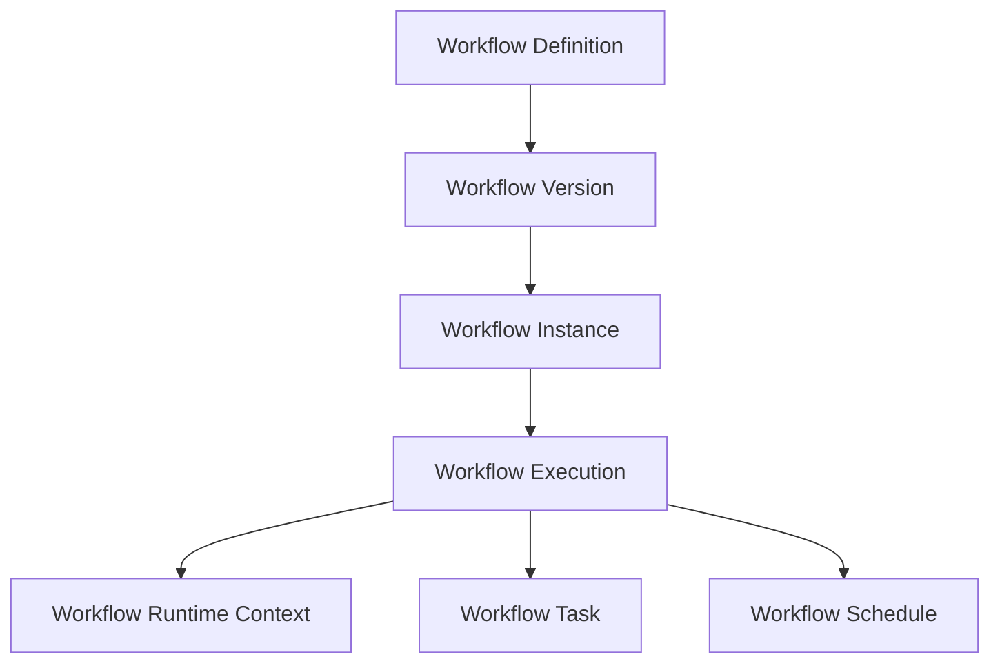

Workflow Definitions never reference runtime objects.

Runtime objects always reference immutable workflow versions.

---

# 19. Aggregate Ownership Rules

## AO-01

Workflow Definitions own workflow structure.

They never own execution.

---

## AO-02

Workflow Versions own immutable published models.

They never own runtime state.

---

## AO-03

Workflow Instances own execution identity.

They never own workflow design.

---

## AO-04

Workflow Execution owns orchestration.

It never owns business decisions.

---

## AO-05

Workflow Tasks own task lifecycle.

They never own organizational identities.

---

## AO-06

Workflow Runtime Context owns execution metadata.

It never owns platform identities.

---

# 20. Repository Model

Repositories provide aggregate persistence.

Repositories expose aggregate roots only.

Repositories never expose internal runtime implementation.

Canonical repositories include:

| Repository | Aggregate |
|------------|-----------|
| WorkflowDefinitionRepository | Workflow Definition |
| WorkflowVersionRepository | Workflow Version |
| WorkflowInstanceRepository | Workflow Instance |
| WorkflowExecutionRepository | Workflow Execution |
| WorkflowTaskRepository | Workflow Task |
| WorkflowScheduleRepository | Workflow Schedule |

Repositories remain infrastructure abstractions.

Persistence implementation is outside the scope of this architecture.

---

# 21. Domain Services

The Workflow Engine defines stateless domain services responsible for orchestration and coordination.

| Domain Service | Responsibility |
|----------------|----------------|
| WorkflowDefinitionService | Definition lifecycle |
| WorkflowValidationService | Validation and publication |
| WorkflowExecutionService | Runtime execution |
| WorkflowSchedulingService | Time-based execution |
| WorkflowTaskService | Human task coordination |
| WorkflowAssignmentService | Assignment resolution using Authorization policies |
| WorkflowRecoveryService | Runtime recovery |
| WorkflowCompensationService | Compensation execution |
| WorkflowMonitoringService | Execution telemetry |
| WorkflowVersionService | Version lifecycle |
| WorkflowMigrationService | Controlled migration planning |

Domain Services coordinate aggregates.

They do not replace aggregate behaviour.

---

# 22. Domain Events

The Workflow Engine publishes business-level workflow events.

Typical events include:

- WorkflowDefinitionCreated
- WorkflowDraftUpdated
- WorkflowVersionPublished
- WorkflowVersionActivated
- WorkflowVersionRetired
- WorkflowStarted
- WorkflowCompleted
- WorkflowCancelled
- WorkflowFailed
- WorkflowCheckpointCreated
- WorkflowResumed
- WorkflowSuspended
- WorkflowTaskCreated
- WorkflowTaskAssigned
- WorkflowTaskClaimed
- WorkflowTaskDelegated
- WorkflowTaskCompleted
- WorkflowTaskEscalated
- WorkflowCompensationStarted
- WorkflowCompensationCompleted

The Workflow Engine never publishes infrastructure implementation events.

Only stable business contracts are exposed.

---

# 23. CQRS Responsibilities

The Workflow Engine follows Command Query Responsibility Segregation (CQRS).

| Command Side | Query Side |
|--------------|------------|
| Workflow execution | Workflow monitoring |
| Workflow publication | Workflow dashboards |
| Task assignment | Task lists |
| Workflow cancellation | Execution history |
| Retry execution | Runtime analytics |
| Compensation | Operational reporting |

Commands change state.

Queries never modify workflow state.

---

# 24. Architectural Principles

## DDD-01

Each aggregate shall enforce its own consistency boundaries.

---

## DDD-02

Cross-aggregate coordination shall occur through Domain Services.

---

## DDD-03

Multi-domain communication shall occur through published contracts only.

---

## DDD-04

Aggregate references shall use identifiers rather than direct object ownership.

---

## DDD-05

The Workflow Engine shall remain a self-contained bounded context independent of business domains.

---

# 25. Workflow Definition Architecture

The Workflow Definition Architecture governs how workflows are created, validated, versioned, published, activated, retired, and consumed throughout the SutraERP platform.

Workflow Definitions represent immutable business process models after publication and act as the canonical source for all runtime executions.

The Workflow Engine SHALL execute only published workflow versions.

Draft definitions SHALL never be executed.

---

# 26. Workflow Definition Lifecycle

A workflow progresses through the following lifecycle.

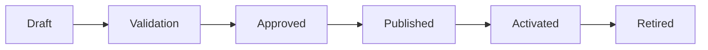

| State | Description |
|--------|-------------|
| Draft | Editable workflow definition |
| Validation | Structural and policy validation |
| Approved | Governance approval before publication |
| Published | Immutable version available for execution |
| Activated | Current active version for new workflow instances |
| Retired | Version no longer available for new executions |

Running instances continue using their originating version even after retirement.

---

# 27. Workflow Definition Components

Every Workflow Definition consists of the following logical components.

| Component | Responsibility |
|-----------|----------------|
| Metadata | Business identity and configuration |
| Nodes | Executable workflow steps |
| Connectors | Relationships between nodes |
| Variables | Runtime data contracts |
| Input Contract | Workflow inputs |
| Output Contract | Workflow outputs |
| Events | Trigger and completion events |
| Policies | Runtime policy references |
| Validation Rules | Design-time validation metadata |

Each component has a single canonical owner within the Workflow Definition aggregate.

---

# 28. Workflow Metadata

Each Workflow Definition SHALL contain canonical metadata.

| Metadata | Description |
|----------|-------------|
| Workflow Identifier | Globally unique identifier |
| Workflow Name | Business-readable name |
| Display Name | Localized display name |
| Description | Functional description |
| Category | Business classification |
| Version | Immutable version identifier |
| Status | Draft, Published, Retired |
| Owner Domain | Owning business domain |
| Created By | Author reference |
| Created Date | Creation timestamp |
| Last Modified | Modification timestamp |

Metadata SHALL NOT contain runtime information.

---

# 29. Runtime Variables

Runtime variables provide controlled data exchange during execution.

Variables are divided into two categories.

## Strongly Typed Variables

Strongly typed variables represent canonical business references.

Examples include:

- StudentId
- ApplicantId
- ExaminationId
- InvoiceId
- PersonId
- OrganizationId
- TenantId

These variables SHALL conform to canonical domain contracts.

---

## Runtime Variables

Runtime variables are intended for runtime execution only.

Examples include:

- Runtime execution metadata
- External API payloads
- Runtime calculations
- Diagnostic information
- Integration responses

Runtime variables SHALL remain scoped to workflow execution.

They SHALL NOT become canonical business records.

---

# 30. Workflow Input Contract

Every workflow defines an explicit input contract.

The input contract specifies:

- Required inputs
- Optional inputs
- Variable types
- Validation rules
- Default values
- Business references

Workflow execution SHALL fail if mandatory inputs are not satisfied.

---

# 31. Workflow Output Contract

Every workflow defines an explicit output contract.

Outputs may include:

- Completion status
- Generated identifiers
- Business references
- Domain events
- Runtime metrics
- Integration responses

Output contracts SHALL remain version compatible.

---

# 32. Workflow Nodes

Workflow Definitions are composed of executable nodes.

The Workflow Engine provides a canonical node library.

Business domains SHALL reuse these nodes.

They SHALL NOT introduce alternative execution semantics.

Canonical node categories include:

| Category | Purpose |
|----------|---------|
| Start | Entry point |
| End | Completion |
| Human Task | Manual activity |
| Service Task | System execution |
| Scriptless Processing | Internal engine operation |
| Event | Event handling |
| Timer | Scheduled execution |
| Decision Gateway | Conditional routing |
| Parallel Gateway | Parallel execution |
| Inclusive Gateway | Conditional parallelism |
| Exclusive Gateway | Single-path routing |
| Merge Gateway | Path convergence |
| Sub Workflow | Nested workflow execution |
| Compensation | Recovery execution |

Additional node implementations shall extend these canonical categories.

---

# 33. Workflow Connectors

Workflow connectors define execution flow.

Connectors specify:

- Source node
- Target node
- Transition conditions
- Execution constraints
- Priority
- Gateway routing metadata

Connectors SHALL remain directional.

Circular execution is permitted only when explicitly validated.

---

# 34. Workflow Validation

Workflow Definitions SHALL pass mandatory validation before publication.

Validation includes:

| Validation | Purpose |
|------------|---------|
| Structural Validation | Graph integrity |
| Connectivity Validation | Reachability |
| Deadlock Detection | Prevent blocked execution |
| Infinite Loop Detection | Prevent uncontrolled cycles |
| Gateway Validation | Valid branching |
| Variable Validation | Type consistency |
| Assignment Validation | Human task configuration |
| Policy Validation | Authorization references |
| Event Validation | Event subscriptions |
| Version Validation | Compatibility rules |
| Dependency Validation | Multi-domain references |

Validation failures SHALL prevent publication.

---

# 35. Publication Pipeline

Workflow publication follows a controlled governance pipeline.

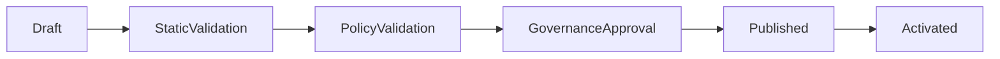

Each stage SHALL complete successfully before the next stage begins.

Partial publication is prohibited.

---

# 36. Workflow Versioning

Workflow versions are immutable.

A published version SHALL NEVER be modified.

Changes require creation of a new version.

Version lifecycle:

```text
Draft v1

↓

Published v1

↓

Draft v2

↓

Published v2

↓

Retire v1

↓

Retire v2
```

Running workflow instances remain attached to the version under which they were created.

---

# 37. Workflow Migration

Workflow migration is an administrative operation.

Migration SHALL NOT occur automatically.

Migration requires:

- Migration Plan
- Compatibility Validation
- Governance Approval
- Administrator Authorization
- Audit Recording

If migration cannot be completed safely, the workflow SHALL continue using its original version.

---

# 38. Reusable Workflow Templates

The Workflow Engine supports reusable workflow templates.

Templates provide common business patterns.

Examples include:

- Approval Workflow
- Document Review
- Multi-Level Approval
- Committee Approval
- Verification Workflow
- Escalation Workflow

Templates are platform assets.

Business domains create domain-specific copies before customization.

Template modification SHALL NOT affect existing workflow definitions.

---

# 39. Sub-Workflows

A workflow may invoke another workflow as a child workflow.

Parent-child relationships SHALL support:

- Input mapping
- Output mapping
- Context inheritance
- Correlation metadata
- Failure propagation
- Compensation propagation

Recursive workflow invocation is prohibited.

---

# 40. Definition Architecture Principles

## WD-01

Workflow Definitions SHALL remain independent from runtime execution.

---

## WD-02

Workflow Versions SHALL be immutable after publication.

---

## WD-03

Workflow Definitions SHALL expose explicit input and output contracts.

---

## WD-04

Workflow validation SHALL be mandatory before publication.

---

## WD-05

Workflow templates SHALL be reusable without modifying the canonical template.

---

## WD-06

Business domains SHALL define business processes.

The Workflow Engine SHALL define execution behaviour only.

---

# 41. Runtime Execution Architecture

The Runtime Execution Architecture governs how published workflow definitions are instantiated, executed, monitored, recovered, and completed.

The Workflow Engine executes workflow instances using a durable, event-driven execution model built upon immutable workflow definitions.

Runtime execution SHALL remain independent of workflow definition management.

---

# 42. Runtime Architecture Overview

Every workflow execution consists of independent runtime components that coordinate execution without modifying the underlying workflow definition.

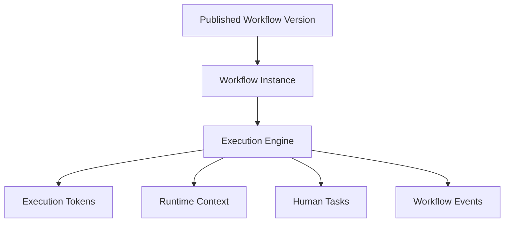

Each runtime component has a single responsibility.

---

# 43. Runtime Execution Principles

The Workflow Engine SHALL satisfy the following execution principles.

| Principle | Description |
|-----------|-------------|
| Durable Execution | Execution survives failures and restarts |
| Immutable Definitions | Runtime never modifies workflow definitions |
| Independent Transactions | Each executable node defines its own transaction boundary |
| Event-Driven Coordination | Execution reacts to events rather than polling |
| Checkpoint Recovery | Failed execution resumes from checkpoints |
| Version Safety | Running instances remain attached to published versions |
| Idempotent Execution | Repeated execution shall not corrupt business state |

---

# 44. Workflow Instance Lifecycle

A Workflow Instance represents one execution of one published workflow version.

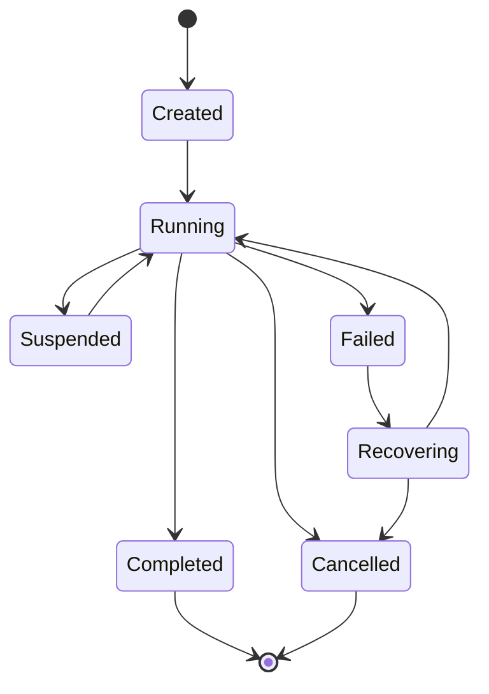

Every instance SHALL progress through controlled state transitions.

Illegal state transitions are prohibited.

---

# 45. Workflow Instance States

| State | Description |
|--------|-------------|
| Created | Runtime instance initialized |
| Running | Active execution |
| Suspended | Temporarily paused |
| Recovering | Recovery from failure |
| Completed | Successful execution |
| Cancelled | Administrative or business cancellation |
| Failed | Execution failure awaiting recovery |

Only the Workflow Engine may transition workflow instance states.

---

# 46. Execution Engine

The Execution Engine is responsible for coordinating runtime execution.

Its responsibilities include:

- Node execution
- Token movement
- Gateway evaluation
- Parallel coordination
- Retry scheduling
- Timeout monitoring
- Compensation execution
- Event handling
- Runtime persistence

The Execution Engine SHALL NOT evaluate business rules.

Business domains provide business outcomes.

---

# 47. Execution Tokens

Execution Tokens represent runtime progress through a workflow graph.

Each token identifies:

- Current node
- Previous node
- Workflow instance
- Execution path
- Correlation identifier
- Runtime context

Multiple tokens may exist simultaneously.

Tokens SHALL remain internal runtime objects.

---

# 48. Parallel Execution

The Workflow Engine SHALL support concurrent execution.

Supported execution patterns include:

- Sequential execution
- Parallel execution
- Conditional execution
- Inclusive execution
- Event-driven execution
- Parent-child execution

Parallel branches SHALL synchronize through gateway semantics before continuation where required.

---

# 49. Gateway Execution

The Workflow Engine supports canonical gateway behaviour.

| Gateway | Behaviour |
|----------|-----------|
| Exclusive | Single execution path |
| Parallel | Execute all outgoing branches |
| Inclusive | Execute selected branches |
| Merge | Join execution paths |
| Event | Wait for events |
| Timer | Wait until scheduled execution |

Gateway behaviour SHALL remain deterministic.

---

# 50. Transaction Boundaries

Each executable node defines its own transaction boundary.

```text
Node A

↓

Commit

↓

Node B

↓

Commit

↓

Node C

↓

Commit
```

Long-running workflows SHALL NOT maintain long-lived database transactions.

Failures affect only the current execution node.

---

# 51. Runtime Persistence

Runtime state SHALL be durably persisted.

Persisted runtime information includes:

- Workflow Instance
- Active Tokens
- Persistent Runtime Variables
- Current Node
- Execution History
- Pending Tasks
- Pending Events
- Retry Metadata
- Timeout Metadata
- Compensation Stack
- Checkpoints

Execution SHALL resume from persisted state after recovery.

---

# 52. Runtime Checkpoints

The Workflow Engine creates checkpoints throughout execution.

Checkpoint creation occurs:

- Before human tasks
- After transaction commits
- Before external integrations
- Before compensation boundaries
- Before suspension
- Before long-running waits

Checkpoint frequency is policy driven.

---

# 53. Runtime Recovery

Workflow recovery SHALL resume execution from the most recent valid checkpoint.

Recovery supports:

- Process restart
- Node restart
- Retry execution
- Event replay where safe
- Manual intervention
- Administrative recovery

Recovery SHALL preserve execution consistency.

---

# 54. Retry Architecture

Retry execution is policy driven.

Supported retry configuration includes:

| Policy | Purpose |
|---------|---------|
| Maximum Attempts | Retry limit |
| Retry Interval | Delay between retries |
| Exponential Backoff | Increasing delay |
| Immediate Retry | Instant retry |
| Scheduled Retry | Deferred retry |

Retry configuration SHALL remain externalized through policy configuration.

---

# 55. Timeout Management

Timeout policies govern long-running execution.

Supported timeout types include:

- Node timeout
- Human task timeout
- External service timeout
- Workflow timeout
- Event wait timeout

Timeout expiry may result in:

- Retry
- Escalation
- Compensation
- Cancellation
- Alternate workflow path

Timeout behaviour SHALL remain policy driven.

---

# 56. Compensation Architecture

The Workflow Engine uses Saga-based compensation.

Compensation SHALL reverse previously completed workflow activities where applicable.

Compensation supports:

- Node compensation
- Sub-workflow compensation
- Parent workflow compensation
- External integration compensation

Compensation SHALL NOT rely on distributed database rollback.

---

# 57. Workflow Suspension

Workflow execution may be suspended.

Suspension preserves:

- Runtime state
- Active tokens
- Pending tasks
- Runtime variables
- Event subscriptions
- Execution checkpoints

Suspension SHALL NOT lose execution progress.

---

# 58. Workflow Cancellation

Cancellation supports two execution modes.

| Mode | Behaviour |
|------|-----------|
| Graceful | Execute configured compensation policy before termination |
| Forced | Immediately terminate execution while recording audit information |

Cancellation SHALL always be audited.

---

# 59. Runtime Scalability

The Workflow Engine SHALL support distributed execution.

Execution nodes remain stateless.

Persistent runtime state remains centralized through durable storage.

Execution distribution SHALL NOT change workflow semantics.

---

# 60. Runtime Architecture Principles

## RE-01

Only published workflow versions may be executed.

---

## RE-02

Execution state SHALL be durably persisted.

---

## RE-03

Running workflow instances SHALL remain bound to their originating workflow version.

---

## RE-04

Each executable node SHALL define its own transaction boundary.

---

## RE-05

Recovery SHALL resume from checkpoints rather than restarting entire workflows.

---

## RE-06

Retry, timeout, escalation, and compensation SHALL be policy driven.

---

## RE-07

Execution SHALL support distributed processing without changing business behaviour.

---

## RE-08

Workflow runtime SHALL remain independent from workflow definition management.

---

# 61. Human Task Management Architecture

Human Task Management provides the execution model for workflow activities requiring human participation.

The Workflow Engine owns the lifecycle of workflow tasks while the Authorization domain owns identity resolution, authorization decisions, delegation policies, and assignment policy evaluation.

The Workflow Engine SHALL coordinate human work.

It SHALL NOT own organizational identities or authorization logic.

---

# 62. Human Task Overview

Human Tasks represent executable workflow nodes requiring action from one or more authorized users.

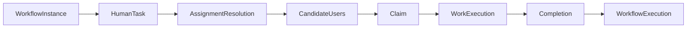

Human Tasks are runtime objects.

They are created during workflow execution and transition to archival according to retention policies after completion.

Completed Human Tasks remain available until retention expires and are not deleted immediately after completion.

---

# 63. Human Task Lifecycle

Every Human Task follows the canonical lifecycle.

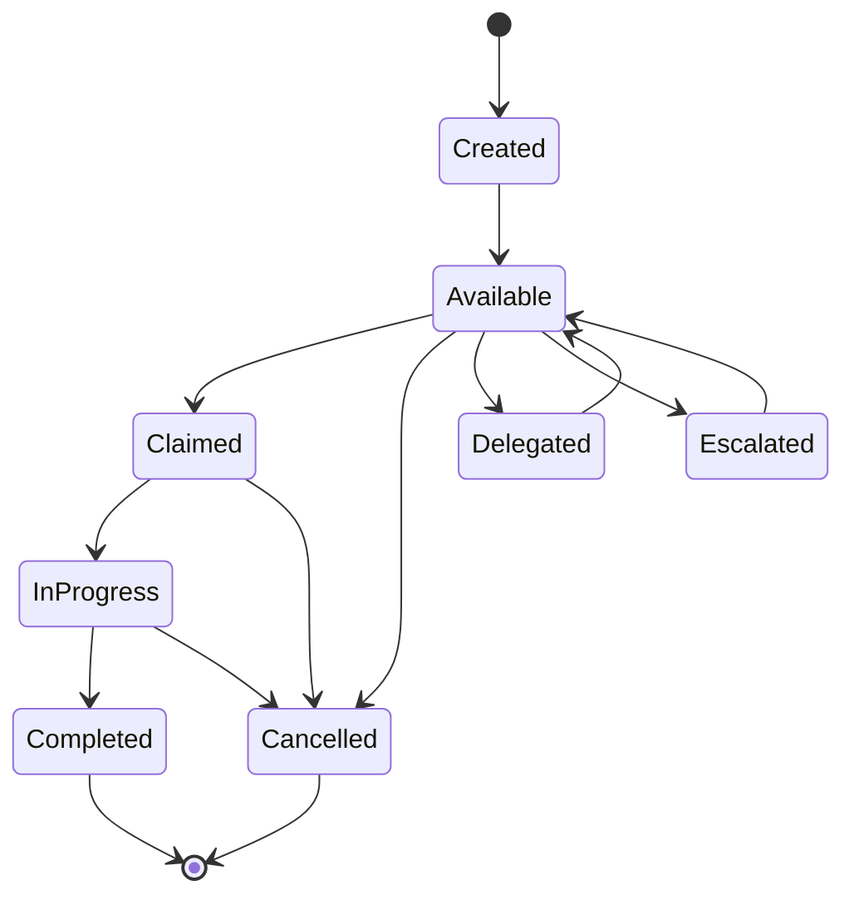

Human Tasks SHALL transition only through valid lifecycle states.

---

# 64. Human Task States

| State | Description |
|--------|-------------|
| Created | Task generated by workflow runtime |
| Available | Waiting for assignment or claim |
| Claimed | Accepted by an authorized user |
| In Progress | Work execution has started |
| Delegated | Assigned to another authorized identity |
| Escalated | Escalated according to policy |
| Completed | Successfully finished |
| Cancelled | Terminated before completion |

Task lifecycle is owned exclusively by the Workflow Engine.

---

# 65. Assignment Architecture

Task assignment identifies the users eligible to perform a Human Task.

Assignment targets are references only.

Identity ownership remains within L2-A02.

Authorization decisions remain within L2-A04.

Supported assignment models include:

| Assignment Type | Description |
|-----------------|-------------|
| Direct User Assignment | Assigned to a specific user |
| Role Assignment | Assigned to users holding a role |
| Group Assignment | Assigned to organizational groups |
| Department Assignment | Assigned to a department |
| Position Assignment | Assigned to users occupying a position |
| Dynamic Assignment | Resolved at runtime using Authorization policies |

Assignment SHALL occur through published platform contracts.

---

# 66. Candidate Resolution

Candidate resolution determines who is eligible to perform a Human Task.

The Workflow Engine requests candidate resolution from the Authorization domain.

The Authorization domain evaluates:

- Roles
- Organizational hierarchy
- Department membership
- Position assignment
- Delegation policies
- Temporary access
- Separation of Duties
- Business authorization policies

The Workflow Engine SHALL consume the result.

It SHALL NOT evaluate authorization policies.

---

# 67. Task Claim Model

Tasks may require explicit claiming before execution.


Only eligible candidates may successfully claim a task.

Claim operations SHALL be atomic.

---

# 68. Delegation Architecture

Task delegation transfers execution responsibility while preserving workflow ownership.

Supported delegation includes:

| Delegation | Description |
|------------|-------------|
| Manual Delegation | User delegates task |
| Temporary Delegation | Policy-controlled delegation |
| Out-of-Office Delegation | Automatic absence handling |
| Administrative Delegation | Administrator initiated |

Delegation SHALL preserve complete audit history.

---

# 69. Task Reassignment

Workflow tasks may be reassigned when permitted by authorization policies.

Supported reassignment scenarios include:

- Administrator reassignment
- Organizational restructuring
- Position changes
- Assignment correction
- Policy-driven reassignment

Every reassignment SHALL be recorded within workflow execution history.

---

# 70. Escalation Management

Human Tasks may be escalated according to configured SLA policies.

Escalation triggers include:

- SLA expiration
- Response timeout
- Approval delay
- Organizational escalation
- Administrative escalation

Escalation actions may include:

- Notify supervisors
- Delegate task
- Reassign task
- Execute alternate workflow path
- Trigger compensation
- Cancel workflow

Escalation behaviour remains policy driven.

---

# 71. SLA Management

Each Human Task may reference an SLA policy.

Supported SLA attributes include:

| Attribute | Purpose |
|-----------|---------|
| Response Time | Initial acknowledgement |
| Completion Time | Maximum execution duration |
| Warning Threshold | Early warning |
| Escalation Threshold | Escalation trigger |
| Business Calendar | Working hours calculation |

The Workflow Engine consumes SLA policies.

It does not define them.

---

# 72. Work Queues

The Workflow Engine maintains logical work queues as runtime projections.

Queues are generated dynamically from assignment results.

Examples include:

- My Tasks
- Department Tasks
- Role Tasks
- Escalated Tasks
- Delegated Tasks
- High Priority Tasks
- Overdue Tasks

Work queues SHALL NOT become assignment mechanisms.

They are execution views only.

---

# 73. Task Priorities

Workflow tasks support execution priorities.

Canonical priorities include:

| Priority | Description |
|----------|-------------|
| Critical | Immediate attention required |
| High | High operational importance |
| Normal | Standard processing |
| Low | Deferred processing |

Priority influences presentation and escalation.

It SHALL NOT bypass authorization.

---

# 74. Attachments and References

Human Tasks may reference external resources.

Supported references include:

- Documents
- Forms
- Images
- URLs
- External Records
- Business Entities

The Workflow Engine stores references only.

Binary content remains owned by the Document Management platform.

---

# 75. Human Task Notifications

The Workflow Engine publishes task lifecycle events.

Examples include:

- TaskCreated
- TaskAssigned
- TaskAvailable
- TaskClaimed
- TaskDelegated
- TaskEscalated
- TaskCompleted
- TaskCancelled

Notification delivery is outside the scope of the Workflow Engine.

Dedicated Notification Services subscribe to these events.

---

# 76. Human Task Security

Human Task execution requires:

- Authenticated user
- Authorized access
- Valid execution context
- Tenant isolation
- Audit recording

The Workflow Engine SHALL trust Authorization decisions.

It SHALL NOT independently authorize task execution.

---

# 77. Human Task Audit

The Workflow Engine records execution history for every Human Task.

Execution history includes:

- Creation
- Assignment
- Candidate resolution
- Claim
- Delegation
- Reassignment
- Escalation
- Completion
- Cancellation

Immutable audit retention remains the responsibility of the Audit domain.

---

# 78. Human Task Architecture Principles

## HT-01

Human Tasks SHALL remain runtime execution objects.

---

## HT-02

The Workflow Engine SHALL own task lifecycle only.

---

## HT-03

Authorization SHALL own assignment resolution.

---

## HT-04

Identity ownership SHALL remain within L2-A02.

---

## HT-05

Delegation, reassignment, and escalation SHALL preserve complete execution history.

---

## HT-06

Work queues SHALL remain logical runtime projections.

They SHALL NOT become assignment mechanisms.

---

## HT-07

Notification delivery SHALL remain outside the Workflow Engine.

---

## HT-08

Human Task execution SHALL always occur within an authenticated and authorized execution context.

---

# 79. System Workflow Orchestration Architecture

The Workflow Engine provides a canonical orchestration platform for automated system-to-system workflows.

System Workflows coordinate platform services, business domains, external systems, scheduled execution, and event-driven automation without requiring human intervention.

The Workflow Engine SHALL orchestrate execution.

It SHALL NOT implement business logic.

---

# 80. System Workflow Overview

System Workflows automate execution between internal platform services and external integrations.

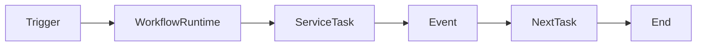

System workflows execute entirely through the Workflow Runtime.

---

# 81. System Workflow Lifecycle

System Workflows follow the same lifecycle as Human Workflows.

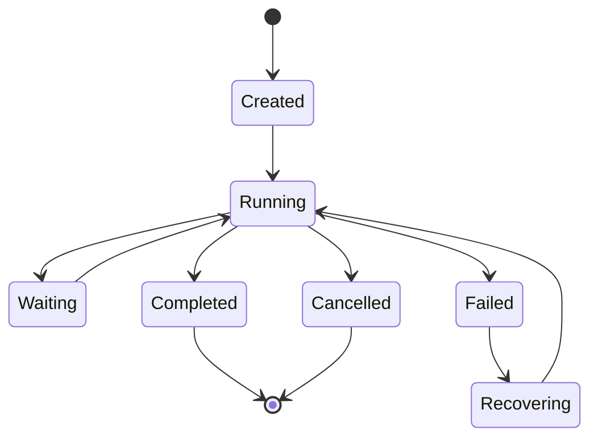

Waiting represents asynchronous execution while awaiting external events, timers, or service responses.

---

# 82. Workflow Triggers

Workflow execution begins through approved trigger mechanisms.

Supported trigger types include:

| Trigger | Description |
|----------|-------------|
| Manual | Explicit user initiation |
| API | Platform API invocation |
| Domain Event | Published business event |
| Timer | Scheduled execution |
| Webhook | External callback |
| Parent Workflow | Parent-child orchestration |
| Signal | Internal runtime signal |

Triggers SHALL create new Workflow Instances.

They SHALL NOT execute workflow logic directly.

---

# 83. Service Tasks

Service Tasks execute automated operations.

Examples include:

- Calling domain services
- Invoking platform APIs
- Executing integrations
- Publishing events
- Waiting for responses
- Data transformation
- Runtime calculations

Service Tasks SHALL remain stateless.

Business rules remain outside the Workflow Engine.

---

# 84. Event-Based Execution

The Workflow Engine supports event-driven orchestration.

Workflow execution may pause while waiting for:

- Domain Events
- Platform Events
- Integration Events
- Timer Events
- Signal Events

Execution resumes only after receiving a valid event.

---

# 85. Timer Architecture

Timers enable delayed or scheduled execution.

Supported timer patterns include:

| Timer Type | Purpose |
|------------|---------|
| One-Time | Execute once |
| Scheduled | Calendar-based execution |
| Relative Delay | Execute after duration |
| Deadline | Execute before expiry |
| Reminder | Notify before timeout |

Timers SHALL survive system restarts.

---

# 86. Event Subscriptions

Workflow instances may subscribe to runtime events.

Subscriptions include:

- Business Events
- Integration Events
- Platform Events
- Workflow Signals
- Timer Events

Subscriptions SHALL be durably persisted.

Lost subscriptions are prohibited.

---

# 87. Parent-Child Workflow Architecture

A workflow may invoke another workflow.

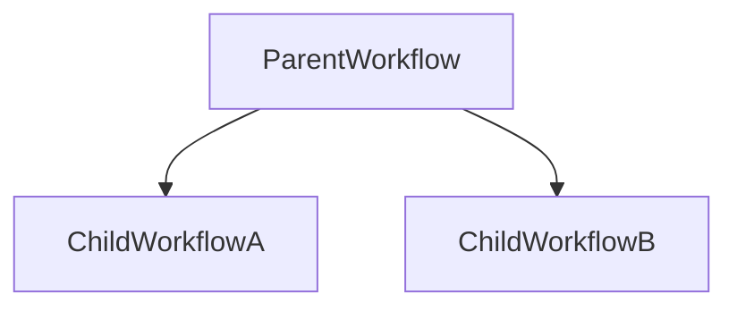

Parent workflows may:

- Wait for completion
- Continue asynchronously
- Aggregate results
- Propagate cancellation
- Propagate compensation

Recursive execution is prohibited.

---

# 88. External System Orchestration

The Workflow Engine may coordinate external systems through integration adapters.

Supported integration targets include:

- Payment Gateways
- Learning Management Systems
- Government Portals
- ERP Systems
- Identity Providers
- Messaging Platforms
- Document Services
- Analytics Platforms

The Workflow Engine SHALL depend on integration abstractions rather than vendor-specific implementations.

---

# 89. API Invocation Model

System Workflows invoke APIs through canonical Service Tasks.

Supported invocation patterns include:

| Pattern | Description |
|---------|-------------|
| Synchronous | Wait for response |
| Asynchronous | Continue after acknowledgement |
| Fire-and-Forget | Publish request without waiting |
| Callback | Resume upon callback |

API execution SHALL remain idempotent where required.

---

# 90. Workflow Signals

Signals provide lightweight runtime coordination.

Signals may be used to:

- Resume execution
- Synchronize branches
- Trigger waiting workflows
- Coordinate parent-child execution
- Notify runtime transitions

Signals SHALL remain internal runtime constructs.

---

# 91. Scheduled Workflows

The Workflow Engine supports recurring workflow execution.

Examples include:

- Daily jobs
- Semester processing
- Monthly billing
- Annual promotions
- Compliance checks
- Scheduled reports

Scheduling metadata SHALL remain independent of workflow definitions.

---

# 92. Long-Running Workflows

The Workflow Engine SHALL support workflows executing for extended durations.

Long-running workflows may remain active while awaiting:

- Human approval
- External response
- Government confirmation
- Payment completion
- Admission verification
- Examination approval

Workflow duration SHALL NOT affect execution correctness.

---

# 93. Short-Lived Workflows

The Workflow Engine also supports short-lived execution.

Typical examples include:

- Validation workflows
- Immediate approvals
- Notification workflows
- API orchestration
- Background processing

Short-lived workflows reuse the same runtime architecture.

---

# 94. Distributed Execution

Workflow execution may occur across multiple execution nodes.

Execution nodes remain stateless.

Runtime state remains durably persisted.

Distributed execution SHALL preserve:

- Ordering guarantees
- Correlation metadata
- Tenant isolation
- Workflow consistency

Infrastructure topology SHALL remain transparent to business domains.

---

# 95. Workflow Correlation

Every workflow execution SHALL include correlation metadata.

Minimum correlation information includes:

| Attribute | Purpose |
|-----------|---------|
| Workflow Instance ID | Runtime identity |
| Correlation ID | End-to-end tracing |
| Tenant ID | Tenant isolation |
| Institution ID | Institutional boundary |
| Organization ID | Organizational boundary |
| Campus ID | Campus boundary |
| Parent Workflow ID | Parent-child tracing |
| Trace ID | Distributed tracing |

Correlation metadata SHALL propagate throughout execution.

---

# 96. Orchestration Failure Handling

System Workflow failures may result in:

- Retry
- Compensation
- Escalation
- Suspension
- Cancellation
- Administrative Recovery

Failure handling SHALL follow configured runtime policies.

---

# 97. Orchestration Principles

## SO-01

System Workflows SHALL orchestrate execution rather than implement business logic.

---

## SO-02

Workflow execution SHALL support synchronous and asynchronous orchestration.

---

## SO-03

Timers, events, and signals SHALL be durable runtime constructs.

---

## SO-04

Parent-child workflows SHALL support controlled execution relationships.

Recursive execution is prohibited.

---

## SO-05

External integrations SHALL occur only through approved adapter abstractions.

---

## SO-06

Workflow correlation SHALL be preserved across every execution boundary.

---

## SO-07

Distributed execution SHALL remain transparent to business domains.

---

## SO-08

System Workflow behaviour SHALL remain deterministic regardless of deployment topology.

---

# 98. Integration Architecture

The Workflow Engine integrates with platform domains, business domains, and external systems through canonical contracts.

Integration SHALL remain contract-driven, loosely coupled, and event-oriented.

The Workflow Engine SHALL coordinate interactions.

It SHALL NOT directly embed domain-specific integrations or vendor-specific implementations.

---

# 99. Integration Principles

The Workflow Engine follows the following integration principles.

| Principle | Description |
|-----------|-------------|
| Contract First | All integrations use published contracts |
| Loose Coupling | Workflow Engine never depends on implementation details |
| Event Driven | Events are the preferred integration mechanism |
| Idempotent Operations | Repeated requests shall not corrupt execution |
| Asynchronous by Default | Long-running operations avoid blocking execution |
| Canonical Contracts | Business communication uses canonical models |
| Technology Independence | Integration contracts remain implementation neutral |

---

# 100. Integration Model

The Workflow Engine sits between business domains and integration infrastructure.

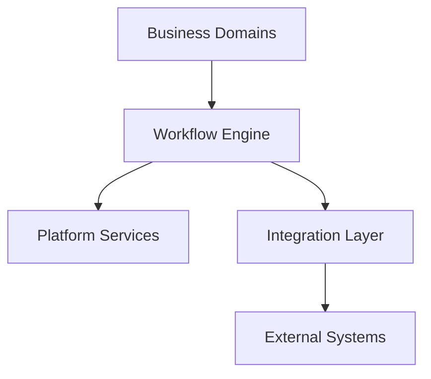

Business domains never communicate directly with Workflow Runtime internals.

---

# 101. Integration Types

The Workflow Engine supports multiple integration mechanisms.

| Integration Type | Purpose |
|------------------|---------|
| Command Invocation | Request execution |
| Event Publication | Notify interested systems |
| Event Subscription | Resume execution |
| Service Invocation | Call platform services |
| API Invocation | Invoke REST or RPC endpoints |
| Message Queue | Asynchronous communication |
| Webhook | Receive external callbacks |
| File Exchange | Controlled document exchange |

Each integration type has a clearly defined execution contract.

---

# 102. Platform Integration

The Workflow Engine integrates with foundational platform domains.

| Platform Domain | Integration Purpose |
|-----------------|---------------------|
| Platform Foundation | Runtime infrastructure and tenancy |
| Person & Identity | Identity references |
| Authentication | Execution identity |
| Authorization & Policy | Assignment, authorization, and policy evaluation |
| Notification Platform | Delivery of workflow notifications |
| Audit Platform | Immutable audit recording |
| Document Management | Document references |
| Configuration Platform | Runtime configuration |
| Observability Platform | Metrics and monitoring |

The Workflow Engine SHALL consume published interfaces only.

---

# 103. Business Domain Integration

Business domains integrate with the Workflow Engine using canonical workflow contracts.

Supported interactions include:

- Start workflow
- Resume workflow
- Cancel workflow
- Query workflow status
- Submit task result
- Receive workflow events
- Receive task events
- Receive completion notifications

Business domains SHALL NOT manipulate runtime state directly.

---

# 104. Command Integration

Commands initiate workflow operations.

Canonical command examples include:

- StartWorkflow
- ResumeWorkflow
- SuspendWorkflow
- CancelWorkflow
- CompleteTask
- ClaimTask
- DelegateTask
- RetryWorkflow

Commands SHALL be validated before execution.

Command execution SHALL produce deterministic outcomes.

---

# 105. Event Architecture

The Workflow Engine publishes domain-level events representing workflow lifecycle transitions.

Examples include:

| Event | Description |
|--------|-------------|
| WorkflowStarted | Workflow execution begins |
| WorkflowCompleted | Workflow finishes successfully |
| WorkflowCancelled | Workflow terminated |
| WorkflowFailed | Execution failure |
| WorkflowSuspended | Execution paused |
| WorkflowRecovered | Recovery completed |
| TaskCreated | Human task generated |
| TaskCompleted | Human task finished |
| TaskEscalated | Escalation occurred |

Events SHALL be immutable.

Published events SHALL never be modified.

---

# 106. Event Consumption

Workflow execution may resume after consuming events.

Supported event sources include:

- Business Domains
- Platform Services
- External Systems
- Scheduled Timers
- Parent Workflows
- Runtime Signals

Event consumption SHALL validate:

- Correlation Identifier
- Tenant Context
- Workflow State
- Event Compatibility
- Version Compatibility

Invalid events SHALL be rejected.

---

# 107. API Integration

The Workflow Engine exposes stable APIs for runtime interaction.

Canonical API categories include:

| API Category | Purpose |
|--------------|---------|
| Workflow Definition APIs | Definition lifecycle |
| Workflow Runtime APIs | Execution control |
| Task APIs | Human task operations |
| Monitoring APIs | Runtime visibility |
| Administration APIs | Governance operations |

API contracts SHALL remain versioned.

Breaking changes require new API versions.

---

# 108. External Integration

External systems interact through approved integration adapters.

Examples include:

- Government Portals
- Banking Platforms
- Payment Gateways
- Identity Providers
- Learning Platforms
- ERP Systems
- Communication Platforms
- Cloud Services

The Workflow Engine SHALL remain vendor neutral.

External systems SHALL never directly manipulate workflow runtime.

---

# 109. Message-Based Integration

Asynchronous messaging is supported for long-running execution.

Supported messaging patterns include:

| Pattern | Purpose |
|----------|---------|
| Publish-Subscribe | Broadcast events |
| Point-to-Point | Directed processing |
| Event Streaming | Continuous event processing |
| Request-Reply | Controlled asynchronous response |

Messaging infrastructure remains outside Workflow Engine ownership.

---

# 110. Callback Architecture

Long-running integrations may complete through callbacks.

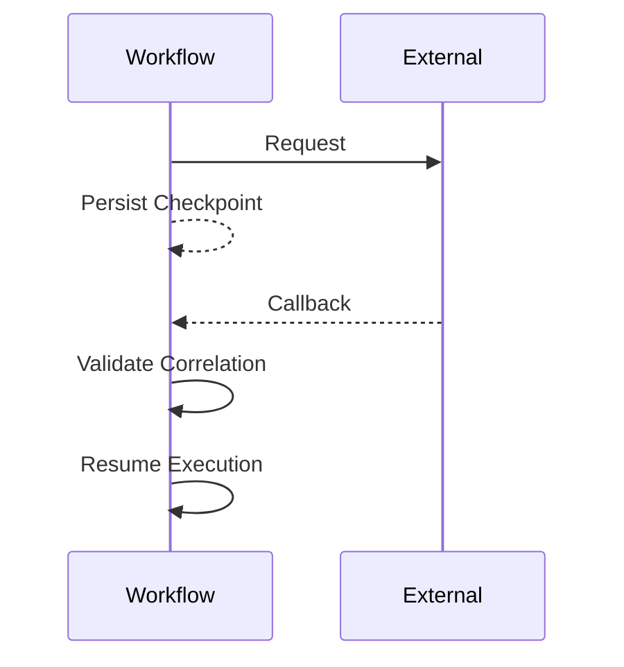

Callbacks SHALL validate:

- Correlation Identifier
- Authentication
- Tenant Context
- Message Integrity

---

# 111. Idempotency

Workflow integration SHALL support idempotent execution.

Duplicate requests SHALL NOT create duplicate workflow execution.

Idempotency applies to:

- Workflow creation
- Task completion
- Callback processing
- Event processing
- Retry execution

Idempotency keys SHALL be maintained throughout execution.

---

# 112. Error Handling

Integration failures SHALL be categorized.

| Failure Type | Handling Strategy |
|--------------|------------------|
| Temporary Failure | Retry |
| Permanent Failure | Compensation |
| Validation Failure | Reject Request |
| Authorization Failure | Deny Execution |
| Timeout | Retry or Escalate |
| Communication Failure | Recover from Checkpoint |

Failure behaviour SHALL follow runtime policies.

---

# 113. Integration Security

Every integration SHALL execute within a validated security context.

Minimum security requirements include:

- Authenticated caller
- Authorized operation
- Tenant isolation
- Correlation validation
- Audit recording
- Secure transport

Security enforcement SHALL remain delegated to Platform Security domains.

---

# 114. Integration Versioning

Integration contracts evolve independently from workflow definitions.

Versioning applies to:

- APIs
- Events
- Commands
- Callbacks
- Message Schemas

Backward compatibility SHOULD be maintained where practical.

Breaking changes SHALL require explicit version upgrades.

---

# 115. Integration Architecture Principles

## IA-01

All integrations SHALL use published contracts.

---

## IA-02

Business domains SHALL remain isolated from Workflow Runtime internals.

---

## IA-03

Workflow events SHALL be immutable.

---

## IA-04

External systems SHALL integrate only through approved adapters.

---

## IA-05

Workflow integration SHALL support idempotent execution.

---

## IA-06

Event and API contracts SHALL be independently versioned.

---

## IA-07

Security enforcement SHALL remain delegated to Authentication and Authorization domains.

---

## IA-08

Integration failures SHALL be handled through policy-driven recovery mechanisms.

---

# 116. Assignment and Policy Architecture

The Assignment and Policy Architecture defines how workflow participants are identified, resolved, authorized, and managed throughout workflow execution.

The Workflow Engine coordinates assignment execution while the Authorization & Policy domain (L2-A04) owns all policy definitions, authorization decisions, separation of duties, delegation rules, and assignment evaluation.

The Workflow Engine SHALL consume policy decisions.

It SHALL NOT implement policy evaluation logic.

---

# 117. Architectural Responsibilities

Assignment responsibilities are divided across platform domains.

| Capability | Canonical Owner |
|------------|-----------------|
| Workflow Task Lifecycle | Workflow Engine |
| Assignment Request | Workflow Engine |
| Policy Evaluation | Authorization & Policy |
| Identity Ownership | Person & Identity |
| Authentication Context | Authentication |
| Authorization Decision | Authorization & Policy |
| Delegation Rules | Authorization & Policy |
| Separation of Duties | Authorization & Policy |
| Organizational Hierarchy | Organization Domain |
| Position Hierarchy | Organization Domain |

This separation preserves clear ownership boundaries and prevents duplication of security logic.

---

# 118. Assignment Resolution Flow

Workflow assignment follows a contract-driven execution model.

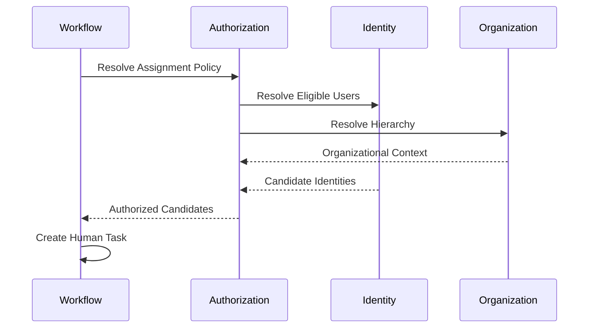

The Workflow Engine receives only the final assignment result.

Intermediate policy decisions remain internal to the Authorization domain.

---

# 119. Assignment Strategies

The Workflow Engine supports multiple assignment strategies.

| Strategy | Description |
|----------|-------------|
| Named User | Specific user reference |
| Role Based | Users possessing a role |
| Position Based | Users occupying a position |
| Department Based | Department membership |
| Organization Based | Organizational unit |
| Committee Based | Committee membership |
| Dynamic Policy | Authorization policy evaluation |
| External Resolver | Approved external assignment provider |

Assignment strategy selection occurs during workflow definition.

Assignment resolution occurs during workflow execution.

---

# 120. Dynamic Assignment

Dynamic Assignment resolves workflow participants at runtime.

Runtime evaluation may consider:

- Runtime variables
- Organizational hierarchy
- Reporting relationships
- Department ownership
- Campus
- Institution
- Tenant
- Current assignments
- Temporary delegation
- Availability

Dynamic assignment SHALL remain deterministic for a given execution context.

---

# 121. Multi-Level Approval

The Workflow Engine supports hierarchical approval workflows.

Typical examples include:

- Department Approval
- Faculty Approval
- Registrar Approval
- Finance Approval
- Controller Approval
- Vice Chancellor Approval

Approval chains are determined through policy evaluation rather than workflow implementation.

Workflow definitions specify the approval pattern.

Authorization determines the actual approvers.

---

# 122. Parallel Approval

Multiple approvers may evaluate a workflow simultaneously.

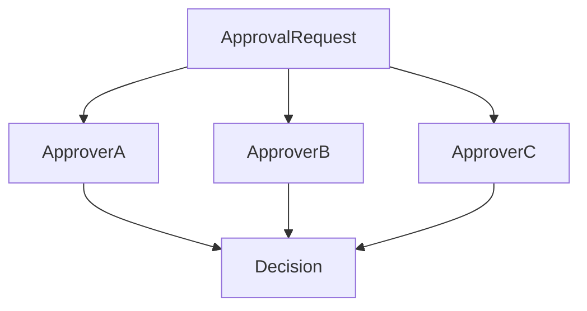

Supported completion rules include:

| Rule | Description |
|------|-------------|
| All Approvals | Every approver must approve |
| Majority | Majority approval required |
| Quorum | Configured quorum required |
| First Response | First valid response wins |
| Custom Policy | Policy-driven completion |

Completion semantics are defined by workflow configuration.

---

# 123. Sequential Approval

Sequential approvals execute in predefined order.

```text
Applicant

↓

Department

↓

Faculty

↓

Finance

↓

Registrar

↓

Completed
```

The next approval SHALL begin only after the current approval completes.

---

# 124. Separation of Duties

The Workflow Engine SHALL enforce Separation of Duties through Authorization.

Examples include:

- Requester cannot approve own request.
- Creator cannot authorize payment.
- Examiner cannot approve examination results.
- Fee creator cannot authorize refund.

Workflow Engine validates only that Authorization has supplied an eligible participant.

Policy ownership remains external.

---

# 125. Delegation Policies

Delegation policies are evaluated by Authorization.

Supported delegation includes:

| Delegation Type | Description |
|-----------------|-------------|
| Temporary | Fixed duration |
| Permanent | Administrative assignment |
| Out-of-Office | Absence handling |
| Emergency | Exceptional delegation |

Delegation SHALL preserve:

- Audit history
- Original assignee
- Delegate identity
- Effective period
- Delegation reason

---

# 126. Escalation Policies

Escalation policies determine behaviour when SLAs are violated.

Escalation actions may include:

- Notify supervisor
- Notify administrator
- Delegate task
- Reassign task
- Extend deadline
- Execute alternate workflow
- Trigger compensation

Escalation rules are evaluated externally.

Workflow execution follows the returned decision.

---

# 127. Authorization Context

Every assignment evaluation executes within an Authorization Context.

Minimum context includes:

| Context | Purpose |
|---------|---------|
| Tenant | Tenant isolation |
| Institution | Institutional scope |
| Organization | Organizational boundary |
| Campus | Campus boundary |
| User Identity | Request initiator |
| Workflow Type | Applicable policy |
| Business Object | Authorization scope |
| Execution Time | Time-based policy evaluation |

The Workflow Engine SHALL forward context unchanged.

---

# 128. Assignment Constraints

Assignment may include execution constraints.

Examples include:

- Working hours
- Business calendar
- Geographic restriction
- Campus restriction
- Institution restriction
- Department restriction
- Concurrent assignment limits
- Conflict of interest rules

Constraint evaluation belongs to Authorization.

---

# 129. Policy References

Workflow Definitions SHALL reference policies symbolically.

Examples include:

- ApprovalPolicy
- DelegationPolicy
- EscalationPolicy
- RetryPolicy
- TimeoutPolicy
- SLA Policy
- AssignmentPolicy

Workflow Definitions SHALL NOT embed policy implementation.

---

# 130. Policy Versioning

Policy evolution is independent of Workflow Definition versioning.

Workflow Definitions reference policy identifiers rather than concrete implementations.

Policy updates SHALL NOT require workflow publication unless behavioural compatibility is affected.

---

# 131. Policy Failure Handling

Policy evaluation may fail due to:

- Missing policy
- Invalid policy
- Ambiguous assignment
- No eligible candidates
- Organizational inconsistency
- Authorization failure

Failure responses may include:

- Workflow suspension
- Administrative intervention
- Retry
- Escalation
- Cancellation

Failure behaviour SHALL follow configured runtime policy.

---

# 132. Assignment Audit

Assignment decisions SHALL be auditable.

Audit information includes:

- Assignment request
- Policy identifier
- Evaluation timestamp
- Candidate identities
- Selected assignee
- Delegation information
- Escalation history
- Reassignment history

The Workflow Engine records execution history.

Long-term immutable audit ownership belongs to the Audit platform.

---

# 133. Assignment and Policy Principles

## AP-01

Workflow Engine SHALL coordinate assignment.

Authorization SHALL evaluate assignment.

---

## AP-02

Workflow Definitions SHALL reference policies rather than embed policy logic.

---

## AP-03

Assignment decisions SHALL execute within a validated Authorization Context.

---

## AP-04

Identity ownership SHALL remain external to the Workflow Engine.

---

## AP-05

Delegation, escalation, and separation of duties SHALL remain policy-driven.

---

## AP-06

Workflow execution SHALL trust published Authorization decisions.

---

## AP-07

Policy versioning SHALL remain independent from workflow versioning.

---

## AP-08

All assignment decisions SHALL be auditable and traceable.

---

# 134. Workflow Lifecycle Management

Workflow Lifecycle Management governs the complete operational lifecycle of workflow instances from creation through archival.

The lifecycle ensures that every workflow execution progresses through well-defined, auditable, and deterministic state transitions.

Only the Workflow Engine may control workflow lifecycle transitions.

Business domains may request lifecycle operations but shall never manipulate runtime state directly.

---

# 135. Workflow Lifecycle Overview

Every workflow instance progresses through a controlled execution lifecycle.

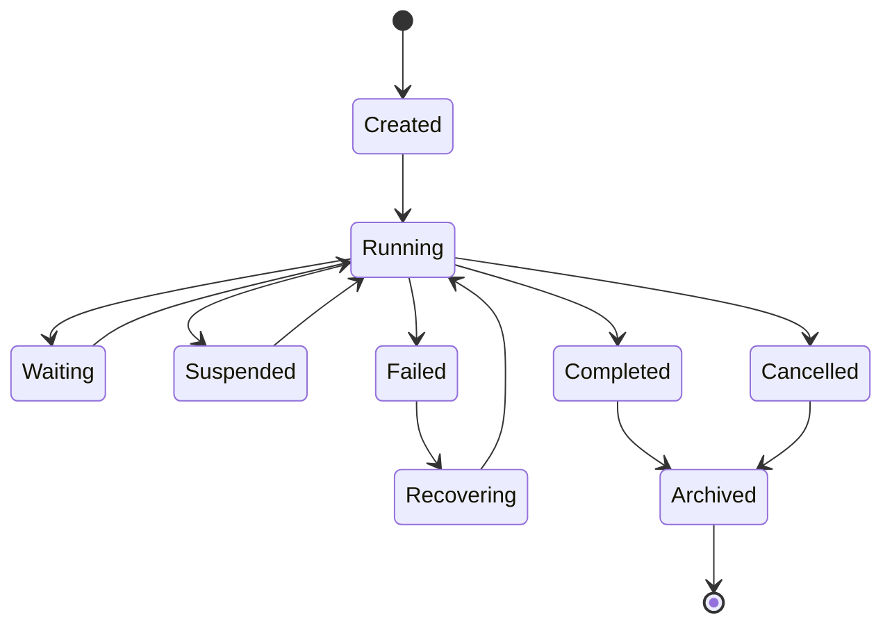

All lifecycle transitions SHALL be validated before execution.

---

# 136. Lifecycle States

| State | Description |
|--------|-------------|
| Created | Runtime instance initialized |
| Running | Active execution |
| Waiting | Awaiting event, timer, callback, or dependency |
| Suspended | Temporarily paused |
| Recovering | Executing recovery procedures |
| Completed | Successfully finished |
| Failed | Execution failure |
| Cancelled | Explicit termination |
| Archived | Retained for historical purposes |

Each workflow instance SHALL exist in exactly one lifecycle state at any point in time.

---

# 137. Lifecycle Transition Rules

The Workflow Engine validates every state transition.

| Current State | Allowed Transition |
|--------------|-------------------|
| Created | Running, Cancelled |
| Running | Waiting, Suspended, Completed, Failed, Cancelled |
| Waiting | Running, Cancelled |
| Suspended | Running, Cancelled |
| Failed | Recovering, Cancelled |
| Recovering | Running, Cancelled |
| Completed | Archived |
| Cancelled | Archived |

Transitions not explicitly defined SHALL be rejected.

---

# 138. Workflow Creation

Workflow creation requires:

- Published workflow version
- Valid execution context
- Successful input validation
- Tenant context
- Correlation identifier
- Execution authorization

Creation SHALL initialize:

- Workflow Instance
- Workflow Runtime Context
- Initial Execution Token
- Execution History
- Monitoring Metadata

No business processing occurs during creation.

---

# 139. Workflow Activation

Workflow activation begins execution after successful creation.

Activation SHALL:

- Load published workflow version
- Initialize execution runtime
- Load runtime variables
- Initialize execution token
- Register event subscriptions
- Start monitoring

Activation SHALL NOT modify workflow definitions.

---

# 140. Waiting State Management

A workflow enters the Waiting state when execution pauses for an external dependency.

Waiting conditions include:

- Human task completion
- External callback
- Timer expiration
- Event reception
- Parent workflow completion
- Child workflow completion
- Scheduled execution window

Workflow state SHALL remain durably persisted throughout the waiting period.

---

# 141. Suspension Management

Suspension temporarily pauses workflow execution.

Suspension may occur due to:

- Administrative request
- Maintenance window
- External dependency
- Policy requirement
- Operational intervention

During suspension the Workflow Engine SHALL preserve:

- Runtime variables
- Execution tokens
- Pending events
- Pending tasks
- Checkpoints
- Execution history

No execution progress shall occur while suspended.

---

# 142. Resume Management

Workflow execution resumes only after suspension conditions have been cleared.

Resume SHALL:

- Restore runtime state
- Reload execution context
- Validate workflow version
- Continue from the latest checkpoint

Resume SHALL NOT restart completed execution steps.

---

# 143. Failure Management

Workflow failures are categorized before recovery.

| Failure Category | Description |
|------------------|-------------|
| Business Failure | Business operation unsuccessful |
| Integration Failure | External communication failure |
| Runtime Failure | Workflow runtime issue |
| Infrastructure Failure | Platform failure |
| Timeout Failure | Execution deadline exceeded |
| Policy Failure | Assignment or authorization failure |

Failure classification determines the recovery strategy.

---

# 144. Recovery Lifecycle

Recovery restores workflow execution without restarting the entire workflow.

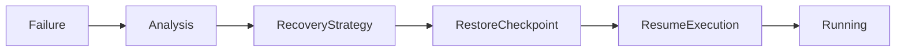

Recovery SHALL preserve workflow consistency.

---

# 145. Workflow Completion

Workflow completion occurs when all executable paths terminate successfully.

Completion SHALL:

- Finalize runtime state
- Publish completion event
- Close pending tasks
- Release runtime resources
- Persist execution history
- Update monitoring metrics

Completed workflows become immutable.

---

# 146. Workflow Cancellation

Cancellation terminates workflow execution before successful completion.

Cancellation may be initiated by:

- Business request
- Administrator
- Runtime policy
- Parent workflow
- Compensation strategy

Cancellation SHALL record:

- Cancellation reason
- Requesting identity
- Timestamp
- Workflow state
- Compensation status

---

# 147. Workflow Archival

Completed and cancelled workflows enter the Archived state according to retention policies.

Archived workflows retain:

- Execution history
- Runtime metadata
- Audit references
- Business references
- Monitoring summaries

Archived workflows SHALL NOT be reactivated.

---

# 148. Retention Management

Workflow retention is governed by platform policies.

Retention categories may include:

| Category | Typical Purpose |
|----------|-----------------|
| Operational | Active operational reporting |
| Audit | Regulatory compliance |
| Legal Hold | Litigation preservation |
| Historical | Analytics and reporting |

Retention policies are externally configurable.

The Workflow Engine enforces them during archival.

---

# 149. Lifecycle Events

Lifecycle transitions publish canonical runtime events.

Examples include:

- WorkflowCreated
- WorkflowActivated
- WorkflowWaiting
- WorkflowResumed
- WorkflowSuspended
- WorkflowRecovered
- WorkflowCompleted
- WorkflowCancelled
- WorkflowArchived

Lifecycle events SHALL remain immutable.

---

# 150. Administrative Operations

Administrative operations support controlled intervention.

Supported operations include:

- Suspend Workflow
- Resume Workflow
- Retry Workflow
- Cancel Workflow
- Force Compensation
- Archive Workflow
- View Execution History

Administrative operations SHALL require appropriate authorization.

---

# 151. Lifecycle Monitoring

The Workflow Engine continuously records lifecycle metrics.

Metrics include:

- Workflow duration
- State transition timestamps
- Waiting duration
- Suspension duration
- Recovery count
- Retry count
- Completion status
- Failure reason

Monitoring data SHALL remain separate from workflow business data.

---

# 152. Lifecycle Architecture Principles

## WL-01

Only the Workflow Engine SHALL control workflow lifecycle transitions.

---

## WL-02

Every workflow instance SHALL exist in one valid lifecycle state.

---

## WL-03

Illegal lifecycle transitions SHALL be rejected.

---

## WL-04

Workflow recovery SHALL resume from persisted checkpoints.

---

## WL-05

Completed workflows SHALL become immutable.

---

## WL-06

Archived workflows SHALL remain available for audit and reporting but SHALL NOT be reactivated.

---

## WL-07

Lifecycle events SHALL be published for every significant state transition.

---

## WL-08

Administrative lifecycle operations SHALL always require authorization and audit recording.

---

# 153. Monitoring and Observability Architecture

The Monitoring and Observability Architecture provides comprehensive visibility into workflow execution, operational health, runtime behavior, and platform performance.

The Workflow Engine SHALL produce operational telemetry for every workflow execution.

Monitoring SHALL observe execution.

It SHALL NOT influence business behavior or workflow outcomes.

---

# 154. Architectural Objectives

The monitoring subsystem exists to provide:

- Runtime visibility
- Operational diagnostics
- Execution traceability
- Capacity planning
- SLA monitoring
- Failure analysis
- Performance optimization
- Compliance reporting

Monitoring data SHALL remain read-only with respect to workflow execution.

---

# 155. Monitoring Architecture

The Workflow Engine continuously publishes runtime telemetry.

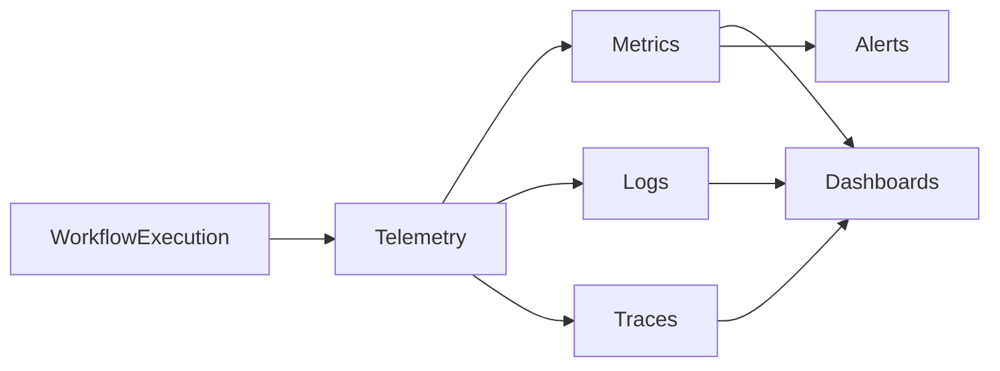

Monitoring infrastructure consumes telemetry without modifying workflow execution.

---

# 156. Observability Pillars

The Workflow Engine follows the three canonical observability pillars.

| Pillar | Purpose |
|---------|---------|
| Metrics | Quantitative operational measurements |
| Logs | Structured execution records |
| Traces | End-to-end execution visibility |

Together they provide complete operational observability.

---

# 157. Runtime Metrics

The Workflow Engine SHALL expose runtime metrics.

Examples include:

| Metric | Description |
|---------|-------------|
| Active Workflow Count | Running workflows |
| Waiting Workflow Count | Waiting executions |
| Completed Workflows | Successful executions |
| Failed Workflows | Failed executions |
| Suspended Workflows | Suspended executions |
| Average Execution Time | Mean runtime duration |
| Retry Count | Retry activity |
| Recovery Count | Recovery operations |
| Active Human Tasks | Outstanding manual work |
| Queue Depth | Pending runtime operations |

Metrics SHALL be continuously updated.

---

# 158. Performance Metrics

Performance measurements include:

- Workflow startup latency
- Node execution latency
- Service task duration
- Human task duration
- Callback latency
- Event processing latency
- Gateway evaluation time
- Recovery duration
- Compensation duration

Performance metrics SHALL support trend analysis.

---

# 159. Business Metrics

Business-oriented monitoring is supported through workflow metadata.

Examples include:

- Admissions Processed
- Applications Approved
- Fees Approved
- Examination Workflows Completed
- Approval Cycle Time
- Average Processing Time
- SLA Compliance Rate

Business metrics SHALL reference business entities.

They SHALL NOT own business data.

---

# 160. Structured Logging

Workflow execution SHALL generate structured logs.

Each log record SHALL include:

- Timestamp
- Workflow Instance ID
- Workflow Version
- Tenant ID
- Institution ID
- Correlation ID
- Execution Node
- Event Type
- Severity
- Message

Logs SHALL remain machine readable.

---

# 161. Distributed Tracing

Workflow execution SHALL support distributed tracing.

Trace context SHALL propagate across:

- Workflow Runtime
- Platform Services
- Business Domains
- Integration Adapters
- External Systems

Each trace SHALL preserve:

- Trace ID
- Span ID
- Parent Span
- Correlation ID

Tracing SHALL remain vendor independent.

---

# 162. Workflow Dashboards

Operational dashboards provide runtime visibility.

Canonical dashboards include:

| Dashboard | Purpose |
|-----------|---------|
| Runtime Overview | Current workflow health |
| Active Workflows | Running execution |
| Failed Workflows | Failure monitoring |
| Human Tasks | Pending work |
| SLA Dashboard | SLA compliance |
| Integration Dashboard | External dependencies |
| Capacity Dashboard | Resource utilization |

Dashboards consume telemetry.

They SHALL NOT modify runtime state.

---

# 163. Alert Management

Alerts notify operators of abnormal runtime behavior.

Alert categories include:

| Category | Example |
|-----------|----------|
| Workflow Failure | Excessive workflow failures |
| SLA Breach | Overdue human task |
| Integration Failure | External system unavailable |
| Runtime Failure | Engine malfunction |
| Capacity | Queue backlog |
| Performance | Latency threshold exceeded |

Alert thresholds SHALL remain externally configurable.

---

# 164. Health Monitoring

The Workflow Engine exposes operational health indicators.

Health checks include:

- Runtime availability
- Scheduler status
- Event processing
- Queue processing
- Database connectivity
- Integration connectivity
- Storage availability

Health status SHALL support automated operational monitoring.

---

# 165. Capacity Monitoring

Capacity metrics support operational planning.

Examples include:

- Concurrent workflows
- Peak workflow execution
- Active execution nodes
- Task throughput
- Event throughput
- Queue utilization
- Storage growth

Capacity monitoring SHALL support horizontal scalability planning.

---

# 166. SLA Monitoring

SLA monitoring continuously evaluates execution timelines.

Measured activities include:

- Human task response time
- Human task completion time
- Workflow completion time
- Escalation frequency
- Deadline compliance
- Policy execution latency

SLA evaluation SHALL use externally defined policies.

---

# 167. Audit Visibility

Monitoring integrates with audit capabilities without replacing them.

Monitoring records:

- Operational events
- Runtime metrics
- Performance telemetry

Audit records:

- Regulatory evidence
- Security events
- Administrative actions
- Immutable compliance history

Monitoring SHALL NOT be considered an audit repository.

---

# 168. Operational Analytics

Operational analytics support continuous improvement.

Analytics include:

- Workflow bottlenecks
- Long-running workflows
- Retry frequency
- Failure trends
- Escalation trends
- Approval duration
- Queue congestion

Analytics SHALL use historical telemetry.

Operational analytics SHALL remain read-only.

---

# 169. Monitoring Security

Monitoring information SHALL respect platform security boundaries.

Visibility SHALL enforce:

- Tenant isolation
- Institution isolation
- Organizational scope
- Role-based visibility
- Administrative authorization

Telemetry SHALL NOT expose unauthorized workflow information.

---

# 170. Monitoring Data Retention

Telemetry retention follows platform retention policies.

Retention categories include:

| Category | Purpose |
|----------|---------|
| Operational | Recent monitoring |
| Historical | Trend analysis |
| Compliance | Regulatory reporting |
| Archived | Long-term storage |

Retention policies SHALL be externally configurable.

---

# 171. Monitoring Architecture Principles

## MO-01

Monitoring SHALL remain observational only.

It SHALL NOT modify workflow execution.

---

## MO-02

Workflow telemetry SHALL include metrics, logs, and traces.

---

## MO-03

Distributed tracing SHALL preserve end-to-end execution visibility.

---

## MO-04

Operational dashboards SHALL consume published telemetry only.

---

## MO-05

Alert thresholds SHALL remain externally configurable.

---

## MO-06

Monitoring SHALL remain logically separate from audit.

---

## MO-07

Monitoring visibility SHALL respect authorization boundaries.

---

## MO-08

Telemetry retention SHALL follow platform governance policies.

---

# 172. Multi-Domain Contracts

The Workflow Engine interacts with platform and business domains exclusively through published contracts.

Multi-domain contracts define stable integration boundaries that allow domains to evolve independently while maintaining interoperability.

The Workflow Engine SHALL communicate through contracts.

It SHALL NOT directly depend upon internal implementations of other domains.

---

# 173. Contract Architecture Principles

Every multi-domain contract SHALL satisfy the following principles.

| Principle | Description |
|-----------|-------------|
| Stable | Contracts remain backward compatible where possible |
| Versioned | Breaking changes require versioning |
| Canonical | Shared platform models are reused |
| Technology Independent | Contracts are implementation neutral |
| Explicit | Every request and response is formally defined |
| Observable | Contract execution is traceable |
| Secure | Authentication and authorization are enforced |

---

# 174. Upstream Platform Contracts

The Workflow Engine consumes contracts from foundational platform domains.

| Domain | Consumed Contract | Purpose |
|--------|-------------------|---------|
| L2-A01 Platform Foundation | Tenant Context | Multi-tenant isolation |
| L2-A01 Platform Foundation | Configuration | Runtime configuration |
| L2-A02 Person & Identity | Identity References | Human task ownership |
| L2-A03 Authentication | Authentication Context | Execution identity |
| L2-A04 Authorization & Policy | Authorization Decision | Access validation |
| L2-A04 Authorization & Policy | Assignment Resolution | Human task assignment |
| L2-A04 Authorization & Policy | Policy Evaluation | Runtime policy execution |

The Workflow Engine SHALL treat upstream contracts as authoritative.

---

# 175. Downstream Business Contracts

Business domains consume Workflow Engine capabilities through published contracts.

Supported contract categories include:

| Contract | Purpose |
|----------|---------|
| Start Workflow | Create workflow instance |
| Resume Workflow | Resume waiting workflow |
| Cancel Workflow | Request cancellation |
| Workflow Status | Runtime status |
| Task Completion | Complete human task |
| Task Query | Retrieve assigned work |
| Workflow Events | Subscribe to lifecycle events |
| Task Events | Subscribe to task lifecycle |

Business domains SHALL NOT directly modify workflow runtime state.

---

# 176. Canonical Command Contracts

The Workflow Engine exposes command contracts for state-changing operations.

Representative command contracts include:

- StartWorkflow
- SuspendWorkflow
- ResumeWorkflow
- CancelWorkflow
- RetryWorkflow
- CompleteTask
- ClaimTask
- DelegateTask
- EscalateTask

Commands SHALL be validated before execution.

Commands SHALL execute atomically.

---

# 177. Canonical Query Contracts

Queries provide read-only access to workflow information.

Examples include:

- GetWorkflowStatus
- GetWorkflowHistory
- GetWorkflowDefinition
- GetTaskList
- GetTaskDetails
- GetWorkflowMetrics
- GetExecutionTimeline

Queries SHALL NEVER modify workflow state.

---

# 178. Workflow Event Contracts

Workflow lifecycle events form the primary asynchronous integration mechanism.

Canonical workflow events include:

| Event | Description |
|--------|-------------|
| WorkflowStarted | Execution initiated |
| WorkflowCompleted | Execution completed |
| WorkflowCancelled | Execution cancelled |
| WorkflowFailed | Execution failed |
| WorkflowRecovered | Recovery completed |
| WorkflowArchived | Archived successfully |

Events SHALL be immutable.

Events SHALL be versioned independently.

---

# 179. Human Task Contracts

Human Task contracts support manual workflow execution.

Supported operations include:

| Operation | Purpose |
|-----------|---------|
| Create Task | Runtime task creation |
| Claim Task | Acquire task ownership |
| Release Task | Return task to candidate pool |
| Complete Task | Submit work result |
| Delegate Task | Transfer responsibility |
| Escalate Task | Trigger escalation |
| Cancel Task | Cancel pending work |

Task contracts SHALL execute within an authenticated execution context.

---

# 180. Workflow Runtime Context Contract

Every workflow execution carries a canonical Workflow Runtime Context.

Minimum context includes:

| Context Element | Purpose |
|-----------------|---------|
| Tenant ID | Tenant isolation |
| Institution ID | Institutional boundary |
| Organization ID | Organizational boundary |
| Campus ID | Campus scope |
| Workflow Instance ID | Runtime identity |
| Correlation ID | Distributed tracing |
| Execution Identity | Authenticated principal |
| Workflow Version | Runtime version consistency |

Workflow Runtime Context SHALL accompany every multi-domain interaction.

---

# 181. Business Reference Contracts

The Workflow Engine references business entities through canonical identifiers.

Examples include:

- StudentId
- ApplicantId
- EmployeeId
- VendorId
- InvoiceId
- ExaminationId
- AdmissionId
- DepartmentId

The Workflow Engine SHALL reference business entities.

It SHALL NOT own business entity data.

---

# 182. Error Contracts

Workflow operations return standardized error contracts.

Standard error categories include:

| Category | Description |
|----------|-------------|
| Validation Error | Invalid request |
| Authentication Error | Invalid identity |
| Authorization Error | Permission denied |
| Version Error | Unsupported workflow version |
| Runtime Error | Execution failure |
| Integration Error | External dependency failure |
| Policy Error | Assignment or policy evaluation failure |
| System Error | Internal runtime failure |

Error contracts SHALL be deterministic and machine-readable.

---

# 183. Version Compatibility

Contract evolution follows explicit compatibility rules.

| Change Type | Compatibility |
|-------------|---------------|
| Add Optional Field | Compatible |
| Add New Event | Compatible |
| Extend Enumeration | Conditionally compatible |
| Remove Field | Breaking |
| Rename Field | Breaking |
| Change Data Type | Breaking |
| Change Semantic Meaning | Breaking |

Breaking changes SHALL require a new contract version.

---

# 184. Contract Governance

Every published contract SHALL undergo governance review.

Governance validates:

- Ownership
- Canonical naming
- Version compatibility
- Dependency impact
- Security implications
- Repository compliance
- Documentation completeness

Unapproved contracts SHALL NOT be published.

---

# 185. Contract Registry

Published contracts SHALL be discoverable through a centralized contract registry.

The registry SHALL maintain:

- Contract identifier
- Version history
- Canonical owner
- Current status
- Deprecation information
- Dependency references
- Documentation links

The Workflow Engine SHALL consume only published contract versions.

---

# 186. Contract Security

Multi-domain contracts SHALL execute within validated security boundaries.

Security requirements include:

- Authenticated caller
- Authorized operation
- Tenant validation
- Correlation validation
- Audit recording
- Transport security

Security enforcement remains delegated to Authentication and Authorization domains.

---

# 187. Contract Observability

Every contract invocation SHALL generate operational telemetry.

Telemetry includes:

- Invocation timestamp
- Correlation identifier
- Execution duration
- Success or failure
- Response status
- Retry count
- Calling domain

Contract telemetry SHALL integrate with platform observability.

---

# 188. Multi-Domain Contract Principles

## CDC-01

All domain interactions SHALL occur through published contracts.

---

## CDC-02

Commands SHALL modify state.

Queries SHALL remain read-only.

---

## CDC-03

Contracts SHALL remain technology independent.

---

## CDC-04

Business entities SHALL be referenced by identifiers rather than embedded objects.

---

## CDC-05

Breaking contract changes SHALL require explicit versioning.

---

## CDC-06

Every contract SHALL execute within authenticated, authorized, and tenant-isolated execution contexts.

---

## CDC-07

Published contracts SHALL be governed through centralized repository approval.

---

## CDC-08

Multi-domain interactions SHALL generate observable telemetry and audit records.

---

# 189. Persistence Architecture

The Persistence Architecture defines how the Workflow Engine durably stores workflow definitions, runtime state, execution history, checkpoints, and operational metadata.

Persistence guarantees workflow correctness across failures, upgrades, distributed execution, and long-running processes.

The Workflow Engine owns persistence for workflow runtime artifacts.

It SHALL NOT persist business domain data beyond canonical references.

---

# 190. Persistence Objectives

The persistence layer SHALL provide:

- Durable execution
- Runtime recovery
- Version consistency
- Transactional integrity
- Long-running workflow support
- Horizontal scalability
- Multi-tenant isolation
- Audit traceability

Persistence SHALL remain an implementation-independent architectural concern.

---

# 191. Persistence Architecture Overview

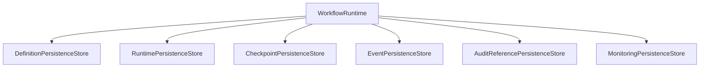

Each persistence store has a clearly defined responsibility.

No store SHALL own another store's data.

---

# 192. Persistence Domains

Workflow persistence is divided into logical persistence stores.

| Persistence Store | Responsibility |
|--------------------|----------------|
| Workflow Definition Persistence Store | Published workflow definitions |
| Workflow Runtime Persistence Store | Active workflow execution |
| Workflow Checkpoint Persistence Store | Recovery checkpoints |
| Workflow Event Persistence Store | Runtime events |
| Workflow History Persistence Store | Execution history |
| Monitoring Persistence Store | Operational telemetry |
| Configuration Persistence Store | Runtime configuration references |

Each persistence domain SHALL evolve independently.

---

# 193. Workflow Definition Persistence

Workflow Definitions are persisted separately from runtime execution.

Persisted information includes:

- Definition metadata
- Workflow graph
- Node configuration
- Variable schema
- Input contract
- Output contract
- Validation metadata
- Version metadata

Published workflow definitions become immutable.

Updates require creation of a new version.

---

# 194. Runtime Persistence

Runtime persistence stores active execution state.

Runtime data includes:

- Workflow Instance
- Execution Tokens
- Persistent Runtime Variables
- Active Node
- Pending Tasks
- Event Subscriptions
- Retry Metadata
- Timeout Metadata
- Correlation Metadata

Runtime persistence SHALL support recovery without workflow restart.

---

# 195. Checkpoint Persistence

Checkpoint persistence enables durable recovery.

Each checkpoint stores:

| Checkpoint Data | Purpose |
|-----------------|---------|
| Workflow Instance ID | Runtime identity |
| Current Node | Resume location |
| Active Tokens | Execution state |
| Persistent Runtime Variables | Current execution context |
| Pending Events | Waiting conditions |
| Pending Tasks | Outstanding work |
| Correlation Metadata | Distributed tracing |
| Creation Timestamp | Recovery ordering |

Checkpoints SHALL be immutable after creation.

Checkpoints exist solely for deterministic recovery.

Execution History exists for operational traceability.

Workflow Events exist for integration history.

These persistence concerns are independent and must never be treated as interchangeable.

---

# 196. Execution History

Execution history records completed runtime activity.

Execution history includes:

- State transitions
- Executed nodes
- Completed tasks
- Retry operations
- Recovery operations
- Compensation execution
- Administrative operations

Execution history SHALL remain append-only.

Execution History is an operational runtime record owned by the Workflow Engine.

Enterprise Audit remains owned by the Audit Platform.

Regulatory audit is produced by publishing audit events.

Execution History does not replace enterprise audit.

Historical records SHALL never be modified.

---

# 197. Event Persistence

Workflow Events are durably persisted before publication.

Persisted event information includes:

- Event Identifier
- Event Type
- Event Version
- Correlation Identifier
- Workflow Instance
- Event Timestamp
- Publication Status

Persisted events SHALL remain immutable.

---

# 198. Runtime Variable Persistence

Persistent runtime variables are persisted separately from workflow definitions.

Variable categories include:

| Category | Persistence |
|----------|-------------|
| Business References | Persistent |
| Persistent Runtime Variables | Persistent |
| Temporary Runtime Variables | Policy controlled |
| Diagnostic Variables | Optional |
| Integration Responses | Policy controlled |

Runtime variables SHALL never alter published workflow definitions.

---

# 199. Repository Architecture

Repositories expose aggregate persistence boundaries.

Canonical repositories include:

| Repository | Aggregate |
|------------|-----------|
| WorkflowDefinitionRepository | Workflow Definition |
| WorkflowVersionRepository | Workflow Version |
| WorkflowInstanceRepository | Workflow Instance |
| WorkflowExecutionRepository | Workflow Execution |
| WorkflowTaskRepository | Workflow Task |
| WorkflowCheckpointRepository | Checkpoint |
| WorkflowHistoryRepository | Execution History |

Repositories SHALL expose aggregate roots only.

---

# 200. Transaction Management

Workflow persistence follows transactional boundaries defined by runtime execution.

```text
Execute Node

↓

Persist Runtime

↓

Persist Checkpoint

↓

Commit Transaction

↓

Publish Event
```

Long-running workflows SHALL avoid distributed database transactions.

Each execution node defines an independent transaction boundary.

---

# 201. Optimistic Concurrency

Concurrent workflow execution SHALL use optimistic concurrency control.

Concurrency validation SHALL detect:

- Simultaneous updates
- Duplicate completion
- Duplicate callbacks
- Parallel modification
- Stale runtime state

Concurrency failures SHALL trigger retry or recovery according to policy.

---

# 202. Multi-Tenant Persistence

Every persisted workflow artifact SHALL include tenant context.

Minimum tenancy metadata includes:

- Tenant ID
- Institution ID
- Organization ID
- Campus ID

Persistence SHALL guarantee logical tenant isolation.

Cross-tenant access is prohibited.

---

# 203. Data Retention

Persistence retention follows platform governance.

Retention categories include:

| Category | Purpose |
|----------|---------|
| Active Runtime | Current execution |
| Historical | Reporting |
| Audit | Compliance |
| Archived | Long-term retention |

Retention policies SHALL remain externally configurable.

---

# 204. Backup and Recovery

The persistence architecture SHALL support operational recovery.

Recovery objectives include:

- Workflow state restoration
- Checkpoint restoration
- Execution history preservation
- Version consistency
- Event consistency

Recovery SHALL preserve workflow correctness.

---

# 205. Archival Strategy

Completed workflows transition from active runtime storage to archival storage.

Archived records retain:

- Workflow metadata
- Execution history
- Business references
- Audit references
- Correlation metadata
- Monitoring summaries

Archived workflows SHALL remain read-only.

---

# 206. Data Integrity

Persistence SHALL enforce integrity rules.

Integrity requirements include:

- Immutable published definitions
- Immutable events
- Immutable checkpoints
- Append-only history
- Valid aggregate references
- Version consistency

Integrity validation SHALL occur before persistence.

---

# 207. Persistence Security

Workflow persistence SHALL enforce security controls.

Security includes:

- Tenant isolation
- Authorization enforcement
- Encryption support
- Secure transport
- Audit recording
- Administrative authorization

Security enforcement SHALL align with Platform Security architecture.

---

# 208. Persistence Architecture Principles

## PA-01

Workflow Definitions and Runtime Execution SHALL be persisted independently.

---

## PA-02

Published Workflow Definitions SHALL remain immutable.

---

## PA-03

Execution History SHALL be append-only.

---

## PA-04

Checkpoints SHALL support deterministic workflow recovery.

---

## PA-05

Repositories SHALL expose aggregate roots only.

---

## PA-06

Persistence SHALL enforce optimistic concurrency for runtime execution.

---

## PA-07

Every persisted artifact SHALL include tenant isolation metadata.

---

## PA-08

Persistence SHALL remain implementation independent and technology neutral.

---

# 209. Canonical Architecture Diagrams

This section consolidates the canonical diagrams that define the architectural structure, execution model, dependency relationships, and operational behavior of the Workflow Engine.

These diagrams are normative architectural references.

Implementations SHALL conform to these architectural models.

---

# 210. Overall Domain Position

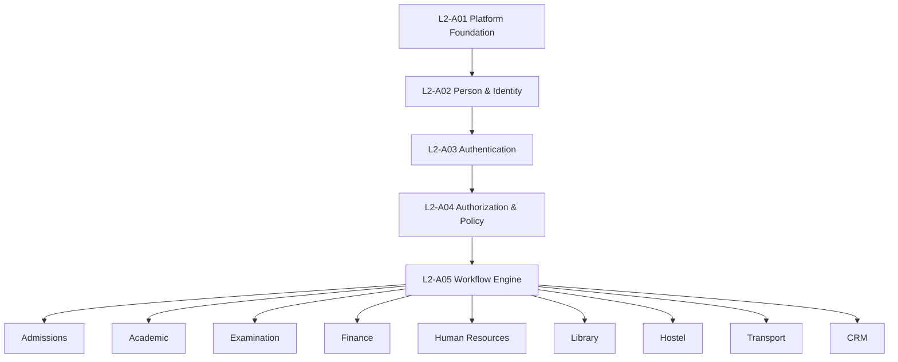

---

# 211. Bounded Context Architecture

```mermaid
flowchart TD

subgraph WorkflowEngine["Workflow Engine Bounded Context"]

Definition[Workflow Definition]

Version[Workflow Version]

Instance[Workflow Instance]

Execution[Workflow Execution]

Task[Workflow Task]

Runtime[Runtime Context]

Schedule[Workflow Schedule]

Checkpoint[Checkpoint]

History[Execution History]

end

Definition --> Version

Version --> Instance

Instance --> Execution

Execution --> Runtime

Execution --> Task

Execution --> Schedule

Execution --> Checkpoint

Execution --> History
```

---

# 212. Workflow Definition Lifecycle

```mermaid
stateDiagram-v2

[*] --> Draft

Draft --> Validation

Validation --> Approved

Approved --> Published

Published --> Activated

Activated --> Retired

Retired --> [*]
```

---

# 213. Workflow Runtime Lifecycle

```mermaid
stateDiagram-v2

[*] --> Created

Created --> Running

Running --> Waiting

Waiting --> Running

Running --> Suspended

Suspended --> Running

Running --> Completed

Running --> Failed

Failed --> Recovering

Recovering --> Running

Running --> Cancelled

Completed --> Archived

Cancelled --> Archived

Archived --> [*]
```

---

# 214. Workflow Execution Model

```mermaid
flowchart LR

Start

Node1[Start Node]

Gateway

TaskA[Human Task]

TaskB[Service Task]

Merge

EndNode[End]

Start --> Node1

Node1 --> Gateway

Gateway --> TaskA

Gateway --> TaskB

TaskA --> Merge

TaskB --> Merge

Merge --> EndNode
```

---

# 215. Runtime Component Architecture

```mermaid
flowchart TD

WorkflowVersion

WorkflowInstance

ExecutionEngine

ExecutionTokens

RuntimeContext

HumanTasks

Events

WorkflowVersion --> WorkflowInstance

WorkflowInstance --> ExecutionEngine

ExecutionEngine --> ExecutionTokens

ExecutionEngine --> RuntimeContext

ExecutionEngine --> HumanTasks

ExecutionEngine --> Events
```

---

# 216. Human Task Lifecycle

```mermaid
stateDiagram-v2

[*] --> Created

Created --> Available

Available --> Claimed

Claimed --> InProgress

InProgress --> Completed

Available --> Delegated

Delegated --> Available

Available --> Escalated

Escalated --> Available

Available --> Cancelled

Claimed --> Cancelled

InProgress --> Cancelled

Completed --> [*]

Cancelled --> [*]
```

---

# 217. Assignment Resolution

```mermaid
sequenceDiagram

participant Workflow

participant Authorization

participant Identity

participant Organization

Workflow->>Authorization: Resolve Assignment

Authorization->>Identity: Resolve Candidates

Authorization->>Organization: Resolve Hierarchy

Organization-->>Authorization: Context

Identity-->>Authorization: Candidate List

Authorization-->>Workflow: Authorized Assignees

Workflow->>Workflow: Create Task
```

---

# 218. Parent-Child Workflow Execution

```mermaid
flowchart TD

ParentWorkflow

ChildWorkflowA

ChildWorkflowB

Completion

ParentWorkflow --> ChildWorkflowA

ParentWorkflow --> ChildWorkflowB

ChildWorkflowA --> Completion

ChildWorkflowB --> Completion
```

---

# 219. Event-Driven Runtime

```mermaid
flowchart LR

Workflow

PublishEvent

EventBus

Subscriber

ResumeExecution

Workflow --> PublishEvent

PublishEvent --> EventBus

EventBus --> Subscriber

Subscriber --> ResumeExecution
```

---

# 220. Checkpoint Recovery

```mermaid
flowchart LR

Execution

Checkpoint

Failure

Recovery

Resume

Execution --> Checkpoint

Checkpoint --> Failure

Failure --> Recovery

Recovery --> Resume
```

---

# 221. Compensation Flow

```mermaid
flowchart LR

BusinessAction1

BusinessAction2

Failure

Compensate2

Compensate1

BusinessAction1 --> BusinessAction2

BusinessAction2 --> Failure

Failure --> Compensate2

Compensate2 --> Compensate1
```

---

# 222. External Integration Architecture

```mermaid
flowchart LR

WorkflowEngine

IntegrationAdapters

ExternalSystems

WorkflowEngine --> IntegrationAdapters

IntegrationAdapters --> ExternalSystems
```

---

# 223. Workflow Persistence

```mermaid
flowchart TD

WorkflowRuntime

DefinitionPersistenceStore

RuntimePersistenceStore

CheckpointPersistenceStore

HistoryPersistenceStore

EventPersistenceStore

WorkflowRuntime --> DefinitionPersistenceStore

WorkflowRuntime --> RuntimePersistenceStore

WorkflowRuntime --> CheckpointPersistenceStore

WorkflowRuntime --> HistoryPersistenceStore

WorkflowRuntime --> EventPersistenceStore
```

---

# 224. Monitoring Architecture

```mermaid
flowchart TD

WorkflowExecution

Telemetry

Metrics

Logs

Traces

Dashboards

Alerts

WorkflowExecution --> Telemetry

Telemetry --> Metrics

Telemetry --> Logs

Telemetry --> Traces

Metrics --> Dashboards

Logs --> Dashboards

Traces --> Dashboards

Metrics --> Alerts
```

---

# 225. Multi-Domain Contract Model

```mermaid
flowchart TD

BusinessDomain

WorkflowEngine

PlatformServices

IntegrationLayer

ExternalSystems

BusinessDomain --> WorkflowEngine

WorkflowEngine --> PlatformServices

WorkflowEngine --> IntegrationLayer

IntegrationLayer --> ExternalSystems
```

---

# 226. Distributed Execution Architecture

```mermaid
flowchart LR

ExecutionNodeA

ExecutionNodeB

ExecutionNodeC

PersistentRuntime

ExecutionNodeA --> PersistentRuntime

ExecutionNodeB --> PersistentRuntime

ExecutionNodeC --> PersistentRuntime
```

---

# 227. Canonical Workflow Engine Architecture

```mermaid
flowchart TD

subgraph Platform

Foundation

Identity

Authentication

Authorization

end

subgraph WorkflowEngine

Definitions

Runtime

Tasks

Scheduling

Events

Monitoring

Persistence

end

subgraph BusinessDomains

Admissions

Academic

Examination

Finance

HR

Library

end

Platform --> WorkflowEngine

WorkflowEngine --> BusinessDomains
```

---

# 228. Diagram Governance Principles

## DG-01

Every architectural diagram SHALL represent the canonical platform architecture.

---

## DG-02

Architectural diagrams SHALL remain technology independent.

---

## DG-03

Business domains SHALL appear only through published dependency relationships.

---

## DG-04

Workflow runtime SHALL remain isolated from workflow definition management.

---

## DG-05

Every diagram SHALL maintain consistency with the aggregate model, lifecycle model, and dependency architecture.

---

## DG-06

Diagram modifications SHALL follow repository governance and architectural review.

---

## DG-07

Mermaid diagrams contained in this document SHALL be considered the canonical repository diagrams unless superseded by a future approved architecture version.

---

# 229. Architecture Decision Records (ADR)

This section documents the fundamental architectural decisions governing the Workflow Engine.

These decisions are considered canonical for the current architecture version.

Future revisions SHALL either preserve these decisions or explicitly supersede them through repository governance.

---

# ADR-001 — Workflow Engine as a Platform Capability

## Status

Accepted

## Decision

Workflow orchestration SHALL be implemented as a shared platform capability rather than embedded within business domains.

## Rationale

A centralized orchestration engine provides:

- Reusable execution infrastructure
- Consistent lifecycle management
- Standardized monitoring
- Unified human task management
- Multi-domain orchestration
- Reduced duplication

## Consequences

### Positive

- Consistent workflow execution
- Lower maintenance cost
- Unified governance
- Platform-wide reuse

### Negative

- Platform dependency
- Additional orchestration layer

---

# ADR-002 — Business Domains Own Business Logic

## Status

Accepted

## Decision

Business domains SHALL remain the canonical owners of business rules.

The Workflow Engine SHALL own orchestration only.

## Rationale

Separating orchestration from business logic preserves domain ownership and prevents duplication.

## Consequences

### Positive

- Clear ownership
- Independent domain evolution
- Better maintainability

### Negative

- Additional service interactions

---

# ADR-003 — Immutable Workflow Versions

## Status

Accepted

## Decision

Published workflow versions SHALL be immutable.

## Rationale

Immutable versions guarantee deterministic execution, reproducibility, and auditability.

## Consequences

### Positive

- Safe upgrades
- Stable execution
- Regulatory compliance

### Negative

- Multiple versions coexist simultaneously

---

# ADR-004 — Long-Running Durable Execution

## Status

Accepted

## Decision

Workflow execution SHALL support durable long-running processes through persistent runtime state and checkpoint recovery.

## Rationale

Institutional workflows may execute over hours, days, or months.

Execution cannot depend upon continuous process availability.

## Consequences

### Positive

- Failure recovery
- Operational resilience
- Long-running workflow support

### Negative

- Additional persistence complexity

---

# ADR-005 — Event-Driven Runtime

## Status

Accepted

## Decision

Workflow coordination SHALL be event-driven.

## Rationale

Events reduce coupling, improve scalability, and support asynchronous execution.

## Consequences

### Positive

- Loose coupling
- Better scalability
- Natural asynchronous processing

### Negative

- Increased operational observability requirements

---

# ADR-006 — Hybrid Execution Model

## Status

Accepted

## Decision

Workflow execution SHALL support sequential, parallel, event-driven, and parent-child orchestration within a unified runtime.

## Rationale

Institutional workflows require multiple execution patterns.

No single execution model satisfies all use cases.

## Consequences

### Positive

- High flexibility
- Reusable execution infrastructure

### Negative

- Increased runtime complexity

---

# ADR-007 — Policy Delegation

## Status

Accepted

## Decision

Authorization, assignment, delegation, separation of duties, and escalation policies SHALL remain owned by L2-A04.

## Rationale

Security policies require a single canonical owner across the platform.

## Consequences

### Positive

- No duplicated authorization logic
- Consistent policy enforcement

### Negative

- Runtime dependency on Authorization services

---

# ADR-008 — Identity Independence

## Status

Accepted

## Decision

Workflow Tasks SHALL reference identities but SHALL NOT own identity information.

## Rationale

Identity ownership belongs exclusively to L2-A02.

## Consequences

### Positive

- Consistent identity model
- Elimination of duplicate identity stores

### Negative

- Runtime dependency on Identity references

---

# ADR-009 — Distributed Stateless Execution

## Status

Accepted

## Decision

Workflow execution nodes SHALL remain stateless.

Durable execution state SHALL be externally persisted.

## Rationale

Stateless execution enables horizontal scalability and operational resilience.

## Consequences

### Positive

- Elastic scaling
- High availability
- Simplified recovery

### Negative

- Increased persistence traffic

---

# ADR-010 — Saga-Based Compensation

## Status

Accepted

## Decision

Distributed business operations SHALL use Saga-based compensation rather than distributed transactions.

## Rationale

Distributed database transactions are unsuitable for long-running institutional workflows.

## Consequences

### Positive

- Better scalability
- Service autonomy
- Improved resilience

### Negative

- Compensation complexity

---

# ADR-011 — Canonical Runtime Ownership

## Status

Accepted

## Decision

Workflow runtime objects SHALL be owned exclusively by the Workflow Engine.

## Rationale

Centralized runtime ownership prevents inconsistent execution semantics.

## Consequences

### Positive

- Single execution authority
- Predictable runtime behavior

### Negative

- Centralized orchestration responsibility

---

# ADR-012 — Contract-Driven Integration

## Status

Accepted

## Decision

All integrations SHALL occur through published commands, events, queries, and APIs.

## Rationale

Contract-driven integration enables independent evolution of platform domains.

## Consequences

### Positive

- Loose coupling
- Versioned integration
- Better maintainability

### Negative

- Contract governance overhead

---

# ADR-013 — Technology-Neutral Architecture

## Status

Accepted

## Decision

The architecture SHALL remain independent of implementation technologies, vendors, frameworks, databases, and messaging platforms.

## Rationale

L2 architecture defines logical platform behavior rather than implementation choices.

## Consequences

### Positive

- Long-term maintainability
- Vendor independence
- Flexible implementation

### Negative

- Technology decisions deferred to lower architecture levels

---

# 230. Repository Compliance Checklist

The Workflow Engine architecture SHALL satisfy all repository governance requirements before merge approval.

| Requirement | Status |
|------------|--------|
| Canonical Domain Ownership | Required |
| Single Responsibility | Required |
| DDD Compliance | Required |
| Aggregate Ownership | Required |
| Bounded Context Defined | Required |
| Dependency Direction Verified | Required |
| Workflow Lifecycle Defined | Required |
| Runtime Model Defined | Required |
| Human Task Model Defined | Required |
| Integration Contracts Defined | Required |
| Persistence Architecture Defined | Required |
| Monitoring Architecture Defined | Required |
| ADRs Documented | Required |
| Mermaid Diagrams Validated | Required |
| Multi-Domain Dependencies Verified | Required |

Every item SHALL pass architectural review before repository merge.

---

# 231. Repository Validation Matrix

| Validation Area | Verification Requirement |
|-----------------|--------------------------|
| Dependency Validation | No cyclic dependencies |
| Ownership Validation | Single canonical owner |
| Aggregate Validation | Aggregate boundaries respected |
| DDD Validation | Repository DDD conventions followed |
| Contract Validation | Published interfaces only |
| Lifecycle Validation | Valid state transitions |
| Runtime Validation | Durable execution architecture |
| Diagram Validation | Mermaid syntax and architectural consistency |
| Documentation Validation | Mandatory sections complete |
| Governance Validation | ADR and repository standards satisfied |

Validation SHALL be completed during architecture review.

---

# 232. Future Extension Guidelines

The Workflow Engine is designed to support future evolution without violating existing architectural principles.

Future extensions SHALL:

- Preserve bounded context integrity.
- Maintain immutable workflow versioning.
- Reuse canonical aggregates where appropriate.
- Extend through published extension points rather than modifying core runtime behavior.
- Preserve backward compatibility for published contracts unless a new version is introduced.
- Maintain technology neutrality at the L2 architecture level.

Examples of future extension areas include:

- AI-assisted workflow recommendations
- Advanced process analytics
- Business process simulation
- Visual workflow designers
- Additional workflow template libraries
- Advanced SLA optimization
- Cross-tenant workflow federation (subject to future architecture approval)

---

# 233. Out of Scope

The following concerns are intentionally excluded from this architecture and SHALL be addressed by lower architecture levels or other domains.

- Physical database schema
- ORM mappings
- Programming language selection
- Messaging technology selection
- Workflow engine implementation framework
- Deployment topology
- Container orchestration
- Infrastructure sizing
- API payload definitions
- UI implementation
- Screen designs
- Low-level service implementation
- Performance tuning implementation

These concerns belong to L3, L4, or implementation repositories.

---

# 234. Conclusion

The L2-A05 Workflow Engine Workflows Architecture establishes the canonical orchestration platform for SutraERP.

It defines:

- Domain ownership
- Bounded context
- Aggregate model
- Workflow definition lifecycle
- Runtime execution model
- Human task management
- System orchestration
- Integration architecture
- Assignment and policy interaction
- Lifecycle management
- Monitoring and observability
- Multi-domain contracts
- Persistence architecture
- Canonical architectural diagrams
- Architecture Decision Records
- Repository governance

This document serves as the authoritative Level 2 architecture for workflow orchestration within the SutraERP platform.

All lower architecture levels SHALL conform to the architectural constraints, ownership boundaries, and governance principles defined herein.

---

# 235. End of Document

**Document Status:** Trust Certification Ready

**Architecture Level:** L2 – Domain Workflow Architecture

**Domain:** A05 – Workflow Engine Workflows

**Canonical Owner:** Platform Architecture Team

**Supersedes:** None

**Next Logical Architecture:** L3-A05 – Workflow Engine Logical Architecture

**Repository Merge Requirement:** Successful independent architecture review and repository validation.

---
