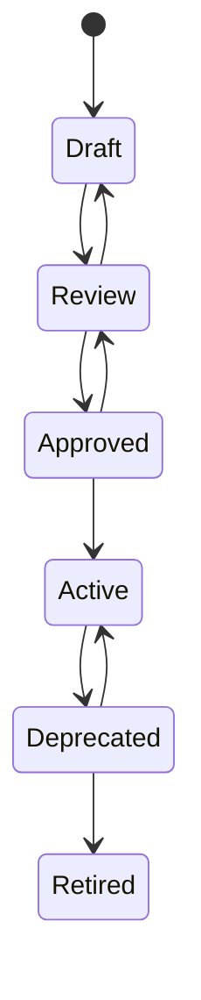
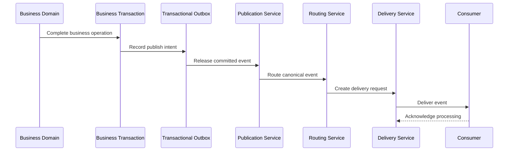
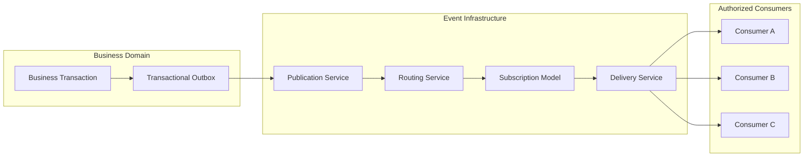
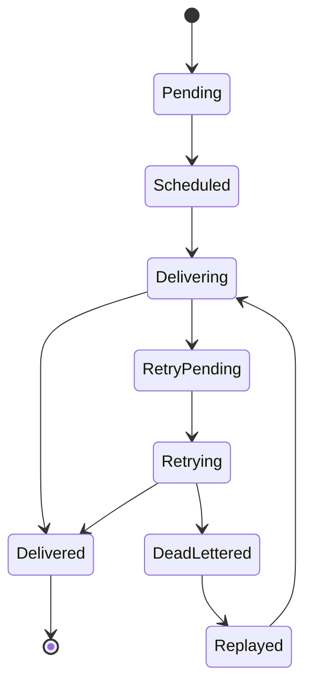
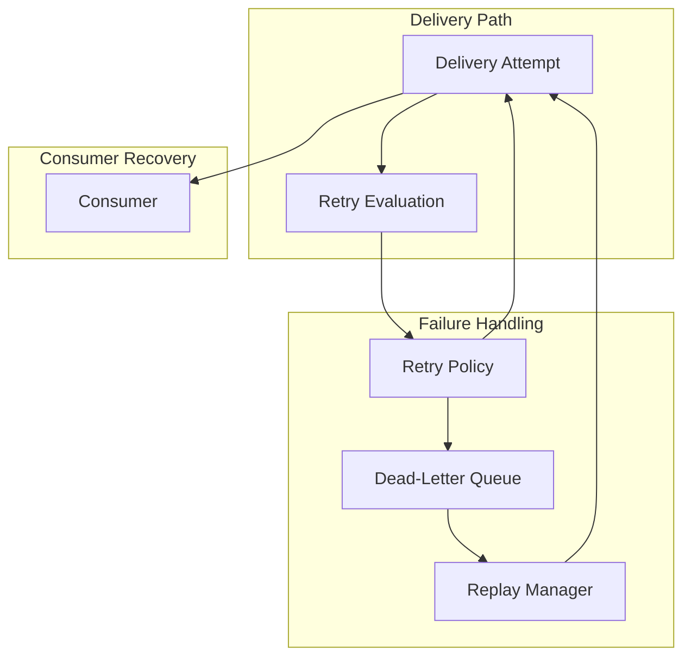
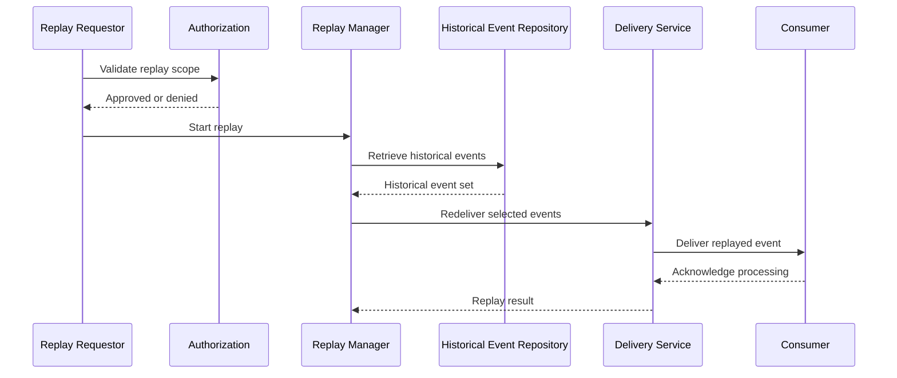
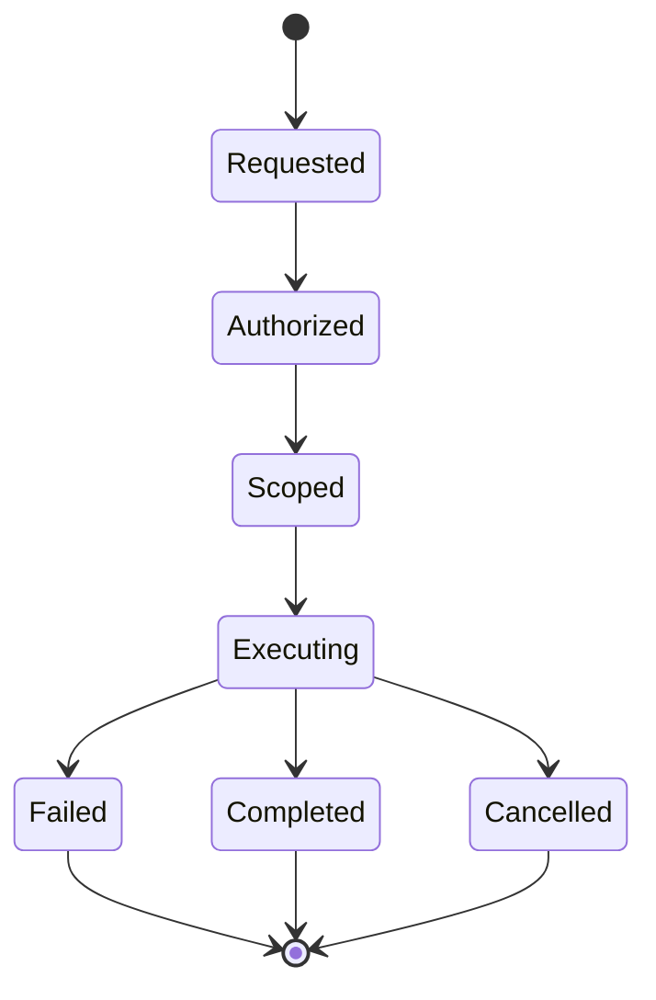
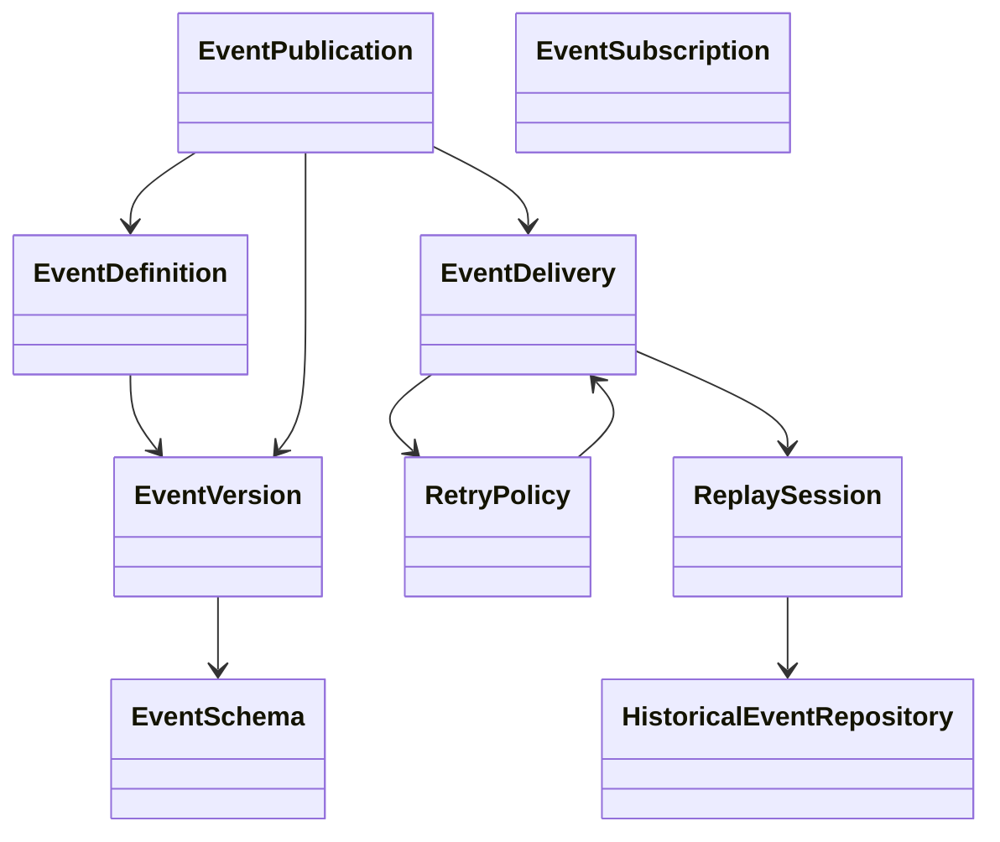
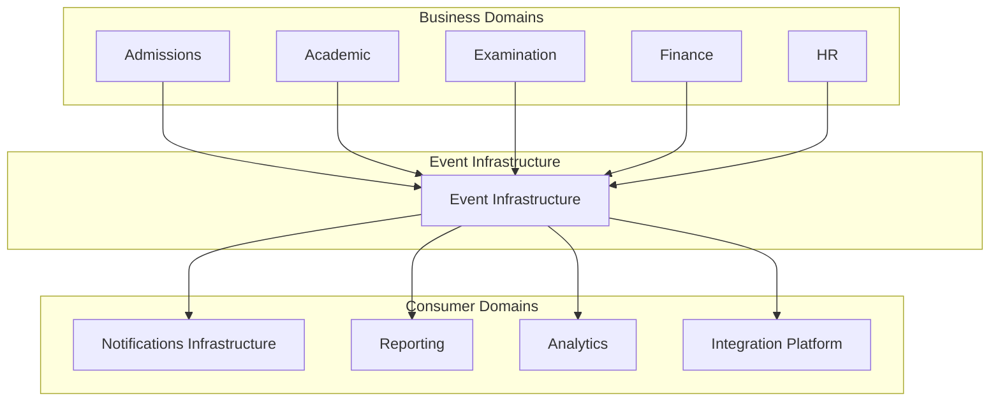
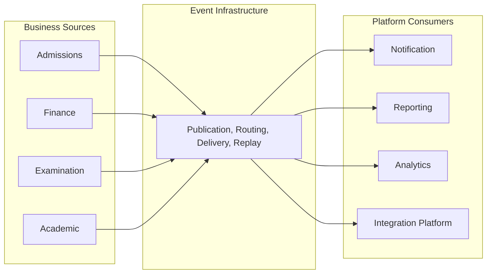

# L2-A06 — Event Infrastructure Workflows

---

# Document Metadata

| Attribute | Value |
|-----------|-------|
| Document ID | L2-A06 |
| Document Name | Event Infrastructure Workflows |
| Layer | Level 2 – Core Platform Architecture |
| Domain | Platform Event Infrastructure |
| Owner | Dhruv |
| Depends On | L2-A01 Platform & Tenant Foundation, L2-A02 Person & Identity Workflows, L2-A03 Authentication Workflows, L2-A04 Authorization & Policy Workflows, L2-A05 Workflow Engine Workflows |
| Referenced By | All Business Domains (Admissions, Academic, Curriculum, Examination, Finance, HR, Library, Hostel, Transport, Procurement, Inventory, CRM, Analytics, Notifications, Reporting, APIs, Mobile Applications and Future Domains) |
| Status | Draft |
| Version | 1.0 |

---

# 1. Purpose

This document defines the complete Event Infrastructure architecture of the SutraERP platform.

It establishes the architectural standards governing event publication, event routing, event subscription, event delivery, event governance, event registry management, event schema lifecycle, transactional event publishing, event replay, dead-letter handling, retry management, event ordering, correlation, causation, operational observability, and enterprise-wide event-driven integration.

The Event Infrastructure provides a reusable, technology-independent, policy-governed platform capability enabling every business and platform domain to exchange business facts through canonical events while remaining loosely coupled.

This document serves as the canonical architectural reference for all event-driven communication within SutraERP.

---

# 2. Scope

This document defines:

- Event Infrastructure Architecture
- Event Registry
- Event Registry Model
- Event Taxonomy
- Event Definition Lifecycle
- Event Schema Lifecycle
- Event Versioning
- Event Publication
- Transactional Outbox
- Event Routing
- Event Channels
- Event Streams
- Event Subscription
- Event Delivery
- Consumer Groups
- Event Ordering
- Event Correlation
- Event Causation
- Retry Management
- Dead-Letter Queue (DLQ)
- Event Replay
- Idempotency Strategy
- Event Governance
- Event Metadata
- Event Lifecycle
- Event Security Model
- Operational Monitoring
- Multi-Domain Event Contracts

---

# 3. Out of Scope

The following responsibilities belong to other architecture documents.

### L2-A01 — Platform & Tenant Foundation

- Platform Infrastructure
- Tenant Management
- Platform Configuration
- Runtime Foundation

### L2-A02 — Person & Identity

- Person Lifecycle
- Identity Lifecycle
- User Account Management
- Identity Resolution

### L2-A03 — Authentication

- Authentication
- Credentials
- Login
- Authentication Sessions
- Multi-Factor Authentication

### L2-A04 — Authorization & Policy

- Roles
- Permissions
- Authorization Decisions
- Policy Evaluation
- Workspace
- Delegation

### L2-A05 — Workflow Engine

- Workflow Definitions
- Workflow Runtime
- Workflow Execution
- Human Task Management
- Workflow Orchestration

### Notifications Infrastructure

The Notifications Infrastructure owns:

- Email Delivery
- SMS Delivery
- Push Notifications
- WhatsApp Delivery
- In-App Notification Delivery
- Notification Templates

The Event Infrastructure only publishes events that notifications services may consume.

### Audit Infrastructure

The Audit Infrastructure owns:

- Audit Storage
- Audit Retention
- Compliance Records
- Audit Reporting

The Event Infrastructure publishes platform events but does not own audit persistence.

### Integration Platform

External protocol implementations, API gateways, connector implementations, ESB technologies, middleware products, and vendor-specific integration mechanisms remain outside this document.

---

# 4. Architectural Responsibility

L2-A06 is the canonical owner of:

- Event Definitions
- Event Registry
- Event Registry Model
- Event Publication Infrastructure
- Event Routing Infrastructure
- Event Subscription Infrastructure
- Event Streams
- Event Channels
- Transactional Outbox
- Retry Infrastructure
- Dead-Letter Queue
- Replay Infrastructure
- Event Ordering
- Correlation Metadata
- Causation Metadata
- Event Governance
- Event Schema Management
- Event Version Lifecycle
- Event Metadata Standards
- Event Delivery Infrastructure
- Consumer Coordination

No other architecture document shall redefine ownership of these concepts.

Business domains own business facts.

The Event Infrastructure owns the transport, governance, lifecycle, and distribution of those facts.

---

# 5. Architectural Objectives

The Event Infrastructure shall provide:

- Enterprise-grade event distribution
- Canonical event governance
- Loose coupling between domains
- Reliable event publication
- Durable event delivery
- Transactional consistency through the Outbox pattern
- Event replay capability
- Dead-letter handling
- Retry management
- Consumer isolation
- Event ordering guarantees where required
- Multi-tenant isolation
- Complete auditability of event movement
- Technology independence
- Future extensibility
- Vendor-independent architecture

The architecture shall support institutions ranging from small colleges to multi-campus university groups without requiring architectural redesign.

---

# 6. Architectural Principles

The following principles are architectural invariants throughout the SutraERP platform.

## EIP-01 — Events Represent Completed Business Facts

Events represent facts that have already occurred.

Events shall never represent commands, intentions, requests, or partially completed work.

---

## EIP-02 — Business Domains Own Business Facts

Business domains own business events.

The Event Infrastructure owns only event transport, governance, and delivery.

Business ownership shall never transfer to the Event Infrastructure.

---

## EIP-03 — Canonical Publication

Every canonical business event shall be published exactly once through the Event Infrastructure.

Direct point-to-point event distribution is prohibited.

---

## EIP-04 — Loose Coupling

Publishers shall never depend upon knowledge of event consumers.

Consumers subscribe independently.

Publisher implementations shall remain unaffected by consumer changes.

---

## EIP-05 — Event Registry First

Every publishable event shall be registered in the Event Registry before publication.

Unregistered events shall not be distributed through the platform.

---

## EIP-06 — Immutable Event Definitions

Published event definitions are immutable.

Behavioral or structural changes require a new event version.

Historical event definitions remain permanently preserved.

---

## EIP-07 — Multi-Tenant Isolation

Event publication, routing, storage, replay, and subscription shall execute entirely within tenant boundaries unless an explicitly governed federation architecture exists.

Cross-tenant event propagation is prohibited by default.

---

## EIP-08 — Policy-Governed Infrastructure

Publication, subscriptions, replay, routing, and administrative operations shall be governed through platform policies rather than implementation-specific behavior.

---

## EIP-09 — Reliability Before Performance

Reliable delivery takes precedence over maximum throughput.

Event loss is unacceptable.

Temporary delays are preferable to silent event loss.

---

## EIP-10 — Technology Independence

This document defines logical responsibilities only.

Messaging technologies, brokers, databases, protocols, serialization mechanisms, cloud providers, and infrastructure products belong to lower architectural levels and are intentionally excluded.

---

# 7. Architectural Position

## 7.1 Position Within the Platform Architecture

The Event Infrastructure is a foundational platform capability that enables asynchronous communication between independent domains without introducing direct runtime dependencies.

It acts as the enterprise event backbone through which canonical business facts are exchanged across the platform.

The Event Infrastructure does not own business logic, business data, workflow execution, authorization decisions, or notification delivery. Its responsibility is to provide a reliable, governed, and observable mechanism for transporting business events between producers and consumers.

Every platform and business domain may publish and consume events through this infrastructure while remaining operationally independent.

---

## 7.2 Position Within the Level 2 Architecture

The Event Infrastructure is positioned after the foundational platform services because it depends on established concepts including tenants, identities, authentication, authorization, and workflow execution.

Its architectural dependencies are illustrated below.

| Dependency | Purpose |
|------------|---------|
| L2-A01 Platform & Tenant Foundation | Tenant isolation, platform configuration, infrastructure boundaries |
| L2-A02 Person & Identity | Publisher and consumer identity representation |
| L2-A03 Authentication | Authentication of event publishers and subscribers |
| L2-A04 Authorization & Policy | Authorization for publication, subscription, replay, and administration |
| L2-A05 Workflow Engine | Workflow-generated business events and workflow subscriptions |

Every subsequent business domain may depend on the Event Infrastructure for asynchronous communication.

---

## 7.3 Responsibilities

The Event Infrastructure is responsible for:

- Maintaining the enterprise Event Registry.
- Governing canonical event definitions.
- Managing event schema evolution.
- Registering event versions.
- Publishing canonical events.
- Routing events to subscribers.
- Delivering events reliably.
- Coordinating consumer subscriptions.
- Managing retry policies.
- Managing dead-letter queues.
- Supporting event replay.
- Maintaining event metadata.
- Preserving event ordering where required.
- Maintaining correlation and causation metadata.
- Providing operational observability.
- Enforcing event governance policies.
- Supporting multi-domain integration.

---

## 7.4 Responsibilities Explicitly Excluded

The Event Infrastructure shall not:

- Execute business workflows.
- Store operational business data.
- Validate business rules.
- Execute authorization policies.
- Authenticate users.
- Send emails or SMS messages.
- Generate reports.
- Perform analytics.
- Replace APIs.
- Implement integration adapters.
- Own domain-specific processing logic.
- Persist audit records.
- Schedule background jobs.
- Coordinate long-running business processes.

These responsibilities belong to their respective architecture domains.

---

# 8. Domain Vision

The long-term vision of the Event Infrastructure is to establish a unified enterprise event ecosystem in which every significant business fact can be published once and consumed by any authorized domain without introducing direct dependencies between systems.

The architecture aims to eliminate tightly coupled integrations by replacing synchronous point-to-point communication with governed event exchange.

This enables:

- Independent domain evolution.
- Higher platform resilience.
- Improved scalability.
- Simplified integration.
- Better operational visibility.
- Faster feature delivery.
- Reduced architectural coupling.

The Event Infrastructure becomes the canonical mechanism through which domains communicate changes in business state.

---

# 9. Success Criteria

The Event Infrastructure shall be considered architecturally successful when the following conditions are consistently achieved.

## Functional Success

- Every publishable business event is registered before publication.
- Every event has a canonical schema.
- Every event is version controlled.
- Every event can be traced from publication to consumption.
- Authorized consumers can independently subscribe to events.
- Failed deliveries can be retried.
- Poison messages are isolated without affecting healthy consumers.
- Historical events can be replayed when permitted by policy.

---

## Operational Success

- Event publication is durable.
- Event loss does not occur during normal operations.
- Consumers remain isolated from failures in other consumers.
- Infrastructure supports horizontal scaling.
- Monitoring exposes publication, routing, delivery, retries, failures, and latency.
- Replay operations do not disrupt live processing.

---

## Governance Success

- Event ownership is clearly assigned.
- Event naming remains consistent amulti-domains.
- Unauthorized publication is prevented.
- Unauthorized subscription is prevented.
- Deprecated event versions remain traceable.
- Multi-domain event contracts remain stable and discoverable.

---

# 10. Domain Boundaries

The Event Infrastructure operates strictly within defined architectural boundaries.

Understanding these boundaries prevents responsibility overlap with adjacent domains.

## Upstream Boundaries

The Event Infrastructure receives business facts from publishing domains.

Examples include:

- Admission completed
- Student enrolled
- Fee payment received
- Examination published
- Employee onboarded
- Inventory issued
- Purchase approved

The publishing domain remains the owner of the business event.

---

## Internal Boundary

Within the Event Infrastructure, responsibilities include:

- Event registration.
- Event validation.
- Metadata enrichment.
- Event routing.
- Delivery coordination.
- Retry management.
- Dead-letter handling.
- Replay management.
- Subscription coordination.
- Operational monitoring.

No business processing occurs inside this boundary.

---

## Downstream Boundary

Consumers independently subscribe to events according to business needs.

Consumers may include:

- Workflow Engine
- Notifications Infrastructure
- Finance
- Examination
- Academic
- HR
- Reporting
- Analytics
- CRM
- External Integration Services

Consumers remain completely independent of publishers.

---

## Architectural Boundary Rules

The following rules are mandatory.

1. Publishers shall never invoke consumers directly through the Event Infrastructure.

2. Consumers shall never assume knowledge of publisher implementation.

3. Events represent completed business facts and shall never request another service to perform work.

4. Business logic shall never migrate into the Event Infrastructure.

5. Event Infrastructure shall remain infrastructure-only and domain-neutral.

---

# 11. Ubiquitous Language

The following terminology is normative throughout this document.

| Term | Definition |
|------|------------|
| Event | An immutable record describing a completed business fact. |
| Publisher | A domain or component that emits a canonical event. |
| Consumer | A domain or component that subscribes to and processes events. |
| Event Registry | The authoritative registry of all canonical event definitions. |
| Event Schema | The structural definition of an event payload and metadata. |
| Event Version | A uniquely governed revision of an event definition. |
| Topic | A logical routing destination for events of a common type. |
| Subscription | A governed relationship allowing a consumer to receive specific events. |
| Consumer Group | A logical processing group coordinating event consumption. |
| Correlation Identifier | Identifier linking related events across a business transaction. |
| Causation Identifier | Identifier referencing the event that directly caused another event. |
| Replay | Controlled re-delivery of previously published events. |
| Dead-Letter Queue (DLQ) | Isolated storage for events that repeatedly fail processing. |
| Retry | Controlled re-attempt of failed event delivery. |
| Outbox | Transactional mechanism ensuring reliable event publication alongside business state changes. |
| Event Metadata | Standardized descriptive information associated with every published event. |
| Event Contract | The governed agreement defining event structure, semantics, and compatibility between publishers and consumers. |

# 12. Domain Model

## 12.1 Overview

The Event Infrastructure domain is responsible for governing the lifecycle of enterprise events from their definition through publication, routing, delivery, replay, and retirement.

The domain provides a logical abstraction over event-driven communication and intentionally avoids dependence on any specific messaging technology, broker, transport protocol, or cloud provider.

Its primary objective is to ensure that every business event is discoverable, governed, versioned, reliable, traceable, and independently consumable across the platform.

The domain is composed of several core aggregates that collectively manage the complete event ecosystem.

---

## 12.2 Domain Capabilities

The Event Infrastructure provides the following core capabilities.

| Capability | Description |
|------------|-------------|
| Event Registry | Maintains the canonical registry of enterprise events. |
| Event Schema Management | Governs event payload definitions and schema evolution. |
| Event Publication | Publishes canonical business events. |
| Event Routing | Routes events to authorized subscribers. |
| Subscription Management | Maintains publisher-consumer relationships. |
| Delivery Coordination | Ensures reliable delivery of published events. |
| Retry Management | Coordinates recovery from transient failures. |
| Dead-Letter Handling | Isolates events that cannot be processed successfully. |
| Replay Management | Supports controlled reprocessing of historical events. |
| Event Governance | Enforces ownership, lifecycle, and architectural standards. |
| Event Monitoring | Provides operational visibility into event movement. |

---

# 13. Bounded Context

The Event Infrastructure represents a single bounded context within the Platform Architecture.

Its responsibility is limited to the management and movement of events.

Business semantics remain within their originating domains.

The Event Infrastructure does not reinterpret, transform, or enrich business meaning beyond standardized event metadata required for routing and governance.

---

## 13.1 Upstream Contexts

The following bounded contexts publish events into the Event Infrastructure.

- Institution
- Organisation
- Campus
- Admissions
- Student Lifecycle
- Academic Management
- Curriculum
- Timetable
- Attendance
- Examination
- Finance
- Human Resources
- Procurement
- Inventory
- Library
- Hostel
- Transport
- CRM
- Workflow Engine
- Identity
- Authentication
- Authorization
- Future Platform Domains

These domains remain authoritative owners of their published business facts.

---

## 13.2 Downstream Contexts

The following bounded contexts may consume events.

- Workflow Engine
- Notifications Infrastructure
- Reporting
- Analytics
- Finance
- Examination
- Academic
- CRM
- Integration Platform
- Mobile Platform
- Third-Party Integrations
- Future Platform Domains

Consumers remain autonomous and independently evolve without affecting publishers.

---

## 13.3 Shared Kernel

The following concepts form the shared kernel used across all participating domains.

- Event Identifier
- Event Type
- Event Version
- Event Metadata
- Correlation Identifier
- Causation Identifier
- Tenant Identifier
- Timestamp
- Publisher Identity
- Event Contract

These concepts must remain consistent throughout the platform.

---

## 13.4 Event Taxonomy

The Event Infrastructure recognizes the following canonical event categories.

| Category | Ownership Rule | Purpose |
|----------|-----------------|---------|
| Business Events | Owned by the originating business domain. | Describe completed business facts within a domain boundary. |
| Platform Events | Owned by the platform capability that emits the event. | Describe platform state changes, governance outcomes, and shared platform behavior. |
| Integration Events | Owned by the originating domain and exposed through governed integration contracts. | Support approved cross-boundary exchange without redefining business ownership. |
| Notification Events | Owned by the Notifications Infrastructure. | Describe notification lifecycle and delivery-related facts. |
| System Events | Owned by the platform capability that emits them. | Describe operational, lifecycle, and governance facts within the platform. |

Each event shall have exactly one canonical owner.

Event categories do not alter ownership, lifecycle governance, or versioning rules.

---

# 14. Aggregate Landscape

The Event Infrastructure consists of the following primary aggregates.

| Aggregate | Primary Responsibility |
|-----------|------------------------|
| Event Definition | Canonical description of an enterprise event. |
| Event Schema | Structural definition of an event payload. |
| Event Version | Governs schema evolution and compatibility. |
| Event Publication | Controls publication lifecycle. |
| Event Subscription | Governs consumer subscriptions. |
| Event Delivery | Coordinates reliable delivery. |
| Retry Policy | Manages transient failure recovery. |
| Dead-Letter Queue | Stores unrecoverable delivery failures. |
| Replay Session | Governs controlled event replay. |

Each aggregate owns its own lifecycle, consistency boundaries, and invariants.

The Event Registry is a logical architectural registry, not an aggregate.

It is governed by the Event Registry Service and serves as the canonical discovery model for definitions, versions, schemas, owners, lifecycle state, contracts, and consumers.

No aggregate directly modifies the internal state of another aggregate.

Communication between aggregates occurs through well-defined domain interactions.

---

# 15. Aggregate Relationships

The relationships between aggregates are governed by the following rules.

- An Event Definition owns one or more Event Versions.
- Every Event Version references exactly one Event Schema.
- Every publishable event must reference an active Event Definition.
- Event Publication instances are created only for registered event versions.
- Event Subscriptions reference Event Definitions rather than publishers.
- Event Delivery instances are created from successful publications.
- Retry operations operate on Event Delivery records.
- Dead-Letter Queue entries originate from exhausted retry attempts.
- Replay Sessions reference historical Event Publications rather than creating new business events.

The aggregate model preserves immutability of published business facts while allowing operational recovery through retry and replay mechanisms.

---

# 16. Aggregate Lifecycle Principles

All aggregates within the Event Infrastructure shall adhere to the following lifecycle principles.

## AGP-01 — Immutable Business Facts

Published events are immutable.

Business facts shall never be altered after publication.

Corrections shall be represented by new events rather than modification of historical records.

---

## AGP-02 — Explicit State Transitions

Every aggregate shall transition through explicitly defined lifecycle states.

Implicit state changes are prohibited.

---

## AGP-03 — Independent Consistency Boundaries

Each aggregate maintains its own transactional consistency boundary.

Cross-aggregate transactions shall be avoided wherever possible.

---

## AGP-04 — Stable Identity

Every aggregate possesses a globally unique identifier that remains stable throughout its lifecycle.

Identifiers shall never be reused.

---

## AGP-05 — Governance Before Activation

No aggregate may participate in runtime operations until it has successfully completed all mandatory governance and validation requirements.

For example:

- Event Definitions must be registered before publication.
- Event Schemas must be validated before activation.
- Event Versions must be approved before becoming publishable.
- Subscriptions must satisfy authorization policies before activation.

# 17. Core Aggregates

## 17.1 Event Definition

### Purpose

The Event Definition aggregate represents the canonical business definition of an enterprise event.

It establishes the semantic meaning, ownership, lifecycle, classification, and governance rules for an event independently of any implementation technology.

An Event Definition exists before any event instance is published.

---

### Responsibilities

The Event Definition aggregate is responsible for:

- Defining the canonical event name.
- Assigning domain ownership.
- Maintaining business semantics.
- Associating event versions.
- Defining lifecycle status.
- Maintaining event classification.
- Managing publication eligibility.
- Providing discoverability through the Event Registry.

---

### Aggregate Root

**Event Definition**

---

### Primary Attributes

| Attribute | Description |
|----------|-------------|
| Event Definition ID | Globally unique identifier |
| Canonical Name | Enterprise-wide event name |
| Display Name | Human-readable name |
| Business Domain | Owning domain |
| Description | Functional meaning |
| Category | Business or Platform classification |
| Active Version | Active publishable version |
| Lifecycle Status | Current governance state |
| Owner Team | Responsible architecture or product team |
| Created Timestamp | Creation date |
| Last Modified Timestamp | Latest governance update |

---

### Lifecycle States

- Draft
- Under Review
- Approved
- Active
- Deprecated
- Retired

Once retired, an Event Definition shall never be reused.

---

### Invariants

- Canonical names are globally unique.
- Ownership is mandatory.
- At least one version must exist before activation.
- Only approved definitions may become active.
- Retired definitions cannot return to Active status.

---

## 17.2 Event Schema

### Purpose

The Event Schema aggregate defines the structural contract for every published event.

The schema specifies the permitted payload structure, metadata fields, validation rules, and compatibility expectations.

The schema governs structure only.

Business processing remains the responsibility of the publishing and consuming domains.

---

### Responsibilities

The Event Schema aggregate is responsible for:

- Defining payload structure.
- Defining metadata structure.
- Maintaining field definitions.
- Managing compatibility rules.
- Supporting schema evolution.
- Validating publishable versions.

---

### Aggregate Root

**Event Schema**

---

### Primary Attributes

| Attribute | Description |
|----------|-------------|
| Schema ID | Unique identifier |
| Schema Version | Version identifier |
| Event Definition Reference | Parent event definition |
| Payload Structure | Canonical payload model |
| Metadata Structure | Standard metadata definition |
| Compatibility Mode | Forward, backward, or full compatibility |
| Validation Rules | Structural validation constraints |
| Lifecycle Status | Draft, Approved, Active, Deprecated |

---

### Invariants

- Every schema belongs to exactly one Event Definition.
- Schemas are immutable after activation.
- Structural changes require a new schema version.
- Payload validation must succeed before activation.

---

## 17.3 Event Version

### Purpose

The Event Version aggregate governs controlled evolution of an Event Definition while preserving compatibility with existing publishers and consumers.

Versioning enables the platform to introduce improvements without disrupting operational integrations.

---

### Responsibilities

The Event Version aggregate manages:

- Version numbering.
- Activation.
- Deprecation.
- Compatibility tracking.
- Schema association.
- Publication eligibility.

---

### Aggregate Root

**Event Version**

---

### Primary Attributes

| Attribute | Description |
|----------|-------------|
| Version ID | Unique identifier |
| Version Number | Semantic version |
| Event Definition Reference | Parent definition |
| Schema Reference | Associated schema |
| Status | Lifecycle state |
| Effective Date | Activation timestamp |
| Deprecation Date | Optional retirement timeline |
| Compatibility Policy | Compatibility classification |

---

### Lifecycle States

- Draft
- Approved
- Active
- Deprecated
- Retired

Only one version may be designated as the default active version for new publishers unless explicitly governed otherwise.

---

### Invariants

- Version numbers are immutable.
- Each version references exactly one schema.
- Retired versions remain discoverable.
- Historical event instances permanently reference the version under which they were published.

---

# 18. Value Objects

The Event Infrastructure uses immutable value objects to represent standardized concepts shared across aggregates.

Value objects possess no independent identity and are compared solely by their values.

---

## 18.1 Event Identifier

Represents the globally unique identifier assigned to an individual published event instance.

Characteristics:

- Immutable
- Globally unique
- Never reused
- Traceable across the platform

---

## 18.2 Event Type

Represents the canonical classification of a business event.

Examples include:

- StudentAdmitted
- StudentRegistered
- ExaminationPublished
- FeePaymentReceived
- EmployeeJoined

The Event Type identifies the business meaning rather than the implementation mechanism.

---

## 18.3 Correlation Identifier

Represents the identifier shared by related events participating in the same business transaction or process.

The Correlation Identifier enables end-to-end traceability across multiple domains.

---

## 18.4 Causation Identifier

Represents the identifier of the event that directly caused another event to be generated.

This allows reconstruction of event chains and dependency graphs.

---

## 18.5 Tenant Identifier

Represents the tenant ownership of an event.

Every published event shall carry an immutable Tenant Identifier to enforce tenant isolation throughout publication, routing, delivery, replay, and monitoring operations.

---

## 18.6 Event Metadata

Represents standardized descriptive information attached to every published event.

Typical metadata includes:

- Event Identifier
- Event Type
- Event Version
- Publisher
- Tenant Identifier
- Correlation Identifier
- Causation Identifier
- Publication Timestamp
- Processing Timestamp
- Trace Identifier
- Priority
- Classification
- Security Classification

Metadata shall remain separate from the business payload and shall follow enterprise-wide standards.

# 19. Domain Services

Domain Services encapsulate platform behaviors that cannot naturally belong to a single aggregate while preserving aggregate autonomy and transactional boundaries.

These services coordinate enterprise event operations without owning business data.

---

## 19.1 Event Registry Service

### Purpose

The Event Registry Service maintains the authoritative registry of all canonical enterprise events.

It provides centralized discovery, governance, validation, and lifecycle management for every event definition within the platform.

---

### Responsibilities

The Event Registry Service shall:

- Register new event definitions.
- Validate naming conventions.
- Prevent duplicate registrations.
- Maintain ownership information.
- Manage lifecycle transitions.
- Maintain discoverability.
- Associate event versions.
- Maintain schema references.
- Maintain contract references.
- Maintain consumer references.
- Publish registry metadata.
- Support governance reporting.

---

### Inputs

- Event Definition
- Event Version
- Schema Definition
- Governance Approval

---

### Outputs

- Registered Event
- Registry Metadata
- Discovery Information
- Version Registry

---

### Constraints

- Registration is mandatory before publication.
- Duplicate canonical names are prohibited.
- Ownership must always be assigned.
- Registry records remain permanently traceable.

The Event Registry Service does not own business semantics.

It owns registry stewardship, not event meaning.

---

## 19.2 Event Publication Service

### Purpose

The Event Publication Service coordinates reliable publication of canonical business events after successful completion of business transactions.

The service ensures that events become visible only after the originating business state has been committed successfully.

---

### Responsibilities

The Event Publication Service shall:

- Validate publish requests.
- Verify active event versions.
- Validate schemas.
- Attach standard metadata.
- Assign identifiers.
- Publish through the Transactional Outbox.
- Record publication status.
- Notify routing infrastructure.

---

### Inputs

- Business Event
- Active Event Version
- Publisher Context
- Tenant Context

---

### Outputs

- Published Event
- Publication Record
- Outbox Entry

---

### Constraints

- Publication shall never occur before successful business transaction completion.
- Every publication shall reference a registered event version.
- Publication shall remain idempotent.
- Every published event shall receive immutable metadata.

---

## 19.3 Event Routing Service

### Purpose

The Event Routing Service determines how published events are distributed to authorized subscribers.

Routing decisions are based on event definitions, subscription rules, tenant boundaries, and governance policies.

---

### Responsibilities

The Event Routing Service shall:

- Resolve subscriptions.
- Apply tenant isolation.
- Evaluate routing rules.
- Create delivery requests.
- Preserve ordering where required.
- Record routing decisions.
- Support fan-out delivery.
- Enforce governance policies.

---

### Inputs

- Published Event
- Subscription Definitions
- Routing Policies

---

### Outputs

- Delivery Requests
- Routing Metadata
- Consumer Destinations

---

### Constraints

- Unauthorized routing is prohibited.
- Cross-tenant routing is prohibited unless explicitly governed.
- Routing decisions must remain deterministic.
- Publisher knowledge of consumers is prohibited.

---

## 19.4 Subscription Management Service

### Purpose

The Subscription Management Service governs consumer access to enterprise events.

It maintains the relationship between event definitions and authorized consumers.

---

### Responsibilities

The service shall:

- Register subscriptions.
- Validate authorization.
- Activate subscriptions.
- Suspend subscriptions.
- Retire subscriptions.
- Maintain subscription metadata.
- Validate compatibility with event versions.
- Track subscription history.

---

### Constraints

- Consumers subscribe to event definitions rather than publishers.
- Authorization policies shall be evaluated before activation.
- Duplicate active subscriptions shall be prevented where inappropriate.
- Subscription history shall remain auditable.

---

## 19.5 Event Delivery Service

### Purpose

The Event Delivery Service coordinates reliable delivery of published events to subscribing consumers.

Delivery responsibility begins after routing has completed and ends when the consumer acknowledges successful processing or the event transitions into failure handling.

---

### Responsibilities

The Event Delivery Service shall:

- Create delivery attempts.
- Coordinate acknowledgements.
- Track delivery state.
- Detect delivery failures.
- Invoke retry policies.
- Escalate exhausted deliveries to the Dead-Letter Queue.
- Record operational metrics.
- Preserve delivery history.

---

### Delivery Principles

- Delivery shall be durable.
- Delivery shall be traceable.
- Delivery shall support independent consumers.
- Consumer failures shall remain isolated.
- One consumer shall not affect another consumer's delivery lifecycle.

---

## 19.6 Replay Management Service

### Purpose

The Replay Management Service enables controlled re-delivery of previously published events without modifying historical event records.

Replay exists solely for operational recovery, migration, testing, or controlled business correction scenarios.

---

### Responsibilities

The service shall:

- Authorize replay requests.
- Select replay scope.
- Preserve historical metadata.
- Coordinate replay execution.
- Prevent duplicate replay sessions.
- Record replay history.
- Expose replay progress.
- Support replay cancellation where appropriate.

---

### Constraints

- Replay shall never modify historical events.
- Replay authorization shall be policy governed.
- Replay operations shall remain fully auditable.
- Replay shall preserve original event ordering when required.

---

# 20. Aggregate Ownership Matrix

The following matrix defines ownership responsibilities across the Event Infrastructure.

| Aggregate / Service | Primary Owner | Supporting Services |
|----------------------|---------------|---------------------|
| Event Definition | Event Registry Service | Governance |
| Event Schema | Event Registry Service | Schema Validation |
| Event Version | Event Registry Service | Governance |
| Event Publication | Event Publication Service | Transactional Outbox |
| Event Routing | Event Routing Service | Subscription Management |
| Event Subscription | Subscription Management Service | Authorization |
| Event Delivery | Event Delivery Service | Retry Management |
| Retry Policy | Event Delivery Service | Operational Monitoring |
| Dead-Letter Queue | Event Delivery Service | Replay Management |
| Replay Session | Replay Management Service | Authorization & Audit |

Ownership shall remain singular for each aggregate to preserve consistency and avoid conflicting responsibilities.

---

## 20.2 Logical Persistence Ownership

The Event Infrastructure owns a logical historical persistence capability for previously published events.

| Logical Component | Primary Owner | Supporting Services |
|-------------------|---------------|---------------------|
| Historical Event Repository | Event Infrastructure | Replay Management, Retention, Audit, Monitoring |

The Historical Event Repository is a logical architectural component only.

It preserves immutable historical event records for replay, archival, retention, investigation, and traceability.

It does not redefine event ownership and does not alter business meaning.

# 21. Event Lifecycle

## 21.1 Overview

Every event managed by the Event Infrastructure progresses through a well-defined lifecycle.

The lifecycle governs an event from its architectural definition to its eventual retirement while ensuring governance, traceability, reliability, and operational consistency.

Each lifecycle stage has clearly defined responsibilities, entry criteria, exit criteria, and governance controls.

Business event instances and event definitions follow separate lifecycles.

This section describes the lifecycle of an **Event Definition** and the operational lifecycle of an **Event Instance**.

---

# 22. Event Definition Lifecycle

## 22.1 Lifecycle States

An Event Definition progresses through the following lifecycle.

| State | Purpose |
|--------|---------|
| Draft | Initial event definition under preparation |
| Review | Architectural and business validation |
| Approved | Approved for implementation |
| Active | Available for publication |
| Deprecated | Scheduled for retirement |
| Retired | Permanently withdrawn from future publication |

---

## 22.2 Draft

The Draft state is used while defining a new canonical event.

During this phase the following activities occur:

- Business semantics are defined.
- Domain ownership is assigned.
- Event naming is validated.
- Initial schema is prepared.
- Metadata requirements are identified.
- Initial governance review begins.

Draft events cannot be published.

---

## 22.3 Review

The Review state validates architectural quality before activation.

Validation activities include:

- Naming compliance.
- Schema validation.
- Ownership confirmation.
- Domain boundary validation.
- Compatibility assessment.
- Security review.
- Tenant isolation review.
- Governance approval.

Review does not permit runtime publication.

---

## 22.4 Approved

Approval indicates that the event satisfies all architectural and governance requirements.

At this stage:

- Schema becomes locked.
- Event ownership is finalized.
- Initial version is approved.
- Registry entry becomes authoritative.

Approved events remain inactive until explicitly activated.

---

## 22.5 Active

Active events are available for runtime publication.

Only Active definitions may be referenced by publishers.

Consumers may discover and subscribe to active event versions according to authorization policies.

---

## 22.6 Deprecated

Deprecation indicates that newer versions should be adopted.

Characteristics include:

- Existing consumers remain supported.
- New publishers should migrate.
- Migration guidance is published.
- Retirement schedule is communicated.

Deprecation does not invalidate historical event instances.

---

## 22.7 Retired

Retired definitions remain discoverable for historical reference but cannot be used for future publication.

Historical event records permanently preserve their association with retired definitions.

Retired definitions shall never return to Active status.

---

# 23. Event Instance Lifecycle

Unlike Event Definitions, Event Instances represent individual occurrences of completed business facts.

Every published event instance follows a controlled operational lifecycle.

---

## 23.1 Lifecycle States

| State | Description |
|--------|-------------|
| Created | Business event generated by the publisher |
| Validated | Structural and governance validation completed |
| Queued | Stored for reliable publication |
| Published | Successfully released to the Event Infrastructure |
| Routed | Consumer destinations determined |
| Delivering | Delivery in progress |
| Delivered | Successfully acknowledged by consumer |
| Retrying | Delivery retry in progress |
| Dead-Lettered | Delivery permanently failed |
| Replayed | Historical event undergoing controlled replay |
| Archived | Lifecycle completed for operational purposes |

---

## 23.2 Created

The originating business domain creates an event after successfully completing a business transaction.

The event exists only within the publishing domain until publication begins.

---

## 23.3 Validated

The event undergoes validation against:

- Registered Event Definition
- Active Event Version
- Event Schema
- Required Metadata
- Tenant Context
- Authorization Policies

Events failing validation shall not proceed to publication.

---

## 23.4 Queued

Validated events are persisted using the Transactional Outbox pattern.

The queue represents durable intent to publish.

No consumer visibility exists at this stage.

---

## 23.5 Published

Publication transfers the event into the enterprise Event Infrastructure.

Publication assigns immutable runtime metadata including:

- Event Identifier
- Publication Timestamp
- Correlation Identifier
- Causation Identifier
- Publisher Identity
- Tenant Identifier

Once published, the event becomes immutable.

---

## 23.6 Routed

The routing infrastructure determines all authorized destinations.

Routing considers:

- Active subscriptions.
- Tenant boundaries.
- Authorization policies.
- Event version compatibility.
- Consumer eligibility.

Routing does not modify the event payload.

---

## 23.7 Delivering

Delivery requests are independently coordinated for each consumer.

Each consumer maintains an isolated delivery lifecycle.

Failures affecting one consumer shall not delay delivery to others.

---

## 23.8 Delivered

A Delivered event has been successfully acknowledged by the intended consumer.

Successful delivery records:

- Delivery timestamp
- Consumer identity
- Processing duration
- Delivery outcome

Delivery completion does not imply successful business processing unless explicitly acknowledged by the consuming domain.

---

## 23.9 Retrying

Retry operations handle transient delivery failures.

Retry behavior is governed by platform retry policies.

Each retry attempt records:

- Attempt number
- Failure reason
- Retry timestamp
- Retry outcome

Retry history remains permanently auditable.

---

## 23.10 Dead-Lettered

Events that exceed retry limits transition into the Dead-Letter Queue.

Dead-lettered events remain available for investigation and replay.

Automatic deletion of dead-lettered events is prohibited unless governed by retention policies.

---

## 23.11 Replayed

Replay creates a new delivery cycle using the original immutable event.

Replay preserves:

- Original Event Identifier
- Original Publication Timestamp
- Correlation Identifier
- Causation Identifier
- Tenant Context
- Event Version

Replay does not generate a new business event.

---

## 23.12 Archived

After operational completion and retention requirements are satisfied, event records transition into archival storage.

Archival preserves historical traceability while reducing operational workload on active infrastructure.

Archived events remain available according to enterprise retention and compliance policies.

# 24. Event Registry

## 24.1 Purpose

The Event Registry is the authoritative registry of every canonical event defined within the SutraERP platform.

It serves as the single source of truth for event discovery, ownership, versioning, lifecycle management, schema association, governance, and operational metadata.

Every publishable event shall be registered before it becomes available for runtime publication.

---

## 24.2 Objectives

The Event Registry shall:

- Maintain a complete inventory of enterprise events.
- Prevent duplicate event definitions.
- Establish clear ownership.
- Support event discovery amulti-domains.
- Govern event version evolution.
- Associate schemas with event definitions.
- Maintain lifecycle history.
- Provide metadata required for routing and governance.
- Support dependency analysis.
- Enable architecture compliance.

---

## 24.3 Registry Contents

Each registry entry shall include the following information.

| Category | Contents |
|----------|----------|
| Identification | Event ID, Canonical Name, Display Name |
| Ownership | Domain Owner, Responsible Team |
| Classification | Business Event or Platform Event |
| Version Information | Active Version, Historical Versions |
| Schema | Active Schema Reference |
| Lifecycle | Draft, Review, Active, Deprecated, Retired |
| Compatibility | Compatibility Policy |
| Security | Classification and Access Requirements |
| Governance | Approval Information |
| Operational Metadata | Creation Date, Last Update, Status |
| Contracts | Approved Event Contracts |
| Consumers | Authorized consumer domains and consumer groups |

---

## 24.4 Registry Principles

The Event Registry shall operate according to the following principles.

### ER-01 — Single Source of Truth

Only one authoritative registry shall exist for canonical event definitions.

---

### ER-02 — Mandatory Registration

Unregistered events shall not be published through the Event Infrastructure.

---

### ER-03 — Permanent Traceability

Registry history shall never be deleted.

Lifecycle changes shall remain permanently auditable.

---

### ER-04 — Discoverability

Authorized architects, developers, and platform services shall be able to discover available event definitions through the registry.

---

### ER-05 — Ownership

Every registry entry shall have exactly one owning domain.

Shared ownership is prohibited.

---

## 24.5 Registry Model

The Event Registry is a logical architectural model owned by the Event Registry Service.

It provides the canonical registry view for event definitions, versions, schemas, owners, lifecycle state, contracts, and consumers.

The Event Registry is not an aggregate and shall not be treated as a business data store.

Its role is to support discovery, governance, compatibility analysis, and architectural review.

---

# 25. Event Schema Management

## 25.1 Purpose

Event Schema Management governs the structure, validation, evolution, and compatibility of all event payloads exchanged through the Event Infrastructure.

A schema defines the contract between publishers and consumers.

It specifies the structural representation of an event but does not define business behavior.

---

## 25.2 Schema Responsibilities

Schema Management is responsible for:

- Schema creation.
- Schema validation.
- Schema registration.
- Version evolution.
- Compatibility verification.
- Structural governance.
- Metadata definition.
- Schema retirement.

---

## 25.3 Schema Components

Each event schema consists of the following logical components.

| Component | Description |
|-----------|-------------|
| Header | Standard metadata describing the event instance |
| Payload | Business data describing the completed business fact |
| Metadata | Routing, tracing, governance, and operational information |
| Version | Schema version identifier |
| Validation Rules | Structural constraints and required fields |

---

## 25.4 Schema Design Principles

### SM-01 — Canonical Representation

Each business event shall have one canonical schema.

Publisher-specific variations are prohibited.

---

### SM-02 — Explicit Structure

All payload fields shall be explicitly defined.

Implicit or undocumented fields are prohibited.

---

### SM-03 — Strong Validation

Schemas shall support deterministic structural validation before publication.

---

### SM-04 — Backward Compatibility

Whenever practical, new schema versions should preserve compatibility with existing consumers.

Breaking changes require a new governed version.

---

### SM-05 — Immutable Schemas

Activated schemas are immutable.

Any structural modification requires creation of a new schema version.

---

# 26. Event Version Management

## 26.1 Purpose

Event Version Management governs controlled evolution of canonical event definitions while preserving interoperability across publishers and consumers.

Versioning enables the platform to introduce enhancements without disrupting existing integrations.

---

## 26.2 Version Lifecycle

Each event version progresses through the following lifecycle.

| State | Description |
|--------|-------------|
| Draft | Initial version under preparation |
| Review | Under governance validation |
| Approved | Ready for activation |
| Active | Available for publication |
| Deprecated | Scheduled for replacement |
| Retired | Permanently withdrawn |

---

## 26.3 Versioning Principles

### VM-01 — Immutable Versions

Published versions are immutable.

Existing versions shall never be modified.

---

### VM-02 — Historical Preservation

All historical versions remain discoverable.

Historical event instances permanently reference their original version.

---

### VM-03 — Explicit Compatibility

Every version shall explicitly declare its compatibility characteristics.

Compatibility classifications include:

- Backward Compatible
- Forward Compatible
- Fully Compatible
- Breaking Change

---

### VM-04 — Controlled Activation

Only approved versions may become active.

Activation shall follow governance approval.

---

### VM-05 — Single Default Version

Only one version may be designated as the default publication version for an Event Definition at any given time.

Earlier versions may continue to exist for compatibility purposes where governance permits.

---

# 27. Event Contracts

## 27.1 Purpose

An Event Contract defines the formal agreement between publishers and consumers regarding the structure, semantics, and lifecycle of an event.

The contract enables independent evolution while maintaining interoperability amulti-domains.

---

## 27.2 Contract Components

Every Event Contract shall define:

- Canonical Event Name
- Business Meaning
- Owning Domain
- Event Version
- Event Schema
- Required Metadata
- Compatibility Policy
- Lifecycle Status
- Security Classification
- Ownership Information

---

## 27.3 Contract Principles

### EC-01 — Contract Before Publication

An approved Event Contract shall exist before an event becomes publishable.

---

### EC-02 — Stable Semantics

The business meaning of an Event Contract shall remain stable throughout its lifecycle.

Changes in business meaning require creation of a new event definition rather than modification of an existing contract.

---

### EC-03 — Independent Consumers

Consumers depend upon the Event Contract rather than publisher implementation details.

Publishers may evolve internally without affecting consumers provided the published contract remains compatible.

---

### EC-04 — Governance Enforcement

All Event Contracts shall be governed through architectural review, version management, and lifecycle approval before activation.

Unauthorized contract changes are prohibited.

# 28. Event Publication Architecture

## 28.1 Purpose

The Event Publication Architecture governs the reliable publication of canonical business events from publishing domains into the Event Infrastructure.

Publication begins only after a business transaction has been successfully completed and committed.

The architecture guarantees that published events accurately represent completed business facts and are never emitted for partially completed or failed operations.

---

## 28.2 Publication Objectives

The publication architecture shall:

- Ensure reliable event publication.
- Prevent event loss.
- Prevent duplicate publication.
- Preserve event ordering where required.
- Support transactional consistency.
- Maintain complete traceability.
- Enforce governance policies.
- Publish immutable business facts.
- Support multi-tenant isolation.
- Enable downstream asynchronous processing.

---

## 28.3 Publication Workflow

The logical publication workflow consists of the following stages.

| Stage | Description |
|--------|-------------|
| Business Transaction | Business operation completes successfully |
| Event Creation | Canonical business event is generated |
| Event Validation | Event definition and schema are validated |
| Metadata Enrichment | Standard platform metadata is attached |
| Transactional Persistence | Event is stored using the Outbox pattern |
| Publication | Event is released to the Event Infrastructure |
| Routing | Event is routed to eligible consumers |
| Delivery | Independent consumer delivery begins |

Each stage shall complete successfully before the next stage begins.

---

## 28.4 Publication Principles

### EP-01 — Publish After Commit

Events shall only be published after the successful commitment of the originating business transaction.

Publication before transaction completion is prohibited.

---

### EP-02 — Canonical Publication

Every business fact shall be published using its registered canonical event definition.

Ad-hoc event formats are prohibited.

---

### EP-03 — Immutable Publication

Once published, an event shall never be modified.

Business corrections shall be represented through new events.

---

### EP-04 — Idempotent Publication

Repeated publication attempts for the same business transaction shall not create duplicate business events.

---

### EP-05 — Complete Metadata

Every published event shall include all mandatory operational metadata before entering the Event Infrastructure.

---

# 29. Transactional Outbox

## 29.1 Purpose

The Transactional Outbox ensures reliable publication of business events without compromising transactional consistency.

The Outbox bridges the gap between business transaction processing and asynchronous event publication.

It guarantees that either both the business transaction and event publication intent are recorded, or neither is recorded.

---

## 29.2 Responsibilities

The Transactional Outbox is responsible for:

- Persisting publication intent.
- Coordinating reliable publication.
- Preventing event loss.
- Supporting recovery after failures.
- Preserving publication order where required.
- Maintaining publication history.
- Enabling replay of unpublished records.

---

## 29.3 Outbox Lifecycle

| State | Description |
|--------|-------------|
| Pending | Awaiting publication |
| Publishing | Publication in progress |
| Published | Successfully released |
| Failed | Publication unsuccessful |
| Retrying | Publication retry underway |
| Archived | Operational lifecycle completed |

---

## 29.4 Outbox Principles

### TO-01 — Shared Transaction Boundary

Business data changes and Outbox persistence shall occur within the same transactional boundary.

---

### TO-02 — Deferred Publication

The Outbox records publication intent during transaction processing.

Actual event publication occurs asynchronously.

---

### TO-03 — Reliable Recovery

Unpublished Outbox records shall remain available for automatic recovery after infrastructure failures.

---

### TO-04 — Immutable Records

Outbox entries shall remain immutable after creation except for controlled lifecycle state transitions.

---

### TO-05 — Auditable History

Every Outbox state transition shall remain permanently traceable.

---

# 30. Event Metadata

## 30.1 Purpose

Event Metadata provides standardized operational information required for governance, routing, observability, replay, security, and distributed tracing.

Metadata is separate from the business payload and shall remain consistent across every event published within the platform.

---

## 30.2 Standard Metadata

Every published event shall include the following mandatory metadata.

| Metadata Field | Purpose |
|----------------|---------|
| Event Identifier | Globally unique event instance identifier |
| Event Definition | Canonical event reference |
| Event Version | Published event version |
| Tenant Identifier | Tenant ownership |
| Publisher | Originating domain or service |
| Publication Timestamp | Time of publication |
| Correlation Identifier | Business transaction correlation |
| Causation Identifier | Immediate parent event |
| Trace Identifier | Distributed tracing reference |
| Security Classification | Security and governance level |
| Event Priority | Operational processing priority |

Additional metadata may be introduced through governance without violating existing contracts.

---

## 30.3 Metadata Principles

### EM-01 — Mandatory Metadata

All mandatory metadata fields shall be populated before publication.

---

### EM-02 — Metadata Immutability

Metadata associated with published events shall not be modified.

---

### EM-03 — Platform Standardization

Metadata definitions shall remain standardized across every platform domain.

---

### EM-04 — Separation of Concerns

Operational metadata shall remain separate from business payload information.

Business consumers shall not depend upon infrastructure-specific metadata for business processing.

---

# 31. Publication Validation

Before an event is accepted for publication, the Event Infrastructure shall validate the following conditions.

| Validation | Requirement |
|------------|-------------|
| Event Definition | Registered and Active |
| Event Version | Approved for publication |
| Event Schema | Successfully validated |
| Mandatory Metadata | Complete |
| Tenant Context | Present and valid |
| Publisher Authorization | Approved |
| Contract Status | Active |
| Payload Validation | Successful |

Publication shall be rejected if any mandatory validation fails.

Validation failures shall be recorded for operational analysis and governance reporting.

# 32. Event Routing Architecture

## 32.1 Purpose

The Event Routing Architecture governs how published events are distributed from publishers to authorized consumers.

Routing is responsible for determining the appropriate destinations for each event while preserving tenant isolation, subscription policies, ordering requirements, and governance constraints.

The routing infrastructure operates independently of both publishers and consumers.

---

## 32.2 Objectives

The Event Routing Architecture shall:

- Decouple publishers from consumers.
- Resolve authorized subscriptions.
- Preserve tenant isolation.
- Support one-to-many event distribution.
- Maintain deterministic routing decisions.
- Support scalable consumer expansion.
- Preserve ordering where required.
- Maintain complete routing traceability.
- Enforce governance policies.

---

## 32.3 Routing Responsibilities

The routing layer is responsible for:

- Subscription resolution.
- Consumer eligibility evaluation.
- Tenant boundary enforcement.
- Topic resolution.
- Delivery request generation.
- Routing metadata creation.
- Delivery coordination initiation.
- Operational monitoring.

Routing is not responsible for executing business logic.

---

## 32.4 Routing Principles

### ERA-01 — Publisher Independence

Publishers shall never determine routing destinations.

The Event Infrastructure exclusively owns routing decisions.

---

### ERA-02 — Consumer Independence

Consumers independently register subscriptions.

Publishers remain unaware of consumer existence.

---

### ERA-03 — Deterministic Routing

Identical routing inputs shall always produce identical routing outcomes.

---

### ERA-04 — Policy-Based Routing

Routing decisions shall be governed by platform policies rather than application-specific logic.

---

### ERA-05 — Tenant Isolation

Routing shall never violate tenant boundaries unless explicitly governed by approved federation policies.

---

# 33. Topics and Event Channels

## 33.1 Purpose

Topics provide logical categorization for published events.

They enable scalable routing and consumer organization without exposing publisher implementation details.

Topics are logical architectural concepts and are independent of any messaging technology.

---

## 33.2 Topic Principles

### TC-01 — Logical Classification

Topics classify related event types.

They do not represent business ownership.

---

### TC-02 — Stable Naming

Topic names shall remain stable across platform evolution.

Frequent renaming is prohibited.

---

### TC-03 — Technology Independence

Topic definitions are logical architecture artifacts.

Implementation-specific messaging constructs belong to lower architectural levels.

---

### TC-04 — Governance

Topics shall be centrally governed.

Unauthorized topic creation is prohibited.

---

## 33.3 Topic Characteristics

Each topic shall define:

| Characteristic | Description |
|---------------|-------------|
| Topic Name | Canonical logical identifier |
| Purpose | Functional responsibility |
| Supported Event Types | Registered event definitions |
| Tenant Scope | Tenant isolation model |
| Ordering Requirement | Required or not required |
| Security Classification | Access control level |
| Retention Policy | Operational retention rules |

---

# 34. Subscription Management

## 34.1 Purpose

Subscription Management governs how consumers register interest in enterprise events.

Subscriptions define the relationship between consumers and canonical event definitions.

The subscription model enables publishers and consumers to evolve independently.

---

## 34.2 Subscription Lifecycle

Each subscription progresses through the following lifecycle.

| State | Description |
|--------|-------------|
| Requested | Initial registration request |
| Under Review | Authorization and governance validation |
| Approved | Approved for activation |
| Active | Receiving events |
| Suspended | Temporarily disabled |
| Retired | Permanently removed |

---

## 34.3 Subscription Components

Every subscription shall include:

- Subscription Identifier
- Consumer Identity
- Event Definition
- Supported Versions
- Tenant Scope
- Authorization Policy
- Delivery Preferences
- Retry Policy Reference
- Operational Status

---

## 34.4 Subscription Principles

### SMG-01 — Independent Registration

Consumers independently register subscriptions.

Publisher approval is not required unless defined by governance policy.

---

### SMG-02 — Authorization Required

Every subscription shall be validated through the Authorization Architecture before activation.

---

### SMG-03 — Version Awareness

Subscriptions shall explicitly define supported event versions.

---

### SMG-04 — Lifecycle Governance

Subscription state transitions shall remain fully auditable.

---

### SMG-05 — Tenant Boundaries

Subscriptions shall only receive events belonging to their authorized tenant scope.

---

# 35. Consumer Groups

## 35.1 Purpose

Consumer Groups enable multiple processing instances to cooperate while preventing duplicate processing of the same delivery.

Consumer Groups improve scalability, availability, and workload distribution without changing publisher behavior.

---

## 35.2 Responsibilities

Consumer Groups are responsible for:

- Coordinating event processing.
- Balancing processing workload.
- Maintaining processing ownership.
- Supporting horizontal scaling.
- Preventing duplicate concurrent processing.
- Supporting recovery after consumer failures.

---

## 35.3 Principles

### CG-01 — Logical Consumers

Consumer Groups represent logical processing units rather than individual runtime instances.

---

### CG-02 — Independent Scaling

Consumers may scale independently without affecting publishers or routing decisions.

---

### CG-03 — Failure Isolation

Failure of one consumer instance shall not interrupt processing by other healthy members of the same group.

---

### CG-04 — Operational Transparency

Consumer membership changes shall not require modification of event definitions or publishers.

---

# 36. Delivery Coordination

## 36.1 Purpose

Delivery Coordination manages the transfer of published events from the routing layer to subscribed consumers.

Each consumer receives an independent delivery lifecycle, ensuring that failures affecting one consumer do not impact others.

---

## 36.2 Delivery Workflow

The logical delivery workflow consists of the following stages.

| Stage | Description |
|--------|-------------|
| Delivery Request Created | Routing identifies an eligible consumer |
| Delivery Scheduled | Consumer delivery is planned |
| Delivery Initiated | Event transfer begins |
| Consumer Acknowledgement | Consumer reports processing outcome |
| Delivery Completed | Successful completion recorded |
| Failure Handling | Retry or Dead-Letter processing begins |

---

## 36.3 Delivery Principles

### DC-01 — Independent Deliveries

Each consumer receives an independent delivery instance.

---

### DC-02 — Consumer Isolation

Processing failures affecting one consumer shall never prevent delivery to other consumers.

---

### DC-03 — Reliable Delivery

Delivery shall remain durable until successful acknowledgement or transition to failure handling.

---

### DC-04 — Observable Delivery

Every delivery attempt shall be recorded for operational monitoring, troubleshooting, and audit purposes.

---

### DC-05 — Deterministic Processing

Delivery coordination shall ensure consistent processing behavior for identical delivery conditions.

# 37. Event Ordering

## 37.1 Purpose

Event Ordering ensures that events requiring sequential processing are delivered and processed in the correct business order.

Not every event requires ordering. Ordering shall only be enforced where business correctness depends upon sequence.

The architecture distinguishes between ordered event streams and unordered event streams to maximize scalability while preserving business integrity.

---

## 37.2 Ordering Objectives

The Event Ordering architecture shall:

- Preserve business consistency.
- Maintain deterministic processing.
- Prevent sequence inversion.
- Support scalable parallel processing where ordering is unnecessary.
- Enable controlled replay while preserving sequence.
- Maintain ordering within defined consistency boundaries.

---

## 37.3 Ordering Principles

### EO-01 — Business-Driven Ordering

Ordering requirements shall be determined by business semantics rather than technical implementation.

---

### EO-02 — Explicit Ordering Scope

Ordering shall be defined only for explicitly identified event streams.

Global platform-wide ordering is prohibited.

---

### EO-03 — Immutable Sequence

Once assigned, an event's logical sequence shall never be modified.

---

### EO-04 — Replay Consistency

Replay operations shall preserve the original event ordering whenever replay scope requires sequential processing.

---

### EO-05 — Consumer Independence

Consumers requiring ordering shall implement processing according to the ordering guarantees provided by the Event Infrastructure.

Consumers not requiring ordering shall remain unaffected.

---

## 37.4 Ordering Scope

Ordering may be required within the following logical boundaries.

| Ordering Scope | Example |
|----------------|---------|
| Entity | Student lifecycle events |
| Aggregate | Fee Account events |
| Workflow Instance | Admission workflow |
| Business Transaction | Payment processing |
| Tenant | Tenant-specific operational events |

Ordering requirements shall be explicitly documented for each event definition.

---

# 38. Correlation and Causation

## 38.1 Purpose

Correlation and Causation provide end-to-end traceability across distributed business processes.

They enable reconstruction of business execution paths, workflow progression, operational diagnostics, and distributed transaction analysis.

These identifiers form part of the mandatory event metadata.

---

## 38.2 Correlation Identifier

A Correlation Identifier links all events participating in the same logical business transaction or process.

Examples include:

- Student Admission
- Semester Registration
- Examination Result Processing
- Procurement Approval
- Payroll Generation

Every event participating in the same business process shall share the same Correlation Identifier.

---

## 38.3 Causation Identifier

A Causation Identifier references the immediate event responsible for producing the current event.

Unlike Correlation, which groups related events, Causation establishes direct parent-child relationships.

This enables reconstruction of event dependency chains.

---

## 38.4 Principles

### CC-01 — Mandatory Correlation

Every published event shall contain a Correlation Identifier.

---

### CC-02 — Mandatory Causation

Every event generated because of another event shall include a Causation Identifier.

Root events may omit this value where no parent event exists.

---

### CC-03 — Immutable Relationships

Correlation and Causation metadata shall remain immutable after publication.

---

### CC-04 — Distributed Traceability

Correlation and Causation shall enable complete end-to-end tracing across workflows, services, and domains.

---

# 39. Event Delivery Semantics

## 39.1 Purpose

Delivery Semantics define the guarantees provided by the Event Infrastructure when transferring events from publishers to consumers.

These guarantees establish consistent expectations for reliability, recovery, replay, and consumer implementation.

---

## 39.2 Delivery Guarantees

The Event Infrastructure shall provide:

- Reliable publication.
- Durable storage before delivery.
- Independent consumer delivery.
- Retry support.
- Dead-letter isolation.
- Replay capability.
- Complete delivery traceability.

The architecture intentionally does not prescribe a specific messaging technology or protocol.

---

## 39.3 Delivery Principles

### DS-01 — Reliable Before Fast

Delivery reliability shall take precedence over maximum throughput.

---

### DS-02 — Consumer Isolation

Each consumer shall possess an independent delivery lifecycle.

Failures affecting one consumer shall not interrupt delivery to others.

---

### DS-03 — Acknowledgement-Based Completion

Delivery shall be considered complete only after successful acknowledgement by the consumer.

---

### DS-04 — Recoverable Failures

Transient delivery failures shall enter controlled retry processing.

Permanent failures shall transition to the Dead-Letter Queue.

---

### DS-05 — Replay Support

Historical event delivery shall support controlled replay without altering original business events.

---

# 40. Event Processing States

Every delivery instance progresses through well-defined operational states.

| State | Description |
|--------|-------------|
| Pending | Awaiting delivery |
| Scheduled | Delivery scheduled |
| Delivering | Delivery currently in progress |
| Acknowledged | Consumer confirmed receipt |
| Completed | Delivery lifecycle successfully completed |
| Retry Pending | Awaiting retry |
| Retrying | Retry currently executing |
| Dead-Lettered | Retry limit exceeded |
| Replayed | Delivery recreated during replay |
| Archived | Delivery history archived |

State transitions shall remain fully auditable.

No delivery instance shall skip mandatory lifecycle transitions.

---

# 41. Consumer Responsibilities

Consumers interacting with the Event Infrastructure shall adhere to the following architectural responsibilities.

## CR-01 — Process Immutable Events

Consumers shall treat received events as immutable business facts.

Modification of event payloads is prohibited.

---

## CR-02 — Support Idempotent Processing

Consumers shall safely tolerate duplicate event deliveries without producing inconsistent business outcomes.

---

## CR-03 — Acknowledge Processing

Consumers shall acknowledge successful processing according to platform delivery protocols.

---

## CR-04 — Handle Unsupported Versions

Consumers shall reject unsupported event versions in accordance with compatibility policies.

---

## CR-05 — Preserve Traceability

Consumers shall preserve Correlation Identifiers, Causation Identifiers, and Trace Identifiers throughout downstream processing.

---

## CR-06 — Avoid Publisher Dependencies

Consumers shall depend only upon the published Event Contract.

Consumers shall never rely upon publisher implementation details or internal business processes.

---

## CR-07 — Respect Tenant Isolation

Consumers shall process only events belonging to their authorized tenant scope.

Unauthorized cross-tenant processing is prohibited.

# 42. Retry Management

## 42.1 Purpose

Retry Management provides controlled recovery from transient delivery failures without compromising event integrity, ordering requirements, or consumer independence.

The objective of retry processing is to maximize successful delivery while preventing uncontrolled retry loops and excessive resource consumption.

Retry Management operates independently for each consumer delivery instance.

---

## 42.2 Objectives

Retry Management shall:

- Recover from transient failures.
- Minimize manual operational intervention.
- Preserve delivery traceability.
- Prevent duplicate business processing.
- Support configurable retry policies.
- Escalate permanent failures to the Dead-Letter Queue.
- Maintain complete retry history.

---

## 42.3 Retry Lifecycle

Each retry operation progresses through the following states.

| State | Description |
|--------|-------------|
| Retry Scheduled | Retry request created |
| Retry Pending | Awaiting execution |
| Retry Executing | Retry currently in progress |
| Retry Successful | Delivery completed successfully |
| Retry Failed | Attempt unsuccessful |
| Retry Exhausted | Maximum retry attempts reached |
| Dead-Letter Escalated | Event transferred to DLQ |

---

## 42.4 Retry Principles

### RM-01 — Independent Retry

Retries shall be performed independently for each consumer.

One consumer's retries shall not delay deliveries to other consumers.

---

### RM-02 — Controlled Retry

Retry attempts shall follow platform-defined retry policies.

Unbounded retry loops are prohibited.

---

### RM-03 — Complete Traceability

Every retry attempt shall record:

- Attempt Number
- Attempt Timestamp
- Failure Reason
- Retry Outcome
- Processing Duration

---

### RM-04 — Deterministic Behavior

Identical retry conditions shall produce consistent operational behavior.

---

### RM-05 — Escalation

When retry policies are exhausted, the delivery shall transition to the Dead-Letter Queue.

---

# 43. Dead-Letter Queue (DLQ)

## 43.1 Purpose

The Dead-Letter Queue (DLQ) provides isolated storage for delivery instances that cannot be successfully processed after exhausting retry policies.

The DLQ protects the Event Infrastructure from repeatedly processing unrecoverable failures while preserving failed events for operational investigation and controlled recovery.

---

## 43.2 Objectives

The Dead-Letter Queue shall:

- Isolate permanently failed deliveries.
- Preserve failed event data.
- Support operational investigation.
- Enable controlled replay.
- Prevent infinite retry cycles.
- Maintain complete audit history.

---

## 43.3 Dead-Letter Entry

Each DLQ entry shall include:

| Attribute | Description |
|----------|-------------|
| Event Identifier | Original event reference |
| Consumer | Failed consumer |
| Failure Reason | Final processing error |
| Retry Count | Number of attempts performed |
| Failure Timestamp | Time of final failure |
| Tenant Identifier | Tenant ownership |
| Correlation Identifier | Business correlation |
| Causation Identifier | Parent event reference |
| Event Version | Published version |
| Operational Metadata | Diagnostic information |

---

## 43.4 DLQ Principles

### DLQ-01 — Immutable Storage

Dead-letter entries shall preserve the original published event.

Modification of business payloads is prohibited.

---

### DLQ-02 — Operational Isolation

Dead-letter processing shall remain isolated from normal delivery operations.

---

### DLQ-03 — Controlled Access

Only authorized operational users and governed platform services may inspect or manage Dead-Letter Queue entries.

---

### DLQ-04 — Replay Integration

Dead-letter entries may participate in controlled replay after operational approval.

Replay shall not modify historical event records.

---

### DLQ-05 — Retention

Dead-letter records shall be retained according to enterprise retention and compliance policies.

---

# 44. Event Replay

## 44.1 Purpose

Replay enables controlled re-delivery of previously published events for recovery, migration, reconciliation, testing, or operational correction.

Replay reuses historical event records from the Historical Event Repository rather than generating new business events.

---

## 44.2 Replay Objectives

Replay shall:

- Recover failed processing.
- Restore downstream consistency.
- Support controlled migrations.
- Assist operational diagnostics.
- Preserve event history.
- Maintain complete auditability.

---

## 44.3 Replay Scope

Replay may be initiated using one or more logical scopes.

| Replay Scope | Description |
|--------------|-------------|
| Single Event | Individual published event |
| Event Definition | All instances of an event definition |
| Event Version | Events belonging to a specific version |
| Time Range | Events published within a period |
| Consumer | Events for a specific consumer |
| Correlation Identifier | Entire business process |
| Tenant | Tenant-specific replay |

Replay scope shall be explicitly specified before execution.

---

## 44.4 Replay Lifecycle

Replay progresses through the following stages.

| State | Description |
|--------|-------------|
| Requested | Replay initiated |
| Authorized | Governance approval completed |
| Prepared | Replay scope resolved |
| Executing | Replay currently running |
| Completed | Replay successfully finished |
| Cancelled | Replay terminated before completion |
| Failed | Replay execution unsuccessful |

---

## 44.5 Replay Principles

### RP-01 — Preserve Original Identity

Replay shall preserve the original Event Identifier, Correlation Identifier, Causation Identifier, Event Version, and Publication Timestamp unless governance explicitly requires alternative operational metadata.

---

### RP-02 — No Business Modification

Replay shall never alter historical business facts.

---

### RP-03 — Authorization Required

Replay operations shall require authorization through the Authorization and Policy Architecture.

---

### RP-04 — Fully Auditable

Every replay operation shall record:

- Requestor
- Approval
- Scope
- Start Time
- Completion Time
- Outcome
- Events Processed
- Events Failed

---

### RP-05 — Consumer Isolation

Replay shall not disrupt normal production event delivery.

Replay execution shall remain operationally isolated wherever practical.

---

# 45. Idempotency

## 45.1 Purpose

Idempotency ensures that repeated delivery or processing of the same event does not produce duplicate business effects.

Idempotency protects consumers from duplicate deliveries resulting from retries, replay operations, infrastructure recovery, or network failures.

---

## 45.2 Idempotency Principles

### ID-01 — Duplicate Tolerance

Consumers shall safely tolerate duplicate deliveries.

---

### ID-02 — Stable Event Identity

Event Identifiers shall remain globally unique and immutable.

Consumers shall use stable identifiers when implementing idempotent processing.

---

### ID-03 — Replay Safety

Replay shall not produce unintended duplicate business outcomes.

Consumers remain responsible for correctly handling replayed events.

---

### ID-04 — Infrastructure Independence

Idempotency shall be achieved through architectural behavior rather than reliance on specific messaging technologies.

---

### ID-05 — Complete Traceability

Duplicate detection, replay processing, retry execution, and idempotent outcomes shall remain observable through operational monitoring and audit records.

# 46. Multi-Domain Integration

## 46.1 Purpose

The Event Infrastructure enables independent business and platform domains to exchange canonical business facts without introducing direct runtime dependencies.

Multi-domain integration is achieved through standardized event contracts, governed publication, authorized subscriptions, and asynchronous communication.

Each participating domain remains autonomous while sharing enterprise business events through the Event Infrastructure.

---

## 46.2 Integration Objectives

The Multi-Domain Integration architecture shall:

- Eliminate point-to-point integrations.
- Promote loose coupling between domains.
- Support independent domain evolution.
- Enable scalable event distribution.
- Preserve business ownership.
- Enforce governance standards.
- Support future domain expansion.
- Maintain complete operational traceability.

---

## 46.3 Integration Principles

### CDI-01 — Publish Once

A business event shall be published exactly once by its owning domain.

Multiple domains shall not publish the same business fact independently.

---

### CDI-02 — Consume Independently

Consumers shall independently subscribe to required events.

Publisher implementation shall remain unknown to consumers.

---

### CDI-03 — Preserve Domain Ownership

Publishing an event shall not transfer ownership of business data or business rules.

The originating domain remains the authoritative owner of the business fact.

---

### CDI-04 — Canonical Contracts

All multi-domain communication shall use approved Event Contracts.

Private event formats between domains are prohibited.

---

### CDI-05 — Asynchronous Communication

Multi-domain integration shall occur asynchronously unless another architecture explicitly governs synchronous interaction.

---

# 47. Internal and External Events

## 47.1 Internal Events

Internal Events are exchanged exclusively between domains within the SutraERP platform.

Characteristics include:

- Governed by the Event Registry.
- Published using canonical contracts.
- Routed through the Event Infrastructure.
- Subject to platform authorization policies.
- Fully observable and auditable.

Examples include:

- StudentAdmitted
- StudentRegistered
- ExaminationPublished
- FeePaymentReceived
- EmployeeOnboarded

---

## 47.2 External Events

External Events are exchanged with systems outside the SutraERP platform through approved integration mechanisms.

External publication remains governed by the Event Infrastructure but shall pass through the Integration Platform before reaching external systems.

The Integration Platform is responsible for:

- Protocol translation.
- Data transformation where explicitly approved.
- External authentication.
- External authorization.
- API management.
- Connector implementation.
- Vendor-specific integrations.

The Event Infrastructure remains responsible only for publishing canonical enterprise events.

---

## 47.3 External Integration Principles

### EE-01 — Canonical Source

External systems shall receive canonical business events originating from approved Event Definitions.

---

### EE-02 — Platform Governance

External publication shall remain subject to platform governance, authorization, and audit requirements.

---

### EE-03 — Technology Independence

The Event Infrastructure shall remain independent of transport protocols, messaging technologies, and integration products.

---

# 48. Integration Contracts

## 48.1 Purpose

Integration Contracts define the architectural agreement governing event exchange between independent domains and external integration services.

They ensure compatibility, predictability, and long-term maintainability.

---

## 48.2 Contract Components

Every Integration Contract shall define:

- Participating domains.
- Event Definition.
- Supported Event Versions.
- Ownership.
- Security Classification.
- Authorization Requirements.
- Tenant Scope.
- Compatibility Policy.
- Operational Constraints.

---

## 48.3 Contract Principles

### IC-01 — Explicit Contracts

Every integration shall reference an approved Event Contract.

---

### IC-02 — Independent Evolution

Domains may evolve independently provided published contracts remain compatible.

---

### IC-03 — Version Governance

Contract evolution shall follow approved Event Version Management procedures.

---

### IC-04 — Auditability

All contract approvals, revisions, deprecations, and retirements shall remain permanently auditable.

---

# 49. Multi-Tenant Event Model

## 49.1 Purpose

The Multi-Tenant Event Model ensures that event publication, routing, delivery, replay, monitoring, and operational management respect tenant isolation throughout the platform.

Every event belongs to exactly one tenant unless explicitly governed under an approved federation architecture.

---

## 49.2 Tenant Isolation Principles

### MT-01 — Mandatory Tenant Ownership

Every published event shall contain a valid Tenant Identifier.

Tenant ownership is mandatory.

---

### MT-02 — Isolation by Default

Events shall only be visible within their owning tenant.

Cross-tenant visibility is prohibited unless explicitly authorized.

---

### MT-03 — Independent Delivery

Delivery lifecycles shall remain isolated for each tenant.

Operational failures affecting one tenant shall not impact another tenant.

---

### MT-04 — Tenant-Aware Replay

Replay operations shall execute within tenant boundaries unless governance explicitly authorizes broader scope.

---

### MT-05 — Tenant-Aware Monitoring

Operational metrics shall support tenant-level visibility without exposing another tenant's operational information.

---

## 49.3 Federation Considerations

Certain institutional deployments may require controlled federation across multiple tenants.

Examples include:

- University Groups
- Education Trusts
- Multi-Campus Institutions
- Government Education Networks

Federated event exchange shall require explicit governance and policy approval.

Federation shall never bypass authorization, audit, or tenant isolation controls.

---

# 50. Domain Interaction Matrix

The following matrix illustrates the logical interaction between the Event Infrastructure and adjacent architectural domains.

| Domain | Publishes Events | Consumes Events | Interaction Type |
|--------|------------------|-----------------|------------------|
| Institution | Yes | Yes | Canonical Events |
| Organisation | Yes | Yes | Canonical Events |
| Campus | Yes | Yes | Canonical Events |
| Identity | Yes | Yes | Platform Events |
| Authentication | Yes | Yes | Platform Events |
| Authorization | Yes | Yes | Platform Events |
| Workflow Engine | Yes | Yes | Workflow Events |
| Admissions | Yes | Yes | Business Events |
| Academic | Yes | Yes | Business Events |
| Examination | Yes | Yes | Business Events |
| Finance | Yes | Yes | Business Events |
| HR | Yes | Yes | Business Events |
| Procurement | Yes | Yes | Business Events |
| Inventory | Yes | Yes | Business Events |
| Library | Yes | Yes | Business Events |
| Hostel | Yes | Yes | Business Events |
| Transport | Yes | Yes | Business Events |
| Notifications Infrastructure | No | Yes | Notification Events |
| Reporting | No | Yes | Analytical Consumption |
| Analytics | No | Yes | Analytical Consumption |
| Integration Platform | Yes | Yes | External Event Exchange |

The matrix represents logical architectural interactions and does not prescribe implementation technologies or deployment topology.
# 51. Event Governance

## 51.1 Purpose

Event Governance establishes the policies, standards, ownership, review processes, and lifecycle controls required to maintain a consistent, reliable, and scalable enterprise event ecosystem.

Governance ensures that every event published within the platform adheres to architectural standards and remains discoverable, interoperable, and maintainable throughout its lifecycle.

---

## 51.2 Governance Objectives

The Event Governance framework shall:

- Maintain a canonical enterprise event registry.
- Ensure consistent event naming.
- Enforce ownership accountability.
- Govern schema evolution.
- Prevent duplicate event definitions.
- Maintain compatibility across versions.
- Control event lifecycle transitions.
- Preserve architectural consistency.
- Support long-term platform evolution.

---

## 51.3 Governance Scope

Governance applies to:

- Event Definitions
- Event Schemas
- Event Versions
- Event Contracts
- Publication Policies
- Subscription Policies
- Replay Policies
- Routing Policies
- Metadata Standards
- Naming Standards
- Lifecycle Management
- Multi-Domain Integrations

---

## 51.4 Governance Principles

### EG-01 — Canonical Ownership

Every event shall have one authoritative owning domain.

Shared ownership is prohibited.

---

### EG-02 — Architectural Review

Every new Event Definition, Event Version, and Event Contract shall undergo architectural review before activation.

---

### EG-03 — Lifecycle Governance

All lifecycle transitions shall be governed through approved change management procedures.

---

### EG-04 — Traceability

Every governance decision shall remain permanently traceable.

---

### EG-05 — Controlled Evolution

Event evolution shall occur only through governed version management.

Existing contracts shall never be modified in place.

---

# 52. Security Model

## 52.1 Purpose

The Security Model defines the architectural controls protecting event publication, routing, delivery, replay, administration, and operational management.

Security responsibilities are shared between the Event Infrastructure and the Authentication and Authorization architectures.

---

## 52.2 Security Objectives

The security architecture shall:

- Protect event confidentiality.
- Preserve event integrity.
- Prevent unauthorized publication.
- Prevent unauthorized subscriptions.
- Protect tenant isolation.
- Secure replay operations.
- Support operational auditing.
- Enable policy-driven administration.

---

## 52.3 Security Principles

### SEC-01 — Authentication Required

All publishers, consumers, and administrative users shall be authenticated before interacting with the Event Infrastructure.

Authentication is governed by L2-A03.

---

### SEC-02 — Authorization Required

All privileged operations shall require authorization through L2-A04.

Examples include:

- Event publication
- Subscription creation
- Replay execution
- Dead-Letter Queue access
- Administrative configuration

---

### SEC-03 — Least Privilege

Publishers and consumers shall receive only the minimum permissions required to perform their responsibilities.

---

### SEC-04 — Tenant Protection

Security controls shall enforce tenant isolation throughout the event lifecycle.

---

### SEC-05 — Auditability

Every privileged security operation shall generate audit records in accordance with enterprise audit policies.

---

# 53. Policy Integration

The Event Infrastructure delegates policy evaluation to the Authorization and Policy Architecture.

Examples of policy-controlled operations include:

- Event publication authorization.
- Subscription approval.
- Replay authorization.
- Dead-Letter Queue inspection.
- Administrative configuration.
- Governance approvals.

The Event Infrastructure requests policy decisions but does not evaluate authorization rules internally.

---

# 54. Retention and Archival

## 54.1 Purpose

Retention and archival policies govern how long event-related information remains available for operational processing, audit, compliance, and historical analysis.

Retention periods shall be determined by enterprise governance, legal requirements, and institutional policies.

The Historical Event Repository is the logical architectural component that preserves immutable historical event records for the approved retention period.

It is owned by the Event Infrastructure and supports replay, archival, retention, and audit traceability.

---

## 54.2 Retention Principles

### RA-01 — Policy Driven

Retention periods shall be governed through enterprise policy rather than implementation-specific configuration.

---

### RA-02 — Historical Preservation

Historical event information shall remain available throughout the approved retention period.

---

### RA-03 — Controlled Disposal

Information eligible for disposal shall be removed only through governed retention processes.

Unauthorized deletion is prohibited.

---

### RA-04 — Replay Compatibility

Retention policies shall consider replay requirements before operational information is archived or removed.

---

### RA-05 — Audit Preservation

Governance records, approval history, and lifecycle history shall remain available according to enterprise audit requirements.

---

### RA-06 — Historical Event Repository

Historical event records shall remain available in the logical Historical Event Repository for the approved retention period unless governance explicitly authorizes removal.

The Historical Event Repository shall preserve immutable records and shall not alter published business facts.

---

# 55. Compliance Requirements

The Event Infrastructure shall support institutional compliance obligations by providing:

- Complete event traceability.
- Immutable publication history.
- Replay audit records.
- Subscription history.
- Governance history.
- Delivery history.
- Retry history.
- Dead-Letter Queue history.
- Lifecycle transition history.
- Administrative activity history.

Compliance implementation is governed by enterprise policies and applicable regulatory requirements.

---

# 56. Operational Controls

Operational controls ensure safe administration of the Event Infrastructure while minimizing operational risk.

Administrative operations shall include, where applicable:

- Event registration.
- Event activation.
- Event retirement.
- Subscription approval.
- Subscription suspension.
- Replay initiation.
- Replay cancellation.
- Dead-Letter Queue recovery.
- Retry policy management.
- Monitoring configuration.

Every operational action shall be:

- Authenticated.
- Authorized.
- Auditable.
- Traceable.
- Tenant-aware.
- Policy governed.

No operational control shall bypass enterprise governance or authorization requirements.

---

# 57. Operational Roles

The Event Infrastructure recognizes the following logical operational responsibilities.

| Role | Primary Responsibilities |
|------|---------------------------|
| Platform Architect | Defines event standards, governance policies, and architectural compliance. |
| Domain Owner | Owns Event Definitions and business semantics. |
| Platform Administrator | Operates the Event Infrastructure and manages runtime configuration. |
| Security Administrator | Oversees security policies, access control, and privileged operations. |
| Operations Engineer | Monitors platform health, investigates failures, and coordinates recovery. |
| Integration Administrator | Manages approved external event integrations. |
| Consumer Owner | Maintains event subscriptions and consumer processing behavior. |

These roles represent logical architectural responsibilities and do not prescribe organizational structure or user account design.

# 58. Monitoring and Observability

## 58.1 Purpose

Monitoring and Observability provide operational visibility into the complete lifecycle of enterprise events.

The objective is to enable platform operators, administrators, and support teams to detect, diagnose, and resolve operational issues while maintaining service reliability and governance compliance.

Observability spans event publication, routing, delivery, retries, dead-letter processing, replay operations, and infrastructure health.

---

## 58.2 Objectives

The Monitoring and Observability architecture shall:

- Monitor end-to-end event flow.
- Detect operational failures.
- Measure platform performance.
- Support distributed tracing.
- Enable proactive alerting.
- Provide operational dashboards.
- Maintain historical operational metrics.
- Support troubleshooting and root cause analysis.
- Preserve operational auditability.

---

## 58.3 Observability Principles

### MO-01 — End-to-End Visibility

Every event shall be traceable from publication through final delivery or archival.

---

### MO-02 — Non-Intrusive Monitoring

Monitoring shall observe operational behavior without modifying business processing.

---

### MO-03 — Real-Time Detection

Operational failures shall be detected as close to their occurrence as reasonably possible.

---

### MO-04 — Historical Analysis

Operational telemetry shall remain available for trend analysis, capacity planning, and incident investigation.

---

### MO-05 — Tenant Awareness

Monitoring capabilities shall respect tenant isolation and prevent unauthorized visibility across tenants.

---

# 59. Operational Metrics

## 59.1 Purpose

Operational metrics quantify the health, performance, reliability, and utilization of the Event Infrastructure.

Metrics support operational decision-making, incident response, service improvement, and long-term capacity planning.

---

## 59.2 Publication Metrics

The platform should monitor:

- Events Published
- Publication Success Rate
- Publication Failure Rate
- Publication Latency
- Outbox Backlog
- Publication Throughput

---

## 59.3 Routing Metrics

The platform should monitor:

- Events Routed
- Routing Success Rate
- Routing Failures
- Average Routing Latency
- Active Routes
- Subscription Resolution Time

---

## 59.4 Delivery Metrics

The platform should monitor:

- Delivery Success Rate
- Delivery Failure Rate
- Consumer Processing Latency
- Pending Deliveries
- Delivery Throughput
- Consumer Availability

---

## 59.5 Retry Metrics

The platform should monitor:

- Retry Attempts
- Retry Success Rate
- Retry Failure Rate
- Retry Exhaustion Count
- Average Retry Duration

---

## 59.6 Dead-Letter Metrics

The platform should monitor:

- Dead-Letter Queue Size
- New Dead-Letter Entries
- Replay Success Rate
- Replay Failure Rate
- Average Dead-Letter Resolution Time

---

## 59.7 Governance Metrics

The platform should monitor:

- Registered Event Definitions
- Active Event Versions
- Deprecated Events
- Retired Events
- Pending Governance Reviews
- Subscription Approvals

---

# 60. Health Management

## 60.1 Purpose

Health Management continuously evaluates the operational condition of the Event Infrastructure.

Health assessments support automated monitoring, operational dashboards, and service management activities.

---

## 60.2 Health Indicators

The platform shall evaluate:

| Indicator | Purpose |
|-----------|---------|
| Publication Health | Publication pipeline status |
| Routing Health | Routing subsystem availability |
| Delivery Health | Delivery subsystem status |
| Retry Health | Retry processing condition |
| Replay Health | Replay service availability |
| Registry Health | Event Registry status |
| Subscription Health | Subscription management status |
| Monitoring Health | Observability subsystem status |

---

## 60.3 Health Principles

### HM-01 — Continuous Assessment

Health evaluation shall operate continuously throughout platform operation.

---

### HM-02 — Independent Evaluation

Subsystem health shall be assessed independently to improve fault isolation.

---

### HM-03 — Observable Status

Health information shall be available to authorized operational personnel through approved monitoring interfaces.

---

### HM-04 — Failure Visibility

Critical failures shall generate operational alerts in accordance with enterprise monitoring policies.

---

# 61. Scalability Architecture

## 61.1 Purpose

The Event Infrastructure shall support growth in event volume, participating domains, tenants, consumers, and operational workload without requiring architectural redesign.

Scalability shall be achieved through logical architecture principles rather than dependence on specific infrastructure technologies.

---

## 61.2 Scalability Principles

### SC-01 — Horizontal Expansion

Infrastructure components shall support independent horizontal scaling where appropriate.

---

### SC-02 — Stateless Coordination

Operational coordination services should minimize reliance on runtime state to improve scalability and resilience.

---

### SC-03 — Consumer Independence

Consumers shall scale independently without requiring publisher modifications.

---

### SC-04 — Workload Isolation

High-volume consumers shall not degrade delivery performance for unrelated consumers.

---

### SC-05 — Tenant Isolation

Growth within one tenant shall not negatively impact the operational characteristics of other tenants beyond shared platform capacity limits.

---

# 62. Capacity Planning

Capacity planning supports sustainable growth of the Event Infrastructure.

Planning activities should consider:

- Number of Event Definitions
- Publication Volume
- Concurrent Consumers
- Delivery Throughput
- Retry Volume
- Replay Frequency
- Dead-Letter Queue Growth
- Tenant Growth
- Multi-Domain Integrations
- Historical Retention Requirements

Capacity planning shall be based on observed operational metrics rather than assumptions.

---

# 63. Resilience Principles

The Event Infrastructure shall be designed to tolerate operational failures while preserving business correctness.

The architecture shall support:

- Durable publication.
- Independent consumer recovery.
- Controlled retry.
- Dead-letter isolation.
- Replay-based recovery.
- Operational observability.
- Graceful degradation where practical.

Operational recovery shall preserve event integrity, tenant isolation, and governance requirements.

---

# 64. Availability Considerations

The architecture shall support high operational availability through the following principles:

- Elimination of single logical points of failure where practical.
- Independent recovery of infrastructure components.
- Isolation of consumer failures.
- Durable persistence of publication intent.
- Continuous operational monitoring.
- Controlled recovery after infrastructure interruptions.

Specific deployment topologies, clustering mechanisms, and infrastructure implementations are outside the scope of this architecture and belong to lower architectural levels.

---

# 65. Performance Considerations

Performance optimization shall not compromise architectural correctness.

The following principles apply:

- Reliability takes precedence over raw throughput.
- Ordering guarantees shall only be applied where business requirements demand them.
- Monitoring shall minimize operational overhead.
- Replay operations should avoid disruption to production processing.
- Event publication shall remain asynchronous wherever practical.
- Consumer processing shall remain independent and isolated.

Performance improvements shall preserve event integrity, governance compliance, and interoperability across all participating domains.

# 66. Architecture Decision Records (ADRs)

The following Architecture Decision Records capture the foundational architectural decisions governing the Event Infrastructure.

These decisions are considered architectural invariants unless superseded through formal governance.

---

## ADR-001 — Event-Driven Communication

**Decision**

SutraERP shall adopt an event-driven architecture for asynchronous communication between platform and business domains.

**Rationale**

- Reduces coupling.
- Improves scalability.
- Enables independent domain evolution.
- Supports distributed workflows.
- Improves operational resilience.

---

## ADR-002 — Canonical Event Registry

**Decision**

All publishable events shall be registered within the enterprise Event Registry.

**Rationale**

- Ensures discoverability.
- Prevents duplicate definitions.
- Standardizes governance.
- Simplifies dependency analysis.

---

## ADR-003 — Immutable Events

**Decision**

Published events are immutable.

Business corrections shall always be represented through new business events.

**Rationale**

- Preserves auditability.
- Enables replay.
- Supports traceability.
- Eliminates ambiguity.

---

## ADR-004 — Transactional Outbox

**Decision**

Reliable event publication shall be implemented using the Transactional Outbox pattern.

**Rationale**

- Eliminates publication loss.
- Preserves transactional consistency.
- Supports reliable recovery.
- Enables asynchronous publication.

---

## ADR-005 — Publisher Independence

**Decision**

Publishers shall remain unaware of event consumers.

**Rationale**

- Enables loose coupling.
- Supports independent deployment.
- Simplifies domain evolution.
- Reduces integration complexity.

---

## ADR-006 — Policy-Based Governance

**Decision**

Publication, subscription, replay, and administrative operations shall be governed through centralized authorization policies.

**Rationale**

- Improves security.
- Standardizes governance.
- Enables centralized administration.
- Supports institutional compliance.

---

## ADR-007 — Tenant Isolation

**Decision**

Every event shall belong to exactly one tenant unless explicitly governed under federation architecture.

**Rationale**

- Preserves data isolation.
- Supports multi-tenancy.
- Improves security.
- Simplifies operational governance.

---

## ADR-008 — Replay Without Mutation

**Decision**

Replay shall re-deliver historical events without modifying their business content.

**Rationale**

- Preserves historical integrity.
- Supports operational recovery.
- Maintains audit consistency.
- Prevents accidental business changes.

---

# 67. Dependency Matrix

## 67.1 Upstream Dependencies

The Event Infrastructure depends upon the following architectural documents.

| Architecture | Dependency |
|--------------|------------|
| L2-A01 Platform & Tenant Foundation | Tenant boundaries, platform configuration, runtime infrastructure |
| L2-A02 Person & Identity | Publisher and consumer identities |
| L2-A03 Authentication | Identity verification |
| L2-A04 Authorization & Policy | Policy evaluation and authorization |
| L2-A05 Workflow Engine | Workflow-generated events and workflow subscriptions |

---

## 67.2 Downstream Dependencies

The following architecture domains consume Event Infrastructure capabilities.

| Domain | Dependency |
|---------|------------|
| Institution | Business event publication and consumption |
| Organisation | Organizational lifecycle events |
| Campus | Campus operational events |
| Admissions | Admission workflow events |
| Student Lifecycle | Student lifecycle events |
| Academic | Academic operational events |
| Curriculum | Curriculum change events |
| Timetable | Scheduling events |
| Attendance | Attendance events |
| Examination | Examination lifecycle events |
| Finance | Financial events |
| HR | Human resource events |
| Procurement | Procurement events |
| Inventory | Inventory movement events |
| Library | Library operational events |
| Hostel | Hostel operational events |
| Transport | Transport operational events |
| Notifications Infrastructure | Event-driven notifications |
| Reporting | Analytical event consumption |
| Analytics | Enterprise analytics |
| Integration Platform | External event exchange |

---

# 68. Repository Compliance

This document shall comply with the Level 2 Architecture repository standards.

## Repository Requirements

The document shall:

- Define logical architecture only.
- Remain technology independent.
- Avoid implementation details.
- Define clear ownership boundaries.
- Maintain canonical terminology.
- Reference adjacent architecture documents where appropriate.
- Preserve architectural consistency across the repository.
- Follow enterprise naming standards.
- Maintain version-controlled governance.

---

## Explicit Exclusions

This document intentionally excludes:

- Programming languages.
- Message broker products.
- Queue implementations.
- Database technologies.
- Cloud provider services.
- Deployment models.
- Container orchestration.
- Infrastructure automation.
- API implementation details.
- Runtime configuration procedures.

These concerns belong to lower architectural levels.

---

# 69. Architecture Validation Checklist

The following checklist shall be used during architecture reviews.

| Validation Area | Expected Outcome |
|-----------------|------------------|
| Event Definitions | Canonical and uniquely owned |
| Event Registry | Complete and authoritative |
| Event Schemas | Version-controlled and governed |
| Publication | Reliable and transactional |
| Routing | Policy-governed and deterministic |
| Delivery | Reliable and traceable |
| Retry | Controlled and observable |
| Dead-Letter Queue | Operationally isolated |
| Replay | Authorized and auditable |
| Tenant Isolation | Fully enforced |
| Security | Authentication and authorization integrated |
| Governance | Lifecycle fully managed |
| Monitoring | End-to-end observability available |
| Compliance | Repository standards satisfied |

All architecture reviews should validate each area before approval for repository merge.

---

# 70. Architecture Constraints

The following constraints are mandatory across the Event Infrastructure.

1. Events represent completed business facts only.

2. Published events are immutable.

3. Every publishable event shall exist in the Event Registry.

4. Every event shall reference an approved Event Version.

5. Every event shall include mandatory metadata.

6. Publication shall occur only after successful business transaction completion.

7. Publishers shall never know consumers.

8. Consumers shall depend only upon Event Contracts.

9. Cross-tenant event exchange is prohibited unless explicitly governed.

10. Authorization shall govern privileged operations.

11. Replay shall preserve historical event integrity.

12. Every lifecycle transition shall remain auditable.

13. Business logic shall never execute inside the Event Infrastructure.

14. Technology-specific implementation details shall remain outside this architecture.

15. This document defines logical architecture only and shall remain implementation independent.

# 71. Canonical Mermaid Diagrams

## 71.1 Event Definition Lifecycle



---

## 71.2 Canonical Event Registry Model

```mermaid
classDiagram

class "Event Registry" as EventRegistry
class "Event Definition" as EventDefinition
class "Event Version" as EventVersion
class "Event Schema" as EventSchema
class "Event Owner" as EventOwner
class "Lifecycle State" as LifecycleState
class "Event Contract" as EventContract
class "Consumer" as Consumer

EventRegistry "1" o-- "*" EventDefinition : contains
EventDefinition "1" o-- "*" EventVersion : versions
EventVersion "1" --> "1" EventSchema : uses
EventDefinition --> EventOwner : owned by
EventDefinition --> LifecycleState : governed by
EventDefinition --> EventContract : published as
EventContract "1" o-- "*" Consumer : consumed by
```

---

## 71.3 Event Publication Sequence



---

## 71.4 Publication and Routing Architecture



---

## 71.5 Delivery Lifecycle



---

## 71.6 Retry and Dead-Letter Architecture



---

## 71.7 Replay Sequence



---

## 71.8 Replay Lifecycle



---

## 71.9 Event Infrastructure Domain Model



---

## 71.10 Bounded Context Interaction



---

## 71.11 Multi-Domain Event Flow



---

# 72. Glossary

| Term | Definition |
|------|------------|
| Event | Immutable representation of a completed business fact. |
| Event Definition | Canonical description of a business event. |
| Event Version | Governed revision of an Event Definition. |
| Event Schema | Structural definition of an event payload and metadata. |
| Event Registry | Authoritative registry of canonical event definitions. |
| Publisher | Domain responsible for publishing business events. |
| Consumer | Authorized subscriber processing business events. |
| Topic | Logical routing destination for related events. |
| Subscription | Authorized relationship between consumers and event definitions. |
| Consumer Group | Logical processing unit coordinating event consumption. |
| Correlation Identifier | Identifier linking events belonging to one business process. |
| Causation Identifier | Identifier referencing the event that directly caused another event. |
| Transactional Outbox | Reliable publication mechanism preserving transactional consistency. |
| Retry | Controlled recovery from transient delivery failures. |
| Dead-Letter Queue | Isolated storage for permanently failed deliveries. |
| Replay | Controlled re-delivery of historical events. |
| Event Contract | Canonical agreement defining event structure and semantics. |
| Event Metadata | Standardized operational information attached to every event. |

---

# 73. References

This document is governed by and depends upon the following Level 2 architecture documents.

| Document | Purpose |
|----------|---------|
| L2-A01 – Platform & Tenant Foundation | Platform, tenant, and infrastructure foundation |
| L2-A02 – Person & Identity Workflows | Identity and person lifecycle |
| L2-A03 – Authentication Workflows | Authentication architecture |
| L2-A04 – Authorization and Policy Workflows | Authorization and policy governance |
| L2-A05 – Workflow Engine Workflows | Workflow orchestration and execution |

Business domains consuming this architecture include, but are not limited to:

- Institution
- Organisation
- Campus
- Admissions
- Student Lifecycle
- Academic
- Curriculum
- Timetable
- Attendance
- Examination
- Finance
- Human Resources
- Procurement
- Inventory
- Library
- Hostel
- Transport
- CRM
- Reporting
- Analytics
- Notifications Infrastructure
- Integration Platform

---

# 74. Future Evolution

Future architectural enhancements may introduce additional capabilities while preserving the principles defined in this document.

Potential areas of evolution include:

- Advanced event governance automation.
- Automated schema compatibility validation.
- Event registry search and discovery enhancements.
- Event lineage visualization.
- Federated event governance.
- Multi-region event distribution.
- Advanced replay orchestration.
- Event quality scoring.
- Policy-driven event lifecycle automation.
- AI-assisted operational diagnostics.

Such enhancements shall preserve:

- Canonical event definitions.
- Event immutability.
- Tenant isolation.
- Technology independence.
- Policy-governed operation.
- Architectural consistency.

---

# 75. Architecture Lock

The architecture defined within this document establishes the canonical Level 2 Event Infrastructure Architecture for the SutraERP platform.

This document defines logical responsibilities, governance rules, architectural boundaries, domain interactions, lifecycle models, and enterprise standards governing event-driven communication.

Implementation technologies, deployment strategies, infrastructure products, runtime configuration, programming languages, messaging platforms, cloud services, databases, and operational tooling are intentionally excluded and shall be defined in subsequent architectural levels.

All future Level 3, Level 4, implementation, integration, and deployment artifacts shall conform to the architectural principles, ownership boundaries, governance requirements, and constraints established within this document.

Any deviation from this architecture shall require formal architectural review, documented justification, impact assessment, and approval through the enterprise architecture governance process.
