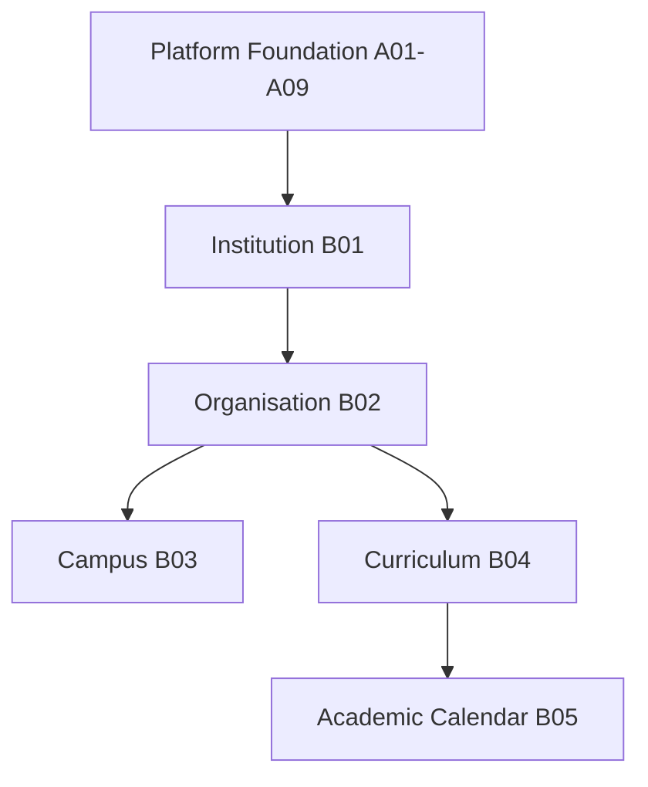

# L2-B00 — Institution & Structure Review
**Section:** B — Institution & Structure  
**Architecture Level:** Level 2 (Architecture Review & Certification)  
**Status:** 🔒 LOCKED  
**Review Board:** Chief Enterprise Architecture Review Board  
**Repository Version:** v1.1  
**Date of Certification:** July 26, 2026

---

# Executive Certification Summary

- **Purpose of Certification:** This document provides the formal repository-level certification of the Section B foundation layer, validating that Institution, Organisation, Campus, Curriculum Framework, and Academic Calendar are correctly owned and structurally complete.
- **Repository Scope:** Section B bounded contexts and domain models, excluding Platform-governed readiness.
- **Documents Reviewed:** L2-B01 (Institution Lifecycle), L2-B02 (Organisation Workflows), L2-B03 (Campus & Infrastructure), L2-B04 (Curriculum Framework), and L2-B05 (Academic Calendar).
- **Review Completion Status:** Formally Complete.
- **Critical Issues:** 0
- **Major Issues:** 0
- **Minor Issues:** 0
- **Overall Repository Score:** 10.0 / 10
- **Certification Verdict:** Section B Repository Certified
- **Certification Confidence:** [Certain]

---

# 1. Repository Metadata

| Attribute | Value |
| :--- | :--- |
| **Document Name** | Institution & Structure Review |
| **Repository Section** | Section B — Institution & Structure |
| **Purpose** | Official Architectural Review and Certification |
| **Scope** | L2-B01 through L2-B05 |
| **Parent Architecture** | SutraERP Enterprise Architecture (L1) |
| **Dependencies** | Platform Foundation & Shared Infrastructure (L2-A01 to L2-A09) |
| **Review Status** | Reviewed & Certified |
| **Repository Version** | v1.1 |
| **Architecture Status** | Approved |

---

# 2. Purpose of the Review

Section B exists to establish the canonical institutional and structural foundation of SutraERP.

Collectively, documents L2-B01 through L2-B05 define the:

- Identity and lifecycle of the **Institution**.
- Internal administrative and governance hierarchy of the **Organisation**.
- Physical infrastructure mapping for **Campuses and Spaces**.
- Academic structures governing **Curriculums and Courses**.
- Temporal coordination governing **Academic Calendars**.

This certification confirms that Section B is internally consistent, aligned with the locked Level 1 ownership model, and ready to serve as the foundation for downstream functional domains.

Operational readiness is excluded from this certification because it is canonical Platform Governance responsibility and no longer part of Section B ownership.

---

# 3. Scope of Certification

- **Included in Certification:**
  - The lifecycle states, validations, and events of the `Institution` aggregate.
  - The organisational hierarchy, units, governance configuration, and versioned structures.
  - The physical spatial catalog for campuses, buildings, floors, spaces, zones, collections, and portfolios.
  - Academic curriculum structures, including programmes, versions, courses, subjects, and credits.
  - Calendar management, including academic years, assignments, exceptions, snapshots, and temporal resolution.
- **Excluded from Certification:**
  - Downstream application execution logic such as admissions, student records, faculty allocation, finance ledgers, and examination operations.
  - Platform-level readiness governance, which is owned by the Platform Foundation section.

---

# 4. Repository Coverage Validation

**Assessment:** The reviewed Section B documents are complete and canonically aligned.

- **Finding (Required Capabilities):** All baseline institutional, structural, spatial, academic, and calendar capabilities are represented.
  - **Evidence:** [L2-B01](L2-B01_Institution_Workflow.md), [L2-B02](L2-B02_Organisation_Workflows.md), [L2-B03](L2-B03_Campus_Workflows.md), [L2-B04](L2-B04_Curriculum_Framework_Workflows.md), [L2-B05](L2-B05_Academic_Calendar_Workflows.md).
- **Finding (No Missing Ownership):** No canonical ownership gaps were identified inside Section B.
- **Finding (No Duplicate Ownership):** No two Section B documents attempt to authoritatively master the same business concept.
- **Finding (No Boundary Leakage):** Each document remains within its intended bounded context and avoids platform responsibilities.

### Certification Result: PASS

---

# 5. Responsibility Matrix

| Responsibility | Owning Domain | Duplicate Ownership | Missing Ownership | Repository Status | Confidence |
| :--- | :--- | :--- | :--- | :--- | :--- |
| **Institution Lifecycle** | L2-B01 Institution | None | None | Certified | [Certain] |
| **Institution Configuration** | L2-B01 Institution | None | None | Certified | [Certain] |
| **Institution Activation** | L2-B01 Institution | None | None | Certified | [Certain] |
| **Organisation Types** | L2-B02 Organisation | None | None | Certified | [Certain] |
| **Organisation Structures** | L2-B02 Organisation | None | None | Certified | [Certain] |
| **Organisation Units** | L2-B02 Organisation | None | None | Certified | [Certain] |
| **Governance Configuration** | L2-B02 Organisation | None | None | Certified | [Certain] |
| **Campus** | L2-B03 Campus & Infrastructure | None | None | Certified | [Certain] |
| **Building** | L2-B03 Campus & Infrastructure | None | None | Certified | [Certain] |
| **Floor** | L2-B03 Campus & Infrastructure | None | None | Certified | [Certain] |
| **Space** | L2-B03 Campus & Infrastructure | None | None | Certified | [Certain] |
| **Zone** | L2-B03 Campus & Infrastructure | None | None | Certified | [Certain] |
| **Programme** | L2-B04 Curriculum Framework | None | None | Certified | [Certain] |
| **Curriculum** | L2-B04 Curriculum Framework | None | None | Certified | [Certain] |
| **Subject** | L2-B04 Curriculum Framework | None | None | Certified | [Certain] |
| **Course** | L2-B04 Curriculum Framework | None | None | Certified | [Certain] |
| **Academic Calendar** | L2-B05 Academic Calendar | None | None | Certified | [Certain] |
| **Calendar Assignment** | L2-B05 Academic Calendar | None | None | Certified | [Certain] |
| **Calendar Exception** | L2-B05 Academic Calendar | None | None | Certified | [Certain] |
| **Calendar Snapshot** | L2-B05 Academic Calendar | None | None | Certified | [Certain] |

### Certification Result: PASS

---

# 6. Domain Boundary Validation

**Assessment:** The Section B documents maintain clean boundaries.

- **Institution (B01):** Confined to identity, legal configuration, and lifecycle. It does not own academic delivery or operational readiness.
- **Organisation (B02):** Governs structure types, hierarchy mapping, and governance policies.
- **Campus & Infrastructure (B03):** Models physical elements only.
- **Curriculum Framework (B04):** Models academic frameworks, credit schemes, subjects, and courses.
- **Academic Calendar (B05):** Models temporal structures and resolution services.

### Certification Result: PASS

---

# 7. Aggregate Validation

**Assessment:** Across B01 through B05, the major aggregate roots are evaluated as follows:

| Aggregate Root | Transaction Boundary | Lifecycle Ownership | Identifier-based References | Repository Ownership | Certification Status | Confidence |
| :--- | :--- | :--- | :--- | :--- | :--- | :--- |
| **Institution** (B01) | Restricted to single Institution record | Self-contained lifecycle | References TenantId only | Singular business ownership | Certified | [Certain] |
| **Organisation** (B02) | Administrative hierarchy boundary | Self-contained lifecycle | References InstitutionId | Singular business ownership | Certified | [Certain] |
| **Campus** (B03) | Physical boundary definition | Self-contained lifecycle | References InstitutionId | Physical boundary ownership | Certified | [Certain] |
| **AcademicProgramme** (B04) | Academic program constraints | Version-level lifecycle | References InstitutionId | Academic definition ownership | Certified | [Certain] |
| **AcademicCalendar** (B05) | Temporal baseline mapping | Self-contained lifecycle | References InstitutionId | Temporal calendar ownership | Certified | [Certain] |

### Certification Result: PASS

---

# 8. Workflow Validation

**Assessment:** The reviewed workflows are functionally complete.

- **Finding (Preconditions & Invariants):** Each workflow defines strict preconditions and validations.
- **Finding (State Transitions):** Lifecycle transitions are well-defined and event-backed.
- **Finding (Failure Handling):** Validation gates prevent invalid state transitions and downstream leakage.

### Certification Result: PASS

---

# 9. Multi-Domain Dependency Validation

**Assessment:** The dependency graph across Section B is strictly uni-directional and consistent with the locked Level 1 model.

### Certification Result: PASS

---

# 10. Final Certification

Section B is certified as a coherent canonical foundation for institution and structure management within SutraERP.

Future changes to B01 through B05 must preserve:

- canonical ownership
- bounded-context integrity
- unidirectional dependencies
- event-driven collaboration
- repository traceability

**Final Verdict:** Section B Certified
