# L2-C01 — Admissions Workflows

Version: 1.0 (Draft)
Architecture Level: L2 – Domain Workflow Architecture
Section: C – Student Lifecycle
Domain Owner: Student Lifecycle (Section C)
Document Owner: Varad
Lead Architect Approval: Pending
Status: Draft

1. Purpose
1.1 Objective

This document defines the canonical Admission Workflows for the Student Lifecycle domain within SutraERP.

The objective of this document is to establish a single authoritative architectural specification governing the transition of an Applicant through the Admission lifecycle into a canonical Student identity while preserving complete institutional history, auditability, and compliance with NEP 2020.

This document defines business workflow architecture, domain ownership, state transitions, business rules, workflow boundaries, multi-domain interactions, and canonical events.

It intentionally does not define:

UI design
APIs
Database schema
DTOs
Technical implementation
Event payloads
Microservice architecture
Screen navigation

Those belong to later architecture levels (L3–L6).

1.2 Architectural Goal

Admission is not merely a fee collection process.

Admission is the institutional process through which a verified candidate is formally accepted into the institution and transformed into a canonical Student identity capable of participating in academic operations.

The workflow must guarantee:

complete auditability
deterministic state transitions
configurable approval policies
institutional compliance
NEP compatibility
future scalability
zero ownership ambiguity
1.3 Architectural Principles

This workflow follows the core architectural principles established within SutraERP.

Principle 1 — Single Domain Ownership

Every business concept shall have exactly one authoritative owner.

Admissions owns only the admission transition.

Academic structure remains owned by Section D.

Finance owns all monetary transactions.

Examination owns assessment.

No workflow shall violate ownership boundaries.

Principle 2 — Student Identity is Permanent

Once created,

A Student shall never be physically deleted.

The lifecycle state changes.

The identity remains.

Historical admissions remain preserved permanently.

Principle 3 — Admission is Historical

Every admission attempt is an institutional record.

Even cancelled or withdrawn admissions remain part of institutional history.

Admissions are immutable historical transactions.

Principle 4 — Student ≠ Applicant

Applicant

↓

Admission

↓

Student

These represent three different business concepts.

An Applicant does not automatically become a Student.

Student creation occurs only after successful completion of admission policies.

Principle 5 — Configuration over Hardcoding

Approval chains

Admission authority

Fee policies

Document policies

Verification policies

Reservation policies

shall all be configurable through the Workflow Engine.

Business logic must never hardcode institutional policies.

Principle 6 — Multi-Domain Ownership

Admission may collaborate with other domains.

Admission shall never directly modify another domain's owned data.

Example:

Admission

↓

Requests Finance

↓

Finance creates payment

NOT

Admission

↓

Insert Payment Record

Principle 7 — Commit Before Publish

Domain events represent completed business facts.

Events are published only after successful transaction commit.

No consumer may depend upon uncommitted state.

2. Scope

This document governs the workflows beginning with Applicant admission processing and ending with successful Student creation and ownership handoff to L2-C02 — Student Lifecycle & Activation.

2.1 Included Scope

The Admission domain includes:

Admission confirmation
Admission verification
Admission document validation
Admission fee initiation
Admission approval
Student creation
Publication of StudentCreated domain event for downstream activation
Admission cancellation
Admission withdrawal
Admission revocation
Readmission entry creation
Admission audit trail
2.2 Explicitly Excluded Scope

The following are outside the ownership of this document.

Marketing
Campaigns
Promotions
Lead generation
Enquiry Management
Prospect management
Walk-ins
Counselling
CRM
Application Processing
Online application forms
Offline application forms
Application review
Merit preparation
Seat Allocation
Reservation matrix
Category allocation
Merit ranking
Seat allotment
Academic Delivery

Owned by Section D

Includes:

Programme
Programme Version
Curriculum
Semester Structure
Credits
Subjects
Electives
Finance

Owned by Section F

Includes:

Payments
Refunds
Ledger
Accounting
Receipts
Scholarships (financial processing)
Examination

Owned by Section I

Includes:

Eligibility
Assessments
Hall Tickets
Results
3. Upstream Dependencies

Admissions depends upon the following canonical domains.

3.1 Platform Foundation (Section A)

Consumes

Identity
Authentication
Authorization
Workflow Engine
Audit
Event Infrastructure
Document Platform
Configuration

Purpose

Provides foundational platform capabilities.

Admissions owns none of these.

3.2 Institution & Structure (Section B)

Consumes

Institution
College
Department
Campus
Academic Calendar
Academic Year
Programme Catalog Reference

Purpose

Provides institutional context.

Admissions never owns institutional hierarchy.

3.3 Academic Delivery (Section D)

Consumes

Read-only references to:

Programme
Programme Version
Branch
Specialization
Intake
Semester Structure

Admissions shall never create or modify academic structures.

3.4 Finance (Section F)

Consumes synchronous validation for:

Fee payable
Payment completion
Financial clearance

Admissions never owns payment records.

3.5 Document Platform
Consumes

Document storage
Verification status
Version history

Admission owns verification workflow.

Document Platform owns storage.

4. Downstream Dependencies

Admission publishes authoritative business facts consumed by downstream domains.

Student Lifecycle

Consumes

AdmissionConfirmed

StudentCreated

(StudentActivated is published exclusively by L2-C02 — Student Lifecycle.)

Academic Registration

Consumes

(StudentActivated is published exclusively by L2-C02 — Student Lifecycle.)

to enable registration.

Finance

Consumes

AdmissionCancelled

AdmissionRevoked

AdmissionWithdrawn

for refund policy execution.

Notification

Consumes

AdmissionConfirmed

AdmissionRejected

AdmissionCancelled

AdmissionExpired

APAAR Integration

Consumes

StudentCreated

for identity synchronization.

ABC Integration

Consumes

StudentActivated

to initialize Academic Credit Ledger.

Directory

Consumes

StudentCreated

to expose institutional directory entries.

5. Domain Ownership Boundaries

This section defines the authoritative ownership boundary for Admissions.

Ownership ambiguity is strictly prohibited.

5.1 Admissions Owns

Admissions owns:

Admission Record
Admission Lifecycle
Admission Status
Admission Verification Workflow
Admission Approval Workflow
Admission Confirmation
Admission Withdrawal
Admission Cancellation
Admission Revocation
Student Creation Trigger
Readmission Entry
Admission Audit Trail

Admissions is the sole authority over these concepts.

5.2 Admissions Does NOT Own

Admissions does NOT own:

Applicant CRM
Leads
Enquiries
Marketing
Counselling
Application Processing
Applications
Merit
Reservation
Rank
Seat Allocation
Academic Structure
Programme
Branch
Curriculum
Credits
Subjects
Student Academic Records

After Student creation,

ownership transfers to

Student Lifecycle.

Financial Records

Admissions never owns

Payments
Ledger
Receipts
Refunds
Examination

Admissions never determines

Examination Eligibility
Examination Status
Results

Admissions has no ownership after successful qualification completion.

| Business Concept                 | Owner     |
| -------------------------------- | --------- |
| Admission Record                 | Section C |
| Admission Status                 | Section C |
| Student Identity Creation        | Section C |
| Student Lifecycle                | Section C |
| Programme                        | Section D |
| Curriculum                       | Section D |
| Payment                          | Section F |
| Refund                           | Section F |
| Scholarship Financial Processing | Section F |
| Examination Eligibility          | Section I |
| Result                           | Section I |
| APAAR Synchronization            | Section H |
| ABC Synchronization              | Section H |
| Notification Delivery            | Section H |
| Directory Projection             | Section H |


# 6. Domain Lifecycle

## 6.1 Overview

The Admission Lifecycle defines the canonical business progression through which an institution transforms an **approved admission** into a **canonical Student identity** while ensuring compliance with institutional policies, financial regulations, academic governance, audit requirements, and NEP 2020.

The lifecycle exists to guarantee that every admission follows a deterministic sequence of business states regardless of institution type, admission mode, or workflow configuration.

The lifecycle is independent of UI implementation, APIs, or database design and serves as the authoritative business state machine for the Admission domain.

---

## 6.2 Lifecycle Objectives

The Admission Lifecycle has the following objectives:

- Ensure a single, deterministic admission journey.
- Prevent unauthorized Student creation.
- Support configurable institutional admission policies.
- Maintain a complete historical record of every admission.
- Enable workflow automation through the Workflow Engine.
- Guarantee auditability of every state transition.
- Support autonomous, affiliated, private, deemed, and government institutions.
- Support NEP 2020 Multiple Entry–Multiple Exit (MEME) requirements.
- Provide a stable integration boundary for downstream domains.

---

## 6.3 Lifecycle Principles

The Admission Lifecycle follows these architectural principles.

### LP-01 — Single Source of Truth

The Admission domain is the sole authority for the Admission lifecycle.

---

### LP-02 — Deterministic State Machine

An admission shall always exist in one and only one lifecycle state at any point in time.

Parallel lifecycle states are prohibited.

---

### LP-03 — Immutable History

Historical lifecycle states shall never be modified or deleted.

Each transition shall append to the audit history.

---

### LP-04 — Configuration Driven

Approval stages, verification requirements, fee policies, and confirmation authorities shall be configurable through the Workflow Engine.

No institutional policy shall be hardcoded.

---

### LP-05 — Event After Commit

Lifecycle events represent completed business facts.

Events shall only be published after successful transaction commit.

---

### LP-06 — Multi-Domain Isolation

The lifecycle may consume services from other domains but shall never modify data owned by another domain.

---

## 6.4 Primary Lifecycle

The standard lifecycle is illustrated below.

```text
Admission Initiated
        │
        ▼
Documents Submitted
        │
        ▼
Verification Completed
        │
        ▼
Admission Approved
        │
        ▼
Financial Clearance
        │
        ▼
Admission Confirmed
        │
        ▼
Student Created
        │
        ▼
Admission Completed
```

Admission Completed is the terminal state of this domain.

Subsequent lifecycle management belongs to **L2-C02 – Student Lifecycle & Activation**.

---

## 6.5 Lifecycle Phases

The Admission Lifecycle consists of six logical phases.

| Phase | Description |
|--------|-------------|
| Initiation | Admission record enters institutional processing. |
| Verification | Required documents and eligibility are validated. |
| Approval | Institutional authorities approve admission. |
| Financial Clearance | Financial obligations are verified according to institutional policy. |
| Student Creation | Canonical Student identity is created. |
| Completion | Admission process concludes and ownership transitions to Student Lifecycle. |

---

## 6.6 State Definitions

### Admission Initiated

Represents the beginning of institutional admission processing.

No Student exists.

---

### Documents Submitted

All mandatory admission documents have been received.

Verification has not yet completed.

---

### Verification Completed

Required documents satisfy institutional verification policies.

Eligibility validation is complete.

---

### Admission Approved

Admission authority has formally approved the admission.

No Student has yet been created.

---

### Financial Clearance

All mandatory financial conditions required by institutional policy have been satisfied.

If the institution allows deferred payment, this state may be satisfied through an approved financial policy rather than full payment.

---

### Admission Confirmed

The institution has formally accepted the admission.

The admission is now eligible for Student creation.

---

### Student Created

The canonical Student identity has been created.

Ownership of subsequent lifecycle activities transfers to the Student Lifecycle domain.

---

### Admission Completed

The Admission workflow has concluded successfully.

No further lifecycle transitions exist within this domain.

---

## 6.7 Alternate Lifecycle Paths

Not every admission reaches successful completion.

The following alternate terminal paths are supported.

```text
Admission Initiated
        │
        ├──────────────► Cancelled
        │
        ├──────────────► Withdrawn
        │
        ├──────────────► Revoked
        │
        └──────────────► Expired
```

These states are terminal unless institutional policy explicitly permits Readmission.

---

## 6.8 Alternate State Definitions

### Cancelled

Admission cancelled before Student creation.

Cancellation may be initiated by the institution or applicant.

Historical records remain preserved.

---

### Withdrawn

Applicant voluntarily withdraws from admission.

No Student identity shall exist.

---

### Revoked

Institution revokes an approved admission due to policy violations, fraud, legal directives, or administrative decisions.

Revocation requires mandatory audit recording.

---

### Expired

Admission offer lapses because required actions were not completed within the configured validity period.

Expiry shall be determined through configurable policy.

---

## 6.9 State Transition Matrix

| Current State | Allowed Next States |
|---------------------------|----------------------------------------------|
| Admission Initiated | Documents Submitted, Cancelled, Expired |
| Documents Submitted | Verification Completed, Cancelled |
| Verification Completed | Admission Approved, Cancelled |
| Admission Approved | Financial Clearance, Revoked |
| Financial Clearance | Admission Confirmed |
| Admission Confirmed | Student Created |
| Student Created | Admission Completed |
| Admission Completed | None |
| Cancelled | None* |
| Withdrawn | None* |
| Revoked | None* |
| Expired | None* |

\* Readmission may create a **new Admission Record** linked to the same Person, subject to institutional policy.

---
## 6.9.1 Canonical Lifecycle Transition Matrix

The following matrix defines every valid Admission lifecycle transition.

No transition outside this matrix shall be permitted.


| From                   | To                                                      |
| ---------------------- | ------------------------------------------------------- |
| Admission Initiated    | Documents Submitted                                     |
| Documents Submitted    | Verification Completed                                  |
| Verification Completed | Admission Approved                                      |
| Admission Approved     | Financial Clearance                                     |
| Financial Clearance    | Admission Confirmed                                     |
| Admission Confirmed    | Student Created                                         |
| Student Created        | Admission Completed                                     |
| Admission Initiated    | Cancelled                                               |
| Documents Submitted    | Cancelled                                               |
| Verification Completed | Cancelled                                               |
| Admission Approved     | Cancelled                                               |
| Financial Clearance    | Cancelled                                               |
| Admission Confirmed    | Withdrawn                                               |
| Admission Confirmed    | Revoked                                                 |
| Student Created        | Revoked (Policy Controlled)                             |
| Withdrawn              | Readmission (New Admission Record)                      |
| Cancelled              | Readmission (New Admission Record)                      |
| Revoked                | Readmission (Institution Policy — New Admission Record) |


## 6.9.2 Terminal State Classification

| State | Classification |
|--------|----------------|
| Student Created | Active Terminal |
| Cancelled | Reopenable via Readmission |
| Withdrawn | Reopenable via Readmission |
| Revoked | Policy-Controlled Terminal |


## 6.10 Forbidden Transitions

The following transitions are architecturally prohibited.

- Admission Initiated → Student Created
- Documents Submitted → Admission Confirmed
- Verification Completed → Student Created
- Admission Approved → Student Created
- Admission Confirmed → Documents Submitted
- Student Created → Admission Approved
- Admission Completed → Admission Approved

Any attempt to perform these transitions shall be rejected by the domain.

---

## 6.11 Entry Conditions

A lifecycle state may only be entered when all mandatory business conditions have been satisfied.

Examples include:

- Required approvals completed.
- Mandatory documents verified.
- Programme reference validated.
- Institutional policy satisfied.
- Financial policy resolved.

---

## 6.12 Exit Conditions

A lifecycle state may only be exited after completion of all mandatory activities associated with that state.

Premature transitions are prohibited.

---

## 6.13 Terminal States

The Admission Lifecycle recognizes the following terminal states for an individual Admission Record.

• Admission Completed
• Cancelled
• Withdrawn
• Revoked
• Expired

These states permanently terminate the lifecycle of the current Admission Record.

Where institutional policy permits Readmission, the previous Admission Record SHALL remain immutable and closed.

Readmission SHALL create a new Admission Record linked to the same canonical Person (and existing Student identity, where applicable).

No terminal Admission Record shall ever be reopened or transitioned back into an active lifecycle state.
---

## 6.14 Lifecycle Ownership

| Lifecycle Responsibility | Owner |
|---------------------------|--------|
| Admission Processing | Admission Domain |
| Admission State Machine | Admission Domain |
| Student Creation | Admission Domain |
| Student Lifecycle | Student Lifecycle Domain (L2-C02) |
| Academic Registration | Academic Registration Domain |
| Finance Processing | Finance Domain |

---

## 6.15 Lifecycle Events

Typical lifecycle events include:

- AdmissionInitiated
- DocumentsSubmitted
- DocumentsVerified
- AdmissionApproved
- FinancialClearanceCompleted
- AdmissionConfirmed
- StudentCreated
- AdmissionCompleted
- AdmissionCancelled
- AdmissionWithdrawn
- AdmissionRevoked
- AdmissionExpired

These events are formally defined later in Section 10.

---

## 6.16 Audit Requirements

Every lifecycle transition shall record:

- Previous State
- New State
- Transition Timestamp
- Initiating User/System
- Workflow Version
- Policy Version
- Reason Code
- Remarks
- Correlation Identifier
- Institution Identifier

Audit records are immutable.

---

## 6.17 NEP 2020 Considerations

The Admission Lifecycle shall support:

- Multiple Entry–Multiple Exit (MEME)
- Re-admission using the same canonical Person identity
- Academic Journey continuity
- APAAR integration
- Academic Bank of Credits (ABC) integration
- Future mobility across institutions through standardized identity mappings

Student creation shall never duplicate an existing institutional Student identity for the same Person. Instead, subsequent admissions shall create a new Admission Record and, where applicable, a new Academic Journey while preserving the canonical Student identity.

---

## 6.18 Lifecycle Summary

The Admission Lifecycle concludes with the successful creation of a canonical Student identity and the completion of admission processing.

From this point onward, all lifecycle ownership transitions to **L2-C02 – Student Lifecycle & Activation**, ensuring strict domain ownership boundaries and preventing overlap between Admission and Student Lifecycle responsibilities.

# 7. Domain Workflows

## 7.1 Purpose

The Domain Workflows define the canonical business processes executed by the Admission domain. They describe how business activities are orchestrated to transform an approved admission into a canonical Student identity while maintaining strict ownership boundaries, institutional compliance, financial integrity, and complete auditability.

These workflows are implementation-independent and represent the authoritative business behaviour of the domain.

Each workflow is intentionally decomposed into reusable business capabilities that may later be automated by the Workflow Engine, implemented through application services, or orchestrated by configurable institutional policies.

---

## 7.2 Workflow Design Principles

Every workflow defined in this domain shall comply with the following principles.

### DP-01 — Single Responsibility

Each workflow shall own one primary business objective.

Large workflows shall be decomposed into smaller workflows rather than introducing multiple business responsibilities into a single orchestration.

---

### DP-02 — Deterministic Execution

Given the same inputs and institutional policies, a workflow shall always produce the same business outcome.

---

### DP-03 — Configurable Policies

Institution-specific approval chains, financial rules, verification requirements, reservation policies, and admission authorities shall be resolved through configurable policies.

No workflow shall hardcode institutional behaviour.

---

### DP-04 — Domain Ownership

A workflow may consume information from another domain but shall never modify data owned by another domain.

Multi-domain collaboration shall occur through synchronous contracts or published domain events.

---

### DP-05 — Event Publication

Business events shall only be published after successful completion of the business transaction.

Events represent completed business facts.

---

### DP-06 — Auditability

Every workflow execution shall generate immutable audit records sufficient to reconstruct the complete business history.

---

### DP-07 — Idempotency

Where supported, workflow execution shall be safe for retry without producing duplicate business outcomes.

---

### DP-08 — Extensibility

Institution-specific workflow variations shall be introduced through configuration and extension points rather than modifying the canonical workflow.

---

## 7.3 Workflow Catalogue

The Admission domain consists of the following canonical workflows.

| Workflow ID | Workflow | Primary Objective |
|--------------|----------------------------------------------|------------------------------------------------|
| WF-C01-01 | Admission Confirmation | Confirm institutionally approved admission |
| WF-C01-02 | Document Verification | Verify mandatory admission documents |
| WF-C01-03 | Admission Approval | Execute institutional approval workflow |
| WF-C01-04 | Financial Clearance | Validate financial eligibility for admission |
| WF-C01-05 | Student Creation | Create canonical Student identity |
| WF-C01-06 | Admission Cancellation | Cancel admission before Student creation |
| WF-C01-07 | Admission Withdrawal | Handle voluntary withdrawal by applicant |
| WF-C01-08 | Admission Revocation | Revoke admission through institutional authority |
| WF-C01-09 | Readmission | Process subsequent admission for an existing Person |
| WF-C01-10 | Admission Audit | Maintain immutable admission history |

Each workflow is independent but participates in the overall Admission Lifecycle defined in Section 6.

---

# 7.4 Workflow Relationship Diagram

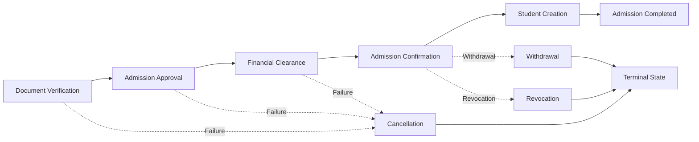

---

## 7.5 Workflow Interaction Matrix

| Workflow | Depends On | Produces |
|-----------|------------|----------|
| Document Verification | Document Platform | Verified Admission Documents |
| Admission Approval | Verification | Approved Admission |
| Financial Clearance | Finance | Financial Clearance |
| Admission Confirmation | Approval + Finance | Confirmed Admission |
| Student Creation | Confirmed Admission | Student |
| Cancellation | Admission | Cancelled Admission |
| Withdrawal | Admission | Withdrawn Admission |
| Revocation | Admission | Revoked Admission |
| Readmission | Existing Person | New Admission Record |
| Audit | All Workflows | Immutable Audit Trail |

---

## 7.6 Workflow Sequencing Rules

The following sequencing rules are mandatory.

1. Document Verification shall complete before Admission Approval.

2. Admission Approval shall complete before Financial Clearance unless institutional policy explicitly permits parallel execution.

3. Admission Confirmation shall not occur before mandatory financial conditions are satisfied.

4. Student Creation shall occur exactly once for each successful admission.

5. Cancellation, Withdrawal, Revocation, and Expiry terminate the Admission Lifecycle.

6. Readmission creates a new Admission Record while preserving the canonical Person and Student identities.

7. No workflow may bypass lifecycle transitions defined in Section 6.

---


# WF-C01-01 — Admission Confirmation Workflow

---

# 1. Workflow Definition

## 1.1 Purpose

The Admission Confirmation Workflow formalizes the institution's final acceptance of an approved admission after all mandatory academic, administrative, regulatory, and financial conditions have been satisfied.

Admission Confirmation is the final decision point of the admission process before creation of the canonical Student identity.

This workflow concludes with a **Confirmed Admission** and prepares the admission for Student creation.

It does **not** create the Student identity. Student creation is performed exclusively by **WF-C01-05 – Student Creation Workflow**.

---

## 1.2 Business Context

Admission Confirmation represents the institutional commitment to admit an applicant into a specific academic programme under a defined academic session and institutional policy.

The workflow ensures that:

- institutional approvals are complete,
- mandatory verification has succeeded,
- financial obligations are satisfied (or explicitly waived through policy),
- regulatory conditions have been met,
- admission is eligible for Student creation.

---

## 1.3 Workflow Objectives

The workflow has the following objectives:

- Confirm institutional admission.
- Prevent unauthorized Student creation.
- Ensure compliance with admission policies.
- Maintain complete auditability.
- Produce deterministic business outcomes.
- Publish canonical business events.
- Preserve immutable admission history.

---

## 1.4 Scope

Included:

- Admission confirmation
- Policy validation
- Confirmation authorization
- Confirmation timestamp
- Admission status update
- Domain event publication

Excluded:

- Applicant registration
- Seat allocation
- Merit preparation
- Programme management
- Fee collection
- Student creation
- Academic registration

---

# 2. Workflow Behaviour

## 2.1 Trigger

The workflow may be initiated through one of the following triggers:

• Financial Clearance Completed
• Workflow Engine Automation
• Authorized Admission Officer
• Batch Admission Confirmation
• Government Admission Import

Admission Approval alone shall not initiate this workflow until Financial Clearance has been successfully satisfied.
---

## 2.2 Preconditions

The following conditions shall already be satisfied before execution.

### Academic

- Programme exists.
- Programme Version exists.
- Intake exists.
- Academic Session exists.
- Admission belongs to the Institution.
- Admission is in Admission Approved state.
- The Admission Approval Workflow shall have completed successfully.
- No lifecycle state other than Admission Approved is eligible to enter this workflow.

### Administrative

- Admission Record exists.
- Admission is Approved.
- Required documents verified.
- Admission not cancelled.
- Admission not revoked.

### Financial

- Financial Clearance completed.

or

- Deferred payment approved through institutional policy.

### System

- Admission Workflow active.
- Configuration resolved.
- User authorized.

---

## 2.3 Inputs

Primary inputs include:

| Input | Source |
|---------|--------|
| Admission Record | Admission Domain |
| Programme Reference | Academic Delivery |
| Academic Session | Institution Structure |
| Financial Clearance | Finance |
| Verification Status | Admission Domain |
| Workflow Policy | Workflow Engine |
| Institution Configuration | Platform |
|Applicant Identity | Platform Foundation |

---

## 2.4 Main Workflow

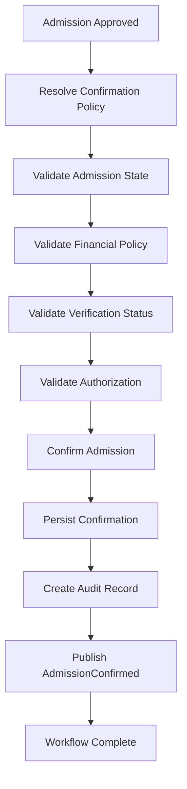

---

## 2.5 Detailed Execution Steps

### Step 1

Resolve institutional confirmation policy.

Determine whether confirmation requires:

- automatic execution,
- manual confirmation,
- committee approval,
- delegated authority.

---

### Step 2

Validate current admission state.

Only **Admission Approved** admissions may proceed.

Any other lifecycle state shall terminate execution.

---

### Step 3

Validate financial policy.

Examples:

- Full payment received.
- Installment approved.
- Scholarship approved.
- Fee waiver approved.
- Deferred payment permitted.

---

### Step 4

Validate verification completion.

Every mandatory verification rule shall be satisfied.

---

### Step 5

Validate authorization.

The executing actor shall possess authority defined by institutional workflow policy.

---

### Step 6

Create immutable confirmation record.

Record:

- timestamp,
- authority,
- workflow version,
- policy version,
- institution,
- remarks.

---

### Step 7

Update Admission status.

New state:

**Admission Confirmed**

---

### Step 8

Commit transaction.

---

### Step 9

Publish domain event.

AdmissionConfirmed

---

### Step 10

Workflow completes.

Admission becomes eligible for Student creation.

---

## 2.6 Alternate Flows

### AF-01 — Automatic Confirmation

Workflow Engine confirms admission automatically after approval.

---

### AF-02 — Manual Confirmation

Authorized Admission Officer performs confirmation.

---

### AF-03 — Batch Confirmation

Multiple admissions confirmed simultaneously.

Each admission executes independently.

Partial success shall not rollback successful confirmations.

---

### AF-04 — Government Admission

Admission imported from centralized admission authority.

Institution performs configurable validation before confirmation.

---

## 2.7 Exception Flows

### EX-01 — Financial Clearance Missing

Admission remains pending.

No confirmation occurs.

---

### EX-02 — Verification Incomplete

Workflow terminates.

Admission remains unconfirmed.

---

### EX-03 — Invalid Lifecycle State

Workflow rejected.

Audit generated.

---

### EX-04 — Unauthorized User

Workflow denied.

Security audit generated.

---

### EX-05 — Duplicate Confirmation Request

Workflow shall be idempotent.

Previously confirmed admission returned.

No duplicate confirmation created.

---

## 2.8 Postconditions

Upon successful completion:

- Admission state updated.
- Confirmation persisted.
- Audit completed.
- AdmissionConfirmed event published.
- Admission eligible for Student creation.

---

# 3. Architecture Contracts

## 3.1 State Transition

Refer to **Section 6.9** for the canonical lifecycle matrix.

This workflow performs only the following transition:

```text
Admission Approved
        │
        ▼
Financial Clearance
        │
        ▼
Admission Confirmed
```

No other lifecycle transitions are permitted.

---

## 3.2 Published Events

| Event | Description |
|--------|-------------|
| AdmissionConfirmed | Admission successfully confirmed |

---

## 3.3 Consumed Events

- AdmissionApproved
- FinancialClearanceCompleted
- DocumentsVerified

---

## 3.4 Multi-Domain Interactions

| Domain | Interaction |
|----------|------------|
| Finance | Validate financial clearance |
| Academic Delivery | Validate programme reference |
| Platform | Authentication & Authorization |
| Workflow Engine | Resolve workflow policy |
| Audit | Persist immutable audit record |

This workflow shall never modify external domain data.

---

## 3.5 Business Rules

| Rule ID | Rule |
|----------|------|
| BR-C01-001 | Admission must be approved before confirmation. |
| BR-C01-002 | Confirmation requires financial policy satisfaction. |
| BR-C01-003 | Confirmation authority is configurable. |
| BR-C01-004 | Confirmation timestamp is immutable. |
| BR-C01-005 | Admission cannot be confirmed twice. |
| BR-C01-006 | Student creation shall not occur before confirmation. |
| BR-C01-007 | Confirmation history shall never be deleted. |
| BR-C01-008 | Domain events shall publish only after successful commit. |

---

## 3.6 Decision Matrix

The following decision matrix governs the execution of the Admission Confirmation Workflow.

| Rule | Admission Approved | Documents Verified | Financial Policy Satisfied | Authorized User | Outcome |
|------|--------------------|--------------------|----------------------------|-----------------|---------|
| DM-C01-001 | Yes | Yes | Yes | Yes | Confirm Admission |
| DM-C01-002 | Yes | Yes | No | Yes | Pending Financial Clearance |
| DM-C01-003 | Yes | No | Any | Yes | Reject Confirmation |
| DM-C01-004 | No | Any | Any | Yes | Reject Confirmation |
| DM-C01-005 | Yes | Yes | Yes | No | Authorization Failure |
| DM-C01-006 | Revoked | Any | Any | Any | Terminate Workflow |
| DM-C01-007 | Cancelled | Any | Any | Any | Terminate Workflow |
| DM-C01-008 | Already Confirmed | Any | Any | Any | Return Existing Confirmation (Idempotent) |

## 3.7 Failure Matrix

| Failure Scenario | System Action | Retry Allowed | Audit Required |
|------------------|--------------|---------------|----------------|
| Programme Missing | Reject Workflow | Yes | Yes |
| Financial Clearance Pending | Suspend Workflow | Yes | Yes |
| Verification Incomplete | Reject Workflow | Yes | Yes |
| Unauthorized User | Reject Request | Yes | Yes |
| Duplicate Confirmation | Return Existing Result | N/A | Yes |
| Admission Revoked | Terminate Workflow | No | Yes |
| Admission Cancelled | Terminate Workflow | No | Yes |
| Policy Resolution Failure | Retry After Configuration | Yes | Yes |

## 3.8 Outputs

Successful execution produces:

### Primary Outputs

- Confirmed Admission
- Confirmation Timestamp
- Confirmation Authority
- Admission Status Update

### Secondary Outputs

- Immutable Audit Record
- AdmissionConfirmed Domain Event
- Workflow Completion Record
- Notification Trigger (optional)


# 4. Governance

## 4.1 Audit Requirements

Refer to **Section 6.16**.

Additional workflow-specific audit attributes:

- Confirmation Authority
- Confirmation Reason
- Workflow Policy Version
- Confirmation Method
- Institution Identifier
- Correlation Identifier
- Transaction Identifier

---

## 4.2 Extension Points

Institutions may extend:

- approval hierarchy,
- confirmation authority,
- financial policy,
- confirmation notifications,
- regulatory validations,
- government integrations,

without modifying the canonical workflow.

---

## 4.3 Architectural Constraints

- Student identity shall never be created by this workflow.
- Programme information is read-only.
- Finance remains the owner of financial records.
- Workflow execution shall be idempotent.
- Historical confirmation records are immutable.
- Multi-domain writes are prohibited.

---

## 4.4 Architectural Notes

This workflow establishes the contractual boundary between the **Admission Lifecycle** and **Student Creation**.

Its sole responsibility is to produce a **Confirmed Admission** that is eligible for downstream Student creation.

Any attempt to create a Student before successful completion of this workflow constitutes an architectural violation.

## 4.5 Performance & Scalability Considerations

The Admission Confirmation Workflow shall support:

- Batch admission confirmation.
- Parallel execution for independent admissions.
- Idempotent retries.
- High-volume admission seasons.
- Multi-campus execution.
- Multi-tenant deployment.
- Configurable workflow policies without code modification.

Workflow execution shall not create cross-admission dependencies that prevent horizontal scaling.

## 4.6 Security Considerations

Admission Confirmation is a privileged institutional operation.

The workflow shall ensure:

- Authentication of the initiating actor.
- Authorization according to institutional policy.
- Complete audit logging.
- Protection against duplicate confirmation requests.
- Protection against replay attacks.
- Immutable confirmation history.
- Non-repudiation of confirmation actions.

## 4.7 Related Architecture Documents

This workflow depends upon the following canonical architecture documents.

- L2-A01 — Platform Foundation
- L2-B01 — Institution Structure
- L2-D01 — Academic Delivery
- L2-F01 — Finance
- L2-C02 — Student Lifecycle & Activation

Refer to these documents for ownership boundaries and implementation contracts.

No ownership defined within these documents shall be overridden by this workflow.

# WF-C01-02 — Document Verification Workflow

---

# 1. Workflow Definition

## 1.1 Purpose

The Document Verification Workflow validates that all mandatory admission documents submitted by an applicant satisfy institutional, regulatory, academic, and statutory requirements before the admission proceeds to institutional approval.

The workflow establishes the authenticity, completeness, and validity of submitted documents while maintaining a complete verification history.

This workflow **does not own document storage**. It owns only the verification process and verification outcome.

---

## 1.2 Business Context

Every admission requires verification of documents based on institutional policies, programme requirements, admission category, government regulations, and applicable reservation rules.

Verification ensures that only eligible and compliant admissions proceed further in the Admission Lifecycle.

Document requirements shall be configurable and institution-specific.

---

## 1.3 Workflow Objectives

This workflow aims to:

- Validate document completeness.
- Verify document authenticity.
- Detect missing or invalid documents.
- Support manual and automated verification.
- Prevent fraudulent admissions.
- Preserve immutable verification history.
- Produce a deterministic verification outcome.

---

## 1.4 Scope

### Included

- Required document identification
- Document completeness validation
- Document authenticity verification
- Verification decision
- Re-submission requests
- Verification audit trail
- Verification status management

### Excluded

- Physical document storage
- OCR implementation
- External API implementation
- Applicant profile management
- Admission approval
- Student creation

---

# 2. Workflow Behaviour

## 2.1 Trigger(s)

This workflow may be initiated by:

- Admission Initiated
- Document Uploaded
- Document Re-uploaded
- Admission Updated
- Manual Verification Request
- Workflow Engine Policy
- External Verification Callback

---

## 2.2 Preconditions

The following conditions shall exist before execution.

### Admission

- Admission Record exists.
- Admission is in Submitted state.
- Admission is Active.
- Admission is not Cancelled.
- Admission is not Revoked.

### Configuration

- Document Policy exists.
- Institution Configuration exists.
- Verification Rules resolved.

### System

- User authorized.
- Workflow active.
- Document metadata available.

---

## 2.3 Inputs

| Input | Source |
|---------|---------------------------|
| Admission Record | Admission Domain |
| Uploaded Documents | Document Platform |
| Verification Policy | Workflow Engine |
| Institution Rules | Platform Configuration |
| Programme Details | Academic Delivery |
| Reservation Category | Admission Record |

---

## 2.4 Main Workflow

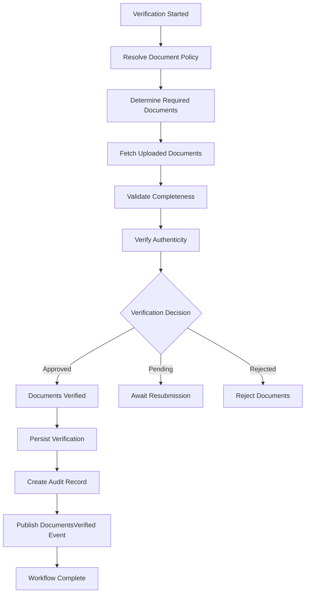

---

## 2.5 Detailed Execution Steps

### Step 1

Resolve institutional document policy.

Policy shall determine:

- Required documents
- Optional documents
- Programme-specific documents
- Category-specific documents
- Country-specific requirements

---

### Step 2

Determine mandatory documents.

Examples:

- Identity Proof
- Address Proof
- Previous Qualification
- Transfer Certificate
- Migration Certificate
- Birth Certificate
- Category Certificate
- Income Certificate
- Disability Certificate
- Eligibility Certificate
- Passport
- Visa

Institution-specific requirements shall be configurable.

---

### Step 3

Collect uploaded documents.

Latest document version shall be considered for verification.

Previous versions remain immutable.

---

### Step 4

Validate completeness.

Verify:

- Missing documents
- Duplicate uploads
- Invalid document types
- Expired documents
- Incorrect formats

---

### Step 5

Verify authenticity.

Verification may consume outcomes from:

- Manual institutional review
- OCR verification service
- Digital signature verification service
- Government verification service
- University verification service
- External verification APIs

Admission remains responsible only for the verification decision and resulting business outcome.

Verification strategy is configurable.

---

### Step 6

Determine verification outcome.

Possible outcomes:

- Verified
- Pending
- Rejected
- Conditional Approval
- Waived

---

### Step 7

Persist verification result.

Verification history shall never overwrite previous history.

---

### Step 8

Generate immutable audit record.

---

### Step 9

Publish verification event.

---

### Step 10

Workflow completes.

---

## 2.6 Alternate Flows

### AF-01 — Manual Verification

Verification Officer manually verifies every document.

---

### AF-02 — Automated Verification

Workflow Engine invokes configured digital verification services.

---

### AF-03 — Hybrid Verification

Certain documents verified digitally.

Remaining documents verified manually.

---

### AF-04 — Conditional Verification

Institution temporarily accepts admission while awaiting specific documents.

Conditions shall be policy-driven.

---

### AF-05 — Waiver

Authorized institution waives specific document requirements.

Waiver shall require mandatory audit recording.

---

## 2.7 Exception Flows

### EX-01 Missing Document

Verification remains Pending.

Applicant notified.

---

### EX-02 Expired Document

Resubmission required.

---

### EX-03 Invalid Document

Verification rejected.

Reason recorded.

---

### EX-04 Fraud Suspected

Admission flagged.

Institution notified.

Workflow suspended.

---

### EX-05 External Verification Service Failure

Fallback to manual verification if configured.

Otherwise remain Pending.

---

### EX-06 Duplicate Upload

Latest version retained.

History preserved.

---

## 2.8 Postconditions

Successful execution results in:

- Verification Status updated.
- Verification History persisted.
- Audit completed.
- Verification Event published.
- Admission eligible for Approval Workflow.

---

# 3. Architecture Contracts

## 3.1 State Transition

Refer to Section 6.9.

This workflow performs the following lifecycle transition.

```text
Documents Submitted
        │
        ▼
Verification Completed
```

No other transitions are permitted.

---

## 3.2 Published Events

| Event | Description |
|---------|--------------------------------|
| DocumentsVerified | Verification successful |
| DocumentsRejected | Verification failed |
| DocumentsPending | Awaiting applicant action |
| VerificationWaived | Policy waiver granted |

---

## 3.3 Consumed Events

- AdmissionInitiated
- DocumentsUploaded
- DocumentUpdated

---

## 3.4 Multi-Domain Interactions

| Domain | Interaction |
|----------|----------------------------|
| Document Platform | Read document metadata |
| Workflow Engine | Resolve policies |
| Academic Delivery | Programme validation |
| Platform | Authentication |
| Audit | Verification logging |

No external domain data shall be modified.

---

## 3.5 Decision Matrix

| Rule | Complete | Authentic | Policy Satisfied | Outcome |
|------|----------|------------|------------------|---------|
| DM-001 | Yes | Yes | Yes | Verified |
| DM-002 | No | Any | Any | Pending |
| DM-003 | Yes | No | Any | Rejected |
| DM-004 | Yes | Yes | Waived | Verified |
| DM-005 | Fraud | Any | Any | Suspend Admission |

---

## 3.6 Business Rules

| Rule ID | Rule |
|-----------|--------------------------------------------------------------|
| BR-C01-009 | Required documents shall be policy-driven. |
| BR-C01-010 | Verification history shall be immutable. |
| BR-C01-011 | Latest version shall not overwrite historical versions. |
| BR-C01-012 | Waivers require authorized approval. |
| BR-C01-013 | Verification outcome shall be deterministic. |
| BR-C01-014 | Fraud detection shall suspend further processing. |
| BR-C01-015 | Verification must complete before Admission Approval. |
| BR-C01-016 | Verification policies shall support programme-specific rules. |

---

# 4. Governance

## 4.1 Audit Requirements

Refer to Section 6.16.

Additional audit attributes include:

- Verifier
- Verification Method
- Verification Decision
- Document Version
- Waiver Reference
- Fraud Flag
- Verification Timestamp

---

## 4.2 Extension Points

Institutions may extend:

- Document Policies
- Verification Rules
- Government Integrations
- OCR Providers
- Digital Signature Providers
- Third-Party Verification APIs

No modification of the canonical workflow shall be required.

---

## 4.3 Architectural Constraints

- Admission owns verification.
- Document Platform owns storage.
- Verification shall not modify document contents.
- Historical versions shall remain immutable.
- Workflow shall support retry.
- Verification shall be idempotent.

---

## 4.4 Related Architecture Documents

- L2-A01 — Platform Foundation
- L2-B01 — Institution Structure
- L2-D01 — Academic Delivery
- L2-C02 — Student Lifecycle
- L2-F01 — Finance

---

## 4.5 Architectural Notes

Document Verification is the first governance gate within the Admission Lifecycle.

Its purpose is not merely to check document availability but to establish institutional confidence that an admission satisfies all documentary requirements before progressing to institutional approval.

This workflow forms the contractual boundary between **Document Platform** and the **Admission Domain**. Storage responsibilities remain with the Document Platform, while all verification decisions, outcomes, and lifecycle implications remain exclusively owned by the Admission Domain.

# WF-C01-03 — Admission Approval Workflow

---

# 1. Workflow Definition

## 1.1 Purpose

The Admission Approval Workflow governs the institutional decision-making process through which a verified admission is evaluated and formally approved before financial clearance and admission confirmation.

The workflow ensures that admissions comply with institutional policies, statutory regulations, reservation rules, programme capacity, and governance requirements.

Admission Approval represents the institutional decision to admit a candidate subject to fulfillment of all downstream conditions.

This workflow **does not confirm admission** and **does not create the Student identity**.

---

## 1.2 Business Context

Every admission shall pass through an approval process determined by institutional policies.

Approval authority may vary based upon:

- Institution Type
- Admission Category
- Programme
- Quota
- Government Rules
- Admission Mode
- Reservation Policy
- Management Policy

Approval workflows shall remain completely configurable through the Workflow Engine.

---

## 1.3 Workflow Objectives

This workflow aims to:

- Validate institutional eligibility.
- Execute configurable approval chains.
- Ensure governance compliance.
- Produce deterministic approval decisions.
- Prevent unauthorized admissions.
- Maintain complete approval history.
- Publish canonical approval events.

---

## 1.4 Scope

### Included

- Admission evaluation
- Institutional approval
- Multi-level approval
- Approval decisions
- Approval remarks
- Approval audit
- Approval status management

### Excluded

- Document Verification
- Fee Collection
- Student Creation
- Academic Registration
- Seat Allocation
- Merit Calculation

---

# 2. Workflow Behaviour

## 2.1 Trigger(s)

Workflow execution may begin when:

- Document Verification Completed
- Admission Submitted for Approval
- Workflow Engine Trigger
- Committee Review Scheduled
- Government Allocation Imported

---

## 2.2 Preconditions

### Admission

- Admission exists.
- Admission is in Verification Completed (Verified) state.
- Admission active.
- Admission not cancelled.
- Admission not revoked.

### Verification

- Required documents verified.
- Verification outcome successful.

### Configuration

- Approval workflow configured.
- Approval hierarchy resolved.
- Institutional policy loaded.

### Authorization

- Approval authority available.

---

## 2.3 Inputs

| Input | Source |
|---------|----------------|
| Admission Record | Admission |
| Verification Status | Admission |
| Programme Reference | Academic Delivery |
| Institution Policy | Workflow Engine |
| Reservation Details | Admission |
| Approval Configuration | Platform |

---

## 2.4 Main Workflow

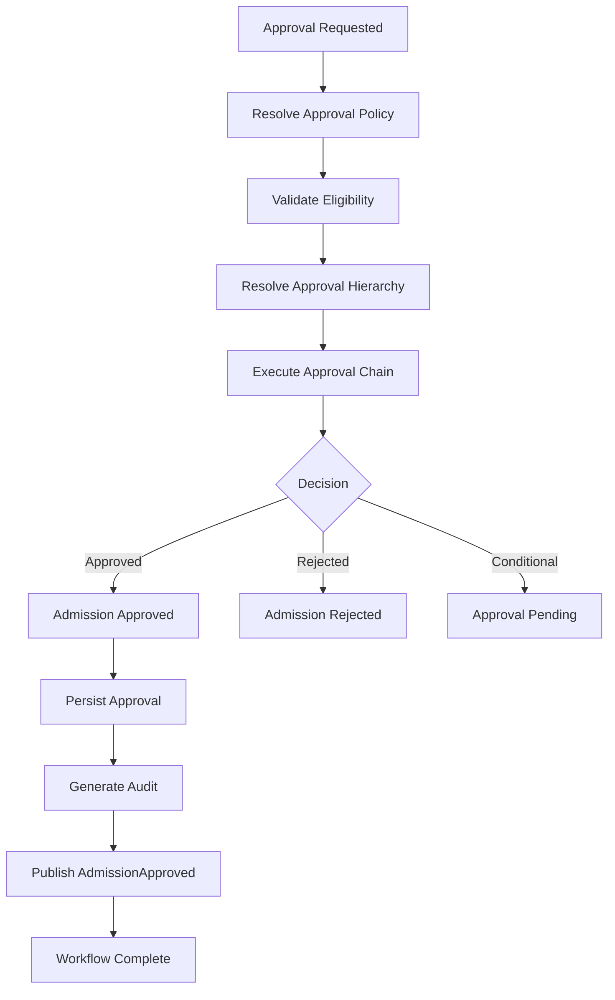

---

## 2.5 Detailed Execution Steps

### Step 1

Load institutional approval policy.

Determine:

- approval hierarchy,
- authority,
- approval mode,
- committee requirements.

---

### Step 2

Validate admission eligibility.

Confirm:

- document verification,
- admission validity,
- programme availability,
- reservation compliance,
- institutional policies.

---

### Step 3

Determine approval chain.

Examples:

- Single-level approval
- Multi-level approval
- Committee approval
- Department approval
- Principal approval
- Registrar approval

---

### Step 4

Execute approval workflow.

Workflow Engine orchestrates approval sequence.

---

### Step 5

Capture approval decision.

Possible outcomes:

- Approved
- Rejected
- Pending
- Escalated

---

### Step 6

Persist approval history.

Approval history is immutable.

---

### Step 7

Generate audit trail.

---

### Step 8

Publish domain event.

---

### Step 9

Workflow completes.

---

## 2.6 Alternate Flows

### AF-01 Single-Level Approval

One authorized officer approves.

---

### AF-02 Multi-Level Approval

Sequential approval chain.

---

### AF-03 Parallel Approval

Multiple authorities approve simultaneously.

Workflow completes after configured policy.

---

### AF-04 Committee Approval

Committee collectively approves.

Decision recorded.

---

### AF-05 Auto Approval

Institution policy allows automatic approval.

---

## 2.7 Exception Flows

### EX-01 Approval Rejected

Admission enters Rejected state.

Reason recorded.

---

### EX-02 Approver Unavailable

Workflow escalated.

---

### EX-03 Approval Timeout

Workflow remains Pending.

Escalation policy invoked.

---

### EX-04 Policy Resolution Failure

Workflow suspended.

---

### EX-05 Admission Modified During Approval

Approval invalidated.

Workflow restarted.

---

## 2.8 Postconditions

Successful execution results in:

- Admission Approved.
- Approval persisted.
- Approval audit created.
- AdmissionApproved event published.

---

# 3. Architecture Contracts

## 3.1 State Transition

Refer Section 6.9.

Workflow performs:

```text
Verification Completed
        │
        ▼
Admission Approved
```

---

## 3.2 Published Events

| Event | Description |
|---------|--------------------------|
| AdmissionApproved | Admission approved |
| AdmissionRejected | Admission rejected |
| ApprovalPending | Approval pending |
| ApprovalEscalated | Escalation initiated |

---

## 3.3 Consumed Events

- DocumentsVerified
- AdmissionSubmitted

---

## 3.4 Multi-Domain Interactions

| Domain | Interaction |
|----------|----------------------------|
| Workflow Engine | Approval orchestration |
| Academic Delivery | Programme validation |
| Platform | Authorization |
| Audit | Approval logging |

---

## 3.5 Decision Matrix

| Rule | Verified | Authority | Policy | Outcome |
|------|----------|------------|---------|---------|
| DM-001 | Yes | Valid | Valid | Approved |
| DM-002 | Yes | Invalid | Any | Authorization Failure |
| DM-003 | No | Any | Any | Reject |
| DM-004 | Yes | Valid | Escalation | Pending |
| DM-005 | Yes | Committee | Approved | Approved |

---

## 3.6 Business Rules

| Rule ID | Rule |
|----------|------------------------------------------------|
| BR-C01-017 | Admission shall not bypass approval. |
| BR-C01-018 | Approval hierarchy shall be configurable. |
| BR-C01-019 | Approval history shall be immutable. |
| BR-C01-020 | Approval authority shall be authenticated. |
| BR-C01-021 | Rejected admissions shall not continue. |
| BR-C01-022 | Every approval generates audit history. |
| BR-C01-023 | Approval shall precede Financial Clearance. |

---

# 4. Governance

## 4.1 Audit Requirements

Additional workflow attributes:

- Approver
- Approval Level
- Decision
- Remarks
- Approval Timestamp
- Workflow Version

---

## 4.2 Extension Points

Institutions may configure:

- Approval hierarchy
- Escalation policies
- Committee structures
- Auto approval
- Parallel approvals

---

## 4.3 Architectural Constraints

- Approval shall not modify Finance.
- Approval shall not create Students.
- Approval shall remain idempotent.
- Approval shall never bypass verification.
- Approval history is immutable.

---

## 4.4 Related Documents

- L2-A01
- L2-B01
- L2-C02
- L2-D01
- L2-F01

---

## 4.5 Architectural Notes

Admission Approval is the institutional governance gate.

It validates institutional willingness to admit the applicant.

Approval alone **does not** constitute admission.

Admission remains incomplete until Financial Clearance and Admission Confirmation are successfully completed.

# WF-C01-04 — Financial Clearance Workflow

---

# 1. Workflow Definition

## 1.1 Purpose

The Financial Clearance Workflow determines whether an approved admission has satisfied all financial obligations required by the institution before admission can be formally confirmed.

The workflow validates payment compliance according to institutional policies while remaining independent of the Finance domain's internal accounting processes.

This workflow **does not collect payments**, generate invoices, or perform accounting operations. It only determines whether the Admission Domain is financially eligible to proceed.

---

## 1.2 Business Context

Many institutions require candidates to complete prescribed financial obligations before admission becomes effective.

Financial requirements may include:

- Admission Fee
- Tuition Fee
- Registration Fee
- Security Deposit
- Hostel Advance
- Miscellaneous Charges

Financial policies may vary by:

- Institution
- Programme
- Admission Category
- Scholarship
- Government Quota
- Installment Policy

---

## 1.3 Workflow Objectives

This workflow aims to:

- Validate financial eligibility.
- Resolve institutional financial policies.
- Verify payment completion.
- Support installment-based admissions.
- Handle fee waivers.
- Publish financial clearance status.
- Produce deterministic workflow outcomes.

---

## 1.4 Scope

### Included

- Financial policy validation
- Payment verification
- Clearance determination
- Fee waiver handling
- Scholarship consideration
- Financial audit
- Clearance status management

### Excluded

- Invoice generation
- Payment gateway
- Accounting
- Ledger Posting
- Refund Processing
- Student Fee Management

---

# 2. Workflow Behaviour

## 2.1 Trigger(s)

Workflow execution may begin when:

- Admission Approved
- Payment Completed
- Scholarship Approved
- Fee Waiver Approved
- Installment Paid
- Finance Domain Notification

---

## 2.2 Preconditions

### Admission

- Admission exists.
- Admission is Approved.
- Admission is Active.
- Admission is not Cancelled.
- Admission is not Revoked.
### Finance

- Financial policy resolved.
- Applicable fees calculated.
- Finance records available.

### Authorization

- User authorized.
- Workflow active.

---

## 2.3 Inputs

| Input | Source |
|---------|----------------|
| Admission Record | Admission Domain |
| Fee Structure | Finance |
| Payment Status | Finance |
| Scholarship Details | Finance |
| Waiver Details | Finance |
| Financial Policy | Workflow Engine |

---

## 2.4 Main Workflow

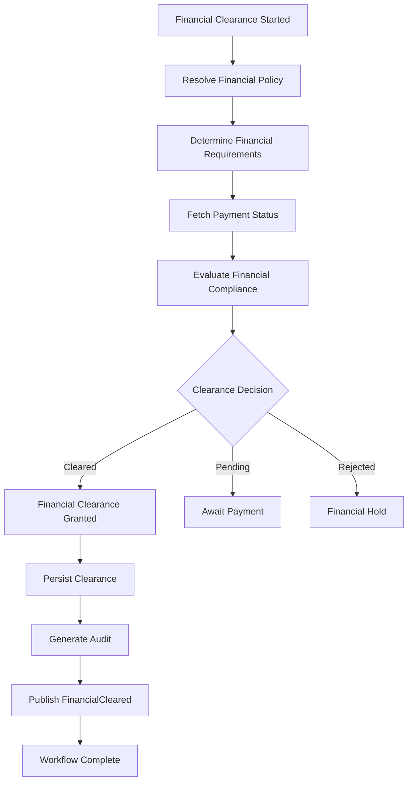

---

## 2.5 Detailed Execution Steps

### Step 1

Resolve applicable financial policy.

Determine:

- Fee structure
- Payment deadlines
- Installment rules
- Waiver policies
- Scholarship policies

---

### Step 2

Calculate financial obligations.

Applicable obligations may include:

- Admission Fee
- Tuition Fee
- Registration Charges
- Hostel Charges
- Transport Charges
- Other institutional fees

---

### Step 3

Fetch financial status from Finance Domain.

Admission Domain shall never calculate payments independently.

---

### Step 4

Evaluate financial compliance.

Possible conditions:

- Fully Paid
- Partially Paid
- Installment Active
- Scholarship Covered
- Waived
- Outstanding Balance

---

### Step 5

Determine clearance.

Possible outcomes:

- Cleared
- Pending
- Financial Hold

---

### Step 6

Persist financial clearance.

Historical clearance records remain immutable.

---

### Step 7

Generate audit trail.

---

### Step 8

Publish financial clearance event.

---

### Step 9

Workflow completes.

---

## 2.6 Alternate Flows

### AF-01 Full Payment

Financial Clearance immediately granted.

---

### AF-02 Scholarship

Scholarship satisfies financial obligation.

---

### AF-03 Fee Waiver

Institution grants authorized waiver.

---

### AF-04 Installment Plan

Admission remains eligible according to institutional policy.

---

### AF-05 Sponsored Admission

External sponsor fulfills payment obligations.

---

## 2.7 Exception Flows

### EX-01 Payment Pending

Workflow remains Pending.

---

### EX-02 Outstanding Balance

Financial Clearance denied.

---

### EX-03 Finance Service Unavailable

Workflow suspended until retry.

---

### EX-04 Invalid Fee Structure

Policy resolution failure.

Workflow terminated.

---

### EX-05 Payment Reversed

Financial Clearance revoked.

Admission re-evaluated.

---

## 2.8 Postconditions

Successful execution results in:

- Financial Clearance granted.
- Financial audit completed.
- FinancialCleared event published.
- Admission eligible for Admission Confirmation.

---

# 3. Architecture Contracts

## 3.1 State Transition

Refer Section 6.9.

Workflow performs:

```text
Admission Approved
        │
        ▼
Financial Cleared
```

---

## 3.2 Published Events

| Event | Description |
|---------|------------------------------|
| FinancialCleared | Financial obligations satisfied |
| FinancialPending | Awaiting payment |
| FinancialRejected | Clearance denied |
| FinancialHold | Admission placed on hold |

---

## 3.3 Consumed Events

- AdmissionApproved
- PaymentCompleted
- ScholarshipApproved
- FeeWaiverApproved

---

## 3.4 Multi-Domain Interactions

| Domain | Interaction |
|----------|------------------------------|
| Finance | Read financial status |
| Workflow Engine | Resolve policies |
| Platform | Authentication |
| Audit | Workflow logging |

The Admission Domain shall never modify Finance-owned data.

---

## 3.5 Decision Matrix

| Rule | Payment | Scholarship | Waiver | Outcome |
|------|----------|-------------|---------|---------|
| DM-001 | Complete | N/A | N/A | Cleared |
| DM-002 | Partial | Valid Installment | N/A | Cleared |
| DM-003 | Outstanding | None | None | Pending |
| DM-004 | N/A | Approved | N/A | Cleared |
| DM-005 | N/A | N/A | Approved | Cleared |
| DM-006 | Payment Reversed | Any | Any | Financial Hold |

---

## 3.6 Business Rules

| Rule ID | Rule |
|----------|--------------------------------------------------------|
| BR-C01-024 | Financial Clearance shall occur after Admission Approval. |
| BR-C01-025 | Admission Domain shall not calculate financial balances. |
| BR-C01-026 | Finance Domain owns all financial records. |
| BR-C01-027 | Financial Clearance shall be policy-driven. |
| BR-C01-028 | Clearance history shall be immutable. |
| BR-C01-029 | Every clearance generates audit records. |
| BR-C01-030 | Financial Clearance precedes Admission Confirmation. |

---

# 4. Governance

## 4.1 Audit Requirements

Record:

- Financial Policy
- Payment Status
- Clearance Decision
- Scholarship Reference
- Waiver Reference
- Decision Timestamp

---

## 4.2 Extension Points

Institutions may configure:

- Installment policies
- Scholarship models
- Fee waiver rules
- Sponsored admissions
- Financial thresholds
- Clearance policies

---

## 4.3 Architectural Constraints

- Finance owns financial calculations.
- Admission consumes only financial outcomes.
- Workflow shall be idempotent.
- Financial history is immutable.
- Multi-domain ownership shall never be violated.

---

## 4.4 Related Architecture Documents

- L2-A01
- L2-B01
- L2-F01
- L2-C02
- L2-D01

---

## 4.5 Architectural Notes

Financial Clearance is the contractual integration point between the Admission Domain and the Finance Domain.

The Admission Domain does not interpret accounting transactions or payment processing logic. It consumes only the canonical financial clearance outcome published by the Finance Domain.

Successful completion of this workflow is the final governance checkpoint before Admission Confirmation.

# WF-C01-05 — Student Creation Workflow

---

# 1. Workflow Definition

## 1.1 Purpose

The Student Creation Workflow creates the canonical Student entity after an admission has successfully completed all mandatory admission lifecycle stages.

This workflow establishes the permanent Student identity within the institution and marks the transition from the Admission Domain to the Student Domain.

Student creation shall occur exactly once for each successful admission.

---

## 1.2 Business Context

An applicant remains an Admission entity throughout the admission process.

Only after:

- Document Verification
- Admission Approval
- Financial Clearance
- Admission Confirmation

have successfully completed, may the institution create the Student record.

This workflow represents the ownership handover from the Admission Domain to the Student Domain.

---

## 1.3 Workflow Objectives

This workflow aims to:

- Create the canonical Student entity.
- Generate a unique Student Identifier.
- Prevent duplicate student creation.
- Establish Admission–Student linkage.
- Publish Student creation events.
- Maintain complete audit history.
- Ensure idempotent execution.

---

## 1.4 Scope

### Included

- Student creation
- Student identifier generation
- Admission linking
- Student initialization
- Audit generation
- Domain event publication

### Excluded

- Academic Registration
- Semester Enrollment
- Subject Allocation
- Identity Card Generation
- Hostel Allocation
- Library Membership
- LMS Account Creation

These processes belong to downstream domains.

---

# 2. Workflow Behaviour

## 2.1 Trigger(s)

Workflow execution may begin when:

- Admission Confirmed
- Workflow Engine Trigger
- Manual Administrative Trigger (Authorized)
- Admission Restoration

---

## 2.2 Preconditions

### Admission

- Admission exists.
- Admission confirmed.
- Admission active.
- Admission not cancelled.
- Admission not revoked.
- Financial Clearance completed successfully.

### Student

- Student does not already exist.
- Student Identifier available.

### Configuration

- Student numbering policy resolved.
- Institution configuration available.

---

## 2.3 Inputs

| Input | Source |
|---------|-----------------------|
| Admission Record | Admission Domain |
| Student Number Policy | Platform |
| Institution Configuration | Platform |
| Programme Information | Academic Delivery |
| Campus Information | Institution |

---

## 2.4 Main Workflow

flowchart TD

A[Admission Confirmed]

A --> B[Validate Admission]

B --> C[Check Existing Student]

C --> D{Student Already Exists}

D -->|Yes| E[Return Existing Student]

D -->|No| F[Generate Student Identifier]

F --> G[Authorize Student Creation]

G --> H[Student Domain Persists Student]

H --> I[Receive Student Reference]

I --> J[Link Admission & Student]

J --> K[Persist Admission-Student Link]

K --> L[Generate Audit]

L --> M[Publish StudentCreated]

M --> N[Workflow Complete]

E --> L

---

## 2.5 Detailed Execution Steps

### Step 1

Validate admission eligibility.

Verify:

- Admission Confirmed
- Admission Active
- No cancellation
- No revocation

---

### Step 2

Check duplicate student creation.

If Student already exists:

- Return existing Student
- Do not create duplicate
- Record audit

---

### Step 3

Generate Student Identifier.

Generation strategy may be configured using:

- Institution
- Campus
- Academic Year
- Programme
- Running Sequence

Identifier generation policy is institution configurable.

---

### Step 4

Create Student entity.

Populate canonical attributes.

Examples include:

- Student Identifier
- Admission Reference
- Institution
- Programme
- Campus
- Admission Session
- Student Status

---

### Step 5

Create Admission–Student relationship.

Relationship shall remain immutable.

---

### Step 6

Persist Student entity.

---

### Step 7

Generate audit trail.

---

### Step 8

Publish StudentCreated event.

---

### Step 9

Workflow completes successfully.

---

## 2.6 Alternate Flows

### AF-01 Existing Student

Existing Student returned.

No duplicate creation.

---

### AF-02 Manual Student Number

Institution manually assigns Student Number.

---

### AF-03 Imported Admission

Student created from migrated admission.

---

## 2.7 Exception Flows

### EX-01 Duplicate Student Identifier

Identifier regenerated according to policy.

---

### EX-02 Student Already Exists

Workflow returns existing Student.

---

### EX-03 Admission Invalid

Workflow terminated.

---

### EX-04 Identifier Policy Failure

Workflow suspended.

---

### EX-05 Persistence Failure

Transaction rolled back.

---

## 2.8 Postconditions

Successful execution results in:

- Student created.
- Student Identifier assigned.
- Admission linked.
- StudentCreated event published.
- Student Lifecycle becomes active.

---

# 3. Architecture Contracts

## 3.1 State Transition

Refer Section 6.9.

Workflow performs:

```text
Admission Confirmed
        │
        ▼
Student Created
```

Ownership transfers from the Admission Domain to the Student Domain.

---

## 3.2 Published Events

| Event | Description |
|---------|----------------------------|
| StudentCreated | Student successfully created |
| StudentCreationFailed | Creation failed |
| StudentAlreadyExists | Existing Student found |

---

## 3.3 Consumed Events

- AdmissionConfirmed

---

## 3.4 Multi-Domain Interactions

| Domain | Interaction |
|----------|----------------------------|
| Student Domain | Persist the canonical Student aggregate after Admission Domain authorizes creation |
| Platform | Student Number Generation |
| Academic Delivery | Programme Reference |
| Audit | Workflow Logging |

No downstream domain initialization shall occur within this workflow.
Architectural Note

The Admission Domain owns the business decision and orchestration that authorizes Student creation.

The Student Domain owns the Student aggregate and is the sole authority responsible for persisting and managing Student data after successful creation.

This workflow represents the contractual ownership handoff between the Admission Domain and the Student Domain.


---

## 3.5 Decision Matrix

| Rule | Admission Confirmed | Student Exists | Identifier Available | Outcome |
|------|----------------------|----------------|----------------------|---------|
| DM-001 | Yes | No | Yes | Create Student |
| DM-002 | Yes | Yes | N/A | Return Existing Student |
| DM-003 | No | Any | Any | Reject Workflow |
| DM-004 | Yes | No | No | Suspend Workflow |

---

## 3.6 Business Rules

| Rule ID | Rule |
|----------|----------------------------------------------------------|
| BR-C01-031 | Student creation shall occur exactly once. |
| BR-C01-032 | Student Identifier shall be globally unique within the institution. |
| BR-C01-033 | Student creation requires confirmed admission. |
| BR-C01-034 | Student creation shall be idempotent. |
| BR-C01-035 | Admission–Student relationship shall be immutable. |
| BR-C01-036 | Student lifecycle begins after successful creation. |
| BR-C01-037 | Downstream services shall consume StudentCreated event. |

---

# 4. Governance

## 4.1 Audit Requirements

Record:

- Student Identifier
- Admission Identifier
- Institution
- Campus
- Programme
- Creation Timestamp
- Workflow Version
- Initiating User

---

## 4.2 Extension Points

Institutions may configure:

- Student numbering schemes
- Identifier formats
- Student initialization policies
- Migration strategies
- Legacy identifier mapping

---

## 4.3 Architectural Constraints

- Admission owns Applicant until confirmation.
- Student Domain owns Student after creation.
- Student creation shall be transactional.
- Duplicate Student creation is prohibited.
- Workflow shall be idempotent.
- Admission records shall never be deleted after Student creation.

---

## 4.4 Related Architecture Documents

- L2-A01 — Platform Foundation
- L2-B01 — Institution Structure
- L2-C02 — Student Lifecycle
- L2-D01 — Academic Delivery
- L2-F01 — Finance

---

## 4.5 Architectural Notes

This workflow represents the definitive ownership transfer between the Admission Domain and the Student Domain.

The Admission Domain concludes its operational responsibility by creating the canonical Student entity. All subsequent student-centric operations—including registration, enrollment, academic progression, attendance, examinations, fees, and qualification completion—are managed by their respective downstream domains using the newly created Student identity as the primary reference.

Student creation is therefore the contractual boundary between **L2-C01 — Admissions** and **L2-C02 — Student Lifecycle**.

# WF-C01-06 — Admission Cancellation Workflow

---

# 1. Workflow Definition

## 1.1 Purpose

The Admission Cancellation Workflow permanently terminates an admission before successful Student creation, according to institutional policies, applicant requests, administrative decisions, or regulatory requirements.

Admissions that have already resulted in Student creation shall not be cancelled.

Subsequent institutional actions shall be performed through Revocation, Withdrawal, or downstream Student Lifecycle processes.

---

## 1.2 Business Context

Admissions may require cancellation due to:

- Applicant request
- Duplicate admission
- Incorrect admission
- Payment failure
- Fraud detection
- Administrative decision
- Government directive
- Regulatory non-compliance

Cancellation policies shall remain institution configurable.

---

## 1.3 Workflow Objectives

This workflow aims to:

- Cancel admissions safely.
- Preserve complete audit history.
- Prevent further admission processing.
- Notify dependent domains.
- Enforce institutional policies.
- Maintain immutable cancellation history.

---

## 1.4 Scope

### Included

- Admission cancellation
- Cancellation validation
- Reason capture
- Audit generation
- Event publication
- Workflow termination

### Excluded

- Refund processing
- Student deletion
- Finance adjustments
- Certificate cancellation
- Academic deregistration

---

# 2. Workflow Behaviour

## 2.1 Trigger(s)

Workflow execution may begin when:

- Applicant Cancellation Request
- Administrative Cancellation
- Fraud Detection
- Government Order
- Duplicate Admission Detection
- Workflow Engine Policy

---

## 2.2 Preconditions

- Admission exists.
- Admission active.
- User authorized.
- Cancellation policy resolved.

---

## 2.3 Inputs

| Input | Source |
|---------|--------------------|
| Admission Record | Admission Domain |
| Cancellation Reason | User |
| Policy | Workflow Engine |
| Authorization | Platform |

---

## 2.4 Main Workflow

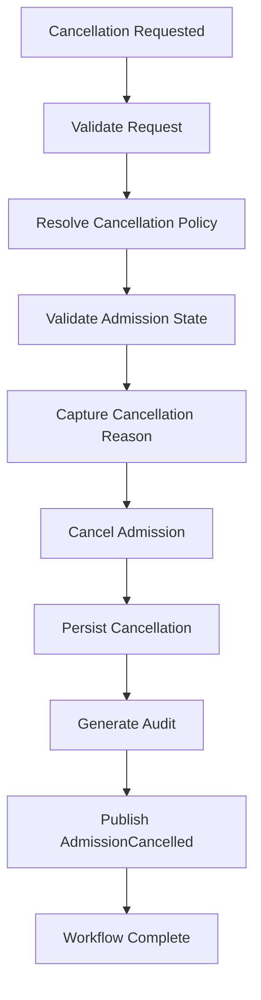

---

## 2.5 Detailed Execution Steps

### Step 1

Validate cancellation request.

---

### Step 2

Validate authorization.

---

### Step 3

Resolve institutional cancellation policy.

---

### Step 4

Verify admission eligibility for cancellation.

---

### Step 5

Capture cancellation reason.

Reason becomes immutable.

---

### Step 6

Transition admission to Cancelled.

---

### Step 7

Persist cancellation history.

---

### Step 8

Generate audit trail.

---

### Step 9

Publish cancellation event.

---

## 2.6 Alternate Flows

### AF-01 Applicant Cancellation

Applicant withdraws before confirmation.

---

### AF-02 Administrative Cancellation

Institution cancels admission.

---

### AF-03 Duplicate Admission

Duplicate admission cancelled.

---

### AF-04 Regulatory Cancellation

Government order initiates cancellation.

---

## 2.7 Exception Flows

### EX-01 Admission Already Cancelled

Return existing result.

---

### EX-02 Invalid Admission

Workflow rejected.

---

### EX-03 Unauthorized User

Authorization failure.

---

## 2.8 Postconditions

- Admission Cancelled.
- Audit completed.
- Cancellation event published.
- Admission workflow terminated.

---

# 3. Architecture Contracts

## 3.1 State Transition

Refer Section 6.9.

```text
Admission Initiated
or
Documents Submitted
or
Verification Completed
or
Admission Approved
or
Financial Clearance

↓

Cancelled
```

---

## 3.2 Published Events

- AdmissionCancelled

---

## 3.3 Consumed Events

- CancellationRequested

---

## 3.4 Multi-Domain Interactions

| Domain | Interaction |
|----------|--------------------------|
| Workflow Engine | Policy Resolution |
| Platform | Authorization |
| Audit | Logging |

---

## 3.5 Decision Matrix

| Rule | Authorized | Valid State | Outcome |
|------|------------|-------------|---------|
| DM-001 | Yes | Yes | Cancel Admission |
| DM-002 | No | Any | Reject |
| DM-003 | Yes | Already Cancelled | Return Existing |
| DM-004 | Yes | Invalid | Reject |

---

## 3.6 Business Rules

- Cancellation history is immutable.
- Admission records are never deleted.
- Cancellation terminates active admission workflows.
- Every cancellation requires audit logging.

---

# 4. Governance

## 4.1 Audit Requirements

- Cancelling User
- Timestamp
- Reason
- Previous Status
- New Status

---

## 4.2 Extension Points

- Institution-specific cancellation policies
- Government integrations
- Automated cancellation rules

---

## 4.3 Architectural Constraints

- Cancellation is irreversible.
- Student records are not deleted.
- Finance owns refund processing.
- Workflow shall be idempotent.

---

## 4.4 Related Architecture Documents

- L2-A01
- L2-C02
- L2-F01

---

## 4.5 Architectural Notes

Admission Cancellation permanently terminates the Admission Lifecycle while preserving all historical records.

Ownership of refunds, accounting adjustments, and downstream operational reversals remains with their respective domains.

# WF-C01-07 — Admission Withdrawal Workflow

---

# 1. Workflow Definition

## 1.1 Purpose

The Admission Withdrawal Workflow governs the voluntary withdrawal of an admission by the applicant after admission has been approved or confirmed but before the completion of the academic programme.

The workflow records the withdrawal decision, terminates further admission activities, and notifies dependent domains while preserving complete historical records.

Admission Withdrawal never deletes institutional records.

---

## 1.2 Business Context

An admission may be voluntarily withdrawn due to:

- Personal reasons
- Selection in another institution
- Financial reasons
- Medical reasons
- Family circumstances
- Programme change
- Relocation
- Administrative request

Institutional withdrawal policies shall remain configurable.

---

## 1.3 Workflow Objectives

This workflow aims to:

- Process voluntary withdrawal requests.
- Validate withdrawal eligibility.
- Record withdrawal reasons.
- Preserve institutional history.
- Notify downstream domains.
- Generate complete audit records.
- Prevent further admission progression.

---

## 1.4 Scope

### Included

- Withdrawal request
- Eligibility validation
- Withdrawal approval (if applicable)
- Reason recording
- Audit generation
- Event publication

### Excluded

- Refund processing
- Financial settlement
- Certificate issuance
- Academic deregistration
- Hostel clearance
- Library clearance

---

# 2. Workflow Behaviour

## 2.1 Trigger(s)

Workflow execution may begin when:

- Applicant Withdrawal Request
- Administrative Withdrawal Request
- Student Portal Request
- Authorized Institutional Officer

---

## 2.2 Preconditions

### Admission

- Admission exists.
- Admission is in Admission Confirmed state.
 or
- Student Created state, where institutional withdrawal policy permits.
- Admission is not Cancelled.
- Admission is not Revoked.

### Authorization

- Applicant authenticated or
- Authorized institutional user.

### Configuration

- Withdrawal policy resolved.

---

## 2.3 Inputs

| Input | Source |
|---------|---------------------------|
| Admission Record | Admission Domain |
| Withdrawal Request | Applicant |
| Withdrawal Reason | Applicant |
| Institutional Policy | Workflow Engine |

---

## 2.4 Main Workflow

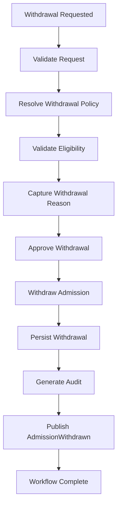

---

## 2.5 Detailed Execution Steps

### Step 1

Receive withdrawal request.

---

### Step 2

Validate applicant identity or administrative authorization.

---

### Step 3

Resolve institutional withdrawal policy.

---

### Step 4

Determine withdrawal eligibility.

Validation may include:

- Admission status
- Withdrawal deadline
- Academic session
- Financial constraints
- Institutional rules

---

### Step 5

Capture withdrawal reason.

Reasons remain immutable.

---

### Step 6

Approve withdrawal according to policy.

Approval may be:

- Automatic
- Administrative
- Committee based

---

### Step 7

Update admission status.

---

### Step 8

Persist withdrawal history.

---

### Step 9

Generate immutable audit record including Correlation ID, Admission Identifier, User Identifier, Institution Identifier, and Timestamp.

---

### Step 10

Publish domain event.

---

## 2.6 Alternate Flows

### AF-01 Self Withdrawal

Applicant withdraws directly.

---

### AF-02 Administrative Withdrawal

Institution processes withdrawal on behalf of applicant.

---

### AF-03 Committee Approval

Withdrawal requires institutional approval.

---

## 2.7 Exception Flows

### EX-01 Withdrawal Window Closed

Withdrawal rejected.

---

### EX-02 Unauthorized Request

Workflow rejected.

---

### EX-03 Admission Already Withdrawn

Return existing result.

---

### EX-04 Invalid Admission State

Workflow terminated.

---

## 2.8 Postconditions

Successful execution results in:

- Admission Withdrawn.
- Withdrawal recorded.
- Audit completed.
- AdmissionWithdrawn event published.

---

# 3. Architecture Contracts

## 3.1 State Transition

Refer Section 6.9.

```text
Admission Confirmed

↓

Withdrawn
```

---

## 3.2 Published Events

| Event | Description |
|---------|-----------------------------|
| AdmissionWithdrawn | Admission withdrawn |
| WithdrawalRejected | Withdrawal rejected |

---

## 3.3 Consumed Events

- WithdrawalRequested

---

## 3.4 Multi-Domain Interactions

| Domain | Interaction |
|----------|-----------------------------|
| Workflow Engine | Policy resolution |
| Platform | Authentication |
| Audit | Audit logging |

No downstream domain data shall be modified.

---

## 3.5 Decision Matrix

| Rule | Authorized | Eligible | Policy | Outcome |
|------|------------|----------|---------|---------|
| DM-001 | Yes | Yes | Valid | Withdraw Admission |
| DM-002 | No | Any | Any | Reject |
| DM-003 | Yes | No | Any | Reject |
| DM-004 | Yes | Yes | Approval Required | Pending Approval |

---

## 3.6 Business Rules

| Rule ID | Rule |
|----------|------------------------------------------------|
| BR-C01-038 | Withdrawal shall preserve all historical records. |
| BR-C01-039 | Withdrawal reason shall be mandatory. |
| BR-C01-040 | Withdrawal policies shall be configurable. |
| BR-C01-041 | Withdrawal shall terminate admission workflows. |
| BR-C01-042 | Withdrawal history shall be immutable. |
| BR-C01-043 | Every withdrawal generates audit history. |

---

# 4. Governance

## 4.1 Audit Requirements

Record:

- Applicant
- Withdrawal Reason
- Decision Authority
- Previous Status
- New Status
- Timestamp

---

## 4.2 Extension Points

Institutions may configure:

- Withdrawal deadlines
- Approval hierarchy
- Withdrawal policies
- Automatic approvals
- Regulatory compliance rules

---

## 4.3 Architectural Constraints

- Withdrawal never deletes records.
- Finance owns refund processing.
- Student lifecycle remains independent.
- Workflow shall be idempotent.
- Historical records are immutable.

---

## 4.4 Related Architecture Documents

- L2-A01 — Platform Foundation
- L2-C02 — Student Lifecycle
- L2-F01 — Finance

---

## 4.5 Architectural Notes

Admission Withdrawal represents a voluntary termination initiated by the applicant or an authorized institutional representative.

Unlike Admission Cancellation or Admission Revocation, Withdrawal assumes that the admission was initially valid and accepted. Its purpose is to formally conclude the admission while preserving institutional history and notifying downstream domains responsible for financial settlement, academic disengagement, and operational closure.

# WF-C01-08 — Admission Revocation Workflow

---

# 1. Workflow Definition

## 1.1 Purpose

The Admission Revocation Workflow governs the institutional process of invalidating an admission that was previously approved or confirmed due to fraud, regulatory violations, administrative errors, policy violations, or legal directives.

Revocation permanently invalidates the admission while preserving the complete historical record for legal, regulatory, and audit purposes.

Admission Revocation never deletes institutional records.

---

## 1.2 Business Context

Admission Revocation is an exceptional institutional action and shall only occur under authorized circumstances.

Common reasons include:

- Fraudulent documents
- False declarations
- Identity fraud
- Administrative error
- Court order
- Government directive
- Policy violation
- Eligibility violation
- Duplicate admission

Revocation policies shall remain institution configurable.

---

## 1.3 Workflow Objectives

This workflow aims to:

- Revoke invalid admissions.
- Preserve institutional evidence.
- Prevent further admission processing.
- Notify downstream domains.
- Maintain complete audit history.
- Ensure regulatory compliance.

---

## 1.4 Scope

### Included

- Revocation validation
- Authority verification
- Reason recording
- Admission revocation
- Audit generation
- Domain event publication

### Excluded

- Financial recovery
- Refund processing
- Legal proceedings
- Academic record management
- Certificate cancellation

---

# 2. Workflow Behaviour

## 2.1 Trigger(s)

Workflow execution may begin when:

- Fraud Investigation Completed
- Administrative Decision
- Court Order
- Government Directive
- Internal Audit Finding
- Eligibility Violation Detected

---

## 2.2 Preconditions

### Admission

- Admission exists.
- Admission active.
- Admission not already revoked.

### Authorization

- Revocation authority available.
- Institutional policy resolved.

### Evidence

- Supporting evidence available.
- Reason documented.

---

## 2.3 Inputs

| Input | Source |
|---------|------------------------------|
| Admission Record | Admission Domain |
| Revocation Reason | Institution |
| Investigation Report | Audit/Compliance |
| Court/Government Order | External Authority |
| Institutional Policy | Workflow Engine |

---

## 2.4 Main Workflow

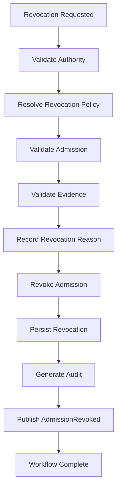

---

## 2.5 Detailed Execution Steps

### Step 1

Receive revocation request.

---

### Step 2

Validate revocation authority.

---

### Step 3

Resolve institutional revocation policy.

---

### Step 4

Verify admission eligibility.

---

### Step 5

Validate supporting evidence.

Evidence may include:

- Fraud reports
- Investigation findings
- Legal orders
- Government directives
- Administrative decisions

---

### Step 6

Capture revocation reason.

Reason becomes immutable.

---

### Step 7

Update admission status to Revoked.

---

### Step 8

Persist revocation history.

---

### Step 9

Generate audit trail.

---

### Step 10

Publish AdmissionRevoked event.

---

## 2.6 Alternate Flows

### AF-01 Administrative Revocation

Institution revokes admission.

---

### AF-02 Fraud Revocation

Admission revoked following fraud investigation.

---

### AF-03 Court Ordered Revocation

Revocation initiated by judicial authority.

---

### AF-04 Government Revocation

Government directive revokes admission.

---

## 2.7 Exception Flows

### EX-01 Unauthorized Request

Workflow rejected.

---

### EX-02 Admission Already Revoked

Return existing result.

---

### EX-03 Evidence Missing

Workflow suspended.

---

### EX-04 Invalid Admission

Workflow terminated.

---

## 2.8 Postconditions

Successful execution results in:

- Admission Revoked.
- Revocation history recorded.
- Audit completed.
- AdmissionRevoked event published.

---

# 3. Architecture Contracts

## 3.1 State Transition

Refer Section 6.9.

```text
Any Valid Admission
        │
        ▼
Revoked
```

---

## 3.2 Published Events

| Event | Description |
|---------|------------------------------|
| AdmissionRevoked | Admission revoked |
| RevocationRejected | Revocation request denied |

---

## 3.3 Consumed Events

- RevocationRequested
- FraudDetected
- CourtOrderReceived
- GovernmentDirectiveReceived

---

## 3.4 Multi-Domain Interactions

| Domain | Interaction |
|----------|------------------------------|
| Workflow Engine | Policy Resolution |
| Platform | Authorization |
| Audit | Investigation History |
| Compliance | Evidence Validation |

No downstream domain data shall be modified directly.

---

## 3.5 Decision Matrix

| Rule | Authorized | Evidence | Valid Admission | Outcome |
|------|------------|----------|-----------------|---------|
| DM-001 | Yes | Yes | Yes | Revoke Admission |
| DM-002 | No | Any | Any | Reject |
| DM-003 | Yes | No | Yes | Suspend Workflow |
| DM-004 | Yes | Yes | Already Revoked | Return Existing |

---

## 3.6 Business Rules

| Rule ID | Rule |
|----------|------------------------------------------------------|
| BR-C01-044 | Revocation shall require institutional authority. |
| BR-C01-045 | Supporting evidence shall be mandatory. |
| BR-C01-046 | Revocation history shall be immutable. |
| BR-C01-047 | Admission records shall never be deleted. |
| BR-C01-048 | Every revocation generates audit records. |
| BR-C01-049 | Revocation terminates all remaining admission workflows. |
| BR-C01-050 | Revocation shall be idempotent. |

---

# 4. Governance

## 4.1 Audit Requirements

Record:

- Revoking Authority
- Revocation Reason
- Supporting Evidence Reference
- Previous Status
- New Status
- Timestamp
- Policy Version

---

## 4.2 Extension Points

Institutions may configure:

- Revocation authorities
- Investigation workflows
- Evidence requirements
- Government integrations
- Compliance policies

---

## 4.3 Architectural Constraints

- Revocation is irreversible.
- Historical records are immutable.
- Finance owns financial recovery.
- Legal proceedings remain outside this workflow.
- Workflow shall be idempotent.

---

## 4.4 Related Architecture Documents

- L2-A01 — Platform Foundation
- L2-C02 — Student Lifecycle
- L2-F01 — Finance
- L2-G01 — Compliance & Audit (Future)

---

## 4.5 Architectural Notes

Admission Revocation is the strongest administrative action within the Admission Domain.

Unlike Cancellation or Withdrawal, Revocation declares that the admission is no longer institutionally valid due to regulatory, legal, or compliance reasons. It permanently terminates the admission lifecycle while preserving all historical information required for governance, legal defense, compliance audits, and institutional accountability.

Revocation does not perform downstream operational reversals; it publishes canonical domain events that allow dependent domains to execute their own policy-driven corrective actions.

# WF-C01-09 — Readmission Workflow

---

# 1. Workflow Definition

## 1.1 Purpose

The Readmission Workflow governs the institutional process of reactivating a previously cancelled, withdrawn, discontinued, or otherwise inactive admission in accordance with institutional policies.

The workflow evaluates eligibility, validates institutional rules, and either restores or creates a new admission process as defined by institutional policy.

Readmission shall always preserve complete historical records.

---

## 1.2 Business Context

Applicants may seek readmission due to:

- Voluntary withdrawal
- Admission cancellation
- Academic discontinuation
- Medical leave
- Financial hardship
- Administrative approval
- Institutional policy

Readmission policies vary across institutions and programmes.

Institutions may configure the readmission process, but every readmission shall create a new Admission Record while preserving complete historical linkage to previous admissions.

---

## 1.3 Workflow Objectives

This workflow aims to:

- Validate readmission eligibility.
- Restore eligible admissions.
- Maintain historical continuity.
- Prevent duplicate admissions.
- Publish readmission events.
- Preserve institutional audit trails.
- Support configurable institutional policies.

---

## 1.4 Scope

### Included

- Readmission request
- Eligibility validation
- Policy resolution
- Readmission approval
- Admission restoration
- Audit generation
- Domain event publication

### Excluded

- Academic credit transfer
- Financial settlement
- Fee calculation
- Student promotion
- Academic registration

---

# 2. Workflow Behaviour

## 2.1 Trigger(s)

Workflow execution may begin when:

- Applicant Readmission Request
- Administrative Readmission
- Institutional Restoration
- Approved Appeal
- Government Directive

---

## 2.2 Preconditions

### Admission

- Historical Admission exists.
- Admission inactive.
- Admission eligible for readmission.

### Authorization

- Applicant authenticated.
- Institution authorized.

### Configuration

- Readmission policy resolved.

---

## 2.3 Inputs

| Input | Source |
|---------|-----------------------------|
| Historical Admission | Admission Domain |
| Readmission Request | Applicant |
| Institutional Policy | Workflow Engine |
| Academic Session | Academic Delivery |
| Programme Information | Academic Delivery |

---

## 2.4 Main Workflow

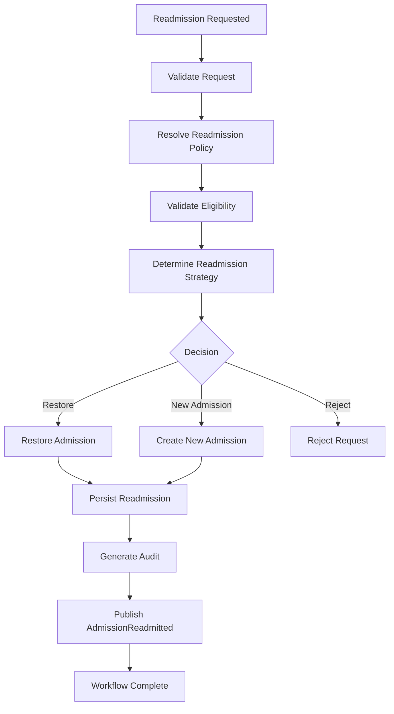

---

## 2.5 Detailed Execution Steps

### Step 1

Receive readmission request.

---

### Step 2

Validate applicant identity.

---

### Step 3

Resolve institutional readmission policy.

Determine:

- Restoration rules
- Academic year policy
- Programme eligibility
- Maximum readmission attempts
- Time limits

---

### Step 4

Validate eligibility.

Examples include:

- Previous admission status
- Withdrawal reason
- Cancellation reason
- Academic regulations
- Institutional restrictions

---

### Step 5

Determine readmission strategy.

Possible strategies:

- Restore Existing Admission
- Create New Admission
- Reject Request

---

### Step 6

Execute configured strategy.

---

### Step 7

Persist readmission history.

---

### Step 8

Generate audit trail.

---

### Step 9

Publish AdmissionReadmitted event.

---

## 2.6 Alternate Flows

### AF-01 Restore Existing Admission

Historical admission restored.

---

### AF-02 Fresh Admission

Institution requires new admission lifecycle.

---

### AF-03 Administrative Readmission

Institution directly restores admission.

---

## 2.7 Exception Flows

### EX-01 Ineligible Applicant

Readmission rejected.

---

### EX-02 Policy Restriction

Workflow terminated.

---

### EX-03 Maximum Attempts Exceeded

Request rejected.

---

### EX-04 Invalid Historical Admission

Workflow terminated.

---

## 2.8 Postconditions

Successful execution results in:

- Admission restored or recreated.
- Readmission history persisted.
- Audit completed.
- AdmissionReadmitted event published.

---

# 3. Architecture Contracts

## 3.1 State Transition

Refer Section 6.9.

```text
Withdrawn / Cancelled
        │
        ▼
Readmitted
```

---

## 3.2 Published Events

| Event | Description |
|---------|------------------------------|
| AdmissionReadmitted | Admission restored |
| ReadmissionRejected | Request rejected |

---

## 3.3 Consumed Events

- ReadmissionRequested

---

## 3.4 Multi-Domain Interactions

| Domain | Interaction |
|----------|------------------------------|
| Workflow Engine | Policy Resolution |
| Academic Delivery | Session Validation |
| Platform | Authentication |
| Audit | Readmission History |

---

## 3.5 Decision Matrix

| Rule | Eligible | Policy | Previous Status | Outcome |
|------|----------|---------|-----------------|---------|
| DM-001 | Yes | Restore | Withdrawn | Restore Admission |
| DM-002 | Yes | Fresh Admission | Cancelled | Create New Admission |
| DM-003 | No | Any | Any | Reject |
| DM-004 | Yes | Restricted | Any | Reject |

---

## 3.6 Business Rules

| Rule ID | Rule |
|----------|------------------------------------------------------|
| BR-C01-051 | Readmission shall preserve historical records. |
| BR-C01-052 | Readmission policy shall be configurable. |
| BR-C01-053 | Duplicate active admissions are prohibited. |
| BR-C01-054 | Readmission shall generate audit records. |
| BR-C01-055 | Readmission may restore or recreate admissions according to policy. |
| BR-C01-056 | Workflow execution shall be idempotent. |

---

# 4. Governance

## 4.1 Audit Requirements

Record:

- Previous Admission
- Readmission Reason
- Decision
- Strategy Applied
- Timestamp
- Initiating User

---

## 4.2 Extension Points

Institutions may configure:

- Readmission eligibility
- Maximum attempts
- Academic gap rules
- Restoration strategy
- Approval hierarchy

---

## 4.3 Architectural Constraints

- Historical admissions are immutable.
- Readmission shall never overwrite historical records.
- Duplicate active admissions are prohibited.
- Workflow shall remain idempotent.

---

## 4.4 Related Architecture Documents

- L2-A01 — Platform Foundation
- L2-C02 — Student Lifecycle
- L2-D01 — Academic Delivery
- L2-F01 — Finance

---

## 4.5 Architectural Notes

Readmission provides the institutional mechanism for re-engaging applicants whose previous admission lifecycle has already concluded.

The workflow intentionally separates **historical admissions** from **active admissions**, ensuring complete auditability while allowing institutions to choose between restoring an existing admission or initiating a new admission lifecycle based on configurable policies. All historical relationships remain preserved regardless of the selected readmission strategy.

# WF-C01-10 — Admission Audit Workflow

---

# 1. Workflow Definition

## 1.1 Purpose

The Admission Audit Workflow provides the canonical governance mechanism for recording, validating, reviewing, and preserving every significant event that occurs throughout the Admission Lifecycle.

Rather than performing business operations, this workflow ensures that all admission activities remain traceable, compliant, tamper-evident, and legally defensible.

The workflow maintains complete historical accountability for every admission processed within the institution.

---

## 1.2 Business Context

Admissions involve numerous institutional decisions including:

- Document Verification
- Admission Approval
- Financial Clearance
- Admission Confirmation
- Student Creation
- Cancellation
- Withdrawal
- Revocation
- Readmission

Every significant action shall generate immutable audit evidence.

Audit information supports:

- Institutional Governance
- Internal Audit
- Regulatory Compliance
- Accreditation
- Legal Investigations
- Security Reviews
- Operational Monitoring

---

## 1.3 Workflow Objectives

This workflow aims to:

- Capture complete admission history.
- Maintain immutable audit records.
- Support regulatory compliance.
- Provide forensic traceability.
- Enable operational investigations.
- Preserve historical evidence.
- Publish audit events.

---

## 1.4 Scope

### Included

- Audit event recording
- Audit validation
- Audit persistence
- Audit retrieval
- Compliance reporting
- Audit publication

### Excluded

- Business workflow execution
- Admission decisions
- Student creation
- Financial processing
- Document storage

---

# 2. Workflow Behaviour

## 2.1 Trigger(s)

Workflow executes automatically whenever:

- Admission Created
- Documents Verified
- Admission Approved
- Financial Cleared
- Admission Confirmed
- Student Created
- Admission Cancelled
- Admission Withdrawn
- Admission Revoked
- Admission Readmitted
- Admission Updated
- Administrative Override
- Security Event

---

## 2.2 Preconditions

### Admission

- Admission exists.

### Audit

- Audit service available.
- Audit policy resolved.

### System

- Event generated.
- Workflow active.

---

## 2.3 Inputs

| Input | Source |
|---------|--------------------------|
| Domain Event | Admission Domain |
| User Context | Platform |
| Institution Context | Platform |
| Workflow Metadata | Workflow Engine |
| Security Context | Platform |

---

## 2.4 Main Workflow

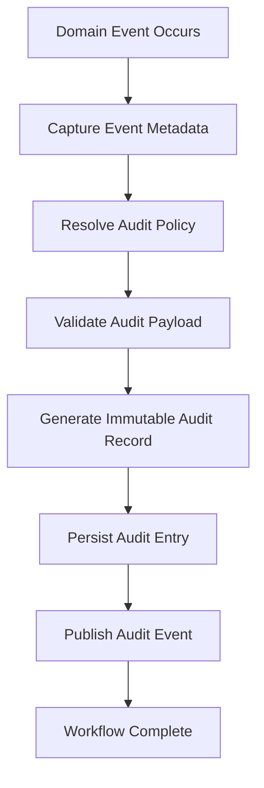

---

## 2.5 Detailed Execution Steps

### Step 1

Receive domain event.

---

### Step 2

Capture execution context.

Examples include:

- User
- Role
- Timestamp
- Institution
- Campus
- Session
- Workflow
- Correlation ID

---

### Step 3

Resolve institutional audit policy.

---

### Step 4

Validate audit payload.

---

### Step 5

Generate immutable audit record.

Record shall include:

- Before State
- After State
- Event Type
- Actor
- Decision
- Metadata

---

### Step 6

Persist audit record.

Existing audit history shall never be modified.

---

### Step 7

Publish audit event.

---

### Step 8

Workflow completes.

---

## 2.6 Alternate Flows

### AF-01 Batch Audit

Multiple workflow events audited together.

---

### AF-02 Compliance Audit

Additional compliance information recorded.

---

### AF-03 Security Audit

Security-sensitive actions receive enhanced audit records.

---

## 2.7 Exception Flows

### EX-01 Audit Storage Failure

Retry according to institutional policy.

---

### EX-02 Invalid Audit Payload

Reject audit entry.

Raise administrative alert.

---

### EX-03 Audit Policy Failure

Fallback to default audit policy.

---

## 2.8 Postconditions

Successful execution results in:

- Immutable audit persisted.
- Audit event published.
- Compliance requirements satisfied.

---

# 3. Architecture Contracts

## 3.1 State Transition

Audit Workflow does not modify Admission Lifecycle states.

It records lifecycle transitions initiated by other workflows.

---

## 3.2 Published Events

| Event | Description |
|---------|----------------------------|
| AuditRecorded | Audit successfully stored |
| AuditFailed | Audit persistence failure |

---

## 3.3 Consumed Events

Consumes every canonical Admission Domain Event including:

- AdmissionCreated
- DocumentsVerified
- AdmissionApproved
- FinancialCleared
- AdmissionConfirmed
- StudentCreated
- AdmissionCancelled
- AdmissionWithdrawn
- AdmissionRevoked
- AdmissionReadmitted

---

## 3.4 Multi-Domain Interactions

| Domain | Interaction |
|----------|-------------------------------|
| Platform | User Context |
| Workflow Engine | Workflow Metadata |
| Security | Authentication Context |
| Compliance | Regulatory Reporting |
| Audit Infrastructure | Persistent Storage |

Audit workflow never modifies business data.

---

## 3.5 Decision Matrix

| Rule | Event Received | Payload Valid | Audit Storage | Outcome |
|------|----------------|---------------|---------------|---------|
| DM-001 | Yes | Yes | Available | Record Audit |
| DM-002 | Yes | No | Any | Reject Entry |
| DM-003 | Yes | Yes | Unavailable | Retry |
| DM-004 | No | Any | Any | Ignore |

---

## 3.6 Business Rules

| Rule ID | Rule |
|----------|-----------------------------------------------------------|
| BR-C01-057 | Every business event shall generate an audit record. |
| BR-C01-058 | Audit history shall be immutable. |
| BR-C01-059 | Audit timestamps shall use canonical system time. |
| BR-C01-060 | Audit entries shall include user context. |
| BR-C01-061 | Audit records shall support regulatory retention policies. |
| BR-C01-062 | Audit workflow shall never modify business data. |
| BR-C01-063 | Audit recording shall be idempotent. |

---

# 4. Governance

## 4.1 Audit Requirements

Each audit entry shall capture:

- Audit Identifier
- Event Identifier
- Admission Identifier
- Institution
- Campus
- User
- Role
- Previous State
- New State
- Event Timestamp
- Correlation Identifier
- Workflow Identifier
- Policy Version

---

## 4.2 Extension Points

Institutions may configure:

- Audit retention period
- Compliance metadata
- Security classifications
- Regulatory reporting
- Digital signatures
- External audit integrations

---

## 4.3 Architectural Constraints

- Audit records are immutable.
- Audit storage shall be append-only.
- Audit workflow shall never update Admission data.
- Every workflow shall remain independently auditable.
- Workflow execution shall remain idempotent.

---

## 4.4 Related Architecture Documents

- L2-A01 — Platform Foundation
- L2-B01 — Institution Structure
- L2-C02 — Student Lifecycle
- L2-F01 — Finance
- L2-G01 — Compliance & Governance (Future)

---

## 4.5 Architectural Notes

The Admission Audit Workflow is the governance backbone of the Admission Domain.

Unlike operational workflows, it does not participate in business decision-making. Instead, it observes and records every significant lifecycle event to create a complete, tamper-evident history of institutional actions.

Every workflow defined within **L2-C01 — Admissions** shall generate audit events through this workflow, ensuring complete traceability, regulatory compliance, forensic investigation capability, and institutional accountability without violating domain ownership or modifying operational business data.

# 9. Domain Events

## 9.1 Overview

Domain Events represent immutable business facts that have occurred within the Admission Domain.

Events provide the canonical communication mechanism between the Admission Domain and other domains within SutraERP while maintaining loose coupling and domain ownership.

Every Domain Event shall be immutable, timestamped, auditable, and uniquely identifiable.

---

## 9.2 Event Design Principles

The Admission Domain follows these principles for event publication:

- Events represent completed business facts.
- Events are immutable after publication.
- Events shall never be updated.
- Events shall be published only after successful transaction commit.
- Events shall support idempotent consumption.
- Events shall include correlation identifiers.
- Events shall preserve domain ownership boundaries.

---

## 9.3 Event Categories

The Admission Domain publishes the following categories of events:

- Admission Lifecycle Events
- Verification Events
- Approval Events
- Financial Events
- Student Creation Events
- Administrative Events
- Audit Events

---

# 9.4 Admission Lifecycle Events

| Event | Trigger | Published By |
|---------|----------------------------|------------------|
| AdmissionCreated | Admission initiated | Admission Domain |
| AdmissionUpdated | Admission modified | Admission Domain |
| AdmissionSubmitted | Submitted for processing | Admission Domain |
| AdmissionConfirmed | Admission confirmed | Admission Domain |
| AdmissionCancelled | Admission cancelled | Admission Domain |
| AdmissionWithdrawn | Admission withdrawn | Admission Domain |
| AdmissionRevoked | Admission revoked | Admission Domain |
| AdmissionReadmitted | Admission restored | Admission Domain |

---

# 9.5 Verification Events

| Event | Trigger |
|---------|----------------------------|
| DocumentsUploaded | Documents received |
| DocumentsVerified | Verification successful |
| DocumentsRejected | Verification failed |
| DocumentsPending | Awaiting resubmission |
| VerificationWaived | Document waiver approved |

---

# 9.6 Approval Events

| Event | Trigger |
|---------|----------------------------|
| AdmissionApproved | Approval completed |
| AdmissionRejected | Approval rejected |
| ApprovalPending | Awaiting approval |
| ApprovalEscalated | Escalation initiated |

---

# 9.7 Financial Events

| Event | Trigger |
|---------|----------------------------|
| FinancialCleared | Financial obligations satisfied |
| FinancialPending | Awaiting payment |
| FinancialRejected | Clearance denied |
| FinancialHold | Admission placed on hold |

---

# 9.8 Student Events

| Event | Trigger |
|---------|----------------------------|
| StudentCreated | Student successfully created |
| StudentCreationFailed | Creation failed |
| StudentAlreadyExists | Duplicate prevented |

---

# 9.9 Audit Events

| Event | Trigger |
|---------|----------------------------|
| AuditRecorded | Audit persisted |
| AuditFailed | Audit persistence failure |

---

# 9.10 Standard Event Structure

Every Admission Domain Event shall contain the following canonical attributes.

| Attribute | Description |
|------------|------------------------------|
| Event ID | Globally unique identifier |
| Event Name | Canonical event name |
| Event Version | Schema version |
| Event Timestamp | UTC timestamp |
| Admission ID | Admission reference |
| Institution ID | Institution reference |
| Campus ID | Campus reference |
| Correlation ID | Cross-workflow identifier |
| Actor ID | Initiating user/system |
| Source Workflow | Workflow identifier |
| Payload | Event-specific business data |

---

# 9.11 Event Publishing Rules

| Rule ID | Rule |
|----------|-----------------------------------------------------------|
| EV-C01-001 | Events shall only be published after successful transaction commit. |
| EV-C01-002 | Events shall be immutable. |
| EV-C01-003 | Event publication shall be idempotent. |
| EV-C01-004 | Events shall include correlation identifiers. |
| EV-C01-005 | Events shall preserve domain ownership boundaries. |
| EV-C01-006 | Event schemas shall be versioned. |

---

# 9.12 Event Consumers

| Domain | Consumed Events |
|----------|----------------------------------------------------|
| Student Lifecycle | AdmissionConfirmed, StudentCreated |
| Finance | AdmissionApproved, AdmissionCancelled |
| Academic Delivery | StudentCreated |
| Notification | All major lifecycle events |
| Audit | All Admission events |
| Analytics | All business events |

---

# 9.13 Event Summary

Domain Events are the canonical integration contracts of the Admission Domain.

All inter-domain communication shall occur through these immutable business events. Direct multi-domain business operations are prohibited unless explicitly defined by architecture contracts.

# 10. State Model

## 10.1 Overview

The Admission State Model defines the canonical lifecycle states of the Admission aggregate and the permitted transitions between those states.

Every Admission shall exist in exactly one lifecycle state at any point in time.

State transitions are deterministic, auditable, and governed by institutional policies.

---

## 10.2 State Design Principles

The Admission State Model follows these principles:

- Every Admission has one active state.
- State transitions shall be deterministic.
- Invalid transitions are prohibited.
- Historical states shall never be modified.
- Every transition shall generate an audit record.
- Every transition shall publish the corresponding Domain Event.
- Terminal states cannot transition unless explicitly allowed by Readmission policy.

---

## 10.3 Canonical Admission States

| State | Description |
|---------|-----------------------------------------------|
| Draft | Admission initiated but incomplete |
| Submitted | Submitted for institutional processing |
| UnderVerification | Documents under verification |
| Verified | Documents successfully verified |
| ApprovalPending | Awaiting approval |
| Approved | Admission approved |
| FinancialPending | Awaiting financial clearance |
| FinancialCleared | Financial obligations completed |
| Confirmed | Admission officially confirmed |
| StudentCreated | Student successfully created |
| Cancelled | Admission cancelled |
| Withdrawn | Admission withdrawn by applicant |
| Revoked | Admission revoked by institution |
| Readmitted | Admission restored under institutional policy |

---

# 10.4 Canonical State Diagram

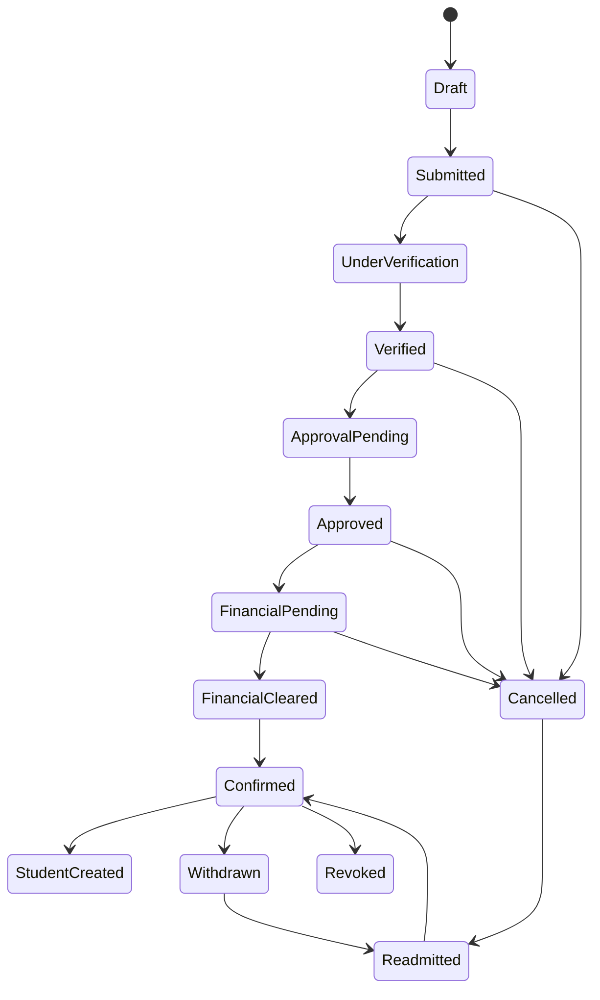

---

# 10.5 Allowed State Transitions

| Current State | Allowed Transition |
|---------------|----------------------------------------|
| Draft | Submitted, Cancelled |
| Submitted | UnderVerification, Cancelled |
| UnderVerification | Verified, Cancelled |
| Verified | ApprovalPending, Cancelled |
| ApprovalPending | Approved, Cancelled |
| Approved | FinancialPending, Cancelled |
| FinancialPending | FinancialCleared, Cancelled |
| FinancialCleared | Confirmed |
| Confirmed | StudentCreated, Withdrawn, Revoked |
| Withdrawn | Readmitted |
| Cancelled | Readmitted |
| Readmitted | Confirmed |

---

# 10.6 Invalid State Transitions

The following transitions are prohibited:

| Invalid Transition | Reason |
|--------------------|----------------------------------------------|
| Draft → Approved | Verification skipped |
| Draft → StudentCreated | Admission incomplete |
| Submitted → Confirmed | Approval missing |
| Verified → StudentCreated | Financial clearance missing |
| Cancelled → Approved | Must follow Readmission policy |
| Revoked → Confirmed | Institution must initiate Readmission |
| StudentCreated → Draft | Historical state rollback prohibited |

---

# 10.7 Terminal States

The following states are considered terminal under normal workflow execution.

| State | Readmission Allowed |
|---------|--------------------|
| StudentCreated | No |
| Cancelled | Yes (Policy Driven) |
| Withdrawn | Yes (Policy Driven) |
| Revoked | Institution Policy |

---

# 10.8 State Ownership

| State Category | Owning Domain |
|----------------|---------------------------|
| Admission States | Admission Domain |
| Financial Status | Finance Domain |
| Student Status | Student Lifecycle Domain |
| Academic Status | Academic Delivery Domain |

The Admission Domain shall not manage lifecycle states owned by other domains.

---

# 10.9 State Transition Rules

| Rule ID | Rule |
|----------|-----------------------------------------------------------|
| ST-C01-001 | Every Admission shall have exactly one active state. |
| ST-C01-002 | State transitions shall follow the canonical lifecycle. |
| ST-C01-003 | Invalid transitions shall be rejected. |
| ST-C01-004 | Every transition shall generate an audit record. |
| ST-C01-005 | Every transition shall publish the corresponding Domain Event. |
| ST-C01-006 | Historical states shall never be modified. |
| ST-C01-007 | State transitions shall be idempotent. |

---

# 10.10 State Recovery

In the event of system interruption:

- Previously committed states shall remain unchanged.
- Incomplete transitions shall be rolled back.
- Retried operations shall remain idempotent.
- Audit history shall remain intact.
- Duplicate state transitions are prohibited.

---

# 10.11 State Summary

The Admission State Model defines the authoritative lifecycle of every Admission within SutraERP.

All workflows, APIs, integrations, background jobs, and administrative operations shall comply with this model. Any transition outside the defined lifecycle is considered architecturally invalid unless explicitly introduced through a future architecture revision.

# 11. Service Contracts

## 11.1 Overview

Service Contracts define the canonical operations exposed by the Admission Domain.

These contracts represent logical business capabilities rather than implementation-specific REST, GraphQL, gRPC, or messaging interfaces.

All implementations shall conform to these contracts regardless of deployment architecture.

---

## 11.2 Service Design Principles

Admission services shall adhere to the following principles:

- Stateless execution.
- Idempotent where applicable.
- Authorization before execution.
- Transactional consistency.
- Audit generation for business operations.
- Event publication after successful completion.
- Clear ownership boundaries.

---

# 11.3 Admission Management Services

| Service | Description |
|----------|----------------------------------------------|
| Create Admission | Initiate a new admission |
| Update Admission | Modify editable admission details |
| Submit Admission | Submit admission for processing |
| Retrieve Admission | Retrieve admission information |
| Search Admissions | Search admission records |
| Cancel Admission | Cancel an admission |
| Withdraw Admission | Withdraw confirmed admission |
| Revoke Admission | Administrative revocation |
| Readmit Admission | Execute readmission workflow |

---

# 11.4 Document Services

| Service | Description |
|----------|---------------------------------------------|
| Upload Documents | Upload admission documents |
| Retrieve Documents | Retrieve uploaded documents |
| Verify Documents | Verify submitted documents |
| Reject Documents | Reject invalid documents |
| Waive Documents | Apply document waiver |
| View Verification History | Retrieve verification history |

---

# 11.5 Approval Services

| Service | Description |
|----------|---------------------------------------------|
| Submit for Approval | Initiate approval workflow |
| Approve Admission | Approve admission |
| Reject Admission | Reject admission |
| Escalate Approval | Escalate approval |
| View Approval History | Retrieve approval decisions |

---

# 11.6 Financial Integration Services

The Admission Domain consumes financial outcomes but does not perform financial calculations.

| Service | Description |
|----------|---------------------------------------------|
| Request Financial Clearance | Request Finance validation |
| Retrieve Clearance Status | Obtain clearance status |
| Process Financial Outcome | Consume Finance decision |

---

# 11.7 Student Creation Services

| Service | Description |
|----------|---------------------------------------------|
| Create Student | Create Student after confirmation |
| Validate Existing Student | Prevent duplicates |
| Publish StudentCreated | Notify Student Domain |

---

# 11.8 Audit Services

| Service | Description |
|----------|---------------------------------------------|
| Record Audit | Persist audit record |
| Retrieve Audit | View audit history |
| Compliance Export | Generate compliance records |

---

# 11.9 Common Service Behaviour

Every Admission Service shall:

1. Authenticate requester.
2. Authorize operation.
3. Validate request.
4. Execute business rules.
5. Persist transaction.
6. Generate immutable audit record including Correlation ID, Admission Identifier, User Identifier, Institution Identifier, and Timestamp.
7. Publish domain events.
8. Return canonical response.

---

# 11.10 Canonical Response Model

Every service shall return a standardized response.

| Field | Description |
|---------|----------------------------|
| Success | Operation result |
| Status Code | Business status |
| Message | Human-readable message |
| Correlation ID | Request tracking identifier |
| Timestamp | Canonical UTC timestamp |
| Payload | Business response data |
| Validation Errors | Business validation failures |

---

# 11.11 Error Classification

| Category | Description |
|-----------|----------------------------------------------|
| Validation Error | Business rule violation |
| Authorization Error | Access denied |
| Authentication Error | Identity failure |
| Policy Error | Institutional policy violation |
| Conflict Error | Duplicate or conflicting operation |
| Integration Error | External service failure |
| System Error | Unexpected internal failure |

---

# 11.12 Service Constraints

| Rule ID | Constraint |
|----------|----------------------------------------------------------|
| SC-C01-001 | Services shall remain stateless. |
| SC-C01-002 | Business operations shall be transactional. |
| SC-C01-003 | Successful operations shall publish Domain Events. |
| SC-C01-004 | Services shall enforce Business Rules before execution. |
| SC-C01-005 | Service responses shall use canonical response structures. |
| SC-C01-006 | Idempotent operations shall safely support retries. |
| SC-C01-007 | Every business operation shall generate audit records. |

---

# 11.13 Service Ownership

| Capability | Owning Domain |
|-------------|----------------------------|
| Admission Services | Admission Domain |
| Financial Services | Finance Domain |
| Student Services | Student Lifecycle Domain |
| Authentication | Platform Foundation |
| Audit Infrastructure | Audit Platform |
| Workflow Orchestration | Workflow Engine |

---

# 11.14 Service Summary

The Service Contracts defined in this section establish the canonical business interface of the Admission Domain.

All APIs, integrations, user interfaces, workflow engines, and background services shall invoke Admission functionality through these logical contracts, ensuring consistent behavior, domain ownership, and implementation independence across the SutraERP platform.


# 12. Authorization & Access Control

## 12.1 Overview

Authorization within the Admission Domain is governed through Role-Based Access Control (RBAC) augmented by institution-specific policies.

Every Admission operation shall require authentication, authorization, and policy evaluation before execution.

Authorization decisions shall remain independent of business logic.

---

## 12.2 Authorization Principles

The Admission Domain follows these principles:

- Authentication precedes authorization.
- Least-privilege access.
- Role-based permissions.
- Policy-driven authorization.
- Institution isolation.
- Complete auditability.
- Deny-by-default.

---

## 12.3 Role Categories

| Role Category | Description |
|---------------|--------------------------------------------|
| Applicant | Own admission lifecycle |
| Admission Officer | Process admissions |
| Verification Officer | Verify documents |
| Approver | Approve admissions |
| Finance Officer | Financial clearance |
| Registrar | Administrative authority |
| Institution Administrator | Institutional configuration |
| System Administrator | Platform administration |
| Integration User | Machine-to-machine access |
| Auditor | Read-only audit access |

---

# 12.4 Permission Matrix

| Operation | Applicant | Admission Officer | Verifier | Approver | Finance | Registrar | Auditor |
|------------|-----------|-------------------|-----------|-----------|-----------|------------|----------|
| Create Admission | ✔ | ✔ | | | | ✔ | |
| Update Admission | ✔* | ✔ | | | | ✔ | |
| Submit Admission | ✔ | ✔ | | | | ✔ | |
| Verify Documents | | | ✔ | | | ✔ | |
| Approve Admission | | | | ✔ | | ✔ | |
| Reject Admission | | | | ✔ | | ✔ | |
| Financial Clearance | | | | | ✔ | ✔ | |
| Confirm Admission | | ✔ | | | | ✔ | |
| Cancel Admission | ✔* | ✔ | | | | ✔ | |
| Withdraw Admission | ✔ | ✔ | | | | ✔ | |
| Revoke Admission | | | | | | ✔ | |
| Readmit Admission | | ✔ | | ✔ | | ✔ | |
| View Audit | | | | | | | ✔ |

\* Subject to institutional policy and admission lifecycle state.

---

# 12.5 Policy Evaluation

Every authorization request shall evaluate:

1. Authentication status
2. User role
3. Institution membership
4. Campus restrictions
5. Delegated authority
6. Admission lifecycle state
7. Institutional policies

Access shall only be granted when all applicable policies succeed.

---

# 12.6 Ownership Restrictions

The Admission Domain enforces strict ownership boundaries.

| Resource | Owning Domain |
|-----------|------------------------------|
| Admission | Admission Domain |
| Student | Student Lifecycle Domain |
| Financial Ledger | Finance Domain |
| Academic Programme | Academic Delivery Domain |
| User Identity | Platform Foundation |

No role may directly modify resources owned by another domain.

---

# 12.7 Administrative Operations

The following operations require elevated institutional authority:

- Admission Revocation
- Administrative Cancellation
- Manual Confirmation
- Readmission Override
- Policy Override
- Document Waiver
- Historical Record Correction

All administrative overrides shall generate mandatory audit records.

---

# 12.8 Delegated Authority

Institutions may configure delegated authority for:

- Approval hierarchy
- Verification authority
- Campus-level processing
- Department-level admissions
- Temporary delegation
- Acting officers

Delegation shall have defined validity periods and shall remain fully auditable.

---

# 12.9 Security Constraints

| Rule ID | Constraint |
|----------|-----------------------------------------------------------|
| AC-C01-001 | Authentication shall precede authorization. |
| AC-C01-002 | Authorization shall be policy-driven. |
| AC-C01-003 | Access shall follow least-privilege principles. |
| AC-C01-004 | Cross-institution access is prohibited unless explicitly configured. |
| AC-C01-005 | Administrative overrides require audit records. |
| AC-C01-006 | Authorization decisions shall be deterministic. |
| AC-C01-007 | Permission evaluation shall occur before business validation. |

---

# 12.10 Audit Requirements

Every authorization decision shall record:

- User Identifier
- Role
- Institution
- Campus
- Requested Operation
- Resource Identifier
- Decision
- Policy Applied
- Timestamp
- Correlation Identifier

---

# 12.11 Authorization Summary

The Authorization Model ensures that every Admission operation is executed only by authenticated and authorized actors within their defined institutional scope.

Authorization remains policy-driven, auditable, and independent of business workflows, preserving both institutional governance and domain ownership across the SutraERP platform.

# 13. Multi-Domain Integrations

## 13.1 Overview

The Admission Domain operates as part of the broader SutraERP ecosystem and interacts with multiple domains through well-defined architecture contracts.

All integrations shall preserve domain ownership, loose coupling, and event-driven communication wherever applicable.

The Admission Domain shall never directly modify business entities owned by another domain.

---

## 13.2 Integration Principles

Multi-domain integrations shall adhere to the following principles:

- Domain ownership shall be respected.
- Communication shall use canonical service contracts or domain events.
- Multi-domain writes are prohibited unless explicitly defined.
- Integrations shall be idempotent.
- Failures shall be isolated.
- All interactions shall be auditable.

---

# 13.3 Platform Foundation (L2-A01)

### Purpose

Provides common platform capabilities required by the Admission Domain.

### Consumed Services

- Authentication
- Authorization
- User Management
- Tenant Resolution
- Institution Context
- Campus Context
- Identity Management
- Notification Infrastructure

### Published Events

None

---

# 13.4 Institution & Structure (L2-B01)

### Purpose

Provides organizational hierarchy.

### Consumed Data

- Institution
- Campus
- Department
- Programme Ownership
- Academic Structure

Admission does not modify institutional hierarchy.

---

# 13.5 Student Lifecycle (L2-C02)

### Purpose

Admission transfers ownership after successful confirmation.

### Published Events

- StudentCreated

### Consumed Events

- StudentAlreadyExists (optional)
- StudentCreationFailed

Ownership of the Student aggregate belongs exclusively to the Student Lifecycle Domain.

---

# 13.6 Academic Delivery (L2-D01)

### Consumed Services

- Programme Catalogue
- Academic Session
- Intake Configuration
- Eligibility Rules
- Programme Capacity

Admission consumes academic information but never owns or modifies it.

---

# 13.7 Finance (L2-F01)

### Purpose

Finance determines financial eligibility.

### Admission Consumes

- Financial Clearance
- Payment Status
- Outstanding Obligations

### Admission Publishes

- AdmissionApproved
- AdmissionCancelled

Finance owns all accounting records and financial transactions.

---

# 13.8 Document Management

### Purpose

Stores admission documents.

### Admission Responsibilities

- Request uploads
- Request verification
- Consume verification outcomes

### Document Domain Responsibilities

- File storage
- Version management
- Metadata
- Retention
- Integrity

Admission shall never directly manage physical document storage.

---

# 13.9 Workflow Engine

### Purpose

Executes configurable institutional workflows.

### Responsibilities

- Approval routing
- Policy evaluation
- Workflow orchestration
- Escalations
- Timeouts
- SLA management

Business ownership remains with the Admission Domain.

---

# 13.10 Notification Services

### Consumed Services

- Email
- SMS
- Push Notifications
- In-App Notifications

Notification failures shall not invalidate completed business transactions unless explicitly configured.

---

# 13.11 Audit Platform

### Responsibilities

- Audit persistence
- Compliance retention
- Historical reporting
- Regulatory evidence

Admission publishes audit information but does not own audit storage.

---

# 13.12 Analytics & Reporting

Admission publishes business events for:

- Operational dashboards
- Institutional reports
- Regulatory submissions
- BI systems
- Data warehouse pipelines

Analytics consumers shall remain read-only.

---

# 13.13 External Integrations

Institutions may integrate Admission with:

- Government admission portals
- National identity services
- Scholarship providers
- Payment gateways
- Entrance examination systems
- Digital document verification services
- Third-party ERP systems

All external integrations shall use canonical integration contracts.

---

# 13.14 Integration Responsibility Matrix

| Domain | Admission Consumes | Admission Publishes |
|----------|-------------------------------|------------------------------|
| Platform | Authentication, Identity | None |
| Institution | Institution Structure | None |
| Student Lifecycle | Student Creation Outcome | StudentCreated Event |
| Academic | Programme Information | None |
| Finance | Financial Clearance | AdmissionApproved |
| Documents | Verification Results | DocumentsUploaded |
| Workflow | Policy Decisions | Workflow Events |
| Audit | Audit Services | Audit Events |
| Notifications | Delivery Services | Notification Requests |
| Analytics | None | Business Events |

---

# 13.15 Integration Constraints

| Rule ID | Constraint |
|----------|--------------------------------------------------------------|
| IN-C01-001 | Domain ownership shall never be violated. |
| IN-C01-002 | Multi-domain writes are prohibited unless architecturally defined. |
| IN-C01-003 | Integrations shall be idempotent. |
| IN-C01-004 | Published events shall be immutable. |
| IN-C01-005 | Service contracts shall remain versioned. |
| IN-C01-006 | Integration failures shall not corrupt Admission state. |
| IN-C01-007 | All multi-domain interactions shall be auditable. |

---

# 13.16 Integration Summary

The Admission Domain integrates with surrounding SutraERP domains exclusively through canonical service contracts and immutable domain events.

This integration model preserves domain autonomy, supports distributed deployment, enables independent evolution of domains, and ensures that business ownership remains clearly defined across the entire architecture.

# 14. Configuration Model

## 14.1 Overview

The Admission Domain is highly configurable to accommodate the operational policies of different institutions without requiring changes to core business logic.

Configuration influences workflow behavior, validation, approvals, eligibility, document requirements, financial clearance, notifications, and lifecycle policies.

Business ownership remains unchanged regardless of configuration.

---

## 14.2 Configuration Principles

The Admission Domain shall follow these principles:

- Configuration shall be policy-driven.
- Business logic shall remain implementation-independent.
- Configuration shall not violate architecture contracts.
- Institution-specific configuration shall remain tenant-isolated.
- Configuration changes shall be auditable.
- Configuration shall support versioning.

---

# 14.3 Configuration Categories

| Category | Description |
|-----------|----------------------------------------------|
| Admission Policies | Institution admission rules |
| Eligibility Rules | Eligibility criteria |
| Document Policies | Required documents |
| Approval Policies | Approval workflow |
| Financial Policies | Clearance requirements |
| Readmission Policies | Readmission eligibility |
| Notification Policies | Communication preferences |
| Security Policies | Authorization configuration |
| Workflow Policies | Workflow execution |
| Audit Policies | Audit retention and compliance |

---

# 14.4 Admission Configuration

Institutions may configure:

- Admission application period
- Admission modes
- Intake schedules
- Programme availability
- Campus availability
- Admission capacity
- Admission numbering policy
- Duplicate admission policy

---

# 14.5 Eligibility Configuration

Configurable parameters include:

- Academic qualifications
- Minimum percentage
- Reservation categories
- Entrance examination requirements
- Age criteria
- Nationality restrictions
- Institution-specific eligibility

Eligibility evaluation shall remain deterministic.

---

# 14.6 Document Configuration

Institutions may configure:

- Mandatory documents
- Optional documents
- Programme-specific documents
- Category-specific documents
- Verification requirements
- Waiver policies
- Resubmission limits

Document storage remains outside the Admission Domain.

---

# 14.7 Approval Configuration

Approval workflow may configure:

- Single-level approval
- Multi-level approval
- Parallel approvals
- Sequential approvals
- Approval delegation
- Escalation policies
- Approval time limits

Approval execution is performed by the Workflow Engine.

---

# 14.8 Financial Configuration

Admission consumes financial policies defined by institutional configuration.

Examples include:

- Admission fee requirement
- Deposit requirement
- Financial clearance mandatory/optional
- Scholarship consideration
- Fee waiver eligibility

Financial calculations remain owned by the Finance Domain.

---

# 14.9 Readmission Configuration

Institutions may configure:

- Readmission eligibility
- Maximum readmission attempts
- Academic gap limits
- Restoration policy
- Fresh admission policy
- Approval requirements
- Programme restrictions

---

# 14.10 Notification Configuration

Institutions may configure:

- Email notifications
- SMS notifications
- Push notifications
- Reminder schedules
- Escalation alerts
- Applicant communication templates

Notification delivery is handled outside the Admission Domain.

---

# 14.11 Audit Configuration

Configurable options include:

- Audit retention period
- Compliance reporting
- Audit verbosity
- Digital signatures
- Regulatory export
- Immutable retention policies

Audit records themselves shall remain immutable.

---

# 14.12 Configuration Versioning

Every configuration change shall include:

| Attribute | Description |
|------------|------------------------------|
| Configuration Version | Unique version identifier |
| Effective Date | Activation date |
| Institution | Configuration owner |
| Modified By | User identifier |
| Approval Status | Configuration approval |
| Change Reason | Business justification |

Previous configuration versions shall remain preserved.

---

# 14.13 Configuration Constraints

| Rule ID | Constraint |
|----------|-----------------------------------------------------------|
| CFG-C01-001 | Configuration shall never violate architecture contracts. |
| CFG-C01-002 | Configuration changes shall be audited. |
| CFG-C01-003 | Tenant configurations shall remain isolated. |
| CFG-C01-004 | Configuration shall support versioning. |
| CFG-C01-005 | Business ownership shall not change through configuration. |
| CFG-C01-006 | Workflow behavior may change only within approved policy boundaries. |
| CFG-C01-007 | Configuration shall be backward compatible where applicable. |

---

# 14.14 Configuration Ownership

| Configuration Area | Owning Domain |
|--------------------|-------------------------------|
| Admission Policies | Admission Domain |
| Workflow Policies | Workflow Engine |
| Financial Policies | Finance Domain |
| Academic Policies | Academic Delivery |
| Security Policies | Platform Foundation |
| Audit Policies | Audit Platform |

---

# 14.15 Configuration Summary

The Configuration Model enables institutions to tailor admission processes while preserving the canonical architecture of the Admission Domain.

Configurations influence operational behavior but shall never alter domain ownership, lifecycle integrity, business rules, or architectural contracts defined within **L2-C01 — Admissions**.

# 15. Validation Framework

## 15.1 Overview

The Validation Framework defines the canonical validation model for all Admission operations.

Validation ensures that only complete, consistent, authorized, and policy-compliant data enters the Admission Lifecycle.

Validation failures shall prevent business execution before any state transition occurs.

---

## 15.2 Validation Principles

The Admission Domain follows these validation principles:

- Validate before execution.
- Deterministic validation.
- Policy-driven validation.
- Fail-fast execution.
- Immutable validation results.
- Auditable validation decisions.
- Idempotent validation.

---

# 15.3 Validation Categories

| Category | Purpose |
|-----------|-----------------------------------------------|
| Identity Validation | Verify applicant identity |
| Data Validation | Validate admission data |
| Eligibility Validation | Verify admission eligibility |
| Document Validation | Validate required documents |
| Approval Validation | Validate approval prerequisites |
| Financial Validation | Validate financial clearance |
| Security Validation | Validate authorization |
| Configuration Validation | Validate institutional configuration |
| Multi-Domain Validation | Validate external dependencies |

---

# 15.4 Identity Validation

Validation shall verify:

- Applicant existence
- User authentication
- Institution membership
- Duplicate applicant detection
- Identity consistency

Identity verification services remain owned by the Platform Foundation.

---

# 15.5 Admission Data Validation

Admission data shall validate:

- Mandatory fields
- Data types
- Value ranges
- Date consistency
- Programme selection
- Campus selection
- Session availability
- Duplicate admission prevention

---

# 15.6 Eligibility Validation

Eligibility evaluation includes:

- Academic qualification
- Minimum eligibility
- Reservation policy
- Entrance examination requirements
- Programme eligibility
- Institution-specific policies

Eligibility shall be evaluated before approval.

---

# 15.7 Document Validation

Validation shall verify:

- Mandatory documents submitted
- Document completeness
- Supported file types
- File integrity
- Verification status
- Document expiry
- Waiver authorization

Physical document storage is outside the Admission Domain.

---

# 15.8 Approval Validation

Before approval:

- Documents verified
- Eligibility successful
- Required approvals available
- Institutional policy satisfied
- Workflow completed

Incomplete approvals shall block Admission Approval.

---

# 15.9 Financial Validation

Admission validates:

- Financial Clearance received
- Required payments completed
- Finance decision available

Financial computations remain owned by the Finance Domain.

---

# 15.10 Multi-Domain Validation

The Admission Domain validates responses from:

| Domain | Validation |
|----------|--------------------------------------------|
| Platform | Authentication |
| Institution | Institution availability |
| Academic | Programme & Session |
| Finance | Financial Clearance |
| Student | Duplicate student detection |
| Workflow Engine | Policy execution |

Admission never validates internal business rules owned by other domains.

---

# 15.11 Validation Order

Validation shall execute in the following canonical order:

1. Authentication
2. Authorization
3. Configuration
4. Identity
5. Admission Data
6. Eligibility
7. Documents
8. Approval Requirements
9. Financial Clearance
10. Business Rule Validation
11. Workflow Execution

Failure at any stage shall terminate execution.

---

# 15.12 Validation Results

Every validation operation shall return:

| Field | Description |
|---------|-------------------------------|
| Validation Status | Pass / Fail |
| Validation Code | Standardized result code |
| Validation Message | Human-readable message |
| Failed Rule | Business rule identifier |
| Correlation ID | Request identifier |
| Timestamp | UTC validation time |

---

# 15.13 Validation Constraints

| Rule ID | Constraint |
|----------|--------------------------------------------------------------|
| VAL-C01-001 | Validation shall occur before state transition. |
| VAL-C01-002 | Validation shall be deterministic. |
| VAL-C01-003 | Validation failures shall prevent workflow execution. |
| VAL-C01-004 | Validation shall be auditable. |
| VAL-C01-005 | Validation results shall be immutable. |
| VAL-C01-006 | Validation shall support idempotent retries. |
| VAL-C01-007 | Multi-domain validation shall respect ownership boundaries. |

---

# 15.14 Validation Failure Handling

When validation fails:

- No state transition shall occur.
- No business transaction shall be committed.
- Audit records shall be generated where applicable.
- Validation errors shall be returned using canonical response models.
- Partial execution is prohibited.

---

# 15.15 Validation Summary

The Validation Framework ensures that every Admission operation is evaluated consistently before execution.

By enforcing deterministic, policy-driven, and auditable validation, the Admission Domain preserves business integrity, prevents invalid state transitions, and guarantees compliance with institutional and architectural rules across the SutraERP platform.

# 16. Exception & Error Model

## 16.1 Overview

The Exception & Error Model defines the canonical approach for detecting, classifying, handling, and reporting errors within the Admission Domain.

Exceptions shall never leave the Admission aggregate in an inconsistent state.

All errors shall be deterministic, auditable, and recoverable where appropriate.

---

## 16.2 Exception Handling Principles

The Admission Domain follows these principles:

- Fail fast.
- Preserve data integrity.
- Roll back incomplete transactions.
- Never expose internal implementation details.
- Generate audit records where applicable.
- Maintain idempotency during retries.
- Return standardized error responses.

---

# 16.3 Error Classification

| Category | Description |
|-----------|----------------------------------------------|
| Validation Error | Business rule validation failure |
| Authentication Error | User identity verification failed |
| Authorization Error | Permission denied |
| Policy Error | Institutional policy violation |
| Business Rule Error | Domain rule violation |
| State Transition Error | Invalid lifecycle transition |
| Integration Error | External dependency failure |
| Concurrency Error | Simultaneous update conflict |
| Configuration Error | Invalid institutional configuration |
| System Error | Unexpected internal failure |

---

# 16.4 Validation Errors

Examples include:

- Mandatory field missing
- Invalid programme selection
- Duplicate admission
- Invalid academic session
- Eligibility failure
- Required document missing
- Invalid document status

Validation errors shall terminate workflow execution before state transition.

---

# 16.5 Business Exceptions

Business exceptions include:

- Admission already confirmed
- Admission cancelled
- Admission withdrawn
- Financial clearance pending
- Readmission not permitted
- Duplicate active admission
- Student already exists

Business exceptions shall preserve the existing Admission state.

---

# 16.6 State Transition Exceptions

Examples:

| Invalid Transition | Reason |
|--------------------|--------------------------------------|
| Draft → Confirmed | Verification not completed |
| Submitted → StudentCreated | Approval skipped |
| Cancelled → Approved | Readmission required |
| Revoked → Confirmed | Institutional restoration required |
| StudentCreated → Draft | Historical rollback prohibited |

No invalid transition shall modify Admission state.

---

# 16.7 Integration Exceptions

External integration failures may occur when interacting with:

- Finance
- Academic Delivery
- Platform Foundation
- Workflow Engine
- Notification Services
- Document Management

Integration failures shall not corrupt committed Admission data.

---

# 16.8 Retry Policy

Retry shall only be performed for transient failures.

Eligible retry scenarios include:

- Temporary network failures
- Service timeout
- Infrastructure interruption
- Message delivery failure

The following shall never be retried automatically:

- Business rule failures
- Validation failures
- Authorization failures
- Policy violations

---

# 16.9 Transaction Recovery

Upon failure:

1. Roll back incomplete transaction.
2. Preserve committed data.
3. Generate audit record where required.
4. Return standardized error response.
5. Allow safe retry where applicable.

No partial Admission state shall be committed.

---

# 16.10 Standard Error Response

Every failed operation shall return the canonical error structure.

| Field | Description |
|---------|------------------------------|
| Success | False |
| Error Code | Standardized error identifier |
| Error Category | Error classification |
| Message | Human-readable description |
| Correlation ID | Request identifier |
| Timestamp | UTC timestamp |
| Details | Validation or diagnostic information |

---

# 16.11 Exception Constraints

| Rule ID | Constraint |
|----------|--------------------------------------------------------------|
| EX-C01-001 | Failed transactions shall not modify Admission state. |
| EX-C01-002 | Exceptions shall be auditable where applicable. |
| EX-C01-003 | Error responses shall follow canonical structures. |
| EX-C01-004 | Business exceptions shall not expose implementation details. |
| EX-C01-005 | Automatic retries shall be limited to transient failures. |
| EX-C01-006 | Exception handling shall preserve idempotency. |
| EX-C01-007 | Partial commits are prohibited. |

---

# 16.12 Exception Logging

Every exception log shall include:

- Error Identifier
- Correlation Identifier
- Admission Identifier
- Institution Identifier
- User Identifier
- Workflow Identifier
- Exception Category
- Error Code
- Timestamp
- Resolution Status

Logs shall support operational diagnostics without exposing sensitive information.

---

# 16.13 Exception Summary

The Exception & Error Model provides a consistent framework for handling failures throughout the Admission Domain.

By enforcing deterministic error handling, transactional rollback, standardized responses, and comprehensive auditability, the Admission Domain maintains data integrity, operational resilience, and architectural consistency across all workflows and integrations within the SutraERP platform.

# 17. Non-Functional Requirements

## 17.1 Overview

This section defines the non-functional characteristics required for the Admission Domain to operate reliably, securely, and efficiently across all supported deployment models.

These requirements apply equally to cloud-hosted, hybrid, and on-premises deployments.

---

## 17.2 Availability

The Admission Domain shall provide:

- High service availability during admission periods.
- Graceful degradation during dependent service failures.
- Recovery after unexpected interruptions.
- Support for planned maintenance windows.

Admission operations shall preserve transactional consistency regardless of infrastructure topology.

---

## 17.3 Performance

The Admission Domain shall be designed to:

- Support concurrent admission processing.
- Minimize workflow execution latency.
- Optimize document validation throughput.
- Efficiently search admission records.
- Scale for peak admission periods.

Performance optimization shall never compromise data consistency.

---

## 17.4 Scalability

The architecture shall support:

- Horizontal application scaling.
- Multiple institutions.
- Multiple campuses.
- Large applicant volumes.
- Distributed workflow execution.
- Event-driven processing.

Scalability shall not require changes to business logic.

---

## 17.5 Reliability

The Admission Domain shall guarantee:

- Transaction integrity.
- Idempotent operations.
- Safe retry mechanisms.
- Consistent workflow execution.
- Failure isolation.
- Recovery without data corruption.

---

## 17.6 Security

Security requirements include:

- Strong authentication.
- Role-based authorization.
- Tenant isolation.
- Secure communication.
- Data encryption where applicable.
- Audit logging.
- Protection against unauthorized access.

---

## 17.7 Data Integrity

The Admission Domain shall ensure:

- Referential integrity.
- Immutable historical records.
- Unique Admission identifiers.
- Consistent lifecycle transitions.
- Duplicate prevention.
- Version-controlled configuration.

---

## 17.8 Auditability

Every significant business operation shall support:

- Complete audit history.
- User traceability.
- Correlation identifiers.
- Historical reconstruction.
- Regulatory evidence.
- Immutable audit records.

---

## 17.9 Maintainability

The architecture shall promote:

- Modular design.
- Clear domain ownership.
- Independent deployment.
- Versioned contracts.
- Minimal coupling.
- Configurable institutional policies.

---

## 17.10 Observability

Operational monitoring shall support:

- Structured logging.
- Metrics collection.
- Health monitoring.
- Distributed tracing.
- Workflow monitoring.
- Integration diagnostics.

Observability shall not expose sensitive business information.

---

## 17.11 Disaster Recovery

The Admission Domain shall support:

- Backup and restoration.
- Transaction recovery.
- Infrastructure replacement.
- Event replay where applicable.
- Business continuity.

Recovery procedures shall preserve Admission integrity.

---

## 17.12 Deployment Compatibility

The Admission Domain shall operate consistently across:

- Cloud deployment
- On-premises deployment
- Hybrid deployment
- Single institution
- Multi-institution
- Distributed infrastructure

No deployment model shall require changes to canonical business behavior.

---

## 17.13 Non-Functional Constraints

| Rule ID | Constraint |
|----------|------------------------------------------------------------|
| NFR-C01-001 | Business consistency shall take precedence over performance. |
| NFR-C01-002 | Operations shall remain idempotent. |
| NFR-C01-003 | Historical records shall remain immutable. |
| NFR-C01-004 | Tenant isolation shall always be enforced. |
| NFR-C01-005 | Domain ownership shall never be violated. |
| NFR-C01-006 | The architecture shall support horizontal scaling. |
| NFR-C01-007 | All deployments shall preserve identical business behavior. |

---

## 17.14 Summary

The Non-Functional Requirements establish the quality attributes required for the Admission Domain.

Together, these requirements ensure that the domain remains reliable, secure, scalable, maintainable, and deployment-independent while preserving the canonical architecture of SutraERP.

# 18. Reporting & Analytics

## 18.1 Overview

The Admission Domain provides standardized reporting and analytics capabilities to support institutional operations, management decision-making, regulatory compliance, and strategic planning.

Reporting is read-only and shall never modify Admission business data.

Analytics consumers shall access Admission data through approved reporting interfaces, data warehouses, or event streams.

### Architectural Constraint

Reporting & Analytics shall consume canonical Admission domain events (or approved read models) to build reporting projections and dashboards.

Reporting & Analytics shall not directly participate in operational Admission workflows, own Admission state, or rely on direct aggregate access for business processing.

---

## 18.2 Reporting Principles

Reporting within the Admission Domain shall follow these principles:

- Read-only access.
- Near real-time reporting where applicable.
- Historical data preservation.
- Tenant isolation.
- Configurable institutional reports.
- Auditability of generated reports.
- No impact on transactional processing.

---

# 18.3 Operational Reports

The Admission Domain shall support reports including:

- Admission Register
- Daily Admission Summary
- Pending Admissions
- Approved Admissions
- Rejected Admissions
- Confirmed Admissions
- Cancelled Admissions
- Withdrawn Admissions
- Readmitted Admissions

---

# 18.4 Verification Reports

Supported reports include:

- Pending Document Verification
- Verified Documents
- Rejected Documents
- Document Waivers
- Verification Performance
- Verification Turnaround Time

---

# 18.5 Approval Reports

Institutions may generate:

- Pending Approvals
- Approval History
- Rejected Applications
- Escalated Approvals
- Approval SLA Report
- Approval Workload

---

# 18.6 Financial Reports

The Admission Domain may present admission-related financial status received from the Finance Domain.

Examples include:

- Financial Clearance Status
- Pending Financial Clearance
- Admission Fee Status
- Scholarship Eligibility Status

Financial calculations remain owned by the Finance Domain.

---

# 18.7 Administrative Reports

Administrative reporting includes:

- Admissions by Institution
- Admissions by Campus
- Admissions by Programme
- Admissions by Department
- Admissions by Academic Session
- Admissions by Intake

---

# 18.8 Compliance Reports

Compliance reporting supports:

- Regulatory submissions
- Accreditation reports
- Government reporting
- Reservation statistics
- Admission audit summaries
- Institutional compliance reviews

---

# 18.9 Analytics

The Admission Domain publishes business data for analytics including:

- Admission trends
- Programme demand
- Applicant conversion rates
- Approval rates
- Verification performance
- Financial clearance trends
- Readmission statistics

Analytics platforms shall consume immutable domain events wherever possible.

---

# 18.10 Standard Reporting Dimensions

Reports may be filtered by:

- Institution
- Campus
- Academic Session
- Programme
- Department
- Admission Status
- Date Range
- Admission Mode
- Reservation Category

---

# 18.11 Report Security

Report access shall follow institutional RBAC policies.

Sensitive reports shall enforce:

- Institution isolation
- Campus restrictions
- Role-based authorization
- Audit logging
- Export authorization

---

# 18.12 Reporting Constraints

| Rule ID | Constraint |
|----------|--------------------------------------------------------------|
| REP-C01-001 | Reports shall never modify Admission data. |
| REP-C01-002 | Report access shall follow RBAC policies. |
| REP-C01-003 | Tenant data isolation shall always be maintained. |
| REP-C01-004 | Historical reports shall preserve immutable records. |
| REP-C01-005 | Analytics shall consume canonical business events where applicable. |
| REP-C01-006 | Financial reports shall consume Finance-owned data only. |
| REP-C01-007 | Report generation shall not impact transactional processing. |

---

# 18.13 Reporting Ownership

| Capability | Owning Domain |
|-------------|------------------------------|
| Admission Reports | Admission Domain |
| Financial Reports | Finance Domain |
| Academic Reports | Academic Delivery Domain |
| Student Reports | Student Lifecycle Domain |
| Enterprise Analytics | Analytics Platform |

---

# 18.14 Summary

The Reporting & Analytics Model enables institutions to derive operational, managerial, and regulatory insights from Admission data while preserving transactional integrity, domain ownership, and architectural boundaries.

All reporting capabilities remain read-only and are designed to scale independently from operational admission processing.

# 19. Audit & Compliance

## 19.1 Overview

The Admission Domain shall maintain complete, immutable, and traceable records of every significant business operation to satisfy institutional governance, regulatory compliance, operational monitoring, and forensic investigation requirements.

Audit capabilities are independent of business workflows and shall not alter Admission data.

---

## 19.2 Audit Principles

The Admission Domain follows these audit principles:

- Every significant business event shall be auditable.
- Audit records shall be immutable.
- Audit data shall be append-only.
- Audit shall support complete historical reconstruction.
- Audit timestamps shall use canonical UTC time.
- Audit shall be tenant-isolated.
- Audit shall support regulatory retention requirements.

---

# 19.3 Auditable Operations

The following operations shall generate audit records:

- Admission Creation
- Admission Update
- Admission Submission
- Document Upload
- Document Verification
- Admission Approval
- Admission Rejection
- Financial Clearance
- Admission Confirmation
- Student Creation
- Admission Cancellation
- Admission Withdrawal
- Admission Revocation
- Readmission
- Administrative Override
- Configuration Changes

---

# 19.4 Audit Record Structure

Every audit entry shall include:

| Attribute | Description |
|------------|--------------------------------------|
| Audit ID | Unique audit identifier |
| Event ID | Related domain event |
| Admission ID | Admission reference |
| Institution ID | Institution reference |
| Campus ID | Campus reference |
| User ID | Initiating actor |
| User Role | Authorized role |
| Operation | Business operation |
| Previous State | Before transition |
| New State | After transition |
| Timestamp | UTC execution time |
| Correlation ID | End-to-end trace identifier |
| Workflow ID | Executing workflow |
| Source System | Originating system |

---

# 19.5 Compliance Requirements

The Admission Domain shall support compliance with:

- Institutional governance policies
- Higher education regulations
- Accreditation requirements
- Government reporting mandates
- Internal audit policies
- Information security policies
- Data retention regulations

Compliance requirements shall remain configurable where permitted by law.

---

# 19.6 Audit Retention

Institutions may configure:

- Audit retention duration
- Archive policies
- Long-term storage
- Regulatory retention periods
- Export requirements
- Digital signature policies

Historical audit records shall never be modified after creation.

---

# 19.7 Compliance Reporting

The Admission Domain shall support generation of:

- Admission Audit Reports
- Approval History Reports
- Verification History Reports
- Administrative Override Reports
- User Activity Reports
- Regulatory Compliance Reports
- Audit Trail Exports

Report generation shall not modify audit records.

---

# 19.8 Audit Security

Audit information shall enforce:

- Read-only access
- Role-based authorization
- Institution isolation
- Tamper resistance
- Secure storage
- Complete traceability

Only authorized personnel may access audit information.

---

# 19.9 Audit Constraints

| Rule ID | Constraint |
|----------|--------------------------------------------------------------|
| AUD-C01-001 | Audit records shall be immutable. |
| AUD-C01-002 | Audit storage shall be append-only. |
| AUD-C01-003 | Every lifecycle transition shall generate an audit record. |
| AUD-C01-004 | Audit timestamps shall use canonical UTC time. |
| AUD-C01-005 | Audit access shall follow RBAC policies. |
| AUD-C01-006 | Audit records shall support complete historical reconstruction. |
| AUD-C01-007 | Audit records shall never be physically modified or deleted by business operations. |

---

# 19.10 Compliance Ownership

| Responsibility | Owning Domain |
|----------------|-------------------------------|
| Admission Audit Generation | Admission Domain |
| Audit Storage | Audit Platform |
| Regulatory Reporting | Reporting Platform |
| Security Monitoring | Platform Foundation |
| Retention Policy | Institution Configuration |

---

# 19.11 Audit & Compliance Summary

The Audit & Compliance Model ensures complete accountability for every Admission lifecycle event.

By enforcing immutable audit records, standardized compliance reporting, tenant isolation, and regulatory retention policies, the Admission Domain provides a trustworthy and legally defensible historical record while preserving architectural boundaries and domain ownership throughout the SutraERP platform.

20 Architecture Visual Models

20.1 Domain Context
## 20.1 Domain Context

The following diagram illustrates the Admission Domain within the overall SutraERP ecosystem.

The Admission Domain owns the complete Admission lifecycle from institutional admission processing until creation of the canonical Student entity. It collaborates with surrounding domains through canonical service contracts and immutable domain events while preserving strict ownership boundaries.


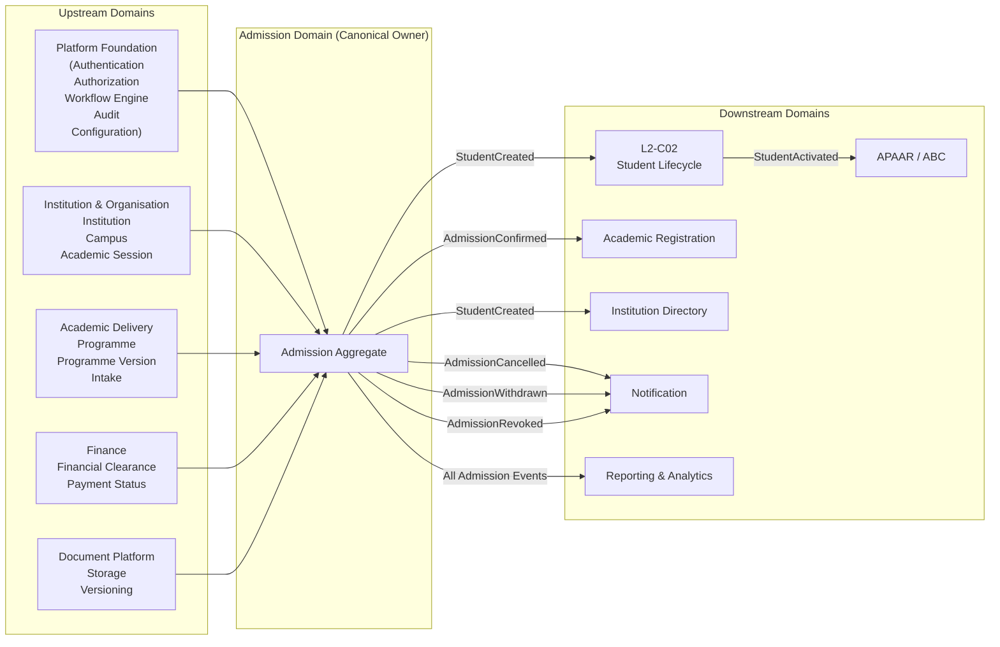


### Architectural Notes

- Admission is the sole owner of the **Admission Aggregate**.
- Academic structures remain owned by Academic Delivery.
- Financial records remain owned by Finance.
- Physical document storage remains owned by Document Platform.
- Student ownership transfers to the Student Lifecycle domain only after successful Student creation.
- Multi-domain communication occurs exclusively through canonical service contracts and immutable domain events.

## 20.2 Aggregate Model

The Admission Aggregate represents the transactional consistency boundary of the Admission Domain.

It owns the complete Admission lifecycle, verification status, approval status, confirmation status, and audit metadata while maintaining references to external domain aggregates through immutable identifiers.

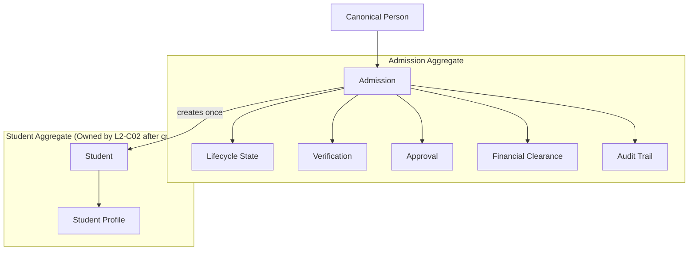
### Aggregate Invariants

- Every Admission has exactly one Aggregate Root.
- The Admission Aggregate owns the Admission lifecycle exclusively.
- Verification, Approval, Financial Clearance, Student Creation, and Audit are internal entities of the Admission Aggregate.
- Programme, Person, Institution, Academic Session, Finance, and Document Platform remain external aggregates referenced only by identity.
- Multi-domain writes are prohibited.
- Aggregate consistency is maintained transactionally within the Admission Domain.

20.3 State Machine
## 20.3 State Machine

The following state machine defines the canonical lifecycle of the Admission Aggregate.

Every Admission shall exist in exactly one lifecycle state at any point in time. State transitions are deterministic, auditable, policy-driven, and enforced by the Admission Domain.

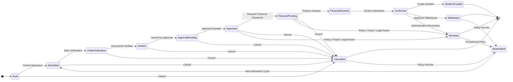

### Architectural Constraints

- Every Admission has exactly one active lifecycle state.
- Invalid state transitions shall be rejected.
- Every successful transition generates:
  - Immutable Audit Record
  - Canonical Domain Event
- Multi-domain state changes are prohibited.
- Student creation is the final operational responsibility of the Admission Domain.
- After **StudentCreated**, lifecycle ownership transfers to **L2-C02 – Student Lifecycle**.
- Readmission never modifies historical admission records; it initiates a new policy-driven admission cycle while preserving complete history.

20.4 Admission Lifecycle
## 20.4 Primary Business Workflow

The Primary Business Workflow illustrates the canonical end-to-end Admission process executed by the Admission Domain.

The workflow transforms an eligible admission into a canonical Student while enforcing institutional policies, financial compliance, governance requirements, and strict domain ownership boundaries.

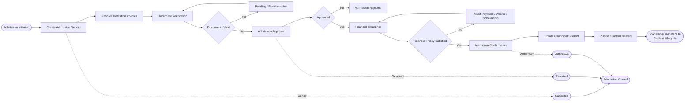

### Architectural Characteristics

- The workflow is deterministic.
- Every business transition generates immutable audit records.
- Institutional policies are resolved through the Workflow Engine.
- Finance determines financial clearance but never performs Admission operations.
- Student creation occurs exactly once.
- Ownership transfers to the Student Lifecycle domain immediately after successful Student creation.
- Cancellation, Withdrawal, and Revocation terminate the Admission lifecycle while preserving complete historical records.

20.5 Admission Confirmation Workflow
## 20.5 Secondary Business Workflow — Admission Confirmation

The Admission Confirmation Workflow represents the final governance checkpoint before the creation of the canonical Student entity.

It validates that all institutional, academic, administrative, and financial requirements have been satisfied before confirming the admission and making it eligible for Student creation.

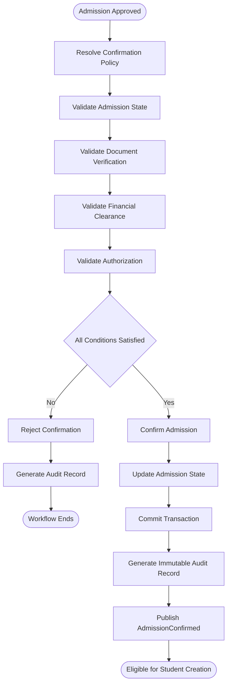

### Workflow Characteristics

- Executes only after **Admission Approval**.
- Requires successful **Document Verification**.
- Requires **Financial Clearance** (or policy-approved exemption).
- Authorization is resolved through institutional workflow policies.
- Business events are published **only after successful transaction commit**.
- Every execution generates immutable audit records.
- The workflow **does not create the Student**; it only produces a **Confirmed Admission** eligible for the Student Creation Workflow.

### Published Event

- `AdmissionConfirmed`

### Consumed Business Facts

- `AdmissionApproved`
- `DocumentsVerified`
- `FinancialClearanceCompleted`

### Architectural Constraints

- Student creation is prohibited before successful Admission Confirmation.
- Duplicate confirmations are prevented through idempotent execution.
- Multi-domain writes are prohibited.
- Finance remains the owner of all financial records.
- Programme information is consumed as read-only.

20.6 Student Creation Workflow/ Admission to Student Transition
## 20.6 Domain-Specific Workflow — Admission-to-Student Transition/ Student Creation Workflow

The Admission-to-Student Transition Workflow represents the final responsibility of the Admission Domain.

Upon successful Admission Confirmation, the Admission Domain creates the canonical Student entity exactly once, publishes the corresponding domain event, and transfers lifecycle ownership to the Student Lifecycle domain.

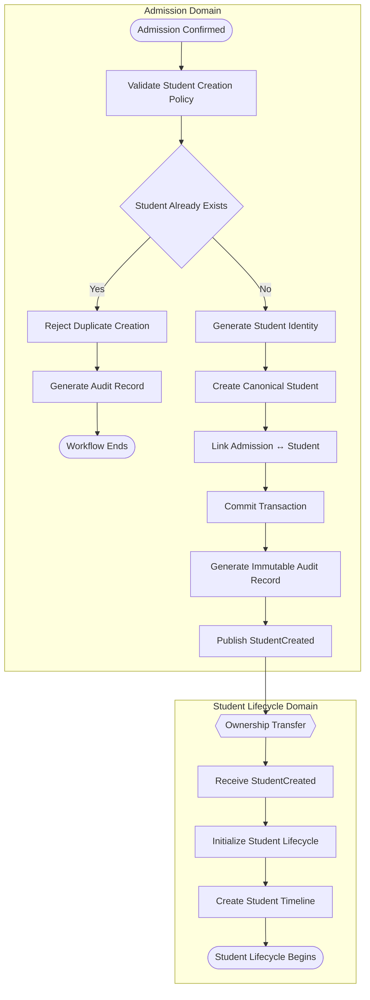

### Workflow Characteristics

- Executes only after successful **Admission Confirmation**.
- Student creation is **exactly-once** and idempotent.
- Student identity is generated before persistence.
- Admission and Student are linked through immutable identifiers.
- The transaction is committed before publishing any domain events.
- Ownership transfers immediately after the `StudentCreated` event is published.

### Published Event

- `StudentCreated`

### Consuming Domain

- **L2-C02 – Student Lifecycle**

### Architectural Constraints

- The Admission Domain never manages the Student lifecycle after creation.
- Duplicate Student creation is prohibited.
- Historical Admission records remain immutable.
- Student identity is globally unique within the tenant.
- All operations are fully auditable.

20.7 Multi-Domain Sequence
## 20.7 Multi-Domain Sequence

The following sequence diagram illustrates the canonical interaction between the Admission Domain and its collaborating domains during the end-to-end Admission process.

It distinguishes synchronous service interactions from asynchronous domain events while preserving bounded context ownership.

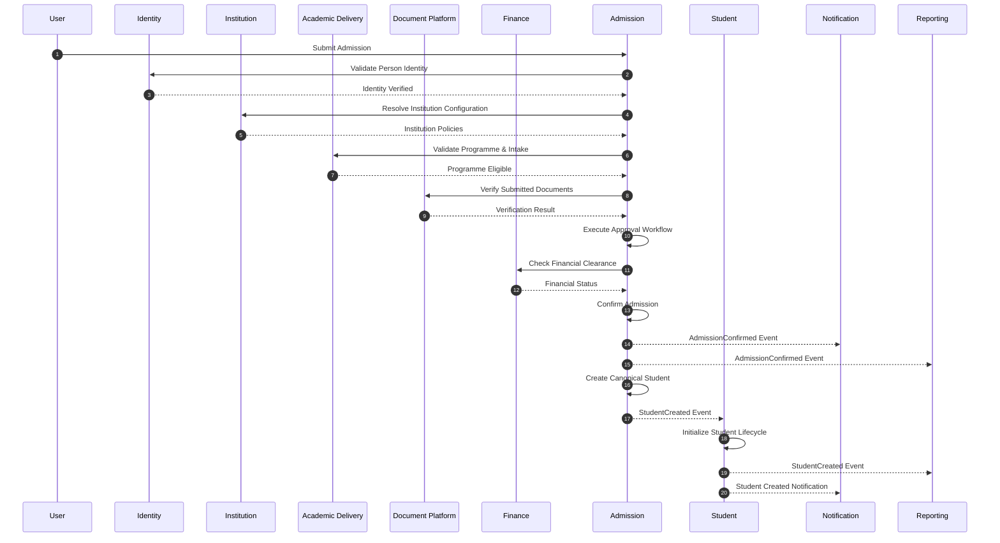

### Interaction Characteristics

| Interaction | Type |
|-------------|------|
| Identity Validation | Synchronous Service |
| Institution Policy Resolution | Synchronous Service |
| Programme Validation | Synchronous Service |
| Document Verification | Synchronous Service |
| Financial Clearance Lookup | Synchronous Service |
| Admission Confirmation | Local Transaction |
| Student Creation | Local Transaction |
| AdmissionConfirmed | Asynchronous Domain Event |
| StudentCreated | Asynchronous Domain Event |

### Architectural Principles

- Each domain owns its own data.
- No domain directly updates another domain's database.
- Multi-domain communication occurs through service contracts or immutable domain events.
- Domain events are published only after successful transaction commit.
- The Admission Domain remains the orchestration boundary until `StudentCreated`.
- Ownership transfers to the Student Lifecycle domain immediately after the `StudentCreated` event.

20.8 Event Flow
## 20.8 Event Flow

The following diagram illustrates the canonical domain events published by the Admission Domain and the bounded contexts that consume them.

Only externally visible domain events are represented. Internal workflow events remain implementation details within the Admission Domain.

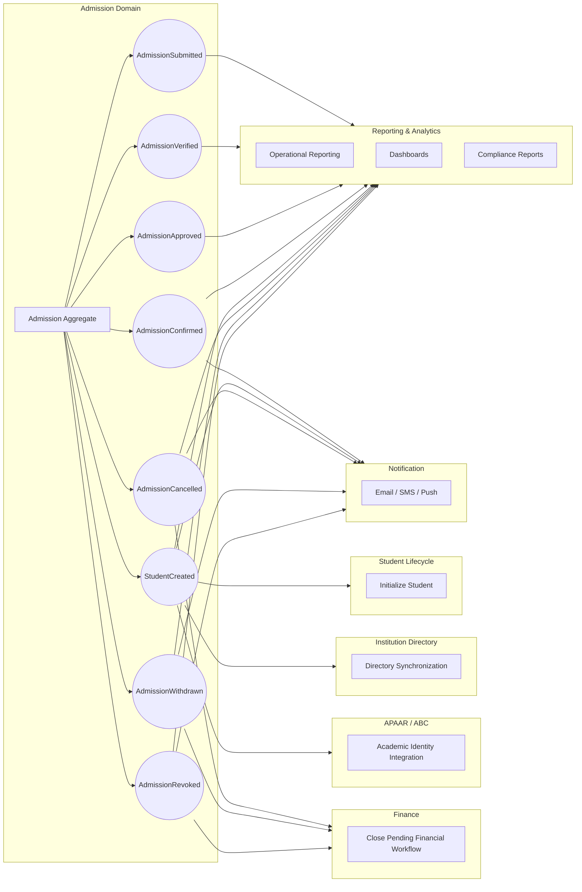

### Published Domain Events

| Event | Purpose |
|---------|----------|
| AdmissionSubmitted | Admission officially submitted |
| AdmissionVerified | Verification successfully completed |
| AdmissionApproved | Institutional approval completed |
| AdmissionConfirmed | Admission finalized |
| StudentCreated | Canonical Student successfully created |
| AdmissionCancelled | Admission cancelled |
| AdmissionWithdrawn | Applicant withdrew admission |
| AdmissionRevoked | Admission revoked administratively |

### Event Architecture Principles

- Events are immutable.
- Events are published only after successful transaction commit.
- Events never modify another bounded context directly.
- Consumer domains own all post-processing.
- Failed consumers do not affect Admission transaction completion.
- Event replay must remain idempotent.
- Every published event includes Correlation ID, Tenant ID, Aggregate ID, Event Version, Timestamp, and Audit Metadata.

### Event Ownership

| Producer | Owner |
|-----------|-------|
| AdmissionSubmitted | Admission Domain |
| AdmissionVerified | Admission Domain |
| AdmissionApproved | Admission Domain |
| AdmissionConfirmed | Admission Domain |
| StudentCreated | Admission Domain |
| AdmissionCancelled | Admission Domain |
| AdmissionWithdrawn | Admission Domain |
| AdmissionRevoked | Admission Domain |

20.9 Dependency Graph
## 20.9 Dependency Graph

The following dependency graph illustrates the architectural dependencies of the Admission Domain.

It distinguishes synchronous service dependencies from asynchronous event-driven integrations while preserving bounded context ownership.

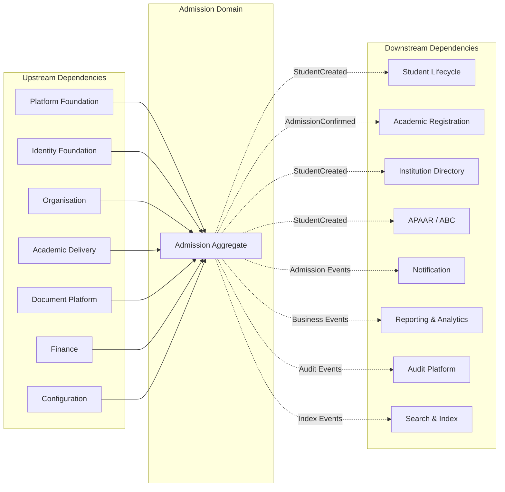

### Dependency Classification

| Domain | Dependency Type | Required |
|----------|----------------|----------|
| Platform Foundation | Service | Yes |
| Identity Foundation | Service | Yes |
| Organisation | Service | Yes |
| Academic Delivery | Service | Yes |
| Document Platform | Service | Yes |
| Finance | Service | Yes |
| Configuration | Service | Yes |
| Student Lifecycle | Domain Event | Yes |
| Academic Registration | Domain Event | Yes |
| Institution Directory | Domain Event | Optional |
| APAAR / ABC | Domain Event | Optional |
| Notification | Domain Event | Optional |
| Reporting & Analytics | Domain Event | Yes |
| Audit Platform | Domain Event | Yes |
| Search & Index | Domain Event | Optional |

### Architectural Constraints

- Admission owns no external data.
- All synchronous dependencies are read-only service interactions.
- Multi-domain database access is prohibited.
- Downstream domains consume immutable domain events.
- Event consumers must be independently deployable.
- Optional integrations shall never block Admission processing.
- Dependency inversion is enforced through canonical service contracts and event contracts.

20.10 Service Interaction
## 20.10 Service Interaction

The following diagram illustrates the internal service interactions within the Admission Domain following Clean Architecture and Domain-Driven Design principles.

The diagram demonstrates how requests flow through the application layer, domain layer, infrastructure layer, and event infrastructure while maintaining strict separation of concerns.

```mermaid
flowchart TD

%% ==========================================================
%% External Actors
%% ==========================================================

Client["Portal / ERP UI / API Client"]

%% ==========================================================
%% Application Layer
%% ==========================================================

subgraph APP["Application Layer"]

API["Admission API"]

APPSERVICE["Admission Application Service"]

end

%% ==========================================================
%% Domain Layer
%% ==========================================================

subgraph DOMAIN["Domain Layer"]

AGG["Admission Aggregate"]

DOMAINSERVICE["Admission Domain Service"]

POLICY["Admission Policy Engine"]

end

%% ==========================================================
%% Infrastructure Layer
%% ==========================================================

subgraph INFRA["Infrastructure Layer"]

REPO["Admission Repository"]

EVENTBUS["Event Publisher"]

AUDIT["Audit Service"]

end

%% ==========================================================
%% External Services
%% ==========================================================

subgraph EXT["External Domain Services"]

IDENTITY["Identity Service"]

ACADEMIC["Academic Service"]

FINANCE["Finance Service"]

DOCUMENT["Document Service"]

end

%% ==========================================================
%% Downstream Consumers
%% ==========================================================

subgraph CONSUMERS["Event Consumers"]

STUDENT["Student Lifecycle"]

NOTIFY["Notification"]

REPORT["Reporting"]

end

%% ==========================================================
%% Request Flow
%% ==========================================================

Client

--> API

--> APPSERVICE

--> DOMAINSERVICE

--> POLICY

--> AGG

%% ==========================================================
%% External Validation
%% ==========================================================

APPSERVICE --> IDENTITY

APPSERVICE --> ACADEMIC

APPSERVICE --> FINANCE

APPSERVICE --> DOCUMENT

%% ==========================================================
%% Persistence
%% ==========================================================

AGG --> REPO

REPO --> AUDIT

REPO --> EVENTBUS

%% ==========================================================
%% Event Distribution
%% ==========================================================

EVENTBUS --> STUDENT

EVENTBUS --> NOTIFY

EVENTBUS --> REPORT
```

### Service Responsibilities

| Layer | Responsibility |
|---------|----------------|
| Admission API | Receives external requests |
| Application Service | Coordinates use cases and transactions |
| Domain Service | Executes business rules that span aggregates |
| Admission Aggregate | Enforces business invariants and state transitions |
| Admission Policy Engine | Evaluates configurable institutional policies |
| Repository | Persists aggregate state |
| Audit Service | Records immutable audit trails |
| Event Publisher | Publishes committed domain events |
| External Domain Services | Provide validation and reference data |
| Event Consumers | React independently to published events |

### Architectural Principles

- Controllers contain no business logic.
- Application Services orchestrate use cases.
- Business rules reside exclusively within the Domain Layer.
- Aggregates enforce transactional consistency.
- External domains are accessed only through service contracts.
- Repository commits precede event publication.
- Audit logging occurs as part of the successful transaction.
- Downstream domains consume immutable domain events asynchronously.

20.11 Audit Flow
## 20.11 Audit Flow

The following diagram illustrates how significant Admission operations generate immutable audit records throughout the Admission lifecycle.

Audit generation is an integral part of every successful business transaction and provides complete traceability for compliance, governance, and forensic analysis.

```mermaid
flowchart TD

%% ==========================================================
%% Business Request
%% ==========================================================

A([Admission Operation])

--> B[Application Service]

--> C[Execute Domain Logic]

--> D[Admission Aggregate]

%% ==========================================================
%% Transaction
%% ==========================================================

D --> E[Persist Aggregate]

E --> F[Commit Transaction]

%% ==========================================================
%% Audit Generation
%% ==========================================================

F --> G[Generate Audit Record]

G --> H[Capture Audit Metadata]

H --> I[Persist Immutable Audit Log]

%% ==========================================================
%% Event Publication
%% ==========================================================

I --> J[Publish Domain Event]

%% ==========================================================
%% Consumers
%% ==========================================================

J --> K[Reporting]

J --> L[Notification]

J --> M[Student Lifecycle]

%% ==========================================================
%% Audit Repository
%% ==========================================================

I --> N[(Central Audit Repository)]
```

### Audit Metadata Captured

| Metadata | Description |
|-----------|-------------|
| Audit ID | Globally unique audit record identifier |
| Tenant ID | Tenant performing the operation |
| Institution ID | Institution context |
| Admission ID | Aggregate identifier |
| Business Operation | Create, Verify, Approve, Confirm, Cancel, etc. |
| Previous State | Aggregate state before change |
| New State | Aggregate state after change |
| Actor ID | User or system initiating the operation |
| Actor Role | Role at the time of execution |
| Timestamp | UTC transaction timestamp |
| Correlation ID | Cross-service request correlation |
| Transaction ID | Transaction identifier |
| Source | Portal, ERP UI, API, Batch Job |
| Event Version | Domain event version |
| Remarks | Optional business comments |

### Audited Business Operations

- Admission Created
- Admission Submitted
- Document Verification
- Admission Approved
- Admission Confirmed
- Student Created
- Admission Cancelled
- Admission Withdrawn
- Admission Revoked
- Readmission Processed
- Administrative Override
- Policy Exception Applied

### Architectural Principles

- Audit records are immutable.
- Audit generation occurs only after successful transaction commit.
- Audit records are never updated or deleted.
- Every domain event is traceable to its originating audit record through the Correlation ID.
- Historical state transitions remain permanently available for governance and compliance.
- Audit infrastructure is shared across all SutraERP bounded contexts while preserving tenant isolation.

20.12 Reporting Flow
## 20.12 Reporting Flow

The following diagram illustrates how Admission business data is transformed into operational dashboards, analytics, statutory reports, and institutional insights without impacting transactional processing.

Reporting is event-driven and consumes immutable business events published by the Admission Domain.

```mermaid
flowchart TD

%% ==========================================================
%% Admission Domain
%% ==========================================================

subgraph AD["Admission Domain"]

A[Admission Aggregate]

end

%% ==========================================================
%% Domain Events
%% ==========================================================

subgraph EV["Published Domain Events"]

E1((AdmissionSubmitted))
E2((AdmissionVerified))
E3((AdmissionApproved))
E4((AdmissionConfirmed))
E5((StudentCreated))
E6((AdmissionCancelled))
E7((AdmissionWithdrawn))
E8((AdmissionRevoked))

end

%% ==========================================================
%% Reporting Infrastructure
%% ==========================================================

subgraph RP["Reporting Infrastructure"]

BUS["Event Bus"]

PROC["Reporting Event Processor"]

STORE["Reporting Data Store"]

end

%% ==========================================================
%% Reporting Consumers
%% ==========================================================

subgraph OUT["Reporting Consumers"]

DASH["Operational Dashboards"]

ANALYTICS["Analytics & BI"]

STAT["Statutory Reports"]

MIS["Management Information System"]

EXPORT["Data Export Services"]

end

%% ==========================================================
%% Event Publication
%% ==========================================================

A --> E1
A --> E2
A --> E3
A --> E4
A --> E5
A --> E6
A --> E7
A --> E8

%% ==========================================================
%% Reporting Pipeline
%% ==========================================================

E1 --> BUS
E2 --> BUS
E3 --> BUS
E4 --> BUS
E5 --> BUS
E6 --> BUS
E7 --> BUS
E8 --> BUS

BUS --> PROC

PROC --> STORE

STORE --> DASH
STORE --> ANALYTICS
STORE --> STAT
STORE --> MIS
STORE --> EXPORT
```

### Reporting Outputs

| Consumer | Purpose |
|-----------|---------|
| Operational Dashboards | Live admission progress monitoring |
| Analytics & BI | Trends, forecasting, conversion analysis |
| Statutory Reports | UGC, AICTE, NAAC, NBA, Government reporting |
| MIS | Institutional management reporting |
| Data Export Services | External reporting and integrations |

### Architectural Principles

- Reporting never queries transactional aggregates directly.
- Reporting models are populated exclusively through immutable domain events.
- Reporting workloads remain isolated from operational transactions.
- Event replay enables reporting model reconstruction.
- Reporting data may be eventually consistent.
- Multiple reporting views can be generated from the same business events.
- Tenant isolation is maintained throughout the reporting pipeline.
- Historical reporting data remains immutable once published.

20.13 Configuration Hierarchy
## 20.13 Configuration Hierarchy

The following diagram illustrates how Admission configuration is resolved through the hierarchical configuration model of SutraERP.

Configuration inheritance enables global standardization while allowing tenant-specific, institution-specific, and programme-specific overrides without duplicating configuration.

```mermaid
flowchart TD

%% ==========================================================
%% Configuration Hierarchy
%% ==========================================================

GLOBAL["Global Platform Configuration"]

TENANT["Tenant Configuration"]

INSTITUTION["Institution Configuration"]

SESSION["Academic Session Configuration"]

PROGRAMME["Programme Configuration"]

ADMISSION["Admission Policy Configuration"]

WORKFLOW["Workflow Resolution"]

%% ==========================================================
%% Resolution Order
%% ==========================================================

GLOBAL

--> TENANT

--> INSTITUTION

--> SESSION

--> PROGRAMME

--> ADMISSION

--> WORKFLOW

%% ==========================================================
%% Policy Consumers
%% ==========================================================

subgraph POLICIES["Resolved Admission Policies"]

P1["Admission Workflow"]

P2["Document Requirements"]

P3["Approval Matrix"]

P4["Financial Clearance Rules"]

P5["Reservation Rules"]

P6["Readmission Rules"]

P7["Student Creation Rules"]

P8["Notification Policies"]

end

WORKFLOW --> P1
WORKFLOW --> P2
WORKFLOW --> P3
WORKFLOW --> P4
WORKFLOW --> P5
WORKFLOW --> P6
WORKFLOW --> P7
WORKFLOW --> P8
```

### Configuration Resolution Order

| Priority | Configuration Scope | Override Allowed |
|-----------|---------------------|------------------|
| 1 | Global Platform | No |
| 2 | Tenant | Yes |
| 3 | Institution | Yes |
| 4 | Academic Session | Yes |
| 5 | Programme | Yes |
| 6 | Admission Policy | Yes |

### Examples of Configurable Policies

- Admission workflow definitions
- Required admission documents
- Verification workflow
- Approval hierarchy
- Financial clearance rules
- Scholarship integration rules
- Reservation and quota policies
- Readmission policies
- Student number generation strategy
- Notification templates
- Integration settings
- Admission validity periods

### Architectural Principles

- Configuration is resolved hierarchically at runtime.
- Lower levels inherit values from higher levels unless explicitly overridden.
- Admission never persists configuration values inside the Admission Aggregate.
- Configuration changes affect future workflow execution without modifying historical admission records.
- Historical admissions retain the policy version that governed their execution.
- Configuration resolution is deterministic, versioned, auditable, and tenant-isolated.

24 Appendix

# 21. Architecture Decisions (ADRs)

## 21.1 Overview

This section documents the major architectural decisions that govern the Admission Domain.

These decisions are considered canonical and shall guide future implementation, maintenance, and architectural evolution.

Architecture Decisions may only be modified through formal architecture governance.

---

# ADR-C01-001 — Admission Owns the Admission Aggregate

**Status:** Accepted

### Decision

The Admission Domain is the sole owner of the Admission aggregate.

### Rationale

Maintains clear ownership boundaries and prevents multi-domain coupling.

### Consequence

No other domain may directly modify Admission business data.

---

# ADR-C01-002 — Student Lifecycle Begins After Admission Confirmation

**Status:** Accepted

### Decision

Student creation occurs only after successful Admission Confirmation.

### Rationale

Applicants and Students represent distinct business entities with independent lifecycles.

### Consequence

Ownership transfers from the Admission Domain to the Student Lifecycle Domain upon successful student creation.

---

# ADR-C01-003 — Event-Driven Multi-Domain Communication

**Status:** Accepted

### Decision

Multi-domain communication shall use immutable Domain Events or canonical service contracts.

### Rationale

Supports loose coupling, scalability, and independent domain evolution.

### Consequence

Direct database access between domains is prohibited.

---

# ADR-C01-004 — Finance Owns Financial Processing

**Status:** Accepted

### Decision

The Admission Domain consumes financial outcomes but never performs financial calculations.

### Rationale

Accounting responsibilities belong exclusively to the Finance Domain.

### Consequence

Admission decisions depend only on Finance-owned clearance results.

---

# ADR-C01-005 — Workflow Engine Orchestrates Processes

**Status:** Accepted

### Decision

Workflow orchestration is delegated to the Workflow Engine.

### Rationale

Separates workflow execution from business ownership.

### Consequence

Admission retains business ownership while Workflow Engine manages execution flow.

---

# ADR-C01-006 — Configuration Over Customization

**Status:** Accepted

### Decision

Institutional differences shall be handled through configuration rather than source-code customization.

### Rationale

Supports maintainability, upgrades, and multi-tenant deployments.

### Consequence

Institution-specific behavior remains policy-driven.

---

# ADR-C01-007 — Immutable Audit History

**Status:** Accepted

### Decision

Audit records shall be append-only and immutable.

### Rationale

Supports compliance, traceability, and forensic investigation.

### Consequence

Historical audit records cannot be modified by business operations.

---

# ADR-C01-008 — Canonical Admission Lifecycle

**Status:** Accepted

### Decision

Every Admission shall follow the lifecycle defined in Section 10.

### Rationale

Provides deterministic workflow execution across all institutions.

### Consequence

State transitions outside the canonical lifecycle are prohibited unless introduced through an approved architecture revision.

---

# ADR-C01-009 — Idempotent Business Operations

**Status:** Accepted

### Decision

Business operations shall support safe retry without creating duplicate business effects.

### Rationale

Improves resilience in distributed systems.

### Consequence

Retries shall not create duplicate Admissions, Students, or audit records.

---

# ADR-C01-010 — Deployment Independence

**Status:** Accepted

### Decision

Business behavior shall remain identical across cloud, hybrid, and on-premises deployments.

### Rationale

Supports multiple deployment strategies without architectural divergence.

### Consequence

Infrastructure decisions shall not influence Admission business rules.

---

# 21.2 Future Architecture Decisions

Future ADRs shall document decisions regarding:

- AI-assisted admission evaluation
- Advanced workflow automation
- Distributed event processing
- Government admission integrations
- International admissions
- Multi-region deployments
- Emerging regulatory requirements

Each new ADR shall include:

- Decision Identifier
- Status
- Context
- Decision
- Rationale
- Consequences

---

# 21.3 Governance

Architecture Decisions are governed through formal architecture review.

No implementation may violate an accepted ADR without an approved replacement decision.

Deprecated ADRs shall remain preserved for historical traceability.

---

# 21.4 Summary

The Architecture Decisions recorded in this section define the foundational design principles of the Admission Domain.

Together, these ADRs establish clear ownership boundaries, lifecycle integrity, deployment independence, and long-term architectural consistency, ensuring that future evolution of the Admission Domain remains aligned with the overall SutraERP architecture.

# 22. Glossary

## 22.1 Overview

This glossary defines the canonical terminology used throughout **L2-C01 — Admissions**.

All terms shall have a single authoritative meaning within the SutraERP architecture. Future architecture documents shall reuse these definitions unless explicitly superseded by an approved Architecture Decision Record (ADR).

---

# 22.2 Business Terms

| Term | Definition |
|------|------------|
| Admission | The institutional process through which an applicant is evaluated and accepted into a programme. |
| Applicant | A person applying for admission to an institution. |
| Student | A person whose admission has been confirmed and whose Student entity has been created in the Student Lifecycle Domain. |
| Admission Lifecycle | The sequence of states governing an Admission from creation until completion or termination. |
| Admission Confirmation | Institutional confirmation that an applicant has successfully completed all admission requirements. |
| Readmission | Restoration or recreation of a previously inactive admission according to institutional policy. |
| Withdrawal | Voluntary termination of a confirmed admission by the applicant. |
| Revocation | Administrative termination of an admission by the institution. |
| Cancellation | Termination of an admission before completion of the admission lifecycle. |

---

# 22.3 Workflow Terms

| Term | Definition |
|------|------------|
| Workflow | A sequence of business activities executed to achieve a defined admission outcome. |
| Workflow Engine | Platform component responsible for orchestrating configurable business workflows. |
| Workflow Instance | A single execution of a workflow. |
| Trigger | Event or action that starts a workflow. |
| State Transition | Movement of an Admission from one lifecycle state to another. |

---

# 22.4 Domain Terms

| Term | Definition |
|------|------------|
| Domain | A bounded business capability within the SutraERP architecture. |
| Aggregate | A consistency boundary owned by a single domain. |
| Domain Event | An immutable business fact published after successful completion of a business operation. |
| Service Contract | The canonical business interface exposed by a domain. |
| Domain Ownership | Exclusive responsibility of a domain for its business entities and rules. |

---

# 22.5 Technical Terms

| Term | Definition |
|------|------------|
| RBAC | Role-Based Access Control governing authorization decisions. |
| Idempotency | Property whereby repeated execution produces the same business outcome. |
| Correlation ID | Unique identifier used to trace a request across multiple workflows and domains. |
| Tenant | An isolated institution operating within the SutraERP platform. |
| Audit Record | Immutable record of a completed business operation. |
| Policy | Institution-configurable rule influencing workflow execution without changing core architecture. |
| Configuration | Institution-specific settings controlling supported business behavior. |

---

# 22.6 Multi-Domain Terms

| Term | Owning Domain |
|------|-----------------------------|
| Admission | Admission Domain |
| Student | Student Lifecycle Domain |
| Institution | Institution Domain |
| Programme | Academic Delivery Domain |
| Financial Clearance | Finance Domain |
| Audit Record | Audit Platform |
| User Identity | Platform Foundation |

---

# 22.7 Acronyms

| Acronym | Meaning |
|----------|-----------------------------------------|
| ADR | Architecture Decision Record |
| API | Application Programming Interface |
| BI | Business Intelligence |
| NFR | Non-Functional Requirement |
| RBAC | Role-Based Access Control |
| SLA | Service Level Agreement |
| UTC | Coordinated Universal Time |
| UUID | Universally Unique Identifier |

---

# 22.8 Naming Conventions

The Admission Domain adopts the following naming conventions:

| Artifact | Convention |
|----------|-----------------------------|
| Domain | L2-C01 |
| Workflow | WF-C01-XX |
| Business Rule | BR-C01-XXX |
| Event | AdmissionPastTense |
| ADR | ADR-C01-XXX |
| Constraint | CATEGORY-C01-XXX |

---

# 22.9 Glossary Governance

- Definitions shall remain consistent across all SutraERP architecture documents.
- New terms shall be introduced only through architecture governance.
- Existing definitions shall not be redefined without an approved ADR.
- Domain ownership terminology shall remain authoritative.

---

# 22.10 Summary

This glossary establishes the canonical vocabulary for the Admission Domain.

By standardizing terminology across workflows, business rules, integrations, and architecture documents, it ensures consistent interpretation, reduces ambiguity, and supports long-term maintainability of the SutraERP architecture repository.

# 23. References & Dependencies

## 23.1 Overview

This section identifies the architectural dependencies, referenced documents, upstream domains, downstream consumers, and governance artifacts required for the Admission Domain.

The purpose of this section is to ensure architectural traceability across the SutraERP repository.

---

# 23.2 Upstream Dependencies

The Admission Domain depends on the following domains before admission processing can be completed.

| Domain | Dependency | Purpose |
|----------|-----------------------------|---------------------------------------------|
| L2-A01 | Platform Foundation | Authentication, Authorization, Tenant Context |
| L2-B01 | Institution & Structure | Institution, Campus, Department Hierarchy |
| L2-D01 | Academic Delivery | Programme, Session, Intake, Eligibility |
| L2-F01 | Finance | Financial Clearance |
| Workflow Engine | Workflow Orchestration | Approval Routing & Policy Execution |
| Document Platform | Document Services | Document Storage & Verification |

Admission shall consume—but never own—these business capabilities.

---

# 23.3 Downstream Consumers

The following domains consume Admission outputs.

| Consumer Domain | Consumed Information |
|-----------------|--------------------------------|
| L2-C02 — Student Lifecycle | StudentCreated |
| Finance | AdmissionApproved |
| Academic Delivery | StudentCreated |
| Notification Services | Admission Events |
| Analytics Platform | Business Events |
| Audit Platform | Audit Records |

---

# 23.4 Referenced Architecture Documents

This document references the following architecture artifacts.

| Document | Purpose |
|-----------|------------------------------------------|
| Architecture Index | Repository navigation |
| Dependency Map | Multi-domain dependency graph |
| L2-A01 | Platform Foundation |
| L2-B01 | Institution & Structure |
| L2-C02 | Student Lifecycle (Downstream) |
| L2-D01 | Academic Delivery |
| L2-F01 | Finance |
| Architecture Governance Standards | Repository standards |

---

# 23.5 Dependency Principles

Admission dependencies shall follow these principles:

- Dependencies shall be explicit.
- Circular dependencies are prohibited.
- Domain ownership shall remain preserved.
- Multi-domain communication shall use canonical contracts.
- Integration contracts shall remain versioned.
- Dependency changes require architecture review.

---

# 23.6 Repository Traceability

The Admission Domain contributes the following repository artifacts:

| Artifact | Identifier Pattern |
|-----------|--------------------|
| Workflows | WF-C01-XX |
| Business Rules | BR-C01-XXX |
| Domain Events | Admission* |
| Architecture Decisions | ADR-C01-XXX |
| Service Contracts | SC-C01-XXX |
| Validation Rules | VAL-C01-XXX |
| Constraints | *-C01-XXX |

These identifiers shall remain stable across future architecture revisions.

---

# 23.7 Versioning

This document shall follow repository version governance.

| Attribute | Value |
|------------|--------------------------------------------|
| Architecture Level | Level 2 |
| Domain | Admissions |
| Document ID | L2-C01 |
| Version | v1.0 |
| Status | 🔒 LOCKED |
| Change Control | Architecture Governance Process |

Future revisions shall increment the document version while preserving historical versions.

---

# 23.8 Future Extensions

Future architecture revisions may extend this document to support:

- International Admissions
- Exchange Program Admissions
- AI-assisted Eligibility Evaluation
- Government Admission Portals
- Multi-round Admission Campaigns
- Distributed Admission Processing
- Advanced Analytics Integration

All extensions shall preserve the canonical architecture defined in this document.

---

# 23.9 Architecture Governance

Changes to this document require:

- Architecture review
- Multi-domain dependency validation
- Backward compatibility assessment
- ADR approval (where applicable)
- Repository version update

No modification shall violate accepted architecture decisions or domain ownership principles.

---

# 23.10 Completion Statement

**L2-C01 — Admissions** defines the canonical architecture for managing the complete Admission lifecycle within the SutraERP platform.

It establishes domain ownership, lifecycle management, workflows, business rules, integrations, service contracts, validation, security, reporting, audit, configuration, and governance required for repository-grade implementation.

This document serves as the authoritative architectural contract for the Admission Domain and forms the upstream foundation for **L2-C02 — Student Lifecycle & Activation**, where ownership transitions from **Applicant** to **Student** after successful Admission Confirmation and Student creation.

---

# End of Document

**Document ID:** L2-C01 — Admissions  
**Architecture Level:** Level 2  
**Version:** v1.0  
**Status:** 🔒 LOCKED  
