# L2-C02 — Student Lifecycle & Activation Workflows

**Section:** C — Student Lifecycle  
**Architecture Level:** Level 2 (Domain Architecture)  
**Status:** Locked  
**Document Owner:** Student Lifecycle — Activation  

**Depends On:**
- L2-A01 — Platform Foundation
- L2-B01 — Institution & Structure
- L2-C01 — Admissions

**Used By:**
- L2-D01 — Course & Course Offering Workflows
- L2-D04 — Teaching Session & Attendance Workflows
- L2-I01 — Examination Policy & Configuration Workflows
- L2-F01 — Student Charge & Fee Management
- L2-G03 — Hostel Management Workflows
- L2-G05 — Library Management Workflows
- L2-G04 — Transport Management Workflows
- L2-H04 — Placement Workflows
- L2-C08 — Alumni Transition Workflows
- L2-C06 — Guardian Workflows
- Analytics & Reporting

---

## Canonical Section Crosswalk

> Added 2026-08-04 under integrity finding INT-018. `governance/constitution/Volume_3_Architecture_Framework.md` section 18 requires every L2 document to define eleven sections. This document uses its own numbered-section convention; the table below maps the required sections to where they actually live. No content was moved.

| Required section (Volume 3 §18) | Location in this document |
|---|---|
| Purpose | §1.1 Purpose; WF-C02-11.2 Purpose; WF-C02-12.2 Purpose |
| Scope | §4 Domain Scope; §25.2 Scope Confirmation; §1.6 Out of Scope |
| Actors | WF-C02-11.4 Primary Actors; WF-C02-12.4 Primary Actors; WF-C02-13.4 Primary Actors |
| Entities | §6 Student Aggregate Model; §6.2 Aggregate Root; §6.3 Aggregate Composition |
| Business Rules | §9 Business Rules; §17.5 Business Rule Exceptions; §9.13 Student Document Request Business Rules |
| Workflow | §7 Core Workflows; §7.2 Workflow Catalogue; §7.3 Workflow Dependencies |
| State Machine | §22.7 ADR-C02-006 — Lifecycle Controlled Through Canonical State Machine |
| Contracts | §12 Service Contracts; §12.2 Service Contract Principles; §12.8 Canonical Error Contracts |
| Events | §10 Domain Events; §10.2 Event Publishing Principles; §10.3 Event Catalogue |
| Dependencies | §7.3 Workflow Dependencies; §14.3 Upstream Dependencies; §21.28 Architecture Dependency Graph |
| Locked Decisions | §22 Architecture Decision Records (ADR); Decision |

---

# 1. Overview

## 1.1 Purpose

The Student Lifecycle Domain is the canonical owner of the **Student Aggregate** within SutraERP.

This domain governs the complete lifecycle of a student beginning immediately after successful admission confirmation and continuing until the student's relationship with the institution permanently ends.

Unlike the Admission Domain, which manages applicants, this domain manages officially enrolled students and their institutional identity.

The Student Domain acts as the central master record upon which nearly every academic and administrative domain depends.

---

## 1.2 Business Context

Once an applicant successfully completes the Admission Lifecycle (L2-C01), ownership of the individual transfers from the Admission Domain to the Student Lifecycle Domain.

At this point:

- Applicant becomes Student.
- Permanent Student Identity is established.
- Institutional relationship begins.
- StudentContext is established.
- Academic and administrative lifecycle begins within the StudentContext.
- Student becomes eligible for downstream services.

Every subsequent academic operation—including attendance, examinations, finance, hostel allocation, library membership, transport allocation, placement activities, and alumni transition—depends upon the Student aggregate managed by this domain.

---

## 1.3 Domain Mission

The Student Lifecycle Domain provides:

- Canonical Student Identity
- Student Lifecycle Management
- Institutional Enrollment
- Student Status Management
- Programme Association
- Academic Relationship Management
- Administrative Activation
- Cross-domain Student Master Data

It intentionally does **not** own academic teaching, finance, attendance, examinations, hostel operations, or library transactions.

Those remain the responsibility of their respective domains.

---

## 1.4 Architectural Position

```text
Admission (Applicant)

        │
AdmissionConfirmed
StudentCreated
        │
        ▼

Student Lifecycle (THIS DOMAIN)

        │
        ├── Academic Delivery
        ├── Attendance
        ├── Finance
        ├── Examination
        ├── Hostel
        ├── Library
        ├── Transport
        ├── Placement
        ├── Alumni
        └── Analytics
```

The Student Domain becomes the authoritative source of Student information for the entire ERP.

> **Post-creation admission revocation, approved 2026-08-17 (CF-06).** C01 Admissions owns the revocation decision and publishes `AdmissionRevoked`. When a Student Context already exists, this domain consumes the event and routes the C02-owned Student Context through the existing `WF-C02-10` / `ArchiveStudent()` path according to institutional policy. The Student Context and its complete history are archived, not physically deleted, and ownership does not transfer back to Admissions.

> **Programme migration boundary, approved 2026-08-17 (C-C02, Option B).** L2-C04 APW-08 exclusively owns Programme-changing mobility, including its eligibility, curriculum mapping, credit mapping, approval, and canonical `ProgrammeMigrationApproved` outcome. WF-C02-08 excludes Programme change and remains limited to non-Programme organisational or placement transfer. C02 retains Student Context ownership and consumes `ProgrammeMigrationApproved` only to apply the approved Programme association to that context; it does not make or republish the migration decision.

---

## 1.5 Domain Responsibilities

The Student Lifecycle Domain is responsible for:

- Student creation
- Student activation
- Student identity management
- Enrollment lifecycle
- Programme association
- Batch assignment
- Section assignment
- Student status transitions
- Student archival
- Student transfer (institutional policy)
- Student suspension
- Student restoration
- Student qualification completion handoff
- Student exit management

---

## 1.6 Out of Scope

The Student Lifecycle Domain does **not** perform:

- Admission processing
- Applicant management
- Fee calculation
- Accounting
- Attendance calculation
- Examination processing
- Timetable management
- Library circulation
- Hostel allocation
- Transport scheduling
- HR operations

These remain owned by their respective domains.

---

# 2. Architecture Objectives

The Student Lifecycle architecture shall:

- Establish a single canonical Student identity.
- Prevent duplicate Student creation.
- Maintain complete lifecycle history.
- Support configurable institutional policies.
- Preserve domain ownership.
- Enable downstream academic domains.
- Support event-driven integration.
- Maintain immutable historical records.
- Ensure idempotent lifecycle operations.
- Remain deployment independent.

---

# 3. Architectural Principles

The Student Lifecycle Domain follows these foundational principles:

### SP-001

Student is the canonical master entity after Admission.

---

### SP-002

A Student shall originate only from a successful Admission.

---

### SP-003

Student identifiers are immutable.

---

### SP-004

- A Student shall have a single canonical Student Aggregate representing the student persona.

- A Student may own multiple historical StudentContexts across institutional history.

- At most one StudentContext may be Active within a given Institute at any point in time.

---

### SP-005

Student lifecycle is independent from Admission lifecycle after ownership transfer.

---

### SP-006

Academic domains consume Student information but do not own it.

---

### SP-007

Student lifecycle transitions shall be deterministic.

---

### SP-008

Every lifecycle transition shall generate immutable audit records.

---

### SP-009

Every lifecycle transition shall publish canonical domain events.

---

### SP-010

Historical Student records shall never be physically deleted.

---

# 4. Domain Scope

## Included

- Student Creation
- Student Activation
- Student Identity
- Enrollment
- Programme Assignment
- Batch Assignment
- Section Assignment
- Status Management
- Student Suspension
- Student Restoration
- Student Transfer
- Student Exit
- Qualification Completion Handoff
- Student Archive

---

## Excluded

- Admissions
- Applicant Records
- Academic Teaching
- Attendance Processing
- Fee Accounting
- Hostel Management
- Library Operations
- Examination Processing
- Placement Operations
- Alumni Management

---

# 5. Domain Ownership

| Business Capability | Owner |
|----------------------|----------------------------|
| Student Master | Student Lifecycle |
| Student Identity | Student Lifecycle |
| Student Status | Student Lifecycle |
| Enrollment | Student Lifecycle |
| Programme Association | Student Lifecycle |
| Batch Assignment | Student Lifecycle |
| Section Assignment | Student Lifecycle |
| Student Lifecycle | Student Lifecycle |

The Student Lifecycle Domain is the exclusive owner of the Student Aggregate and the associated StudentContext.

The Student Aggregate represents the canonical student persona.

The StudentContext represents the student's academic and institutional relationship with a specific Institute and owns the academic lifecycle.

No downstream domain may directly modify Student master information or StudentContext lifecycle information except through approved architecture contracts.

---
# 6. Student Aggregate Model

## 6.1 Overview

The **Student Aggregate** is the canonical business entity representing an individual who has successfully completed the admission process and has entered the institution as an official student.

The Student Aggregate serves as the single source of truth for all downstream academic and administrative domains.

No downstream domain shall duplicate or own Student master information.

---

# 6.2 Aggregate Root

```
Student
```

The Student entity is the Aggregate Root.

All lifecycle operations shall originate through this aggregate.

No child entity may be modified independently.

---

# 6.3 Aggregate Composition

```
Student
├── Student Identity
├── Enrollment
├── Academic Assignment
├── Lifecycle Status
├── Institutional Association
├── Student Contacts
├── Guardian Information
├── Category Information
├── Reservation Information
├── Disability Information
├── Government Identifiers
├── Communication Preferences
├── Student Flags
├── Audit Information
└── Domain Events
```

---

# 6.4 Aggregate Components

## Student Identity

Represents the permanent institutional identity.

Contains:

- Student ID
- Enrollment Number
- Roll Number
- Registration Number
- University Registration Number
- Identity Type
- Identity Status

Identity values may follow institution-configurable numbering policies.

---

## Enrollment

Represents the student's institutional enrollment.

Contains:

- Admission Reference
- Admission Session
- Admission Date
- Enrollment Date
- Current Academic Session
- Current Semester
- Current Year
- Enrollment Type

---

## Academic Assignment

Represents academic placement.

Contains:

- Programme
- Department
- Faculty
- Campus
- Batch
- Division
- Section
- Mentor
- Advisor

Academic Delivery owns curriculum.

Student Lifecycle owns assignment.

---

## Lifecycle Status

Represents the student's current institutional state.

Contains:

- Current Status
- Effective Date
- Previous Status
- Status Reason
- Suspension Flag
- Exit Flag
- Qualification Completion Flag

---

## Institutional Association

Represents institutional ownership.

Contains:

- Institution
- Campus
- Branch
- Organization Unit
- Tenant

---

## Student Contacts

Contains:

- Mobile Numbers
- Email Addresses
- Emergency Contacts
- Permanent Address
- Current Address

Contact management remains part of Student Master.

---

## Guardian Information

Contains:

- Father
- Mother
- Guardian
- Guardian Contact
- Guardian Occupation
- Guardian Relationship

---

## Category Information

Contains institution-specific classification.

Examples:

- Gender
- Category
- Religion
- Nationality
- Blood Group
- Caste
- Minority Status

These are configurable according to institutional policies.

---

## Reservation Information

Contains:

- Reservation Category
- Quota
- Scholarship Eligibility
- Reservation Documents

Applicable only where institution policy requires.

---

## Disability Information

Contains:

- Disability Status
- Disability Category
- Accessibility Requirements
- Medical Support Indicators

---

## Government Identifiers

Contains identifiers required by regulations.

Examples:

- Aadhaar
- National Identity
- Passport
- Visa
- Social Security Number
- Other Government IDs

Fields remain configurable by country.

---

## Communication Preferences

Contains:

- Preferred Language
- Notification Preference
- Email Consent
- SMS Consent
- Portal Consent
- Mobile App Preference

---

## Student Flags

Represents operational indicators.

Examples:

- International Student
- Hostel Resident
- Transport User
- Scholarship Holder
- Placement Eligible
- Alumni Eligible
- Library Active

Flags do not transfer ownership.

They only expose operational state.

---

## Audit Information

Contains:

- Created By
- Created Date
- Modified By
- Modified Date
- Version
- Correlation ID
- Source System

---

## Domain Events

Stores pending business events generated by lifecycle operations.

Events remain immutable.

---

# 6.5 Aggregate Ownership Rules

The Student Aggregate owns:

- Student Identity
- Enrollment
- Student Status
- Academic Assignment
- Student Contact Information
- Guardian Information
- Lifecycle Information

It shall never own:

- Attendance
- Marks
- Fees
- Hostel Rooms
- Library Transactions
- Examination Results
- Payroll
- Placement Records

These remain owned by their respective domains.

---

# 6.6 Aggregate Invariants

The following invariants shall always hold true:

- Every Student shall have exactly one Student ID.
- Every Student shall originate from an Admission.
- Student ID shall never change.
- Student ownership shall remain within this domain.
- Status transitions shall follow the canonical lifecycle.
- Historical lifecycle information shall remain immutable.
- Deleted students shall never be physically removed.
- Duplicate active Student identities are prohibited.
- Every aggregate modification shall produce an audit record.
- Cross-domain updates shall occur only through approved contracts.

---

# 6.7 Aggregate Lifecycle

```
AdmissionConfirmed
        │
        ▼
Student Created
        │
        ▼
Student Activated
        │
        ▼
Academic Lifecycle
        │
        ├── Promotion
        ├── Suspension
        ├── Restoration
        ├── Transfer
        ├── Qualification Completion
        └── Exit
```

The Student Aggregate represents the canonical Student persona.

The academic and institutional lifecycle is owned by the associated StudentContext.
Each StudentContext represents a student's relationship with a specific Institute and progresses independently through the institutional lifecycle.
A Student may have multiple historical StudentContexts; however, at most one StudentContext may be Active for a given Institute at any point in time.
The Student Aggregate remains the canonical identity anchor, while StudentContext owns institutional lifecycle progression, qualification completion, transfer, withdrawal, and other academic state transitions.

---

# 6.8 Summary

The Student Aggregate establishes the canonical master record representing the student persona within SutraERP.
The associated StudentContext owns the student's institutional relationship, academic assignment, and lifecycle state for a specific Institute.
Together, the Student Aggregate and StudentContext provide the authoritative model consumed by downstream domains through approved architecture contracts without transferring ownership.


# 7. Core Workflows

## 7.1 Overview

The Student Lifecycle Domain governs the complete lifecycle of a student after ownership has transferred from the Admission Domain.

Each workflow represents a major business capability that modifies the Student Aggregate while preserving architectural consistency, auditability, and domain ownership.

All workflows shall:

- Execute through approved service contracts.
- Produce immutable audit records.
- Publish canonical domain events.
- Enforce lifecycle validation.
- Support idempotent execution.
- Respect authorization policies.
- Maintain aggregate consistency.

---

# 7.2 Workflow Catalogue

| Workflow ID | Workflow | Purpose |
|-------------|-----------------------------------------|-------------------------------------------|
| WF-C02-01 | Student Creation | Create Student from confirmed Admission |
| WF-C02-02 | Student Activation | Activate newly created Student |
| WF-C02-03 | Student Enrollment Update | Update enrollment information |
| WF-C02-04 | Academic Assignment | Assign programme, batch and section |
| WF-C02-05 | Student Status Change | Change lifecycle status |
| WF-C02-06 | Student Suspension | Temporarily suspend student |
| WF-C02-07 | Student Restoration | Restore suspended student |
| WF-C02-08 | Student Transfer | Transfer student between non-Programme organisational or placement dimensions |
| WF-C02-09 | Qualification Completion Handoff | Transfer ownership towards Alumni |
| WF-C02-10 | Student Exit / Archive | Complete institutional relationship |

---

# 7.3 Workflow Dependencies

```text
AdmissionConfirmed
        │
        ▼
WF-C02-01 Student Creation
        │
        ▼
WF-C02-02 Student Activation
        │
        ▼
WF-C02-03 Enrollment Update
        │
        ▼
WF-C02-04 Academic Assignment
        │
        ▼
Student Active
        │
        ├──────────────┐
        │              │
        ▼              ▼
Status Change     Transfer
        │              │
        ▼              ▼
 Suspension      Restoration
        │              │
        └──────┬───────┘
               ▼
      Qualification Completion / Exit
               │
               ▼
            Archive
```

---

# 7.4 Workflow Characteristics

Every workflow shall satisfy the following architectural characteristics:

| Characteristic | Requirement |
|---------------|-------------|
| Atomic | Business transaction completes entirely or rolls back |
| Idempotent | Safe retry without duplicate business effects |
| Auditable | Every execution generates immutable audit records |
| Authorized | RBAC enforced before execution |
| Observable | Domain events published after completion |
| Versioned | Workflow definition is version controlled |
| Configurable | Institution policies influence execution where permitted |

---

# 7.5 Canonical Workflow Sequence

The canonical lifecycle is:

1. Student Creation
2. Student Activation
3. Enrollment Assignment
4. Academic Assignment
5. Active Student Lifecycle
6. Suspension / Restoration (optional)
7. Transfer (optional)
8. Qualification Completion or Exit
9. Archive

Institutions may configure intermediate approval stages but shall not violate this lifecycle sequence.

---

# 7.6 Workflow Ownership

The Student Lifecycle Domain owns all workflows that modify the Student Aggregate.

Downstream domains may invoke these workflows through approved service contracts but shall never execute lifecycle transitions directly.

---

# 7.7 Cross-Domain Participation

| Workflow | External Domain Participation |
|----------|-------------------------------|
| Student Creation | Admissions |
| Student Activation | Identity Platform |
| Enrollment Update | Academic Delivery |
| Academic Assignment | Academic Delivery |
| Status Change | Multiple Domains (Read-only consumers) |
| Suspension | Finance / Discipline (policy dependent) |
| Restoration | Finance / Administration (policy dependent) |
| Transfer | Institution & Structure |
| Qualification Completion Handoff | Academic Delivery / Examination |
| Exit / Archive | Alumni / Analytics / Audit |

Cross-domain participation shall occur only through canonical service contracts and domain events.

---

# 7.8 Workflow Governance

Every workflow defined in this domain shall include:

- Workflow Definition
- Workflow Behaviour
- Preconditions
- Postconditions
- Business Rules
- State Transitions
- Domain Events
- Service Contracts
- Authorization
- Exception Handling
- Audit Requirements
- Architecture Contracts

Each workflow specification shall be treated as an independent architectural contract.

---

# 7.9 Detailed Workflow Specifications

The following sections define each workflow in detail.

- **WF-C02-01 — Student Creation**
- **WF-C02-02 — Student Activation**
- **WF-C02-03 — Student Enrollment Update**
- **WF-C02-04 — Academic Assignment**
- **WF-C02-05 — Student Status Change**
- **WF-C02-06 — Student Suspension**
- **WF-C02-07 — Student Restoration**
- **WF-C02-08 — Student Transfer**
- **WF-C02-09 — Qualification Completion Handoff**
- **WF-C02-10 — Student Exit / Archive**
- **WF-C02-11 — Student Document & Certificate Request**

Each workflow shall follow the standardized repository template established across all Level 2 domains.

---

# 7.10 Summary

The Core Workflows of the Student Lifecycle Domain define the authoritative business processes that govern the Student Aggregate from creation through archival. They establish consistent lifecycle management, enforce domain ownership, and provide standardized integration points for every downstream academic and administrative module within the SutraERP ecosystem.

# 8. Workflow Specifications

## 8.1 Overview

This section defines the detailed workflow specifications governing the Student Lifecycle Domain.

Each workflow represents a canonical business process responsible for creating, activating, maintaining, or terminating the institutional lifecycle of a Student.

Every workflow shall conform to the standard SutraERP workflow architecture:

1. Workflow Definition
2. Workflow Behaviour
3. Architecture Contracts
4. Governance

---

# WF-C02-01 — Student Creation

## 1. Workflow Definition

### Purpose

Create the canonical Student Aggregate immediately after successful Admission Confirmation.

Ownership transfers from the Admission Domain to the Student Lifecycle Domain during this workflow.

### Trigger

The workflow is initiated upon consumption of the canonical `StudentCreationRequested` domain event published by the Admissions Domain after successful admission confirmation.

The Student Lifecycle Domain validates the request, creates the Student Aggregate, persists the aggregate, and publishes the canonical `StudentCreated` domain event.

### Preconditions

- Admission Status = Confirmed
- Admission not Cancelled
- Admission not Revoked
- Student does not already exist
- Required admission data available

### Postconditions

- Student Aggregate created
- Permanent Student ID generated
- Student linked to Admission
- Initial Lifecycle Status assigned
- Audit record created
- Domain events published

---

## 2. Workflow Behaviour

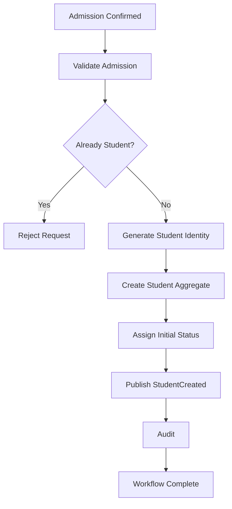

---

## 3. Architecture Contracts

### Input

- Admission ID
- Applicant Information
- Institution
- Programme
- Session

### Output

- Student ID
- Student Aggregate
- StudentCreated Event

### Domain Events

- StudentCreated

### Service Contracts

- CreateStudent()
- ValidateAdmission()

---

## 4. Governance

- Student ID immutable
- Duplicate creation prohibited
- Idempotent execution mandatory
- Audit logging mandatory

---

# WF-C02-02 — Student Activation

## 1. Workflow Definition

### Purpose

Activate a newly created Student for institutional operations.

Activation makes the Student eligible for downstream academic and administrative services.

### Trigger

- Student Created

### Preconditions

- Student exists
- Identity generated
- Required assignments complete

### Postconditions

- Student Status = Active
- Activation timestamp recorded
- Student available to downstream domains
- Domain event published

---

## 2. Workflow Behaviour

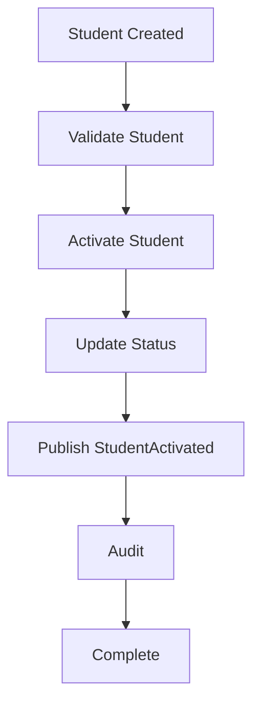

---

## 3. Architecture Contracts

### Input

- Student ID

### Output

- Active Student

### Domain Events

- StudentActivated

### Service Contracts

- ActivateStudent()

---

## 4. Governance

- Activation only once
- Activation auditable
- Idempotent retries supported

---

# WF-C02-03 — Student Enrollment Update

## 1. Workflow Definition

### Purpose

Maintain enrollment-related information throughout the student's lifecycle.

### Trigger

- Enrollment Change
- Academic Session Update
- Administrative Request

### Preconditions

- Student Active
- Authorized Request

### Postconditions

- Enrollment updated
- History preserved
- Audit completed
- Event published

---

## 2. Workflow Behaviour

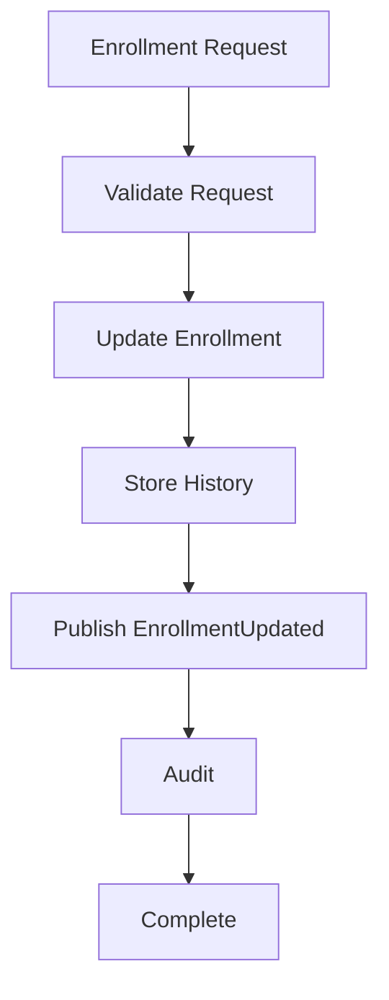

---

## 3. Architecture Contracts

### Input

- Student ID
- Enrollment Data

### Output

- Updated Enrollment

### Domain Events

- EnrollmentUpdated

### Service Contracts

- UpdateEnrollment()

---

## 4. Governance

- Historical enrollment immutable
- Current enrollment unique
- Audit mandatory

---

# WF-C02-04 — Academic Assignment

## 1. Workflow Definition

### Purpose

Assign the Student to the appropriate academic structure.

Assignments include:

- Programme
- Department
- Batch
- Section
- Mentor

### Trigger

- Student Activation
- Administrative Assignment
- Academic Reassignment
- `ProgrammeMigrationApproved` from L2-C04, for application of an already-approved Programme association

### Preconditions

- Student Active
- Programme exists
- Batch exists
- If an existing Programme association will change, the matching `ProgrammeMigrationApproved` result from L2-C04 has been consumed.

### Postconditions

- Academic assignment completed
- Student ready for academic operations

---

## 2. Workflow Behaviour

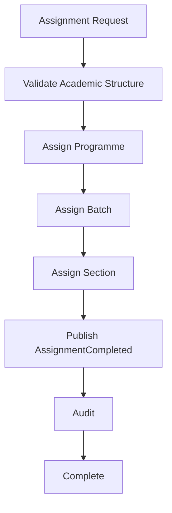

---

## 3. Architecture Contracts

### Domain Events

- AcademicAssignmentCompleted

### Consumed Events

- ProgrammeMigrationApproved (Programme-association update only; the migration decision remains C04-owned)

### Service Contracts

- AssignProgramme()
- AssignBatch()
- AssignSection()

---

## 4. Governance

- Assignment must reference valid academic entities.
- Changes shall preserve historical assignment records.
- Every reassignment shall generate an audit record.
- A Programme-association update shall apply the authoritative C04 migration result without re-evaluating or republishing the migration decision.

---

# Remaining Workflow Specifications

The following workflow specifications continue using the identical repository template established above:

- **WF-C02-05 — Student Status Change**
- **WF-C02-06 — Student Suspension**
- **WF-C02-07 — Student Restoration**
- **WF-C02-08 — Student Transfer**
- **WF-C02-09 — Qualification Completion Handoff**
- **WF-C02-10 — Student Exit / Archive**

Each workflow shall contain:

1. Workflow Definition
2. Workflow Behaviour
3. Architecture Contracts
4. Governance

to maintain consistency with the standardized Level 2 workflow architecture adopted across the SutraERP repository.

---

# 8.2 Summary

The workflow specifications defined in this section establish the operational contracts governing the Student Aggregate. They ensure that every lifecycle transition is deterministic, auditable, event-driven, and compliant with the architectural standards established across the SutraERP platform.

# WF-C02-05 — Student Status Change

## 1. Workflow Definition

### Purpose

Modify the lifecycle status of a Student while preserving the integrity of the Student Aggregate.

Status changes reflect legitimate institutional transitions without affecting the Student's permanent identity.

### Trigger

- Administrative Decision
- Academic Progression
- Institutional Policy
- Automated Lifecycle Process

### Preconditions

- Student exists
- Student is not archived
- Requested status transition is valid
- Authorized user initiates the request

### Postconditions

- Student status updated
- Previous status preserved
- Status history recorded
- Audit record generated
- Domain event published

---

## 2. Workflow Behaviour

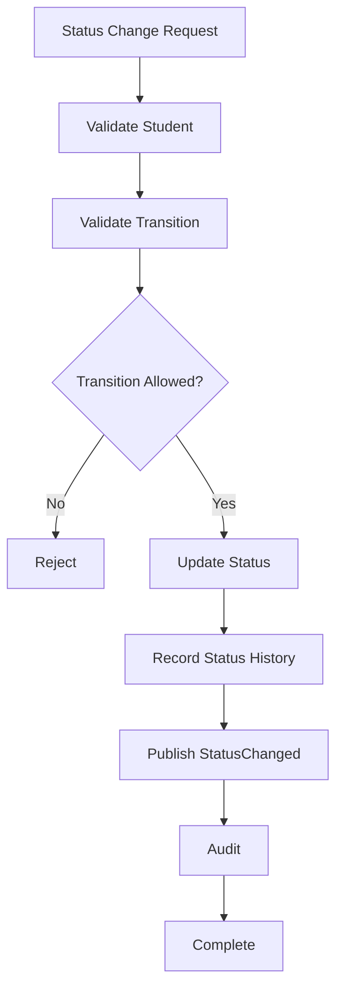

---

## 3. Architecture Contracts

### Input

- Student ID
- Target Status
- Reason

### Output

- Updated Student Status

### Domain Events

- StudentStatusChanged

### Service Contracts

- ChangeStudentStatus()

---

## 4. Governance

- Invalid transitions prohibited
- History immutable
- Status changes fully auditable

---

# WF-C02-06 — Student Suspension

## 1. Workflow Definition

### Purpose

Temporarily suspend institutional privileges while preserving the Student record.

Suspension shall not delete or deactivate the Student identity.

### Trigger

- Disciplinary Action
- Financial Hold
- Administrative Decision
- Regulatory Requirement

### Preconditions

- Student Active
- Suspension permitted
- Approval completed (if required)

### Postconditions

- Status = Suspended
- Suspension reason recorded
- Effective dates stored
- Event published

---

## 2. Workflow Behaviour

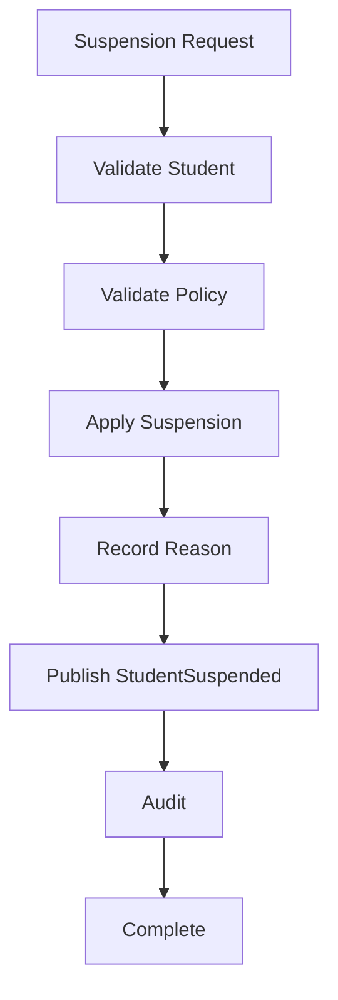

---

## 3. Architecture Contracts

### Domain Events

- StudentSuspended

### Service Contracts

- SuspendStudent()

---

## 4. Governance

- Suspension reversible
- Financial data unaffected
- Academic history preserved

---

# WF-C02-07 — Student Restoration

## 1. Workflow Definition

### Purpose

Restore a previously suspended Student to Active status.

### Trigger

- Administrative Approval
- Financial Clearance
- Disciplinary Resolution

### Preconditions

- Student Suspended
- Restoration authorized

### Postconditions

- Status = Active
- Restoration recorded
- Domain event published

---

## 2. Workflow Behaviour

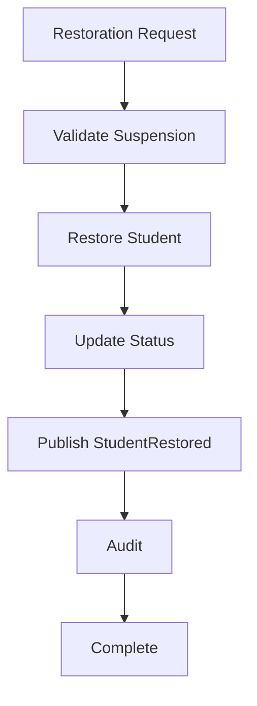

---

## 3. Architecture Contracts

### Domain Events

- StudentRestored

### Service Contracts

- RestoreStudent()

---

## 4. Governance

- Only suspended students may be restored
- Restoration history immutable

---

# WF-C02-08 — Student Transfer

## 1. Workflow Definition

### Purpose

Transfer a Student between non-Programme organisational or placement dimensions within the institution according to approved institutional policies.

Transfers may include:

- Campus
- Department
- Section
- Batch

Programme-changing mobility is excluded and is owned by L2-C04 APW-08 — Programme Migration.

The Student identity remains unchanged.

### Trigger

- Administrative Approval
- Student Transfer Request

### Preconditions

- Student Active
- Destination exists
- Policy permits transfer

### Postconditions

- Assignment updated
- Previous assignment preserved
- Domain events published

---

## 2. Workflow Behaviour

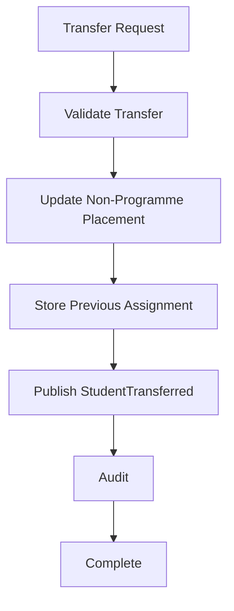

---

## 3. Architecture Contracts

### Domain Events

- StudentTransferred

### Service Contracts

- TransferStudent()

---

## 4. Governance

- Student ID unchanged
- Historical assignments retained
- Programme-changing mobility excluded; L2-C04 APW-08 owns that decision and outcome

---

# WF-C02-09 — Qualification Completion Handoff

## 1. Workflow Definition

### Purpose

Complete the active academic lifecycle and hand off the Student to the Alumni Domain after successful qualification completion.

Ownership of the Student Aggregate remains with the Student Lifecycle Domain, while Alumni becomes the owner of alumni-specific data.

### Trigger

- Qualification Completion Approved

### Preconditions

- Qualification Completion requirements satisfied
- Examination completed
- Degree approved

### Postconditions

- Student marked Qualification Completed
- Alumni handoff initiated
- Events published

---

## 2. Workflow Behaviour

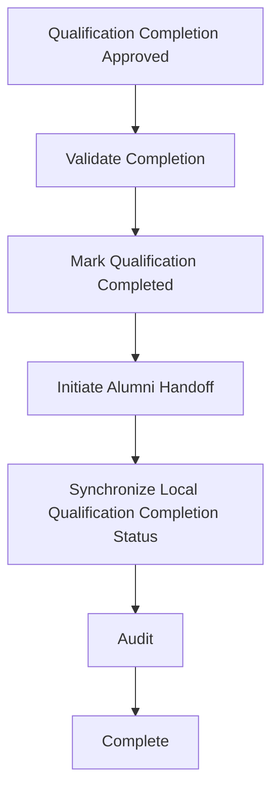

---

## 3. Architecture Contracts

### Domain Events

- None. This workflow consumes `QualificationAwarded`, published by the Qualification Completion domain (L2-C05); it does not publish a competing canonical event.

### Service Contracts

- CompleteQualification()

---

## 4. Governance

- Qualification Completion irreversible through normal operations
- Alumni integration event mandatory

---

# WF-C02-10 — Student Exit / Archive

## 1. Workflow Definition

### Purpose

Complete the institutional lifecycle of a Student who permanently exits the institution.

The Student Aggregate shall be archived rather than deleted.

### Trigger

- Student Exit
- Administrative Closure
- Permanent Separation
- Post-creation `AdmissionRevoked`, when institutional policy directs Student Context archival

### Preconditions

- Exit or closure is approved, or a post-creation `AdmissionRevoked` event has been consumed.
- Institutional archive policy authorizes the Student Context archival.
- Outstanding obligations and required approvals are resolved according to institutional policy.

### Postconditions

- Status = Archived
- Student retained for historical reference
- Archive event published

---

## 2. Workflow Behaviour

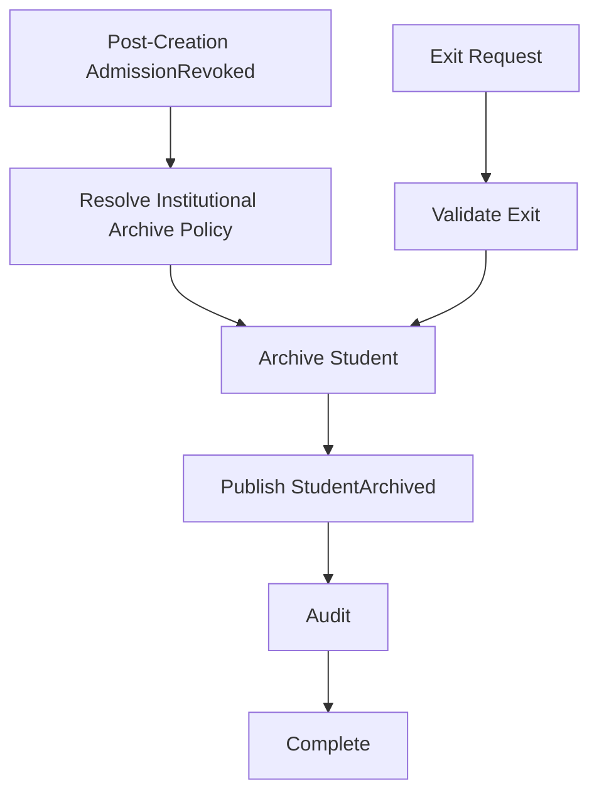

---

## 3. Architecture Contracts

### Domain Events

- StudentArchived

### Consumed Events

- AdmissionRevoked (after Student Context creation)

### Service Contracts

- ArchiveStudent()

---

## 4. Governance

- Physical deletion prohibited
- Historical data immutable
- Archive permanent
- Audit mandatory

---

---

# WF-C02-11 — Student Document & Certificate Request Workflow

## WF-C02-11.1 Overview

The **Student Document & Certificate Request Workflow** governs the canonical business process through which a Student requests institution-issued documents and certificates during or after their academic lifecycle.

This workflow establishes the Student Lifecycle Domain as the authoritative owner of document request initiation, eligibility validation, request lifecycle management, approval orchestration, and cross-domain coordination while preserving the **Document Services Domain** as the exclusive owner of document generation, rendering, issuance, storage, verification, and lifecycle management of generated documents.

The workflow provides a standardized mechanism for requesting institution-issued documents while ensuring policy compliance, institutional approvals, auditability, and secure delegation to downstream document generation services.

This workflow applies consistently across cloud, hybrid, and on-premises deployments and supports institution-specific operational policies through governed configuration without altering canonical business behavior.

---

## WF-C02-11.2 Purpose

The objectives of this workflow are to:

- Provide a standardized document request process.
- Validate Student eligibility before request acceptance.
- Enforce institution-specific approval policies.
- Prevent duplicate active document requests.
- Maintain complete auditability throughout the request lifecycle.
- Delegate document generation to the Document Services Domain.
- Preserve domain ownership boundaries.
- Support future document types without architectural modification.

---

## WF-C02-11.3 Scope

This workflow governs:

- Student document requests
- Certificate requests
- Eligibility validation
- Approval routing
- Request lifecycle management
- Request cancellation
- Request rejection
- Request tracking
- Audit generation
- Cross-domain coordination
- Notification initiation

This workflow does **not** govern:

- Document template management
- Certificate rendering
- PDF generation
- Digital signatures
- QR code generation
- Document verification
- File storage
- Certificate archival

These capabilities remain exclusively owned by the **Document Services Domain**.

---

## WF-C02-11.4 Primary Actors

| Actor | Responsibility |
|---------|----------------------------------------------|
| Student | Submit document requests and track request status. |
| Registrar | Approve or reject document requests where required. |
| Department Administrator | Validate departmental prerequisites where applicable. |
| Student Lifecycle Domain | Manage request lifecycle and business validation. |
| Finance Domain | Validate financial clearance where required. |
| Examination Domain | Validate academic completion where required. |
| Workflow Engine | Execute configurable approval workflows. |
| Document Services Domain | Generate and issue approved documents. |
| Notification Platform | Notify stakeholders regarding request status changes. |

---

## WF-C02-11.5 Preconditions

Before this workflow begins:

- Student exists.
- Student identity is valid.
- Student belongs to the current tenant.
- Requested document type is supported.
- Student satisfies institutional eligibility rules.
- Required configuration is active.
- Caller is authenticated.
- Caller is authorized.
- Student lifecycle state permits the requested document.
- No conflicting active request exists unless explicitly permitted by institutional policy.

Failure to satisfy any prerequisite shall terminate the workflow before request creation.

---

## WF-C02-11.6 Trigger

The workflow may be initiated by:

- Student Portal
- Registrar Portal
- Administrative User
- Approved External Integration
- Workflow Engine

Every request shall receive a unique **Document Request Identifier** before business execution proceeds.

---

## WF-C02-11.7 Workflow Steps

| Step | Description |
|------|----------------------------------------------|
| 1 | Receive RequestStudentDocument command. |
| 2 | Authenticate caller. |
| 3 | Authorize operation. |
| 4 | Validate Student identity. |
| 5 | Validate Student lifecycle state. |
| 6 | Validate requested document type. |
| 7 | Validate institutional policy. |
| 8 | Validate financial clearance where applicable. |
| 9 | Validate academic eligibility where applicable. |
| 10 | Validate duplicate active requests. |
| 11 | Create Student Document Request. |
| 12 | Determine approval workflow. |
| 13 | Execute approval workflow where required. |
| 14 | Publish StudentDocumentRequested event. |
| 15 | Invoke Document Services through approved Service Contract. |
| 16 | Receive StudentDocumentReady event. |
| 17 | Notify Student. |
| 18 | Complete request lifecycle. |

---

## WF-C02-11.8 Workflow Outputs

Successful workflow execution produces:

- Student Document Request
- Approval Record (where applicable)
- Audit Record
- StudentDocumentRequested event
- Notification Request
- Cross-domain document generation request

---

## WF-C02-11.9 Failure Conditions

The workflow shall terminate immediately if:

- Student does not exist.
- Student is not eligible.
- Unsupported document type is requested.
- Financial clearance fails.
- Academic clearance fails.
- Required approval is rejected.
- Duplicate active request exists.
- Authorization fails.
- Configuration validation fails.
- Cross-tenant access is detected.

Failures shall not modify business state.

---

## WF-C02-11.10 Cross-Domain Dependencies

| Domain | Purpose |
|----------|----------------------------------------------|
| Finance | Financial clearance validation. |
| Examination | Academic completion validation. |
| Academic Delivery | Programme validation. |
| Authorization | Permission validation. |
| Workflow Engine | Approval orchestration. |
| Document Services | Document generation. |
| Notification Platform | Student notifications. |
| Audit Platform | Audit persistence. |

---

## WF-C02-11.11 Postconditions

Upon successful completion:

- Document Request is persisted.
- Approval outcome is recorded.
- StudentDocumentRequested event is published.
- Audit record is generated.
- Notification request is initiated.
- Document Services receives generation request.
- Student may track request progress through query services.

The Student Aggregate shall remain internally consistent regardless of downstream processing.

---

## WF-C02-11.12 Audit Requirements

The following actions shall always generate audit records:

- Request submission
- Approval
- Rejection
- Cancellation
- Administrative override
- Document generation initiation
- Completion notification

Audit records shall remain immutable.

---

## WF-C02-11.13 Workflow Completion

The workflow reaches completion when one of the following terminal outcomes occurs:

- Document successfully issued.
- Request rejected.
- Request cancelled.
- Request expired according to institutional policy.

Completed requests shall remain historically traceable.

---

## WF-C02-11.14 Canonical Workflow Diagram

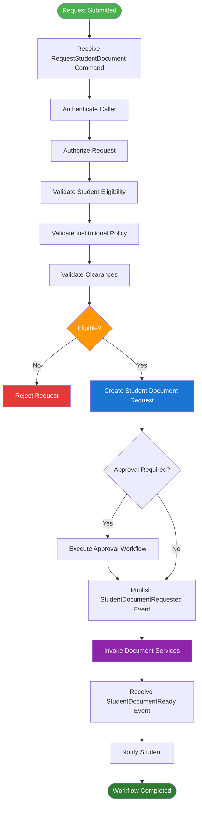

---

# WF-C02-12 — Student Profile Update Workflow

## WF-C02-12.1 Overview

The **Student Profile Update Workflow** governs the canonical business process for modifying Student-owned profile information after Student creation.

The workflow establishes the Student Lifecycle Domain as the authoritative owner of Student master profile data while ensuring that profile modifications remain validated, auditable, policy-driven, and synchronized across dependent domains.

Profile updates shall preserve Student identity integrity and shall never compromise canonical ownership boundaries or lifecycle consistency.

This workflow supports institution-specific approval policies through governed configuration while maintaining consistent architectural behavior across cloud, hybrid, and on-premises deployments.

---

## WF-C02-12.2 Purpose

The objectives of this workflow are to:

- Maintain accurate Student master information.
- Protect immutable identity attributes.
- Validate profile updates before persistence.
- Support configurable approval workflows.
- Synchronize profile changes across dependent domains.
- Maintain complete audit history.
- Publish canonical profile update events.
- Preserve aggregate consistency.

---

## WF-C02-12.3 Scope

This workflow governs:

- Personal information updates
- Contact information updates
- Address updates
- Guardian information updates
- Communication preference updates
- Preferred language updates
- Student photograph updates
- Institution-approved profile corrections

This workflow does **not** govern:

- Admission information
- Academic assignments
- Enrollment management
- Student lifecycle status
- Programme allocation
- Financial information
- Examination information

These remain owned by their respective domains.

---

## WF-C02-12.4 Primary Actors

| Actor | Responsibility |
|---------|----------------------------------------------|
| Student | Submit permitted profile updates. |
| Registrar | Approve restricted profile modifications where required. |
| Student Lifecycle Domain | Validate and persist profile updates. |
| Workflow Engine | Execute approval workflows. |
| Notification Platform | Notify stakeholders of profile changes. |
| Analytics Platform | Consume profile update events. |
| Audit Platform | Persist audit records. |

---

## WF-C02-12.5 Preconditions

Before this workflow begins:

- Student exists.
- Student belongs to current tenant.
- Caller is authenticated.
- Caller is authorized.
- Student lifecycle state permits profile modification.
- Requested attributes are editable.
- Configuration permits requested operation.
- No conflicting update is currently executing.

Failure to satisfy any prerequisite shall terminate the workflow before modification begins.

---

## WF-C02-12.6 Trigger

The workflow may be initiated through:

- Student Self-Service Portal
- Administrative Portal
- Mobile Application
- Approved Integration API
- Workflow Engine

Each request shall receive a unique **Profile Update Request Identifier** before business execution proceeds.

---

## WF-C02-12.7 Editable Attribute Categories

The following categories may be updated according to institutional policy.

| Category | Examples |
|-----------|----------------------------------------------|
| Personal Information | Preferred Name, Nationality, Category |
| Contact Information | Mobile Number, Email Address |
| Address Information | Current Address, Permanent Address |
| Guardian Information | Guardian Contact Details |
| Communication Preferences | Email, SMS, Push Notifications |
| Student Photograph | Profile Image |
| Emergency Contact | Emergency Contact Details |

Immutable attributes shall remain protected.

---

## WF-C02-12.8 Immutable Attributes

The following attributes shall never be modified through this workflow.

- Student ID
- Student Number
- Admission Reference
- Institution Identifier
- Creation Timestamp
- Audit History

Administrative correction procedures shall govern exceptional identity corrections.

---

## WF-C02-12.9 Workflow Steps

| Step | Description |
|------|----------------------------------------------|
| 1 | Receive UpdateStudentProfile command. |
| 2 | Authenticate caller. |
| 3 | Authorize operation. |
| 4 | Validate Student existence. |
| 5 | Validate lifecycle state. |
| 6 | Validate editable attributes. |
| 7 | Validate configuration policies. |
| 8 | Validate business rules. |
| 9 | Determine approval requirement. |
| 10 | Execute approval workflow where applicable. |
| 11 | Update Student Aggregate. |
| 12 | Persist transaction. |
| 13 | Generate audit record. |
| 14 | Publish StudentProfileUpdated event. |
| 15 | Notify dependent domains. |
| 16 | Complete workflow. |

---

## WF-C02-12.10 Workflow Outputs

Successful workflow execution produces:

- Updated Student Profile
- Audit Record
- StudentProfileUpdated event
- Notification Request
- Updated Read Models
- Cross-domain synchronization request

---

## WF-C02-12.11 Failure Conditions

The workflow shall terminate immediately if:

- Student does not exist.
- Unauthorized attribute modification is attempted.
- Immutable attribute modification is requested.
- Configuration validation fails.
- Business validation fails.
- Approval is rejected.
- Cross-tenant access is detected.
- Authorization fails.

Failures shall not modify business state.

---

## WF-C02-12.12 Cross-Domain Dependencies

| Domain | Purpose |
|----------|----------------------------------------------|
| Authorization | Permission validation. |
| Workflow Engine | Approval orchestration. |
| Notification Platform | User notifications. |
| Analytics Platform | Reporting updates. |
| Audit Platform | Audit persistence. |

No downstream domain shall directly modify Student profile information.

---

## WF-C02-12.13 Postconditions

Upon successful completion:

- Student Aggregate reflects approved changes.
- Aggregate version is incremented.
- Audit history is updated.
- StudentProfileUpdated event is published.
- Dependent domains receive synchronization events.
- Read models are refreshed according to platform policy.

Aggregate consistency shall be preserved throughout execution.

---

## WF-C02-12.14 Audit Requirements

The following operations shall always generate audit records:

- Profile update request
- Approval
- Rejection
- Administrative modification
- Sensitive field modification
- Manual override
- Event publication

Audit records shall remain immutable.

---

## WF-C02-12.15 Workflow Completion

The workflow reaches completion when:

- Profile update succeeds.
- Request is rejected.
- Request is cancelled.
- Request expires according to institutional policy.

Completed requests shall remain historically traceable.

---

## WF-C02-12.16 Canonical Workflow Diagram

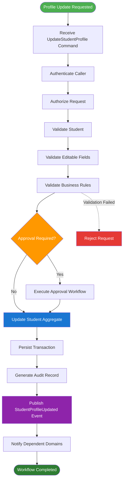

---

## WF-C02-12.17 Summary

The Student Profile Update Workflow establishes the canonical process for maintaining Student master profile information while preserving aggregate integrity, immutable identity, institutional policy enforcement, comprehensive auditing, and event-driven synchronization across the SutraERP platform. By separating editable profile data from immutable identity attributes and governing every modification through validation, authorization, approval, and audit, the workflow ensures consistent and maintainable Student master data management throughout the Student lifecycle.

---

# WF-C02-13 — Guardian & Emergency Contact Management Workflow

## WF-C02-13.1 Overview

The **Guardian & Emergency Contact Management Workflow** governs the canonical business process for creating, updating, validating, activating, deactivating, and maintaining Guardian and Emergency Contact information associated with a Student.

The Student Lifecycle Domain remains the authoritative owner of Guardian associations and Emergency Contact information throughout the Student lifecycle while ensuring data integrity, policy compliance, auditability, and controlled synchronization with dependent domains.

Guardian information represents legally and operationally significant data used by multiple institutional processes including communication, fee recovery, hostel administration, transport management, medical emergencies, disciplinary actions, and statutory reporting.

This workflow provides a standardized mechanism for managing Guardian information while preserving canonical ownership boundaries and maintaining deployment independence across cloud, hybrid, and on-premises environments.

---

## WF-C02-13.2 Purpose

The objectives of this workflow are to:

- Maintain accurate Guardian information.
- Maintain Emergency Contact information.
- Support multiple Guardian associations where institutional policy permits.
- Validate Guardian relationships.
- Prevent duplicate Guardian associations.
- Govern approval workflows where required.
- Synchronize Guardian updates across dependent domains.
- Preserve complete audit history.

---

## WF-C02-13.3 Scope

This workflow governs:

- Guardian registration
- Guardian updates
- Guardian replacement
- Emergency Contact management
- Guardian activation
- Guardian deactivation
- Relationship validation
- Primary Guardian designation
- Guardian communication preferences
- Audit generation

This workflow does **not** govern:

- Parent Portal authentication
- Financial sponsorship
- Hostel authorization
- Medical records
- Communication delivery
- Identity verification services

These capabilities remain owned by their respective domains.

---

## WF-C02-13.4 Primary Actors

| Actor | Responsibility |
|---------|----------------------------------------------|
| Student | Request Guardian updates where permitted. |
| Guardian | Provide verified information where supported. |
| Registrar | Approve Guardian modifications where required. |
| Student Lifecycle Domain | Maintain Guardian associations. |
| Workflow Engine | Execute approval workflows. |
| Notification Platform | Notify affected parties. |
| Audit Platform | Persist audit history. |

---

## WF-C02-13.5 Preconditions

Before this workflow begins:

- Student exists.
- Student belongs to current tenant.
- Caller is authenticated.
- Caller is authorized.
- Student lifecycle permits Guardian modification.
- Required configuration is active.
- Guardian relationship type is valid.
- Duplicate Guardian association does not already exist unless institutional policy permits.

Failure to satisfy any prerequisite shall terminate the workflow before modification begins.

---

## WF-C02-13.6 Trigger

The workflow may be initiated by:

- Student Portal
- Administrative Portal
- Registrar
- Approved Integration API
- Workflow Engine

Each request shall receive a unique **Guardian Management Request Identifier**.

---

## WF-C02-13.7 Guardian Types

Supported Guardian categories include:

| Guardian Type | Description |
|---------------|----------------------------------------------|
| Father | Parent |
| Mother | Parent |
| Legal Guardian | Court-appointed Guardian |
| Sponsor | Financial Sponsor |
| Emergency Contact | Emergency communication contact |
| Other | Institution-approved relationship |

Institutions may extend relationship metadata through governed configuration.

---

## WF-C02-13.8 Workflow Steps

| Step | Description |
|------|----------------------------------------------|
| 1 | Receive ManageGuardian command. |
| 2 | Authenticate caller. |
| 3 | Authorize operation. |
| 4 | Validate Student existence. |
| 5 | Validate Guardian information. |
| 6 | Validate relationship type. |
| 7 | Validate duplicate associations. |
| 8 | Validate configuration policies. |
| 9 | Determine approval requirement. |
| 10 | Execute approval workflow where applicable. |
| 11 | Update Guardian association. |
| 12 | Update Emergency Contact information where applicable. |
| 13 | Persist transaction. |
| 14 | Generate audit record. |
| 15 | Publish StudentGuardianUpdated event. |
| 16 | Notify dependent domains. |
| 17 | Complete workflow. |

---

## WF-C02-13.9 Workflow Outputs

Successful execution produces:

- Updated Guardian Association
- Updated Emergency Contact
- Audit Record
- StudentGuardianUpdated event
- Notification Request
- Updated Read Models

---

## WF-C02-13.10 Failure Conditions

The workflow shall terminate immediately if:

- Student does not exist.
- Invalid Guardian relationship is supplied.
- Duplicate Guardian association exists.
- Required approval is rejected.
- Configuration validation fails.
- Authorization fails.
- Cross-tenant access is detected.

Failures shall not modify business state.

---

## WF-C02-13.11 Cross-Domain Dependencies

| Domain | Purpose |
|----------|----------------------------------------------|
| Authorization | Permission validation. |
| Workflow Engine | Approval execution. |
| Notification Platform | Communication. |
| Audit Platform | Audit persistence. |
| Analytics Platform | Reporting updates. |

No downstream domain shall directly modify Guardian information.

---

## WF-C02-13.12 Postconditions

Upon successful completion:

- Guardian association is updated.
- Emergency Contact information is synchronized.
- Student Aggregate version is incremented.
- Audit record is generated.
- StudentGuardianUpdated event is published.
- Read models are refreshed.

Aggregate consistency shall remain preserved.

---

## WF-C02-13.13 Audit Requirements

The following operations shall always generate audit records:

- Guardian creation
- Guardian modification
- Guardian replacement
- Guardian removal
- Emergency Contact modification
- Administrative override
- Approval decision

Audit records shall remain immutable.

---

## WF-C02-13.14 Workflow Completion

The workflow reaches completion when one of the following terminal outcomes occurs:

- Guardian successfully created.
- Guardian successfully updated.
- Guardian successfully removed.
- Request rejected.
- Request cancelled.
- Request expired according to institutional policy.

Completed requests shall remain historically traceable.

---

## WF-C02-13.15 Canonical Workflow Diagram

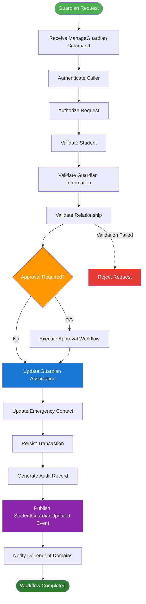

---

## WF-C02-13.16 Summary

The Guardian & Emergency Contact Management Workflow establishes the canonical process for maintaining Guardian relationships and Emergency Contact information throughout the Student lifecycle. By enforcing standardized validation, configurable approval policies, immutable auditing, and event-driven synchronization, the workflow ensures that legally significant Guardian information remains accurate, consistent, secure, and fully governed across the SutraERP platform while preserving the Student Lifecycle Domain as the authoritative owner of these associations.

---

# WF-C02-14 — Student Communication Preference Management Workflow

## WF-C02-14.1 Overview

The **Student Communication Preference Management Workflow** governs the canonical business process for creating, updating, validating, and maintaining Student communication preferences throughout the Student lifecycle.

The Student Lifecycle Domain remains the authoritative owner of Student communication preferences while the Notification Platform remains exclusively responsible for message delivery, notification orchestration, channel execution, and delivery tracking.

Communication preferences define how the Student chooses to receive institution-authorized communications and ensure that downstream notification services operate according to institutional policy, regulatory requirements, and Student consent.

This workflow provides a standardized, auditable, and policy-driven mechanism for managing communication preferences across cloud, hybrid, and on-premises deployments.

---

## WF-C02-14.2 Purpose

The objectives of this workflow are to:

- Maintain Student communication preferences.
- Maintain communication consent.
- Support institution-approved notification channels.
- Support preferred communication language.
- Validate communication policies.
- Synchronize communication preference updates.
- Preserve complete audit history.
- Publish standardized domain events.

---

## WF-C02-14.3 Scope

This workflow governs:

- Email communication preferences
- SMS communication preferences
- Push notification preferences
- Preferred communication language
- Parent communication consent
- Emergency communication preferences
- Institutional notification consent
- Communication preference audit history

This workflow does **not** govern:

- Notification delivery
- Email generation
- SMS delivery
- Push notification infrastructure
- Template management
- Notification scheduling
- Campaign management

These capabilities remain exclusively owned by the **Notification Platform**.

---

## WF-C02-14.4 Primary Actors

| Actor | Responsibility |
|---------|----------------------------------------------|
| Student | Maintain communication preferences. |
| Registrar | Modify preferences where institution policy permits. |
| Student Lifecycle Domain | Validate and persist communication preferences. |
| Notification Platform | Consume updated communication preferences. |
| Workflow Engine | Execute approval workflow where applicable. |
| Audit Platform | Persist audit history. |

---

## WF-C02-14.5 Preconditions

Before this workflow begins:

- Student exists.
- Student belongs to current tenant.
- Caller is authenticated.
- Caller is authorized.
- Communication configuration is active.
- Requested communication channels are supported.
- Student lifecycle permits modification.

Failure to satisfy any prerequisite shall terminate the workflow.

---

## WF-C02-14.6 Trigger

The workflow may be initiated through:

- Student Self-Service Portal
- Administrative Portal
- Mobile Application
- Approved Integration API
- Workflow Engine

Each request shall receive a unique **Communication Preference Request Identifier**.

---

## WF-C02-14.7 Managed Preferences

Institutions may govern the following preferences.

| Preference | Description |
|------------|----------------------------------------------|
| Email Notifications | Enable or disable email communication. |
| SMS Notifications | Enable or disable SMS communication. |
| Push Notifications | Enable or disable push notifications. |
| Preferred Language | Preferred communication language. |
| Parent Notifications | Enable parent or guardian notifications where supported. |
| Emergency Notifications | Mandatory emergency communication settings. |

Institution-specific extensions may be introduced through governed configuration.

---

## WF-C02-14.8 Workflow Steps

| Step | Description |
|------|----------------------------------------------|
| 1 | Receive UpdateCommunicationPreferences command. |
| 2 | Authenticate caller. |
| 3 | Authorize operation. |
| 4 | Validate Student existence. |
| 5 | Validate communication preferences. |
| 6 | Validate institutional policy. |
| 7 | Validate supported communication channels. |
| 8 | Determine approval requirement where applicable. |
| 9 | Execute approval workflow. |
| 10 | Update communication preferences. |
| 11 | Persist transaction. |
| 12 | Generate audit record. |
| 13 | Publish StudentCommunicationPreferencesUpdated event. |
| 14 | Notify Notification Platform. |
| 15 | Complete workflow. |

---

## WF-C02-14.9 Workflow Outputs

Successful workflow execution produces:

- Updated Communication Preferences
- Audit Record
- StudentCommunicationPreferencesUpdated event
- Notification Platform synchronization request
- Updated read models

---

## WF-C02-14.10 Failure Conditions

The workflow shall terminate immediately if:

- Student does not exist.
- Unsupported communication channel is requested.
- Invalid language configuration is supplied.
- Authorization fails.
- Configuration validation fails.
- Required approval is rejected.
- Cross-tenant access is detected.

Failures shall not modify business state.

---

## WF-C02-14.11 Cross-Domain Dependencies

| Domain | Purpose |
|----------|----------------------------------------------|
| Authorization | Permission validation. |
| Configuration | Communication policy validation. |
| Workflow Engine | Approval workflow execution. |
| Notification Platform | Preference synchronization. |
| Audit Platform | Audit persistence. |
| Analytics Platform | Reporting updates. |

The Notification Platform shall never directly modify Student communication preferences.

---

## WF-C02-14.12 Postconditions

Upon successful completion:

- Communication preferences are updated.
- Student Aggregate version is incremented.
- Audit record is generated.
- StudentCommunicationPreferencesUpdated event is published.
- Notification Platform receives updated preferences.
- Read models are refreshed.

Aggregate consistency shall remain preserved.

---

## WF-C02-14.13 Audit Requirements

The following operations shall always generate audit records:

- Preference update
- Consent modification
- Language change
- Administrative modification
- Approval decision
- Manual override

Audit records shall remain immutable.

---

## WF-C02-14.14 Workflow Completion

The workflow reaches completion when one of the following terminal outcomes occurs:

- Communication preferences successfully updated.
- Request rejected.
- Request cancelled.
- Request expired according to institutional policy.

Completed requests shall remain historically traceable.

---

## WF-C02-14.15 Canonical Workflow Diagram

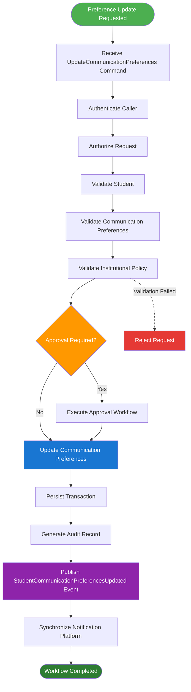

---

## WF-C02-14.16 Summary

The Student Communication Preference Management Workflow establishes the canonical process for managing Student communication preferences throughout the Student lifecycle. By separating communication preference ownership from notification delivery, enforcing policy-driven validation, comprehensive auditing, configurable approvals, and event-driven synchronization, the workflow ensures secure, consistent, and maintainable communication management while preserving clear domain ownership across the SutraERP platform.

---

# WF-C02-15 — Student Identity Correction Workflow

## WF-C02-15.1 Overview

The **Student Identity Correction Workflow** governs the canonical business process for correcting legally significant Student identity information after Student creation.

The Student Lifecycle Domain remains the authoritative owner of Student identity information while ensuring that identity corrections are performed only through governed administrative processes supported by documentary evidence, institutional approvals, comprehensive auditing, and controlled synchronization across all dependent domains.

Identity correction is an exceptional administrative process intended to rectify verified errors in Student identity information. It shall never be used to bypass institutional admission procedures, business rules, or regulatory requirements.

This workflow preserves the integrity of the Student Aggregate while maintaining complete historical traceability of all identity corrections.

---

## WF-C02-15.2 Purpose

The objectives of this workflow are to:

- Correct verified identity errors.
- Preserve immutable Student identity.
- Support documentary evidence verification.
- Enforce institutional approval workflows.
- Synchronize corrected identity information.
- Maintain complete audit history.
- Preserve regulatory compliance.
- Protect cross-domain referential integrity.

---

## WF-C02-15.3 Scope

This workflow governs:

- Legal name correction
- Date of Birth correction
- Gender correction
- Nationality correction
- Reservation category correction
- Government identifier correction
- Identity document replacement
- Supporting document verification
- Approval workflow
- Audit generation

This workflow does **not** govern:

- Student Number modification
- Student ID modification
- Admission ownership
- Enrollment management
- Academic assignment
- Student lifecycle management

Primary identifiers remain immutable.

---

## WF-C02-15.4 Primary Actors

| Actor | Responsibility |
|---------|----------------------------------------------|
| Student | Submit correction request with supporting evidence. |
| Registrar | Verify documentation and approve corrections. |
| Student Lifecycle Domain | Validate and execute approved corrections. |
| Workflow Engine | Execute approval workflow. |
| Document Services | Store supporting evidence where applicable. |
| Audit Platform | Persist audit records. |
| Notification Platform | Notify stakeholders. |

---

## WF-C02-15.5 Preconditions

Before this workflow begins:

- Student exists.
- Student belongs to current tenant.
- Caller is authenticated.
- Caller is authorized.
- Requested correction is institutionally permitted.
- Supporting documentation is available where required.
- Required configuration is active.
- Student lifecycle permits identity correction.

Failure to satisfy any prerequisite shall terminate the workflow before modification begins.

---

## WF-C02-15.6 Trigger

The workflow may be initiated through:

- Registrar Portal
- Administrative Portal
- Student Self-Service Portal (Request Only)
- Workflow Engine

Each request shall receive a unique **Identity Correction Request Identifier** before processing begins.

---

## WF-C02-15.7 Correctable Identity Attributes

The following attributes may be corrected according to institutional policy.

| Attribute | Correction Allowed |
|------------|-------------------|
| Legal First Name | Yes |
| Middle Name | Yes |
| Last Name | Yes |
| Date of Birth | Restricted |
| Gender | Restricted |
| Nationality | Yes |
| Reservation Category | Restricted |
| Government Identifier | Restricted |
| Identity Documents | Yes |

Primary Student identifiers shall never be modified.

---

## WF-C02-15.8 Workflow Steps

| Step | Description |
|------|----------------------------------------------|
| 1 | Receive CorrectStudentIdentity command. |
| 2 | Authenticate caller. |
| 3 | Authorize operation. |
| 4 | Validate Student existence. |
| 5 | Validate requested correction. |
| 6 | Validate supporting documents. |
| 7 | Validate institutional policy. |
| 8 | Execute approval workflow. |
| 9 | Update approved identity attributes. |
| 10 | Preserve historical values. |
| 11 | Persist transaction. |
| 12 | Generate audit record. |
| 13 | Publish StudentIdentityCorrected event. |
| 14 | Synchronize dependent domains. |
| 15 | Notify stakeholders. |
| 16 | Complete workflow. |

---

## WF-C02-15.9 Workflow Outputs

Successful workflow execution produces:

- Corrected Student identity
- Historical identity record
- Audit record
- StudentIdentityCorrected event
- Cross-domain synchronization request
- Notification request

---

## WF-C02-15.10 Failure Conditions

The workflow shall terminate immediately if:

- Student does not exist.
- Supporting documentation is invalid.
- Requested correction violates institutional policy.
- Required approval is rejected.
- Authorization fails.
- Configuration validation fails.
- Cross-tenant access is detected.

Failures shall not modify business state.

---

## WF-C02-15.11 Cross-Domain Dependencies

| Domain | Purpose |
|----------|----------------------------------------------|
| Authorization | Permission validation. |
| Workflow Engine | Approval orchestration. |
| Document Services | Supporting evidence storage. |
| Notification Platform | Stakeholder notification. |
| Audit Platform | Audit persistence. |
| Analytics Platform | Reporting synchronization. |

Dependent domains shall consume corrected identity information through approved Service Contracts or Domain Events.

---

## WF-C02-15.12 Postconditions

Upon successful completion:

- Approved identity attributes are updated.
- Previous values remain historically traceable.
- Student Aggregate version is incremented.
- Audit record is generated.
- StudentIdentityCorrected event is published.
- Dependent domains receive synchronized identity updates.

Primary Student identifiers remain unchanged.

---

## WF-C02-15.13 Audit Requirements

The following operations shall always generate audit records:

- Identity correction request
- Document verification
- Approval decision
- Identity modification
- Administrative override
- Event publication

Audit records shall remain immutable and retain both previous and corrected values.

---

## WF-C02-15.14 Workflow Completion

The workflow reaches completion when one of the following terminal outcomes occurs:

- Identity successfully corrected.
- Request rejected.
- Request cancelled.
- Request expired according to institutional policy.

Completed requests shall remain permanently traceable.

---

## WF-C02-15.15 Canonical Workflow Diagram

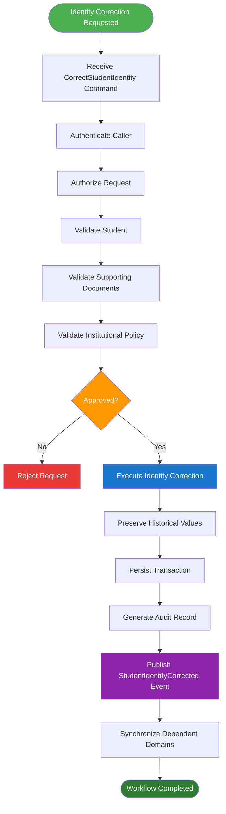

---

## WF-C02-15.16 Summary

The Student Identity Correction Workflow establishes the canonical process for correcting legally significant Student identity information while preserving immutable primary identifiers, historical traceability, institutional governance, and cross-domain consistency. By requiring documentary evidence, configurable approvals, comprehensive auditing, and event-driven synchronization, the workflow ensures that identity corrections remain secure, compliant, and fully governed throughout the SutraERP platform.

---

# WF-C02-16 — Student Merge & Duplicate Resolution Workflow

## WF-C02-16.1 Overview

The **Student Merge & Duplicate Resolution Workflow** governs the canonical business process for identifying, reviewing, approving, and resolving duplicate Student records while preserving the integrity of the Student Aggregate and all dependent business references across the SutraERP platform.

Duplicate Student records may arise due to repeated admissions processing, manual administrative errors, migration activities, integration inconsistencies, or external data synchronization failures.

The Student Lifecycle Domain remains the authoritative owner of duplicate resolution and merge operations. All downstream domains shall reconcile their references through approved Service Contracts and Domain Events without directly modifying Student ownership.

This workflow provides a standardized Master Data Management (MDM) process that preserves historical traceability, prevents data loss, maintains referential integrity, and guarantees consistent Student identity across the enterprise.

This workflow applies consistently across cloud, hybrid, and on-premises deployments.

---

## WF-C02-16.2 Purpose

The objectives of this workflow are to:

- Detect duplicate Student records.
- Support manual and assisted duplicate resolution.
- Preserve a single canonical Student identity.
- Maintain complete auditability.
- Protect downstream referential integrity.
- Synchronize merged identity across all dependent domains.
- Prevent future duplicate creation.
- Preserve historical lineage of merged records.

---

## WF-C02-16.3 Scope

This workflow governs:

- Duplicate identification
- Duplicate investigation
- Merge approval
- Survivor record selection
- Attribute reconciliation
- Reference migration
- Duplicate archival
- Merge audit history
- Cross-domain synchronization

This workflow does **not** govern:

- Applicant merge
- Admission correction
- Examination result reconciliation
- Financial ledger reconciliation
- Document regeneration
- External identity registry updates

These responsibilities remain owned by their respective domains.

---

## WF-C02-16.4 Primary Actors

| Actor | Responsibility |
|---------|----------------------------------------------|
| Registrar | Review and approve merge requests. |
| Student Lifecycle Domain | Execute canonical merge operation. |
| Workflow Engine | Execute configurable approval workflow. |
| Analytics Platform | Refresh reporting references. |
| Audit Platform | Persist immutable audit records. |
| Notification Platform | Notify affected stakeholders. |

---

## WF-C02-16.5 Preconditions

Before this workflow begins:

- Both Student records exist.
- Both Students belong to the same tenant.
- Duplicate suspicion has been established.
- Merge is permitted by institutional policy.
- Required approvals are configured.
- Caller is authenticated.
- Caller is authorized.
- Neither Student is currently participating in conflicting business operations.

Failure to satisfy any prerequisite shall terminate the workflow.

---

## WF-C02-16.6 Trigger

The workflow may be initiated through:

- Registrar Portal
- Administrative Portal
- Approved Duplicate Detection Service
- Data Migration Process
- Workflow Engine

Each request shall receive a unique **Student Merge Request Identifier**.

---

## WF-C02-16.7 Merge Strategy

The merge process shall designate one Student as the **Canonical (Survivor) Student** and one or more Students as **Merged Student Records**.

The Canonical Student shall retain:

- Student ID
- Student Number
- Lifecycle ownership
- Aggregate identity
- Version history

Merged Student records shall never remain operational after successful merge.

---

## WF-C02-16.8 Mergeable Business Data

The following business information may be reconciled according to institutional policy.

| Category | Merge Behaviour |
|-----------|----------------------------------------------|
| Personal Information | Reconciled |
| Contact Information | Reconciled |
| Guardian Information | Reconciled |
| Communication Preferences | Reconciled |
| Academic Assignments | Validated before reconciliation |
| Enrollment History | Preserved |
| Lifecycle History | Preserved |
| Audit History | Preserved |
| Attachments | Re-associated where applicable |

Primary identifiers shall never be merged into a new identity.

---

## WF-C02-16.9 Workflow Steps

| Step | Description |
|------|----------------------------------------------|
| 1 | Receive MergeStudent command. |
| 2 | Authenticate caller. |
| 3 | Authorize operation. |
| 4 | Validate duplicate candidates. |
| 5 | Validate institutional policy. |
| 6 | Select Canonical Student. |
| 7 | Validate conflicting attributes. |
| 8 | Execute approval workflow. |
| 9 | Reconcile mergeable attributes. |
| 10 | Migrate approved business references. |
| 11 | Archive merged Student record. |
| 12 | Persist transaction. |
| 13 | Generate audit record. |
| 14 | Publish StudentMerged event. |
| 15 | Synchronize downstream domains. |
| 16 | Complete workflow. |

---

## WF-C02-16.10 Workflow Outputs

Successful workflow execution produces:

- Canonical Student Record
- Archived Duplicate Record
- Merge Audit Record
- StudentMerged event
- Downstream synchronization request
- Updated reporting read models

---

## WF-C02-16.11 Failure Conditions

The workflow shall terminate immediately if:

- Duplicate records cannot be validated.
- Students belong to different tenants.
- Conflicting business constraints cannot be resolved.
- Required approval is rejected.
- Authorization fails.
- Configuration validation fails.
- Referential integrity cannot be preserved.

Failures shall not modify business state.

---

## WF-C02-16.12 Cross-Domain Dependencies

| Domain | Purpose |
|----------|----------------------------------------------|
| Authorization | Permission validation. |
| Workflow Engine | Approval orchestration. |
| Audit Platform | Audit persistence. |
| Notification Platform | Stakeholder notification. |
| Analytics Platform | Reporting synchronization. |
| Attendance | Reference reconciliation. |
| Examination | Reference reconciliation. |
| Finance | Reference reconciliation. |
| Hostel | Reference reconciliation. |
| Library | Reference reconciliation. |
| Transport | Reference reconciliation. |
| Placement | Reference reconciliation. |
| Alumni | Historical reconciliation. |

Downstream domains shall update references using approved Service Contracts or Domain Events only.

---

## WF-C02-16.13 Postconditions

Upon successful completion:

- One canonical Student remains active.
- Duplicate Student records are archived.
- Historical lineage is preserved.
- Audit history is complete.
- StudentMerged event is published.
- Downstream references are synchronized.
- Reporting models are refreshed.

The Student Aggregate shall remain internally consistent throughout execution.

---

## WF-C02-16.14 Audit Requirements

The following operations shall always generate audit records:

- Duplicate detection
- Merge request creation
- Approval decision
- Survivor selection
- Attribute reconciliation
- Reference migration
- Duplicate archival
- Event publication

Audit records shall remain immutable and permanently linked to both the Canonical Student and the archived duplicate.

---

## WF-C02-16.15 Workflow Completion

The workflow reaches completion when one of the following terminal outcomes occurs:

- Duplicate successfully merged.
- Merge rejected.
- Merge cancelled.
- Merge abandoned due to validation failure.

Completed merge operations shall remain permanently traceable.

---

## WF-C02-16.16 Canonical Workflow Diagram

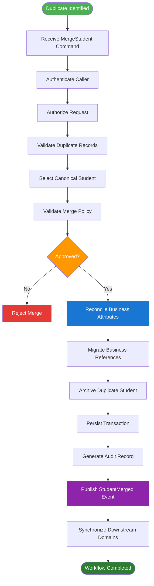

---

## WF-C02-16.17 Summary

The Student Merge & Duplicate Resolution Workflow establishes the canonical Master Data Management (MDM) process for resolving duplicate Student records across the SutraERP platform. By enforcing governed duplicate validation, controlled survivor selection, attribute reconciliation, immutable auditing, and event-driven synchronization, the workflow preserves a single authoritative Student identity while maintaining referential integrity, historical traceability, and consistent cross-domain interoperability throughout the enterprise.

---

## WF-C02-11.15 Summary

The Student Document & Certificate Request Workflow establishes the canonical business process for requesting institution-issued documents while preserving strict domain ownership boundaries between the Student Lifecycle Domain and the Document Services Domain. By enforcing standardized validation, approval governance, auditability, and event-driven integration, the workflow ensures secure, scalable, and maintainable document request management across the SutraERP platform.

# 8.3 Workflow Governance

All Student Lifecycle workflows shall adhere to the following architectural principles:

- Execute through approved service contracts.
- Preserve Student Aggregate consistency.
- Generate immutable audit records.
- Publish canonical domain events upon successful completion.
- Support idempotent execution.
- Enforce authorization through RBAC.
- Prevent unauthorized lifecycle transitions.
- Maintain complete historical traceability.
- Never violate domain ownership boundaries.
- Remain deployment-independent across cloud, hybrid, and on-premises environments.

---

# 8.4 Summary

The Student Lifecycle workflows collectively define the authoritative operational model for managing the Student Aggregate from creation through archival. They provide deterministic lifecycle transitions, preserve institutional history, enforce governance, and establish standardized integration contracts for all downstream domains within the SutraERP ecosystem.
# 9. Business Rules

## 9.1 Overview

Business Rules define the mandatory constraints governing the Student Lifecycle Domain.

These rules ensure consistent lifecycle execution, preserve Student Aggregate integrity, prevent invalid operations, and guarantee interoperability across all dependent domains.

All implementations shall enforce these rules before committing business transactions.

---

# 9.2 Student Identity Rules

| Rule ID | Business Rule |
|----------|---------------|
| BR-C02-001 | Every Student shall originate from a confirmed Admission. |
| BR-C02-002 | A Student shall have exactly one permanent Student ID. |
| BR-C02-003 | Student ID shall never be modified after creation. |
| BR-C02-004 | Duplicate active Student identities are prohibited. |
| BR-C02-005 | Student creation shall be idempotent. |

---

# 9.3 Enrollment Rules

| Rule ID | Business Rule |
|----------|---------------|
| BR-C02-006 | Every Student shall belong to one Institution. |
| BR-C02-007 | Every Student shall have one active enrollment. |
| BR-C02-008 | Enrollment shall reference a valid Academic Session. |
| BR-C02-009 | Enrollment history shall remain immutable. |
| BR-C02-010 | Enrollment modifications shall preserve previous records. |

---

# 9.4 Academic Assignment Rules

| Rule ID | Business Rule |
|----------|---------------|
| BR-C02-011 | Every active Student shall be assigned to a Programme. |
| BR-C02-012 | Every active Student shall belong to a Department. |
| BR-C02-013 | Batch assignment shall reference an active Batch. |
| BR-C02-014 | Section assignment shall reference an active Section. |
| BR-C02-015 | Academic assignments shall maintain historical traceability. |

---

# 9.5 Lifecycle Rules

| Rule ID | Business Rule |
|----------|---------------|
| BR-C02-016 | Student lifecycle shall follow the canonical state model. |
| BR-C02-017 | Invalid lifecycle transitions are prohibited. |
| BR-C02-018 | Suspension shall preserve Student identity. |
| BR-C02-019 | Restoration shall be permitted only for suspended Students. |
| BR-C02-020 | Archived Students shall not return to Active status unless institutional policy explicitly supports reactivation through a governed process. |

---

# 9.6 Status Management Rules

| Rule ID | Business Rule |
|----------|---------------|
| BR-C02-021 | Every Student shall have exactly one current lifecycle status. |
| BR-C02-022 | Status changes shall record effective date and reason. |
| BR-C02-023 | Previous statuses shall remain immutable. |
| BR-C02-024 | Every status transition shall be audited. |
| BR-C02-025 | Status changes shall publish canonical domain events. |

---

# 9.7 Transfer Rules

| Rule ID | Business Rule |
|----------|---------------|
| BR-C02-026 | Student transfer shall not change Student ID. |
| BR-C02-027 | Previous academic assignments shall be retained. |
| BR-C02-028 | Transfer destination shall exist before approval. |
| BR-C02-029 | Transfer shall comply with institutional policy. |
| BR-C02-030 | Transfer shall generate complete audit history and shall not decide or publish a Programme change; Programme-changing mobility is owned by L2-C04 APW-08. |

---

# 9.8 Qualification Completion Rules

| Rule ID | Business Rule |
|----------|---------------|
| BR-C02-031 | Qualification Completion requires successful completion of institutional academic requirements. |
| BR-C02-032 | Qualification Completion status shall be updated upon consuming the `QualificationAwarded` event published by the Qualification Completion domain (L2-C05). Student Lifecycle shall not publish a competing canonical event for this transition. |
| BR-C02-033 | Qualification Completion shall initiate Alumni handoff. |
| BR-C02-034 | Qualification Completion shall preserve the complete Student history. |
| BR-C02-035 | Qualification Completion shall not delete Student records. |

---

# 9.9 Archive Rules

| Rule ID | Business Rule |
|----------|---------------|
| BR-C02-036 | Archived Students shall remain searchable according to authorization policies. |
| BR-C02-037 | Physical deletion of Student records is prohibited. |
| BR-C02-038 | Archived records shall remain available for compliance and reporting. |
| BR-C02-039 | Archive operations shall be fully auditable. |
| BR-C02-040 | Archive shall preserve all historical relationships. A post-creation `AdmissionRevoked` shall route the Student Context through WF-C02-10 only as institutional policy authorizes, without transferring ownership to Admissions. |

---

# 9.10 Cross-Domain Rules

| Rule ID | Business Rule |
|----------|---------------|
| BR-C02-041 | Downstream domains shall consume Student data through approved contracts only. |
| BR-C02-042 | Cross-domain updates shall not directly modify the Student Aggregate. |
| BR-C02-043 | Domain ownership shall remain exclusive to the Student Lifecycle Domain. |
| BR-C02-044 | Domain events shall be immutable. |
| BR-C02-045 | Service contracts shall remain version controlled. |

---

# 9.11 Audit & Compliance Rules

| Rule ID | Business Rule |
|----------|---------------|
| BR-C02-046 | Every lifecycle modification shall generate an immutable audit record. |
| BR-C02-047 | Every business transaction shall include actor identity. |
| BR-C02-048 | Correlation IDs shall be preserved across distributed operations. |
| BR-C02-049 | Business timestamps shall use the platform standard. |
| BR-C02-050 | Audit records shall never be altered through business operations. |

---

# 9.12 Configuration Rules

| Rule ID | Business Rule |
|----------|---------------|
| BR-C02-051 | Student numbering schemes shall be configuration-driven. |
| BR-C02-052 | Academic assignment policies shall be institution configurable. |
| BR-C02-053 | Suspension approval workflows shall be configurable. |
| BR-C02-054 | Communication preferences shall support institution-specific defaults. |
| BR-C02-055 | Business configuration shall not violate canonical lifecycle rules. |

---

## 9.13 Student Document Request Business Rules

The following rules govern requests for official Student documents.

| Rule ID | Business Rule |
|----------|------------------------------------------------------------|
| BR-C02-056 | Official document requests shall reference a valid Student. |
| BR-C02-057 | Requested document types shall be supported by institutional policy. |
| BR-C02-058 | Document generation may require institutional approval where configured. |
| BR-C02-059 | Document requests shall be recorded for audit purposes. |
| BR-C02-060 | Generated documents shall reference the canonical Student identity. |
| BR-C02-061 | Duplicate document requests shall be handled according to institutional policy. |
| BR-C02-062 | Document requests shall never modify the Student Aggregate. |

---

## 9.14 Student Profile Update Business Rules

The following rules govern updates to Student profile information.

| Rule ID | Business Rule |
|----------|------------------------------------------------------------|
| BR-C02-063 | Profile updates shall reference an existing Student Aggregate. |
| BR-C02-064 | Immutable identity attributes shall not be modified through profile updates. |
| BR-C02-065 | Editable fields shall be controlled through authorization policies. |
| BR-C02-066 | Profile changes shall preserve historical auditability where required. |
| BR-C02-067 | Validation shall execute before profile updates are committed. |
| BR-C02-068 | Profile updates shall publish canonical domain events after successful completion. |
| BR-C02-069 | Profile updates shall not violate tenant isolation. |

---

## 9.15 Guardian Management Business Rules

The following rules govern management of Student guardian information.

| Rule ID | Business Rule |
|----------|------------------------------------------------------------|
| BR-C02-070 | Every guardian shall be associated with an existing Student. |
| BR-C02-071 | Guardian relationships shall comply with institution-defined classifications. |
| BR-C02-072 | Primary guardian information shall remain uniquely identifiable. |
| BR-C02-073 | Guardian updates shall be fully auditable. |
| BR-C02-074 | Guardian information shall comply with privacy regulations. |
| BR-C02-075 | Authorization shall be required before guardian information is modified. |
| BR-C02-076 | Guardian updates shall not affect Student identity. |

---

## 9.16 Communication Preference Business Rules

The following rules govern Student communication preferences.

| Rule ID | Business Rule |
|----------|------------------------------------------------------------|
| BR-C02-077 | Communication preferences shall belong to the Student Aggregate. |
| BR-C02-078 | Supported communication channels shall be institution configurable. |
| BR-C02-079 | Communication preferences shall respect institutional consent policies. |
| BR-C02-080 | Preference updates shall be auditable. |
| BR-C02-081 | Unauthorized modification attempts shall be rejected. |
| BR-C02-082 | Preference changes shall publish canonical notification events where applicable. |
| BR-C02-083 | Preference updates shall preserve tenant isolation. |

---

## 9.17 Student Identity Correction Business Rules

The following rules govern controlled correction of Student identity information.

| Rule ID | Business Rule |
|----------|------------------------------------------------------------|
| BR-C02-084 | Identity correction shall never replace the canonical Student identifier. |
| BR-C02-085 | Identity corrections shall require explicit institutional authorization. |
| BR-C02-086 | Supporting evidence shall be recorded where required. |
| BR-C02-087 | Identity corrections shall be fully auditable. |
| BR-C02-088 | Previous identity values shall remain historically traceable. |
| BR-C02-089 | Identity corrections shall preserve cross-domain referential integrity. |
| BR-C02-090 | Identity correction shall publish a canonical domain event. |
| BR-C02-091 | Identity correction shall not create duplicate Student identities. |

---

## 9.18 Student Merge Business Rules

The following rules govern duplicate Student resolution.

| Rule ID | Business Rule |
|----------|------------------------------------------------------------|
| BR-C02-092 | Student merge shall only occur for verified duplicate Student records. |
| BR-C02-093 | Merge operations shall require institutional approval. |
| BR-C02-094 | One Student Aggregate shall be designated as the surviving record. |
| BR-C02-095 | Historical references shall remain traceable after merge completion. |
| BR-C02-096 | Merge operations shall preserve audit history. |
| BR-C02-097 | Merge operations shall preserve external integration references. |
| BR-C02-098 | Merge execution shall be atomic. |
| BR-C02-099 | Merge completion shall publish a canonical domain event. |
| BR-C02-100 | Merge operations shall never violate aggregate consistency. |


---

# 9.19 Summary

The Business Rules defined in this section establish the mandatory behavioral constraints for the Student Lifecycle Domain. Together, they preserve Student identity, enforce deterministic lifecycle transitions, maintain historical integrity, and ensure consistent interaction with every downstream domain across the SutraERP platform.

# 10. Domain Events

## 10.1 Overview

Domain Events represent immutable business facts that have occurred within the Student Lifecycle Domain.

They notify downstream domains of completed business operations without exposing internal implementation details.

Events are published **only after successful transaction commitment** and shall never be modified after publication.

The Student Lifecycle Domain is the authoritative publisher of all Student-related lifecycle events.

---

# 10.2 Event Publishing Principles

Every domain event shall satisfy the following principles:

- Immutable after publication.
- Published only after successful transaction completion.
- Version controlled.
- Timestamped using platform standard.
- Include Correlation ID.
- Include Event Version.
- Support idempotent processing.
- Independent of deployment model.
- Backward compatible where applicable.

---

# 10.3 Event Catalogue

| Event ID | Event | Description |
|-----------|-------------------------------|----------------------------------------------|
| EVT-C02-001 | StudentCreated | Student Aggregate successfully created |
| EVT-C02-002 | StudentActivated | Student activated for institutional services |
| EVT-C02-003 | EnrollmentUpdated | Enrollment information modified |
| EVT-C02-004 | AcademicAssignmentCompleted | Academic assignment completed |
| EVT-C02-005 | StudentStatusChanged | Lifecycle status updated |
| EVT-C02-006 | StudentSuspended | Student temporarily suspended |
| EVT-C02-007 | StudentRestored | Suspended Student restored |
| EVT-C02-008 | StudentTransferred | Student transferred within institution |
| EVT-C02-009 | QualificationAwarded (consumed) | Consumed from L2-C05; not published by Student Lifecycle |
| EVT-C02-010 | StudentArchived | Student lifecycle archived |

---

# 10.4 StudentCreated

## Description

Published immediately after successful creation of the Student Aggregate.

This event establishes the official existence of a Student within the SutraERP ecosystem and marks the point at which downstream domains may begin referencing the Student through canonical service contracts and domain events.

The event represents the authoritative creation of the Student master record and shall never be republished for the same aggregate instance.

### Trigger

Successful completion of:

- WF-C02-01 — Student Creation

### Published By

Student Lifecycle Domain

### Event Payload

| Field | Description |
|---------|---------------------------------------------|
| Event ID | Globally unique event identifier |
| Student ID | Canonical Student identifier |
| Admission ID | Source Admission reference |
| Institution ID | Institution owner |
| Campus ID | Assigned Campus |
| Programme ID | Assigned Programme |
| Academic Session ID | Initial Academic Session |
| Lifecycle State | Created |
| Status | Current operational status |
| Correlation ID | Distributed transaction identifier |
| Event Timestamp | UTC execution timestamp |
| Event Version | Event schema version |

### Typical Consumers

- Academic Delivery
- Attendance
- Examination
- Finance
- Hostel
- Library
- Transport
- Notification Platform
- Analytics Platform
- Document Services

### Business Purpose

The StudentCreated event establishes the canonical Student identity across the enterprise and enables downstream domains to initialize their own read models, reference data, memberships, and business processes without requiring direct access to the Student Aggregate.

# 10.5 StudentActivated

## Description

Published immediately after successful activation of the Student Aggregate.

This event signifies that the Student has satisfied all mandatory institutional prerequisites and is now eligible to participate in operational academic and administrative processes throughout the SutraERP platform.

Student activation marks the transition from a registered Student record to an operational institutional participant.

### Trigger

Successful completion of:

- WF-C02-02 — Student Activation

### Published By

Student Lifecycle Domain

### Event Payload

| Field | Description |
|---------|---------------------------------------------|
| Event ID | Globally unique event identifier |
| Student ID | Canonical Student identifier |
| Institution ID | Institution owner |
| Campus ID | Assigned Campus |
| Academic Session ID | Active Academic Session |
| Lifecycle State | Active |
| Operational Status | Active |
| Activation Date | Effective activation date |
| Correlation ID | Distributed transaction identifier |
| Event Timestamp | UTC execution timestamp |
| Event Version | Event schema version |

### Typical Consumers

- Attendance
- Examination
- Finance
- Hostel
- Library
- Transport
- Learning Management System (LMS)
- Notification Platform
- Analytics Platform

### Business Purpose

The StudentActivated event authorizes downstream domains to begin operational processing for the Student.

Typical examples include:

- Attendance eligibility
- Examination registration
- Library membership activation
- Hostel eligibility
- Transport allocation
- LMS account provisioning
- Notification onboarding
- Analytics synchronization

Downstream domains shall treat this event as the canonical indication that the Student has entered active institutional participation.

# 10.6 EnrollmentUpdated

## Description

Published immediately after successful modification of Student enrollment information.

This event communicates that the Student's enrollment context has changed while preserving the canonical ownership of enrollment identity within the Student Lifecycle Domain.

Enrollment updates may include changes to enrollment status, academic session association, enrollment dates, or other institution-governed enrollment attributes.

### Trigger

Successful completion of:

- WF-C02-03 — Enrollment Management

### Published By

Student Lifecycle Domain

### Event Payload

| Field | Description |
|---------|---------------------------------------------|
| Event ID | Globally unique event identifier |
| Student ID | Canonical Student identifier |
| Institution ID | Institution owner |
| Enrollment Number | Student enrollment identifier |
| Academic Session ID | Current academic session |
| Enrollment Status | Updated enrollment status |
| Effective Date | Date from which enrollment becomes effective |
| Correlation ID | Distributed transaction identifier |
| Event Timestamp | UTC execution timestamp |
| Event Version | Event schema version |

### Typical Consumers

- Academic Delivery
- Examination
- Finance
- Analytics Platform
- Reporting Platform

### Business Purpose

The EnrollmentUpdated event ensures that all downstream domains maintain a consistent understanding of the Student's institutional enrollment.

Typical business scenarios include:

- Examination eligibility updates
- Academic participation validation
- Reporting synchronization
- Institutional analytics refresh
- Enrollment-based financial verification

Consumer domains shall treat this event as the authoritative notification of enrollment changes.

# 10.7 AcademicAssignmentCompleted

## Description

Published immediately after successful assignment or modification of the Student's academic structure.

The event communicates that the Student has been assigned or reassigned to an approved academic context, including Programme, Department, Batch, Section, Semester, or Academic Session as governed by institutional policy.

For a Programme change, this event records application of the C04-approved association to Student Context; `ProgrammeMigrationApproved` remains the sole canonical Programme Migration decision event.

Academic entities remain owned by the Academic Delivery Domain; this event communicates only the Student's reference to those entities.

### Trigger

Successful completion of:

- WF-C02-04 — Academic Assignment

### Published By

Student Lifecycle Domain

### Event Payload

| Field | Description |
|---------|---------------------------------------------|
| Event ID | Globally unique event identifier |
| Student ID | Canonical Student identifier |
| Institution ID | Institution owner |
| Programme ID | Assigned programme |
| Department ID | Assigned department |
| Batch ID | Assigned batch |
| Section ID | Assigned section |
| Academic Session ID | Assigned academic session |
| Semester ID | Assigned semester (where applicable) |
| Correlation ID | Distributed transaction identifier |
| Event Timestamp | UTC execution timestamp |
| Event Version | Event schema version |

### Typical Consumers

- Academic Delivery
- Timetable
- Attendance
- Examination
- Faculty Workload
- Learning Management System (LMS)
- Analytics Platform

### Business Purpose

The AcademicAssignmentCompleted event synchronizes the Student's academic placement across the enterprise.

Typical business scenarios include:

- Timetable generation
- Attendance allocation
- Examination eligibility
- Faculty workload planning
- LMS course enrollment
- Academic analytics

Consumer domains shall regard this event as the canonical notification of changes to the Student's academic assignment.

# 10.8 StudentStatusChanged

## Description

Published immediately after a governed change to the Student's operational status.

This event represents a generic lifecycle status transition that does not require a dedicated domain event. It enables downstream domains to synchronize operational behaviour whenever the Student's status changes according to the canonical lifecycle model.

Dedicated lifecycle events such as StudentSuspended, StudentRestored, and StudentArchived shall continue to be published independently for significant business transitions. Qualification Completion status is instead synchronized locally upon consuming `QualificationAwarded`, published by the Qualification Completion domain (L2-C05); see Section 10.12.

### Trigger

Successful completion of:

- WF-C02-05 — Student Status Change

### Published By

Student Lifecycle Domain

### Event Payload

| Field | Description |
|---------|---------------------------------------------|
| Event ID | Globally unique event identifier |
| Student ID | Canonical Student identifier |
| Institution ID | Institution owner |
| Previous Status | Operational status before change |
| Current Status | Operational status after change |
| Status Reason | Business reason for change |
| Effective Date | Effective status date |
| Correlation ID | Distributed transaction identifier |
| Event Timestamp | UTC execution timestamp |
| Event Version | Event schema version |

### Typical Consumers

- Attendance
- Examination
- Finance
- Hostel
- Library
- Transport
- Placement
- Alumni
- Notification Platform
- Analytics Platform

### Business Purpose

The StudentStatusChanged event enables downstream domains to synchronize operational behaviour whenever a Student's general institutional status changes.

Typical business scenarios include:

- Operational eligibility updates
- Reporting synchronization
- Notification generation
- Institutional dashboards
- Cross-domain policy evaluation

Consumer domains shall not infer specialised lifecycle transitions from this event when a dedicated canonical event exists.


# 10.9 StudentSuspended

## Description

Published immediately after successful suspension of a Student according to approved institutional policy.

Suspension temporarily restricts the Student's participation in institutional operations while preserving the integrity and historical continuity of the Student Aggregate.

The Student remains part of the institutional record throughout the suspension period.

### Trigger

Successful completion of:

- WF-C02-06 — Student Suspension

### Published By

Student Lifecycle Domain

### Event Payload

| Field | Description |
|---------|---------------------------------------------|
| Event ID | Globally unique event identifier |
| Student ID | Canonical Student identifier |
| Institution ID | Institution owner |
| Suspension Reason | Business reason for suspension |
| Effective Date | Suspension effective date |
| Expected Restoration Date | Planned restoration date where applicable |
| Correlation ID | Distributed transaction identifier |
| Event Timestamp | UTC execution timestamp |
| Event Version | Event schema version |

### Typical Consumers

- Attendance
- Examination
- Finance
- Hostel
- Library
- Transport
- Learning Management System (LMS)
- Notification Platform
- Analytics Platform

### Business Purpose

The StudentSuspended event informs downstream domains that the Student's operational privileges may require temporary restriction according to institutional policy.

Typical business actions include:

- Disable attendance participation
- Prevent examination registration where applicable
- Suspend library borrowing privileges
- Restrict hostel services where required
- Pause LMS participation
- Generate institutional notifications
- Update operational dashboards

Consumer domains shall apply suspension policies according to their own governed business rules while preserving historical records.

---

# 10.10 StudentRestored

## Description

Published immediately after a suspended Student is successfully restored to active institutional participation.

Restoration re-enables the Student's eligibility to participate in institutional services according to approved institutional policy. The restoration process shall preserve the complete suspension history for audit and compliance purposes.

### Trigger

Successful completion of:

- WF-C02-07 — Student Restoration

### Published By

Student Lifecycle Domain

### Event Payload

| Field | Description |
|---------|---------------------------------------------|
| Event ID | Globally unique event identifier |
| Student ID | Canonical Student identifier |
| Institution ID | Institution owner |
| Previous Status | Suspended |
| Current Status | Active |
| Restoration Reason | Business justification |
| Restored By | User or Service |
| Correlation ID | Distributed transaction identifier |
| Event Timestamp | UTC execution timestamp |
| Event Version | Event schema version |

### Typical Consumers

- Attendance
- Examination
- Finance
- Hostel
- Library
- Transport
- Learning Management System (LMS)
- Notification Platform
- Analytics Platform

### Business Purpose

The StudentRestored event informs downstream domains that previously suspended institutional privileges may now be reinstated.

Typical business actions include:

- Restore attendance eligibility
- Re-enable examination participation
- Reactivate library privileges
- Restore hostel eligibility
- Resume LMS access
- Generate restoration notifications
- Update institutional dashboards

Consumer domains shall determine the exact restoration behaviour according to their own governed business rules.
---

# 10.11 StudentTransferred

## Description

Published immediately after successful completion of a governed non-Programme Student transfer.

Transfers may occur between campuses, departments, sections, batches, or other non-Programme organisational and placement dimensions according to approved institutional policies. Programme-changing mobility is owned by L2-C04 APW-08 and publishes `ProgrammeMigrationApproved`, not `StudentTransferred`.

The Student Aggregate remains the same throughout the transfer process.

### Trigger

Successful completion of:

- WF-C02-08 — Student Transfer

### Published By

Student Lifecycle Domain

### Event Payload

| Field | Description |
|---------|---------------------------------------------|
| Event ID | Globally unique event identifier |
| Student ID | Canonical Student identifier |
| Institution ID | Institution owner |
| Transfer Type | Campus, Department, Section, Batch, or another non-Programme placement dimension |
| Previous Assignment | Previous academic assignment |
| New Assignment | New academic assignment |
| Effective Date | Transfer effective date |
| Approved By | Authorized approver |
| Correlation ID | Distributed transaction identifier |
| Event Timestamp | UTC execution timestamp |
| Event Version | Event schema version |

### Typical Consumers

- Academic Delivery
- Attendance
- Examination
- Finance
- Hostel
- Library
- Transport
- Learning Management System (LMS)
- Notification Platform
- Analytics Platform

### Business Purpose

The StudentTransferred event enables all dependent domains to synchronize their records following a governed non-Programme organisational or placement transfer.

Typical business actions include:

- Update academic allocation
- Reassign timetable participation
- Update examination eligibility
- Modify hostel or transport assignments
- Notify stakeholders
- Refresh analytical datasets

The Student Aggregate identity shall remain unchanged throughout the transfer.

---

# 10.12 QualificationAwarded (Consumed)

## Description

Published immediately after a Student successfully completes all institutional qualification completion requirements.

Qualification Completion marks the successful completion of the academic programme and initiates downstream post-completion business processes. The Student Aggregate remains part of the operational history until archival.

### Trigger

Successful completion of:

- WF-C02-09 — Student Qualification Completion

### Published By

Student Lifecycle Domain

### Event Payload

| Field | Description |
|---------|---------------------------------------------|
| Event ID | Globally unique event identifier |
| Student ID | Canonical Student identifier |
| Institution ID | Institution owner |
| Programme ID | Completed programme |
| Qualification Completion Date | Official qualification completion date |
| Qualification Completion Classification | Award classification where applicable |
| Degree Status | Degree awarded status |
| Correlation ID | Distributed transaction identifier |
| Event Timestamp | UTC execution timestamp |
| Event Version | Event schema version |

### Typical Consumers

- Alumni
- Degree Management
- Certificate Services
- Finance
- Placement
- Document Services
- Notification Platform
- Analytics Platform

### Business Purpose

The `QualificationAwarded` event is published by the Qualification Completion domain (L2-C05) and consumed here so the Student Aggregate can synchronize its local lifecycle status with that authoritative decision. Downstream institutional post-qualification-completion processes are triggered from L2-C05's event and the downstream Alumni Transition chain (L2-C08), not republished by Student Lifecycle.

Typical business actions include:

- Create Alumni profile
- Generate degree and certificates
- Close academic participation
- Update placement eligibility
- Produce qualification completion notifications
- Update institutional reporting and analytics

Qualification Completion shall not automatically archive the Student Aggregate. Archival remains an independent governed lifecycle operation.

---

# 10.13 StudentArchived

## Description

Published immediately after a Student Aggregate is successfully archived according to institutional retention policies.

Archival marks the completion of the operational Student lifecycle while preserving the complete historical record for compliance, audit, legal retention, and institutional reporting purposes.

The Student Aggregate becomes read-only after archival and shall no longer participate in operational business workflows.

### Trigger

Successful completion of:

- WF-C02-10 — Student Archive

### Published By

Student Lifecycle Domain

### Event Payload

| Field | Description |
|---------|---------------------------------------------|
| Event ID | Globally unique event identifier |
| Student ID | Canonical Student identifier |
| Institution ID | Institution owner |
| Archive Reason | Business justification |
| Archived By | User or Service |
| Archive Date | Effective archive date |
| Retention Policy | Applied retention policy |
| Correlation ID | Distributed transaction identifier |
| Event Timestamp | UTC execution timestamp |
| Event Version | Event schema version |

### Typical Consumers

- Archive Platform
- Analytics Platform
- Audit Platform
- Document Services
- Reporting Platform

### Business Purpose

The StudentArchived event informs downstream domains that the Student Aggregate has transitioned into its historical lifecycle state.

Typical business actions include:

- Move operational records to historical storage
- Update reporting datasets
- Apply retention policies
- Prevent future operational updates
- Preserve compliance history
- Generate audit records

Archival shall not delete the Student Aggregate or any associated historical records.

---

## 10.14 StudentDocumentRequested

### Description

Published immediately after a Student successfully submits a governed request for an official institutional document.

The event confirms that the request has been accepted for downstream processing. It does not indicate that the requested document has been generated or issued.

### Trigger

Successful completion of:

- WF-C02-11 — Student Document Request

### Published By

Student Lifecycle Domain

### Event Payload

| Field | Description |
|---------|---------------------------------------------|
| Event ID | Globally unique event identifier |
| Student ID | Canonical Student identifier |
| Institution ID | Institution owner |
| Request ID | Document request identifier |
| Document Type | Requested document category |
| Requested By | User or Service |
| Delivery Mode | Digital / Physical |
| Priority | Normal / Urgent |
| Correlation ID | Distributed transaction identifier |
| Event Timestamp | UTC execution timestamp |
| Event Version | Event schema version |

### Typical Consumers

- Document Services
- Notification Platform
- Payment & Finance (where chargeable)
- Audit Platform
- Analytics Platform

### Business Purpose

The StudentDocumentRequested event initiates the institutional document fulfilment process.

Typical business actions include:

- Create document generation request
- Validate eligibility
- Initiate approval workflow
- Notify Student
- Calculate applicable fees
- Record audit history

Document generation shall remain the responsibility of the Document Services Domain.

---

## 10.15 StudentProfileUpdated

### Description

Published immediately after governed Student profile information is successfully modified.

This event represents updates to mutable profile attributes only. It shall never indicate modification of immutable Student identity attributes such as Student ID or Admission ID.

### Trigger

Successful completion of:

- WF-C02-12 — Student Profile Update

### Published By

Student Lifecycle Domain

### Event Payload

| Field | Description |
|---------|---------------------------------------------|
| Event ID | Globally unique event identifier |
| Student ID | Canonical Student identifier |
| Institution ID | Institution owner |
| Updated Fields | List of modified profile attributes |
| Updated By | User or Service |
| Change Reason | Optional business reason |
| Correlation ID | Distributed transaction identifier |
| Event Timestamp | UTC execution timestamp |
| Event Version | Event schema version |

### Typical Consumers

- Analytics Platform
- Notification Platform
- Student Services
- Identity Platform
- Audit Platform

### Business Purpose

The StudentProfileUpdated event synchronizes mutable Student profile information across dependent domains.

Typical business actions include:

- Refresh cached profile information
- Update reporting datasets
- Notify subscribed systems
- Record profile history
- Synchronize search indexes

Profile updates shall preserve the canonical Student Aggregate identity and shall not modify immutable identifiers.

---

## 10.16 StudentGuardianUpdated

### Description

Published immediately after Student guardian information is successfully created, updated, replaced, or removed through approved business workflows.

Guardian information forms part of the Student Aggregate and shall always remain governed by Student Lifecycle Domain ownership.

### Trigger

Successful completion of:

- WF-C02-13 — Guardian Management

### Published By

Student Lifecycle Domain

### Event Payload

| Field | Description |
|---------|---------------------------------------------|
| Event ID | Globally unique event identifier |
| Student ID | Canonical Student identifier |
| Institution ID | Institution owner |
| Guardian ID | Guardian reference |
| Change Type | Added / Updated / Replaced / Removed |
| Updated By | User or Service |
| Effective Date | Date change becomes effective |
| Correlation ID | Distributed transaction identifier |
| Event Timestamp | UTC execution timestamp |
| Event Version | Event schema version |

### Typical Consumers

- Notification Platform
- Student Services
- Emergency Contact Services
- Analytics Platform
- Audit Platform

### Business Purpose

The StudentGuardianUpdated event synchronizes guardian information across dependent domains.

Typical business actions include:

- Update emergency contact records
- Refresh guardian communication channels
- Synchronize reporting datasets
- Record guardian history
- Notify dependent institutional services

Guardian modifications shall preserve Student ownership boundaries and shall never alter Student identity.

---

## 10.17 StudentCommunicationPreferencesUpdated

### Description

Published immediately after Student communication preferences are successfully modified through governed self-service or administrative operations.

The event represents changes to communication policy only and shall not indicate changes to Student identity or contact information.

### Trigger

Successful completion of:

- WF-C02-14 — Communication Preference Update

### Published By

Student Lifecycle Domain

### Event Payload

| Field | Description |
|---------|---------------------------------------------|
| Event ID | Globally unique event identifier |
| Student ID | Canonical Student identifier |
| Institution ID | Institution owner |
| Updated Preferences | Modified communication settings |
| Updated By | User or Service |
| Consent Status | Current communication consent |
| Correlation ID | Distributed transaction identifier |
| Event Timestamp | UTC execution timestamp |
| Event Version | Event schema version |

### Typical Consumers

- Notification Platform
- Analytics Platform
- Student Portal
- CRM Services
- Audit Platform

### Business Purpose

The StudentCommunicationPreferencesUpdated event ensures downstream systems honor the Student's latest communication preferences.

Typical business actions include:

- Refresh notification subscriptions
- Update consent records
- Synchronize messaging preferences
- Refresh communication dashboards
- Record compliance history

Communication preference updates shall comply with institutional privacy policies and applicable regulatory requirements.

---

## 10.18 StudentIdentityCorrected

### Description

Published immediately after an authorized correction to mutable Student identity attributes has been approved and committed.

This event shall never indicate modification of the immutable Student Identifier. Identity corrections apply only to approved business attributes such as name, date of birth, gender, or other institution-governed identity information.

### Trigger

Successful completion of:

- WF-C02-15 — Student Identity Correction

### Published By

Student Lifecycle Domain

### Event Payload

| Field | Description |
|---------|---------------------------------------------|
| Event ID | Globally unique event identifier |
| Student ID | Canonical Student identifier |
| Institution ID | Institution owner |
| Corrected Attributes | List of corrected identity fields |
| Correction Reason | Business justification |
| Approved By | Authorized approver |
| Updated By | User or Service |
| Correlation ID | Distributed transaction identifier |
| Event Timestamp | UTC execution timestamp |
| Event Version | Event schema version |

### Typical Consumers

- Examination
- Finance
- Library
- Hostel
- Notification Platform
- Identity Platform
- Analytics Platform
- Audit Platform

### Business Purpose

The StudentIdentityCorrected event synchronizes approved identity corrections across all dependent domains.

Typical business actions include:

- Update replicated identity records
- Refresh identity caches
- Synchronize reporting datasets
- Notify integrated systems
- Record compliance history

The canonical Student ID shall remain immutable throughout the lifetime of the Student Aggregate.

---

## 10.19 StudentMerged

### Description

Published immediately after two verified duplicate Student Aggregates are successfully consolidated into a single canonical Student Aggregate through an approved merge workflow.

The event identifies both the surviving Student Aggregate and the retired aggregate, enabling downstream domains to reconcile references while preserving complete auditability.

Student merging is an exceptional administrative operation and shall only be executed through explicitly authorized governance procedures.

### Trigger

Successful completion of:

- WF-C02-16 — Student Merge

### Published By

Student Lifecycle Domain

### Event Payload

| Field | Description |
|---------|---------------------------------------------|
| Event ID | Globally unique event identifier |
| Surviving Student ID | Canonical Student Aggregate retained |
| Retired Student ID | Duplicate Student Aggregate retired |
| Institution ID | Institution owner |
| Merge Reason | Business justification |
| Approved By | Authorized approver |
| Executed By | User or Service |
| Correlation ID | Distributed transaction identifier |
| Event Timestamp | UTC execution timestamp |
| Event Version | Event schema version |

### Typical Consumers

- Attendance
- Examination
- Finance
- Hostel
- Library
- Transport
- Placement
- Alumni
- Notification Platform
- Analytics Platform
- Audit Platform

### Business Purpose

The StudentMerged event enables downstream systems to safely reconcile duplicate Student references.

Typical business actions include:

- Update foreign references
- Retire obsolete Student records
- Preserve historical traceability
- Refresh analytical datasets
- Synchronize replicated identity data
- Generate compliance audit records

The surviving Student Aggregate shall remain the sole authoritative Student record after merge completion.

---

# 10.20 Canonical Event Structure

Every Student Lifecycle Domain Event shall conform to the canonical event contract defined by the SutraERP Platform Foundation.

This standard structure ensures interoperability, schema consistency, traceability, auditability, and backward-compatible evolution across all business domains.

## Mandatory Metadata

| Field | Description |
|---------|---------------------------------------------|
| Event ID | Globally unique event identifier (UUID) |
| Event Name | Canonical business event name |
| Event Version | Event schema version |
| Aggregate ID | Student Aggregate identifier |
| Aggregate Type | Student |
| Tenant ID | Institution context |
| Correlation ID | Distributed transaction identifier |
| Causation ID | Parent event or originating command |
| Event Timestamp | UTC execution timestamp |
| Published By | Originating domain service |
| Actor ID | User or System initiating the action |
| Actor Type | Human / Service / System |
| Payload | Event-specific business information |

## Event Payload Principles

Event payloads shall:

- Represent completed business facts.
- Contain only business-relevant information.
- Exclude internal implementation details.
- Preserve aggregate ownership boundaries.
- Remain immutable after publication.
- Support schema version evolution.

## Example Structure

```text
Event Metadata
    Event ID
    Event Name
    Event Version
    Aggregate ID
    Tenant ID
    Correlation ID
    Causation ID
    Timestamp
    Actor

Business Payload
    Event Specific Attributes
```
---

# 10.21 Event Lifecycle & Ordering

The Student Lifecycle Domain publishes events that reflect successful completion of business operations.

The canonical lifecycle event sequence is illustrated below.

```text
AdmissionConfirmed
        │
        ▼
StudentCreated
        │
        ▼
StudentActivated
        │
        ▼
EnrollmentUpdated
        │
        ▼
AcademicAssignmentCompleted
        │
        ▼
StudentStatusChanged
        │
 ┌──────┼─────────────┐
 ▼      ▼             ▼
StudentSuspended   StudentTransferred
 │                    │
 ▼                    │
StudentRestored       │
 └─────────┬──────────┘
           ▼
QualificationAwarded
           │
           ▼
StudentArchived
```

## Ordering Principles

The following ordering rules apply:

- Events generated within a single business transaction shall preserve publication order.
- Consumers shall not assume ordering across independent event streams.
- Duplicate event delivery shall be tolerated through idempotent processing.
- Missing events shall be recoverable through replay mechanisms where supported.
- Event ordering guarantees depend upon the messaging infrastructure and partitioning strategy.

Business correctness shall never depend solely upon event arrival order.

---

# 10.22 Event Governance

The publication, evolution, consumption, and retirement of Student Lifecycle Domain Events shall comply with the canonical governance standards defined by the SutraERP Platform Foundation.

These governance rules ensure long-term interoperability, stable integrations, backward compatibility, and clear ownership across all dependent domains.

## 10.22.1 Event Ownership

The Student Lifecycle Domain is the exclusive owner of all Student Lifecycle Domain Events.

No external domain shall:

- Publish Student Lifecycle events on behalf of the Student Lifecycle Domain.
- Modify published Student Lifecycle event schemas.
- Republish altered versions of canonical events.
- Assume ownership of Student Aggregate state.

Business ownership shall remain aligned with the Student Aggregate ownership model.

---

## 10.22.2 Event Versioning

Every published event shall be version controlled.

The following rules apply:

- Every event schema shall contain an explicit Event Version.
- Backward-compatible enhancements shall preserve existing consumers wherever practical.
- Breaking schema changes shall publish a new major event version.
- Multiple event versions may coexist during controlled migration periods.
- Deprecated event versions shall remain supported according to platform deprecation policy.

---

## 10.22.3 Event Publication Rules

Events shall only be published after successful transaction commitment.

The following publication rules apply:

- Failed transactions shall not publish business events.
- Events shall represent completed business facts.
- Events shall be immutable after publication.
- Event publication shall be reliable and recoverable.
- Event publication failures shall be handled using the Platform Outbox Pattern.
- Event publication shall preserve transactional consistency.

---

## 10.22.4 Event Consumption Rules

Consumer domains shall implement resilient event processing.

Consumers shall:

- Process events idempotently.
- Ignore duplicate deliveries.
- Ignore unknown optional attributes.
- Validate supported event versions.
- Avoid assumptions regarding cross-stream ordering.
- Handle delayed event delivery gracefully.

Consumers shall never directly modify the Student Aggregate.

---

## 10.22.5 Security & Privacy

Published events shall comply with institutional security policies.

The following rules apply:

- Personally Identifiable Information (PII) shall be minimized.
- Sensitive attributes shall only be included where explicitly required.
- Tenant isolation shall be preserved.
- Event transport shall follow Platform security standards.
- Consumer authorization shall be enforced before event subscription where applicable.

---

## 10.22.6 Audit Requirements

The following event activities shall be auditable:

- Event publication
- Event replay
- Event schema version changes
- Failed publication attempts
- Manual replay operations
- Administrative event recovery

Audit records shall remain immutable.

---

## 10.22.7 Event Retirement

Events shall never be removed without formal governance.

Deprecated events shall:

- Remain documented.
- Maintain migration guidance.
- Reference replacement events where applicable.
- Follow platform deprecation timelines.
- Preserve historical compatibility for archived data.

---

## 10.22.8 Governance Summary

The Student Lifecycle Domain Event model shall comply with the following mandatory principles:

- Canonical ownership.
- Immutable business facts.
- Version-controlled schemas.
- Reliable publication.
- Idempotent consumption.
- Backward-compatible evolution.
- Secure event transport.
- Complete auditability.
- Platform-wide interoperability.

These governance rules ensure stable integration between the Student Lifecycle Domain and every dependent domain throughout the evolution of the SutraERP platform.

---


# 10.23 Summary

The Domain Events defined within the Student Lifecycle Domain establish the canonical asynchronous integration contract between the Student Aggregate and the remainder of the SutraERP platform.

Each published event represents an immutable business fact that has successfully completed within the Student Lifecycle Domain and serves as the authoritative notification mechanism for downstream academic, administrative, analytical, and operational domains.

By enforcing strict domain ownership, standardized event structures, version-controlled schemas, reliable publication mechanisms, governed evolution, and idempotent consumption, the architecture enables loosely coupled, highly scalable, and operationally resilient cross-domain communication without compromising aggregate consistency or business integrity.

Together with the Platform Event Infrastructure, these Domain Events provide the foundation for enterprise-wide event-driven architecture across cloud, hybrid, and on-premises deployments while preserving long-term maintainability, interoperability, auditability, and deployment independence throughout the SutraERP ecosystem.


# 11. State Model

## 11.1 Overview

The Student Lifecycle Domain follows a deterministic state model that governs every valid transition of the Student Aggregate throughout its institutional lifecycle.

The state model ensures:

- Predictable business behavior
- Lifecycle integrity
- Consistent cross-domain interactions
- Complete auditability
- Deterministic workflow execution

A Student shall always exist in **exactly one current lifecycle state**.

This domain governs **two related state machines**, and they must not be conflated:

- The **Student Aggregate** state machine (sections 11.2 to 11.9) governs the canonical student persona — the institution-wide identity created once from a confirmed Admission.
- The **StudentContext** state machine (section 11.10) governs one student's academic and institutional relationship with **one specific Institute**. A Student may hold many StudentContexts over time, but at most one may be Active within a given Institute.

`StudentContext` is the aggregate name defined in locked L1. Section 11.10 publishes its canonical state list and the mapping between the two machines.

---

# 11.2 Canonical Lifecycle States — Student Aggregate

| State | Description |
|---------|--------------------------------------------|
| Created | Student Aggregate has been created from a confirmed Admission. |
| Activated | Student identity is active and available to downstream domains. |
| Enrolled | Enrollment completed and academic relationship established. |
| Academically Assigned | Programme, Department, Batch, and Section assigned. |
| Active | Student actively participates in institutional activities. |
| Suspended | Student temporarily restricted by institutional policy. |
| Restored | Student returned to Active state after suspension. |
| Transferred | Student reassigned within the institution. |
| Qualification Completed | Academic programme successfully completed. |
| Archived | Institutional lifecycle completed and record retained for history. |

---

# 11.3 Canonical State Diagram

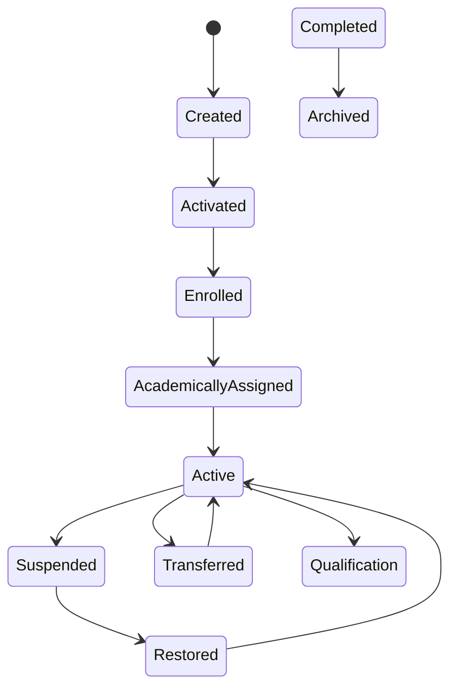

---

# 11.4 State Descriptions

## Created

Represents successful creation of the Student Aggregate.

Characteristics:

- Student ID assigned
- Admission linked
- Identity established
- Awaiting activation

---

## Activated

Student becomes available for institutional services.

Characteristics:

- Identity activated
- Eligible for downstream integrations
- Student officially recognized by the institution

---

## Enrolled

Institutional enrollment has been finalized.

Characteristics:

- Academic session assigned
- Enrollment recorded
- Student becomes academically associated

---

## Academically Assigned

Student receives organizational academic placement.

Assignments include:

- Programme
- Department
- Faculty
- Batch
- Section
- Mentor

---

## Active

Represents the normal operational state.

Student may participate in:

- Attendance
- Timetable
- Examinations
- Library
- Hostel
- Finance
- Transport
- Placement

---

## Suspended

Temporary restriction of institutional participation.

Student identity remains valid.

Historical information remains unchanged.

---

## Restored

Represents successful removal of suspension.

Student returns to Active state.

---

## Transferred

Student organisational or placement assignment changes within the institution without changing Programme.

Examples:

- Campus Transfer
- Department Change
- Batch Change
- Section Change

Programme change is governed separately by L2-C04 APW-08 — Programme Migration.

Student identity remains unchanged.

---

## Qualification Completed

Academic programme completed successfully.

Student becomes eligible for Alumni transition.

---

## Archived

Final lifecycle state.

Characteristics:

- Historical record retained
- No active academic participation
- Record available for compliance and reporting
- Physical deletion prohibited

---

# 11.5 Valid State Transitions

| Current State | Allowed Next State(s) |
|---------------|-----------------------|
| Created | Activated |
| Activated | Enrolled |
| Enrolled | Academically Assigned |
| Academically Assigned | Active |
| Active | Suspended, Transferred, Qualification Completed |
| Suspended | Restored |
| Restored | Active |
| Transferred | Active |
| Qualification Completed | Archived |
| Archived | None |

---

# 11.6 Invalid State Transitions

The following transitions are prohibited:

| Invalid Transition | Reason |
|--------------------|-----------------------------------------|
| Created → Active | Activation required. |
| Activated → Qualification Completed | Academic lifecycle incomplete. |
| Active → Created | Reverse lifecycle prohibited. |
| Archived → Active | Archived records are immutable unless a governed reactivation process is explicitly supported by institutional policy. |
| Qualification Completed → Suspended | Qualification Completion completes the active academic lifecycle. |
| Suspended → Qualification Completed | Restoration required before qualification completion processing. |
| Archived → Deleted | Physical deletion prohibited. |

---

# 11.7 State Ownership

| State | Owning Domain |
|---------|-----------------------------|
| Created | Student Lifecycle |
| Activated | Student Lifecycle |
| Enrolled | Student Lifecycle |
| Academically Assigned | Student Lifecycle |
| Active | Student Lifecycle |
| Suspended | Student Lifecycle |
| Restored | Student Lifecycle |
| Transferred | Student Lifecycle |
| Qualification Completed | Student Lifecycle |
| Archived | Student Lifecycle |

No external domain may directly modify lifecycle state.

---

# 11.8 Transition Triggers

| Transition | Trigger |
|------------|--------------------------------|
| Created → Activated | Student Activation Workflow |
| Activated → Enrolled | Enrollment Completion |
| Enrolled → Academically Assigned | Academic Assignment Workflow |
| Academically Assigned → Active | Institutional Activation Complete |
| Active → Suspended | Suspension Workflow |
| Suspended → Restored | Restoration Workflow |
| Restored → Active | Restoration Complete |
| Active → Transferred | Transfer Workflow |
| Transferred → Active | Transfer Completed |
| Active → Qualification Completed | Qualification Completion Workflow |
| Qualification Completed → Archived | Archive Workflow |

---

# 11.9 State Invariants

The following conditions shall always remain true:

- Student ID is immutable.
- Only one current lifecycle state exists.
- Every transition generates an audit record.
- Every transition publishes a domain event.
- Historical states remain immutable.
- Invalid transitions are rejected.
- Cross-domain systems consume state changes through canonical events or service contracts.
- Lifecycle execution shall remain deterministic.

---

# 11.10 Canonical Lifecycle States — StudentContext

`StudentContext` is the canonical aggregate defined in locked L1 for a student's relationship with a
single Institute. The Student Aggregate is the institution-wide persona; the StudentContext is the
per-Institute academic relationship. Both are owned exclusively by the Student Lifecycle Domain.

## 11.10.1 Canonical StudentContext States

| State | Description | Terminal |
|---|---|---|
| Pending Activation | Context created for an Institute; academic relationship not yet live. | No |
| Active | The student's academic relationship with this Institute is live. | No |
| Suspended | Relationship temporarily restricted by institutional policy; reversible to Active. | No |
| Qualification Completed | The student completed the qualification at this Institute. | Yes |
| Withdrawn | The student voluntarily ended the relationship with this Institute. | Yes |
| Transferred | The relationship moved to another Institute; a new StudentContext is opened there. | Yes |
| Discontinued | The relationship lapsed without a formal exit decision. | Yes |
| Terminated | The institution ended the relationship by administrative or disciplinary decision. | Yes |

## 11.10.2 StudentContext Invariants

| ID | Invariant |
|---|---|
| SC-INV-001 | At most one StudentContext may be `Active` within a given Institute at any point in time. Inherited directly from locked L1. |
| SC-INV-002 | A Student may own multiple historical StudentContexts across institutional history. |
| SC-INV-003 | A StudentContext in any terminal state is immutable and shall be retained for history. |
| SC-INV-004 | A new StudentContext may only be opened for an Institute once every prior StudentContext for that Institute is terminal. |
| SC-INV-005 | Every StudentContext belongs to exactly one Student Aggregate and exactly one Institute. |

## 11.10.3 Mapping — Student Aggregate to StudentContext

The Student Aggregate reflects the institution-wide persona; the StudentContext reflects one Institute
relationship. The mapping below is the authoritative reconciliation between the two machines.

| Student Aggregate state | Corresponding StudentContext state | Notes |
|---|---|---|
| Created | *(none yet)* | Persona exists; no Institute relationship opened. |
| Activated | Pending Activation | Context created for the admitting Institute. |
| Enrolled | Active | Academic relationship established. |
| Academically Assigned | Active | Programme/Batch/Section assigned within the same Active context. |
| Active | Active | Steady state. |
| Suspended | Suspended | Suspension applies to the Active context for that Institute. |
| Restored | Active | Restoration returns the context to Active. |
| Transferred | Transferred (closed) + Pending Activation (new) | The originating context becomes terminal; a new context opens at the receiving Institute. |
| Qualification Completed | Qualification Completed | Terminal for that Institute; triggers `QualificationAwarded` handling in L2-C05. |
| Archived | *(all contexts terminal)* | Persona archived only once every StudentContext is terminal. |

### Exit-state reconciliation

Terminal StudentContext states that have no distinct Student Aggregate state are recorded on the
context, not the persona:

| StudentContext terminal state | Student Aggregate outcome |
|---|---|
| Withdrawn | Persona remains; Aggregate moves to Archived once no Active context remains. |
| Discontinued | Persona remains; Aggregate moves to Archived once no Active context remains. |
| Terminated | Persona remains; Aggregate moves to Archived once no Active context remains. |

## 11.10.4 Ownership

| Concern | Owner |
|---|---|
| Student Aggregate identity and persona lifecycle | Student Lifecycle (L2-C02) |
| StudentContext lifecycle and per-Institute relationship | Student Lifecycle (L2-C02) |
| Qualification Completion decision | Qualification Completion (L2-C05) |
| Student-to-Alumni transition | Alumni Transition (L2-C08) |

No downstream domain may modify StudentContext lifecycle state except through approved
architecture contracts.

Added 2026-08-03 to close integrity finding INT-009: the StudentContext state list was previously
present only inside a master-data reference table, with no published mapping to the Student
Aggregate state machine.

---

# 11.11 Summary

The Student Lifecycle State Model defines the authoritative progression of both the Student Aggregate (the institution-wide persona) and the StudentContext (the per-Institute academic relationship, section 11.10) from creation through archival. By enforcing valid transitions, preserving historical state information, and centralizing lifecycle ownership within the Student Lifecycle Domain, it provides a consistent foundation for all downstream academic and administrative processes across the SutraERP platform.

# 12. Service Contracts

## 12.1 Overview

Service Contracts define the canonical interfaces exposed by the Student Lifecycle Domain.

These contracts provide the only approved mechanism for creating, modifying, querying, or managing the Student Aggregate.

No external domain shall directly access or modify Student data outside these contracts.

---

# 12.2 Service Contract Principles

Every Service Contract exposed by the Student Lifecycle Domain shall comply with the canonical service architecture defined by the SutraERP Platform Foundation.

These principles ensure consistent interoperability, long-term maintainability, secure integration, and stable evolution across all deployment models.

The following principles apply to every Service Contract.

| Principle | Description |
|------------|--------------------------------------------------------------|
| Domain Ownership | Service Contracts shall preserve Student Lifecycle Domain ownership of the Student Aggregate. |
| Technology Independence | Contracts describe business capabilities rather than implementation technology. |
| Version Controlled | Every public contract shall be versioned. |
| Backward Compatibility | Existing consumers shall remain functional wherever practical. |
| Secure by Default | Authentication and authorization shall precede business execution. |
| Idempotent Execution | Commands shall support safe retry where applicable. |
| Auditable | Successful and failed command execution shall be auditable. |
| Deployment Independent | Contracts shall remain consistent across Cloud, Hybrid, and On-Premises deployments. |
| Explicit Validation | All commands shall execute the canonical validation pipeline before modifying business state. |
| Event Driven | Successful command execution shall publish canonical Domain Events where applicable. |

Service Contracts define business behavior only and shall remain independent of transport protocols such as REST, gRPC, messaging systems, or future integration technologies.

---

# 12.3 Command Services

Command Services modify the Student Aggregate and represent the only approved mechanism for changing Student business state.

Every Command Service shall:

- Validate authorization.
- Execute canonical business validation.
- Preserve aggregate consistency.
- Generate audit records.
- Publish Domain Events where applicable.
- Commit changes atomically.

| Contract ID | Service | Primary Workflow | Published Event |
|-------------|-------------------------------|------------------|----------------------------------------------|
| SC-C02-001 | CreateStudent() | WF-C02-01 | StudentCreated |
| SC-C02-002 | ActivateStudent() | WF-C02-02 | StudentActivated |
| SC-C02-003 | UpdateEnrollment() | WF-C02-03 | EnrollmentUpdated |
| SC-C02-004 | AssignAcademicStructure() | WF-C02-04 | AcademicAssignmentCompleted |
| SC-C02-005 | ChangeStudentStatus() | WF-C02-05 | StudentStatusChanged |
| SC-C02-006 | SuspendStudent() | WF-C02-06 | StudentSuspended |
| SC-C02-007 | RestoreStudent() | WF-C02-07 | StudentRestored |
| SC-C02-008 | TransferStudent() | WF-C02-08 | StudentTransferred |
| SC-C02-009 | CompleteQualification() | WF-C02-09 | None (consumes QualificationAwarded from L2-C05) |
| SC-C02-010 | ArchiveStudent() | WF-C02-10 | StudentArchived |
| SC-C02-011 | RequestStudentDocument() | WF-C02-11 | StudentDocumentRequested |
| SC-C02-012 | UpdateStudentProfile() | WF-C02-12 | StudentProfileUpdated |
| SC-C02-013 | ManageStudentGuardian() | WF-C02-13 | StudentGuardianUpdated |
| SC-C02-014 | UpdateCommunicationPreferences() | WF-C02-14 | StudentCommunicationPreferencesUpdated |
| SC-C02-015 | CorrectStudentIdentity() | WF-C02-15 | StudentIdentityCorrected |
| SC-C02-016 | MergeStudents() | WF-C02-16 | StudentMerged |

---

# 12.4 Query Services

Query Services retrieve Student information without modifying the Student Aggregate.

Queries shall execute against approved read models where applicable and shall never generate Domain Events.

| Contract ID | Service | Purpose |
|-------------|----------------------------------------------|--------------------------------------------|
| SQ-C02-001 | GetStudentById() | Retrieve Student using Student ID |
| SQ-C02-002 | GetStudentByEnrollmentNumber() | Retrieve Student using Enrollment Number |
| SQ-C02-003 | GetStudentByAdmissionId() | Retrieve Student from Admission reference |
| SQ-C02-004 | GetStudentAcademicProfile() | Academic assignment information |
| SQ-C02-005 | GetStudentLifecycle() | Lifecycle state and history |
| SQ-C02-006 | GetStudentHistory() | Historical Student timeline |
| SQ-C02-007 | SearchStudents() | Configurable Student search |
| SQ-C02-008 | GetStudentStatus() | Current operational status |
| SQ-C02-009 | GetStudentGuardian() | Guardian information |
| SQ-C02-010 | GetCommunicationPreferences() | Communication settings |
| SQ-C02-011 | GetStudentDocuments() | Document request history |
| SQ-C02-012 | GetStudentAuditSummary() | Audit overview for authorized users |

---

# 12.5 Integration Services

Integration Services expose governed Student information to authorized upstream and downstream domains without transferring ownership of the Student Aggregate.

Integration Services are read-only unless explicitly defined by an approved Architecture Decision Record (ADR).

Every Integration Service shall:

- Preserve Student Aggregate ownership.
- Execute authorization before data retrieval.
- Enforce tenant isolation.
- Return canonical business representations.
- Remain version controlled.
- Support backward compatibility.
- Be independent of transport technology.

| Contract ID | Service | Primary Consumers | Purpose |
|-------------|----------------------------------------|----------------------------------------------|----------------------------------------------|
| SI-C02-001 | ValidateStudent() | All Domains | Verify Student existence and eligibility |
| SI-C02-002 | GetStudentIdentity() | Identity Platform | Retrieve canonical identity |
| SI-C02-003 | GetAcademicAssignment() | Academic Delivery, Attendance | Academic structure lookup |
| SI-C02-004 | GetEnrollmentInformation() | Examination, Finance | Enrollment validation |
| SI-C02-005 | GetStudentEligibility() | Finance, Scholarship | Operational eligibility |
| SI-C02-006 | GetStudentCommunicationProfile() | Notification Platform | Communication preferences |
| SI-C02-007 | GetGuardianInformation() | Student Services | Guardian details |
| SI-C02-008 | GetStudentLifecycleStatus() | Analytics, Reporting | Lifecycle state |
| SI-C02-009 | SearchStudentDirectory() | Authorized Domains | Search Students |
| SI-C02-010 | GetStudentAuditReference() | Audit Platform | Audit linkage |

Integration Services shall never expose internal persistence models or implementation-specific structures.

---

# 12.6 Canonical Service Specifications

Every Command Service shall be formally specified using a standardized architectural template.

Each specification defines:

- Business Purpose
- Workflow Mapping
- Authorization Requirements
- Input Contract
- Output Contract
- Validation Dependencies
- Business Preconditions
- Business Postconditions
- Published Domain Events
- Audit Requirements
- Failure Conditions
- Idempotency Requirements

The following sections define each Command Service individually.

---

## 12.6.1 CreateStudent()

### Purpose

Creates the canonical Student Aggregate following successful Admission confirmation.

### Workflow

- WF-C02-01 — Student Creation

### Authorization

Admission Administrator, Registrar

### Input

- Admission ID
- Institution ID
- Initial Academic Assignment
- Student Profile

### Output

- Student ID
- Student Number
- Lifecycle State = Created

### Preconditions

- Admission confirmed
- No duplicate Student exists
- Institution exists
- Academic Session valid

### Postconditions

- Student Aggregate created
- Student persisted
- Audit record generated
- StudentCreated published

### Published Event

- StudentCreated

### Validation

Refer Section 16.

### Failure Conditions

- Duplicate Student
- Invalid Admission
- Authorization Failure
- Invalid Institution

### Idempotency

Supported using Admission ID and Request ID.

## 12.6.2 ActivateStudent()

### Purpose

Transitions a Created Student into the Active lifecycle state.

### Workflow

- WF-C02-02 — Student Activation

### Authorization

Registrar

### Preconditions

- Student exists
- Student state = Created
- Enrollment validated
- Academic Assignment completed

### Postconditions

- Lifecycle updated
- Student activated
- Audit generated
- StudentActivated published

### Published Event

- StudentActivated

### Failure Conditions

- Already Active
- Missing Enrollment
- Invalid Lifecycle Transition

### Idempotency

Activation shall safely ignore duplicate activation requests.

## 12.6.3 UpdateEnrollment()

### Purpose

Updates Student enrollment information while preserving complete enrollment history.

### Workflow

- WF-C02-03 — Enrollment Update

### Authorization

Registrar
Academic Office

### Preconditions

- Student Active
- Academic Session valid
- Enrollment policy satisfied

### Postconditions

- Enrollment updated
- Historical enrollment preserved
- Audit generated
- EnrollmentUpdated published

### Published Event

- EnrollmentUpdated

### Failure Conditions

- Invalid Session
- Duplicate Enrollment
- Policy Violation

### Idempotency

Enrollment updates shall support safe retry using Request ID.

## 12.6.4 AssignAcademicStructure()

### Purpose

Assigns or updates the Student's academic structure within the institution, including Programme, Department, Academic Session, Batch, Section, Semester, Mentor, and Advisor references.

The service establishes the academic context required for downstream academic operations while preserving historical assignment integrity.

For a Programme change, this service applies only the already-approved `ProgrammeMigrationApproved` result from L2-C04 to the C02-owned Student Context. It does not evaluate, approve, or publish a competing Programme Migration decision.

### Workflow

- WF-C02-04 — Academic Assignment

### Authorization

Academic Administrator  
Registrar

### Input

- Student ID
- Programme ID
- Department ID
- Academic Session ID
- Batch ID
- Section ID (Optional)
- Semester ID (Optional)
- Mentor ID (Optional)
- Advisor ID (Optional)

### Output

Updated Academic Assignment

### Preconditions

- Student exists.
- Student is Active.
- Programme exists.
- Department exists.
- Academic Session exists.
- Batch exists.
- All academic references belong to the same Institution.
- If the current Programme association will change, a matching `ProgrammeMigrationApproved` result from L2-C04 exists.

### Postconditions

- Academic Assignment updated.
- Previous assignment preserved where applicable.
- Audit record generated.
- AcademicAssignmentCompleted event published.

### Published Event

- AcademicAssignmentCompleted

### Validation

Refer Section 16.

### Failure Conditions

- Invalid Programme
- Missing ProgrammeMigrationApproved for an existing Programme-association change
- Invalid Batch
- Invalid Section
- Invalid Academic Session
- Authorization Failure

### Idempotency

Supported using Student ID and Request ID.

## 12.6.5 ChangeStudentStatus()

### Purpose

Updates the operational status of the Student Aggregate while enforcing the canonical lifecycle state model.

Status changes shall never bypass lifecycle validation.

### Workflow

- WF-C02-05 — Student Status Change

### Authorization

Registrar

### Input

- Student ID
- Target Status
- Business Reason

### Output

Updated Student Status

### Preconditions

- Student exists.
- Requested transition is valid.
- Current lifecycle permits transition.

### Postconditions

- Student status updated.
- Status history preserved.
- Audit record generated.
- StudentStatusChanged event published.

### Published Event

- StudentStatusChanged

### Validation

Refer Section 16.

### Failure Conditions

- Invalid Transition
- Archived Student
- Authorization Failure

### Idempotency

Duplicate requests shall not generate duplicate status changes.

## 12.6.6 SuspendStudent()

### Purpose

Temporarily suspends an Active Student according to institutional policy while preserving the complete Student Aggregate.

Suspension restricts operational participation but does not remove historical data.

### Workflow

- WF-C02-06 — Student Suspension

### Authorization

Registrar  
Authorized Administrative Authority

### Input

- Student ID
- Suspension Reason
- Effective Date

### Output

Student Lifecycle = Suspended

### Preconditions

- Student is Active.
- Suspension policy satisfied.
- Authorization approved.

### Postconditions

- Student suspended.
- Suspension recorded.
- Audit record generated.
- StudentSuspended event published.

### Published Event

- StudentSuspended

### Validation

Refer Section 16.

### Failure Conditions

- Invalid Lifecycle State
- Already Suspended
- Authorization Failure

### Idempotency

Repeated suspension requests shall safely return the existing suspended state.

## 12.6.7 RestoreStudent()

### Purpose

Restores a previously suspended Student to Active status after satisfying institutional restoration policies.

### Workflow

- WF-C02-07 — Student Restoration

### Authorization

Registrar  
Authorized Administrative Authority

### Input

- Student ID
- Restoration Reason

### Output

Student Lifecycle = Active

### Preconditions

- Student is Suspended.
- Restoration policy satisfied.

### Postconditions

- Student restored.
- Restoration history recorded.
- Audit record generated.
- StudentRestored event published.

### Published Event

- StudentRestored

### Validation

Refer Section 16.

### Failure Conditions

- Student not Suspended
- Authorization Failure
- Policy Violation

### Idempotency

Duplicate restoration requests shall safely return the restored state.

## 12.6.8 TransferStudent()

### Purpose

Transfers a Student between approved non-Programme organisational or placement structures within the Institution while preserving complete assignment history.

Transfers shall never result in loss of historical academic assignments.

### Workflow

- WF-C02-08 — Student Transfer

### Authorization

Registrar  
Academic Administrator

### Input

- Student ID
- Target Campus (where applicable)
- Target Department
- Target Batch
- Target Section
- Transfer Reason

### Output

Updated Academic Assignment

### Preconditions

- Student is Active.
- Target non-Programme placement structure exists.
- Transfer policy satisfied.

### Postconditions

- Previous assignment archived.
- New assignment activated.
- Audit record generated.
- StudentTransferred event published.

### Published Event

- StudentTransferred

### Validation

Refer Section 16.

### Failure Conditions

- Invalid Non-Programme Placement Structure
- Transfer Not Allowed
- Authorization Failure

### Idempotency

Duplicate transfer requests shall not create duplicate assignment history.

## 12.6.9 CompleteQualification()

### Purpose

Completes the academic lifecycle of a Student after all institutional qualification completion requirements have been successfully satisfied.

Qualification Completion represents the transition from an Active Student to a Qualification Completed Student while preserving the complete academic and operational history.

### Workflow

- WF-C02-09 — Student Qualification Completion

### Authorization

Registrar  
Examination Authority

### Input

- Student ID
- Qualification Completion Date
- Qualification Completion Session
- Qualification Completion Remarks (Optional)

### Output

Student Lifecycle = Qualification Completed

### Preconditions

- Student is Active.
- Academic completion verified.
- Examination clearance completed.
- Financial clearance completed where applicable.
- Institutional qualification completion policy satisfied.

### Postconditions

- Student marked as Qualification Completed.
- Qualification Completion details recorded.
- Audit record generated.
- Local Qualification Completion status synchronized from the consumed `QualificationAwarded` event (L2-C05).

### Published Event

- QualificationAwarded

### Validation

Refer Section 16.

### Failure Conditions

- Qualification Completion requirements not met.
- Pending academic obligations.
- Authorization failure.

### Idempotency

Duplicate qualification completion requests shall safely return the existing Qualification Completed state without creating duplicate business operations.

## 12.6.10 ArchiveStudent()

### Purpose

Archives the Student Aggregate after completion of the operational lifecycle, or after a post-creation Admission Revocation when institutional policy so directs, according to institutional retention policies.

Archival preserves the complete historical record while preventing further operational modifications.

### Workflow

- WF-C02-10 — Student Archive

### Authorization

Registrar  
System Administrator (Policy Controlled)

### Input

- Student ID
- Archive Reason
- Retention Policy

### Output

Student Lifecycle = Archived

### Preconditions

- Student is eligible for archival under institutional policy, including a post-creation `AdmissionRevoked` where that policy directs archival.
- Retention policy satisfied.
- Required approvals completed.

### Postconditions

- Student archived.
- Aggregate becomes read-only.
- Audit record generated.
- StudentArchived event published.

### Published Event

- StudentArchived

### Validation

Refer Section 16.

### Failure Conditions

- Invalid lifecycle state.
- Retention policy violation.
- Authorization failure.

### Idempotency

Repeated archive requests shall safely return the existing Archived state.

## 12.6.11 RequestStudentDocument()

### Purpose

Registers a governed request for an official institutional document associated with the Student.

The service records the request and initiates downstream document processing without generating the document itself.

### Workflow

- WF-C02-11 — Student Document Request

### Authorization

Student  
Registrar  
Authorized Administrative Staff

### Input

- Student ID
- Document Type
- Delivery Mode
- Purpose
- Priority (Optional)

### Output

Document Request ID

### Preconditions

- Student exists.
- Student eligible for requested document.
- Outstanding policy validations satisfied.
- Applicable fees verified where required.

### Postconditions

- Document request recorded.
- Audit record generated.
- StudentDocumentRequested event published.

### Published Event

- StudentDocumentRequested

### Validation

Refer Section 16.

### Failure Conditions

- Invalid document type.
- Student not eligible.
- Required approval missing.
- Outstanding obligations preventing issuance.

### Idempotency

Duplicate requests shall be detected using Request ID and Student ID.

## 12.6.12 UpdateStudentProfile()

### Purpose

Updates mutable Student profile information while preserving the integrity of the canonical Student identity.

Immutable identity attributes shall not be modified through this service.

### Workflow

- WF-C02-12 — Student Profile Update

### Authorization

Student (Self-Service)  
Registrar  
Authorized Administrative Staff

### Input

- Student ID
- Updated Profile Information

### Output

Updated Student Profile

### Preconditions

- Student exists.
- Requested attributes are editable.
- Authorization validated.

### Postconditions

- Student profile updated.
- Audit record generated.
- StudentProfileUpdated event published.

### Published Event

- StudentProfileUpdated

### Validation

Refer Section 16.

### Failure Conditions

- Attempt to modify immutable attributes.
- Authorization failure.
- Invalid profile data.

### Idempotency

Profile updates shall safely ignore duplicate requests containing identical business data.

## 12.6.13 ManageStudentGuardian()

### Purpose

Creates, updates, replaces, or removes Student guardian information while maintaining complete historical traceability.

Guardian management remains exclusively owned by the Student Lifecycle Domain.

### Workflow

- WF-C02-13 — Guardian Management

### Authorization

Student (where permitted)  
Registrar  
Authorized Administrative Staff

### Input

- Student ID
- Guardian Information
- Change Type

### Output

Updated Guardian Information

### Preconditions

- Student exists.
- Guardian information satisfies institutional policy.
- Authorization validated.

### Postconditions

- Guardian information updated.
- Audit record generated.
- StudentGuardianUpdated event published.

### Published Event

- StudentGuardianUpdated

### Validation

Refer Section 16.

### Failure Conditions

- Invalid guardian information.
- Policy violation.
- Authorization failure.

### Idempotency

Repeated requests with identical guardian information shall not create duplicate updates.

## 12.6.14 UpdateCommunicationPreferences()

### Purpose

Updates the Student's communication preferences governing institutional notifications across supported communication channels.

This service manages communication preferences only and shall not modify Student identity or contact information.

### Workflow

- WF-C02-14 — Communication Preference Update

### Authorization

Student (Self-Service)  
Registrar  
Authorized Administrative Staff

### Input

- Student ID
- Communication Preferences
- Preferred Language
- Notification Channel Preferences

### Output

Updated Communication Preferences

### Preconditions

- Student exists.
- Communication preference configuration is valid.
- Authorization successfully verified.

### Postconditions

- Communication preferences updated.
- Audit record generated.
- StudentCommunicationPreferencesUpdated event published.

### Published Event

- StudentCommunicationPreferencesUpdated

### Validation

Refer Section 16.

### Failure Conditions

- Invalid communication preference.
- Unsupported notification channel.
- Authorization failure.

### Idempotency

Submitting identical communication preferences multiple times shall not generate duplicate updates or events.

## 12.6.14 UpdateCommunicationPreferences()

### Purpose

Updates the Student's communication preferences governing institutional notifications across supported communication channels.

This service manages communication preferences only and shall not modify Student identity or contact information.

### Workflow

- WF-C02-14 — Communication Preference Update

### Authorization

Student (Self-Service)  
Registrar  
Authorized Administrative Staff

### Input

- Student ID
- Communication Preferences
- Preferred Language
- Notification Channel Preferences

### Output

Updated Communication Preferences

### Preconditions

- Student exists.
- Communication preference configuration is valid.
- Authorization successfully verified.

### Postconditions

- Communication preferences updated.
- Audit record generated.
- StudentCommunicationPreferencesUpdated event published.

### Published Event

- StudentCommunicationPreferencesUpdated

### Validation

Refer Section 16.

### Failure Conditions

- Invalid communication preference.
- Unsupported notification channel.
- Authorization failure.

### Idempotency

Submitting identical communication preferences multiple times shall not generate duplicate updates or events.

## 12.6.16 MergeStudents()

### Purpose

Merges two verified duplicate Student Aggregates into a single canonical Student record while preserving complete historical traceability.

The merge process shall retain one canonical Student Aggregate and permanently retire the duplicate aggregate.

### Workflow

- WF-C02-16 — Student Merge

### Authorization

Registrar  
System Administrator (Policy Controlled)

### Input

- Primary Student ID
- Duplicate Student ID
- Merge Reason
- Approval Reference

### Output

Merged Student Aggregate

### Preconditions

- Both Student records exist.
- Duplicate relationship verified.
- Administrative approval obtained.
- Merge policy satisfied.

### Postconditions

- Duplicate Student retired.
- References consolidated.
- Full audit trail preserved.
- StudentMerged event published.

### Published Event

- StudentMerged

### Validation

Refer Section 16.

### Failure Conditions

- Students are not eligible for merge.
- Duplicate verification failed.
- Authorization failure.
- Merge policy violation.

### Idempotency

Repeated merge requests referencing an already completed merge shall safely return the surviving Student Aggregate.


# 12.7 Service Authorization Framework

Every Service Contract shall enforce authorization through the canonical Platform Authorization Framework (L2-A04).

Authorization shall be evaluated before business validation to prevent unauthorized access to Student resources.

Authorization decisions shall consider:

- User Identity
- Assigned Roles
- Granted Permissions
- Institutional Scope
- Campus Scope
- Department Scope
- Student Ownership (where applicable)
- Workflow Context
- Policy Configuration
- Delegated Authority
- Emergency Override Policies (if enabled)

No service shall execute business logic before successful authorization.

---

## 12.7.1 Authorization Matrix

| Service | Primary Roles | Scope Validation |
|----------|------------------------------|--------------------------------|
| CreateStudent() | Admission Administrator, Registrar | Institution |
| ActivateStudent() | Registrar | Institution |
| UpdateEnrollment() | Registrar, Academic Office | Institution, Academic Session |
| AssignAcademicStructure() | Academic Administrator | Programme, Department |
| ChangeStudentStatus() | Registrar | Institution |
| SuspendStudent() | Registrar, Discipline Authority | Institution |
| RestoreStudent() | Registrar | Institution |
| TransferStudent() | Registrar | Institution, Campus |
| CompleteQualification() | Registrar, Examination Authority | Institution |
| ArchiveStudent() | Registrar, System Administrator | Institution |
| RequestStudentDocument() | Student, Registrar | Student Ownership |
| UpdateStudentProfile() | Student, Registrar | Student Ownership |
| ManageGuardianInformation() | Student, Registrar | Student Ownership |
| UpdateCommunicationPreferences() | Student | Student Ownership |
| CorrectStudentIdentity() | Registrar | Institution |
| MergeStudents() | Registrar, System Administrator | Institution |

---

## 12.7.2 Authorization Principles

All Student services shall comply with the following principles:

- Least Privilege
- Explicit Authorization
- Tenant Isolation
- Scope Validation
- Role Separation
- Auditability
- Policy-Based Decisions
- Configuration Driven Authorization

Authorization decisions shall be fully audited through the Platform Audit Framework.

---

# 12.8 Canonical Error Contracts

Every Service Contract shall return standardized, versioned error responses.

Error contracts provide consistent behavior across APIs, workflow execution, event publishing, and integration services.

Errors shall never expose internal implementation details.

---

## 12.8.1 Error Categories

| Category | Purpose |
|----------|----------------------------------------------|
| Validation Error | Invalid business input |
| Authorization Error | Permission denied |
| Business Rule Error | Business policy violation |
| State Error | Invalid lifecycle transition |
| Duplicate Error | Duplicate Student detected |
| Dependency Error | Required upstream dependency unavailable |
| Integration Error | External integration failure |
| Configuration Error | Invalid institutional configuration |
| Infrastructure Error | Platform failure |

---

## 12.8.2 Canonical Error Codes

| Error Code | Description |
|-------------|----------------------------------------------|
| STU-001 | Student Not Found |
| STU-002 | Duplicate Student |
| STU-003 | Invalid Lifecycle Transition |
| STU-004 | Invalid Enrollment |
| STU-005 | Invalid Academic Assignment |
| STU-006 | Unauthorized Operation |
| STU-007 | Student Already Active |
| STU-008 | Student Already Archived |
| STU-009 | Transfer Not Permitted |
| STU-010 | Qualification Completion Requirements Not Met |
| STU-011 | Document Request Not Allowed |
| STU-012 | Guardian Validation Failed |
| STU-013 | Communication Preference Invalid |
| STU-014 | Identity Correction Not Authorized |
| STU-015 | Student Merge Validation Failed |

---

## 12.8.3 Error Response Structure

Every error response shall include:

- Error Code
- Error Category
- Error Message
- Correlation ID
- Timestamp
- Service Version
- Retry Indicator (where applicable)

All error responses shall remain backward compatible.

---

# 12.9 Service Governance

The Student Lifecycle Service Contracts constitute the official public API surface of the domain.

All services shall comply with the following governance principles.

---

## Versioning

- Public contracts shall be version controlled.
- Breaking changes require a new major version.
- Deprecated contracts shall remain supported during the approved transition period.

---

## Backward Compatibility

Backward compatibility shall be preserved whenever feasible.

Consumers shall not be forced to upgrade unless a breaking architectural change has been approved.

---

## Idempotency

Command services supporting retries shall implement idempotent execution.

Duplicate requests shall not produce duplicate Student Aggregates or duplicate Domain Events.

---

## Auditability

Every successful command shall generate:

- Audit Record
- Correlation ID
- Domain Event (where applicable)

---

## Observability

All services shall publish:

- Request Metrics
- Latency Metrics
- Failure Metrics
- Audit Information
- Distributed Traces

---

## Security

Every service shall enforce:

- Authentication
- Authorization
- Tenant Isolation
- Field-Level Security
- Audit Logging

---

## Integration Rules

External domains shall interact only through approved Service Contracts or published Domain Events.

Direct persistence access to the Student Aggregate is strictly prohibited.

---

# 12.10 Summary

The Service Contracts defined in this section establish the canonical application interface for the Student Lifecycle Domain.

Together, the sixteen Command Services, eight Query Services, and six Integration Services provide a governed, versioned, secure, and auditable interaction model for managing the complete Student lifecycle.

These contracts preserve strict ownership of the Student Aggregate, enforce business validation and authorization, generate immutable audit records, publish canonical Domain Events, and provide standardized integration mechanisms for all dependent domains.

By combining Domain-Driven Design principles, CQRS, event-driven integration, policy-based authorization, standardized error contracts, and configuration-driven governance, the Student Lifecycle Domain delivers a stable and extensible service architecture that aligns with the canonical enterprise architecture of the SutraERP platform.

# 13. Authorization & Access Control

## 13.1 Overview

The Student Lifecycle Domain manages one of the most sensitive business aggregates within the SutraERP platform.

Authorization controls shall ensure that only properly authorized users, services, and automated workflows can view or modify Student information.

Authorization shall be enforced through the Platform Foundation RBAC framework and shall remain independent of business logic.

---

# 13.2 Authorization Architecture Principles

The Student Lifecycle Domain shall inherit and comply with the canonical Platform Authorization Framework defined in **L2-A04 — Authorization & Policy Workflows**.

Authorization shall be enforced independently of business logic and evaluated before any business validation or aggregate modification.

Every authorization decision shall be policy-driven, auditable, tenant-aware, and consistently enforced across all interaction channels.

The Student Lifecycle Domain follows these authorization principles:

- Least Privilege
- Explicit Deny by Default
- Role-Based Access Control (RBAC)
- Attribute-Based Access Control (ABAC)
- Policy-Based Authorization
- Scope-Based Authorization
- Separation of Duties (SoD)
- Tenant Isolation
- Institutional Boundary Enforcement
- Campus Boundary Enforcement
- Student Ownership Validation
- Delegated Authority
- Configuration-Driven Authorization
- Immutable Authorization Audit
- Secure Service-to-Service Authorization
- Zero Trust Principles

These principles shall apply uniformly to User Interfaces, APIs, Batch Jobs, Workflow Engine executions, Integration Services, and System-to-System communication.

---
# 13.2 Authorization Architecture Principles

The Student Lifecycle Domain shall inherit and comply with the canonical Platform Authorization Framework defined in **L2-A04 — Authorization & Policy Workflows**.

Authorization shall be enforced independently of business logic and evaluated before any business validation or aggregate modification.

Every authorization decision shall be policy-driven, auditable, tenant-aware, and consistently enforced across all interaction channels.

The Student Lifecycle Domain follows these authorization principles:

- Least Privilege
- Explicit Deny by Default
- Role-Based Access Control (RBAC)
- Attribute-Based Access Control (ABAC)
- Policy-Based Authorization
- Scope-Based Authorization
- Separation of Duties (SoD)
- Tenant Isolation
- Institutional Boundary Enforcement
- Campus Boundary Enforcement
- Student Ownership Validation
- Delegated Authority
- Configuration-Driven Authorization
- Immutable Authorization Audit
- Secure Service-to-Service Authorization
- Zero Trust Principles

These principles shall apply uniformly to User Interfaces, APIs, Batch Jobs, Workflow Engine executions, Integration Services, and System-to-System communication.

---


# 13.3 Authorization Capability Categories

Authorization within the Student Lifecycle Domain shall be evaluated against business capabilities rather than CRUD operations alone.

| Capability | Description |
|------------|----------------------------------------------|
| Student Creation | Create Student Aggregate |
| Student Activation | Activate institutional participation |
| Profile Management | Update permitted Student profile fields |
| Identity Correction | Correct governed identity attributes |
| Guardian Management | Manage guardian information |
| Communication Preference Management | Manage notification preferences |
| Enrollment Management | Modify enrollment information |
| Academic Assignment | Assign programme, batch, section, department |
| Lifecycle Management | Status transitions |
| Suspension Management | Suspend Student |
| Restoration Management | Restore Student |
| Transfer Management | Transfer Student |
| Qualification Completion Management | Qualification Completed Student |
| Archive Management | Archive Student |
| Document Requests | Request official institutional documents |
| Student Merge | Merge duplicate Student records |
| Reporting | Read analytical information |
| Audit | View audit history |
| Configuration | Manage authorization configuration |

---

# 13.4 Canonical Authorization Roles

The Student Lifecycle Domain recognizes the following canonical roles.

| Role | Responsibilities |
|------|-----------------------------------------------|
| Platform Administrator | Platform-wide governance |
| Institution Administrator | Institution administration |
| Registrar | Complete Student lifecycle governance |
| Admission Administrator | Student creation after Admission |
| Academic Administrator | Academic assignments |
| Department Administrator | Department-level operations |
| Examination Administrator | Qualification Completion coordination |
| Finance Officer | Eligibility verification |
| Student Services Officer | Student support operations |
| Faculty Member | Read-only academic access |
| Mentor | Assigned Student advisory access |
| Student | Self-service operations |
| Parent / Guardian | Policy-controlled delegated access |
| Auditor | Audit and compliance review |
| Integration Service | Trusted machine identity |
| Workflow Engine | Automated workflow execution |

Additional institution-specific roles may be configured through the Platform Authorization Framework without modifying domain logic.

---

# 13.5 Authorization Matrix

| Capability | Platform Admin | Institution Admin | Registrar | Academic Admin | Student | Faculty | Auditor |
|------------|----------------|-------------------|------------|----------------|----------|----------|----------|
| Create Student | ✓ | ✓ | ✓ | ✗ | ✗ | ✗ | ✗ |
| Activate Student | ✓ | ✓ | ✓ | ✗ | ✗ | ✗ | ✗ |
| Update Profile | Limited | Limited | ✓ | ✗ | Self | ✗ | ✗ |
| Identity Correction | ✓ | ✓ | ✓ | ✗ | ✗ | ✗ | ✗ |
| Guardian Management | Limited | Limited | ✓ | ✗ | Self | ✗ | ✗ |
| Communication Preferences | ✗ | ✗ | ✓ | ✗ | Self | ✗ | ✗ |
| Enrollment Update | ✗ | ✓ | ✓ | ✓ | ✗ | ✗ | ✗ |
| Academic Assignment | ✗ | ✓ | ✓ | ✓ | ✗ | ✗ | ✗ |
| Suspend Student | ✗ | ✓ | ✓ | ✗ | ✗ | ✗ | ✗ |
| Restore Student | ✗ | ✓ | ✓ | ✗ | ✗ | ✗ | ✗ |
| Transfer Student | ✗ | ✓ | ✓ | ✓ | ✗ | ✗ | ✗ |
| Qualification Completed Student | ✗ | ✗ | ✓ | Limited | ✗ | ✗ | ✗ |
| Archive Student | ✓ | ✓ | ✓ | ✗ | ✗ | ✗ | Read |
| Merge Students | ✓ | ✓ | ✓ | ✗ | ✗ | ✗ | ✗ |
| View Reports | ✓ | ✓ | ✓ | ✓ | Self | Limited | ✓ |
| View Audit | ✓ | ✓ | ✓ | ✗ | ✗ | ✗ | ✓ |

Actual permissions shall be determined through policy evaluation and institutional configuration.

---

# 13.6 Authorization Rules

The following authorization rules govern all operations performed within the Student Lifecycle Domain.

| Rule ID | Rule |
|----------|--------------------------------------------------------------------------------------------------------------------------------|
| AUTH-C02-001 | Every request shall authenticate the caller before authorization is evaluated. |
| AUTH-C02-002 | Authorization shall always be evaluated before business validation and workflow execution. |
| AUTH-C02-003 | Authorization shall follow a deny-by-default model unless access is explicitly granted. |
| AUTH-C02-004 | Cross-tenant access shall be prohibited under all circumstances. |
| AUTH-C02-005 | Authorization decisions shall validate Institution, Campus, Department, and other applicable operational scopes. |
| AUTH-C02-006 | Student self-service operations shall be limited to institution-approved capabilities only. |
| AUTH-C02-007 | Sensitive operations shall require policy evaluation through the Platform Authorization Framework. |
| AUTH-C02-008 | Delegated authority shall be validated before allowing delegated operations. |
| AUTH-C02-009 | Separation of Duties (SoD) policies shall prevent conflicting administrative operations where configured. |
| AUTH-C02-010 | Service-to-service communication shall use trusted platform identities and managed credentials. |
| AUTH-C02-011 | Field-level authorization shall be enforced for protected Student attributes. |
| AUTH-C02-012 | Every authorization decision shall generate an auditable security record. |
| AUTH-C02-013 | Emergency override (Break-Glass) access shall be permitted only through approved institutional policy and shall always be audited. |
| AUTH-C02-014 | Authorization policies shall remain configuration-driven and version controlled. |
| AUTH-C02-015 | Authorization failures shall never modify business state or publish Domain Events. |

Authorization policies shall be centrally managed through the Platform Authorization Framework and shall remain independent of business logic.

---

# 13.7 Field-Level Security

Certain Student information requires additional protection beyond standard role-based authorization.

Field-level security shall be enforced through the Platform Authorization Framework and evaluated independently for every request.

| Data Category | Access Policy |
|---------------|--------------------------------------------------------------|
| Student ID | Read Only |
| Admission ID | Read Only |
| Government Identifiers | Restricted |
| Personal Identity Information | Restricted |
| Contact Information | Role Based |
| Guardian Information | Role Based |
| Communication Preferences | Student Self-Service / Role Based |
| Disability Information | Restricted |
| Medical Information | Restricted |
| Reservation / Category Information | Restricted |
| Scholarship Eligibility | Restricted |
| Financial Aid Indicators | Restricted |
| Academic Assignment | Role Based |
| Enrollment Information | Role Based |
| Lifecycle Status | Role Based |
| Identity Correction History | Administrative Roles Only |
| Student Merge History | Administrative Roles Only |
| Document Request History | Role Based |
| Audit Information | Audit Roles Only |

Sensitive attributes shall be protected through:

- Field masking
- Partial disclosure
- Attribute redaction
- Policy-based authorization
- Tenant isolation
- Audit logging

Field-level authorization shall be evaluated independently of page-level or service-level authorization and shall prevent unauthorized disclosure even when access to the containing resource has been granted.

---

# 13.8 Self-Service Access

Students shall be permitted to perform only institution-approved self-service operations.

Self-service capabilities shall be governed through institutional configuration and enforced by the Platform Authorization Framework.

| Capability | Description |
|------------|------------------------------------------------------------|
| View Personal Profile | View institution-approved personal information |
| Update Student Profile | Modify permitted profile attributes |
| Manage Guardian Information | Add or update guardian details where permitted |
| Manage Communication Preferences | Update notification preferences |
| View Enrollment Information | View enrollment and academic session details |
| View Academic Assignment | View programme, department, batch, and section |
| View Lifecycle Status | View current Student lifecycle state |
| Request Official Documents | Submit requests for institutional documents |
| Download Approved Documents | Download institution-approved documents |
| View Student History | View institution-approved historical information |

The following restrictions shall always apply:

- Students shall never modify the canonical Student Identifier.
- Students shall never modify enrollment history.
- Students shall never change lifecycle states.
- Students shall never modify academic assignments.
- Students shall never bypass institutional approval workflows.
- Self-service permissions shall remain fully configuration driven.

Every successful self-service operation shall generate an audit record where required by institutional policy.

---

# 13.9 Authorization Audit Requirements

Every authorization decision shall generate sufficient audit information to support compliance, security monitoring, forensic investigations, and institutional governance.

The following operations shall always generate audit records:

- Student Creation
- Student Activation
- Enrollment Modification
- Academic Assignment
- Student Status Change
- Student Suspension
- Student Restoration
- Student Transfer
- Student Qualification Completion
- Student Archive
- Student Profile Update
- Guardian Management
- Communication Preference Update
- Student Identity Correction
- Student Merge
- Student Document Request
- Authorization Failures
- Delegated Authorization
- Emergency Override (Break-Glass) Access
- Service-to-Service Authorization

Every authorization audit record shall contain the following information.

| Audit Attribute | Description |
|-----------------|-------------------------------------------------------------|
| Audit ID | Unique audit identifier |
| Actor Identity | User or Service performing the operation |
| Tenant ID | Institution context |
| Resource | Protected Student resource |
| Requested Operation | Requested business capability |
| Authorization Decision | Allow / Deny |
| Applied Policy | Authorization policy evaluated |
| Authorization Scope | Institution, Campus, Department, Student Ownership |
| Correlation ID | Distributed transaction identifier |
| Session ID | User or Service session |
| Client Application | Calling application |
| Timestamp | UTC execution timestamp |

Authorization audit records shall remain immutable and comply with the Platform Audit Framework.

---

# 13.10 Authorization Governance

Authorization within the Student Lifecycle Domain shall comply with the following governance principles.

- Authorization shall be centrally managed through the Platform Authorization Framework.
- Business logic shall never bypass authorization evaluation.
- Authorization policies shall remain configuration driven.
- Authorization policies shall be version controlled.
- Role assignments shall remain fully auditable.
- Sensitive operations may require multi-level approval where defined by institutional policy.
- Periodic access reviews shall validate assigned permissions.
- Separation of Duties (SoD) policies shall be periodically reviewed.
- Hardcoded permissions within business logic are prohibited.
- Tenant isolation shall be enforced for every authorization decision.
- Emergency Override (Break-Glass) access shall be governed through institutional policy and fully audited.
- Authorization failures shall never modify business state.
- Security controls shall remain consistent across Cloud, Hybrid, and On-Premises deployments.
- Authorization changes shall become effective without requiring modification of business workflows.
- All authorization decisions shall remain traceable through immutable audit records.

The Student Lifecycle Domain shall rely exclusively on the Platform Authorization Framework for authorization policy evaluation and shall not implement independent authorization mechanisms.

---

# 13.11 Summary

The Authorization & Access Control architecture establishes the canonical security model governing every interaction with the Student Lifecycle Domain.

By combining Role-Based Access Control (RBAC), Attribute-Based Access Control (ABAC), policy-based authorization, scope validation, field-level security, delegated authority, tenant isolation, immutable audit logging, and configuration-driven governance, the Student Lifecycle Domain ensures that Student information is accessed only by properly authorized users, services, and automated workflows.

This authorization model preserves strict ownership of the Student Aggregate, protects sensitive institutional information, supports regulatory compliance, and provides a secure, scalable, and maintainable authorization foundation fully aligned with the canonical Platform Authorization Framework of the SutraERP architecture.

# 14. Cross-Domain Integrations

## 14.1 Overview

The Student Lifecycle Domain serves as one of the central integration hubs within the SutraERP ecosystem.

After successful Student creation, nearly every academic and administrative domain depends upon the Student Aggregate for identity, enrollment, and lifecycle information.

To preserve architectural integrity:

- Student Lifecycle owns Student Master data.
- Downstream domains consume Student information.
- Cross-domain communication occurs only through approved Service Contracts and Domain Events.
- Direct database access across domains is prohibited.

---

# 14.2 Integration Architecture Principles

The Student Lifecycle Domain shall integrate with other domains exclusively through governed integration mechanisms defined by the SutraERP Platform Architecture.

Every integration shall preserve domain ownership, maintain loose coupling, and support independent evolution of participating domains.

All integrations shall comply with the following architectural principles:

- Single Source of Truth
- Domain Ownership
- Event-Driven Communication
- Service-Oriented Integration
- Loose Coupling
- Eventual Consistency
- Immutable Domain Events
- Versioned Service Contracts
- Canonical Data Contracts
- Technology Independence
- Tenant Isolation
- Backward Compatibility
- Idempotent Event Processing
- Configuration-Driven Integration
- End-to-End Traceability
- Auditability by Default

Business domains shall communicate only through approved Service Contracts, Domain Events, or Platform Integration Services.

Direct database access between domains is strictly prohibited.

---
---

## 14.2.1 Canonical Integration Patterns

The Student Lifecycle Domain supports the following integration patterns.

| Pattern | Purpose | Typical Usage |
|----------|--------------------------------------------|---------------------------------------------|
| Synchronous Service Calls | Real-time validation and queries | ValidateStudent(), GetStudentIdentity() |
| Asynchronous Domain Events | Business state propagation | StudentCreated, StudentTransferred |
| Workflow Integration | Cross-domain orchestration | Student lifecycle execution |
| Read Model Consumption | Reporting and analytics | Dashboards, KPIs |
| Configuration Lookup | Policy-driven execution | Institutional policies |

Each integration pattern shall be selected according to business consistency, latency, scalability, and ownership requirements.


# 14.3 Upstream Dependencies

The Student Lifecycle Domain depends upon the following canonical platform and business domains.

| Domain | Dependency Type | Purpose | Required |
|----------|----------------|-----------------------------------------------|----------|
| L2-A01 — Platform Foundation | Service | Authentication, Tenant Context, Configuration | Mandatory |
| L2-A03 — Authentication | Service | User Identity Verification | Mandatory |
| L2-A04 — Authorization & Policy | Service | Authorization Decisions | Mandatory |
| L2-A05 — Workflow Engine | Service | Workflow orchestration | Optional |
| L2-A06 — Event Infrastructure | Platform | Event publication infrastructure | Mandatory |
| L2-A07 — Audit Infrastructure | Platform | Immutable audit logging | Mandatory |
| L2-B01 — Institution & Structure | Service | Institution, Campus, Department validation | Mandatory |
| L2-C01 — Admissions | Event + Service | Admission confirmation, Applicant information, and post-creation AdmissionRevoked | Mandatory |
| L2-C04 — Academic Progression | Event | ProgrammeMigrationApproved for C02-owned Student Context Programme-association update | Conditional |
| L2-D01 — Academic Delivery | Service | Programme, Batch, Academic Session validation | Mandatory |

Failure of mandatory upstream dependencies shall prevent execution of dependent business operations.

---

# 14.4 Downstream Consumers

The following domains consume Student Lifecycle services and Domain Events.

| Domain | Service Consumption | Event Consumption | Primary Purpose |
|----------|--------------------|-------------------|----------------------------------------------|
| Academic Delivery | ✓ | ✓ | Academic participation |
| Attendance | ✓ | ✓ | Attendance eligibility |
| Examination | ✓ | ✓ | Examination registration |
| Finance | ✓ | ✓ | Fee eligibility |
| Hostel | ✓ | ✓ | Hostel allocation |
| Library | ✓ | ✓ | Library membership |
| Transport | ✓ | ✓ | Transport allocation |
| Placement | ✓ | ✓ | Placement eligibility |
| Alumni | ✓ | ✓ | Alumni creation |
| Notification Platform | ✓ | ✓ | Student communication |
| Analytics Platform | Optional | ✓ | Reporting & KPIs |
| Document Services | ✓ | ✓ | Certificates and official documents |

Consumer domains shall never assume ownership of Student business data.

---

# 14.5 Cross-Domain Integration Matrix

| Domain | Query Services | Command Services | Consumes Events | Publishes Events to Student Domain |
|----------|---------------|------------------|-----------------|-------------------------------------|
| Admissions | ✓ | ✗ | ✓ | ✓ |
| Academic Delivery | ✓ | ✗ | ✓ | ✗ |
| Attendance | ✓ | ✗ | ✓ | ✗ |
| Examination | ✓ | ✗ | ✓ | ✗ |
| Finance | ✓ | ✗ | ✓ | ✗ |
| Hostel | ✓ | ✗ | ✓ | ✗ |
| Library | ✓ | ✗ | ✓ | ✗ |
| Transport | ✓ | ✗ | ✓ | ✗ |
| Placement | ✓ | ✗ | ✓ | ✗ |
| Alumni | ✓ | ✗ | ✓ | ✗ |
| Notification Platform | ✓ | ✗ | ✓ | ✗ |
| Analytics Platform | Optional | ✗ | ✓ | ✗ |
| Document Services | ✓ | ✗ | ✓ | ✗ |

No downstream domain shall invoke Student command services except through explicitly approved business workflows.

---

# 14.6 Event-Based Integrations

The Student Lifecycle Domain publishes canonical Domain Events after successful completion of governed business operations.

Events shall be published only after successful transaction commitment through the Platform Event Infrastructure and shall remain immutable after publication.

| Domain Event | Typical Consumers | Business Purpose |
|--------------|-----------------------------------------------|---------------------------------------------|
| StudentCreated | Academic Delivery, Finance, Library, Notification Platform | Student Aggregate creation |
| StudentActivated | Attendance, Examination, Finance | Student becomes operational |
| EnrollmentUpdated | Examination, Analytics | Enrollment synchronization |
| AcademicAssignmentCompleted | Attendance, Timetable, Academic Delivery | Academic assignment synchronization |
| StudentStatusChanged | All authorized domains | Lifecycle status synchronization |
| StudentSuspended | Library, Hostel, Finance, Notification Platform | Restrict institutional services |
| StudentRestored | Library, Hostel, Finance | Restore institutional participation |
| StudentTransferred | Academic Delivery, Attendance, Examination | Academic mobility |
| QualificationAwarded (consumed from L2-C05) | Not republished by Student Lifecycle | Local status synchronization only |
| StudentArchived | Archive Platform, Analytics | Historical archival |
| StudentDocumentRequested | Document Services, Notification Platform | Official document processing |
| StudentProfileUpdated | Analytics Platform, Notification Platform | Profile synchronization |
| StudentGuardianUpdated | Student Services, Notification Platform | Guardian synchronization |
| StudentCommunicationPreferencesUpdated | Notification Platform | Communication preference update |
| StudentIdentityCorrected | Examination, Finance, Library | Identity correction synchronization |
| StudentMerged | All dependent domains | Duplicate record consolidation |

All Domain Events shall:

- Be immutable.
- Be version controlled.
- Include Correlation ID.
- Include Tenant Context.
- Support idempotent processing.
- Preserve backward compatibility where applicable.

---

# 14.7 Service-Based Integrations

The Student Lifecycle Domain exposes canonical Service Contracts for synchronous interactions with authorized consumer domains.

All services shall be version controlled and accessed exclusively through approved Service Contracts.

## Command Services

| Service | Purpose |
|----------|----------------------------------------------|
| CreateStudent() | Create Student Aggregate |
| ActivateStudent() | Activate Student |
| UpdateEnrollment() | Update enrollment |
| AssignAcademicStructure() | Academic assignment |
| ChangeStudentStatus() | Lifecycle management |
| SuspendStudent() | Suspend Student |
| RestoreStudent() | Restore Student |
| TransferStudent() | Transfer Student |
| CompleteQualification() | Qualification Completed Student |
| ArchiveStudent() | Archive Student |
| RequestStudentDocument() | Request official documents |
| UpdateStudentProfile() | Update profile |
| ManageGuardianInformation() | Guardian management |
| UpdateCommunicationPreferences() | Communication preference management |
| CorrectStudentIdentity() | Governed identity correction |
| MergeStudents() | Duplicate consolidation |

---

## Query Services

| Service | Purpose |
|----------|----------------------------------------------|
| GetStudentById() | Retrieve Student |
| GetStudentByEnrollmentNumber() | Lookup by enrollment |
| GetStudentByAdmissionId() | Lookup by Admission |
| GetStudentAcademicProfile() | Academic information |
| GetStudentLifecycle() | Lifecycle information |
| GetStudentHistory() | Historical timeline |
| SearchStudents() | Student search |
| GetStudentStatus() | Operational status |

---

## Integration Services

| Service | Typical Consumers |
|----------|----------------------------------------------|
| ValidateStudent() | All Domains |
| GetStudentIdentity() | Identity Platform |
| GetEnrollmentInformation() | Examination, Finance |
| GetAcademicAssignment() | Academic Delivery |
| GetStudentEligibility() | Finance, Scholarship |
| GetStudentCommunicationProfile() | Notification Platform |

Service Contracts shall remain the only approved synchronous integration mechanism.

---

# 14.8 Integration Constraints

The following architectural constraints govern every integration involving the Student Lifecycle Domain.

| Constraint ID | Constraint |
|---------------|--------------------------------------------------------------------------------------------------------------------------------|
| INT-C02-001 | Student Lifecycle exclusively owns the Student Aggregate and Student Master Data. |
| INT-C02-002 | External domains shall never modify Student business data directly. |
| INT-C02-003 | Synchronous communication shall occur only through approved Service Contracts. |
| INT-C02-004 | Asynchronous communication shall occur only through canonical Domain Events. |
| INT-C02-005 | Cross-domain transactions shall preserve eventual consistency. |
| INT-C02-006 | Service Contracts and Domain Events shall remain version controlled. |
| INT-C02-007 | Breaking integration changes require Architecture Review Board approval. |
| INT-C02-008 | Circular dependencies between business domains are prohibited. |
| INT-C02-009 | Event consumers shall implement idempotent processing. |
| INT-C02-010 | Integration shall preserve tenant isolation. |
| INT-C02-011 | Cross-domain communication shall remain technology independent. |
| INT-C02-012 | Integration failures shall never compromise Student Aggregate consistency. |
| INT-C02-013 | Consumer domains shall tolerate temporary service unavailability through resilient integration patterns. |
| INT-C02-014 | Direct database sharing between business domains is strictly prohibited. |
| INT-C02-015 | Every integration shall be traceable through Correlation ID and immutable audit records. |

---

# 14.9 Canonical Integration Architecture

```text
                    Platform Foundation
                           │
        Authentication • Authorization • Audit
                           │
                           ▼
                     Admissions Domain
                           │
                  AdmissionConfirmed
                           │
                           ▼
                Student Lifecycle Domain
                           │
        ┌──────────────────┼──────────────────┐
        │                  │                  │
        ▼                  ▼                  ▼
 Service Contracts     Domain Events     Read Models
        │                  │                  │
        └──────────────┬───┴──────────────────┘
                       ▼
       Academic Delivery
       Attendance
       Examination
       Finance
       Library
       Hostel
       Transport
       Placement
       Alumni
       Notification Platform
       Analytics Platform
       Document Services
```

The Student Lifecycle Domain serves as the canonical provider of Student identity, lifecycle, enrollment, and academic assignment information for the SutraERP ecosystem.

All cross-domain communication shall preserve domain ownership and comply with approved Service Contracts or Domain Events.

---

# 14.10 Integration Governance

Every integration involving the Student Lifecycle Domain shall comply with the following governance principles.

- Domain ownership shall remain explicit and immutable.
- Service Contracts shall be version controlled.
- Domain Event schemas shall be version controlled.
- Integration Contracts shall remain backward compatible wherever feasible.
- Breaking changes require Architecture Review Board (ARB) approval.
- Consumer domains shall tolerate duplicate event delivery through idempotent processing.
- Integration retries shall never produce duplicate business operations.
- Cross-domain communication shall remain technology independent.
- All integrations shall preserve tenant isolation.
- Integration failures shall be observable through centralized logging, metrics, tracing, and immutable audit records.
- Every integration shall include Correlation ID for end-to-end traceability.
- Deprecated Service Contracts and Domain Events shall follow approved deprecation policies before removal.
- Integration security shall be enforced through the Platform Authentication and Authorization Frameworks.
- Direct database integration between business domains is prohibited.
- Integration implementations shall remain deployment independent across Cloud, Hybrid, and On-Premises environments.

All future integrations shall conform to the canonical enterprise integration architecture defined by the SutraERP Platform Foundation.

---
---

# 14.11 Workflow Integration Matrix

The following matrix summarizes the primary cross-domain interactions performed by each governed Student Lifecycle workflow.

| Workflow | Upstream Dependencies | Downstream Consumers |
|----------|------------------------------------------------------|--------------------------------------------------------------|
| Student Creation | Admissions, Institution Structure | Academic Delivery, Finance, Library, Notification Platform |
| Student Activation | Platform Authorization | Attendance, Examination, Finance |
| Enrollment Update | Academic Delivery | Examination, Analytics |
| Academic Assignment | Academic Delivery | Attendance, Timetable, Examination |
| Status Change | Platform Authorization | All Authorized Domains |
| Student Suspension | Platform Authorization | Library, Hostel, Finance, Notification Platform |
| Student Restoration | Platform Authorization | Library, Hostel, Finance |
| Student Transfer | Academic Delivery | Attendance, Examination |
| Student Qualification Completion | Examination | Alumni, Document Services, Analytics |
| Student Archive | Audit Platform | Archive Platform, Analytics |
| Student Document Request | Document Services | Notification Platform |
| Student Profile Update | Platform Authorization | Analytics, Notification Platform |
| Guardian Management | Platform Authorization | Student Services, Notification Platform |
| Communication Preference Update | Platform Authorization | Notification Platform |
| Student Identity Correction | Platform Authorization | Examination, Finance, Library |
| Student Merge | Platform Authorization | All dependent domains |

This matrix provides an implementation reference for service orchestration, event publication, integration testing, and future architectural evolution.

---


# 14.12 Summary

The Cross-Domain Integration architecture establishes the Student Lifecycle Domain as the canonical provider of Student identity, enrollment, academic assignment, and lifecycle information across the SutraERP platform.

Through governed Service Contracts, immutable Domain Events, standardized integration patterns, strict ownership boundaries, and configuration-driven integration governance, the Student Lifecycle Domain enables reliable, scalable, and loosely coupled collaboration among all academic and administrative domains.

By combining synchronous service interactions, asynchronous event propagation, workflow orchestration, immutable auditing, and end-to-end traceability, this architecture provides a resilient integration foundation that supports independent domain evolution while preserving enterprise-wide consistency and interoperability.

All integrations shall conform to the canonical Platform Architecture and remain aligned with the principles of Domain-Driven Design, Event-Driven Architecture, Configuration over Customization, and strict domain ownership defined throughout the SutraERP architecture repository.


# 15. Configuration Model

## 15.1 Overview

The Student Lifecycle Domain supports institution-specific configuration while preserving the canonical architecture.

Configuration enables institutions to adapt operational behavior without modifying business logic or source code.

All configuration shall remain policy-driven, version-controlled, and auditable.

Configuration shall never violate the canonical lifecycle defined by this architecture.

---

# 15.2 Configuration Principles

The Student Lifecycle Domain follows the canonical Platform Configuration Framework and shall apply the following principles to every configurable behavior.

| Principle | Description |
|-----------|--------------------------------------------------------------|
| Configuration over Customization | Business behavior shall be controlled through governed configuration rather than source-code modification. |
| Tenant Isolation | Configuration shall remain isolated for each Institution unless explicitly defined as platform-wide. |
| Policy-Driven Behavior | Business policies shall be externalized into managed configuration. |
| Version Controlled | Every configuration change shall create a new governed configuration version. |
| Runtime Configurable | Approved configuration may be applied without requiring application redeployment where supported. |
| Validation Before Activation | Configuration shall pass structural and business validation before becoming active. |
| Auditability | Every configuration change shall be fully auditable. |
| Backward Compatibility | Configuration evolution shall preserve existing business behavior wherever practical. |
| Secure by Default | Sensitive configuration shall require appropriate authorization. |
| Deployment Independent | Configuration behavior shall remain independent of deployment architecture. |

These principles ensure that institution-specific flexibility never compromises the canonical Student Lifecycle architecture.

---

# 15.3 Configuration Categories

The Student Lifecycle Domain supports the following governed configuration categories.

| Category | Scope | Typical Examples |
|-----------|--------------------------------|---------------------------------------------|
| Student Identity | Identifier generation policies | Student Number, Roll Number, Registration Number |
| Enrollment | Enrollment lifecycle | Enrollment approval, effective dates |
| Academic Assignment | Academic allocation | Batch allocation, Section allocation, Mentor assignment |
| Lifecycle | Lifecycle governance | Initial status, suspension approval, archival retention |
| Communication | Communication policies | Email, SMS, Push, Preferred language |
| Self-Service | Student portal capabilities | Profile editing, Guardian updates |
| Compliance | Regulatory policies | Government identifiers, Reservation categories |
| Integration | External integrations | Event publishing, API configuration |
| Security | Access control policies | Self-service restrictions, Field visibility |
| Data Retention | Historical governance | Archive periods, Purge eligibility |

Each configuration category represents a governed policy area and shall evolve independently under version control.

---

# 15.4 Student Identity Configuration

Institution may configure:

- Student ID format
- Enrollment Number format
- Registration Number format
- Roll Number generation
- Sequence generation
- Prefixes
- Suffixes
- Academic year encoding
- Campus codes

Example:

```
2026-CS-000123
```

Generation policies shall remain deterministic.

### Identity Configuration Rules

The following governance rules apply to Student identity generation:

- Student identifiers shall remain globally unique within the owning Institution.
- Generated identifiers shall be immutable after successful Student creation except through approved identity correction workflows.
- Identifier generation shall support Institution-specific numbering schemes without changing canonical business semantics.
- Sequence generators shall prevent duplicate allocation under concurrent processing.
- Identity generation policies shall be version-controlled.
- Historical identifier formats shall remain traceable for audit purposes.

---

# 15.5 Enrollment Configuration

Configurable options include:

- Enrollment approval workflow
- Enrollment effective date
- Academic session mapping
- Default enrollment status
- Late enrollment policies
- Re-enrollment rules (if supported by institutional policy)

Configuration shall not create duplicate active enrollments.

### Enrollment Configuration Governance

Enrollment configuration shall additionally support:

- Default enrollment activation behavior.
- Automatic or manual enrollment confirmation.
- Institution-specific enrollment validation policies.
- Semester or academic session mapping rules.
- Re-enrollment eligibility policies.
- Enrollment deadline policies.
- Controlled override permissions for authorized administrators.

Enrollment configuration shall never violate canonical enrollment ownership or lifecycle validation rules.

---

# 15.6 Academic Assignment Configuration

Institutions may configure:

- Default programme assignment
- Batch assignment policy
- Section allocation strategy
- Mentor assignment
- Advisor assignment
- Automatic assignment rules
- Manual approval requirements

Academic entities themselves remain owned by the Academic Delivery Domain.

### Academic Assignment Governance

Configuration may define assignment strategies but shall never redefine Academic Delivery ownership.

Supported configuration includes:

- Automatic section balancing.
- Capacity-aware section allocation.
- Mentor assignment algorithms.
- Advisor assignment policies.
- Programme-specific default assignment behavior.
- Institution-specific assignment approval workflows.

Academic entity definitions shall always remain governed by the Academic Delivery Domain.


---

# 15.7 Lifecycle Configuration

Institutional policies may configure:

- Initial Student status
- Suspension approval workflow
- Restoration approval workflow
- Transfer approval workflow
- Qualification Completion approval sequence
- Archive retention policy

Lifecycle configuration shall not bypass mandatory state validation.

### Lifecycle Configuration Governance

Lifecycle behavior shall remain governed by the canonical Student Lifecycle State Machine.

Institutions may configure operational policies, but shall never redefine the valid lifecycle states or their permitted transitions.

Supported configuration includes:

- Automatic Student activation after Admission confirmation.
- Manual activation approval workflows.
- Institution-specific suspension approval hierarchy.
- Restoration authorization policies.
- Transfer approval workflows.
- Qualification Completion verification sequence.
- Archive eligibility period.
- Archive execution schedule.

The following architectural constraints always apply:

- Configuration shall not create new lifecycle states.
- Configuration shall not bypass lifecycle validation.
- Configuration shall not skip mandatory business workflows.
- Configuration shall preserve auditability of every lifecycle transition.


---


# 15.8 Communication Configuration

Institutions may configure:

- Default notification channels
- Email preferences
- SMS preferences
- Push notifications
- Parent notifications
- Student communication language
- Communication consent defaults

### Communication Governance

Communication configuration controls only notification behavior and shall never alter core Student business operations.

Institutions may additionally configure:

- Event-specific notification templates.
- Multi-language notification templates.
- Guardian notification policies.
- Emergency notification channels.
- Communication throttling policies.
- Retry behavior for failed notifications.
- Institution branding for communications.

Notification delivery remains the responsibility of the Notification Platform.

---

# 15.9 Self-Service Configuration

Institutions may enable or disable:

- Profile editing
- Contact information updates
- Address updates
- Guardian updates
- Communication preferences
- Identity document uploads
- Student dashboard visibility

Editable fields shall be restricted by authorization policies.
### Self-Service Governance

Self-service capabilities shall remain policy-controlled and institution configurable.

Typical governance includes:

- Editable profile fields.
- Maximum update frequency.
- Approval requirements for sensitive profile changes.
- Guardian approval where applicable.
- Self-service document upload permissions.
- Student visibility of historical information.
- Download permissions for official documents.

Self-service functionality shall never permit Students to modify canonical identity attributes, lifecycle state, enrollment ownership, or academic assignments unless explicitly governed by approved business workflows.


---

# 15.10 Compliance Configuration

Country and institution-specific configuration may include:

- Government identifiers
- Reservation categories
- Disability classifications
- Nationality classifications
- Identity validation rules
- Regulatory reporting attributes

These configurations shall remain metadata-driven and extensible.

### Compliance Governance

Compliance configuration enables institutions to satisfy regional regulatory requirements without changing domain behavior.

Supported compliance configuration includes:

- Country-specific education codes.
- Government identity formats.
- Reservation and quota classifications.
- Accessibility classifications.
- Mandatory demographic attributes.
- Regulatory reporting mappings.
- Institution-specific compliance validation rules.

Compliance configuration shall remain isolated from core business rules and shall not redefine canonical Student ownership.


---

# 15.11 Integration Configuration

Institutions may configure:

- Event publication preferences
- External Student Information System integrations
- Identity provider integration
- Notification provider integration
- Analytics synchronization
- API endpoint configuration
- Retry and timeout policies

Integration configuration shall not alter canonical event definitions or service contracts.

### Integration Configuration Governance

Institutions may configure operational integration behavior while preserving canonical integration contracts.

Supported configuration includes:

- External endpoint definitions.
- Authentication credentials.
- Retry policies.
- Dead-letter queue behavior.
- Timeout thresholds.
- Event publication enablement.
- Service endpoint failover policies.
- Integration health monitoring thresholds.

Configuration shall never:

- Modify Service Contract signatures.
- Modify Domain Event schemas.
- Change event ownership.
- Introduce direct database integrations.
- Circumvent Platform Integration governance.

---

# 15.12 Configuration Constraints

The following architectural constraints govern every configuration within the Student Lifecycle Domain.

| Constraint ID | Constraint | Enforcement |
|---------------|------------------------------------------------------------|------------------------------|
| CFG-C02-001 | Configuration shall never violate domain ownership. | Platform Validation |
| CFG-C02-002 | Configuration shall not bypass lifecycle validation. | Domain Rules |
| CFG-C02-003 | Student identifiers remain immutable after creation except through approved correction workflows. | Business Rules |
| CFG-C02-004 | Every configuration change shall generate an immutable audit record. | Audit Platform |
| CFG-C02-005 | Configuration shall remain tenant-specific unless explicitly defined as platform-wide. | Platform Foundation |
| CFG-C02-006 | Every configuration version shall remain version controlled. | Configuration Service |
| CFG-C02-007 | Invalid configurations shall be rejected before activation. | Configuration Validation |
| CFG-C02-008 | Configuration shall preserve backward compatibility wherever possible. | Architecture Governance |
| CFG-C02-009 | Configuration shall never modify canonical Service Contracts or Domain Events. | Integration Governance |
| CFG-C02-010 | Configuration shall never introduce cross-tenant data visibility. | Platform Security |
| CFG-C02-011 | Runtime configuration changes shall preserve active transaction consistency. | Runtime Engine |
| CFG-C02-012 | Configuration rollback shall restore the previous approved configuration version. | Configuration Repository |

Violation of any constraint shall prevent configuration activation.

---

# 15.13 Configuration Lifecycle

# 15.13 Configuration Lifecycle

Every configuration shall progress through the governed lifecycle below.

```text
Draft
   │
   ▼
Business Validation
   │
   ▼
Technical Validation
   │
   ▼
Architecture Approval (If Required)
   │
   ▼
Configuration Version Created
   │
   ▼
Activation
   │
   ▼
Runtime Usage
   │
   ▼
Monitoring
   │
   ▼
Superseded / Rolled Back / Archived
```

The following governance rules apply:

- Only approved configurations may become Active.
- Configuration activation shall create a new immutable version.
- Historical versions shall remain available for audit.
- Rollback shall restore the last approved configuration.
- Active business transactions shall continue using the configuration version under which they started unless explicitly governed otherwise.


---

# 15.14 Configuration Governance

Configuration management within the Student Lifecycle Domain shall comply with the following governance requirements.

| Governance Area | Requirement |
|-----------------|--------------------------------------------------------------|
| Ownership | Configuration ownership shall remain explicitly assigned. |
| Approval | Sensitive configuration changes shall require institutional approval. |
| Validation | Configuration shall pass business and technical validation before activation. |
| Versioning | Every approved configuration shall create a new governed version. |
| Audit | Every change shall generate immutable audit records. |
| Rollback | Previous approved versions shall remain recoverable. |
| Security | Configuration access shall be protected through Platform RBAC. |
| Tenant Isolation | Configuration shall remain isolated between Institutions. |
| Change Traceability | Every configuration version shall reference its approval history. |
| Architecture Compliance | Configuration shall comply with canonical Student Lifecycle architecture. |

Architecture-impacting configuration changes may require Architecture Review Board (ARB) approval in accordance with Platform Governance policies.

---

# 15.15 Configuration Validation Framework

Every configuration shall be validated before activation.

| Validation Type | Purpose |
|-----------------|-----------------------------------------------|
| Structural Validation | Verify configuration schema correctness |
| Business Validation | Verify compliance with Student business rules |
| Lifecycle Validation | Prevent invalid lifecycle configuration |
| Dependency Validation | Verify dependent configuration availability |
| Security Validation | Validate authorization and field protection |
| Tenant Validation | Ensure tenant isolation |
| Version Validation | Verify compatibility with existing versions |
| Integration Validation | Prevent invalid service or event configuration |

Configuration activation shall fail if any mandatory validation is unsuccessful.

Validation results shall be recorded within the Audit Platform.

---


# 15.16 Summary

The Configuration Model establishes the canonical governance framework through which institutions adapt Student Lifecycle behavior without modifying core business architecture. By externalizing institutional policy into governed, version-controlled, validated, and auditable configuration, the Student Lifecycle Domain remains flexible while preserving strict domain ownership, lifecycle integrity, security, interoperability, and long-term architectural consistency across cloud, hybrid, and on-premises deployments.

This configuration architecture ensures that institutional variation is achieved through managed policy rather than implementation customization, enabling scalable evolution of the SutraERP platform while maintaining a single canonical business model.


# 16. Validation Framework

## 16.1 Overview

The Validation Framework defines the canonical validation rules governing all operations within the Student Lifecycle Domain.

Validation ensures that only consistent, complete, authorized, and policy-compliant changes are applied to the Student Aggregate.

Every command modifying the Student Aggregate shall pass all applicable validation stages before business execution begins.

Validation failures shall prevent state modification and shall return standardized error responses.

---

# 16.2 Validation Objectives

The Validation Framework shall achieve the following architectural objectives.

| Objective | Description |
|-----------|--------------------------------------------------------------|
| Data Integrity | Protect the consistency of the Student Aggregate. |
| Business Integrity | Enforce canonical Student business rules. |
| Lifecycle Integrity | Prevent invalid lifecycle transitions. |
| Identity Integrity | Ensure uniqueness and immutability of Student identity. |
| Academic Integrity | Validate academic references before assignment. |
| Authorization Compliance | Prevent unauthorized operations. |
| Configuration Compliance | Enforce active institutional policies. |
| Cross-Domain Consistency | Validate external references through approved service contracts. |
| Regulatory Compliance | Enforce institution and regulatory requirements. |
| Auditability | Record governed validation outcomes where required. |

These objectives shall apply uniformly across every command executed within the Student Lifecycle Domain.

---

# 16.3 Validation Pipeline

Every command modifying the Student Aggregate shall execute the canonical validation pipeline shown below.

```text
Request Received
        │
        ▼
Authentication
        │
        ▼
Authorization
        │
        ▼
Schema & Input Validation
        │
        ▼
Identity Validation
        │
        ▼
Business Rule Validation
        │
        ▼
Lifecycle Validation
        │
        ▼
Academic & Enrollment Validation
        │
        ▼
Cross-Domain Validation
        │
        ▼
Configuration Validation
        │
        ▼
Concurrency Validation
        │
        ▼
Business Execution
        │
        ▼
Audit Recording
        │
        ▼
Domain Event Publication
```

Validation shall stop immediately upon the first unrecoverable validation failure.

Business execution shall begin only after every mandatory validation stage succeeds.

---

# 16.4 Input Validation

Input validation verifies request correctness before business processing.

| Validation ID | Rule |
|---------------|------------------------------------------------|
| VAL-C02-001 | Student ID format shall be valid. |
| VAL-C02-002 | Mandatory fields shall be present. |
| VAL-C02-003 | Invalid data types shall be rejected. |
| VAL-C02-004 | Invalid enumerations shall be rejected. |
| VAL-C02-005 | Duplicate request identifiers shall be safely handled. |


### Input Validation Governance

Input validation represents the first business validation layer.

The framework shall additionally verify:

- Request schema compatibility.
- Payload size limits.
- Duplicate request detection.
- Unsupported attributes.
- Invalid null values.
- String normalization where required.
- Date and time normalization.
- Character encoding compliance.

Input validation shall remain deterministic and independent of business rules.

---

# 16.5 Identity Validation

Student identity validation ensures uniqueness and integrity.
### Identity Validation Scope

Identity validation shall additionally verify:

- Admission ownership.
- Institution ownership.
- Student uniqueness.
- Identifier immutability.
- Duplicate detection.
- Identity correction eligibility.
- Cross-reference integrity.
- Identity version consistency.

Identity validation shall always execute before any business state modification.


| Validation ID | Rule |
|---------------|------------------------------------------------|
| VAL-C02-006 | Student shall originate from a confirmed Admission. |
| VAL-C02-007 | Duplicate active Student identities are prohibited. |
| VAL-C02-008 | Student ID shall remain immutable. |
| VAL-C02-009 | Enrollment Number uniqueness shall follow institutional policy. |
| VAL-C02-010 | Admission reference shall exist before Student creation. |

---

# 16.6 Lifecycle Validation

Lifecycle validation ensures valid state transitions.

| Validation ID | Rule |
|---------------|------------------------------------------------|
| VAL-C02-011 | Requested transition shall exist in the canonical state model. |
| VAL-C02-012 | Invalid transitions shall be rejected. |
| VAL-C02-013 | Archived Students shall not participate in active workflows unless a governed reactivation process is supported. |
| VAL-C02-014 | Suspension requires an eligible current state. |
| VAL-C02-015 | Restoration requires a Suspended state. |

### Lifecycle Validation Governance

Lifecycle validation protects the canonical Student State Machine.

The framework shall verify:

- Current lifecycle state.
- Requested target state.
- Transition eligibility.
- Required approvals.
- Mandatory prerequisite completion.
- Configuration-based lifecycle policies.
- Archive eligibility.
- Qualification Completion eligibility where applicable.

No lifecycle transition shall bypass canonical state validation.

---

# 16.7 Academic Validation

Academic assignment validation verifies organizational consistency.

| Validation ID | Rule |
|---------------|------------------------------------------------|
| VAL-C02-016 | Programme shall exist. |
| VAL-C02-017 | Department shall exist. |
| VAL-C02-018 | Batch shall exist. |
| VAL-C02-019 | Section shall exist. |
| VAL-C02-020 | Academic Session shall be active where required by policy. |

Academic entities remain owned by the Academic Delivery Domain.
### Academic Validation Governance

Academic validation shall verify that every academic reference associated with the Student Aggregate is valid, active, and consistent with institutional policy.

The validation framework shall additionally verify:

- Programme availability.
- Department ownership.
- Batch eligibility.
- Section capacity where applicable.
- Academic Session validity.
- Campus compatibility.
- Institution ownership.
- Academic hierarchy consistency.

Academic validation shall consume authoritative data through approved Service Contracts exposed by the Academic Delivery Domain and shall never directly access external persistence.


---

# 16.8 Enrollment Validation

Enrollment validation verifies enrollment integrity.

| Validation ID | Rule |
|---------------|------------------------------------------------|
| VAL-C02-021 | Enrollment shall reference a valid Academic Session. |
| VAL-C02-022 | Enrollment shall belong to the correct Institution. |
| VAL-C02-023 | Only one active enrollment is permitted per Student unless institutional policy explicitly supports concurrent enrollments. |
| VAL-C02-024 | Enrollment dates shall satisfy institutional rules. |
| VAL-C02-025 | Historical enrollment records shall remain immutable. |

### Enrollment Validation Governance

Enrollment validation protects the integrity of Student academic participation.

The framework shall additionally verify:

- Enrollment uniqueness.
- Enrollment status consistency.
- Academic Session ownership.
- Institution ownership.
- Effective date validity.
- Concurrent enrollment eligibility where supported.
- Historical enrollment immutability.
- Enrollment policy compliance.

Enrollment validation shall prevent creation of conflicting active enrollments unless explicitly supported through governed institutional policy.

---

# 16.9 Authorization Validation

Authorization validation shall execute before business logic.

| Validation ID | Rule |
|---------------|------------------------------------------------|
| VAL-C02-026 | Caller shall be authenticated. |
| VAL-C02-027 | Caller shall possess required permissions. |
| VAL-C02-028 | Cross-tenant access shall be rejected. |
| VAL-C02-029 | Unauthorized operations shall not modify business state. |
| VAL-C02-030 | Privileged operations shall be audited. |

### Authorization Validation Governance

Authorization validation shall execute before any business validation requiring protected resources.

The framework shall additionally verify:

- Platform identity.
- Tenant ownership.
- Assigned roles.
- Effective permissions.
- Delegated authority where supported.
- Approval requirements.
- Service identity for machine-to-machine requests.
- Field-level authorization for sensitive attributes.

Authorization failures shall terminate request processing immediately and shall generate audit records where required by Platform Security policies.

---

# 16.10 Cross-Domain Validation

Cross-domain validation verifies dependent business entities.

| Validation ID | Rule |
|---------------|------------------------------------------------|
| VAL-C02-031 | Admission shall exist before Student creation. |
| VAL-C02-032 | Institution shall exist. |
| VAL-C02-033 | Programme shall exist. |
| VAL-C02-034 | Academic Session shall exist. |
| VAL-C02-035 | External references shall be validated using approved service contracts. |

### Cross-Domain Validation Governance

Cross-domain validation verifies references owned by external business domains while preserving strict domain ownership.

Validation shall occur exclusively through approved Service Contracts.

Typical validations include:

- Admission confirmation.
- Institution verification.
- Academic structure validation.
- Programme verification.
- Department verification.
- Campus verification.
- Academic Session verification.
- External reference integrity.

Cross-domain validation shall never directly access another domain's database or persistence model.


---

# 16.11 Configuration Validation

Configuration shall be validated before execution.

| Validation ID | Rule |
|---------------|------------------------------------------------|
| VAL-C02-036 | Configuration shall be active. |
| VAL-C02-037 | Configuration shall belong to the current tenant. |
| VAL-C02-038 | Invalid configuration values shall be rejected. |
| VAL-C02-039 | Configuration version shall be compatible. |
| VAL-C02-040 | Configuration shall not violate canonical architecture. |

### Configuration Validation Governance

Configuration validation ensures that active institutional policies are applied consistently during business execution.

The framework shall additionally verify:

- Active configuration version.
- Tenant-specific configuration ownership.
- Configuration compatibility.
- Policy activation status.
- Configuration dependencies.
- Runtime configuration availability.
- Configuration integrity.
- Architecture compliance.

Configuration validation shall consume only approved configuration versions and shall reject deprecated, inactive, or invalid configurations before business execution begins.


---

# 16.12 Validation Errors

Validation failures shall return standardized business errors.

| Error Code | Description |
|------------|--------------------------------------------|
| STU-VAL-001 | Invalid Student Identifier |
| STU-VAL-002 | Duplicate Student |
| STU-VAL-003 | Invalid Lifecycle Transition |
| STU-VAL-004 | Invalid Enrollment |
| STU-VAL-005 | Invalid Academic Assignment |
| STU-VAL-006 | Unauthorized Request |
| STU-VAL-007 | Invalid Institution Reference |
| STU-VAL-008 | Invalid Configuration |
| STU-VAL-009 | Missing Mandatory Data |
| STU-VAL-010 | Cross-Domain Validation Failed |

### Validation Error Governance

Validation errors shall be standardized across all Student Lifecycle services to ensure consistent behavior for users, client applications, and integrated domains.

Each validation error shall satisfy the following principles:

- Error codes shall remain stable across compatible service versions.
- Error messages shall be human-readable while avoiding implementation-specific details.
- Validation failures shall clearly identify the failed validation category.
- Retry recommendations shall be included where appropriate.
- Correlation IDs shall always be returned for traceability.
- Sensitive internal validation logic shall never be exposed.

Validation failures shall terminate processing immediately and shall not modify business state.

---

# 16.13 Validation Governance

The Validation Framework shall comply with the following governance requirements.

| Governance Area | Requirement |
|-----------------|--------------------------------------------------------------|
| Execution Order | Validation shall always precede business execution. |
| Determinism | Identical inputs shall always produce identical validation outcomes. |
| Domain Independence | Validation logic shall remain independent of presentation and infrastructure layers. |
| Versioning | Validation rules shall be version controlled. |
| Configuration | Institutions may extend configurable validations without violating canonical rules. |
| Auditability | Governed validation outcomes shall be auditable. |
| Security | Authorization validation shall execute before protected business validation. |
| Ownership | Cross-domain validation shall preserve domain ownership boundaries. |
| Consistency | Validation behavior shall remain consistent across all deployment models. |
| Extensibility | Additional validation rules shall be introduced without breaking existing behavior. |

Validation governance shall remain aligned with Platform Foundation governance standards.

---

# 16.14 Validation Observability

Validation execution shall be observable to support operational monitoring, troubleshooting, and continuous improvement.

The validation framework shall support monitoring of:

| Metric | Purpose |
|---------|----------------------------------------------|
| Validation Success Rate | Monitor successful request validation |
| Validation Failure Rate | Identify recurring validation failures |
| Most Frequent Validation Errors | Improve business usability |
| Average Validation Duration | Monitor validation performance |
| Cross-Domain Validation Failures | Detect upstream dependency issues |
| Authorization Failure Trends | Detect security anomalies |
| Configuration Validation Failures | Detect configuration quality issues |

Observability data shall integrate with the Platform Monitoring and Analytics infrastructure.

# 16.15 Validation Quality Attributes

The Validation Framework shall satisfy the following quality attributes.

| Attribute | Architectural Objective |
|-----------|----------------------------------------------|
| Accuracy | Detect every invalid business request correctly |
| Performance | Complete validation with minimal latency |
| Reliability | Produce deterministic validation outcomes |
| Scalability | Support high-volume concurrent validation |
| Security | Prevent unauthorized business execution |
| Maintainability | Allow governed evolution of validation rules |
| Auditability | Preserve validation traceability |
| Extensibility | Support new validation rules without architectural redesign |

These quality attributes shall guide future evolution of the Validation Framework.


# 16.16 Summary

The Validation Framework establishes the canonical protection mechanism for the Student Lifecycle Domain by enforcing layered, deterministic, and policy-driven validation before any business state modification occurs. Through governed validation of identity, lifecycle transitions, academic assignments, enrollment, authorization, configuration, and cross-domain dependencies, the framework preserves the integrity of the Student Aggregate while ensuring security, regulatory compliance, auditability, and enterprise-wide consistency.

By combining standardized validation pipelines, governed validation rules, comprehensive observability, and extensible architecture, the framework provides a robust foundation for reliable execution of all Student Lifecycle operations across the SutraERP platform.

# 17. Exception Handling Framework

## 17.1 Overview

The Exception Handling Framework defines the canonical approach for detecting, reporting, managing, and recovering from failures within the Student Lifecycle Domain.

The objective is to ensure that failures do not compromise:

- Student data integrity
- Lifecycle consistency
- Cross-domain synchronization
- Auditability
- Regulatory compliance
- Platform stability

Every exception shall be handled in a deterministic, auditable, and recoverable manner.

---

# 17.2 Exception Handling Principles

The Student Lifecycle Domain follows the canonical Platform Exception Handling Framework and shall apply the following principles to every failure scenario.

| Principle | Description |
|-----------|--------------------------------------------------------------|
| Fail Fast | Detect invalid requests as early as possible. |
| Fail Safely | Prevent inconsistent or partial business state. |
| Preserve Data Integrity | Never compromise the Student Aggregate. |
| Transaction Atomicity | Business transactions shall either complete entirely or roll back completely. |
| Deterministic Behavior | Identical failures shall always produce identical outcomes. |
| Immutable Audit Trail | Exception handling shall preserve complete auditability. |
| Standardized Error Contracts | Consumers shall receive governed error responses. |
| Idempotent Retry Support | Retry operations shall safely handle duplicate execution where applicable. |
| Eventual Consistency | Cross-domain consistency shall be preserved through governed recovery mechanisms. |
| Observability | Exception execution shall support monitoring, tracing, and diagnostics. |

These principles ensure consistent exception handling throughout every Student Lifecycle workflow.

---

# 17.3 Exception Categories

The Student Lifecycle Domain classifies exceptions into the following governed categories.

| Category | Description | Retryable | Business State Modified |
|----------|--------------------------------------------|-----------|-------------------------|
| Validation Exception | Invalid request or input | No | No |
| Authentication Exception | Caller identity invalid | No | No |
| Authorization Exception | Permission denied | No | No |
| Business Rule Exception | Canonical business policy violation | No | No |
| Lifecycle Exception | Invalid lifecycle transition | No | No |
| Configuration Exception | Invalid or inactive configuration | Usually No | No |
| Integration Exception | External dependency failure | Depends | No |
| Infrastructure Exception | Platform or infrastructure failure | Yes | Depends |
| Concurrency Exception | Simultaneous update conflict | Yes | No |
| Event Publication Exception | Domain Event publication failure | Yes | Business Transaction Already Completed |
| Unexpected Exception | Unknown runtime failure | Depends | Depends |

Each exception category shall follow a governed recovery strategy defined within this framework.
---

# 17.4 Validation Exceptions

Validation exceptions occur before business execution.

Examples include:

- Missing mandatory fields
- Invalid Student ID
- Invalid Admission reference
- Invalid Programme
- Invalid Batch
- Invalid Section
- Duplicate Enrollment Number
- Invalid data format

These exceptions shall prevent business execution.

### Validation Exception Governance

Validation exceptions shall terminate request processing before business execution begins.

The framework shall additionally ensure:

- No business state modification occurs.
- No Domain Events are published.
- Validation failures are returned using standardized Error Contracts.
- Rejected requests generate audit records where required by institutional policy.
- Validation failures remain deterministic and repeatable.

Validation exceptions represent recoverable client-side failures and should generally be corrected rather than retried.

---

# 17.5 Business Rule Exceptions

Business rule exceptions occur when requests violate canonical business policies.

Examples include:

- Duplicate Student creation
- Invalid suspension request
- Invalid restoration request
- Qualification Completion prerequisites not satisfied
- Transfer policy violation
- Archive policy violation

Business rule exceptions shall never partially modify the Student Aggregate.

### Business Rule Exception Governance

Business rule exceptions indicate that the requested operation violates canonical Student Lifecycle policies.

The framework shall ensure:

- Complete transaction rollback.
- Preservation of aggregate consistency.
- No partial updates.
- No publication of business events.
- Immutable audit records for governed operations.

Business Rule Exceptions shall always preserve canonical domain ownership and business integrity.


---

# 17.6 Lifecycle Exceptions

Lifecycle exceptions occur when invalid state transitions are attempted.

Examples include:

- Activating an already Active Student
- Restoring a Student who is not Suspended
- Completing the qualification of an Archived Student
- Archiving an Active Student without satisfying institutional policy
- Suspending a Qualification Completed Student where prohibited

Lifecycle validation shall occur before state modification.

### Business Rule Exception Governance

Business rule exceptions indicate that the requested operation violates canonical Student Lifecycle policies.

The framework shall ensure:

- Complete transaction rollback.
- Preservation of aggregate consistency.
- No partial updates.
- No publication of business events.
- Immutable audit records for governed operations.

Business Rule Exceptions shall always preserve canonical domain ownership and business integrity.


---

# 17.7 Integration Exceptions

Integration exceptions originate from dependent domains or infrastructure.

Typical examples:

- Admission service unavailable
- Academic Delivery validation failure
- Notification delivery failure
- Identity service unavailable
- Workflow engine timeout
- Event publication retry exhaustion

The Student Aggregate shall remain internally consistent regardless of external failures.

### Integration Exception Governance

Integration exceptions occur after successful interaction with dependent domains or infrastructure components.

The framework shall distinguish between:

| Integration Failure | Recovery Strategy |
|---------------------|---------------------------------------------|
| Service Timeout | Retry according to Platform Retry Policy |
| Service Unavailable | Circuit Breaker and Retry |
| Network Failure | Retry with exponential backoff |
| Event Publication Failure | Outbox retry mechanism |
| Message Broker Failure | Deferred publication through Outbox |
| Downstream Processing Failure | Consumer-owned compensation process |

The following architectural rules apply:

- External integration failures shall never corrupt the Student Aggregate.
- Business transactions shall remain independent of downstream consumer availability where asynchronous communication is used.
- Domain Events shall be published through the Platform Outbox Pattern.
- Compensating actions shall be governed by the owning downstream domain where appropriate.


---

# 17.8 Concurrency Exceptions

Concurrent updates shall be safely managed.

Possible scenarios include:

- Multiple enrollment updates
- Simultaneous academic assignment changes
- Duplicate activation requests
- Concurrent status updates

Recommended mechanisms include:

- Optimistic locking
- Version validation
- Idempotency keys
- Retry policies

### Concurrency Governance

Concurrent modification of the Student Aggregate shall be controlled using optimistic concurrency mechanisms.

The framework shall additionally support:

- Aggregate Version validation.
- Optimistic locking.
- Duplicate command detection.
- Idempotency keys for external requests.
- Safe retry for transient conflicts.
- Conflict detection before persistence.

Concurrent updates shall never overwrite previously committed business state without successful version validation.

---

# 17.9 Exception Response Model

Every exception response shall follow the canonical Platform Error Contract.

| Field | Description |
|--------|--------------------------------------------------------------|
| Error Code | Canonical business error identifier |
| Error Category | Validation, Business, Integration, Infrastructure, etc. |
| Severity | Information, Warning, Error, Critical |
| Message | Human-readable business description |
| Correlation ID | Distributed trace identifier |
| Request ID | Original request identifier |
| Timestamp | UTC execution timestamp |
| Service | Originating service |
| Retryable | Indicates whether retry is supported |
| Documentation Reference | Related architecture or business rule |

The following architectural rules apply:

- Internal implementation details shall never be exposed.
- Stack traces shall remain internal.
- Error responses shall remain backward compatible.
- Error contracts shall be version controlled.
---


# 17.10 Standard Error Codes

| Error Code | Category | Description | Retryable |
|------------|-----------------|-------------------------------------------|-----------|
| STU-ERR-001 | Business | Student Not Found | No |
| STU-ERR-002 | Business | Duplicate Student | No |
| STU-ERR-003 | Lifecycle | Invalid Lifecycle Transition | No |
| STU-ERR-004 | Enrollment | Enrollment Validation Failed | No |
| STU-ERR-005 | Academic | Academic Assignment Invalid | No |
| STU-ERR-006 | Security | Authorization Failed | No |
| STU-ERR-007 | Configuration | Configuration Error | No |
| STU-ERR-008 | Integration | Integration Failure | Yes |
| STU-ERR-009 | Concurrency | Version Conflict | Yes |
| STU-ERR-010 | Infrastructure | Unexpected Internal Error | Depends |

Error identifiers shall remain stable across compatible service versions and shall be governed by Platform Error Management policies.

---

# 17.11 Recovery Strategy

Recovery behavior shall be determined by the exception category.

| Exception Type | Recovery Strategy | Business Transaction |
|----------------|---------------------------------------------|----------------------|
| Validation | Reject Request | Rollback |
| Authentication | Reject Request | Rollback |
| Authorization | Reject Request | Rollback |
| Business Rule | Reject Request | Rollback |
| Lifecycle | Reject Request | Rollback |
| Configuration | Correct Configuration | Rollback |
| Integration | Retry / Compensating Process | Depends |
| Infrastructure | Platform Recovery | Depends |
| Concurrency | Retry Using Latest Aggregate Version | Rollback |
| Event Publication | Outbox Retry | Already Committed |
| Unexpected | Log, Alert, Investigate | Depends |

The following governance rules apply:

- Recovery shall preserve aggregate consistency.
- Recovery shall never bypass business validation.
- Retry operations shall remain idempotent.
- Long-running recovery processes shall be coordinated through the Platform Workflow Engine where applicable.
---

# 17.12 Logging Requirements

Every exception shall generate structured, machine-readable logs to support operational monitoring, troubleshooting, and forensic analysis.

| Log Attribute | Description |
|---------------|--------------------------------------------------------------|
| Correlation ID | Distributed transaction identifier |
| Request ID | Original request identifier |
| Tenant ID | Institution context |
| Student ID | Student Aggregate identifier where applicable |
| Aggregate Version | Current aggregate version |
| User Identity | Authenticated user or service |
| Service Name | Originating service |
| Operation | Business operation being executed |
| Exception Category | Validation, Business, Integration, etc. |
| Error Code | Canonical error identifier |
| Severity | Information, Warning, Error, Critical |
| Timestamp | UTC execution timestamp |
| Stack Trace | Internal diagnostics only |
| Retry Attempt | Current retry count where applicable |

The following architectural rules apply:

- Personally Identifiable Information (PII) shall be logged only where explicitly permitted.
- Internal implementation details shall never be exposed outside trusted operational environments.
- Logs shall integrate with the Platform Observability infrastructure.
- Log records shall support distributed tracing through Correlation IDs.
---

# 17.13 Audit Requirements

The following exception scenarios shall always generate immutable audit records.

| Exception Scenario | Audit Required |
|------------------------------|----------------|
| Authorization Failure | ✓ |
| Authentication Failure | ✓ |
| Privileged Operation Failure | ✓ |
| Lifecycle Transition Failure | ✓ |
| Student Creation Failure | ✓ |
| Qualification Completion Failure | ✓ |
| Student Archive Failure | ✓ |
| Identity Correction Failure | ✓ |
| Manual Override Attempt | ✓ |
| Security Policy Violation | ✓ |
| Cross-Tenant Access Attempt | ✓ |
| Configuration Policy Violation | ✓ |

Audit records shall contain:

- Actor Identity
- Tenant
- Business Operation
- Exception Category
- Error Code
- Timestamp
- Correlation ID
- Outcome
- Approval Context (where applicable)

Audit records shall remain immutable and governed by the Platform Audit Framework.

---

# 17.14 Governance

# 17.14 Exception Governance

Exception handling within the Student Lifecycle Domain shall comply with the following governance requirements.

| Governance Area | Requirement |
|-----------------|--------------------------------------------------------------|
| Determinism | Identical failures shall produce identical outcomes. |
| Atomicity | Business transactions shall remain atomic. |
| Rollback | Partial business updates are prohibited. |
| Versioning | Exception contracts shall remain version controlled. |
| Retry | Retry mechanisms shall be idempotent where applicable. |
| Observability | Exceptions shall integrate with Platform Monitoring. |
| Auditability | Governed failures shall generate immutable audit records. |
| Security | Sensitive information shall never be exposed in exception responses. |
| Compliance | Exception handling shall satisfy institutional and regulatory requirements. |
| Deployment Independence | Behavior shall remain consistent across Cloud, Hybrid, and On-Premises deployments. |

Architecture changes affecting exception handling shall comply with Platform Foundation governance and Architecture Review Board (ARB) approval where applicable.

---

# 17.14 Exception Governance

Exception handling within the Student Lifecycle Domain shall comply with the following governance requirements.

| Governance Area | Requirement |
|-----------------|--------------------------------------------------------------|
| Determinism | Identical failures shall produce identical outcomes. |
| Atomicity | Business transactions shall remain atomic. |
| Rollback | Partial business updates are prohibited. |
| Versioning | Exception contracts shall remain version controlled. |
| Retry | Retry mechanisms shall be idempotent where applicable. |
| Observability | Exceptions shall integrate with Platform Monitoring. |
| Auditability | Governed failures shall generate immutable audit records. |
| Security | Sensitive information shall never be exposed in exception responses. |
| Compliance | Exception handling shall satisfy institutional and regulatory requirements. |
| Deployment Independence | Behavior shall remain consistent across Cloud, Hybrid, and On-Premises deployments. |

Architecture changes affecting exception handling shall comply with Platform Foundation governance and Architecture Review Board (ARB) approval where applicable.

---

# 17.16 Exception Quality Attributes

The Exception Handling Framework shall satisfy the following architectural quality attributes.

| Attribute | Objective |
|-----------|----------------------------------------------|
| Reliability | Preserve Student Aggregate consistency |
| Availability | Support graceful failure handling |
| Recoverability | Enable governed recovery mechanisms |
| Auditability | Maintain complete operational traceability |
| Security | Prevent information leakage |
| Scalability | Support high-volume concurrent exception handling |
| Maintainability | Enable governed evolution of exception policies |
| Observability | Support monitoring, diagnostics, and tracing |

These quality attributes guide the long-term evolution of the exception handling architecture.


# 17.17 Summary

The Exception Handling Framework establishes the canonical architecture for detecting, classifying, governing, and recovering from failures within the Student Lifecycle Domain. Through standardized error contracts, deterministic processing, transaction-safe recovery, comprehensive auditing, structured observability, and governed retry mechanisms, the framework preserves the integrity of the Student Aggregate while ensuring reliable interoperability across dependent domains.

By combining fail-safe architecture, immutable audit trails, enterprise observability, and policy-driven governance, the framework provides a resilient operational foundation for Student Lifecycle services across cloud, hybrid, and on-premises deployments while remaining fully aligned with the canonical SutraERP Platform Architecture.

# 18. Audit & Compliance Framework

## 18.1 Overview

The Student Lifecycle Domain manages legally significant academic records that require complete traceability throughout the lifetime of every Student.

The Audit & Compliance Framework ensures that all business operations affecting the Student Aggregate are fully traceable, verifiable, immutable, and compliant with institutional policies, statutory regulations, and accreditation requirements.

Audit records are append-only and shall never replace or modify the canonical Student business data.

---

# 18.2 Audit Objectives

The Audit & Compliance Framework shall achieve the following objectives.

| Objective | Purpose |
|-----------|--------------------------------------------------------------|
| Operational Traceability | Reconstruct every Student business operation |
| Regulatory Compliance | Satisfy statutory and accreditation requirements |
| Accountability | Identify every actor responsible for business changes |
| Non-Repudiation | Prevent denial of performed operations |
| Historical Reconstruction | Rebuild complete Student lifecycle history |
| Security Monitoring | Detect unauthorized or suspicious activities |
| Forensic Investigation | Support incident response and investigations |
| Long-Term Retention | Preserve legally significant audit records |
| Cross-Domain Correlation | Trace transactions across multiple domains |
| Governance Verification | Demonstrate compliance with approved architecture |

The framework shall support both operational auditing and long-term institutional compliance without impacting transactional business processing.

---

# 18.3 Audit Principles

The Student Lifecycle Domain adheres to the following canonical audit principles.

| Principle | Description |
|-----------|--------------------------------------------------------------|
| Audit by Default | Every governed business operation shall be auditable. |
| Immutable Records | Audit records shall never be modified after creation. |
| Append-Only Storage | Audit history shall be preserved chronologically. |
| Independent Persistence | Audit storage shall remain logically independent of operational data. |
| Accurate Timestamping | All audit timestamps shall use coordinated UTC time. |
| Actor Accountability | Every operation shall identify the responsible actor. |
| Correlation | Related operations shall be linked through Correlation IDs. |
| Tenant Isolation | Audit records shall remain isolated by institution. |
| Secure Retention | Retention shall comply with institutional and statutory policies. |
| Minimal Exposure | Sensitive information shall not be unnecessarily duplicated within audit records. |

These principles ensure consistent audit behavior across all Student Lifecycle services.
---

# 18.4 Auditable Operations

The following operations shall always generate immutable audit records.

| Audit ID | Business Operation | Audit Severity | Mandatory |
|-----------|------------------------------|--------------|-----------|
| AUD-C02-001 | Student Created | Information | ✓ |
| AUD-C02-002 | Student Activated | Information | ✓ |
| AUD-C02-003 | Enrollment Updated | Information | ✓ |
| AUD-C02-004 | Academic Assignment Changed | Information | ✓ |
| AUD-C02-005 | Student Status Changed | Warning | ✓ |
| AUD-C02-006 | Student Suspended | Warning | ✓ |
| AUD-C02-007 | Student Restored | Warning | ✓ |
| AUD-C02-008 | Student Transferred | Information | ✓ |
| AUD-C02-009 | Student Qualification Completed | Information | ✓ |
| AUD-C02-010 | Student Archived | Information | ✓ |
| AUD-C02-011 | Authorization Failure | Critical | ✓ |
| AUD-C02-012 | Authentication Failure | Critical | ✓ |
| AUD-C02-013 | Configuration Change | Warning | ✓ |
| AUD-C02-014 | Manual Override | Critical | ✓ |
| AUD-C02-015 | Sensitive Data Access | Warning | ✓ |
| AUD-C02-016 | Identity Correction | Critical | ✓ |
| AUD-C02-017 | Student Merge | Critical | ✓ |
| AUD-C02-018 | Cross-Tenant Access Attempt | Critical | ✓ |

Institutions may define additional auditable operations through governed configuration without modifying canonical audit behavior.

---

# 18.5 Audit Record Structure

Every audit record shall conform to the canonical audit schema.

| Field | Description |
|--------|--------------------------------------------------------------|
| Audit ID | Globally unique audit identifier |
| Correlation ID | End-to-end distributed transaction identifier |
| Request ID | Original request identifier |
| Student ID | Student Aggregate identifier |
| Aggregate Version | Aggregate version after operation |
| Tenant ID | Institution identifier |
| Event Type | Business operation performed |
| Previous State | Lifecycle state before change |
| Current State | Lifecycle state after change |
| Actor ID | User or Service initiating operation |
| Actor Type | Human, Service, Scheduled Process |
| Timestamp (UTC) | Execution timestamp |
| Source Service | Originating application service |
| Operation Result | Success or Failure |
| Business Reason | Optional business justification |
| Approval Reference | Approval identifier where applicable |

Additional metadata may be included provided canonical audit semantics remain unchanged.

---

# 18.6 Audit Event Lifecycle

```text
Business Request
        │
        ▼
Authentication
        │
        ▼
Authorization
        │
        ▼
Business Validation
        │
        ▼
Business Execution
        │
        ▼
Transaction Commit
        │
        ▼
Audit Record Generated
        │
        ▼
Immutable Audit Repository
        │
        ▼
Compliance Reporting
        │
        ▼
Analytics & Monitoring
```

Audit generation shall occur only after successful transaction commitment or through a guaranteed post-commit mechanism that preserves transactional consistency.
---

# 18.7 Compliance Categories

The Audit & Compliance Framework supports multiple compliance domains.

| Category | Purpose | Primary Consumer |
|-----------|------------------------------------------------------|------------------------------|
| Academic Compliance | Academic regulations and institutional governance | Registrar |
| Institutional Compliance | Internal operational policy compliance | Institution Administration |
| Financial Compliance | Student fee and financial audit linkage | Finance Domain |
| Identity Compliance | Student identity verification and corrections | Student Lifecycle |
| Regulatory Compliance | Government and statutory reporting | Regulatory Authorities |
| Privacy Compliance | Protection of PII and sensitive information | Compliance Officers |
| Security Compliance | Access monitoring and security investigations | Security Team |
| Operational Compliance | Process adherence and workflow governance | Operations Team |
| Audit Compliance | Verification of audit completeness | Internal Audit |
| Architecture Compliance | Conformance to canonical architecture and ADRs | Architecture Review Board |

The framework is designed to accommodate evolving regulatory and institutional requirements without altering the canonical business architecture.

---

# 18.8 Sensitive Data Auditing

Access to protected Student information shall itself generate audit records whenever required by institutional policy.

Typical protected information includes:

- Government Identifiers
- Personally Identifiable Information (PII)
- Disability Information
- Reservation Category
- Guardian Information
- Protected Contact Information
- Identity Correction Records
- Student Merge History
- Archived Student Records

The audit record shall capture:

- Actor Identity
- Access Reason (where applicable)
- Access Timestamp
- Requested Resource
- Authorization Outcome
- Correlation ID

Sensitive business values shall not be unnecessarily duplicated inside audit records.

Where supported, institutions may enable additional monitoring for repeated or abnormal access patterns.

---

# 18.9 Compliance Rules

| Rule ID | Rule |
|----------|--------------------------------------------------------------|
| COMP-C02-001 | Every successful business transaction shall generate an audit trail. |
| COMP-C02-002 | Audit records shall remain immutable. |
| COMP-C02-003 | Audit history shall survive Student archival. |
| COMP-C02-004 | Audit records shall remain tenant isolated. |
| COMP-C02-005 | Platform time synchronization shall use UTC. |
| COMP-C02-006 | Manual overrides require explicit audit entries. |
| COMP-C02-007 | Compliance reporting shall consume audit records rather than transactional data wherever practical. |
| COMP-C02-008 | Audit retention shall follow institutional and statutory policy. |
| COMP-C02-009 | Sensitive data access shall be auditable where required. |
| COMP-C02-010 | Audit events shall include Correlation IDs for distributed tracing. |
| COMP-C02-011 | Failed privileged operations shall also generate audit records. |
| COMP-C02-012 | Audit records shall never be used to reconstruct mutable business state. |

---

# 18.9 Compliance Rules

| Rule ID | Rule |
|----------|--------------------------------------------------------------|
| COMP-C02-001 | Every successful business transaction shall generate an audit trail. |
| COMP-C02-002 | Audit records shall remain immutable. |
| COMP-C02-003 | Audit history shall survive Student archival. |
| COMP-C02-004 | Audit records shall remain tenant isolated. |
| COMP-C02-005 | Platform time synchronization shall use UTC. |
| COMP-C02-006 | Manual overrides require explicit audit entries. |
| COMP-C02-007 | Compliance reporting shall consume audit records rather than transactional data wherever practical. |
| COMP-C02-008 | Audit retention shall follow institutional and statutory policy. |
| COMP-C02-009 | Sensitive data access shall be auditable where required. |
| COMP-C02-010 | Audit events shall include Correlation IDs for distributed tracing. |
| COMP-C02-011 | Failed privileged operations shall also generate audit records. |
| COMP-C02-012 | Audit records shall never be used to reconstruct mutable business state. |

---

# 18.11 Reporting Support

The Audit Framework shall support the following reporting capabilities.

| Report Category | Purpose |
|-----------------|------------------------------------------------------------|
| Student Lifecycle Reconstruction | Rebuild complete Student history |
| Operational Audit Reports | Operational investigations |
| Compliance Verification | Internal compliance reviews |
| Regulatory Reporting | Government and statutory submissions |
| Accreditation Support | Accreditation evidence generation |
| Security Investigation | Unauthorized access analysis |
| Manual Override Reports | Review exceptional operations |
| Sensitive Data Access Reports | Monitor protected information access |
| Audit Health Reports | Detect missing or failed audit generation |

Reporting shall consume immutable audit data without modifying audit history or operational business records.

---

# 18.12 Governance

The Audit & Compliance Framework shall comply with the following governance requirements.

| Governance Rule | Description |
|-----------------|--------------------------------------------------------------|
| Automatic Audit Generation | Audit records shall be generated automatically for all governed operations. |
| Immutable Storage | Audit records shall not be editable after creation. |
| Independent Persistence | Audit storage shall remain logically separate from transactional business data where supported by the platform architecture. |
| Version Control | Audit schemas and compliance rules shall be version controlled. |
| RBAC Protection | Audit access shall be governed through the Platform Authorization Framework. |
| Tenant Isolation | Audit data shall remain isolated between institutions. |
| Compliance Verification | Audit records shall support internal and external compliance verification. |
| Deployment Independence | Audit behavior shall remain consistent across cloud, hybrid, and on-premises deployments. |
| Monitoring Integration | Audit infrastructure shall integrate with enterprise monitoring and observability platforms. |
| Architecture Compliance | Audit implementation shall remain aligned with approved ADRs and Platform Architecture. |

---

---

# 18.13 Audit Architecture

The Audit Framework follows a canonical event-driven audit architecture.

```text
Business Request
        │
        ▼
Authentication
        │
        ▼
Authorization
        │
        ▼
Business Validation
        │
        ▼
Business Execution
        │
        ▼
Transaction Commit
        │
        ▼
Audit Record
        │
        ▼
Immutable Audit Repository
        │
        ├──────────────┐
        ▼              ▼
 Compliance      Monitoring
   Reports        & Alerts
```

The Audit Repository is the authoritative source for all historical operational evidence and shall remain independent from operational business storage.

---

# 18.14 Monitoring & Alerting

The Audit Framework shall support operational monitoring for security, compliance, and platform governance.

Typical monitoring scenarios include:

| Monitoring Area | Purpose |
|-----------------|------------------------------------------------|
| Repeated Authorization Failures | Detect unauthorized access attempts |
| Cross-Tenant Access Attempts | Detect tenant isolation violations |
| Manual Override Operations | Review privileged administrative actions |
| Sensitive Data Access | Monitor access to protected information |
| Missing Audit Records | Detect audit generation failures |
| Audit Processing Failures | Identify infrastructure issues |
| Abnormal Lifecycle Activity | Detect unusual Student lifecycle behavior |
| High-Risk Administrative Operations | Support security investigations |

Operational alerts shall integrate with the enterprise monitoring platform without affecting transactional business processing.

---

# 18.15 Audit Quality Metrics

The following operational metrics shall be monitored to ensure audit reliability.

| Metric | Purpose |
|---------|------------------------------------------------|
| Audit Success Rate | Percentage of successful audit generation |
| Audit Processing Latency | Time required to persist audit records |
| Failed Audit Events | Detect audit infrastructure failures |
| Missing Correlation IDs | Validate distributed tracing completeness |
| Unauthorized Access Attempts | Security monitoring |
| Manual Override Frequency | Governance monitoring |
| Sensitive Data Access Count | Privacy compliance monitoring |
| Audit Storage Growth | Capacity planning |

Institutions may define additional metrics through governed monitoring configuration.

# 18.16 Summary

The Audit & Compliance Framework establishes the canonical governance model for auditing all Student Lifecycle operations within the SutraERP platform.

By combining immutable audit records, append-only storage, event-driven audit generation, standardized audit schemas, compliance governance, operational monitoring, sensitive data protection, and long-term retention policies, the framework provides complete traceability, regulatory readiness, forensic capability, and enterprise-grade accountability.

The framework ensures that every significant Student Lifecycle operation remains verifiable, historically reconstructable, tenant-isolated, and fully aligned with the architectural principles, security model, and governance standards of the SutraERP platform.

# 19. Reporting & Analytics Framework

## 19.1 Overview

The Reporting & Analytics Framework defines the canonical reporting capabilities of the Student Lifecycle Domain.

The Student Lifecycle Domain serves as the authoritative source for Student master information, enrollment status, academic assignments, and lifecycle progression. It provides trusted data for operational reporting, institutional dashboards, regulatory submissions, and enterprise analytics.

Reporting shall consume governed read models and analytical datasets rather than directly querying transactional business operations.

---

# 19.2 Reporting Objectives

The Reporting & Analytics Framework shall achieve the following objectives.

| Objective | Purpose |
|-----------|--------------------------------------------------------------|
| Operational Visibility | Support day-to-day Student administration |
| Executive Decision Support | Provide institution-wide dashboards and KPIs |
| Regulatory Reporting | Support statutory and accreditation reporting |
| Historical Analysis | Preserve long-term Student lifecycle trends |
| Cross-Domain Analytics | Enable enterprise-wide reporting across domains |
| Read-Optimized Queries | Avoid transactional database contention |
| Self-Service Reporting | Enable governed business reporting |
| Predictive Analytics Readiness | Provide trusted datasets for AI and predictive models |
| Tenant-Isolated Reporting | Preserve institutional data boundaries |
| Canonical Business Definitions | Ensure consistent terminology across reports |

The framework shall provide trusted analytical information without compromising transactional integrity.

---


# 19.3 Reporting Principles

Reporting within the Student Lifecycle Domain follows these canonical architectural principles.

| Principle | Description |
|-----------|--------------------------------------------------------------|
| Single Source of Truth | Reports consume canonical Student data. |
| Read-Optimized Architecture | Reporting shall utilize optimized read models where applicable. |
| Event-Driven Updates | Read models may be refreshed through published domain events. |
| Near Real-Time Availability | Operational reports should reflect current business state. |
| Tenant Isolation | Reports shall never expose cross-tenant data without explicit authorization. |
| Configurable Reporting | Institutions may configure report behavior without changing business logic. |
| Role-Based Access | Report visibility shall be governed through RBAC. |
| Historical Consistency | Historical reports shall preserve historical business context. |
| Versioned Definitions | Report definitions shall remain version controlled. |
| Deployment Independence | Reporting architecture shall remain infrastructure agnostic. |

---

# 19.4 Report Categories

| Category | Purpose | Primary Consumer |
|-----------|------------------------------------------------|------------------------------|
| Student Master Reports | Student identity and profile information | Registrar |
| Enrollment Reports | Enrollment monitoring and statistics | Academic Office |
| Academic Assignment Reports | Programme, Batch and Section analysis | Academic Administration |
| Lifecycle Reports | Student status and progression | Registrar |
| Operational Reports | Daily administrative operations | Institution Administration |
| Executive Dashboards | Institutional KPIs | Executive Leadership |
| Compliance Reports | Regulatory and accreditation reporting | Compliance Team |
| Audit Reports | Audit and operational verification | Internal Audit |
| Historical Reports | Long-term institutional analysis | Analytics Platform |
| Analytical Datasets | Enterprise BI and AI consumption | Enterprise Analytics |
---

# 19.5 Standard Operational Reports

The Student Lifecycle Domain shall provide the following canonical operational reports.

| Report ID | Report | Typical Consumer |
|------------|--------------------------------------------|-----------------------------|
| REP-C02-001 | Student Master Register | Registrar |
| REP-C02-002 | Active Student Register | Academic Office |
| REP-C02-003 | Newly Activated Students | Institution Administration |
| REP-C02-004 | Enrollment Summary | Academic Administration |
| REP-C02-005 | Programme-wise Student List | Department Heads |
| REP-C02-006 | Department-wise Student List | Institution Administration |
| REP-C02-007 | Batch-wise Student List | Academic Office |
| REP-C02-008 | Section-wise Student List | Faculty Administration |
| REP-C02-009 | Suspended Students | Registrar |
| REP-C02-010 | Qualification Completed Students | Examination Domain |
| REP-C02-011 | Archived Students | Records Management |
| REP-C02-012 | Student Transfer Register | Academic Administration |
| REP-C02-013 | Identity Correction Register | Compliance Team |
| REP-C02-014 | Student Merge Register | Audit Team |
| REP-C02-015 | Document Request Register | Student Services |

---

# 19.6 Executive Dashboards

The framework shall support configurable executive dashboards.

| Dashboard | Key Metrics |
|------------|--------------------------------------------------------------|
| Student Population Dashboard | Total, Active, Archived Students |
| Enrollment Dashboard | New Admissions, Activations, Enrollment Trends |
| Academic Dashboard | Programme, Batch and Department Distribution |
| Lifecycle Dashboard | Active, Suspended, Restored, Qualification Completed Students |
| Institutional Growth Dashboard | Year-over-Year Student Growth |
| Student Mobility Dashboard | Transfers and Campus Movements |
| Compliance Dashboard | Regulatory reporting readiness |
| Executive KPI Dashboard | Institution-defined KPIs |

Dashboard widgets shall support:

- Configurable filters
- Drill-down navigation
- Export capabilities
- Time-based comparisons
- Tenant-aware data isolation
- Role-based visibility

Dashboard implementations shall consume governed read models rather than transactional business operations.

---

# 19.7 Regulatory Reporting

The Student Lifecycle Domain shall support configurable regulatory and statutory reporting requirements without embedding jurisdiction-specific logic into the canonical domain model.

| Reporting Category | Purpose | Typical Consumer |
|--------------------|------------------------------------------------|-----------------------------|
| Government Enrollment Reports | Statutory student reporting | Government Authorities |
| Reservation Category Reports | Reservation and category statistics | Regulatory Bodies |
| Gender Distribution Reports | Student demographic reporting | Compliance Authorities |
| Disability Reporting | Accessibility and inclusion reporting | Government Agencies |
| Nationality Reporting | International student statistics | Regulatory Authorities |
| Student Demographics | Institutional planning and compliance | Institution Administration |
| Accreditation Reports | Accreditation evidence | Accreditation Bodies |
| Institutional Compliance Reports | Internal governance | Compliance Office |

Regulatory report definitions shall remain configuration-driven wherever practical to accommodate evolving statutory requirements without requiring architectural changes.

---

# 19.8 Analytics Dimensions

The Student Lifecycle Domain supports multidimensional analytical reporting.

| Dimension | Examples | Source Domain |
|------------|----------------------------------------------|----------------------------|
| Institution | Institution, Campus | Institution Domain |
| Academic | Programme, Department, Batch, Section | Academic Delivery |
| Time | Academic Year, Session, Semester | Academic Calendar |
| Student | Gender, Category, Nationality | Student Lifecycle |
| StudentContext Lifecycle | Pending Activation, Active, Suspended, Qualification Completed, Withdrawn, Transferred, Discontinued, Terminated | StudentContext |
| Geography | Country, State, District | Student Lifecycle |
| Enrollment | Enrollment Type, Enrollment Status | Student Lifecycle |
| Mobility | Transfers, Campus Changes | Student Lifecycle |

Analytical dimensions shall preserve canonical business definitions and may be extended through governed configuration without altering aggregate ownership.

---

# 19.9 Key Performance Indicators (KPIs)

The Student Lifecycle Domain shall provide standardized institutional KPIs.

| KPI | Description | Calculation Owner |
|------|--------------------------------------------|-----------------------------|
| Total Students | Total Student population | Student Lifecycle |
| Active Students | Currently active Students | Student Lifecycle |
| Student Activation Rate | Admission-to-Activation conversion | Student Lifecycle |
| Enrollment Growth | Student growth over time | Analytics Platform |
| Suspension Rate | Suspended Student percentage | Student Lifecycle |
| Restoration Rate | Restored Student percentage | Student Lifecycle |
| Qualification Completion Rate | Successfully completed StudentContexts | Student Lifecycle |
| Transfer Rate | Student transfers | Student Lifecycle |
| Archive Rate | Archived Student percentage | Student Lifecycle |
| Profile Completion Rate | Student profile completeness | Student Lifecycle |
| Identity Correction Count | Approved identity corrections | Student Lifecycle |
| Student Merge Count | Duplicate resolution activities | Student Lifecycle |

Institution-specific KPIs may be defined through the Enterprise Analytics Platform while preserving canonical business definitions.

---

# 19.10 Reporting Security

Reporting shall comply with the Platform Authorization Framework.

| Security Requirement | Description |
|----------------------|------------------------------------------------|
| Role-Based Access Control (RBAC) | Access determined by assigned roles |
| Tenant Isolation | Cross-tenant reporting prohibited unless explicitly authorized |
| Department-Level Security | Restrict reports according to organizational boundaries |
| Field-Level Security | Sensitive attributes shall be masked where required |
| Export Authorization | Export operations require explicit permission |
| Audit Logging | Protected report access shall be auditable |
| Least Privilege | Users receive minimum required reporting permissions |
| Read-Only Reporting | Reporting services shall never modify operational data |

All reporting authorization decisions shall be evaluated before report execution begins.

---

# 19.11 Data Refresh Strategy

Reporting data may be refreshed using one or more approved synchronization strategies.

| Strategy | Typical Usage | Latency |
|-----------|--------------------------------------------|----------------|
| Real-Time | Operational dashboards | Immediate |
| Event-Driven | Read model synchronization | Near Real-Time |
| Scheduled Refresh | Institutional operational reports | Configurable |
| Historical Snapshot | Trend analysis and auditing | Periodic |
| Full Rebuild | Disaster recovery and reconciliation | On Demand |

Data synchronization shall satisfy the following architectural principles:

- Transactional business processing shall remain independent of reporting.
- Read models shall be rebuilt without affecting operational services.
- Event-driven synchronization shall preserve eventual consistency.
- Failed refresh operations shall be retryable and observable.
- Historical snapshots shall preserve point-in-time business context.
---

# 19.12 Reporting Constraints

The following architectural constraints shall govern all reporting capabilities.

| Constraint ID | Constraint |
|---------------|--------------------------------------------------------------|
| REP-C02-001 | Reports shall consume governed read models where applicable. |
| REP-C02-002 | Reporting operations shall never modify business data. |
| REP-C02-003 | Cross-tenant reporting is prohibited unless explicitly authorized by platform policy. |
| REP-C02-004 | Personally Identifiable Information (PII) shall be protected according to institutional policy and applicable regulations. |
| REP-C02-005 | Report definitions shall remain version controlled. |
| REP-C02-006 | Historical reports shall preserve historical business context. |
| REP-C02-007 | Report execution shall be auditable where required. |
| REP-C02-008 | Business terminology shall remain consistent with the canonical glossary. |
| REP-C02-009 | Reporting shall not bypass authorization or field-level security. |
| REP-C02-010 | Analytical datasets shall remain logically independent of transactional aggregates. |
| REP-C02-011 | KPI calculations shall use approved business definitions only. |
| REP-C02-012 | Report customization shall occur through configuration rather than source-code modification. |
---

# 19.13 Integration with Enterprise Analytics

The Student Lifecycle Domain publishes governed analytical information to the Enterprise Analytics Platform through approved service contracts and domain events.

| Consumer | Purpose |
|-----------|--------------------------------------------------------------|
| Executive Dashboards | Institutional performance monitoring |
| Business Intelligence Platform | Enterprise reporting and analysis |
| Accreditation Systems | Accreditation evidence generation |
| Regulatory Reporting | Government and statutory submissions |
| AI & Decision Support | Predictive analytics and recommendations |
| Data Warehouse | Long-term analytical storage |
| Institutional Planning | Capacity planning and forecasting |

Analytical integration shall follow these principles:

- Event-driven synchronization where applicable.
- Read-only analytical consumption.
- Canonical business definitions.
- Versioned analytical contracts.
- Tenant-isolated datasets.
- No direct access to transactional business storage.

---

# 19.14 Governance

Reporting and analytics shall comply with the following governance principles.

| Governance Rule | Description |
|-----------------|--------------------------------------------------------------|
| Canonical Definitions | Business terminology shall remain standardized. |
| Report Ownership | Every report shall have a defined business owner. |
| KPI Governance | KPI calculations shall remain centrally governed. |
| Version Control | Report definitions shall be version controlled. |
| Historical Integrity | Historical analytical data shall remain immutable. |
| RBAC Enforcement | Report access shall be governed through Platform Authorization. |
| Tenant Isolation | Institutional reporting boundaries shall be preserved. |
| Auditability | Protected report execution shall be auditable. |
| Configuration Driven | Institution-specific reports shall be configuration-based. |
| Architecture Compliance | Reporting implementations shall conform to approved ADRs and Platform Architecture. |
---

---

# 19.15 Reporting Architecture

The Reporting & Analytics Framework follows a read-optimized architecture.

```text
Student Lifecycle
 Business Services
         │
         ▼
 Domain Events
         │
         ▼
 Reporting Read Models
         │
 ┌───────┼────────────┐
 ▼       ▼            ▼
Reports Dashboards Analytics
         │
         ▼
Enterprise BI Platform
```

Reporting shall consume optimized read models rather than transactional business services wherever practical.

---

# 19.16 Reporting Quality Metrics

The following operational metrics shall be monitored.

| Metric | Purpose |
|---------|--------------------------------------------------------------|
| Report Generation Time | Performance monitoring |
| Dashboard Response Time | User experience monitoring |
| Read Model Freshness | Synchronization monitoring |
| Failed Report Executions | Operational monitoring |
| Report Usage Statistics | Adoption monitoring |
| KPI Calculation Accuracy | Business validation |
| Data Synchronization Latency | Event processing monitoring |
| Analytical Dataset Growth | Capacity planning |

Institutions may define additional reporting metrics through governed platform configuration.

---

# 19.17 Summary

The Reporting & Analytics Framework establishes the canonical reporting architecture for the Student Lifecycle Domain.

By combining governed read models, standardized reports, executive dashboards, enterprise analytics integration, configuration-driven reporting, KPI governance, secure access control, tenant isolation, and immutable historical datasets, the framework delivers trusted operational intelligence while preserving transactional integrity and architectural consistency.

The framework ensures that all reporting capabilities remain scalable, secure, auditable, deployment-independent, and fully aligned with the canonical architecture and governance principles of the SutraERP platform.


# 20. Non-Functional Requirements (NFR)

## 20.1 Overview

The Non-Functional Requirements (NFR) define the quality attributes that the Student Lifecycle Domain shall satisfy regardless of deployment model, technology stack, or institution size.

These requirements ensure that the Student Lifecycle Domain remains reliable, secure, scalable, maintainable, and operationally resilient throughout its lifecycle.

---

# 20.2 NFR Objectives

The Student Lifecycle Domain shall achieve the following objectives:

- High Availability
- Predictable Performance
- Horizontal Scalability
- Strong Security
- Operational Reliability
- Data Integrity
- Maintainability
- Observability
- Deployment Independence

---

# 20.3 Availability Requirements

| Requirement | Target |
|-------------|-------------------------------------------|
| Business Availability | Institution Defined SLA |
| Planned Maintenance | Configurable Maintenance Window |
| Service Recovery | Automated Where Supported |
| Graceful Degradation | Supported for Non-Critical Services |
| Data Recovery | According to Platform Backup Policy |

Availability targets shall be defined by institutional deployment agreements.

---

# 20.4 Performance Requirements

The Student Lifecycle Domain shall provide responsive business operations under expected institutional workloads.

| Operation | Expected Behaviour |
|------------|--------------------------------------------|
| Student Search | Optimized for high-frequency access |
| Student Creation | Transactional and deterministic |
| Student Activation | Near real-time processing |
| Academic Assignment | Low-latency execution |
| Status Change | Immediate consistency within the aggregate |
| Reporting Queries | Read-model optimized |

Performance optimizations shall not compromise business correctness.

---

# 20.5 Scalability Requirements

The architecture shall support scaling across institutions of varying sizes.

Supported scaling characteristics include:

- Large student populations
- Multiple campuses
- Multiple academic sessions
- High concurrent users
- Parallel service execution
- Event-driven workload distribution

Horizontal scaling is preferred over vertical scaling where supported by the platform.

---

# 20.6 Reliability Requirements

The Student Lifecycle Domain shall ensure:

- Atomic business transactions
- Consistent aggregate state
- Safe retry mechanisms
- Idempotent command execution where applicable
- Reliable event publication
- Controlled failure recovery

Business operations shall never leave the Student Aggregate in an inconsistent state.

---

# 20.7 Security Requirements

The domain shall comply with Platform Foundation security standards.

Requirements include:

- Authentication required for all protected operations
- Role-Based Access Control (RBAC)
- Tenant isolation
- Secure service-to-service communication
- Encryption in transit
- Encryption at rest where supported
- Audit logging for privileged actions
- Sensitive data protection

Security controls shall apply consistently across cloud, hybrid, and on-premises deployments.

---

# 20.8 Data Integrity Requirements

The Student Aggregate shall preserve:

- Unique Student identity
- Immutable primary identifiers
- Referential integrity
- Valid lifecycle transitions
- Historical consistency
- Audit traceability

Integrity constraints shall be enforced at both application and persistence layers where appropriate.

---

# 20.9 Maintainability Requirements

The Student Lifecycle Domain shall support:

- Modular architecture
- Version-controlled service contracts
- Version-controlled event schemas
- Clear domain ownership
- Independent deployment where applicable
- Automated testing
- Configuration-driven behaviour

Business rules shall remain isolated from infrastructure concerns.

---

# 20.10 Observability Requirements

The domain shall expose operational telemetry including:

- Structured logs
- Metrics
- Distributed traces
- Correlation IDs
- Health checks
- Audit records
- Event publication status

Operational monitoring shall enable rapid diagnosis of failures and performance issues.

---

# 20.11 Backup & Recovery Requirements

The platform shall support:

- Scheduled backups
- Point-in-time recovery where supported
- Disaster recovery planning
- Configuration backup
- Audit log preservation
- Recovery verification procedures

Recovery operations shall preserve Student data consistency.

---

# 20.12 Compatibility Requirements

The Student Lifecycle Domain shall remain compatible with:

- Cloud deployments
- Hybrid deployments
- On-premises deployments
- REST-based integrations
- Event-driven integrations
- Future platform upgrades through versioned contracts

Breaking changes shall require explicit version management.

---

# 20.13 Operational Constraints

| Constraint ID | Constraint |
|---------------|------------------------------------------------|
| NFR-C02-001 | Student data shall remain tenant isolated. |
| NFR-C02-002 | Service contracts shall remain backward compatible wherever possible. |
| NFR-C02-003 | Domain events shall be immutable. |
| NFR-C02-004 | Business transactions shall be atomic. |
| NFR-C02-005 | Platform monitoring shall support end-to-end tracing. |
| NFR-C02-006 | Unauthorized access attempts shall be logged. |
| NFR-C02-007 | Operational failures shall not corrupt Student data. |
| NFR-C02-008 | The architecture shall remain deployment independent. |

---

# 20.14 Quality Attributes Summary

| Quality Attribute | Architectural Goal |
|-------------------|--------------------------------------------|
| Availability | High operational continuity |
| Performance | Responsive business operations |
| Scalability | Support institutional growth |
| Reliability | Consistent business execution |
| Security | Protection of Student information |
| Integrity | Accurate and consistent data |
| Maintainability | Modular and extensible architecture |
| Observability | Complete operational visibility |
| Portability | Cloud, Hybrid, and On-Premises support |

---

# 20.15 Governance

Non-functional requirements shall be governed through the Platform Architecture Board.

Governance responsibilities include:

- Periodic NFR review
- Performance benchmarking
- Security assessments
- Capacity planning
- Disaster recovery validation
- Architecture compliance verification
- Continuous operational improvement

Changes to NFR targets shall undergo formal architecture review and approval.

---

# 20.16 Summary

The Non-Functional Requirements establish the foundational quality attributes for the Student Lifecycle Domain. By defining consistent expectations for availability, performance, scalability, security, reliability, maintainability, observability, and portability, the framework ensures that the Student Lifecycle Domain remains robust, enterprise-ready, and capable of supporting institutions of all sizes while preserving long-term architectural consistency across the SutraERP platform.


21. Architecture Visual Models

# 21.1 Overview

The Architecture Visual Models provide the canonical graphical representations of the Student Lifecycle Domain Architecture.

These diagrams complement the normative architectural definitions contained throughout this document and provide architects, developers, testers, reviewers, solution designers, and implementation teams with a consistent visual understanding of the domain.

The visual models shall illustrate approved architectural concepts only and shall never introduce business behavior that is not already defined within the corresponding textual architecture.

Unless explicitly stated otherwise:

- The textual architecture remains the authoritative source of truth.
- Diagrams are explanatory rather than normative.
- Every diagram shall remain synchronized with the approved architecture.
- Diagram revisions shall follow the Architecture Governance Process.
- Visual models shall remain technology independent.

The diagrams contained within this section collectively represent:

- Domain boundaries
- Aggregate ownership
- Lifecycle progression
- Business workflows
- Service interactions
- Event propagation
- Validation flow
- Authorization model
- Cross-domain integrations
- Reporting architecture
- Deployment context
- Enterprise traceability

Collectively, these visual models provide a complete architectural reference for the Student Lifecycle Domain.

---

# 21.2 Diagram Governance

All architecture diagrams contained within this document shall comply with the following governance principles.

| Governance Rule | Description |
|-----------------|--------------------------------------------------------------|
| Canonical Alignment | Every diagram shall accurately represent the approved architecture. |
| Textual Authority | Textual specifications remain authoritative over diagrams. |
| Version Control | Diagrams shall be version controlled together with the architecture repository. |
| Architecture Review | Diagram changes require architectural review and approval. |
| Technology Independence | Diagrams shall avoid implementation-specific technologies unless explicitly required. |
| Naming Consistency | Diagram terminology shall match the canonical business glossary. |
| Cross-Reference Integrity | Diagram elements shall correspond to documented workflows, services, events, and aggregates. |
| Traceability | Each visual model shall support architectural traceability. |


# 21.3 Domain Context Diagram
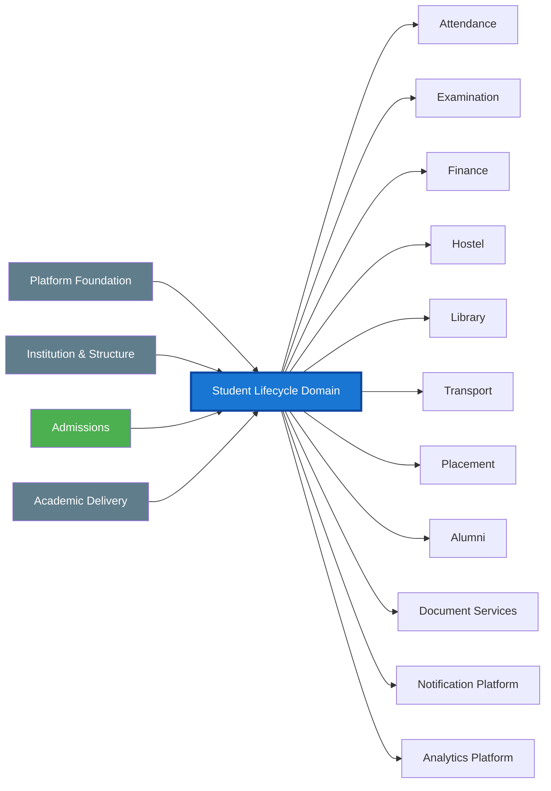

---

# 21.3.1 Diagram Reading Guidelines

The architecture diagrams shall be interpreted according to the following conventions.

| Element | Meaning |
|----------|--------------------------------------------------------------|
| Solid Arrow | Direct dependency or synchronous interaction |
| Dashed Arrow | Reference, association, or indirect dependency |
| Aggregate | Canonical business aggregate |
| Domain | Business ownership boundary |
| Event | Immutable domain event |
| Service | Published service contract |
| Database Symbol | Persistent storage |
| Message Broker | Asynchronous event infrastructure |

These conventions apply uniformly across all diagrams unless explicitly documented otherwise.

# 21.4 Domain Ownership Diagram
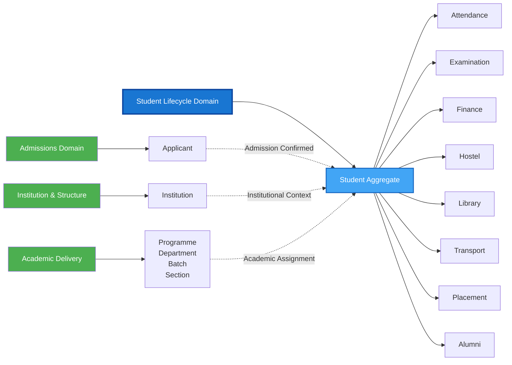

# 21.5 Student Aggregate Diagram
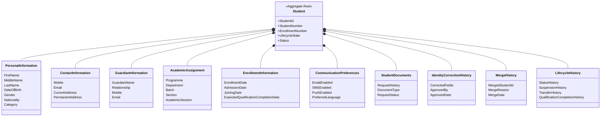


# 21.6 Student Lifecycle Overview
```mermaid
flowchart TD

AdmissionConfirmed

AdmissionConfirmed --> StudentCreated

StudentCreated --> StudentActivated

StudentActivated --> EnrollmentUpdated

EnrollmentUpdated --> AcademicAssignment

AcademicAssignment --> ActiveStudent

ActiveStudent --> ProfileUpdate
ActiveStudent --> GuardianUpdate
ActiveStudent --> CommunicationUpdate
ActiveStudent --> IdentityCorrection
ActiveStudent --> DocumentRequest

ActiveStudent --> Suspend
Suspend --> Restore
Restore --> ActiveStudent

ActiveStudent --> Transfer
Transfer --> ActiveStudent

ActiveStudent --> Merge

Merge --> ActiveStudent

ActiveStudent --> Qualification Completed Student

Qualification Completed Student --> Archive
```

---

# 21.6.1 Student Core Workflow Landscape

```mermaid
flowchart LR

StudentCreated

StudentActivated

EnrollmentManagement

AcademicAssignment

ProfileManagement

GuardianManagement

CommunicationPreferences

IdentityCorrection

DocumentRequests

Transfer

SuspendRestore

MergeStudents

Qualification Completion

Archive

StudentCreated --> StudentActivated
StudentActivated --> EnrollmentManagement
EnrollmentManagement --> AcademicAssignment
AcademicAssignment --> ProfileManagement

ProfileManagement --> GuardianManagement
GuardianManagement --> CommunicationPreferences
CommunicationPreferences --> IdentityCorrection
IdentityCorrection --> DocumentRequests

DocumentRequests --> SuspendRestore
SuspendRestore --> Transfer
Transfer --> MergeStudents
MergeStudents --> Qualification Completion
Qualification Completion --> Archive
```

# 21.7 Student Creation Workflow
```mermaid
flowchart TD

%% Start
A([Admission Confirmed])

%% Validation Phase
B[Receive CreateStudent Command]
C[Validate Admission Reference]
D{Admission Valid?}

%% Failure
E[Reject Request]

%% Processing
F[Generate Student ID]
G[Generate Student Number]
H[Create Student Aggregate]
I[Persist Transaction]

%% Audit & Events
J[Create Audit Record]
K[Publish StudentCreated Event]

%% Finish
L([Student Created])

%% Flow
A --> B
B --> C
C --> D

D -- No --> E

D -- Yes --> F
F --> G
G --> H
H --> I
I --> J
J --> K
K --> L

%% Styles
style A fill:#4CAF50,color:#fff
style D fill:#FF9800,color:#fff
style E fill:#E53935,color:#fff
style H fill:#1976D2,color:#fff
style K fill:#8E24AA,color:#fff
style L fill:#2E7D32,color:#fff
```

# 21.8 Student Activation Workflow

```mermaid
flowchart TD

%% Start
A([Student Created])

%% Command
B[Receive ActivateStudent Command]

%% Validation
C[Validate Student Record]
D[Validate Enrollment Prerequisites]
E[Validate Academic Assignment]
F{All Validations Successful?}

%% Failure
G[Reject Activation]

%% Processing
H[Update Lifecycle State]
I[Set Status = Active]
J[Persist Transaction]

%% Audit & Event
K[Create Audit Record]
L[Publish StudentActivated Event]

%% End
M([Student Activated])

%% Flow
A --> B
B --> C
C --> D
D --> E
E --> F

F -- No --> G

F -- Yes --> H
H --> I
I --> J
J --> K
K --> L
L --> M

%% Styles
style A fill:#4CAF50,color:#fff
style F fill:#FF9800,color:#fff
style G fill:#E53935,color:#fff
style I fill:#1976D2,color:#fff
style L fill:#8E24AA,color:#fff
style M fill:#2E7D32,color:#fff
```
# 21.9 Enrollment Workflow
```mermaid
flowchart TD

%% Start
A([Student Active])

%% Command
B[Receive UpdateEnrollment Command]

%% Validation
C[Validate Student Status]
D[Validate Academic Session]
E[Validate Enrollment Policy]
F{Enrollment Valid?}

%% Failure
G[Reject Enrollment Update]

%% Processing
H[Update Enrollment Information]
I[Persist Transaction]

%% Audit & Event
J[Create Audit Record]
K[Publish EnrollmentUpdated Event]

%% End
L([Enrollment Updated])

%% Flow
A --> B
B --> C
C --> D
D --> E
E --> F

F -- No --> G

F -- Yes --> H
H --> I
I --> J
J --> K
K --> L

%% Styles
style A fill:#4CAF50,color:#fff
style F fill:#FF9800,color:#fff
style G fill:#E53935,color:#fff
style H fill:#1976D2,color:#fff
style K fill:#8E24AA,color:#fff
style L fill:#2E7D32,color:#fff
```

# 21.10 Academic Assignment Workflow
```mermaid
flowchart TD

%% Start
A([Student Active])

%% Command
B[Receive AssignAcademicStructure Command]

%% Validation
C[Validate Student Status]
D[Validate Programme]
E[Validate Department]
F[Validate Batch]
G[Validate Section]
H[Validate Academic Session]

I{All References Valid?}

%% Failure
J[Reject Assignment]

%% Processing
K[Update Academic Assignment]
L[Persist Transaction]

%% Audit & Event
M[Create Audit Record]
N[Publish AcademicAssignmentUpdated Event]

%% End
O([Academic Assignment Updated])

%% Flow
A --> B
B --> C
C --> D
D --> E
E --> F
F --> G
G --> H
H --> I

I -- No --> J

I -- Yes --> K
K --> L
L --> M
M --> N
N --> O

%% Styles
style A fill:#4CAF50,color:#fff
style I fill:#FF9800,color:#fff
style J fill:#E53935,color:#fff
style K fill:#1976D2,color:#fff
style N fill:#8E24AA,color:#fff
style O fill:#2E7D32,color:#fff
```

# 21.11 Student Suspension Workflow
```mermaid
flowchart TD

%% Start
A([Student Active])

%% Command
B[Receive SuspendStudent Command]

%% Validation
C[Validate Student Status]
D[Validate Suspension Reason]
E[Validate Authorisation]
F{Suspension Approved?}

%% Failure
G[Reject Suspension]

%% Processing
H[Update Lifecycle State = Suspended]
I[Record Suspension Details]
J[Persist Transaction]

%% Audit & Event
K[Create Audit Record]
L[Publish StudentSuspended Event]

%% End
M([Student Suspended])

%% Flow
A --> B
B --> C
C --> D
D --> E
E --> F

F -- No --> G

F -- Yes --> H
H --> I
I --> J
J --> K
K --> L
L --> M

%% Styles
style A fill:#4CAF50,color:#fff
style F fill:#FF9800,color:#fff
style G fill:#E53935,color:#fff
style H fill:#FB8C00,color:#fff
style L fill:#8E24AA,color:#fff
style M fill:#616161,color:#fff
```

# 21.12 Student Restoration Workflow
```mermaid
flowchart TD

%% Start
A([Student Suspended])

%% Command
B[Receive RestoreStudent Command]

%% Validation
C[Validate Student Status]
D[Validate Restoration Eligibility]
E[Validate Authorisation]

F{Eligible for Restoration?}

%% Failure
G[Reject Restoration]

%% Processing
H[Update Lifecycle State = Active]
I[Record Restoration Details]
J[Persist Transaction]

%% Audit & Event
K[Create Audit Record]
L[Publish StudentRestored Event]

%% End
M([Student Active])

%% Flow
A --> B
B --> C
C --> D
D --> E
E --> F

F -- No --> G

F -- Yes --> H
H --> I
I --> J
J --> K
K --> L
L --> M

%% Styles
style A fill:#616161,color:#fff
style F fill:#FF9800,color:#fff
style G fill:#E53935,color:#fff
style H fill:#1976D2,color:#fff
style L fill:#8E24AA,color:#fff
style M fill:#4CAF50,color:#fff
```

# 21.13 Student Transfer Workflow
```mermaid
flowchart TD

%% Start
A([Student Active])

%% Command
B[Receive TransferStudent Command]

%% Validation
C[Validate Student Status]
D[Validate Current Assignment]
E[Validate Target Non-Programme Placement]
F[Validate Transfer Policy]
G[Validate Authorisation]

H{Transfer Approved?}

%% Failure
I[Reject Transfer]

%% Processing
J[Archive Previous Assignment]
K[Assign New Non-Programme Placement]
L[Persist Transaction]

%% Audit & Event
M[Create Audit Record]
N[Publish StudentTransferred Event]

%% End
O([Transfer Completed])

%% Flow
A --> B
B --> C
C --> D
D --> E
E --> F
F --> G
G --> H

H -- No --> I

H -- Yes --> J
J --> K
K --> L
L --> M
M --> N
N --> O

%% Styles
style A fill:#4CAF50,color:#fff
style H fill:#FF9800,color:#fff
style I fill:#E53935,color:#fff
style K fill:#1976D2,color:#fff
style N fill:#8E24AA,color:#fff
style O fill:#2E7D32,color:#fff
```

# 21.14 Qualification Completion Workflow
```mermaid
flowchart TD

%% Start
A([Student Active])

%% Command
B[Receive CompleteQualification Command]

%% Validation
C[Validate Student Status]
D[Validate Academic Completion]
E[Validate Financial Clearance]
F[Validate Institutional Clearance]
G[Validate Authorisation]

H{Eligible for Qualification Completion?}

%% Failure
I[Reject Qualification Completion]

%% Processing
J[Update Lifecycle State = Qualification Completed]
K[Record Qualification Completion Details]
L[Persist Transaction]

%% Audit & Event
M[Create Audit Record]
N[Synchronize Local Qualification Completion Status]

%% End
O([Student Qualification Completed])

%% Flow
A --> B
B --> C
C --> D
D --> E
E --> F
F --> G
G --> H

H -- No --> I

H -- Yes --> J
J --> K
K --> L
L --> M
M --> N
N --> O

%% Styles
style A fill:#4CAF50,color:#fff
style H fill:#FF9800,color:#fff
style I fill:#E53935,color:#fff
style J fill:#8E24AA,color:#fff
style N fill:#1565C0,color:#fff
style O fill:#2E7D32,color:#fff
```

# 21.15 Archive Workflow
```mermaid
flowchart TD

%% Start
A([Student Qualification Completed / Terminal State])

%% Command
B[Receive ArchiveStudent Command]

%% Validation
C[Validate Lifecycle State]
D[Validate Retention Policy]
E[Validate Institutional Approval]
F[Validate Authorisation]

G{Eligible for Archival?}

%% Failure
H[Reject Archival]

%% Processing
I[Update Lifecycle State = Archived]
J[Lock Student Aggregate]
K[Persist Transaction]

%% Audit & Event
L[Create Audit Record]
M[Publish StudentArchived Event]

%% End
N([Student Archived])

%% Flow
A --> B
B --> C
C --> D
D --> E
E --> F
F --> G

G -- No --> H

G -- Yes --> I
I --> J
J --> K
K --> L
L --> M
M --> N

%% Styles
style A fill:#8E24AA,color:#fff
style G fill:#FF9800,color:#fff
style H fill:#E53935,color:#fff
style I fill:#616161,color:#fff
style M fill:#1565C0,color:#fff
style N fill:#263238,color:#fff
```

# 21.16 Domain Event Flow

```mermaid
flowchart LR

%% Student Aggregate
A[Student Aggregate]

%% Domain Events
B(StudentCreated)
C(StudentActivated)
D(EnrollmentUpdated)
E(AcademicAssignmentCompleted)
F(StudentProfileUpdated)
G(StudentGuardianUpdated)
H(StudentCommunicationPreferencesUpdated)
I(StudentIdentityCorrected)
J(StudentDocumentRequested)
K(StudentStatusChanged)
L(StudentSuspended)
M(StudentRestored)
N(StudentTransferred)
O(StudentMerged)
P(QualificationAwarded)
Q(StudentArchived)

%% Event Consumers
R[Attendance]
S[Examination]
T[Finance]
U[Hostel]
V[Library]
W[Transport]
X[LMS]
Y[Placement]
Z[Alumni]
AA[Notification]
AB[Document Services]
AC[Analytics]
AD[Audit]

%% Aggregate publishes events
A --> B
A --> C
A --> D
A --> E
A --> F
A --> G
A --> H
A --> I
A --> J
A --> K
A --> L
A --> M
A --> N
A --> O
A --> P
A --> Q

%% Student Created
B --> T
B --> AA
B --> AD

%% Student Activated
C --> R
C --> S
C --> U
C --> V
C --> W
C --> X
C --> AC
C --> AD

%% Enrollment Updated
D --> S
D --> X
D --> AC
D --> AD

%% Academic Assignment
E --> R
E --> S
E --> X
E --> AC
E --> AD

%% Profile Updated
F --> AA
F --> AC
F --> AD

%% Guardian Updated
G --> AA
G --> AD

%% Communication Preferences Updated
H --> AA
H --> AD

%% Identity Corrected
I --> S
I --> T
I --> V
I --> AC
I --> AD

%% Document Requested
J --> AB
J --> AA
J --> AD

%% Status Changed
K --> R
K --> S
K --> T
K --> U
K --> V
K --> W
K --> X
K --> AC
K --> AD

%% Suspended
L --> R
L --> S
L --> U
L --> V
L --> W
L --> X
L --> AA
L --> AD

%% Restored
M --> R
M --> S
M --> U
M --> V
M --> W
M --> X
M --> AA
M --> AD

%% Transferred
N --> R
N --> S
N --> T
N --> U
N --> V
N --> W
N --> X
N --> AC
N --> AD

%% Student Merged
O --> R
O --> S
O --> T
O --> U
O --> V
O --> W
O --> X
O --> AC
O --> AD

%% Qualification Completed
P --> Y
P --> Z
P --> AA
P --> AC
P --> AD

%% Archived
Q --> AC
Q --> AD
```

---

### Additional Event Consumers

The Student Lifecycle Domain publishes events consumed by multiple enterprise domains.

Typical consumers include:

- Attendance
- Examination
- Finance
- Hostel
- Library
- Transport
- LMS
- Placement
- Alumni
- Notification Platform
- Document Services
- Analytics Platform
- Audit Platform

Consumer registration shall remain configuration-driven through the Event Infrastructure Platform, and individual consumers shall process events independently using idempotent event handlers.

# 21.17 Event Publication Architecture
```mermaid
flowchart LR

%% Command Processing
A[Client / API]
B[Application Service]
C[Student Aggregate]

%% Persistence
D[(Student Database)]
E[(Outbox Table)]

%% Publisher
F[Outbox Publisher]
G[Message Broker]

%% Consumers
H[Attendance]
I[Examination]
J[Finance]
K[Hostel]
L[Library]
M[Transport]
N[Placement]
O[Alumni]
P[Notification]
Q[Analytics]

%% Transaction
A --> B
B --> C

C --> D
C --> E

%% Async Publishing
E --> F
F --> G

%% Consumers
G --> H
G --> I
G --> J
G --> K
G --> L
G --> M
G --> N
G --> O
G --> P
G --> Q

%% Styles
style C fill:#1976D2,color:#fff
style D fill:#4CAF50,color:#fff
style E fill:#FF9800,color:#fff
style F fill:#8E24AA,color:#fff
style G fill:#263238,color:#fff
```

# 21.18 State Transition Model
```mermaid
stateDiagram-v2

[*] --> Created : StudentCreated

Created --> Active : StudentActivated

Active --> Suspended : SuspendStudent
Suspended --> Active : RestoreStudent

Active --> Active : UpdateEnrollment
Active --> Active : UpdateAcademicAssignment
Active --> Active : UpdateProfile
Active --> Active : ManageGuardian
Active --> Active : UpdateCommunicationPreferences
Active --> Active : RequestDocument
Active --> Active : CorrectIdentity
Active --> Active : TransferStudent
Active --> Qualification Completed : CompleteQualification

Qualification Completed --> Archived : ArchiveStudent

note left of Archived
A post-creation AdmissionRevoked is an
exceptional policy-controlled trigger for
WF-C02-10 / ArchiveStudent from the current
Student Context state. No new state is created.
end note

Archived --> [*]

note right of Created
Student Aggregate exists
but is not yet operational.
end note

note right of Active
Operational lifecycle.
All normal business
activities are permitted.
end note

note right of Suspended
Operational access restricted.
Aggregate remains active
for audit and history.
end note

note right of Qualification Completed
Academic lifecycle completed.
Historical record retained.
end note

note right of Archived
Immutable historical record.
Operational updates prohibited.
end note
```

# 21.19 Service Contract Architecture
```mermaid
flowchart LR

%% Clients
A[Web Portal]
B[Mobile App]
C[Admissions Domain]
D[Finance Domain]
E[Examination Domain]
F[Attendance Domain]
G[Integration APIs]

%% Service Layer
H[Student Application Services]

%% Command Services
I[Command Services]

J[Create Student]
K[Activate Student]
L[Update Enrollment]
M[Assign Academic Structure]
N[Suspend Student]
O[Restore Student]
P[Transfer Student]
Q[Qualification Completed Student]
R[Archive Student]
AA[Update Profile]
AB[Manage Guardian]
AC[Update Communication Preferences]
AD[Request Student Document]
AE[Correct Student Identity]
AF[Merge Students]


%% Query Services
S[Query Services]

T[Get Student]
U[Search Students]
V[Student Profile]
W[Academic Assignment]
X[Student History]
Z[Guardian Information]
ZA[Communication Preferences]
ZB[Student Documents]
ZC[Identity Correction History]

%% Aggregate
Y[Student Aggregate]

%% Clients
A --> H
B --> H
C --> H
D --> H
E --> H
F --> H
G --> H

%% Services
H --> I
H --> S

%% Commands
I --> J
I --> K
I --> L
I --> M
I --> N
I --> O
I --> P
I --> Q
I --> R
I --> AA
I --> AB
I --> AC
I --> AD
I --> AE
I --> AF

%% Queries
S --> T
S --> U
S --> V
S --> W
S --> X
S --> Z
S --> ZA
S --> ZB
S --> ZC

%% Aggregate
J --> Y
K --> Y
L --> Y
M --> Y
N --> Y
O --> Y
P --> Y
Q --> Y
R --> Y
AA --> Y
AB --> Y
AC --> Y
AD --> Y
AE --> Y
AF --> Y

T --> Y
U --> Y
V --> Y
W --> Y
X --> Y
Z --> Y
ZA --> Y
ZB --> Y
ZC --> Y

%% Styles
style H fill:#1976D2,color:#fff
style I fill:#4CAF50,color:#fff
style S fill:#8E24AA,color:#fff
style Y fill:#FF9800,color:#fff
```

# 21.20 Authorization (RBAC) Model
```mermaid
flowchart LR

%% Roles
A[System Administrator]
B[Registrar]
C[Admissions Officer]
D[Academic Administrator]
E[Department Coordinator]
F[Faculty]
G[Finance Officer]
H[Student]
I[Integration Services]

%% Authorization Layer
J[Authorization Service]

%% Student Services
K[Student Application Services]

%% Commands
L[Create Student]
M[Activate Student]
N[Update Enrollment]
O[Assign Academic Structure]
P[Suspend Student]
Q[Restore Student]
R[Transfer Student]
S[Qualification Completed Student]
T[Archive Student]
U[Update Profile]
V[Manage Guardian]
W[Update Communication Preferences]
X[Request Student Document]
Y[Correct Student Identity]
Z[Merge Students]


%% Queries
U[Student Query Services]

%% Role Mapping
A --> J
B --> J
C --> J
D --> J
E --> J
F --> J
G --> J
H --> J
I --> J

%% Authorization
J --> K
J --> U

%% Commands
K --> L
K --> M
K --> N
K --> O
K --> P
K --> Q
K --> R
K --> S
K --> T
K --> U
K --> V
K --> W
K --> X
K --> Y
K --> Z

%% Styles
style J fill:#1976D2,color:#fff
style K fill:#4CAF50,color:#fff
style U fill:#8E24AA,color:#fff
```

# 21.21 Cross-Domain Integration Architecture
```mermaid
flowchart LR

%% Upstream Domains
A[Platform Foundation]
B[Admissions Domain]
C[Institution & Organisation]
D[Academic Delivery]

%% Student Domain
E[Student Lifecycle Domain]

%% Downstream Domains
F[Attendance]
G[Examination]
H[Finance]
I[Library]
J[Hostel]
K[Transport]
L[LMS]
M[Placement]
N[Alumni]
O[Notification]
P[Analytics]
Q[Document Services]

%% Upstream Integrations
A -->|Authentication & Authorization| E
B -->|Admission Confirmation| E
C -->|Institution Structure| E
D -->|Programme • Batch • Section| E

%% Downstream Service Consumers
E -->|Student Data| F
E -->|Student Data| G
E -->|Student Profile| H
E -->|Membership Data| I
E -->|Resident Data| J
E -->|Transport Eligibility| K
E -->|Enrollment Data| L
E -->|Student Profile| M
E -->|Qualification Completion Events| N
E -->|Lifecycle Events| O
E -->|Operational Data| P
E -->|Student Documents| Q

%% Styling
style E fill:#1976D2,color:#fff
style A fill:#4CAF50,color:#fff
style B fill:#4CAF50,color:#fff
style C fill:#4CAF50,color:#fff
style D fill:#4CAF50,color:#fff
style F fill:#8E24AA,color:#fff
style G fill:#8E24AA,color:#fff
style H fill:#8E24AA,color:#fff
style I fill:#8E24AA,color:#fff
style J fill:#8E24AA,color:#fff
style K fill:#8E24AA,color:#fff
style L fill:#8E24AA,color:#fff
style M fill:#8E24AA,color:#fff
style N fill:#8E24AA,color:#fff
style O fill:#8E24AA,color:#fff
style P fill:#8E24AA,color:#fff
style Q fill:#8E24AA,color:#fff
```

# 21.22 Validation Pipeline
```mermaid
flowchart TD

%% Request
A([Client Request])

%% Processing Pipeline
B[API / Application Service]
C[Authentication]
D[Authorization]
E[Command & Workflow Validation]
F[Reference Data Validation]
G[Business Rule Validation]
H[Aggregate Invariant Validation]

%% Decision
I{Validation Successful?}

%% Success Path
J[Execute Command]
K[Persist Aggregate]
L[Store Outbox Event]
M[Commit Transaction]
N[Publish Domain Event]

%% Failure
O[Return Validation Error]

%% Flow
A --> B
B --> C
C --> D
D --> E
E --> F
F --> G
G --> H
H --> I

I -- No --> O

I -- Yes --> J
J --> K
K --> L
L --> M
M --> N

%% Styles
style A fill:#4CAF50,color:#fff
style I fill:#FF9800,color:#fff
style O fill:#E53935,color:#fff
style J fill:#1976D2,color:#fff
style N fill:#8E24AA,color:#fff
```

# 21.23 Exception Handling Flow
```mermaid
flowchart TD

%% Request
A([Command Received])

%% Processing
B[Execute Validation & Business Logic]

%% Decision
C{Exception Occurred?}

%% Success
D[Commit Transaction]
E[Publish Domain Event]
F([Success Response])

%% Failure Types
G{Exception Type}

H[Validation Error]
I[Authorization Failure]
J[Business Rule / Workflow Validation Failure]
K[Integration Failure]
L[System Exception]

%% Error Processing
M[Rollback Transaction]
N[Record Audit Log]
O[Generate Standard Error Response]

%% End
P([Failure Response])

%% Flow
A --> B
B --> C

C -- No --> D
D --> E
E --> F

C -- Yes --> G

G --> H
G --> I
G --> J
G --> K
G --> L

H --> M
I --> M
J --> M
K --> M
L --> M

M --> N
N --> O
O --> P

%% Styles
style C fill:#FF9800,color:#fff
style G fill:#FB8C00,color:#fff
style D fill:#4CAF50,color:#fff
style E fill:#8E24AA,color:#fff
style M fill:#E53935,color:#fff
style P fill:#616161,color:#fff
```

# 21.24 Audit Pipeline
```mermaid
flowchart LR

%% Sources
A[Application Services]
B[Student Aggregate]
C[Authorization Service]
D[Validation Pipeline]
E[Exception Handler]

%% Audit
F[Audit Service]

%% Storage
G[(Audit Log Repository)]

%% Consumers
H[Compliance Reports]
I[Operational Monitoring]
J[Security Monitoring]
K[Accreditation]
L[Analytics]

%% Flow
A --> F
B --> F
C --> F
D --> F
E --> F

F --> G

G --> H
G --> I
G --> J
G --> K
G --> L

%% Styles
style F fill:#1976D2,color:#fff
style G fill:#4CAF50,color:#fff
style H fill:#8E24AA,color:#fff
style I fill:#8E24AA,color:#fff
style J fill:#8E24AA,color:#fff
style K fill:#8E24AA,color:#fff
style L fill:#8E24AA,color:#fff
```

# 21.25 Reporting Architecture
```mermaid
flowchart LR

%% Operational Sources
A[Student Aggregate]
B[Domain Events]
C[Audit Repository]

%% Processing
D[Reporting, Analytics & Read Model Projection]

%% Storage
E[(Operational Reporting Database)]
R[(Student Read Models)]
F[(Enterprise Data Warehouse)]

%% Consumers
G[Operational Dashboards]
H[Institutional Reports]
I[KPI Dashboard]
J[Regulatory Reports]
K[Accreditation Reports]
L[Executive Analytics]
M[BI Tools]

%% Flow
A --> D
B --> D
C --> D

D --> R
D --> E
D --> F

E --> G
E --> H
E --> I

F --> J
F --> K
F --> L
F --> M

R --> G
R --> H

%% Styles
style D fill:#1976D2,color:#fff
style E fill:#4CAF50,color:#fff
style F fill:#8E24AA,color:#fff
style G fill:#FF9800,color:#fff
style H fill:#FF9800,color:#fff
style I fill:#FF9800,color:#fff
style J fill:#8E24AA,color:#fff
style K fill:#8E24AA,color:#fff
style L fill:#8E24AA,color:#fff
style M fill:#8E24AA,color:#fff
```

# 21.26 Configuration Lifecycle
```mermaid
flowchart LR

%% Request
A[CreateStudent Command]

%% Domain
B[Student Application Service]
C[Student Aggregate]

%% Configuration
D[Configuration Service]
E[(Configuration Repository)]

%% Numbering
F[Numbering Engine]
G[(Sequence Repository)]

%% Persistence
H[(Student Database)]

%% Events
I[Outbox]
J[Message Broker]

%% Flow
A --> B
B --> D
D --> E

B --> F
F --> G

B --> C
C --> H
C --> I

I --> J

%% Styles
style B fill:#1976D2,color:#fff
style D fill:#4CAF50,color:#fff
style F fill:#8E24AA,color:#fff
style C fill:#FF9800,color:#fff
style J fill:#616161,color:#fff
```

# 21.27 Deployment Context
```mermaid
flowchart LR

%% Users
A[Web Portal]
B[Mobile App]
C[External Systems]

%% Entry
D[API Gateway / Load Balancer]

%% Platform
E[Student Lifecycle Service]

%% Platform Services
F[Identity & Access Service]
G[Configuration Service]
H[Notification Service]

%% Persistence
I[(Student Database)]
J[(Outbox Database)]

%% Messaging
K[Message Broker]

%% Consumers
L[Attendance]
M[Examination]
N[Finance]
O[Library]
P[Hostel]
Q[Analytics]

%% Flow
A --> D
B --> D
C --> D

D --> E

E --> F
E --> G
E --> H

E --> I
E --> J

J --> K

K --> L
K --> M
K --> N
K --> O
K --> P
K --> Q

%% Styles
style E fill:#1976D2,color:#fff
style I fill:#4CAF50,color:#fff
style J fill:#FF9800,color:#fff
style K fill:#8E24AA,color:#fff
```

# 21.28 Architecture Dependency Graph
```mermaid
flowchart LR

%% Platform Layer
subgraph Platform Services
PF[Platform Foundation]
ID[Identity & Access]
CFG[Configuration]
MSG[Messaging]
AUD[Audit Service]
end

%% Upstream Domains
subgraph Upstream Domains
ADM[Admissions]
ORG[Institution & Organisation]
ACA[Academic Delivery]
end

%% Current Domain
subgraph Student Lifecycle Domain
STD[Student Lifecycle]
end

%% Downstream Domains
subgraph Downstream Domains
ATT[Attendance]
EXM[Examination]
FIN[Finance]
LIB[Library]
HOS[Hostel]
TRN[Transport]
LMS[LMS]
PLC[Placement]
ALM[Alumni]
DOC[Document Services]
NOTIF[Notification]
ANA[Analytics]
end

%% Dependencies
PF --> STD
ID --> STD
CFG --> STD
MSG --> STD
AUD --> STD

ADM --> STD
ORG --> STD
ACA --> STD

STD --> ATT
STD --> EXM
STD --> FIN
STD --> LIB
STD --> HOS
STD --> TRN
STD --> LMS
STD --> PLC
STD --> ALM
STD --> DOC
STD --> NOTIF
STD --> ANA

%% Styles
style STD fill:#1976D2,color:#fff
style PF fill:#4CAF50,color:#fff
style ADM fill:#4CAF50,color:#fff
style ORG fill:#4CAF50,color:#fff
style ACA fill:#4CAF50,color:#fff
style ATT fill:#8E24AA,color:#fff
style EXM fill:#8E24AA,color:#fff
style FIN fill:#8E24AA,color:#fff
style ANA fill:#8E24AA,color:#fff
```

# 21.29 Traceability Overview
```mermaid
flowchart LR

%% Business Requirements
subgraph Requirements
R1[Student Registration]
R2[Student Lifecycle Management]
R3[Academic Assignment]
R4[Student Mobility]
R5[Qualification Completion & Archival]
R6[Profile Management]
R7[Guardian Management]
R8[Identity Correction]
R9[Student Services]

end

%% Workflows
subgraph Workflows
W1[Create Student]
W2[Activate Student]
W3[Enrollment Management]
W4[Academic Assignment]
W5[Suspension / Restoration]
W6[Transfer]
W7[Qualification Completion]
W8[Archival]
W9[Profile Update]
W10[Guardian Management]
W11[Identity Correction]
W12[Document Request]
W13[Student Merge]

end

%% Service Contracts
subgraph Service Contracts
S1[Command Services]
S2[Query Services]
end

%% Domain Events
subgraph Domain Events
E1[Student Events]
end

%% Governance
subgraph Governance
G1[Validation]
G2[Authorization]
G3[Audit]
G4[Reporting]
end

%% Requirement -> Workflow
R1 --> W1
R1 --> W2
R2 --> W3
R2 --> W5
R3 --> W4
R4 --> W6
R5 --> W7
R5 --> W8
R6 --> W9
R7 --> W10
R8 --> W11
R9 --> W12
R8 --> W13


%% Workflow -> Services
W1 --> S1
W2 --> S1
W3 --> S1
W4 --> S1
W5 --> S1
W6 --> S1
W7 --> S1
W8 --> S1

W9 --> S1
W10 --> S1
W11 --> S1
W12 --> S1
W13 --> S1

W9 --> S2
W10 --> S2
W12 --> S2

W3 --> S2
W4 --> S2
W7 --> S2

%% Services -> Events
S1 --> E1

%% Governance
S1 --> G1
S1 --> G2
S1 --> G3
E1 --> G4

%% Styles
style Requirements fill:#4CAF50,color:#fff
style Workflows fill:#1976D2,color:#fff
style "Service Contracts" fill:#8E24AA,color:#fff
style "Domain Events" fill:#FF9800,color:#fff
style Governance fill:#616161,color:#fff
```

# 21.30 Domain Summary Diagram
```mermaid
flowchart TB

%% Clients
subgraph Client Layer
A[Web Portal]
B[Mobile App]
C[Integration APIs]
end

%% Entry Layer
subgraph Access Layer
D[API Gateway]
E[Authentication & Authorization]
end

%% Application Layer
subgraph Application Layer
F[Student Application Services]
end

%% Domain Layer
subgraph Domain Layer
G[Student Aggregate]
H[Business Rules]
I[Lifecycle State Machine]
end

%% Infrastructure Layer
subgraph Infrastructure Layer
J[(Student Database)]
K[(Outbox)]
L[Message Broker]
end

%% Platform Services
subgraph Shared Platform Services
M[Configuration Service]
N[Audit Service]
O[Notification Service]
end

%% Consumer Domains
subgraph Enterprise Domains
P[Attendance]
Q[Examination]
R[Finance]
S[Library]
T[Hostel]
U[Transport]
V[LMS]
W[Placement]
X[Alumni]
Y[Analytics]
end

%% Flow
A --> D
B --> D
C --> D

D --> E
E --> F

F --> G
G --> H
H --> I

G --> J
G --> K

K --> L

F --> M
F --> N
F --> O

L --> P
L --> Q
L --> R
L --> S
L --> T
L --> U
L --> V
L --> W
L --> X
L --> Y

%% Styles
style G fill:#1976D2,color:#fff
style F fill:#4CAF50,color:#fff
style L fill:#8E24AA,color:#fff
style J fill:#FF9800,color:#fff
style M fill:#607D8B,color:#fff
style N fill:#607D8B,color:#fff
style O fill:#607D8B,color:#fff
```

---

# 21.31 Visual Model Governance Summary

The Architecture Visual Models collectively represent the approved structural, behavioral, integration, security, operational, and governance views of the Student Lifecycle Domain.

These diagrams shall remain synchronized with:

- Aggregate definitions
- All canonical workflows including lifecycle, profile management, guardian management, document services, identity correction,  and merge workflows
- Service Contracts
- Domain Events
- Authorization Model
- Validation Framework
- Exception Handling
- Configuration Model
- Reporting Architecture
- Cross-Domain Integrations
- Architecture Decision Records (ADRs)

Any architectural modification affecting these areas shall include corresponding updates to the affected visual models before approval.

This ensures that the architecture repository remains internally consistent and that visual documentation continues to accurately represent the canonical architecture of the Student Lifecycle Domain.

# 22. Architecture Decision Records (ADR)

## 22.1 Overview

This section documents the key architectural decisions governing the Student Lifecycle Domain.

Architecture Decision Records (ADRs) provide long-term justification for important design choices, ensuring consistency, traceability, and maintainability throughout the evolution of the SutraERP platform.

Each ADR records:

- Architectural Decision
- Context
- Rationale
- Consequences
- Governance Status

---

# 22.2 ADR-C02-001 — Student Lifecycle Domain Owns Student Master Data

## Decision

The Student Lifecycle Domain is the single authoritative owner of the Student Aggregate.

## Context

Multiple domains require Student information, including:

- Academic Delivery
- Attendance
- Examination
- Finance
- Hostel
- Library
- Placement
- Alumni

Without clear ownership, duplicate Student records and inconsistent lifecycle states become inevitable.

## Rationale

A single ownership model ensures:

- Consistent identity
- Controlled lifecycle
- Simplified integrations
- Elimination of conflicting updates

## Consequences

- Downstream domains consume Student data through services or events.
- Direct database updates are prohibited.

**Status:** Accepted

---

# 22.3 ADR-C02-002 — Admission Confirmation is Mandatory Before Student Creation

## Decision

A Student Aggregate shall only be created after successful Admission confirmation.

## Context

Applicants are not Students.

Student records represent officially admitted learners.

## Rationale

Separating Applicant and Student lifecycles preserves clear business boundaries.

## Consequences

- Admission Domain remains owner of Applicant data.
- Student Domain begins ownership only after admission confirmation.

**Status:** Accepted

---

# 22.4 ADR-C02-003 — Event-Driven Integration

## Decision

Cross-domain notifications shall use Domain Events.

## Context

Many ERP domains depend upon Student changes.

Synchronous coupling reduces scalability.

## Rationale

Event-driven architecture provides:

- Loose coupling
- Better scalability
- Independent deployments
- Improved resilience

## Consequences

- Consumers subscribe to canonical events.
- Duplicate event processing shall be idempotent.

**Status:** Accepted

---

# 22.5 ADR-C02-004 — Service Contracts for Synchronous Operations

## Decision

Synchronous interactions shall occur exclusively through versioned Service Contracts.

## Context

External domains require real-time Student validation and lookup.

## Rationale

Versioned APIs provide:

- Stable integrations
- Backward compatibility
- Controlled evolution

## Consequences

- Direct persistence access is prohibited.
- API versioning becomes mandatory.

**Status:** Accepted

---

# 22.6 ADR-C02-005 — Immutable Student Identifier

## Decision

Student ID shall never change after creation.

## Context

Student identity is referenced throughout the ERP ecosystem.

## Rationale

Immutable identifiers simplify:

- Referential integrity
- Audit
- Reporting
- Cross-domain relationships

## Consequences

Student identity corrections shall use controlled business attributes rather than changing the primary identifier.

**Status:** Accepted

---

# 22.7 ADR-C02-006 — Lifecycle Controlled Through Canonical State Machine

## Decision

Student lifecycle transitions shall follow the canonical state model.

## Context

Ad hoc transitions produce inconsistent business states.

## Rationale

A governed state machine ensures:

- Predictable behavior
- Consistent validation
- Reliable integrations

## Consequences

Unsupported transitions shall always be rejected.

**Status:** Accepted

---

# 22.8 ADR-C02-007 — Audit Records are Immutable

## Decision

Audit records shall never be modified or deleted except through approved retention policies where legally permitted.

## Context

Student operations require complete traceability.

## Rationale

Immutable audit supports:

- Regulatory compliance
- Forensic analysis
- Accreditation
- Operational accountability

## Consequences

Audit storage shall remain append-only.

**Status:** Accepted

---

# 22.9 ADR-C02-008 — Configuration Over Customization

## Decision

Institution-specific behavior shall be implemented through configuration rather than source-code modification.

## Context

Different institutions have varying operational policies.

## Rationale

Configuration enables flexibility while preserving a single canonical architecture.

## Consequences

Business logic remains reusable across deployments.

**Status:** Accepted

---

# 22.10 ADR-C02-009 — Cross-Domain Communication Shall Preserve Domain Ownership

## Decision

No external domain may directly modify Student business data.

## Context

Shared database ownership creates architectural coupling.

## Rationale

Strict ownership preserves:

- Data integrity
- Independent evolution
- Clear accountability

## Consequences

All modifications must pass through Student Lifecycle services.

**Status:** Accepted

---

# 22.11 ADR-C02-010 — Deployment Independence

## Decision

The Student Lifecycle Domain shall remain deployment independent.

## Context

SutraERP supports:

- Cloud
- Hybrid
- On-Premises

## Rationale

Business architecture should not depend upon infrastructure choices.

## Consequences

Infrastructure-specific implementation details remain outside the domain model.

**Status:** Accepted

---


# 22.12 ADR-C02-011 — Student Profile as a Governed Aggregate Component

## Decision

Student Profile information shall remain part of the Student Aggregate and shall be modified only through governed domain workflows.

## Context

Student profile information is referenced by multiple downstream domains but remains part of the canonical Student record.

## Rationale

Keeping profile management within the Student Aggregate ensures:

- Single source of truth
- Consistent validation
- Complete auditability
- Controlled event publication

## Consequences

- External domains shall never modify Student profile information directly.
- Profile changes shall publish StudentProfileUpdated events.

**Status:** Accepted

---


# 22.13 ADR-C02-012 — Guardian Information is Domain-Owned

## Decision

Guardian information shall be owned and governed by the Student Lifecycle Domain.

## Context

Guardian information participates in communication, emergency contact, compliance, and student services.

## Rationale

Central ownership prevents inconsistent guardian records across institutional domains.

## Consequences

- Guardian management shall occur only through canonical workflows.
- Guardian changes shall publish StudentGuardianUpdated events.

**Status:** Accepted

---

# 22.14 ADR-C02-013 — Student Identity Corrections Preserve Canonical Identity

## Decision

Student identity corrections shall update business attributes only and shall never modify the canonical Student Identifier.

## Context

Legal name corrections and identity corrections occur after Student creation.

## Rationale

Maintaining an immutable Student Identifier preserves referential integrity throughout the ERP ecosystem.

## Consequences

- Identity corrections require governed approval.
- StudentId remains permanently unchanged.
- Identity corrections publish StudentIdentityCorrected events.

**Status:** Accepted

---


# 22.15 ADR Summary

| ADR ID | Decision | Status |
|---------|-----------------------------------------------|----------|
| ADR-C02-001 | Student Domain owns Student Master Data | Accepted |
| ADR-C02-002 | Admission required before Student creation | Accepted |
| ADR-C02-003 | Event-driven integrations | Accepted |
| ADR-C02-004 | Versioned Service Contracts | Accepted |
| ADR-C02-005 | Immutable Student Identifier | Accepted |
| ADR-C02-006 | Canonical State Machine | Accepted |
| ADR-C02-007 | Immutable Audit Records | Accepted |
| ADR-C02-008 | Configuration over Customization | Accepted |
| ADR-C02-009 | Preserve Domain Ownership | Accepted |
| ADR-C02-010 | Deployment Independence | Accepted |
| ADR-C02-011 | Governed Student Profile Management | Accepted |
| ADR-C02-012 | Student Lifecycle Owns Guardian Information | Accepted |
| ADR-C02-013 | Immutable Student Identifier with Governed Identity Corrections | Accepted |

---

# 22.16 Governance

Architecture Decision Records shall comply with the following governance rules:

- ADRs are immutable after approval; amendments shall be recorded through superseding ADRs rather than modifying historical decisions.
- Every breaking architectural change shall reference the ADR(s) it supersedes.
- New ADRs shall undergo Architecture Review Board (ARB) approval before adoption.
- ADR identifiers shall remain permanent and unique across the platform.
- ADRs shall be version-controlled with the architecture repository.
- All implementation teams shall align domain evolution with approved ADRs.

---

# 22.17 Summary

The Architecture Decision Records provide the long-term architectural rationale for the Student Lifecycle Domain. They establish the governing principles behind ownership, lifecycle management, integration, identity, configuration, auditing, and deployment strategy, ensuring that future evolution of the domain remains consistent with the canonical architecture of the SutraERP platform.

# 23. Glossary

## 23.1 Overview

This glossary defines the canonical business and architectural terminology used throughout the Student Lifecycle Domain.

These definitions establish a common vocabulary for business stakeholders, architects, developers, testers, implementation teams, and future domain owners.

Unless explicitly superseded by a platform-wide glossary, the definitions in this section are authoritative for the Student Lifecycle Domain.

---

# 23.2 Business Terms

| Term | Definition |
|------|----------------------------------------------|
| Applicant | An individual who has applied for admission but has not yet become a Student. |
| Admission | The formal approval process through which an Applicant becomes eligible for Student creation. |
| Student | An officially admitted learner represented by the Student Aggregate. |
| Student Lifecycle | The complete progression of a Student from creation to archival. |
| Enrollment | The formal academic registration of a Student for an academic session or programme. |
| Programme | The academic programme in which the Student is enrolled. |
| Department | The academic department responsible for the programme. |
| Batch | A cohort of Students admitted during a defined academic period. |
| Section | A subdivision of a batch for academic administration. |
| Academic Session | A defined academic period managed by the Academic Delivery Domain. |
| Guardian | Parent or legally authorized guardian associated with the Student. |
| Registrar | Institutional authority responsible for Student lifecycle administration. |
| Student Profile | Canonical personal, demographic, and contact information maintained within the Student Aggregate. |
| Student Document Request | A governed request initiated by a Student for issuance of an official institutional document. |
| Identity Correction | An approved correction of mutable Student identity attributes that preserves the canonical Student Identifier. |
| Student Merge | The governed consolidation of duplicate Student records into a single canonical Student Aggregate. |
| Communication Preference | Student-configurable notification and communication settings governed by institutional policy. |


---

# 23.3 Lifecycle Terms

| Term | Definition |
|------|----------------------------------------------|
| Created | Student Aggregate has been created but is not yet active. |
| Active | Student is eligible for academic participation. |
| Suspended | Student participation is temporarily restricted. |
| Transferred | Student has been reassigned according to institutional policy. |
| Qualification Completed | Student has successfully completed programme requirements. |
| Archived | Student record is retained for historical purposes and is no longer operational. |
| Lifecycle Transition | Movement between valid lifecycle states. |
| State Machine | Canonical model governing lifecycle transitions. |
| Lifecycle Operation | A governed business operation that may or may not result in a lifecycle state transition. |
| Terminal State | A lifecycle state from which no further operational transitions are permitted except through governed administrative procedures. |
| Operational State | A lifecycle state in which the Student may participate in institutional activities according to policy. |


---

# 23.4 Architecture Terms

| Term | Definition |
|------|----------------------------------------------|
| Aggregate | Cluster of business objects managed as a single consistency boundary. |
| Aggregate Root | Primary entity responsible for protecting aggregate consistency. |
| Domain | Independent business capability with explicit ownership. |
| Domain Service | Stateless business service implementing domain logic. |
| Service Contract | Public interface exposed by the domain. |
| Domain Event | Immutable business event published after successful transaction completion. |
| Command | Request that modifies business state. |
| Query | Request that retrieves information without modifying state. |
| Integration | Communication between domains using approved contracts. |
| Read Model | Query-optimized projection derived from domain events for reporting and query operations. |
| Outbox Pattern | Reliable event publication mechanism that guarantees transactional consistency between persistence and event publishing. |
| Aggregate Invariant | A business rule that shall always remain true within the consistency boundary of the Student Aggregate. |
| Canonical Workflow | An architecture-approved business workflow representing the authoritative implementation of a domain capability. |


---

# 23.5 Security Terms

| Term | Definition |
|------|----------------------------------------------|
| Authentication | Verification of caller identity. |
| Authorization | Verification of permissions to perform an operation. |
| RBAC | Role-Based Access Control framework. |
| Tenant | Logical institution boundary within the ERP platform. |
| Tenant Isolation | Separation of data and operations between institutions. |
| Least Privilege | Security principle granting only required permissions. |
| Sensitive Data | Information requiring additional protection under institutional or regulatory policy. |
| Field-Level Security | Authorization mechanism controlling visibility or modification of specific business attributes. |
| Principle of Least Privilege | Security principle granting users only the permissions required to perform assigned responsibilities. |
| Service Identity | Trusted platform identity used for secure service-to-service communication. |


---

# 23.6 Audit & Compliance Terms

| Term | Definition |
|------|----------------------------------------------|
| Audit Record | Immutable record of a business or security operation. |
| Audit Trail | Complete chronological history of relevant operations. |
| Compliance | Adherence to institutional, legal, and regulatory requirements. |
| Correlation ID | Identifier used to trace a transaction across services. |
| Retention Policy | Rules governing preservation and deletion of records. |
| Non-Repudiation | Assurance that an actor cannot deny performing an audited action. |
| Audit Event | Immutable record representing a significant business or security operation. |
| Compliance Evidence | Information demonstrating adherence to institutional, regulatory, or legal requirements. |
| Immutable History | Historical records that cannot be modified after creation except through governed retention policies. |


---

# 23.7 Integration Terms

| Term | Definition |
|------|----------------------------------------------|
| Upstream Domain | Domain providing information required by the Student Lifecycle Domain. |
| Downstream Domain | Domain consuming Student Lifecycle information. |
| Event-Driven Integration | Communication through published domain events. |
| Synchronous Integration | Real-time communication using service contracts. |
| Eventual Consistency | Consistency achieved across domains after asynchronous processing. |
| Consumer | Domain or service subscribing to published events or APIs. |
| Publisher | Domain responsible for publishing canonical Domain Events. |
| Integration Contract | A governed agreement defining how two domains communicate using Service Contracts or Domain Events. |
| Event Consumer | A downstream domain or service that subscribes to and processes published Domain Events. |
| Event Publisher | The authoritative domain responsible for publishing immutable business events. |

---

# 23.8 Reporting Terms

| Term | Definition |
|------|----------------------------------------------|
| Read Model | Optimized representation of business data for querying. |
| Dashboard | Visual representation of operational or executive metrics. |
| KPI | Key Performance Indicator used to measure institutional performance. |
| Analytical Dataset | Curated data prepared for reporting and business intelligence. |
| Historical Snapshot | Point-in-time representation of business data for long-term analysis. |
| Projection | Read-optimized representation generated from Domain Events. |
| Operational Dashboard | Dashboard providing near real-time operational metrics for institutional users. |
| Data Warehouse | Analytical storage optimized for historical reporting and business intelligence. |

---

# 23.9 Configuration Terms

| Term | Definition |
|------|----------------------------------------------|
| Configuration | Institution-specific policy controlling application behavior without code changes. |
| Configuration Version | Managed version of a configuration set. |
| Runtime Configuration | Configuration applied during application execution. |
| Policy | Institution-defined rule governing business behavior. |
| Default Configuration | Initial configuration provided by the platform. |
| Configuration Policy | Institution-defined rules controlling configurable business behavior. |
| Feature Toggle | Configuration-controlled mechanism for enabling or disabling supported platform capabilities without code changes. |
| Configuration Scope | Boundary defining whether configuration applies globally, per tenant, or per institution. |


---

# 23.10 General Abbreviations

| Abbreviation | Meaning |
|--------------|--------------------------------------------|
| ADR | Architecture Decision Record |
| API | Application Programming Interface |
| ARB | Architecture Review Board |
| CQRS | Command Query Responsibility Segregation |
| ERP | Enterprise Resource Planning |
| KPI | Key Performance Indicator |
| NFR | Non-Functional Requirement |
| PII | Personally Identifiable Information |
| RBAC | Role-Based Access Control |
| SLA | Service Level Agreement |
| UUID | Universally Unique Identifier |
| UTC | Coordinated Universal Time |
| CQ | Command Query |
| DDD | Domain-Driven Design |
| UoW | Unit of Work |
| AR | Aggregate Root |


---

# 23.11 Terminology Governance

The following governance rules apply to terminology used within the Student Lifecycle Domain:

- Business terminology shall remain consistent across all architecture documents.
- New terms shall be formally defined before adoption.
- Platform-wide terminology takes precedence where applicable.
- Deprecated terms shall remain documented until fully retired.
- Domain-specific terminology shall not conflict with canonical platform definitions.
- Glossary updates shall follow architecture version control procedures.
- Canonical workflow names shall remain consistent across workflows, service contracts, domain events, visual models, and architecture decision records.
- Business terminology shall not be duplicated with conflicting meanings across domains.
- Renamed architectural concepts shall be updated throughout the repository as part of the same architecture change.
---

# 23.12 Summary

The Glossary establishes the canonical vocabulary for the Student Lifecycle Domain, providing standardized definitions for business concepts, lifecycle states, architectural constructs, security terminology, audit and compliance concepts, integration patterns, reporting terminology, configuration models, and commonly used abbreviations.

By maintaining a single, governed source of terminology, the glossary ensures consistent interpretation across business stakeholders, architects, developers, testers, implementation teams, and operational users. It minimizes ambiguity, strengthens cross-domain communication, supports architecture governance, and ensures that all workflows, service contracts, domain events, visual models, and implementation artifacts use a common and consistent language throughout the SutraERP platform.

# 24. Domain Summary

## 24.1 Overview

The Student Lifecycle Domain is the canonical owner of the **Student Aggregate** within the SutraERP platform.

Its responsibility begins immediately after successful admission confirmation and continues until the Student record is archived according to institutional retention policies.

This domain provides the authoritative source of Student identity, enrollment, academic assignment, lifecycle status, and institutional association for all downstream domains.

---

# 24.2 Domain Mission

The mission of the Student Lifecycle Domain is to:

- Establish a single authoritative Student record.
- Govern the complete Student lifecycle.
- Ensure institutional data consistency.
- Provide standardized services for dependent domains.
- Publish trusted business events.
- Preserve historical integrity throughout the Student lifecycle.
- Govern Student profile and identity information.
- Manage guardian relationships and communication preferences.
- Support governed Student document requests.
- Resolve duplicate Student records through controlled merge operations.

---

# 24.3 Business Responsibilities

The Student Lifecycle Domain is responsible for:

- Student creation
- Student activation
- Enrollment management
- Academic assignment
- Lifecycle management
- Suspension
- Restoration
- Transfer
- Qualification Completion handoff
- Student archival
- Student identity management
- Student master data governance
- Student archival
- Student profile management
- Guardian management
- Communication preference management
- Student document request management
- Student identity correction
- Student merge management
- Student identity governance
- Student master data governance

The domain is **not** responsible for:

- Admissions processing
- Teaching & Learning
- Attendance recording
- Examination execution
- Fee collection
- Hostel management
- Library operations
- Placement activities

These capabilities remain owned by their respective domains.

---

# 24.4 Architectural Responsibilities

The Student Lifecycle Domain provides:

- Canonical Student Aggregate
- Domain Services
- Service Contracts
- Domain Events
- Business Rules
- Validation Framework
- Authorization Policies
- Audit Integration
- Reporting Read Models
- Configuration Support
- Canonical Workflow Definitions
- Aggregate Invariants
- Read Model Projections
- Integration Contracts
- Configuration Policies

These architectural assets ensure consistent business execution across the ERP platform.

---

# 24.5 Domain Ownership

The Student Lifecycle Domain exclusively owns:

- Student Master Record
- Student Identifier
- Enrollment Identity
- Academic Assignment Reference
- Lifecycle State
- Student Status
- Guardian Association
- Student Contact Information
- Student Communication Preferences
- Student Profile
- Guardian Relationships
- Student Document Requests
- Identity Correction History
- Student Merge History

Ownership shall never be shared with external domains.

---

# 24.6 Primary Business Outputs

The domain publishes the following canonical outputs:

### Services

- ValidateStudent()
- GetStudentIdentity()
- GetEnrollmentInformation()
- GetAcademicAssignment()
- SearchStudents()
- GetStudentLifecycle()
- UpdateStudentProfile()
- ManageGuardian()
- UpdateCommunicationPreferences()
- RequestStudentDocument()
- CorrectStudentIdentity()
- MergeStudents()

### Domain Events

- StudentCreated
- StudentActivated
- EnrollmentUpdated
- AcademicAssignmentCompleted
- StudentStatusChanged
- StudentSuspended
- StudentRestored
- StudentTransferred
- QualificationAwarded
- StudentArchived
- StudentDocumentRequested
- StudentProfileUpdated
- StudentGuardianUpdated
- StudentCommunicationPreferencesUpdated
- StudentIdentityCorrected
- StudentMerged

These outputs form the primary integration surface for the remainder of the SutraERP ecosystem.

---

# 24.7 Key Architectural Characteristics

The Student Lifecycle Domain is designed to be:

- Domain Driven
- Event Driven
- Service Oriented
- Workflow Oriented
- Aggregate Centric
- Configuration Driven
- Policy Driven
- Deployment Independent
- Tenant Aware
- Secure by Default
- Fully Auditable
- Observable
- Extensible
- Version Controlled

These characteristics align with the overall SutraERP platform architecture.

---

# 24.8 Quality Attributes

The domain satisfies the following architectural quality attributes:

| Attribute | Implementation Goal |
|-----------|--------------------------------------------|
| Availability | High operational continuity |
| Scalability | Supports institutions of all sizes |
| Reliability | Consistent lifecycle execution |
| Performance | Responsive transactional processing |
| Security | RBAC, tenant isolation, auditability |
| Maintainability | Modular domain architecture |
| Portability | Cloud, Hybrid, On-Premises |
| Observability | Logging, metrics, tracing, audit |
| Compliance | Regulatory and institutional readiness |

---

# 24.9 Domain Dependencies

### Upstream Domains

- Platform Foundation
- Institution & Structure
- Admissions
- Academic Delivery
- Workflow Engine
- Authorization & Policy Infrastructure
- Audit Infrastructure
- Event Infrastructure

### Downstream Domains

- Attendance
- Examination
- Finance
- Hostel
- Library
- Transport
- Placement
- Alumni
- Notification Platform
- Analytics Platform
- Document Services
- Identity Platform

The Student Lifecycle Domain acts as the canonical bridge between Admissions and the remainder of the academic ecosystem.

---

# 24.10 Canonical Lifecycle

The Student Aggregate progresses through the following lifecycle:

```text
Admission Confirmed
         │
         ▼
Student Created
         │
         ▼
Student Activated
         │
         ▼
Student Operational State
         │
 ┌───────┼───────────────────────────────────────────────┐
 ▼       ▼         ▼          ▼          ▼               ▼
Enrollment  Academic   Profile   Guardian   Communication  Document
 Update     Assignment Update    Management Preferences    Request
                     │
                     ▼
             Identity Correction
                     │
                     ▼
               Student Merge
                     │
         ┌───────────┼──────────────┐
         ▼           ▼              ▼
    Suspend     Transfer      Status Change
         │
         ▼
     Restore
         │
         ▼
     Qualification Completed Student
         │
         ▼
      Archive
```

All transitions shall comply with the canonical state model defined in this document.

---

# 24.11 Architecture Compliance Checklist

The Student Lifecycle Domain shall comply with the following architecture requirements:

| Requirement | Status |
|-------------|--------|
| Domain Ownership Defined | ✓ |
| Aggregate Root Defined | ✓ |
| Business Rules Defined | ✓ |
| Workflow Specifications Completed | ✓ |
| Domain Events Defined | ✓ |
| Service Contracts Defined | ✓ |
| State Model Defined | ✓ |
| Validation Framework Defined | ✓ |
| Authorization Model Defined | ✓ |
| Exception Handling Defined | ✓ |
| Audit Framework Defined | ✓ |
| Reporting Framework Defined | ✓ |
| Configuration Model Defined | ✓ |
| Cross-Domain Integrations Defined | ✓ |
| Non-Functional Requirements Defined | ✓ |
| ADRs Documented | ✓ |
| Glossary Included | ✓ |
| Aggregate Invariants Defined | ✓ |
| Read Models Defined | ✓ |
| Integration Contracts Defined | ✓ |
| Visual Architecture Completed | ✓ |
| Repository Traceability Established | ✓ |

---

# 24.12 Final Summary

The **L2-C02 — Student Lifecycle Domain Architecture** establishes the canonical business, functional, and architectural foundation for managing the complete lifecycle of Students within the SutraERP platform.

The domain serves as the authoritative owner of the Student Aggregate, governing Student identity, enrollment, academic assignments, lifecycle state, profile information, guardian relationships, communication preferences, document requests, identity corrections, and merge operations through a comprehensive set of governed business workflows.

By combining strict domain ownership, aggregate-driven design, canonical workflows, standardized service contracts, immutable domain events, layered validation, centralized authorization, auditability, reporting capabilities, configuration-driven behavior, event-driven integration, and deployment-independent architecture, the Student Lifecycle Domain provides a robust, scalable, and future-ready foundation for all Student-related operations.

As a core enterprise domain, it enables secure and consistent interoperability across academic and administrative domains while preserving long-term architectural integrity, governance, and maintainability throughout the SutraERP ecosystem.

# 25. Document Completion & Governance

## 25.1 Document Status

| Attribute | Value |
|-----------|----------------------------------------------|
| Document ID | L2-C02 |
| Domain Name | Student Lifecycle Domain |
| Architecture Level | Level 2 (Domain Architecture) |
| Document Status | Locked |
| Classification | Canonical Architecture |
| Version | 1.0 |
| Review Authority | Architecture Review Board |
| Repository | SutraERP Architecture Repository |

---

# 25.2 Scope Confirmation

This document completely defines the canonical architecture of the Student Lifecycle Domain, including:

- Domain scope
- Domain ownership
- Aggregate model
- Business workflows
- Canonical workflow orchestration
- Aggregate invariants
- Read model projections
- Business rules
- Domain events
- State model
- Service contracts
- Integration contracts
- Authorization model
- Cross-domain integrations
- Configuration model
- Validation framework
- Exception handling
- Audit & compliance
- Reporting & analytics
- Architecture visual models
- Non-functional requirements
- Architecture Decision Records
- Glossary
- Governance

No additional business capability shall be introduced into this domain without formal architecture review.

---

# 25.3 Relationship to Other Architecture Levels

The Student Lifecycle Domain Architecture shall be interpreted together with the following architectural levels.

| Architecture Level | Purpose |
|--------------------|----------------------------------------------|
| L0 | Business Vision |
| L1 | Business Domain Architecture |
| L2 | Domain Workflow Architecture |
| L3 | Business Scenario Architecture |
| L4 | System Behavior Specification |
| L5 | Solution Architecture |
| L6 | UI / UX Architecture |

Level definitions are canonical and taken verbatim from Section 0 of
`architecture/L0_Business_Vision/SutraERP_Architecture_Workflow_Context_Baseline.md`
(corrected 2026-08-05 under integrity finding INT-001; this table previously used a
non-canonical five-level scheme that ended at "L4 Technical Design & Implementation").

This document is the authoritative Level 2 source for the Student Lifecycle Domain.
Downstream L3 and L4 work shall trace to it without redefining business ownership.

---

# 25.4 Dependency References

The Student Lifecycle Domain depends upon the following canonical architecture documents.

| Document | Purpose |
|-----------|----------------------------------------------|
| L2-A01 — Platform Foundation | Platform capabilities |
| L2-A03 — Authentication | Authentication services |
| L2-A04 — Authorization & Policy | Authorization and policy enforcement |
| L2-A05 — Workflow Engine | Workflow orchestration |
| L2-A06 — Event Infrastructure | Domain event publication |
| L2-A07 — Audit Infrastructure | Audit and compliance services |
| L2-B01 — Institution & Structure | Institutional hierarchy |
| L2-B04 — Curriculum Framework | Programme and curriculum ownership |
| L2-B05 — Academic Calendar | Academic session governance |
| L2-C01 — Admissions | Applicant and admission ownership |

Downstream architecture documents shall reference this domain rather than redefining Student ownership.

---

# 25.5 Change Management

All modifications to this architecture shall follow the Architecture Governance Process.

Changes shall be classified as one of the following:

| Change Type | Description |
|-------------|----------------------------------------------|
| Editorial | Documentation corrections with no architectural impact |
| Minor | Backward-compatible architectural enhancement |
| Major | New capabilities requiring architectural review |
| Breaking | Changes affecting existing contracts, events, or ownership |

Breaking changes require approval by the Architecture Review Board (ARB).

---

# 25.6 Versioning Policy

The document shall follow semantic versioning principles.

| Version | Meaning |
|----------|----------------------------------------------|
| Major | Breaking architectural changes |
| Minor | New backward-compatible capabilities |
| Patch | Documentation corrections and clarifications |

Every published version shall remain archived for historical traceability.

---

# 25.7 Review Process

Architecture reviews shall verify:

- Domain ownership
- Business consistency
- Aggregate integrity
- Workflow correctness
- Cross-domain dependencies
- Service contract compatibility
- Event compatibility
- Aggregate invariant compliance
- Workflow consistency
- Visual model consistency
- Repository traceability
- Security compliance
- Regulatory compliance
- Alignment with Platform Architecture

Review outcomes shall be recorded in the architecture repository.

---

# 25.8 Implementation Conformance

All implementations derived from this document shall satisfy the following requirements:

- Preserve the canonical Student Aggregate.
- Implement approved service contracts.
- Publish canonical domain events.
- Preserve aggregate invariants.
- Maintain canonical workflow behavior.
- Generate approved audit events.
- Preserve event ordering guarantees where applicable.
- Implement idempotent command processing where required.
- Enforce defined business rules.
- Follow the lifecycle state model.
- Respect domain ownership boundaries.
- Maintain auditability and security requirements.
- Preserve backward compatibility where applicable.

Implementation-specific optimizations shall not alter the canonical business architecture.

---

# 25.9 Architecture Governance Principles

The Student Lifecycle Domain shall continue to evolve according to the following principles:

- Business ownership before technical implementation.
- Stable public contracts.
- Clear bounded contexts.
- Configuration over customization.
- Event-driven integration.
- Independent domain evolution.
- Security and audit by default.
- Long-term maintainability.

---

# 25.10 Final Architecture Statement

The **L2-C02 — Student Lifecycle Domain Architecture** constitutes the canonical Level 2 architectural specification for Student Lifecycle Management within the SutraERP platform.

This document establishes the authoritative definition of the Student Aggregate, business ownership, aggregate boundaries, canonical workflows, lifecycle state model, service contracts, domain events, validation framework, authorization model, integration architecture, configuration model, audit framework, reporting architecture, visual models, governance principles, and Architecture Decision Records governing Student-related capabilities.

All subsequent Level 3 Solution Architectures, Level 4 Technical Designs, implementation projects, integrations, testing strategies, migration activities, and operational procedures shall conform to the architectural principles and governance defined herein unless explicitly superseded through an approved Architecture Decision Record (ADR).

With the completion of this document, the Student Lifecycle Domain is considered **Architecture Baseline Complete (Level 2)** and serves as the authoritative reference for all future evolution of Student-related capabilities across the SutraERP ecosystem.


# Appendix A. Traceability Matrix

## A.1 Overview

This appendix provides end-to-end traceability between the major architectural components defined within the Student Lifecycle Domain.

The objective of the Traceability Matrix is to ensure that every major business capability is fully governed through:

- Business Workflows
- Business Rules
- Service Contracts
- Domain Events
- Aggregate Ownership
- Lifecycle States
- Authorization
- Audit
- Validation

This matrix serves as a verification artifact during architecture reviews and implementation validation.

---

# A.2 Business Capability Traceability

| Business Capability | Workflow | Business Rules | Service Contract | Domain Event | Lifecycle |
|---------------------|----------|----------------|------------------|--------------|-----------|
| Student Creation | WF-C02-01 | BR-C02-001–008 | CreateStudent() | StudentCreated | Created |
| Student Activation | WF-C02-02 | BR-C02-009–014 | ActivateStudent() | StudentActivated | Active |
| Enrollment Management | WF-C02-03 | BR-C02-015–020 | UpdateEnrollment() | EnrollmentUpdated | Active |
| Academic Assignment | WF-C02-04 | BR-C02-021–026 | AssignAcademicStructure() | AcademicAssignmentCompleted | Active |
| Status Management | WF-C02-05 | BR-C02-027–033 | ChangeStudentStatus() | StudentStatusChanged | Multiple |
| Suspension | WF-C02-06 | BR-C02-034–038 | SuspendStudent() | StudentSuspended | Suspended |
| Restoration | WF-C02-07 | BR-C02-039–043 | RestoreStudent() | StudentRestored | Active |
| Non-Programme Transfer | WF-C02-08 | BR-C02-044–048 | TransferStudent() | StudentTransferred | Active |
| Qualification Completion | WF-C02-09 | BR-C02-049–052 | CompleteQualification() | None (consumes QualificationAwarded from L2-C05) | Qualification Completed |
| Archive | WF-C02-10 | BR-C02-053–055 | ArchiveStudent() | StudentArchived | Archived |

---

# A.3 Aggregate Traceability

| Aggregate Component | Owned By | Validation | Audit | Events |
|---------------------|----------|------------|-------|--------|
| Student Identity | Student Lifecycle | ✓ | ✓ | StudentCreated |
| Enrollment | Student Lifecycle | ✓ | ✓ | EnrollmentUpdated |
| Academic Assignment | Student Lifecycle | ✓ | ✓ | AcademicAssignmentCompleted |
| Lifecycle State | Student Lifecycle | ✓ | ✓ | StudentStatusChanged |
| Guardian Information | Student Lifecycle | ✓ | ✓ | StudentCreated |
| Contact Information | Student Lifecycle | ✓ | ✓ | StudentCreated |
| Communication Preferences | Student Lifecycle | ✓ | ✓ | StudentStatusChanged |

---

# A.4 Validation Traceability

| Validation Area | Framework Section |
|-----------------|-------------------|
| Input Validation | Section 16 |
| Identity Validation | Section 16 |
| Enrollment Validation | Section 16 |
| Academic Validation | Section 16 |
| Lifecycle Validation | Section 16 |
| Authorization Validation | Section 16 |
| Configuration Validation | Section 16 |
| Cross-Domain Validation | Section 16 |

---

# A.5 Security Traceability

| Security Requirement | Governing Section |
|----------------------|-------------------|
| Authentication | Section 13 |
| Authorization | Section 13 |
| RBAC | Section 13 |
| Tenant Isolation | Section 13 |
| Field-Level Security | Section 13 |
| Audit Logging | Section 18 |
| Sensitive Data Protection | Sections 13 & 18 |

---

# A.6 Integration Traceability

| Integration Type | Governing Section |
|------------------|-------------------|
| Service Contracts | Section 12 |
| Domain Events | Section 10 |
| Cross-Domain Integration | Section 14 |
| Validation Dependencies | Section 16 |
| Reporting Integration | Section 19 |

---

# A.7 Governance Traceability

| Governance Area | Governing Section |
|-----------------|-------------------|
| Business Rules | Section 9 |
| Service Contracts | Section 12 |
| Authorization | Section 13 |
| Configuration | Section 15 |
| Validation | Section 16 |
| Exception Handling | Section 17 |
| Audit & Compliance | Section 18 |
| Reporting | Section 19 |
| Non-Functional Requirements | Section 20 |
| Architecture Visual Models | Section 21 |
| Architecture Decision Records | Section 22 |
| Glossary | Section 23 |
| Domain Summary | Section 24 |
| Document Governance | Section 25 |
---

# A.8 Architecture Completeness Checklist

| Architecture Artifact | Status |
|-----------------------|--------|
| Domain Scope | ✓ Complete |
| Aggregate Model | ✓ Complete |
| Workflows | ✓ Complete |
| Business Rules | ✓ Complete |
| Domain Events | ✓ Complete |
| State Model | ✓ Complete |
| Service Contracts | ✓ Complete |
| Authorization | ✓ Complete |
| Cross-Domain Integration | ✓ Complete |
| Configuration Model | ✓ Complete |
| Validation Framework | ✓ Complete |
| Exception Handling | ✓ Complete |
| Audit & Compliance | ✓ Complete |
| Reporting & Analytics | ✓ Complete |
| Architecture Visual Models | ✓ Complete |
| Non-Functional Requirements | ✓ Complete |
| Architecture Decision Records | ✓ Complete |
| Glossary | ✓ Complete |
| Domain Summary | ✓ Complete |
| Document Governance | ✓ Complete |

---

# A.9 Summary

The Traceability Matrix demonstrates that every major business capability within the Student Lifecycle Domain is fully governed by corresponding workflows, business rules, validation mechanisms, service contracts, domain events, authorization controls, audit requirements, and architectural governance. This appendix provides a single verification reference for architecture reviews, implementation planning, compliance assessments, and future evolution of the domain.

# Appendix B. Domain Reference Matrix

## B.1 Overview

This appendix provides a consolidated reference of all major architectural artifacts defined within the **L2-C02 — Student Lifecycle Domain**.

The objective is to provide architects, developers, reviewers, QA teams, implementation partners, and future maintainers with a single navigation reference for the complete domain architecture.

---

# B.2 Section Index

| Section | Title |
|----------|----------------------------------------------|
| 1 | Introduction |
| 2 | Architecture Objectives |
| 3 | Architectural Principles |
| 4 | Domain Scope |
| 5 | Domain Ownership |
| 6 | Student Aggregate Model |
| 7 | Core Workflows |
| 8 | Workflow Specifications |
| 9 | Business Rules |
| 10 | Domain Events |
| 11 | State Model |
| 12 | Service Contracts |
| 13 | Authorization & Access Control |
| 14 | Cross-Domain Integrations |
| 15 | Configuration Model |
| 16 | Validation Framework |
| 17 | Exception Handling Framework |
| 18 | Audit & Compliance Framework |
| 19 | Reporting & Analytics Framework |
| 20 | Non-Functional Requirements |
| 21 | Architecture Visual Models |
| 22 | Architecture Decision Records |
| 23 | Glossary |
| 24 | Domain Summary |
| 25 | Document Completion & Governance |
| Appendix A | Traceability Matrix |
| Appendix B | Domain Reference Matrix |

---

# B.3 Workflow Reference

| Workflow ID | Workflow Name |
|-------------|----------------------------------------------|
| WF-C02-01 | Student Creation |
| WF-C02-02 | Student Activation |
| WF-C02-03 | Enrollment Update |
| WF-C02-04 | Academic Assignment |
| WF-C02-05 | Student Status Change |
| WF-C02-06 | Student Suspension |
| WF-C02-07 | Student Restoration |
| WF-C02-08 | Student Transfer |
| WF-C02-09 | Student Qualification Completion |
| WF-C02-10 | Student Archive |

---

# B.4 Service Contract Reference

## Command Services

| Contract ID | Service |
|-------------|----------------------------------------------|
| SC-C02-001 | CreateStudent() |
| SC-C02-002 | ActivateStudent() |
| SC-C02-003 | UpdateEnrollment() |
| SC-C02-004 | AssignAcademicStructure() |
| SC-C02-005 | ChangeStudentStatus() |
| SC-C02-006 | SuspendStudent() |
| SC-C02-007 | RestoreStudent() |
| SC-C02-008 | TransferStudent() |
| SC-C02-009 | CompleteQualification() |
| SC-C02-010 | ArchiveStudent() |

### Query Services

| Contract ID | Service |
|-------------|----------------------------------------------|
| SQ-C02-001 | GetStudentById() |
| SQ-C02-002 | GetStudentByEnrollmentNumber() |
| SQ-C02-003 | GetStudentByAdmissionId() |
| SQ-C02-004 | GetStudentAcademicProfile() |
| SQ-C02-005 | GetStudentLifecycle() |
| SQ-C02-006 | GetStudentHistory() |
| SQ-C02-007 | SearchStudents() |
| SQ-C02-008 | GetStudentStatus() |

---

# B.5 Domain Event Reference

| Event |
|----------------------------------------------|
| StudentCreated |
| StudentActivated |
| EnrollmentUpdated |
| AcademicAssignmentUpdated |
| StudentLifecycleStatusChanged |
| StudentSuspended |
| StudentRestored |
| StudentTransferred |
| QualificationAwarded |
| StudentArchived |

---

# B.6 Lifecycle Reference

| State |
|----------------------------------------------|
| Created |
| Active |
| Suspended |
| Transferred |
| Qualification Completed |
| Archived |

---

# B.7 Business Rule Reference

| Category | Rule Range |
|-----------|-----------------------------|
| Student Creation | BR-C02-001–008 |
| Student Activation | BR-C02-009–014 |
| Enrollment | BR-C02-015–020 |
| Academic Assignment | BR-C02-021–026 |
| Status Management | BR-C02-027–033 |
| Suspension | BR-C02-034–038 |
| Restoration | BR-C02-039–043 |
| Transfer | BR-C02-044–048 |
| Qualification Completion | BR-C02-049–052 |
| Archive | BR-C02-053–055 |

---

# B.8 ADR Reference

| ADR | Decision |
|------|----------------------------------------------|
| ADR-C02-001 | Student Domain Owns Student Master Data |
| ADR-C02-002 | Admission Required Before Student Creation |
| ADR-C02-003 | Event-Driven Integration |
| ADR-C02-004 | Versioned Service Contracts |
| ADR-C02-005 | Immutable Student Identifier |
| ADR-C02-006 | Canonical Lifecycle State Machine |
| ADR-C02-007 | Immutable Audit Records |
| ADR-C02-008 | Configuration Over Customization |
| ADR-C02-009 | Preserve Domain Ownership |
| ADR-C02-010 | Deployment Independence |

---

# B.9 Domain Ownership Summary

| Owned by Student Lifecycle | Not Owned by Student Lifecycle |
|----------------------------|--------------------------------|
| Student Master Record | Applicant |
| Student Identity | Admission Process |
| Enrollment Identity | Academic Curriculum |
| Academic Assignment Reference | Attendance Records |
| Student Status | Examination Results |
| Guardian Information | Fee Collection |
| Contact Information | Library Transactions |
| Communication Preferences | Hostel Allocation |
| Lifecycle State | Transport Operations |

---

# B.10 Final Reference Summary

This appendix serves as the master navigation index for the **L2-C02 — Student Lifecycle Domain Architecture**. It consolidates all major architectural artifacts into a single reference, enabling rapid lookup during architecture reviews, implementation, testing, governance, onboarding, and future maintenance activities while preserving alignment with the canonical SutraERP architecture.
# Appendix C. Integration Dependency Matrix

## C.1 Overview

This appendix defines the canonical dependency relationships between the Student Lifecycle Domain and all upstream and downstream domains within the SutraERP platform.

Its purpose is to provide implementation teams with a single authoritative reference for domain interactions, ownership boundaries, service dependencies, and event consumption.

This appendix complements Section 14 (Cross-Domain Integrations) by presenting a consolidated dependency matrix.

---

# C.2 Upstream Dependency Matrix

| Domain | Dependency Type | Purpose | Required |
|----------|----------------|------------------------------------------|----------|
| Platform Foundation | Service | Authentication, Authorization, Tenant Context | Mandatory |
| Institution & Structure | Service | Institution, Campus, Department Validation | Mandatory |
| Admissions | Event + Service | Admission Confirmation and post-creation AdmissionRevoked | Mandatory |
| Academic Progression | Event | ProgrammeMigrationApproved for Student Context Programme-association update | Conditional |
| Academic Delivery | Service | Programme, Batch, Section Validation | Mandatory |
| Workflow Engine | Service | Workflow orchestration and long-running business processes | Optional |
| Audit Infrastructure | Service | Immutable audit persistence and compliance logging | Mandatory |

---

# C.3 Downstream Dependency Matrix

| Consumer Domain | Uses Services | Consumes Events | Purpose |
|-----------------|---------------|-----------------|--------------------------------|
| Academic Delivery | ✓ | ✓ | Academic participation |
| Attendance | ✓ | ✓ | Attendance eligibility |
| Examination | ✓ | ✓ | Examination registration |
| Finance | ✓ | ✓ | Fee linkage and eligibility |
| Hostel | ✓ | ✓ | Hostel allocation |
| Library | ✓ | ✓ | Library membership |
| Transport | ✓ | ✓ | Transport allocation |
| Placement | ✓ | ✓ | Placement eligibility |
| Alumni | ✓ | ✓ | Alumni creation after qualification completion |
| Notification Platform | ✓ | ✓ | Student communications |
| Analytics Platform | ✓ | ✓ | Reporting and dashboards |
| Document Services | ✓ | ✓ | Certificates and official documents |

---

# C.4 Published Service Contracts

| Service | Consumers |
|----------|--------------------------------------------|
| ValidateStudent() | All Domains |
| GetStudentIdentity() | Identity Platform |
| GetEnrollmentInformation() | Examination, Finance |
| GetAcademicAssignment() | Academic Delivery, Attendance |
| SearchStudents() | Reporting Modules |
| GetStudentLifecycle() | Analytics, Reporting |

---

# C.5 Published Domain Events

| Event | Typical Consumers |
|--------|--------------------------------------------|
| StudentCreated | Academic Delivery, Finance, Library |
| StudentActivated | Attendance, Examination |
| EnrollmentUpdated | Examination, Analytics |
| AcademicAssignmentCompleted | Timetable, Attendance |
| StudentStatusChanged | All Authorized Domains |
| StudentSuspended | Library, Hostel, Finance |
| StudentRestored | Library, Hostel |
| StudentTransferred | Academic Delivery |
| QualificationAwarded (consumed from L2-C05) | Not republished by Student Lifecycle |
| StudentArchived | Analytics, Archive Services |

---

# C.6 Ownership Matrix

| Business Object | Owner |
|-----------------|------------------------------|
| Student Aggregate | Student Lifecycle |
| Applicant | Admissions |
| Programme | Academic Delivery |
| Institution | Institution & Structure |
| Fee Ledger | Finance |
| Attendance Record | Attendance |
| Examination Record | Examination |
| Hostel Allocation | Hostel |
| Library Membership | Library |

No ownership overlap shall exist between business domains.

---

# C.7 Integration Governance

The following governance rules apply:

- Cross-domain communication shall occur only through approved Service Contracts or Domain Events.
- Downstream domains shall never directly modify the Student Aggregate.
- Integration contracts shall remain version-controlled.
- Event consumers shall implement idempotent processing.
- Circular domain dependencies are prohibited.
- Integration changes require Architecture Review Board approval.

---

# C.8 Summary

The Integration Dependency Matrix provides a consolidated architectural reference for all interactions involving the Student Lifecycle Domain. It reinforces clear ownership boundaries, standardized integration mechanisms, and governed communication patterns, ensuring scalable and maintainable interoperability across the SutraERP platform.

# Appendix D. Student Aggregate Data Dictionary

## D.1 Overview

This appendix defines the canonical data dictionary for the **Student Aggregate**.

The purpose of this appendix is to establish a single authoritative reference for all business attributes owned by the Student Lifecycle Domain.

Implementation teams shall use these definitions when designing:

- APIs
- Database schemas
- Domain Models
- DTOs
- Events
- Reports
- Integration Contracts

This appendix defines business attributes only and does not prescribe physical database implementation.

---

# D.2 Student Aggregate

| Attribute | Type | Required | Mutable | Description |
|-----------|------|----------|----------|-------------|
| StudentId | UUID | Yes | No | Canonical Student identifier |
| AdmissionId | UUID | Yes | No | Source Admission reference |
| InstitutionId | UUID | Yes | No | Institution owner |
| CampusId | UUID | Yes | Yes | Assigned Campus |
| StudentNumber | String | Yes | No | Institution Student Number |
| EnrollmentNumber | String | Yes | No* | Enrollment identifier |
| RegistrationNumber | String | No | No* | Institution registration number |

\* Mutable only through institution-approved administrative correction procedures where supported.

---

# D.3 Personal Information

| Attribute | Type | Required | Mutable | Description |
|-----------|------|----------|----------|-------------|
| FirstName | String | Yes | Yes | Student first name |
| MiddleName | String | No | Yes | Student middle name |
| LastName | String | Yes | Yes | Student surname |
| PreferredName | String | No | Yes | Preferred display name |
| DateOfBirth | Date | Yes | Restricted | Date of birth |
| Gender | Enum | Yes | Restricted | Gender classification |
| Nationality | Enum | Yes | Yes | Nationality |
| Category | Enum | Yes | Yes | Reservation or institutional category |
| BloodGroup | Enum | No | Yes | Blood group |
| DisabilityStatus | Boolean | No | Yes | Disability indicator |
| DisabilityType | String | No | Yes | Disability classification |

---

# D.4 Contact Information

| Attribute | Type | Required | Mutable | Description |
|-----------|------|----------|----------|-------------|
| PrimaryMobile | String | Yes | Yes | Primary contact number |
| SecondaryMobile | String | No | Yes | Alternate contact |
| PrimaryEmail | String | Yes | Yes | Primary email address |
| SecondaryEmail | String | No | Yes | Alternate email |
| CurrentAddress | Address | Yes | Yes | Current residential address |
| PermanentAddress | Address | Yes | Yes | Permanent address |

---

# D.5 Guardian Information

| Attribute | Type | Required | Mutable | Description |
|-----------|------|----------|----------|-------------|
| GuardianId | UUID | No | Yes | Guardian reference |
| GuardianName | String | Yes | Yes | Guardian full name |
| GuardianRelation | Enum | Yes | Yes | Relationship with Student |
| GuardianMobile | String | Yes | Yes | Guardian contact number |
| GuardianEmail | String | No | Yes | Guardian email |
| GuardianOccupation | String | No | Yes | Occupation |

---

# D.6 Academic Assignment

| Attribute | Type | Required | Mutable | Description |
|-----------|------|----------|----------|-------------|
| ProgrammeId | UUID | Yes | Yes | Assigned programme |
| DepartmentId | UUID | Yes | Yes | Assigned department |
| AcademicSessionId | UUID | Yes | Yes | Academic session |
| BatchId | UUID | Yes | Yes | Assigned batch |
| SectionId | UUID | No | Yes | Assigned section |
| SemesterId | UUID | No | Yes | Current semester |
| MentorId | UUID | No | Yes | Faculty mentor |
| AdvisorId | UUID | No | Yes | Academic advisor |

---

# D.7 Enrollment Information

| Attribute | Type | Required | Mutable | Description |
|-----------|------|----------|----------|-------------|
| EnrollmentStatus | Enum | Yes | Yes | Current enrollment status |
| EnrollmentDate | Date | Yes | No | Effective enrollment date |
| AdmissionDate | Date | Yes | No | Admission confirmation date |
| JoiningDate | Date | No | Yes | Date of joining |
| ExpectedQualificationCompletionDate | Date | No | Yes | Planned qualification completion |
| Qualification CompletionDate | Date | No | Yes | Actual qualification completion |

---

# D.8 Lifecycle Information

| Attribute | Type | Required | Mutable | Description |
|-----------|------|----------|----------|-------------|
| LifecycleState | Enum | Yes | Yes | Canonical lifecycle state |
| Status | Enum | Yes | Yes | Current operational status |
| StatusReason | String | No | Yes | Reason for current status |
| StatusEffectiveDate | DateTime | Yes | Yes | Effective date of status |
| SuspensionReason | String | No | Yes | Suspension reason |
| ArchiveReason | String | No | Yes | Archive justification |

---

# D.9 Communication Preferences

| Attribute | Type | Required | Mutable | Description |
|-----------|------|----------|----------|-------------|
| EmailEnabled | Boolean | Yes | Yes | Email communication preference |
| SMSEnabled | Boolean | Yes | Yes | SMS communication preference |
| PushEnabled | Boolean | Yes | Yes | Push notification preference |
| PreferredLanguage | String | No | Yes | Communication language |

---

# D.10 Audit Metadata

| Attribute | Type | Required | Mutable | Description |
|-----------|------|----------|----------|-------------|
| CreatedAt | DateTime | Yes | No | Creation timestamp |
| CreatedBy | UUID | Yes | No | Creator |
| UpdatedAt | DateTime | Yes | Yes | Last modification timestamp |
| UpdatedBy | UUID | Yes | Yes | Last modifier |
| Version | Integer | Yes | Yes | Aggregate version |
| CorrelationId | UUID | Yes | No | Request correlation identifier |

---

# D.11 Data Governance Rules

The following governance rules apply to all Student attributes:

- Business names shall remain canonical across the platform.
- Physical database column names may differ but shall map unambiguously to these business attributes.
- Sensitive attributes shall be protected through RBAC and field-level authorization.
- Personally Identifiable Information (PII) shall comply with applicable institutional and regulatory policies.
- Primary identifiers shall remain immutable after creation unless explicitly permitted through governed administrative correction procedures.
- Attribute definitions shall remain version-controlled.

---

# D.12 Summary

The Student Aggregate Data Dictionary establishes the canonical business attribute definitions for the Student Lifecycle Domain. It provides a consistent foundation for implementation, integration, reporting, and future architectural evolution while preserving semantic consistency across all layers of the SutraERP platform.
# Appendix E. Requirement Coverage Matrix

## E.1 Overview

This appendix provides a comprehensive mapping between the business requirements of the Student Lifecycle Domain and the architectural components that satisfy them.

Its objective is to demonstrate that every major functional and governance requirement is traceable to one or more architecture artifacts.

This matrix supports:

- Architecture Reviews
- Design Validation
- Implementation Planning
- Test Planning
- Compliance Audits
- Future Gap Analysis

---

# E.2 Functional Requirement Coverage

| Requirement ID | Business Requirement | Covered By |
|----------------|--------------------------------------------------|---------------------------------------------|
| FR-C02-001 | Create Student after Admission | WF-C02-01, SC-C02-001, BR-C02-001–008 |
| FR-C02-002 | Activate Student | WF-C02-02, SC-C02-002, BR-C02-009–014 |
| FR-C02-003 | Manage Enrollment | WF-C02-03, SC-C02-003, BR-C02-015–020 |
| FR-C02-004 | Assign Academic Structure | WF-C02-04, SC-C02-004, BR-C02-021–026 |
| FR-C02-005 | Change Lifecycle Status | WF-C02-05, SC-C02-005 |
| FR-C02-006 | Suspend Student | WF-C02-06, SC-C02-006 |
| FR-C02-007 | Restore Student | WF-C02-07, SC-C02-007 |
| FR-C02-008 | Transfer Student | WF-C02-08, SC-C02-008 |
| FR-C02-009 | Qualification Completed Student | WF-C02-09, SC-C02-009 |
| FR-C02-010 | Archive Student | WF-C02-10, SC-C02-010 |

---

# E.3 Business Rule Coverage

| Requirement | Business Rule Section |
|-------------|----------------------|
| Student Creation | Section 9 |
| Enrollment | Section 9 |
| Academic Assignment | Section 9 |
| Lifecycle Management | Section 9 |
| Suspension | Section 9 |
| Restoration | Section 9 |
| Transfer | Section 9 |
| Qualification Completion | Section 9 |
| Archive | Section 9 |

---

# E.4 Security Requirement Coverage

| Security Requirement | Architecture Section |
|----------------------|----------------------|
| Authentication | Section 13 |
| Authorization | Section 13 |
| RBAC | Section 13 |
| Field-Level Security | Section 13 |
| Tenant Isolation | Sections 13 & 20 |
| Audit Logging | Section 18 |
| Sensitive Data Protection | Sections 13 & 18 |

---

# E.5 Validation Coverage

| Validation Requirement | Covered By |
|------------------------|------------------------------|
| Input Validation | Section 16 |
| Identity Validation | Section 16 |
| Enrollment Validation | Section 16 |
| Academic Validation | Section 16 |
| Lifecycle Validation | Section 16 |
| Configuration Validation | Section 16 |
| Cross-Domain Validation | Section 16 |
| Authorization Validation | Section 16 |

---

# E.6 Integration Coverage

| Integration Requirement | Covered By |
|-------------------------|-----------------------------|
| Service Contracts | Section 12 |
| Domain Events | Section 10 |
| Cross-Domain Integration | Section 14 |
| Event Publication | Sections 10 & 14 |
| Service Consumption | Sections 12 & 14 |

---

# E.7 Compliance Coverage

| Compliance Requirement | Covered By |
|------------------------|-----------------------------|
| Audit Trail | Section 18 |
| Compliance Reporting | Sections 18 & 19 |
| Data Retention | Section 18 |
| Privacy Controls | Sections 13 & 18 |
| Regulatory Reporting | Section 19 |

---

# E.8 Non-Functional Coverage

| Quality Attribute | Covered By |
|-------------------|-----------------------------|
| Availability | Section 20 |
| Performance | Section 20 |
| Scalability | Section 20 |
| Reliability | Section 20 |
| Security | Sections 13 & 20 |
| Maintainability | Section 20 |
| Observability | Sections 18 & 20 |
| Portability | Section 20 |

---

# E.9 Architecture Governance Coverage

| Governance Requirement | Covered By |
|------------------------|-----------------------------|
| Domain Ownership | Section 5 |
| Service Governance | Section 12 |
| Configuration Governance | Section 15 |
| Validation Governance | Section 16 |
| Exception Governance | Section 17 |
| Audit Governance | Section 18 |
| Reporting Governance | Section 19 |
| ADR Governance | Section 21 |
| Document Governance | Section 24 |

---

# E.10 Coverage Summary

| Architecture Area | Coverage Status |
|-------------------|-----------------|
| Functional Requirements | ✓ Fully Covered |
| Business Rules | ✓ Fully Covered |
| Aggregate Model | ✓ Fully Covered |
| Workflows | ✓ Fully Covered |
| Domain Events | ✓ Fully Covered |
| Service Contracts | ✓ Fully Covered |
| Security | ✓ Fully Covered |
| Validation | ✓ Fully Covered |
| Integration | ✓ Fully Covered |
| Audit & Compliance | ✓ Fully Covered |
| Reporting | ✓ Fully Covered |
| Non-Functional Requirements | ✓ Fully Covered |
| Governance | ✓ Fully Covered |

---

# E.11 Summary

The Requirement Coverage Matrix demonstrates that every identified business, technical, security, governance, and compliance requirement for the Student Lifecycle Domain is explicitly addressed within the architecture. This appendix provides a complete traceability artifact for architecture validation, implementation readiness, quality assurance, and long-term governance of the SutraERP platform.

# Appendix F. Document Version History

## F.1 Overview

This appendix defines the official version history and revision policy for the **L2-C02 — Student Lifecycle Domain Architecture**.

The objective is to maintain complete historical traceability for all approved architectural changes throughout the lifecycle of the document.

Only approved architecture revisions shall be recorded in this history.

---

# F.2 Versioning Policy

The Student Lifecycle Domain Architecture follows **Semantic Versioning**.

| Version Component | Meaning |
|-------------------|----------------------------------------------|
| Major (X.0.0) | Breaking architectural changes |
| Minor (0.X.0) | Backward-compatible architectural enhancements |
| Patch (0.0.X) | Editorial corrections, clarifications, formatting improvements |

Version numbers shall be assigned only after formal Architecture Review Board (ARB) approval.

---

# F.3 Version History

| Version | Status | Date | Approved By | Summary |
|----------|--------|------|-------------|---------|
| 1.0.0 | Baseline | Initial Release | Architecture Review Board | Initial canonical Student Lifecycle Domain Architecture |

Subsequent revisions shall append new entries without modifying historical records.

---

# F.4 Change Classification

Architectural changes shall be classified as follows.

| Classification | Description | Version Impact |
|----------------|---------------------------------------------|----------------|
| Editorial | Documentation corrections | Patch |
| Clarification | Additional explanation without behavioral change | Patch |
| Enhancement | New backward-compatible capability | Minor |
| Optimization | Improved architecture without breaking contracts | Minor |
| Breaking Change | Changes affecting services, events, ownership, or workflows | Major |

---

# F.5 Controlled Artifacts

The following architectural artifacts are governed by version control.

| Artifact | Version Controlled |
|-----------|--------------------|
| Domain Scope | ✓ |
| Aggregate Model | ✓ |
| Business Rules | ✓ |
| Workflows | ✓ |
| Domain Events | ✓ |
| State Model | ✓ |
| Service Contracts | ✓ |
| Authorization Model | ✓ |
| Validation Framework | ✓ |
| Configuration Model | ✓ |
| Integration Contracts | ✓ |
| Reporting Model | ✓ |
| Architecture Decision Records | ✓ |

---

# F.6 Breaking Change Policy

The following modifications shall be considered breaking changes.

- Student Aggregate ownership changes
- Aggregate boundary changes
- Lifecycle state modifications
- Service Contract signature changes
- Domain Event schema changes
- Removal of public APIs
- Removal of published events
- Business Rule behavioral changes
- Integration contract incompatibilities

Breaking changes require:

- New Major Version
- Architecture Review Board approval
- Updated Architecture Decision Record (ADR)
- Migration strategy
- Consumer impact assessment

---

# F.7 Document Approval Workflow

```text
Draft
   │
   ▼
Architecture Review
   │
   ▼
Technical Validation
   │
   ▼
Architecture Review Board Approval
   │
   ▼
Baseline Publication
   │
   ▼
Version Archived
```

Only approved versions shall be considered canonical.

---

# F.8 Repository Governance

The architecture repository shall maintain:

- Complete version history
- Immutable tagged releases
- Change logs
- Architecture review records
- ADR references
- Approval records
- Historical baselines

Repository history shall never be rewritten.

---

# F.9 Future Revision Guidelines

Future revisions shall adhere to the following principles:

- Preserve domain ownership.
- Maintain backward compatibility wherever feasible.
- Record rationale through ADRs.
- Update traceability matrices when introducing new capabilities.
- Keep glossary definitions synchronized with new terminology.
- Validate all changes against Platform Foundation architecture.

---

# F.10 Summary

The Document Version History establishes a controlled and auditable evolution process for the Student Lifecycle Domain Architecture. By applying semantic versioning, formal approval workflows, immutable history, and governed change management, the architecture remains stable, traceable, and maintainable throughout the lifecycle of the SutraERP platform.

# Appendix G. Future Enhancements & Architectural Roadmap

## G.1 Overview

This appendix identifies future architectural enhancements that may be incorporated into the Student Lifecycle Domain without violating the canonical architecture defined in this document.

These enhancements are **not part of Version 1.0** and shall only be implemented through formal Architecture Review Board (ARB) approval and supporting Architecture Decision Records (ADRs).

The roadmap provides strategic direction while preserving the stability of the baseline architecture.

---

# G.2 Roadmap Principles

Future enhancements shall adhere to the following principles:

- Preserve domain ownership.
- Maintain backward compatibility wherever practical.
- Avoid breaking existing service contracts.
- Preserve canonical aggregate boundaries.
- Follow event-driven architecture.
- Remain deployment independent.
- Be configuration-driven where feasible.

---

# G.3 Candidate Enhancements

| Enhancement ID | Capability | Priority |
|----------------|-----------------------------------------------|----------|
| ENH-C02-001 | Student Profile Completion Score | Medium |
| ENH-C02-002 | Digital Student Identity Card | High |
| ENH-C02-003 | Student Timeline Visualization | Medium |
| ENH-C02-004 | AI-Based Student Risk Indicators | Medium |
| ENH-C02-005 | Automated Academic Advisor Assignment | Medium |
| ENH-C02-006 | Multi-Campus Student Mobility Support | High |
| ENH-C02-007 | External Student Information Exchange APIs | Medium |
| ENH-C02-008 | Advanced Student Search & Filtering | High |
| ENH-C02-009 | Bulk Lifecycle Operations | Medium |
| ENH-C02-010 | Student Merge & Duplicate Resolution Workflow | High |

---

# G.4 Integration Roadmap

Potential future integrations include:

- National Academic Depository
- Government Student Verification Services
- National Scholarship Platforms
- Digital Identity Providers
- External Learning Management Systems (LMS)
- Alumni Management Platforms
- Third-Party Analytics Platforms
- National Education Registries (where applicable)

All integrations shall comply with the canonical Service Contract and Domain Event model.

---

# G.5 Analytics Roadmap

Future analytical capabilities may include:

- Student progression analytics
- Dropout prediction models
- Enrollment trend forecasting
- Academic mobility analytics
- Demographic intelligence
- Student lifecycle performance dashboards
- AI-assisted institutional planning

Analytical capabilities shall consume governed read models and published events.

---

# G.6 Automation Roadmap

Potential automation initiatives include:

- Automatic student activation
- Intelligent section allocation
- Rule-based mentor assignment
- Automated transfer workflows
- Scheduled lifecycle validations
- Automated archive execution
- Notification orchestration

Automation shall execute through approved workflow engines without bypassing domain validation.

---

# G.7 AI Enablement Opportunities

The Student Lifecycle Domain is designed to support future AI capabilities, including:

- Duplicate student detection
- Data quality recommendations
- Student profile completeness suggestions
- Intelligent search
- Lifecycle anomaly detection
- Predictive enrollment analysis
- Institutional planning assistance

AI services shall remain advisory unless explicitly authorized to execute governed business operations.

---

# G.8 Architectural Constraints

Future enhancements shall not:

- Change Student Aggregate ownership.
- Introduce shared database ownership.
- Break existing Service Contracts without versioning.
- Modify canonical Domain Events incompatibly.
- Bypass authorization or validation.
- Circumvent audit generation.
- Violate tenant isolation.

---

# G.9 Governance for Future Enhancements

Every future enhancement shall include:

- Business justification
- Architecture impact assessment
- ADR (where applicable)
- Service Contract review
- Event compatibility review
- Security assessment
- Performance assessment
- Migration strategy (if required)

Implementation shall begin only after Architecture Review Board approval.

---

# G.10 Long-Term Vision

The long-term vision for the Student Lifecycle Domain is to remain the single authoritative source of Student identity and lifecycle information while continuously evolving to support emerging educational models, regulatory requirements, AI-assisted administration, and enterprise-scale integrations.

Future evolution shall preserve the core architectural principles of domain ownership, event-driven communication, configuration over customization, security by default, and deployment independence.

---

# G.11 Summary

This roadmap establishes a controlled path for future evolution of the Student Lifecycle Domain. By identifying strategic enhancements while enforcing strict architectural governance, the SutraERP platform can continue to expand its capabilities without compromising the integrity, consistency, or maintainability of the canonical Level 2 architecture.

---
# End of Document

**Document ID:** L2-C02

**Document Title:** Student Lifecycle Domain

**Architecture Level:** Level 2

**Status:** Locked

**Version:** 1.0.0

**Classification:** Canonical Domain Architecture

**Review Authority:** Student Domain Architecture Team

**Governance Authority:** Architecture Review Board (ARB)

**Repository:** SutraERP Architecture Repository

**Related Documents:**
- L2-C01 — Admissions Domain
- L2-C03 — Student Services Domain
- L2-B01 — Institution Lifecycle Domain
- L2-B02 — Organisation Workflows
- L2-A01 — Platform Foundation
- Architecture Index
- Dependency Map
- Level 2 Matrix

---

© SutraERP Architecture Repository

**End of File**
