# L2-C03 — Academic Registration Workflows

**Document Owner:** Varad  
**Status:** Draft  

---

# 1. Introduction

## 1.1 Purpose

The **L2-C03 — Student Academic Registration Workflows** document defines the canonical architecture for managing academic registration activities within the SutraERP platform.

This domain governs how eligible students register for academic offerings during an academic session, ensuring compliance with institutional regulations, curriculum structures, academic calendars, and approval policies.

The architecture establishes standardized workflows, business rules, validation mechanisms, service contracts, domain events, and governance required to support secure, auditable, and scalable academic registration across higher education institutions.

This document serves as the authoritative reference for architects, developers, functional consultants, quality assurance teams, and implementation partners responsible for designing and maintaining the Student Academic Registration Domain.

---

# 1.2 Scope

The Student Academic Registration Domain manages the complete lifecycle of academic registration after a student becomes academically eligible through the Student Lifecycle Domain.

The scope includes:

- Semester Registration
- Academic Session Registration
- Course Registration
- Subject Registration
- Elective Registration
- Open Elective Registration
- Backlog Registration
- Improvement Registration
- Repeat Course Registration
- Credit Registration
- Add/Drop Registration
- Registration Approval Workflows
- Late Registration
- Registration Cancellation
- Registration Freeze
- Registration Holds
- Registration Eligibility Validation
- Registration Audit
- Registration Status Management

This domain governs **academic registration transactions** and does not own Student identity, admission records, programme structures, curriculum definitions, examination scheduling, or fee management.

---

# 1.3 Architectural Position

Within the SutraERP architecture, the Student Academic Registration Domain is positioned after Student Lifecycle Management and before downstream academic execution domains.

Typical workflow sequence:

```text
Admission
      │
      ▼
Student Lifecycle
      │
      ▼
Academic Registration
      │
      ▼
Academic Delivery
      │
      ▼
Attendance
      │
      ▼
Examination
      │
      ▼
Qualification Completion
```

The domain publishes registration outcomes that become the authoritative source for downstream academic processes.

---

# 1.4 Primary Responsibilities

The Student Academic Registration Domain is responsible for:

- Managing student registration transactions.
- Validating academic registration eligibility.
- Managing registration windows.
- Recording registered academic offerings.
- Managing elective selections.
- Managing repeat and backlog registrations.
- Supporting institutional approval workflows.
- Maintaining registration history.
- Publishing registration events.
- Providing registration services to downstream domains.

---

# 1.5 Out of Scope

The following responsibilities belong to other domains:

| Capability | Owning Domain |
|------------|---------------|
| Student Identity | L2-C02 Student Lifecycle |
| Admissions | L2-C01 Admissions |
| Programme Definition | Academic Management |
| Curriculum Design | Academic Management |
| Course Master | Academic Management |
| Fee Assessment | Finance |
| Examination Scheduling | Examination |
| Attendance Recording | Attendance |
| Timetable Generation | Academic Delivery |

The Student Academic Registration Domain consumes information from these domains but does not modify their canonical data.

---

# 1.6 Stakeholders

Primary stakeholders include:

- Academic Registry
- Controller of Examinations
- Registrar Office
- Department Coordinators
- Programme Coordinators
- Faculty Advisors
- Students
- Academic Administration
- ERP Administrators
- Integration Services
- Reporting & Analytics Teams

---

# 1.7 Architectural Goals

The architecture aims to:

- Standardize academic registration processes.
- Ensure policy-driven registration validation.
- Support configurable institutional regulations.
- Enable scalable registration during peak periods.
- Maintain complete auditability.
- Support event-driven integration.
- Prevent duplicate or invalid registrations.
- Ensure compatibility with NEP-compliant academic structures.
- Support multi-campus and multi-institution deployments.

---

# 1.8 Relationship with Other Domains

The Student Academic Registration Domain interacts closely with:

- Student Lifecycle
- Academic Structure
- Curriculum Management
- Course Catalogue
- Academic Calendar
- Timetable
- Attendance
- Examination
- Finance
- Workflow Engine
- Notification Platform
- Reporting Platform

Interactions occur exclusively through governed Service Contracts and Domain Events.

---

# 1.9 Guiding Principle

The Student Academic Registration Domain shall remain the single authoritative source for all academic registration transactions within the SutraERP platform.

All downstream academic processes shall rely on approved registration data published by this domain, while all upstream master data shall remain owned by their respective canonical domains.

# 2. Architecture Objectives

## 2.1 Overview

The Student Academic Registration Domain shall provide a standardized, configurable, policy-driven, and auditable framework for managing all academic registration activities within the SutraERP platform.

The architecture is designed to support diverse institutional regulations, National Education Policy (NEP) requirements, Choice Based Credit System (CBCS), multidisciplinary education models, and future academic frameworks while maintaining strict domain ownership and enterprise scalability.

---

# 2.2 Primary Objectives

The architecture shall achieve the following primary objectives:

- Establish a single authoritative Academic Registration Domain.
- Support configurable registration policies.
- Ensure accurate student-course registration.
- Prevent invalid academic registrations.
- Support institution-specific academic regulations.
- Enable event-driven downstream academic processes.
- Maintain complete auditability.
- Support multi-campus deployments.
- Support multi-institution deployments.
- Ensure long-term architectural maintainability.

---

# 2.3 Business Objectives

The Student Academic Registration Domain shall enable institutions to:

- Digitize semester registration.
- Simplify academic registration administration.
- Reduce manual registration errors.
- Support online student self-registration.
- Support administrative registrations.
- Improve registration transparency.
- Increase registration accuracy.
- Reduce approval turnaround time.
- Improve academic planning.
- Maintain regulatory compliance.

---

# 2.4 Academic Objectives

The architecture shall support modern higher education practices including:

- Semester-based registration.
- Annual registration.
- Credit-based registration.
- CBCS registration.
- NEP-compliant multidisciplinary programmes.
- Major-Minor combinations.
- Open electives.
- Discipline-specific electives.
- Generic electives.
- Skill enhancement courses.
- Ability enhancement courses.
- Value-added courses.
- Internship registrations.
- Project registrations.
- Research registrations.
- Dissertation registrations.

---

# 2.5 Operational Objectives

Operational objectives include:

- High-volume registration processing.
- Configurable registration windows.
- Rule-driven eligibility validation.
- Automated approval workflows.
- Configurable exception handling.
- Bulk administrative operations.
- Real-time registration visibility.
- High system availability during registration periods.

---

# 2.6 Architectural Objectives

The architecture shall:

- Maintain clear domain ownership.
- Avoid duplicated business logic.
- Publish standardized domain events.
- Expose stable service contracts.
- Support asynchronous processing where appropriate.
- Preserve loose coupling between domains.
- Support future architectural evolution.
- Remain deployment independent.

---

# 2.7 Governance Objectives

The architecture shall ensure:

- Controlled registration approvals.
- Policy-driven validations.
- Standardized authorization.
- Complete audit trails.
- Immutable registration history.
- Version-controlled configurations.
- Architecture compliance.
- Cross-domain consistency.

---

# 2.8 Security Objectives

Security objectives include:

- Role-Based Access Control (RBAC).
- Tenant isolation.
- Fine-grained authorization.
- Protection against unauthorized registrations.
- Secure API interactions.
- Data privacy compliance.
- Immutable audit logging.
- Controlled administrative overrides.

---

# 2.9 Performance Objectives

The architecture shall support:

- Large-scale concurrent registrations.
- Peak admission and semester registration loads.
- Efficient eligibility validation.
- High-throughput event publication.
- Low-latency registration confirmation.
- Horizontal scalability.
- Efficient reporting.
- Reliable recovery from failures.

---

# 2.10 Integration Objectives

The Student Academic Registration Domain shall integrate with:

- Student Lifecycle Domain
- Academic Structure Domain
- Curriculum Management Domain
- Course Catalogue Domain
- Academic Calendar Domain
- Academic Delivery Domain
- Attendance Domain
- Examination Domain
- Finance Domain
- Workflow Engine
- Notification Platform
- Reporting Platform

Integration shall occur exclusively through governed Service Contracts and Domain Events.

---

# 2.11 Compliance Objectives

The architecture shall support compliance with:

- National Education Policy (NEP)
- UGC academic regulations
- AICTE guidelines (where applicable)
- Institution-specific academic ordinances
- Credit framework regulations
- Academic audit requirements
- Internal governance policies
- Data privacy and security regulations

---

# 2.12 Quality Objectives

The Student Academic Registration Domain shall be designed to be:

- Reliable
- Secure
- Configurable
- Scalable
- Maintainable
- Extensible
- Observable
- Testable
- Auditable
- Fault tolerant

---

# 2.13 Success Criteria

The architecture shall be considered successful when it:

- Provides a single canonical registration process.
- Supports diverse institutional academic policies.
- Prevents invalid registrations through governed validation.
- Enables seamless integration with downstream academic domains.
- Maintains complete auditability and traceability.
- Supports enterprise-scale deployments.
- Accommodates future academic reforms without major architectural redesign.

---

# 2.14 Objective Summary

The Student Academic Registration Domain establishes the canonical architecture for managing academic registration across the SutraERP platform. By combining configurable policies, strong governance, event-driven integration, and strict domain ownership, the architecture provides a scalable, secure, and future-ready foundation for academic registration in higher education institutions.

# 3. Architectural Principles

## 3.1 Overview

The Student Academic Registration Domain shall adhere to the core architectural principles of the SutraERP platform to ensure consistency, maintainability, scalability, and interoperability across all higher education implementations.

These principles govern the design of aggregates, workflows, integrations, service contracts, business rules, and domain events throughout the registration lifecycle.

---

# 3.2 Single Source of Truth

The Student Academic Registration Domain shall serve as the sole authoritative source for all academic registration transactions.

No other domain shall create, modify, or maintain academic registration records outside approved Service Contracts.

---

# 3.3 Clear Domain Ownership

Each business capability shall have a single owning domain.

The Student Academic Registration Domain owns:

- Semester Registration
- Academic Registration
- Subject Registration
- Course Registration
- Elective Registration
- Credit Registration
- Add/Drop Operations
- Backlog Registration
- Repeat Registration
- Registration Approval
- Registration Freeze
- Registration Cancellation

The domain shall never assume ownership of:

- Student Identity
- Admission Records
- Curriculum Definitions
- Programme Structures
- Fee Ledgers
- Examination Results

---

# 3.4 Configuration over Customization

Institution-specific academic regulations shall be implemented through configurable policies rather than source code modifications.

Examples include:

- Registration windows
- Maximum credit limits
- Minimum credit limits
- Elective selection rules
- Approval requirements
- Registration deadlines
- Late registration penalties
- Add/Drop periods
- Repeat registration policies

---

# 3.5 Policy-Driven Registration

All registration operations shall be governed by configurable academic policies.

Typical policies include:

- Student eligibility
- Programme eligibility
- Semester eligibility
- Credit eligibility
- Prerequisite completion
- Co-requisite validation
- Registration holds
- Financial clearance requirements
- Academic standing requirements

Business logic shall remain externalized wherever practical.

---

# 3.6 Validation Before Persistence

Every registration request shall successfully complete all mandatory validations before any persistent state changes occur.

Validation shall include:

- Identity validation
- Academic eligibility
- Registration window validation
- Curriculum validation
- Credit validation
- Duplicate registration detection
- Prerequisite validation
- Authorization validation
- Institutional policy validation

Invalid transactions shall not partially update the Registration Aggregate.

---

# 3.7 Event-Driven Architecture

Significant business state changes shall publish immutable Domain Events.

Typical events include:

- RegistrationCreated
- RegistrationSubmitted
- RegistrationApproved
- RegistrationRejected
- CourseRegistered
- CourseDropped
- ElectiveSelected
- RegistrationCancelled
- RegistrationFrozen
- RegistrationCompleted

Downstream domains shall react to published events rather than directly accessing Registration data.

---

# 3.8 Service-Oriented Communication

Cross-domain communication shall occur exclusively through governed Service Contracts and published Domain Events.

Direct database access between domains is strictly prohibited.

---

# 3.9 Aggregate Consistency

The Academic Registration Aggregate shall enforce transactional consistency for all business operations within its ownership boundary.

Consistency shall be maintained through:

- Aggregate invariants
- Business rules
- Domain validation
- Optimistic concurrency
- Transaction boundaries

Cross-domain consistency shall be achieved through asynchronous integration patterns.

---

# 3.10 Security by Default

Security shall be embedded into every registration workflow.

The architecture shall enforce:

- Authentication
- Role-Based Access Control (RBAC)
- Fine-grained authorization
- Tenant isolation
- Secure service communication
- Audit logging
- Administrative accountability

No registration operation shall bypass security controls.

---

# 3.11 Complete Auditability

Every business operation affecting academic registration shall produce an immutable audit record.

Audit information shall include:

- Actor
- Timestamp
- Previous state
- New state
- Business action
- Correlation ID
- Source system
- Approval details (where applicable)

Audit records shall remain permanently traceable in accordance with institutional retention policies.

---

# 3.12 Scalability by Design

The architecture shall support enterprise-scale academic registration without structural redesign.

Scalability considerations include:

- Large student populations
- Concurrent registration sessions
- Multi-campus deployments
- Multi-institution deployments
- Horizontal service scaling
- Asynchronous event processing

---

# 3.13 Deployment Independence

The Student Academic Registration Domain shall operate consistently regardless of deployment model.

Supported deployment environments include:

- Cloud
- On-premises
- Hybrid
- Private cloud

Business behavior shall remain independent of infrastructure choices.

---

# 3.14 Extensibility

Future academic frameworks shall be supported without redesigning the core architecture.

Examples include:

- Future NEP revisions
- New credit frameworks
- Emerging multidisciplinary programmes
- Institution-specific registration models
- Additional approval workflows
- AI-assisted registration guidance

Extensibility shall preserve backward compatibility wherever practical.

---

# 3.15 Architectural Principle Summary

The Student Academic Registration Domain is founded on clear ownership, policy-driven governance, event-driven integration, secure service boundaries, and configurable institutional behavior. These principles ensure that academic registration remains accurate, auditable, scalable, and adaptable while maintaining consistency with the broader SutraERP enterprise architecture.

# 4. Domain Scope

## 4.1 Overview

The Student Academic Registration Domain governs the complete business lifecycle of academic registration within the SutraERP platform.

It acts as the authoritative domain responsible for determining **what academic offerings a student is officially registered to pursue during a specific academic period**.

This domain converts institutional academic policies into governed registration transactions while ensuring that all registrations are valid, auditable, and compliant with institutional and regulatory requirements.

---

# 4.2 Domain Mission

The mission of the Student Academic Registration Domain is to provide a secure, policy-driven, configurable, and auditable framework for managing academic registrations across all supported higher education institutions.

The domain ensures that every registration complies with:

- Institutional regulations
- Programme requirements
- Curriculum rules
- Credit frameworks
- Academic calendars
- Registration policies
- NEP guidelines
- University ordinances

---

# 4.3 Core Business Capabilities

The domain owns the following business capabilities:

- Semester Registration
- Academic Session Registration
- Course Registration
- Subject Registration
- Elective Registration
- Open Elective Registration
- Minor Programme Registration
- Major Specialization Registration
- Credit Registration
- Add/Drop Registration
- Backlog Registration
- Repeat Course Registration
- Improvement Registration
- Registration Approval
- Registration Cancellation
- Registration Freeze
- Registration Hold Management
- Registration Audit
- Registration Status Management

---

# 4.4 In Scope

The following responsibilities belong exclusively to the Student Academic Registration Domain.

## Registration Management

- Create registration
- Modify registration
- Validate registration
- Approve registration
- Reject registration
- Cancel registration
- Freeze registration
- Finalize registration

---

## Academic Offering Selection

- Register courses
- Register subjects
- Register electives
- Register interdisciplinary courses
- Register skill courses
- Register internships
- Register projects
- Register dissertations
- Register value-added courses

---

## Registration Validation

- Student eligibility
- Academic eligibility
- Programme eligibility
- Semester eligibility
- Curriculum validation
- Credit validation
- Prerequisite validation
- Co-requisite validation
- Registration window validation
- Duplicate registration validation
- Institutional policy validation

---

## Workflow Management

- Student self-registration
- Advisor approval
- Department approval
- Registrar approval
- Administrative override
- Bulk registration
- Bulk approval
- Registration notifications

---

## Registration Governance

- Registration audit
- Registration history
- Approval tracking
- Version tracking
- Exception recording
- Administrative justification
- Registration analytics

---

# 4.5 Out of Scope

The following capabilities belong to other domains.

| Capability | Owning Domain |
|------------|---------------|
| Student Identity | L2-C02 Student Lifecycle |
| Applicant Management | L2-C01 Admissions |
| Programme Management | Academic Structure |
| Curriculum Definition | Curriculum Management |
| Course Master | Course Catalogue |
| Faculty Allocation | Academic Delivery |
| Timetable Generation | Academic Delivery |
| Attendance Recording | Attendance |
| Examination Registration | Examination Domain |
| Fee Assessment | Finance |
| Scholarship Processing | Finance |
| Degree Award | Qualification Completion Domain (L2-C05) |

This domain consumes these services but shall not modify their canonical business data.

---

# 4.6 Domain Boundaries

The Student Academic Registration Domain begins when:

- A student becomes academically eligible for registration.
- Registration windows are opened.
- Institutional registration policies permit registration.

The domain ends when:

- Registration is finalized.
- Approved registration is published to downstream domains.
- Registration becomes the authoritative academic enrollment for the academic term.

---

# 4.7 Upstream Dependencies

The domain depends upon the following upstream domains.

| Domain | Purpose |
|---------|---------|
| Student Lifecycle | Student eligibility |
| Academic Structure | Programme hierarchy |
| Curriculum Management | Curriculum rules |
| Course Catalogue | Available courses |
| Academic Calendar | Registration schedule |
| Finance | Financial clearance (where applicable) |
| Identity & Security | Authentication and authorization |

---

# 4.8 Downstream Consumers

Registration information is consumed by:

| Domain | Purpose |
|---------|---------|
| Academic Delivery | Teaching allocation |
| Timetable | Schedule generation |
| Attendance | Attendance eligibility |
| Examination | Examination eligibility |
| Learning Management System | Course provisioning |
| Finance | Fee adjustments (where applicable) |
| Analytics | Academic reporting |
| Notification Platform | Student communication |

---

# 4.9 Domain Constraints

The Student Academic Registration Domain shall enforce the following constraints:

- Registration shall only occur during approved registration windows.
- Students shall not register beyond configured credit limits.
- Prerequisites and co-requisites shall be validated before approval.
- Duplicate registrations shall be prevented.
- Frozen registrations shall not be modified without authorized administrative intervention.
- Every registration modification shall be auditable.
- All registration workflows shall respect institutional approval policies.

---

# 4.10 Domain Assumptions

The architecture assumes that:

- Student records already exist in the Student Lifecycle Domain.
- Academic structures are published by their owning domains.
- Curriculum definitions are approved before registration opens.
- Course offerings are available for the academic term.
- Registration policies are configured before execution.
- User authentication has already been completed by the Platform Foundation.

---

# 4.11 Domain Success Criteria

The Student Academic Registration Domain shall be considered successful when it:

- Maintains a single authoritative academic registration record.
- Prevents invalid or unauthorized registrations.
- Supports configurable institutional regulations.
- Enables seamless downstream academic processing.
- Produces complete audit trails.
- Supports enterprise-scale concurrent registration.
- Remains adaptable to future academic policy changes without architectural redesign.

---

# 4.12 Scope Summary

The Student Academic Registration Domain establishes the canonical ownership boundary for all academic registration activities within the SutraERP platform. It ensures that registration is governed by institutional policies, validated against academic rules, integrated through standardized service contracts and domain events, and maintained as the authoritative source for downstream academic operations.

# 5. Domain Ownership

## 5.1 Overview

The Student Academic Registration Domain is the sole canonical owner of all academic registration transactions within the SutraERP platform.

It is responsible for managing how students register for academic offerings during an academic period while ensuring compliance with institutional regulations, curriculum structures, and academic policies.

No other domain shall create, modify, or own Academic Registration records outside the governed Service Contracts defined by this architecture.

---

# 5.2 Domain Responsibilities

The Student Academic Registration Domain owns the complete lifecycle of academic registration, including:

- Registration creation
- Registration modification
- Registration validation
- Registration approval
- Registration rejection
- Registration cancellation
- Registration freeze
- Registration completion
- Registration history
- Registration audit
- Registration status management
- Academic course selection
- Elective selection
- Credit allocation
- Registration eligibility evaluation
- Registration workflow execution

---

# 5.3 Owned Business Objects

The following business objects are exclusively owned by this domain.

| Business Object | Ownership |
|-----------------|-----------|
| Academic Registration | Full |
| Registration Aggregate | Full |
| Registration Item | Full |
| Course Registration | Full |
| Subject Registration | Full |
| Elective Registration | Full |
| Credit Registration | Full |
| Registration Approval | Full |
| Registration Hold | Full |
| Registration Cancellation | Full |
| Registration History | Full |

No external domain may directly modify these business objects.

---

# 5.4 Referenced Business Objects

The Student Academic Registration Domain references—but does not own—the following entities.

| Business Object | Owning Domain |
|-----------------|---------------|
| Student | Student Lifecycle |
| Programme | Academic Structure |
| Department | Academic Structure |
| School | Academic Structure |
| Curriculum | Curriculum Management |
| Course | Course Catalogue |
| Academic Session | Academic Calendar |
| Semester | Academic Calendar |
| Faculty | Human Resource Management |
| Fee Clearance Status | Finance |

These references shall remain read-only within this domain.

---

# 5.5 Ownership Rules

The following ownership rules shall always apply.

- Student identity shall never be modified.
- Curriculum definitions shall never be modified.
- Course definitions shall never be modified.
- Academic structures shall never be modified.
- Financial records shall never be modified.
- Registration data shall never be updated outside governed services.
- Every registration transaction shall have exactly one owning Registration Aggregate.

---

# 5.6 Registration Aggregate Ownership

The Registration Aggregate is the primary consistency boundary for this domain.

The aggregate owns:

- Registration Header
- Registered Courses
- Registered Subjects
- Elective Selections
- Credit Allocation
- Approval State
- Registration Status
- Registration Timeline
- Registration Audit Metadata

The aggregate guarantees transactional consistency for all business operations within its boundary.

---

# 5.7 Cross-Domain Ownership Matrix

| Capability | Owning Domain | Student Academic Registration Access |
|------------|---------------|--------------------------------------|
| Student Identity | Student Lifecycle | Read |
| Admission | Admissions | Read |
| Programme Structure | Academic Structure | Read |
| Curriculum | Curriculum Management | Read |
| Course Catalogue | Course Catalogue | Read |
| Academic Calendar | Academic Calendar | Read |
| Academic Registration | Student Academic Registration | Read / Write |
| Attendance | Attendance | Publish Only |
| Examination Eligibility | Examination | Publish Only |
| Fee Ledger | Finance | Read |
| Notifications | Notification Platform | Publish Events |

Ownership conflicts shall not exist between domains.

---

# 5.8 Published Services

The Student Academic Registration Domain publishes the following canonical services.

| Service | Purpose |
|----------|---------|
| CreateRegistration() | Create academic registration |
| ValidateRegistration() | Execute registration validation |
| SubmitRegistration() | Submit registration for approval |
| ApproveRegistration() | Approve registration |
| RejectRegistration() | Reject registration |
| FreezeRegistration() | Lock finalized registration |
| CancelRegistration() | Cancel registration |
| GetRegistration() | Retrieve registration details |
| SearchRegistrations() | Search registration records |
| GetRegistrationHistory() | Retrieve audit history |

Only these governed service interfaces shall expose registration operations to external domains.

---

# 5.9 Published Domain Events

The domain publishes immutable events whenever significant business state changes occur.

Typical events include:

- RegistrationCreated
- RegistrationValidated
- RegistrationSubmitted
- RegistrationApproved
- RegistrationRejected
- RegistrationCancelled
- RegistrationFrozen
- CourseRegistered
- CourseDropped
- ElectiveRegistered
- RegistrationCompleted

Downstream systems shall consume these events without directly modifying registration data.

---

# 5.10 Ownership Constraints

The Student Academic Registration Domain shall enforce the following architectural constraints.

- Registration ownership shall never be shared.
- Registration aggregates shall remain immutable outside approved workflows.
- Cross-domain updates shall occur only through Service Contracts or Domain Events.
- Direct database access from external domains is prohibited.
- Administrative overrides shall remain fully auditable.
- Registration history shall never be physically deleted.

---

# 5.11 Governance Responsibilities

The domain is responsible for governing:

- Registration policy enforcement
- Aggregate consistency
- Business rule execution
- Registration lifecycle transitions
- Event publication
- Service contract stability
- Audit generation
- Registration reporting

Governance responsibilities shall remain centralized within the Student Academic Registration Domain.

---

# 5.12 Ownership Summary

The Student Academic Registration Domain serves as the single authoritative owner of all academic registration transactions within the SutraERP platform. By maintaining exclusive ownership of registration aggregates while consuming master data from other canonical domains, the architecture ensures clear responsibility boundaries, transactional consistency, secure integrations, and long-term maintainability across the enterprise.

# 6. Academic Registration Aggregate Model

## 6.1 Overview

The **Academic Registration Aggregate** is the primary transactional consistency boundary within the Student Academic Registration Domain.

It represents the complete academic registration for a student during a specific academic period and ensures that all registration operations remain consistent, valid, auditable, and compliant with institutional academic regulations.

Every registration transaction shall be performed through this aggregate.

---

# 6.2 Aggregate Purpose

The Academic Registration Aggregate is responsible for:

- Managing academic registration.
- Maintaining registration consistency.
- Enforcing institutional registration policies.
- Validating registration eligibility.
- Managing registered academic offerings.
- Recording approval workflow progress.
- Publishing domain events.
- Maintaining complete registration history.

The aggregate acts as the canonical source for all registration information consumed by downstream academic domains.

---

# 6.3 Aggregate Root

The aggregate root is:

**AcademicRegistration**

All modifications to registration data shall pass through the AcademicRegistration Aggregate Root.

Direct modification of child entities is prohibited.

---

# 6.4 Aggregate Structure

```text
AcademicRegistration (Aggregate Root)
│
├── Registration Header
│
├── Student Reference
│
├── Academic Session
│
├── Programme Assignment
│
├── Registration Items
│      ├── Course Registration
│      ├── Subject Registration
│      ├── Elective Registration
│      ├── Project Registration
│      ├── Internship Registration
│      └── Repeat Registration
│
├── Credit Summary
│
├── Registration Holds
│
├── Approval Workflow
│
├── Registration Timeline
│
├── Audit Metadata
│
└── Domain Events
```

---

# 6.5 Aggregate Identity

Each Academic Registration Aggregate shall be uniquely identified by:

| Attribute | Description |
|-----------|-------------|
| RegistrationId | Canonical Registration Identifier |
| StudentId | Student reference |
| AcademicSessionId | Academic session |
| ProgrammeId | Programme reference |
| SemesterId | Semester reference |
| InstitutionId | Institution ownership |

One Registration Aggregate shall represent one student's academic registration for one academic period.

---

# 6.6 Child Entities

The Registration Aggregate owns the following entities.

| Entity | Purpose |
|---------|---------|
| RegistrationHeader | Registration metadata |
| RegistrationItem | Individual academic offering |
| CourseRegistration | Course enrollment |
| SubjectRegistration | Subject enrollment |
| ElectiveRegistration | Elective enrollment |
| RegistrationHold | Administrative restrictions |
| ApprovalStep | Workflow approvals |
| RegistrationHistory | Historical changes |
| AuditEntry | Audit metadata |

Child entities shall not exist independently of the aggregate.

---

# 6.7 Value Objects

The aggregate contains immutable value objects including:

- CreditSummary
- RegistrationWindow
- ApprovalStatus
- RegistrationStatus
- RegistrationPeriod
- AcademicTerm
- RegistrationReason
- ValidationResult
- AcademicStanding

Value Objects contain no independent identity.

---

# 6.8 Aggregate Invariants

The Academic Registration Aggregate shall always satisfy the following invariants.

- Registration shall belong to exactly one student.
- Registration shall belong to exactly one academic session.
- Registration shall reference a valid programme.
- Registration shall contain only approved academic offerings.
- Duplicate registrations are prohibited.
- Credit limits shall always be respected.
- Frozen registrations shall not be modified.
- Cancelled registrations shall not participate in downstream processing.
- Registration status shall always reflect workflow state.
- Aggregate version shall increment after every successful modification.

Violation of an invariant shall reject the transaction.

---

# 6.9 Aggregate Lifecycle

The Academic Registration Aggregate progresses through the following lifecycle.

```text
Created
    │
    ▼
Validated
    │
    ▼
Submitted
    │
    ▼
Approved
    │
    ▼
Registered
    │
    ▼
Frozen
    │
    ├────────► Cancelled
    │
    └────────► Archived
```

Lifecycle transitions shall be governed by business rules and authorization policies.

---

# 6.10 Aggregate Responsibilities

The Registration Aggregate is responsible for:

- Registration creation
- Course enrollment
- Subject enrollment
- Elective enrollment
- Credit validation
- Eligibility validation
- Approval workflow execution
- Registration modification
- Registration cancellation
- Registration freeze
- Event publication

Responsibilities outside this boundary belong to other canonical domains.

---

# 6.11 Aggregate Boundaries

The Registration Aggregate owns:

- Registration metadata
- Registration items
- Credit allocation
- Approval status
- Registration status
- Workflow progress
- Audit metadata

The aggregate references—but does not own:

- Student
- Programme
- Curriculum
- Courses
- Faculty
- Academic Calendar
- Financial Clearance

Referenced objects shall remain read-only.

---

# 6.12 Consistency Boundary

All business operations within the Registration Aggregate shall execute atomically.

Examples include:

- Adding a registered course.
- Removing a registered subject.
- Elective selection.
- Credit recalculation.
- Registration approval.
- Registration cancellation.
- Registration freeze.

Cross-domain consistency shall be achieved through published Domain Events rather than distributed transactions.

---

# 6.13 Aggregate Summary

The Academic Registration Aggregate establishes the transactional core of the Student Academic Registration Domain. By encapsulating all registration-related entities, enforcing business invariants, and maintaining a clearly defined consistency boundary, it ensures that every academic registration remains valid, auditable, and compliant while providing a reliable foundation for downstream academic processes throughout the SutraERP platform.
# 7. Core Workflows

## 7.1 Overview

The Student Academic Registration Domain is composed of a series of governed business workflows that collectively manage the complete academic registration lifecycle.

Each workflow represents a distinct business capability with clearly defined inputs, validations, state transitions, authorization requirements, domain events, and downstream integrations.

All workflows shall execute through the Academic Registration Aggregate and comply with institutional policies.

---

# 7.2 Workflow Architecture

The overall workflow progression is illustrated below.

```text
Registration Window Opens
           │
           ▼
Student Eligibility Validation
           │
           ▼
Registration Creation
           │
           ▼
Academic Offering Selection
           │
           ▼
Registration Validation
           │
           ▼
Approval Workflow
           │
           ▼
Registration Confirmation
           │
           ▼
Registration Freeze
           │
           ▼
Publish Registration Events
```

Each workflow shall execute independently while maintaining aggregate consistency.

---

# 7.3 WF-C03-01 — Registration Window Initialization

### Objective

Open academic registration for eligible students according to institutional academic calendars.

### Trigger

- Registration schedule reaches configured start date.
- Administrative opening of registration.

### Primary Activities

- Validate academic calendar.
- Load registration policies.
- Enable eligible student access.
- Publish registration availability.

### Outputs

- Registration Window Opened
- Registration Availability Published

---

# 7.4 WF-C03-02 — Student Eligibility Validation

### Objective

Determine whether a student is eligible to perform academic registration.

### Validation Includes

- Active student status.
- Programme eligibility.
- Semester eligibility.
- Financial clearance (if configured).
- Academic standing.
- Registration hold validation.
- Institutional policy compliance.

### Outputs

- Eligible
- Not Eligible
- Manual Review Required

---

# 7.5 WF-C03-03 — Academic Registration Creation

### Objective

Create a new Academic Registration Aggregate for the current academic period.

### Activities

- Create Registration Aggregate.
- Associate student.
- Associate academic session.
- Initialize registration status.
- Generate Registration Identifier.
- Publish RegistrationCreated event.

### Output

Academic Registration created.

---

# 7.6 WF-C03-04 — Academic Offering Selection

### Objective

Allow students or authorized administrators to select academic offerings.

### Activities

- Course selection.
- Subject selection.
- Elective selection.
- Minor programme selection.
- Project registration.
- Internship registration.
- Repeat course selection.

### Validation

- Curriculum mapping.
- Credit limits.
- Prerequisites.
- Co-requisites.
- Seat availability (where applicable).

---

# 7.7 WF-C03-05 — Registration Validation

### Objective

Validate the complete registration before submission.

### Validation Areas

- Duplicate registrations.
- Maximum credits.
- Minimum credits.
- Programme compliance.
- Semester compliance.
- Academic regulations.
- Registration window.
- Institutional rules.

Successful validation enables submission.

---

# 7.8 WF-C03-06 — Registration Approval Workflow

### Objective

Execute institution-configured approval workflows.

Possible approvers include:

- Faculty Advisor
- Programme Coordinator
- Department Office
- Registrar
- Academic Administration

Approval workflow shall be configuration driven.

---

# 7.9 WF-C03-07 — Registration Modification

### Objective

Allow modifications before registration freeze.

Typical operations include:

- Add course.
- Drop course.
- Change elective.
- Replace subject.
- Modify project registration.

All modifications shall be fully audited.

---

# 7.10 WF-C03-08 — Registration Cancellation

### Objective

Cancel an academic registration according to institutional policies.

Reasons may include:

- Student withdrawal.
- Administrative cancellation.
- Programme transfer.
- Registration error.
- Policy violation.

Cancellation shall publish appropriate domain events.

---

# 7.11 WF-C03-09 — Registration Freeze

### Objective

Finalize academic registration.

After freezing:

- Registration becomes immutable.
- Downstream academic domains consume finalized data.
- Examination eligibility may be generated.
- Timetable allocation may begin.
- Attendance eligibility becomes active.

Administrative override shall require explicit authorization.

---

# 7.12 WF-C03-10 — Registration Publication

### Objective

Publish finalized registration information to downstream domains.

Consumers include:

- Academic Delivery
- Timetable
- Attendance
- Examination
- Finance
- Learning Management System
- Analytics
- Notification Platform

Publication shall occur using governed Domain Events.

---

# 7.13 Workflow Dependencies

| Workflow | Depends On |
|----------|------------|
| Registration Window Initialization | Academic Calendar |
| Eligibility Validation | Student Lifecycle |
| Registration Creation | Eligibility Validation |
| Academic Offering Selection | Curriculum & Course Catalogue |
| Registration Validation | Registration Creation |
| Approval Workflow | Registration Validation |
| Registration Modification | Approval Status |
| Registration Cancellation | Registration Status |
| Registration Freeze | Approved Registration |
| Registration Publication | Frozen Registration |

Each workflow shall execute only after prerequisite workflows have successfully completed.

---

# 7.14 Exceptional Workflow Paths

Exceptional processing includes:

- Registration rejection.
- Registration hold.
- Late registration.
- Administrative override.
- Credit overload approval.
- Registration rollback before freeze.
- Policy exception approval.

All exceptional paths shall remain configurable and fully auditable.

---

# 7.15 Workflow Governance

All workflows shall comply with the following governance principles:

- Configuration-driven execution.
- Business rule enforcement.
- Authorization before execution.
- Validation before persistence.
- Audit generation for every state transition.
- Event publication after successful completion.
- No direct cross-domain data modification.
- Idempotent workflow execution where applicable.

---

# 7.16 Workflow Summary

The Core Workflows define the canonical execution model for the Student Academic Registration Domain. Together they provide a governed, auditable, and policy-driven registration lifecycle that transforms an eligible student into a fully registered academic participant while ensuring consistency, regulatory compliance, and seamless integration with downstream academic systems across the SutraERP platform.

# 8. Workflow Specifications

## 8.1 Overview

This section defines the canonical workflow specifications for all business processes owned by the Student Academic Registration Domain.

Each workflow specifies:

- Business objective
- Trigger conditions
- Preconditions
- Inputs
- Processing activities
- Business validations
- Outputs
- Domain events
- Exception scenarios
- Postconditions

These specifications serve as the implementation blueprint for application services, workflow engines, and future Level 3 architecture.

---

# 8.2 WS-C03-01 — Registration Window Initialization

## Objective

Open the academic registration window for eligible students according to institutional academic calendars.

## Trigger

- Scheduled registration opening.
- Administrative initiation.

## Preconditions

- Academic session is active.
- Registration configuration is approved.
- Course offerings are published.
- Academic calendar is released.

## Inputs

- Academic Session
- Registration Policy
- Registration Window Configuration

## Processing

1. Validate academic calendar.
2. Validate registration configuration.
3. Activate registration window.
4. Notify eligible users.
5. Publish RegistrationWindowOpened event.

## Outputs

- Active Registration Window
- Notification Published

## Postconditions

Students may begin registration.

---

# 8.3 WS-C03-02 — Student Eligibility Validation

## Objective

Determine whether a student is eligible for academic registration.

## Trigger

Registration initiation.

## Preconditions

- Student exists.
- Registration window is open.

## Validation

- Student status
- Academic standing
- Programme eligibility
- Semester eligibility
- Financial clearance (optional)
- Registration holds
- Institutional policies

## Outputs

- Eligible
- Ineligible
- Pending Review

## Domain Event

RegistrationEligibilityValidated

---

# 8.4 WS-C03-03 — Academic Registration Creation

## Objective

Create a new Academic Registration Aggregate.

## Trigger

Successful eligibility validation.

## Preconditions

- Student eligible.
- Registration period active.

## Processing

1. Generate Registration ID.
2. Create Aggregate.
3. Associate student.
4. Associate academic session.
5. Initialize workflow state.
6. Persist aggregate.
7. Publish RegistrationCreated event.

## Outputs

Academic Registration successfully created.

---

# 8.5 WS-C03-04 — Academic Offering Selection

## Objective

Register academic offerings for the student.

## Inputs

- Curriculum
- Course Catalogue
- Student Programme
- Academic Session

## Activities

- Select courses.
- Select electives.
- Register projects.
- Register internships.
- Register repeat subjects.
- Calculate credits.

## Validation

- Credit limits
- Curriculum mapping
- Prerequisites
- Co-requisites
- Duplicate registrations
- Programme restrictions

## Outputs

Updated Registration Aggregate.

---

# 8.6 WS-C03-05 — Registration Validation

## Objective

Validate the completed registration before approval.

## Validation Areas

- Academic policy
- Registration policy
- Curriculum compliance
- Credit limits
- Registration period
- Duplicate entries
- Academic standing
- Institutional rules

## Outputs

Validated Registration

OR

Validation Failure

---

# 8.7 WS-C03-06 — Registration Approval

## Objective

Approve registration according to institutional workflow.

## Possible Approvers

- Faculty Advisor
- Programme Coordinator
- Head of Department
- Registrar
- Academic Office

## Activities

1. Submit registration.
2. Execute workflow.
3. Record approval.
4. Update registration state.
5. Publish RegistrationApproved event.

---

# 8.8 WS-C03-07 — Registration Modification

## Objective

Modify registration before freeze.

## Supported Operations

- Add Course
- Drop Course
- Change Elective
- Replace Subject
- Update Credits

## Validation

All registration validation rules shall be re-executed after modification.

## Output

Modified Registration Aggregate.

---

# 8.9 WS-C03-08 — Registration Cancellation

## Objective

Cancel an approved or pending registration.

## Trigger

- Student request
- Administrative action
- Policy enforcement

## Activities

- Record reason.
- Update registration state.
- Notify downstream systems.
- Publish RegistrationCancelled event.

---

# 8.10 WS-C03-09 — Registration Freeze

## Objective

Lock registration for academic execution.

## Preconditions

- Registration approved.
- Validation complete.
- Freeze window reached.

## Processing

1. Lock aggregate.
2. Prevent further modification.
3. Publish RegistrationFrozen event.
4. Notify downstream domains.

## Outputs

Frozen Registration.

---

# 8.11 WS-C03-10 — Registration Publication

## Objective

Publish finalized registration information.

## Consumers

- Academic Delivery
- Timetable
- Attendance
- Examination
- LMS
- Finance
- Analytics
- Notification Platform

## Published Information

- Registered courses
- Registered credits
- Registration status
- Academic session
- Programme
- Student reference

---

# 8.12 Workflow State Transitions

```text
Window Open
      │
      ▼
Eligibility Validated
      │
      ▼
Registration Created
      │
      ▼
Academic Offerings Selected
      │
      ▼
Registration Validated
      │
      ▼
Approved
      │
      ▼
Frozen
      │
      ├────────► Cancelled
      │
      └────────► Published
```

Every transition shall satisfy defined business rules before execution.

---

# 8.13 Workflow Failure Handling

Workflow execution shall fail when:

- Registration window is closed.
- Student is ineligible.
- Credit limits are exceeded.
- Required prerequisites are not satisfied.
- Duplicate registration is detected.
- Approval is rejected.
- Mandatory configuration is missing.
- Authorization fails.

No partial updates shall occur after workflow failure.

---

# 8.14 Retry and Recovery

Recoverable workflow failures may support retry operations for:

- Notification delivery
- Event publication
- External service availability
- Temporary infrastructure failures

Business validation failures shall require user or administrator intervention before retry.

---

# 8.15 Workflow Audit Requirements

Every workflow execution shall record:

- Workflow identifier
- Registration identifier
- Student identifier
- Actor
- Timestamp
- Previous state
- New state
- Executed action
- Correlation ID
- Outcome
- Exception details (if any)

Audit records shall remain immutable.

---

# 8.16 Workflow Specification Summary

These workflow specifications define the canonical execution model for all academic registration operations within the Student Academic Registration Domain. By standardizing workflow behavior, validation, state transitions, audit generation, and integration events, the architecture ensures consistent, secure, and scalable registration processing across all institutions supported by the SutraERP platform.

# 9. Business Rules

## 9.1 Overview

The Student Academic Registration Domain enforces a comprehensive set of business rules to ensure that every academic registration complies with institutional regulations, academic policies, curriculum requirements, and regulatory frameworks.

Business Rules define the mandatory conditions that govern registration behavior and shall be enforced consistently across all user interfaces, APIs, workflow engines, and integration services.

Violation of any mandatory rule shall prevent successful registration unless an explicitly authorized exception workflow exists.

---

# 9.2 Registration Eligibility Rules

| Rule ID | Business Rule |
|----------|---------------|
| BR-C03-001 | Only Active students may perform academic registration. |
| BR-C03-002 | Students shall belong to an active academic programme. |
| BR-C03-003 | Registration shall only occur within an active academic session. |
| BR-C03-004 | Students with inactive lifecycle status shall not register. |
| BR-C03-005 | Students under permanent academic restriction shall not register. |
| BR-C03-006 | Institutional registration policies shall be evaluated before registration begins. |

---

# 9.3 Registration Window Rules

| Rule ID | Business Rule |
|----------|---------------|
| BR-C03-007 | Registration shall only occur during approved registration windows. |
| BR-C03-008 | Registration windows shall be configuration driven. |
| BR-C03-009 | Late registration shall follow separately configured institutional policies. |
| BR-C03-010 | Registration outside approved windows requires authorized administrative override. |
| BR-C03-011 | Closed registration windows shall reject all new registration requests. |

---

# 9.4 Academic Offering Rules

| Rule ID | Business Rule |
|----------|---------------|
| BR-C03-012 | Students may register only for published academic offerings. |
| BR-C03-013 | Courses shall belong to the applicable curriculum. |
| BR-C03-014 | Subjects shall be valid for the student's programme and semester. |
| BR-C03-015 | Elective selections shall comply with configured elective groups. |
| BR-C03-016 | Duplicate course registration is prohibited. |
| BR-C03-017 | Duplicate subject registration is prohibited. |
| BR-C03-018 | Archived academic offerings shall not be registered. |

---

# 9.5 Credit Management Rules

| Rule ID | Business Rule |
|----------|---------------|
| BR-C03-019 | Registered credits shall not exceed the configured maximum credit limit. |
| BR-C03-020 | Registered credits shall satisfy the configured minimum credit requirement where applicable. |
| BR-C03-021 | Credit overload shall require institutional approval. |
| BR-C03-022 | Credit calculations shall follow the approved curriculum structure. |
| BR-C03-023 | Total registered credits shall be recalculated after every modification. |

---

# 9.6 Curriculum Validation Rules

| Rule ID | Business Rule |
|----------|---------------|
| BR-C03-024 | Curriculum mappings shall be validated before approval. |
| BR-C03-025 | Programme-specific registration rules shall be enforced. |
| BR-C03-026 | Semester restrictions shall be validated. |
| BR-C03-027 | Major-Minor registration combinations shall comply with institutional policy. |
| BR-C03-028 | NEP multidisciplinary combinations shall follow configured academic regulations. |

---

# 9.7 Prerequisite Rules

| Rule ID | Business Rule |
|----------|---------------|
| BR-C03-029 | Mandatory prerequisites shall be satisfied before registration approval. |
| BR-C03-030 | Co-requisite requirements shall be validated together. |
| BR-C03-031 | Equivalent courses shall follow institutional equivalency policies. |
| BR-C03-032 | Waived prerequisites shall require documented authorization. |

---

# 9.8 Registration Modification Rules

| Rule ID | Business Rule |
|----------|---------------|
| BR-C03-033 | Registration modifications shall only be permitted before registration freeze unless explicitly authorized. |
| BR-C03-034 | Every modification shall trigger complete validation. |
| BR-C03-035 | Add/Drop operations shall respect configured deadlines. |
| BR-C03-036 | Modified registrations shall generate audit records. |
| BR-C03-037 | Administrative overrides shall require recorded justification. |

---

# 9.9 Approval Rules

| Rule ID | Business Rule |
|----------|---------------|
| BR-C03-038 | Approval workflows shall be configuration driven. |
| BR-C03-039 | Required approval levels shall complete before registration becomes Approved. |
| BR-C03-040 | Approval decisions shall be immutable after recording. |
| BR-C03-041 | Rejected registrations shall record rejection reasons. |
| BR-C03-042 | Approval history shall remain permanently auditable. |

---

# 9.10 Cancellation Rules

| Rule ID | Business Rule |
|----------|---------------|
| BR-C03-043 | Registration cancellation shall record a mandatory reason. |
| BR-C03-044 | Cancelled registrations shall not participate in downstream academic processes. |
| BR-C03-045 | Cancellation shall publish the appropriate Domain Event. |
| BR-C03-046 | Cancelled registrations shall remain historically accessible. |

---

# 9.11 Security Rules

| Rule ID | Business Rule |
|----------|---------------|
| BR-C03-047 | Every registration action requires authenticated users. |
| BR-C03-048 | Authorization shall be validated before every business operation. |
| BR-C03-049 | Tenant isolation shall be enforced for all registration data. |
| BR-C03-050 | Administrative operations shall require elevated privileges. |
| BR-C03-051 | Sensitive registration information shall follow platform security policies. |

---

# 9.12 Audit Rules

| Rule ID | Business Rule |
|----------|---------------|
| BR-C03-052 | Every workflow transition shall generate an audit record. |
| BR-C03-053 | Domain Events shall include correlation identifiers. |
| BR-C03-054 | Registration history shall never be physically deleted. |
| BR-C03-055 | Audit records shall be immutable. |
| BR-C03-056 | Administrative overrides shall always be logged. |

---

# 9.13 Integration Rules

| Rule ID | Business Rule |
|----------|---------------|
| BR-C03-057 | External domains shall interact only through governed Service Contracts or Domain Events. |
| BR-C03-058 | Direct database access between domains is prohibited. |
| BR-C03-059 | Domain Events shall be published only after successful transaction completion. |
| BR-C03-060 | Event consumers shall process events idempotently. |

---

# 9.14 Exception Rules

| Rule ID | Business Rule |
|----------|---------------|
| BR-C03-061 | Exception workflows shall require explicit authorization. |
| BR-C03-062 | Policy exceptions shall record justification. |
| BR-C03-063 | Exceptional registrations shall remain fully auditable. |
| BR-C03-064 | Temporary exceptions shall expire according to configured institutional policies. |

---

# 9.15 Business Rule Summary

The Student Academic Registration Domain enforces these business rules to maintain academic integrity, institutional compliance, and architectural consistency. Every registration transaction shall comply with these rules before persistence, ensuring that academic registrations remain valid, traceable, secure, and interoperable across the SutraERP platform.

# 10. Domain Events

## 10.1 Overview

The Student Academic Registration Domain follows an event-driven architecture in which significant business state changes are published as immutable Domain Events.

These events enable loose coupling between domains while ensuring reliable, scalable, and auditable communication throughout the SutraERP platform.

Domain Events shall represent completed business facts and shall never be used as commands.

---

# 10.2 Event Principles

The Student Academic Registration Domain shall follow these event principles:

- Events represent completed business actions.
- Events are immutable after publication.
- Events shall be published only after successful transaction commitment.
- Every event shall include sufficient business context.
- Events shall be versioned independently.
- Event consumers shall process events idempotently.
- Events shall never expose internal implementation details.

---

# 10.3 Event Lifecycle

```text
Business Command
        │
        ▼
Business Validation
        │
        ▼
Aggregate State Change
        │
        ▼
Transaction Commit
        │
        ▼
Domain Event Published
        │
        ▼
Event Bus
        │
        ▼
Downstream Consumers
```

Events shall never be published before successful transaction completion.

---

# 10.4 Core Domain Events

| Event ID | Domain Event | Description |
|-----------|--------------|-------------|
| EVT-C03-001 | RegistrationWindowOpened | Registration window becomes available |
| EVT-C03-002 | RegistrationEligibilityValidated | Student eligibility successfully evaluated |
| EVT-C03-003 | RegistrationCreated | Academic Registration Aggregate created |
| EVT-C03-004 | CourseRegistered | Course successfully added |
| EVT-C03-005 | SubjectRegistered | Subject successfully registered |
| EVT-C03-006 | ElectiveRegistered | Elective successfully selected |
| EVT-C03-007 | RegistrationSubmitted | Registration submitted for approval |
| EVT-C03-008 | RegistrationApproved | Registration approved |
| EVT-C03-009 | RegistrationRejected | Registration rejected |
| EVT-C03-010 | RegistrationModified | Registration successfully modified |
| EVT-C03-011 | CourseDropped | Registered course removed |
| EVT-C03-012 | RegistrationCancelled | Registration cancelled |
| EVT-C03-013 | RegistrationFrozen | Registration finalized |
| EVT-C03-014 | RegistrationCompleted | Registration lifecycle completed |

---

# 10.5 Event Producers

The following aggregate operations publish Domain Events.

| Aggregate Operation | Published Event |
|---------------------|-----------------|
| Open Registration Window | RegistrationWindowOpened |
| Validate Eligibility | RegistrationEligibilityValidated |
| Create Registration | RegistrationCreated |
| Register Course | CourseRegistered |
| Register Subject | SubjectRegistered |
| Register Elective | ElectiveRegistered |
| Submit Registration | RegistrationSubmitted |
| Approve Registration | RegistrationApproved |
| Reject Registration | RegistrationRejected |
| Modify Registration | RegistrationModified |
| Drop Course | CourseDropped |
| Cancel Registration | RegistrationCancelled |
| Freeze Registration | RegistrationFrozen |
| Complete Registration | RegistrationCompleted |

---

# 10.6 Event Consumers

Published events may be consumed by the following domains.

| Consumer Domain | Consumed Events |
|-----------------|-----------------|
| Academic Delivery | RegistrationApproved, RegistrationFrozen |
| Timetable | RegistrationApproved, CourseRegistered |
| Attendance | RegistrationFrozen |
| Examination | RegistrationFrozen |
| Finance | RegistrationApproved, RegistrationCancelled |
| Learning Management System | CourseRegistered, RegistrationFrozen |
| Notification Platform | All major events |
| Analytics Platform | All events |
| Audit Platform | All events |

Consumers shall not directly modify Registration Aggregate data.

---

# 10.7 Standard Event Payload

Every Domain Event shall include the following canonical attributes.

| Attribute | Description |
|-----------|-------------|
| EventId | Unique event identifier |
| EventType | Business event name |
| AggregateId | Registration Aggregate identifier |
| AggregateVersion | Aggregate version |
| StudentId | Student reference |
| RegistrationId | Registration identifier |
| InstitutionId | Institution identifier |
| AcademicSessionId | Academic session |
| OccurredAt | Event timestamp |
| CorrelationId | Distributed tracing identifier |
| InitiatedBy | User or system initiating the event |
| EventVersion | Event schema version |

Additional business-specific fields may be included where required.

---

# 10.8 Event Ordering

The Student Academic Registration Domain shall preserve logical event ordering.

Typical event sequence:

```text
RegistrationWindowOpened
        │
        ▼
RegistrationEligibilityValidated
        │
        ▼
RegistrationCreated
        │
        ▼
CourseRegistered
        │
        ▼
RegistrationSubmitted
        │
        ▼
RegistrationApproved
        │
        ▼
RegistrationFrozen
        │
        ▼
RegistrationCompleted
```

Consumers shall not assume ordering across unrelated Registration Aggregates.

---

# 10.9 Event Reliability

The architecture shall guarantee:

- At-least-once event delivery.
- Idempotent event processing.
- Durable event persistence.
- Retry support for transient failures.
- Dead-letter handling for unrecoverable failures.
- Correlation tracking across distributed workflows.

---

# 10.10 Event Versioning

Event evolution shall follow these rules:

- Existing event schemas shall remain backward compatible whenever practical.
- Breaking schema changes require a new event version.
- Event consumers shall explicitly support published versions.
- Deprecated versions shall follow controlled retirement procedures.

---

# 10.11 Event Governance

The Architecture Review Board shall govern:

- Event naming
- Event ownership
- Event schema evolution
- Event lifecycle
- Compatibility management
- Consumer registration
- Event documentation

No new Domain Event shall be introduced without architecture approval.

---

# 10.12 Event Security

Domain Events shall comply with platform security policies.

Events shall:

- Exclude confidential information unless explicitly required.
- Respect tenant isolation.
- Preserve data integrity.
- Be digitally traceable.
- Support secure transport mechanisms.

Personally identifiable information shall be minimized within published event payloads.

---

# 10.13 Domain Event Summary

The Student Academic Registration Domain uses immutable Domain Events to communicate significant business state changes across the SutraERP platform. By publishing standardized, governed, versioned, and secure events, the architecture enables scalable integration, reliable downstream processing, and complete business traceability while preserving aggregate consistency and domain autonomy.

# 11. State Model

## 11.1 Overview

The Student Academic Registration Domain manages the lifecycle of an Academic Registration Aggregate through a controlled set of business states.

The State Model ensures that every registration progresses through well-defined lifecycle stages while preserving business integrity, enforcing institutional policies, and preventing invalid state transitions.

Every state transition shall be governed by business rules, authorization policies, and workflow validations.

---

# 11.2 State Design Principles

The Registration State Model follows these principles:

- Every Registration Aggregate shall have exactly one current state.
- State transitions shall be deterministic.
- Unauthorized transitions are prohibited.
- Every transition shall be auditable.
- Business validation shall precede every state change.
- Terminal states shall prevent further processing unless explicitly governed.

---

# 11.3 Registration Lifecycle States

| State | Description |
|--------|-------------|
| Draft | Registration Aggregate created but not yet submitted |
| In Progress | Academic offerings are being selected or modified |
| Validation Pending | Registration is undergoing business validation |
| Awaiting Approval | Submitted and waiting for approval workflow |
| Approved | Registration approved for academic processing |
| Rejected | Registration rejected by workflow |
| Frozen | Registration finalized and locked |
| Cancelled | Registration cancelled |
| Archived | Registration retained for historical purposes |

---

# 11.4 State Lifecycle

```text
Draft
   │
   ▼
In Progress
   │
   ▼
Validation Pending
   │
   ▼
Awaiting Approval
   │
   ├────────────► Rejected
   │                  │
   │                  ▼
   │             In Progress
   │
   ▼
Approved
   │
   ▼
Frozen
   │
   ├────────────► Cancelled
   │
   ▼
Archived
```

Only approved transitions shall be permitted.

---

# 11.5 State Definitions

## Draft

### Purpose

Initial registration created.

### Allowed Operations

- Add courses
- Remove courses
- Update registration details
- Delete draft (before submission)

---

## In Progress

### Purpose

Student or administrator is actively preparing registration.

### Allowed Operations

- Add academic offerings
- Remove offerings
- Modify selections
- Save progress
- Submit for validation

---

## Validation Pending

### Purpose

Business validation is executing.

### Allowed Operations

- Read only
- Validation execution
- Policy evaluation

User modifications are not permitted during validation.

---

## Awaiting Approval

### Purpose

Registration has passed validation and is awaiting approval.

### Allowed Operations

- Approve
- Reject
- Escalate
- View registration

Modification requires workflow rollback.

---

## Approved

### Purpose

Registration is officially accepted.

### Allowed Operations

- Prepare for freeze
- Publish downstream notifications
- Administrative modification (if permitted)

---

## Rejected

### Purpose

Registration failed approval.

### Allowed Operations

- View rejection reason
- Modify registration
- Resubmit

Rejected registrations remain fully auditable.

---

## Frozen

### Purpose

Registration becomes the authoritative academic enrollment for the academic period.

### Allowed Operations

- Read
- Publish events
- Downstream consumption

Modification is prohibited except through authorized administrative override procedures.

---

## Cancelled

### Purpose

Registration is permanently cancelled.

### Allowed Operations

- View history
- Audit
- Reporting

Cancelled registrations shall not participate in downstream academic workflows.

---

## Archived

### Purpose

Historical retention.

### Allowed Operations

- Read only
- Reporting
- Compliance
- Audit

Archived registrations shall remain immutable.

---

# 11.6 Valid State Transitions

| Current State | Allowed Next States |
|---------------|---------------------|
| Draft | In Progress |
| In Progress | Validation Pending, Cancelled |
| Validation Pending | Awaiting Approval, In Progress |
| Awaiting Approval | Approved, Rejected |
| Rejected | In Progress, Cancelled |
| Approved | Frozen, Cancelled |
| Frozen | Archived |
| Cancelled | Archived |
| Archived | None |

Transitions outside this matrix shall be rejected.

---

# 11.7 Transition Validation

Every state transition shall validate:

- User authorization
- Current state
- Target state
- Business rules
- Academic policies
- Registration configuration
- Workflow completion
- Aggregate consistency

Failure of any validation shall prevent the transition.

---

# 11.8 State Transition Events

| Transition | Published Event |
|------------|-----------------|
| Draft → In Progress | RegistrationCreated |
| In Progress → Validation Pending | RegistrationSubmitted |
| Validation Pending → Awaiting Approval | RegistrationValidated |
| Awaiting Approval → Approved | RegistrationApproved |
| Awaiting Approval → Rejected | RegistrationRejected |
| Approved → Frozen | RegistrationFrozen |
| Any Active State → Cancelled | RegistrationCancelled |
| Frozen → Archived | RegistrationCompleted |

Events shall be published only after successful state persistence.

---

# 11.9 Terminal States

The following are terminal business states:

- Archived
- Cancelled

Terminal states prohibit further business processing unless an explicitly governed administrative recovery workflow exists.

---

# 11.10 Administrative Overrides

Authorized administrators may perform limited override operations where institutional policy permits.

Examples include:

- Reopen rejected registration.
- Reopen approved registration before freeze.
- Cancel frozen registration (where explicitly configured).
- Correct administrative metadata.

Every override shall:

- Require elevated authorization.
- Record business justification.
- Generate audit records.
- Publish appropriate Domain Events.

---

# 11.11 Audit Requirements

Every state transition shall record:

- Previous state
- New state
- Registration identifier
- Student identifier
- User
- Timestamp
- Business action
- Correlation ID
- Approval information (if applicable)
- Exception details (if any)

Audit records shall remain immutable.

---

# 11.12 State Model Summary

The Registration State Model provides the canonical lifecycle for Academic Registration within the SutraERP platform. By enforcing governed state transitions, policy-driven validations, immutable audit records, and event-driven notifications, the architecture guarantees consistent, secure, and traceable registration processing across all supported higher education institutions.

# 12. Service Contracts

## 12.1 Overview

The Student Academic Registration Domain exposes a set of canonical Service Contracts that enable secure, governed, and standardized interaction with other domains of the SutraERP platform.

Service Contracts represent the only supported mechanism for synchronous business operations. External systems shall never directly access or modify Registration Aggregate data.

Every Service Contract shall enforce business validation, authorization, audit generation, and transactional consistency.

---

# 12.2 Service Design Principles

The Student Academic Registration Domain shall follow these service principles:

- Services shall be business-oriented.
- Services shall operate only through the Academic Registration Aggregate.
- Services shall remain idempotent where applicable.
- Services shall validate all business rules before execution.
- Services shall publish Domain Events after successful completion.
- Services shall remain backward compatible whenever practical.
- Services shall be versioned independently.

---

# 12.3 Service Categories

The Student Academic Registration Domain exposes the following service categories.

| Category | Purpose |
|----------|---------|
| Registration Services | Registration lifecycle management |
| Validation Services | Eligibility and policy validation |
| Approval Services | Approval workflow execution |
| Query Services | Registration retrieval |
| Administrative Services | Controlled administrative operations |
| Reporting Services | Registration reporting support |

---

# 12.4 Registration Services

## CreateRegistration()

### Purpose

Creates a new Academic Registration Aggregate.

### Inputs

- StudentId
- AcademicSessionId
- ProgrammeId
- SemesterId

### Outputs

- RegistrationId
- Registration Status

### Published Event

RegistrationCreated

---

## UpdateRegistration()

### Purpose

Updates an existing registration before freeze.

### Supported Operations

- Add course
- Remove course
- Change elective
- Update registration items
- Modify academic selections

### Published Event

RegistrationModified

---

## CancelRegistration()

### Purpose

Cancels an existing registration.

### Inputs

- RegistrationId
- Cancellation Reason

### Published Event

RegistrationCancelled

---

## FreezeRegistration()

### Purpose

Finalizes registration for downstream academic processing.

### Outputs

Frozen Registration

### Published Event

RegistrationFrozen

---

# 12.5 Validation Services

## ValidateEligibility()

Validates whether a student is eligible to register.

Validation includes:

- Student status
- Academic standing
- Registration holds
- Financial clearance (where configured)
- Institutional policy

---

## ValidateRegistration()

Performs complete registration validation.

Validation includes:

- Curriculum compliance
- Credit limits
- Registration window
- Duplicate registration
- Prerequisites
- Co-requisites
- Institutional policies

Successful validation enables approval workflow.

---

# 12.6 Approval Services

## SubmitRegistration()

Submits registration for institutional approval.

### Published Event

RegistrationSubmitted

---

## ApproveRegistration()

Approves registration.

### Published Event

RegistrationApproved

---

## RejectRegistration()

Rejects registration.

### Published Event

RegistrationRejected

---

# 12.7 Query Services

The domain exposes read-only query services.

| Service | Purpose |
|----------|---------|
| GetRegistration() | Retrieve registration |
| SearchRegistrations() | Search registrations |
| GetStudentRegistrations() | Retrieve student registrations |
| GetRegistrationStatus() | Current workflow state |
| GetRegistrationHistory() | Historical changes |
| GetRegisteredCourses() | Registered academic offerings |
| GetCreditSummary() | Registered credit information |

Query services shall not modify business state.

---

# 12.8 Administrative Services

Authorized administrators may execute the following governed services.

| Service | Purpose |
|----------|---------|
| OverrideRegistrationHold() | Remove registration hold |
| ReopenRegistration() | Reopen eligible registration |
| ForceApproval() | Administrative approval |
| AdministrativeCancellation() | Administrative cancellation |
| CorrectRegistrationMetadata() | Metadata correction |

Administrative services require elevated authorization and mandatory audit generation.

---

# 12.9 Service Authorization Matrix

| Service | Student | Faculty Advisor | Programme Coordinator | Registrar | Administrator |
|----------|---------|----------------|----------------------|-----------|---------------|
| CreateRegistration | ✓ | ✓ | ✓ | ✓ | ✓ |
| UpdateRegistration | ✓ | ✓ | ✓ | ✓ | ✓ |
| ValidateRegistration | ✓ | ✓ | ✓ | ✓ | ✓ |
| SubmitRegistration | ✓ | ✓ | ✓ | ✓ | ✓ |
| ApproveRegistration | ✗ | ✓ | ✓ | ✓ | ✓ |
| RejectRegistration | ✗ | ✓ | ✓ | ✓ | ✓ |
| FreezeRegistration | ✗ | ✗ | ✗ | ✓ | ✓ |
| CancelRegistration | ✓* | ✓ | ✓ | ✓ | ✓ |
| Administrative Services | ✗ | ✗ | ✗ | ✗ | ✓ |

\* Subject to institutional policy and registration state.

---

# 12.10 Service Dependencies

The Student Academic Registration Domain depends on the following services.

| Provider Domain | Consumed Service |
|-----------------|------------------|
| Student Lifecycle | Validate Student |
| Academic Structure | Validate Programme |
| Curriculum Management | Validate Curriculum |
| Course Catalogue | Retrieve Academic Offerings |
| Academic Calendar | Validate Registration Window |
| Finance | Financial Clearance Status |
| Identity Platform | Authentication & Authorization |

Dependencies shall remain read-only unless explicitly governed.

---

# 12.11 Service Versioning

Service evolution shall follow these principles.

- Services shall be independently versioned.
- Backward compatibility shall be preserved whenever practical.
- Breaking changes require a new service version.
- Deprecated services shall follow controlled retirement procedures.
- Consumers shall explicitly declare supported versions.

---

# 12.12 Error Contracts

All services shall return standardized business responses.

| Error Category | Description |
|----------------|-------------|
| ValidationError | Business rule violation |
| AuthorizationError | Permission denied |
| RegistrationWindowClosed | Registration unavailable |
| EligibilityFailure | Student not eligible |
| DuplicateRegistration | Duplicate registration detected |
| ConfigurationError | Missing institutional configuration |
| SystemFailure | Internal platform error |

Internal implementation details shall not be exposed to consumers.

---

# 12.13 Non-Functional Service Requirements

Every Service Contract shall satisfy the following requirements:

- Stateless execution.
- Secure communication.
- Tenant isolation.
- Request correlation.
- Complete auditability.
- High availability.
- Horizontal scalability.
- Idempotent retry support where applicable.
- Structured logging.
- Performance monitoring.

---

# 12.14 Service Governance

The Architecture Review Board governs:

- Service ownership
- Service naming
- Version lifecycle
- API compatibility
- Consumer onboarding
- Security compliance
- Documentation standards

No public Service Contract shall be introduced or modified without formal architectural approval.

---

# 12.15 Service Contract Summary

The Student Academic Registration Domain exposes standardized Service Contracts that provide the exclusive interface for managing academic registration within the SutraERP platform. By enforcing strict validation, authorization, versioning, auditability, and governance, these contracts ensure reliable integration, transactional consistency, and long-term architectural stability across the enterprise.

# 13. Authorization & Access Control

## 13.1 Overview

The Student Academic Registration Domain shall enforce comprehensive authorization and access control mechanisms to ensure that every registration operation is performed only by authenticated and authorized users.

Authorization policies shall be centrally governed and consistently enforced across user interfaces, APIs, workflow engines, background services, and integration endpoints.

The architecture follows the Principle of Least Privilege, ensuring users receive only the minimum permissions required to perform their assigned responsibilities.

---

# 13.2 Security Principles

The Student Academic Registration Domain shall adhere to the following security principles:

- Authentication before authorization.
- Role-Based Access Control (RBAC).
- Fine-grained permission evaluation.
- Tenant isolation.
- Policy-driven authorization.
- Immutable audit logging.
- Secure administrative overrides.
- Separation of duties.

Authorization decisions shall never rely solely on client-side validation.

---

# 13.3 Authentication

Authentication shall be provided by the Platform Foundation.

Supported authentication mechanisms include:

- Username & Password
- Single Sign-On (SSO)
- OAuth/OpenID Connect
- SAML
- Multi-Factor Authentication (MFA)
- API Tokens
- Service Accounts

The Student Academic Registration Domain shall trust only authenticated identities provided by the Platform Identity Service.

---

# 13.4 Authorization Model

Authorization shall be evaluated using the following dimensions:

- User Identity
- Role
- Institution
- Campus
- Department
- Programme
- Academic Session
- Registration Status
- Business Action
- Ownership Rules

Authorization shall be validated before every business operation.

---

# 13.5 Supported Roles

Typical business roles include:

| Role | Primary Responsibility |
|------|-------------------------|
| Student | Self-registration |
| Faculty Advisor | Academic advising and approval |
| Programme Coordinator | Programme-level registration governance |
| Head of Department | Departmental approval |
| Registrar | Institutional registration authority |
| Academic Office Staff | Registration administration |
| ERP Administrator | Platform administration |
| System Integration | Service-to-service integration |
| Reporting User | Read-only reporting |

Institutions may configure additional roles according to governance policies.

---

# 13.6 Permission Matrix

| Business Operation | Student | Faculty Advisor | Programme Coordinator | Registrar | Admin |
|--------------------|---------|----------------|----------------------|-----------|-------|
| View Registration | ✓ | ✓ | ✓ | ✓ | ✓ |
| Create Registration | ✓ | ✓ | ✓ | ✓ | ✓ |
| Modify Registration | ✓* | ✓ | ✓ | ✓ | ✓ |
| Submit Registration | ✓ | ✓ | ✓ | ✓ | ✓ |
| Approve Registration | ✗ | ✓ | ✓ | ✓ | ✓ |
| Reject Registration | ✗ | ✓ | ✓ | ✓ | ✓ |
| Freeze Registration | ✗ | ✗ | ✗ | ✓ | ✓ |
| Cancel Registration | ✓* | ✓ | ✓ | ✓ | ✓ |
| Administrative Override | ✗ | ✗ | ✗ | ✗ | ✓ |
| View Audit History | ✗ | ✓ | ✓ | ✓ | ✓ |

\* Subject to registration state and institutional policy.

---

# 13.7 Registration Ownership Rules

Students shall only access:

- Their own registrations.
- Their own registration history.
- Their own approval status.

Faculty members shall access only registrations within their assigned academic responsibilities.

Programme Coordinators shall access registrations belonging to their programmes.

Registrars and authorized administrators may access institution-wide registration records.

---

# 13.8 Administrative Privileges

Administrative privileges include:

- Registration reopening
- Administrative approval
- Administrative rejection
- Registration cancellation
- Registration correction
- Registration freeze override
- Registration metadata correction

Every administrative operation shall require:

- Elevated authorization
- Recorded justification
- Immutable audit logging
- Correlation identifier

---

# 13.9 Field-Level Authorization

Sensitive registration information may require additional authorization.

Examples include:

- Administrative remarks
- Approval comments
- Registration holds
- Financial clearance indicators
- Internal workflow notes
- Exception justifications

Field-level authorization shall be configurable.

---

# 13.10 Tenant Isolation

Every authorization decision shall enforce tenant boundaries.

Users shall never:

- Access another institution's registration data.
- Modify cross-tenant registrations.
- Execute cross-tenant workflows.
- View unauthorized institutional information.

Tenant isolation shall be enforced at every application layer.

---

# 13.11 API Security

All Service Contracts shall enforce:

- Authentication
- Authorization
- Request validation
- Rate limiting
- Correlation identifiers
- Secure transport
- Audit generation

Unauthorized requests shall be rejected before business processing begins.

---

# 13.12 Authorization Failure Handling

Authorization failures shall result in standardized responses.

Typical failure scenarios include:

- Unauthenticated request
- Insufficient privileges
- Cross-tenant access attempt
- Invalid workflow action
- Administrative privilege violation
- Expired authentication
- Suspended user account

Authorization failures shall not expose sensitive implementation details.

---

# 13.13 Audit Requirements

Every authorization decision shall record:

- User identifier
- Role
- Business action
- Resource accessed
- Authorization outcome
- Timestamp
- Institution identifier
- Correlation ID
- Client information

Audit records shall remain immutable.

---

# 13.14 Security Governance

Authorization policies shall be governed through centralized security administration.

Governance includes:

- Role definitions
- Permission assignments
- Administrative privilege management
- Policy versioning
- Access reviews
- Security audits
- Compliance reporting

All policy modifications shall be version-controlled and auditable.

---

# 13.15 Authorization Summary

The Student Academic Registration Domain implements a comprehensive authorization framework that combines authentication, role-based access control, policy-driven permissions, tenant isolation, and immutable auditing. This architecture ensures that every academic registration operation is executed securely, consistently, and in compliance with institutional governance across the SutraERP platform.

# 14. Cross-Domain Integrations

## 14.1 Overview

The Student Academic Registration Domain operates as a central transactional domain within the SutraERP architecture. It consumes canonical master data from upstream domains and publishes validated academic registration information to downstream operational domains.

All integrations shall occur exclusively through governed Service Contracts and Domain Events.

Direct database access between domains is strictly prohibited.

---

# 14.2 Integration Principles

Cross-domain integration shall follow these principles:

- Single Source of Truth
- Domain Ownership
- Loose Coupling
- Event-Driven Communication
- Service-Oriented Architecture
- Immutable Domain Events
- Idempotent Event Consumption
- Versioned Service Contracts
- Deployment Independence

Each domain shall own only its canonical business data.

---

# 14.3 Upstream Domain Dependencies

The Student Academic Registration Domain depends upon the following upstream domains.

| Domain | Consumed Capability | Integration Type |
|----------|--------------------|------------------|
| Student Lifecycle | Student identity and lifecycle validation | Service |
| Academic Structure | Programme, School, Department, Semester | Service |
| Curriculum Management | Curriculum mapping and academic rules | Service |
| Course Catalogue | Available academic offerings | Service |
| Academic Calendar | Registration windows and academic session | Service |
| Finance | Financial clearance and registration holds (where applicable) | Service |
| Platform Foundation | Authentication, Authorization, Tenant Context | Service |
| Workflow Engine | Approval workflow execution | Service |

These domains remain the canonical owners of their respective data.

Consumes the canonical Student Aggregate and Student lifecycle state from the Student Lifecycle Domain.

Registration processing shall begin only after successful Student creation and activation have been completed by L2-C02.


---

# 14.4 Downstream Domain Consumers

Registration information shall be consumed by the following domains.

| Consumer Domain | Purpose | Integration Type |
|-----------------|---------|------------------|
| Academic Delivery | Teaching allocation | Domain Event |
| Timetable | Schedule generation | Domain Event |
| Attendance | Attendance eligibility | Domain Event |
| Examination | Examination eligibility | Domain Event |
| Learning Management System | Course provisioning | Domain Event |
| Finance | Fee adjustment and reporting | Domain Event |
| Hostel | Academic status verification | Service / Event |
| Library | Academic eligibility verification | Service |
| Notification Platform | Student communication | Domain Event |
| Analytics Platform | Reporting and dashboards | Domain Event |

Downstream consumers shall never modify Registration Aggregate data.

---

# 14.5 Service Contract Integrations

The Student Academic Registration Domain exposes the following canonical services.

| Service | Primary Consumers |
|----------|-------------------|
| CreateRegistration() | Student Portal |
| ValidateEligibility() | Student Portal, ERP |
| ValidateRegistration() | Workflow Engine |
| SubmitRegistration() | Student Portal |
| ApproveRegistration() | Registrar Office |
| RejectRegistration() | Registrar Office |
| FreezeRegistration() | Academic Administration |
| GetRegistration() | All Authorized Domains |
| SearchRegistrations() | Reporting Services |
| GetRegistrationHistory() | Audit Services |

All service invocations shall be authenticated and authorized.

---

# 14.6 Domain Event Integrations

The following Domain Events are published for cross-domain communication.

| Domain Event | Primary Consumers |
|--------------|------------------|
| RegistrationWindowOpened | Notification Platform |
| RegistrationCreated | Analytics |
| RegistrationSubmitted | Workflow Engine |
| RegistrationApproved | Academic Delivery, Timetable |
| RegistrationRejected | Notification Platform |
| CourseRegistered | LMS, Timetable |
| CourseDropped | LMS, Timetable |
| RegistrationModified | Analytics |
| RegistrationCancelled | Examination, Finance |
| RegistrationFrozen | Attendance, Examination, Academic Delivery |
| RegistrationCompleted | Analytics, Audit Platform |

Consumers shall process all events idempotently.

---

# 14.7 Integration Workflow

```text
Student Lifecycle
        │
        ▼
Academic Structure
        │
        ▼
Curriculum Management
        │
        ▼
Course Catalogue
        │
        ▼
Academic Registration
        │
        ▼
Academic Delivery
        │
        ▼
Attendance
        │
        ▼
Examination
        │
        ▼
Analytics
```

The Academic Registration Domain serves as the authoritative bridge between student eligibility and academic execution.

---

# 14.8 Data Ownership Matrix

| Business Data | Owning Domain | Registration Domain Access |
|---------------|---------------|----------------------------|
| Student | Student Lifecycle | Read |
| Programme | Academic Structure | Read |
| Department | Academic Structure | Read |
| Curriculum | Curriculum Management | Read |
| Course | Course Catalogue | Read |
| Academic Session | Academic Calendar | Read |
| Registration | Student Academic Registration | Read / Write |
| Attendance | Attendance | Publish Only |
| Examination Eligibility | Examination | Publish Only |
| Financial Clearance | Finance | Read |

Ownership boundaries shall never overlap.

---

# 14.9 Integration Constraints

The Student Academic Registration Domain shall enforce the following integration constraints:

- Cross-domain updates are prohibited.
- Master data shall remain read-only.
- Registration data shall remain exclusively owned by this domain.
- Distributed transactions shall be avoided.
- Event publication shall occur only after successful transaction commitment.
- Service Contracts shall remain backward compatible wherever practical.
- Integration failures shall not corrupt aggregate consistency.

---

# 14.10 Failure Handling

Integration failures shall be categorized as:

| Failure Type | Handling Strategy |
|--------------|-------------------|
| Service Timeout | Retry according to policy |
| Event Delivery Failure | Retry with backoff |
| Invalid Service Request | Reject transaction |
| Authorization Failure | Deny request |
| Downstream System Failure | Dead-letter queue and alert |
| Duplicate Event | Ignore using idempotency controls |

Business transactions shall remain consistent regardless of downstream failures.

---

# 14.11 Integration Security

Every integration shall enforce:

- Mutual authentication
- Authorization
- Tenant isolation
- Request validation
- Encrypted communication
- Correlation identifiers
- Audit logging

Sensitive registration data shall only be shared on a need-to-know basis.

---

# 14.12 Integration Governance

The Architecture Review Board governs:

- Service ownership
- Domain Event ownership
- API versioning
- Event schema evolution
- Consumer onboarding
- Compatibility validation
- Integration documentation

All integration changes shall undergo architecture review before implementation.

---

# 14.13 Cross-Domain Integration Summary

The Student Academic Registration Domain integrates with upstream master-data domains and downstream academic execution domains through standardized Service Contracts and immutable Domain Events. This architecture preserves clear ownership boundaries, enables scalable enterprise integration, and ensures that academic registration remains the authoritative source for academic enrollment throughout the SutraERP platform.

# 15. Configuration Model

## 15.1 Overview

The Student Academic Registration Domain is designed to be highly configurable, allowing institutions to implement diverse academic regulations without modifying application source code.

All institution-specific registration behavior shall be governed through configuration, ensuring adaptability to different universities, autonomous institutions, colleges, regulatory frameworks, and future academic reforms.

Configuration changes shall be version-controlled, auditable, and governed by authorized administrative roles.

---

# 15.2 Configuration Principles

The Registration Configuration Model follows these principles:

- Configuration over customization.
- Institution-specific flexibility.
- Version-controlled configuration.
- Tenant-specific configuration.
- Policy-driven execution.
- Backward compatibility.
- Auditability.
- Runtime configurability where applicable.

Business logic shall never be hardcoded for institution-specific regulations.

---

# 15.3 Configuration Categories

| Category | Purpose |
|----------|---------|
| Registration Window Configuration | Registration schedules |
| Eligibility Configuration | Student eligibility policies |
| Credit Configuration | Credit limits |
| Curriculum Configuration | Curriculum enforcement |
| Elective Configuration | Elective registration rules |
| Approval Workflow Configuration | Approval hierarchy |
| Registration Modification Configuration | Add/Drop policies |
| Administrative Override Configuration | Exceptional operations |
| Notification Configuration | Registration communication |
| Integration Configuration | External integrations |

---

# 15.4 Registration Window Configuration

Institutions shall configure:

- Registration start date
- Registration end date
- Late registration period
- Add/Drop window
- Freeze date
- Administrative registration window
- Department-specific windows
- Programme-specific windows

Example configuration attributes:

| Parameter | Description |
|-----------|-------------|
| RegistrationOpenDate | Opening date |
| RegistrationCloseDate | Closing date |
| LateRegistrationAllowed | Yes / No |
| LateRegistrationDeadline | Last permitted date |
| AddDropWindowStart | Add/Drop start |
| AddDropWindowEnd | Add/Drop end |
| FreezeDate | Registration lock date |

---

# 15.5 Eligibility Configuration

Institutions may configure:

- Active student requirement
- Financial clearance requirement
- Academic standing requirement
- Registration hold validation
- Semester eligibility
- Programme eligibility
- CGPA-based restrictions
- Maximum backlog allowance

Eligibility rules shall be evaluated before registration begins.

---

# 15.6 Credit Configuration

Supported configuration includes:

- Minimum credits
- Maximum credits
- Credit overload threshold
- Approval required for overload
- Programme-specific limits
- Semester-specific limits
- Elective credit limits
- Internship credit limits
- Project credit limits

Credit configuration shall support institution-specific academic frameworks.

---

# 15.7 Curriculum Configuration

Institutions may configure:

- Curriculum version
- Programme mappings
- Semester mappings
- Mandatory subjects
- Elective groups
- Major-Minor combinations
- NEP multidisciplinary rules
- Course equivalency policies

Curriculum configuration shall remain synchronized with the Curriculum Management Domain.

---

# 15.8 Approval Workflow Configuration

Approval workflows shall be configurable.

Possible approval stages include:

- Faculty Advisor
- Mentor
- Programme Coordinator
- Department Office
- Head of Department
- Registrar
- Academic Administration

Approval sequences may vary by institution, programme, or registration type.

---

# 15.9 Registration Modification Configuration

Institutions may configure:

- Add course deadline
- Drop course deadline
- Elective modification deadline
- Repeat registration period
- Improvement registration period
- Administrative correction period
- Maximum modification count

All modifications shall remain fully auditable.

---

# 15.10 Administrative Override Configuration

Authorized administrators may configure:

- Override permissions
- Override approval hierarchy
- Mandatory justification
- Maximum override duration
- Override expiration
- Override notification requirements

Administrative overrides shall never bypass audit generation.

---

# 15.11 Notification Configuration

Supported notification events include:

- Registration opened
- Registration reminder
- Registration submitted
- Registration approved
- Registration rejected
- Registration modified
- Registration frozen
- Registration cancelled

Delivery channels may include:

- Email
- SMS
- Mobile Push
- Student Portal
- ERP Notifications

---

# 15.12 Integration Configuration

Integration configuration includes:

- Event publication enablement
- API endpoints
- Retry policies
- Timeout policies
- Consumer registration
- Event subscriptions
- Message encryption
- External system mappings

Configuration shall remain deployment independent.

---

# 15.13 Configuration Governance

Configuration changes shall require:

- Authorized administrator
- Version increment
- Change justification
- Audit logging
- Approval (where configured)
- Effective date
- Rollback capability

Configuration history shall remain permanently available.

---

# 15.14 Configuration Validation

Every configuration change shall be validated for:

- Mandatory values
- Data integrity
- Policy consistency
- Date conflicts
- Academic calendar consistency
- Curriculum compatibility
- Tenant isolation
- Dependency validation

Invalid configurations shall not become active.

---

# 15.15 Configuration Summary

The Configuration Model enables the Student Academic Registration Domain to support diverse institutional regulations while preserving a single canonical architecture. Through governed, version-controlled, and policy-driven configuration, the SutraERP platform remains adaptable, maintainable, and compliant with evolving academic frameworks such as NEP, CBCS, and institution-specific academic ordinances.

# 16. Data Model

## 16.1 Overview

The Student Academic Registration Domain maintains the canonical Academic Registration Aggregate that represents a student's official enrollment for a specific academic session, programme, and semester.

The Data Model is designed using Domain-Driven Design (DDD) principles, ensuring aggregate consistency, transactional integrity, clear ownership boundaries, and support for event-driven architecture.

The Registration Aggregate shall be the only authoritative source for student academic registration data.

---

# 16.2 Aggregate Structure

```text
Academic Registration
│
├── Registration Header
├── Registration Status
├── Student Reference
├── Academic Session Reference
├── Programme Reference
├── Semester Reference
├── Registration Items
│     ├── Course Registration
│     ├── Elective Registration
│     ├── Audit Course
│     ├── Repeat Course
│     └── Project / Internship
├── Credit Summary
├── Approval Information
├── Registration Timeline
├── Business Metadata
└── Audit Information
```

The Registration Aggregate shall maintain transactional consistency across all contained entities.

---

# 16.3 Aggregate Root

## AcademicRegistration

The AcademicRegistration Aggregate Root governs the complete registration lifecycle.

### Responsibilities

- Registration lifecycle
- Registration validation
- Course enrollment
- Credit validation
- Approval state management
- Domain event generation
- Aggregate consistency

All business operations shall be executed through the Aggregate Root.

---

# 16.4 Primary Entities

| Entity | Purpose |
|----------|---------|
| AcademicRegistration | Aggregate Root |
| RegistrationItem | Registered academic offering |
| ApprovalRecord | Workflow approvals |
| RegistrationHistory | Lifecycle history |
| CreditSummary | Credit calculations |
| RegistrationRemark | Administrative remarks |

Each entity exists only within the lifecycle of its parent Registration Aggregate.

---

# 16.5 Value Objects

The Registration Aggregate shall use immutable Value Objects wherever appropriate.

| Value Object | Description |
|--------------|-------------|
| RegistrationNumber | Unique registration identifier |
| StudentReference | Student identity reference |
| ProgrammeReference | Programme reference |
| SemesterReference | Semester reference |
| AcademicSessionReference | Academic session reference |
| CreditValue | Credit information |
| RegistrationStatus | Current lifecycle state |
| ApprovalStatus | Approval state |
| RegistrationWindow | Applicable registration period |

Value Objects shall not possess independent identities.

---

# 16.6 AcademicRegistration Entity

### Core Attributes

| Attribute | Description |
|------------|-------------|
| RegistrationId | Unique identifier |
| RegistrationNumber | Institution registration number |
| StudentId | Student reference |
| ProgrammeId | Programme reference |
| SemesterId | Semester reference |
| AcademicSessionId | Academic session |
| RegistrationStatus | Current lifecycle state |
| ApprovalStatus | Approval workflow status |
| TotalCredits | Total registered credits |
| RegisteredCourseCount | Number of registered offerings |
| CreatedOn | Creation timestamp |
| LastModifiedOn | Last modification timestamp |

---

# 16.7 RegistrationItem Entity

Each RegistrationItem represents one registered academic offering.

### Attributes

| Attribute | Description |
|------------|-------------|
| RegistrationItemId | Unique identifier |
| CourseId | Course reference |
| CourseCode | Institutional course code |
| CourseTitle | Course title snapshot |
| CreditValue | Registered credits |
| RegistrationType | Regular / Elective / Repeat / Audit / Project |
| CurriculumVersion | Applicable curriculum |
| RegistrationStatus | Item status |

Each RegistrationItem belongs to exactly one Registration Aggregate.

---

# 16.8 ApprovalRecord Entity

Approval history shall remain immutable.

### Attributes

| Attribute | Description |
|------------|-------------|
| ApprovalId | Unique identifier |
| ApprovalLevel | Workflow stage |
| ApprovedBy | User reference |
| Decision | Approved / Rejected |
| Remarks | Optional comments |
| ApprovedOn | Timestamp |

Approval records shall never be updated after creation.

---

# 16.9 CreditSummary Entity

CreditSummary stores calculated registration metrics.

### Attributes

| Attribute | Description |
|------------|-------------|
| MinimumCredits | Institution minimum |
| MaximumCredits | Institution maximum |
| RegisteredCredits | Student registered credits |
| ElectiveCredits | Elective credits |
| MandatoryCredits | Mandatory credits |
| AuditCredits | Audit credits |
| CreditOverload | Overload indicator |

Values shall be recalculated after every registration modification.

---

# 16.10 RegistrationHistory Entity

The RegistrationHistory entity records significant business milestones.

### Attributes

| Attribute | Description |
|------------|-------------|
| HistoryId | Unique identifier |
| PreviousState | Previous lifecycle state |
| CurrentState | New lifecycle state |
| BusinessAction | Executed operation |
| ExecutedBy | User |
| ExecutedOn | Timestamp |
| CorrelationId | Request correlation |

Registration history shall remain immutable.

---

# 16.11 Relationships

```text
AcademicRegistration
        │
        ├───────────► RegistrationItem (1:N)
        │
        ├───────────► ApprovalRecord (1:N)
        │
        ├───────────► RegistrationHistory (1:N)
        │
        └───────────► CreditSummary (1:1)
```

All dependent entities exist within the lifecycle of the Registration Aggregate.

---

# 16.12 Referential Integrity

The Registration Aggregate references external master data owned by other domains.

| Reference | Owning Domain |
|------------|---------------|
| Student | Student Lifecycle |
| Programme | Academic Structure |
| Semester | Academic Structure |
| Academic Session | Academic Calendar |
| Curriculum | Curriculum Management |
| Course | Course Catalogue |

These references shall remain read-only.

---

# 16.13 Data Integrity Rules

The following constraints shall always be enforced:

- One active registration per student per programme, semester, and academic session.
- Duplicate course registration is prohibited unless explicitly permitted.
- Registered credits shall remain within configured limits.
- Every RegistrationItem shall belong to one Registration Aggregate.
- Approval records shall remain immutable.
- Registration history shall be append-only.
- Aggregate consistency shall be maintained transactionally.

Violations shall prevent transaction completion.

---

# 16.14 Audit Metadata

Every aggregate shall include standard audit attributes.

| Attribute | Description |
|------------|-------------|
| CreatedBy | User |
| CreatedOn | Timestamp |
| ModifiedBy | User |
| ModifiedOn | Timestamp |
| Version | Optimistic locking version |
| TenantId | Institution identifier |
| CorrelationId | Request identifier |

Audit metadata shall be automatically maintained by the platform.

---

# 16.15 Data Model Summary

The Student Academic Registration Data Model provides a normalized, aggregate-centric representation of academic registration within the SutraERP platform. By clearly separating entities, value objects, references, and ownership boundaries, the model ensures transactional integrity, auditability, scalability, and seamless integration with the broader enterprise architecture.

# 17. Error Handling & Exception Management

## 17.1 Overview

The Student Academic Registration Domain shall implement a standardized error handling and exception management framework to ensure consistent business behavior, predictable system responses, comprehensive auditability, and reliable recovery from failures.

Exceptions shall be categorized, logged, monitored, and communicated using canonical platform standards.

Business exceptions shall never compromise aggregate consistency or transactional integrity.

---

# 17.2 Error Handling Principles

The Registration Domain shall adhere to the following principles:

- Fail fast on invalid requests.
- Preserve aggregate consistency.
- Never expose internal implementation details.
- Distinguish business errors from system failures.
- Generate immutable audit records.
- Support retry where appropriate.
- Maintain idempotent behavior.
- Produce standardized error responses.

---

# 17.3 Error Categories

| Category | Description |
|----------|-------------|
| Validation Error | Business rule violation |
| Authorization Error | Permission denied |
| Authentication Error | User identity invalid |
| Configuration Error | Missing or invalid configuration |
| Integration Error | External dependency failure |
| Workflow Error | Invalid workflow transition |
| Concurrency Error | Simultaneous update conflict |
| Infrastructure Error | Platform or infrastructure failure |
| System Error | Unexpected application exception |

Each category shall have predefined handling strategies.

---

# 17.4 Business Validation Errors

Examples include:

- Registration window closed
- Student not eligible
- Duplicate registration
- Credit limit exceeded
- Prerequisite not satisfied
- Co-requisite violation
- Curriculum mismatch
- Invalid semester
- Registration already frozen

Business validation failures shall prevent transaction execution.

---

# 17.5 Authorization Errors

Authorization failures include:

- Insufficient privileges
- Unauthorized approval attempt
- Cross-tenant access
- Administrative override denied
- Invalid role assignment

Authorization failures shall terminate processing immediately.

---

# 17.6 Workflow Exceptions

Workflow-related exceptions include:

- Invalid state transition
- Approval already completed
- Registration already rejected
- Registration already frozen
- Cancellation not permitted
- Approval sequence violation

Workflow integrity shall always be preserved.

---

# 17.7 Integration Exceptions

Integration failures may occur while communicating with dependent domains.

Examples include:

- Student Lifecycle unavailable
- Curriculum Management unavailable
- Finance service timeout
- Academic Calendar unavailable
- Workflow Engine failure
- Notification delivery failure

Integration failures shall not corrupt Registration Aggregate consistency.

---

# 17.8 Concurrency Exceptions

Concurrent updates shall be detected using optimistic concurrency controls.

Typical scenarios include:

- Multiple users modifying registration
- Simultaneous approval actions
- Administrative override conflict
- Background process collision

Conflicting transactions shall be rejected with standardized responses.

---

# 17.9 Infrastructure Exceptions

Infrastructure failures include:

- Database unavailable
- Storage failure
- Network interruption
- Cache failure
- Messaging infrastructure failure
- Authentication service outage

Infrastructure failures shall trigger platform recovery mechanisms where applicable.

---

# 17.10 Standard Error Response

Every failed operation shall return a standardized error structure.

| Field | Description |
|--------|-------------|
| ErrorCode | Canonical error identifier |
| ErrorCategory | Business classification |
| Message | User-friendly description |
| CorrelationId | Request correlation identifier |
| Timestamp | Failure timestamp |
| Severity | Error severity |
| RetryAllowed | Retry indicator |
| AdditionalInformation | Optional contextual information |

Internal stack traces shall never be exposed to consumers.

---

# 17.11 Error Severity Levels

| Severity | Description |
|----------|-------------|
| Information | Informational event |
| Warning | Recoverable issue |
| Error | Business or application failure |
| Critical | Service disruption |
| Fatal | Complete processing failure |

Severity shall guide monitoring and operational response.

---

# 17.12 Retry Strategy

Retry shall only be applied to transient failures.

Supported retry scenarios include:

- Temporary network interruption
- Service timeout
- Message delivery failure
- Infrastructure recovery

Business validation failures shall never be retried automatically.

Retry operations shall remain idempotent.

---

# 17.13 Logging Requirements

Every exception shall record:

- Error code
- Error category
- Registration identifier (if available)
- Student identifier (if available)
- Business operation
- User identifier
- Timestamp
- Correlation ID
- Tenant identifier
- Exception severity

Logs shall support operational diagnostics while protecting sensitive information.

---

# 17.14 Audit Requirements

Business exceptions shall generate immutable audit records where applicable.

Audit entries shall include:

- Attempted operation
- Business state
- Authorization result
- Validation outcome
- Failure reason
- User identity
- Timestamp
- Correlation ID

Audit records shall remain permanently available.

---

# 17.15 Monitoring & Alerting

Critical failures shall generate operational alerts.

Examples include:

- Repeated registration failures
- Integration outages
- Authentication failures
- Approval workflow failures
- Infrastructure disruptions
- Excessive concurrency conflicts

Monitoring shall integrate with the Platform Observability framework.

---

# 17.16 Recovery Principles

Recovery mechanisms shall support:

- Transaction rollback
- Event replay (where applicable)
- Message reprocessing
- Service retry
- Administrative intervention
- Manual reconciliation

Recovery procedures shall never violate aggregate consistency.

---

# 17.17 Exception Governance

The Architecture Review Board governs:

- Error code taxonomy
- Exception classification
- Logging standards
- Retry policies
- Recovery procedures
- Monitoring thresholds
- Operational runbooks

All exception-handling standards shall remain consistent across the SutraERP platform.

---

# 17.18 Error Handling Summary

The Student Academic Registration Domain implements a standardized exception management framework that distinguishes business failures from technical failures while preserving transactional integrity, security, auditability, and operational resilience. This approach ensures predictable behavior, simplified troubleshooting, and consistent enterprise-wide error management across all registration workflows.

# 18. Non-Functional Requirements

## 18.1 Overview

The Student Academic Registration Domain shall satisfy enterprise-grade non-functional requirements to ensure scalability, performance, reliability, security, maintainability, and operational excellence across institutions of varying sizes.

These requirements define the architectural quality attributes necessary for successful deployment in universities, autonomous institutions, and multi-campus educational organizations.

---

# 18.2 Architectural Quality Goals

The Registration Domain shall achieve the following quality objectives:

- High Availability
- Horizontal Scalability
- Strong Consistency
- Fault Tolerance
- Operational Observability
- Security by Design
- Maintainability
- Extensibility
- Tenant Isolation
- Regulatory Compliance

These objectives shall guide all implementation decisions.

---

# 18.3 Availability

The Registration Domain shall support continuous academic operations.

### Requirements

- High availability deployment.
- No single point of failure.
- Automatic service recovery where applicable.
- Planned maintenance with minimal disruption.
- Graceful degradation for dependent service failures.

Critical registration periods shall receive operational priority.

---

# 18.4 Performance

The Registration Domain shall provide responsive user interactions during both normal and peak registration periods.

### Performance Objectives

| Operation | Target |
|-----------|--------|
| Registration Retrieval | ≤ 2 seconds |
| Registration Submission | ≤ 3 seconds |
| Registration Validation | ≤ 5 seconds |
| Registration Approval | ≤ 3 seconds |
| Registration Search | ≤ 3 seconds |
| Registration Status Lookup | ≤ 2 seconds |

Performance targets exclude failures caused by external dependencies.

---

# 18.5 Scalability

The architecture shall support growth in:

- Students
- Programmes
- Academic Sessions
- Courses
- Concurrent Registrations
- Institutions
- Campuses
- Departments

Horizontal scaling shall be supported without architectural redesign.

---

# 18.6 Reliability

The Registration Domain shall ensure reliable processing of business operations.

Requirements include:

- ACID-compliant transactions
- Reliable event publication
- Transaction rollback on failure
- Idempotent processing
- Duplicate request detection
- Consistent aggregate state

Reliability shall take precedence over processing speed.

---

# 18.7 Security

Security requirements include:

- Authentication
- Authorization
- Encryption in transit
- Encryption at rest
- Tenant isolation
- Secure APIs
- Immutable audit logs
- Administrative accountability

Security controls shall align with Platform Foundation standards.

---

# 18.8 Data Integrity

The Registration Domain shall guarantee:

- Aggregate consistency
- Referential integrity
- Validation before persistence
- Optimistic concurrency control
- Immutable audit history
- Consistent event publication

Data corruption shall be prevented through transactional safeguards.

---

# 18.9 Maintainability

The architecture shall support long-term evolution through:

- Modular domain design
- Domain-Driven Design (DDD)
- Clear service boundaries
- Standardized naming conventions
- Version-controlled APIs
- Comprehensive documentation
- Automated testing support

Business rules shall remain centralized within the domain.

---

# 18.10 Observability

The Registration Domain shall expose operational telemetry including:

- Structured logs
- Metrics
- Health checks
- Distributed tracing
- Correlation IDs
- Event monitoring
- Audit reporting

Operational visibility shall support rapid diagnosis and incident response.

---

# 18.11 Recoverability

Recovery capabilities shall include:

- Transaction rollback
- Service restart
- Event replay
- Message retry
- Backup restoration
- Administrative reconciliation

Recovery procedures shall preserve business consistency.

---

# 18.12 Interoperability

The Registration Domain shall integrate seamlessly with other SutraERP domains using:

- Canonical Service Contracts
- Domain Events
- Standardized APIs
- Versioned schemas
- Platform messaging infrastructure

Direct database integration between domains is prohibited.

---

# 18.13 Compliance

The Registration Domain shall support compliance with:

- National Education Policy (NEP)
- CBCS (Choice Based Credit System)
- Institutional Academic Ordinances
- University Regulations
- Audit Requirements
- Data Protection Policies
- Internal Governance Standards

Compliance rules shall be configurable wherever institution-specific variation exists.

---

# 18.14 Multi-Tenancy

The architecture shall support multiple institutions within a shared platform.

Requirements include:

- Logical tenant isolation
- Tenant-specific configuration
- Tenant-specific security policies
- Independent academic calendars
- Independent registration workflows
- Independent audit trails

No tenant shall access another tenant's data.

---

# 18.15 Disaster Recovery

Disaster recovery capabilities shall include:

- Scheduled backups
- Point-in-time recovery (where supported)
- Redundant infrastructure
- Recovery validation
- Data integrity verification
- Documented recovery procedures

Recovery objectives shall be defined by institutional deployment policies.

---

# 18.16 Extensibility

Future enhancements shall be supported without breaking existing implementations.

Examples include:

- New registration types
- Additional approval workflows
- Regulatory policy updates
- Institution-specific extensions
- New integration endpoints
- Emerging academic frameworks

Extensibility shall primarily be achieved through configuration rather than customization.

---

# 18.17 Monitoring KPIs

Operational monitoring shall include:

| KPI | Description |
|-----|-------------|
| Registration Success Rate | Successful registrations |
| Validation Failure Rate | Business validation failures |
| Average Submission Time | Registration completion latency |
| Approval Turnaround Time | Approval processing duration |
| Integration Failure Rate | Cross-domain communication failures |
| Event Delivery Success | Successful event publication |
| Concurrent Registration Load | Peak registration traffic |

These metrics shall support operational planning and continuous improvement.

---

# 18.18 Non-Functional Requirements Summary

The Student Academic Registration Domain satisfies enterprise-grade non-functional requirements by emphasizing scalability, reliability, security, maintainability, observability, interoperability, and compliance. These architectural qualities ensure that the domain can reliably support high-volume academic registration processes while remaining adaptable to institutional growth and evolving educational regulations across the SutraERP platform.

# 19. Audit & Compliance

## 19.1 Overview

The Student Academic Registration Domain shall implement comprehensive audit and compliance capabilities to ensure complete traceability, regulatory adherence, institutional accountability, and long-term historical integrity.

Every significant business action performed within the Registration Domain shall be recorded as an immutable audit event.

Audit information shall support operational monitoring, institutional governance, regulatory inspections, dispute resolution, and forensic investigations.

---

# 19.2 Audit Principles

The Audit Model shall follow these principles:

- Complete traceability.
- Immutable audit records.
- Chronological event history.
- Non-repudiation.
- Tenant isolation.
- Tamper resistance.
- Regulatory compliance.
- Secure audit access.

Audit logging shall not be optional for business-critical operations.

---

# 19.3 Auditable Business Operations

The following operations shall always generate audit records.

| Business Operation | Audit Required |
|--------------------|---------------|
| Registration Created | Yes |
| Registration Modified | Yes |
| Course Added | Yes |
| Course Dropped | Yes |
| Elective Changed | Yes |
| Registration Submitted | Yes |
| Registration Approved | Yes |
| Registration Rejected | Yes |
| Registration Frozen | Yes |
| Registration Cancelled | Yes |
| Administrative Override | Yes |
| Configuration Change | Yes |

No critical registration operation shall bypass audit generation.

---

# 19.4 Audit Record Structure

Each audit record shall contain the following information.

| Attribute | Description |
|------------|-------------|
| AuditId | Unique audit identifier |
| RegistrationId | Registration reference |
| StudentId | Student reference |
| BusinessAction | Executed operation |
| PreviousState | Previous lifecycle state |
| CurrentState | New lifecycle state |
| ExecutedBy | User identifier |
| UserRole | Role at execution time |
| TenantId | Institution identifier |
| Timestamp | Execution timestamp |
| CorrelationId | Request identifier |
| Remarks | Optional justification |

Additional metadata may be recorded where required.

---

# 19.5 Registration History

The complete lifecycle of every Registration Aggregate shall remain permanently traceable.

Historical records include:

- Creation
- Modifications
- Validation
- Approvals
- Rejections
- Administrative actions
- Freeze
- Cancellation
- Archive

Historical data shall remain immutable.

---

# 19.6 Administrative Audit

Administrative operations require enhanced audit controls.

Examples include:

- Override approval
- Forced registration
- Manual cancellation
- Registration reopening
- Metadata correction
- Exception handling

Administrative audit records shall include mandatory justification.

---

# 19.7 Security Audit

Security-related activities shall be audited.

Examples include:

- Authentication failures
- Authorization failures
- Privilege escalation attempts
- Cross-tenant access attempts
- Administrative login
- API authentication failures

Security audit logs shall integrate with the Platform Security framework.

---

# 19.8 Configuration Audit

Configuration changes affecting registration behavior shall record:

- Configuration version
- Previous configuration
- Updated configuration
- Changed fields
- Change reason
- Approved by
- Effective date
- Rollback information

Configuration history shall remain permanently accessible.

---

# 19.9 Compliance Requirements

The Registration Domain shall support compliance with:

- National Education Policy (NEP)
- University Academic Ordinances
- CBCS Regulations
- Institutional Governance Policies
- Internal Audit Standards
- Information Security Policies
- Applicable Data Protection Regulations

Compliance implementation shall be configurable where institutional rules differ.

---

# 19.10 Data Retention

Audit records shall follow institutional retention policies.

Typical retention includes:

| Record Type | Retention Guidance |
|-------------|-------------------|
| Active Registration Audit | Active lifecycle |
| Historical Registration Audit | Long-term retention |
| Administrative Audit | Long-term retention |
| Security Audit | Security policy driven |
| Configuration Audit | Permanent or policy-defined |

Deletion shall follow institutional governance and legal requirements.

---

# 19.11 Audit Accessibility

Audit information shall be accessible only to authorized personnel.

Typical authorized roles include:

- Registrar
- Academic Administration
- Internal Auditor
- Compliance Officer
- ERP Administrator
- System Auditor

Students shall only access audit information related to their own registration where institutionally permitted.

---

# 19.12 Compliance Reporting

The Registration Domain shall support generation of compliance reports including:

- Registration activity reports
- Approval history
- Administrative override reports
- Registration exception reports
- Policy violation reports
- Audit trail reports
- Historical registration reports

Reports shall support institutional and regulatory review processes.

---

# 19.13 Audit Integrity

Audit records shall guarantee:

- Immutability
- Chronological ordering
- Referential integrity
- Tenant isolation
- Secure storage
- Tamper detection
- Version preservation

Audit records shall never be modified after creation.

---

# 19.14 Monitoring & Review

Institutions shall periodically review:

- Administrative overrides
- Registration anomalies
- Security incidents
- Policy violations
- Failed approval attempts
- Unauthorized access attempts

Review findings may initiate corrective or preventive actions.

---

# 19.15 Audit Governance

The Architecture Review Board and institutional governance authorities shall define:

- Audit standards
- Retention policies
- Access policies
- Compliance controls
- Review frequency
- Reporting standards
- Archival procedures

Governance policies shall apply consistently across all tenants.

---

# 19.16 Audit & Compliance Summary

The Student Academic Registration Domain provides a comprehensive audit and compliance framework that ensures every registration lifecycle event is securely recorded, traceable, and compliant with institutional and regulatory requirements. Through immutable audit records, governed access, and standardized compliance reporting, the architecture delivers transparency, accountability, and long-term operational integrity across the SutraERP platform.

# 20. Deployment & Operational Considerations

## 20.1 Overview

The Student Academic Registration Domain shall support deployment across diverse institutional environments, including cloud-native, hybrid, and on-premises infrastructures, while maintaining consistent business behavior, security, and operational governance.

Deployment architecture shall remain independent of business logic, enabling institutions to adopt infrastructure strategies appropriate to their operational and regulatory requirements.

---

# 20.2 Deployment Principles

Deployment of the Registration Domain shall follow these principles:

- Deployment independence.
- Environment consistency.
- Horizontal scalability.
- High availability.
- Secure-by-default configuration.
- Zero business logic changes across environments.
- Infrastructure automation.
- Operational observability.

Deployment choices shall not alter business rules or domain behavior.

---

# 20.3 Supported Deployment Models

The Registration Domain shall support the following deployment models:

| Deployment Model | Description |
|------------------|-------------|
| Cloud-Native | Public or private cloud infrastructure |
| On-Premises | Institution-managed data center |
| Hybrid | Combination of cloud and on-premises services |
| Multi-Tenant SaaS | Shared platform with logical tenant isolation |
| Dedicated Tenant | Institution-specific isolated deployment |

All deployment models shall support the same functional capabilities.

---

# 20.4 Runtime Components

Typical runtime components include:

| Component | Responsibility |
|-----------|----------------|
| Registration Service | Business processing |
| API Gateway | API exposure and security |
| Workflow Engine | Approval orchestration |
| Identity Service | Authentication and authorization |
| Event Broker | Domain event distribution |
| Notification Service | Student communications |
| Audit Service | Immutable audit logging |
| Monitoring Platform | Health monitoring and telemetry |

Each component shall remain independently deployable.

---

# 20.5 Infrastructure Dependencies

The Registration Domain depends on the following platform infrastructure:

- Relational Database
- Distributed Cache
- Event Messaging Platform
- Identity Provider
- Centralized Logging
- Monitoring Platform
- Backup Infrastructure
- Secure Secret Management

Infrastructure dependencies shall be externally configurable.

---

# 20.6 Environment Configuration

Supported deployment environments include:

| Environment | Purpose |
|-------------|---------|
| Development | Feature development |
| Integration | Cross-domain integration testing |
| Quality Assurance | Functional validation |
| User Acceptance Testing | Institutional validation |
| Staging | Production simulation |
| Production | Live academic operations |

Environment-specific behavior shall be controlled through configuration.

---

# 20.7 Scalability Strategy

The Registration Domain shall support:

- Stateless service instances
- Horizontal scaling
- Load-balanced APIs
- Independent service scaling
- Elastic infrastructure
- Distributed workload processing

Peak registration periods shall be accommodated through infrastructure scaling rather than application redesign.

---

# 20.8 High Availability

High availability shall be achieved through:

- Multiple service instances
- Load balancing
- Health monitoring
- Automatic failover
- Database redundancy (where supported)
- Message broker redundancy
- Infrastructure resilience

Single points of failure shall be minimized.

---

# 20.9 Backup & Recovery

Operational deployments shall support:

- Scheduled database backups
- Configuration backups
- Audit data protection
- Point-in-time recovery (where supported)
- Disaster recovery testing
- Recovery validation

Backup policies shall align with institutional governance requirements.

---

# 20.10 Monitoring

Operational monitoring shall include:

- Service availability
- API latency
- Database health
- Queue health
- Event publication success
- Registration throughput
- Error rates
- Infrastructure utilization

Monitoring data shall integrate with the Platform Observability framework.

---

# 20.11 Logging

The Registration Domain shall produce structured logs for:

- Business operations
- API requests
- Validation failures
- Authorization failures
- Integration events
- Administrative actions
- Infrastructure failures

Logs shall support centralized aggregation and analysis.

---

# 20.12 Operational Metrics

The following operational metrics shall be monitored:

| Metric | Description |
|--------|-------------|
| Active Registrations | Current registration workload |
| Registrations per Minute | Processing throughput |
| Average Response Time | Service latency |
| Validation Failure Rate | Business validation issues |
| Approval Processing Time | Workflow efficiency |
| Integration Success Rate | Cross-domain reliability |
| Event Delivery Rate | Messaging effectiveness |
| Error Rate | Operational stability |

Metrics shall support capacity planning and performance optimization.

---

# 20.13 Operational Security

Operational environments shall implement:

- Secure secret storage
- TLS encryption
- API authentication
- Network segmentation
- Infrastructure access control
- Administrative logging
- Vulnerability management
- Security monitoring

Operational security shall comply with institutional security policies.

---

# 20.14 Maintenance

Operational maintenance shall support:

- Rolling deployments
- Configuration updates
- Security patching
- Service upgrades
- Controlled rollback
- Database maintenance
- Infrastructure upgrades

Maintenance activities shall minimize disruption during academic operations.

---

# 20.15 Operational Governance

Deployment and operational governance shall define:

- Release management
- Change management
- Incident management
- Capacity planning
- Disaster recovery procedures
- Operational runbooks
- Service ownership
- Support responsibilities

Operational governance shall remain consistent across all deployment models.

---

# 20.16 Deployment & Operations Summary

The Student Academic Registration Domain is architected for flexible deployment across cloud, hybrid, and on-premises environments while maintaining consistent functionality, security, and operational excellence. Through standardized deployment practices, comprehensive monitoring, scalable infrastructure, and governed operational processes, the domain ensures reliable academic registration services throughout the SutraERP platform lifecycle.


# 21. Architecture Visual Models

## 21.1 Overview

This section provides the canonical architectural visualizations for the Student Academic Registration Domain.

The visual models complement the normative architectural definitions contained throughout this document by illustrating aggregate relationships, workflows, state transitions, service interactions, event flows, integration boundaries, governance structures, deployment topology, and architectural dependencies.

These diagrams are normative architectural representations intended to support implementation consistency, architectural governance, onboarding, and cross-domain understanding.

Unless explicitly stated otherwise, all diagrams inherit the architectural principles, ownership rules, and domain boundaries defined elsewhere in this document.

The visual models contained in this section are illustrative representations of the canonical architecture and shall remain consistent with the normative architectural definitions described throughout this specification.

## 21.2 Domain Context Diagram

### Purpose

The Domain Context Diagram illustrates the architectural position of the Student Academic Registration Domain within the SutraERP ecosystem.

It identifies upstream domains that provide authoritative information, the Registration Domain as the canonical owner of academic registration, and downstream domains that consume registration information through governed Service Contracts and Domain Events.

The diagram reinforces domain ownership, dependency direction, and architectural boundaries.

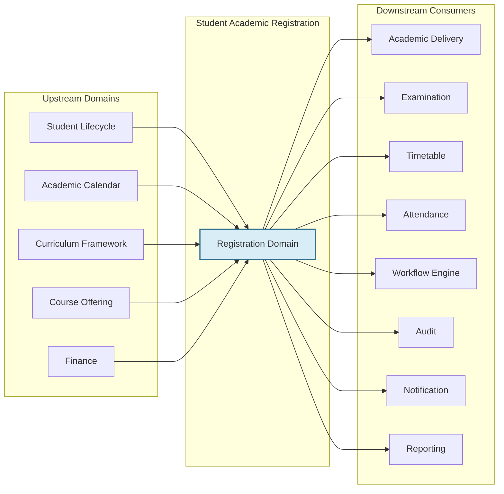

## 21.3 Domain Ownership Diagram

### Purpose

The Domain Ownership Diagram identifies the canonical ownership boundaries of the Student Academic Registration Domain.

It distinguishes between authoritative upstream domains that provide reference information, the Registration Domain that exclusively owns academic registration records and lifecycle, and downstream consumer domains that access registration information through published Service Contracts and Domain Events.

The diagram reinforces the principle that ownership remains singular, while collaboration occurs through well-defined architectural contracts.

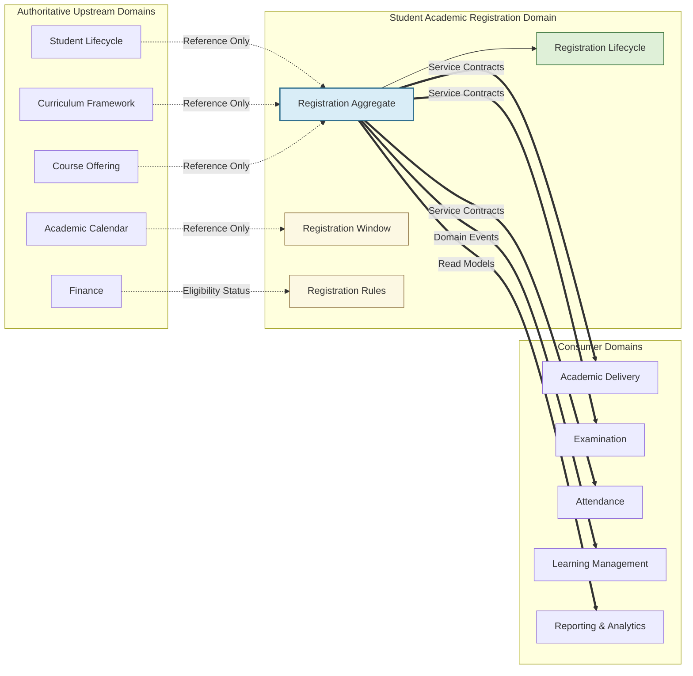

## 21.4 Academic Registration Aggregate Architecture

### Purpose

The Academic Registration Aggregate represents the primary transactional consistency boundary within the Student Academic Registration Domain.

All registration-related business operations shall execute through the AcademicRegistration Aggregate Root, which enforces business invariants, maintains aggregate consistency, governs lifecycle transitions, and coordinates the registration of academic offerings.

Child entities shall never be modified independently. External domains interact only through governed Service Contracts exposed by the Registration Domain.

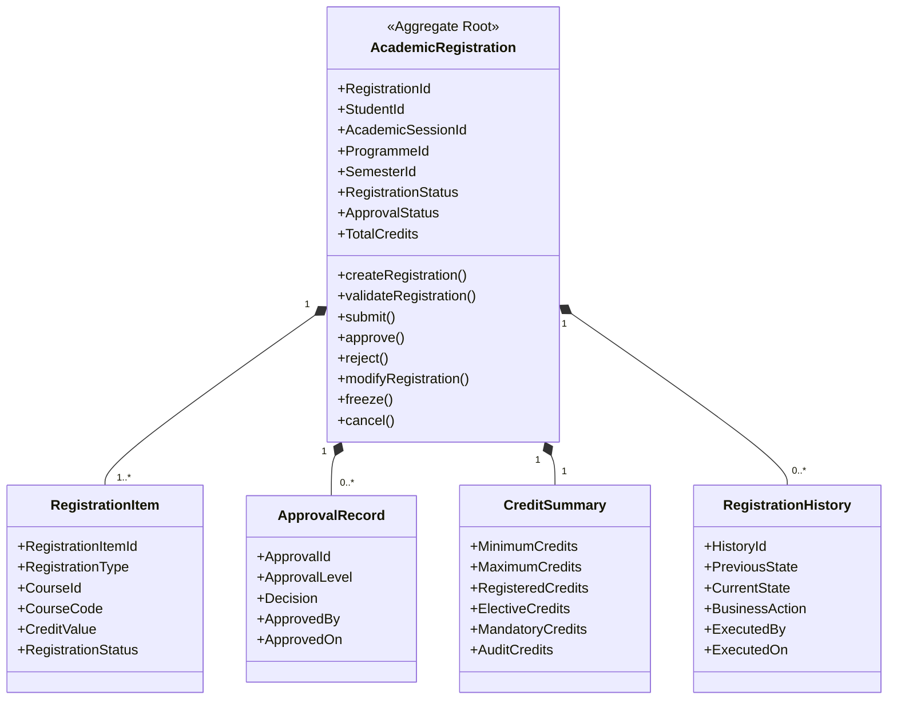

## 21.5 Registration Lifecycle Overview

### Purpose

The Registration Lifecycle Overview illustrates the canonical business lifecycle of an Academic Registration within the Student Academic Registration Domain.

The lifecycle begins when a student initiates registration, progresses through validation and approval activities, and concludes with registration completion or cancellation.

Each transition represents a governed business operation subject to lifecycle rules, authorization policies, and institutional configuration.

Detailed workflows for each stage are described in the subsequent visual models.

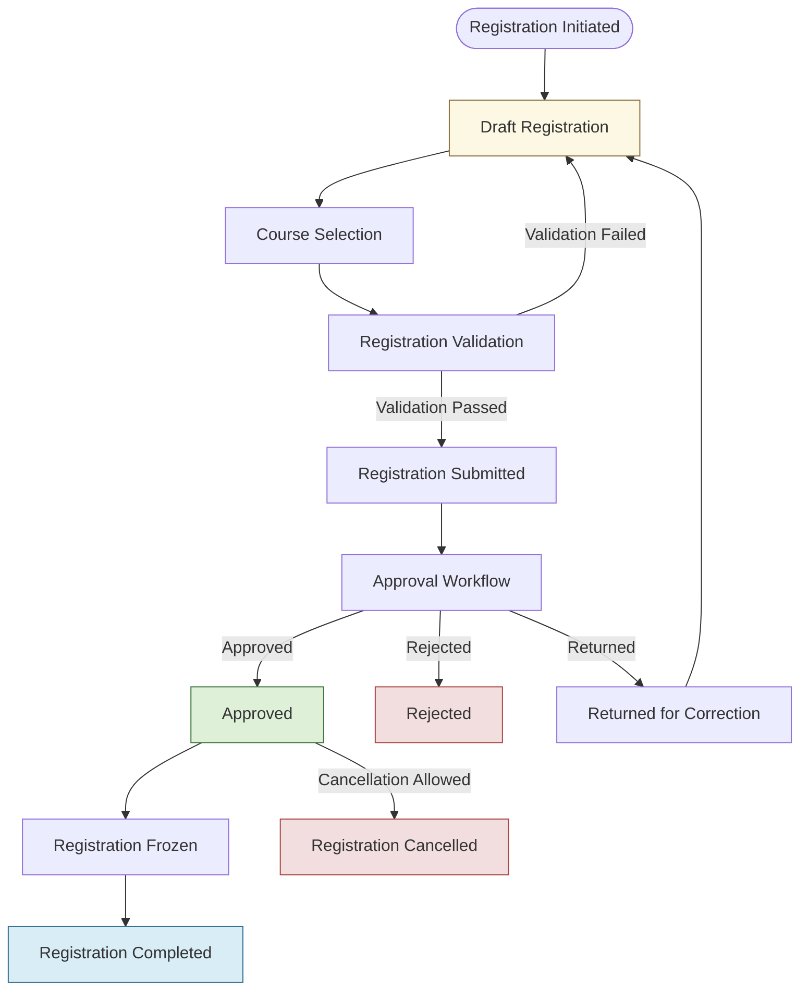

## 21.6 Registration Window Initialization Workflow

### Purpose

The Registration Window Initialization Workflow illustrates the lifecycle of an Academic Registration Window prior to student registration activities.

The Registration Window defines the authorized period during which eligible students may initiate, modify, or cancel academic registrations according to institutional policies.

Window creation, validation, approval, publication, activation, and closure are governed administrative activities performed before any registration transactions are accepted.

The Registration Domain shall reject all registration requests outside an active Registration Window.
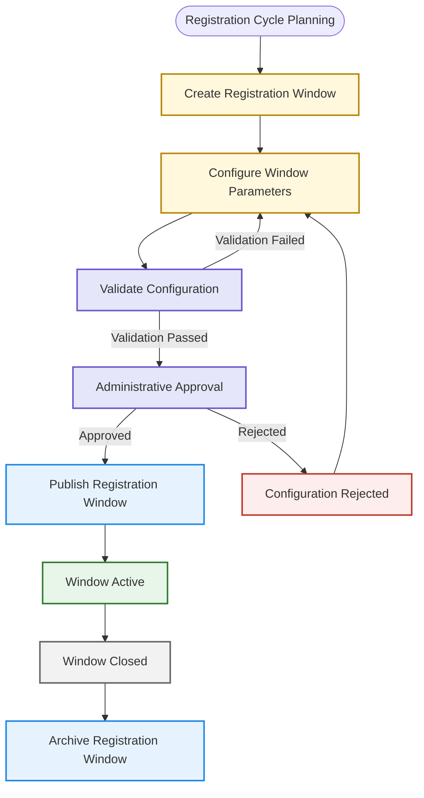

## 21.7 Student Eligibility Validation Workflow

### Purpose

The Student Eligibility Validation Workflow illustrates the canonical business process used to determine whether a student is permitted to initiate academic registration.

Eligibility validation evaluates institutional, academic, financial, and administrative conditions before permitting registration creation.

The Registration Domain shall prevent registration initiation whenever one or more mandatory eligibility conditions are not satisfied.

Only students who successfully satisfy all configured eligibility rules may proceed to registration creation.

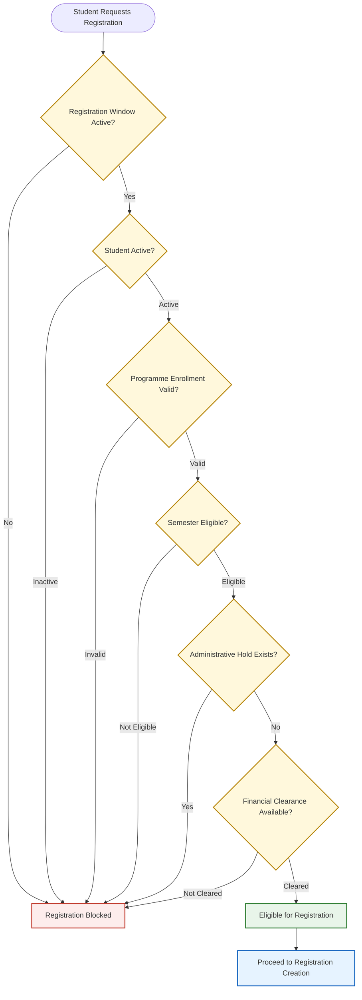

## 21.8 Registration Creation Workflow

### Purpose

The Registration Creation Workflow illustrates the canonical process for creating an Academic Registration after a student has successfully passed eligibility validation.

During this workflow, the Registration Domain establishes a new Academic Registration Aggregate, initializes its lifecycle, associates it with the appropriate academic session, programme, and semester, and records the initial registration status.

Registration creation shall occur exactly once for a student within a registration cycle unless institutional policies explicitly permit multiple registrations.

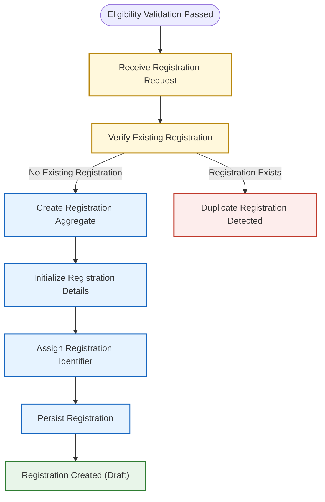

## 21.9 Course Selection Workflow

### Purpose

The Course Selection Workflow illustrates the canonical process by which a student selects academic offerings within an existing Academic Registration.

Course selection occurs after the Academic Registration Aggregate has been successfully created and remains in a modifiable state.

The Registration Domain retrieves the available academic offerings, records the student's selections, performs preliminary selection validation, updates the registration, and prepares the registration for comprehensive validation.

Detailed academic validation rules, including prerequisite verification, credit limits, timetable conflict detection, and institutional policy enforcement, are performed during the Registration Validation Pipeline.

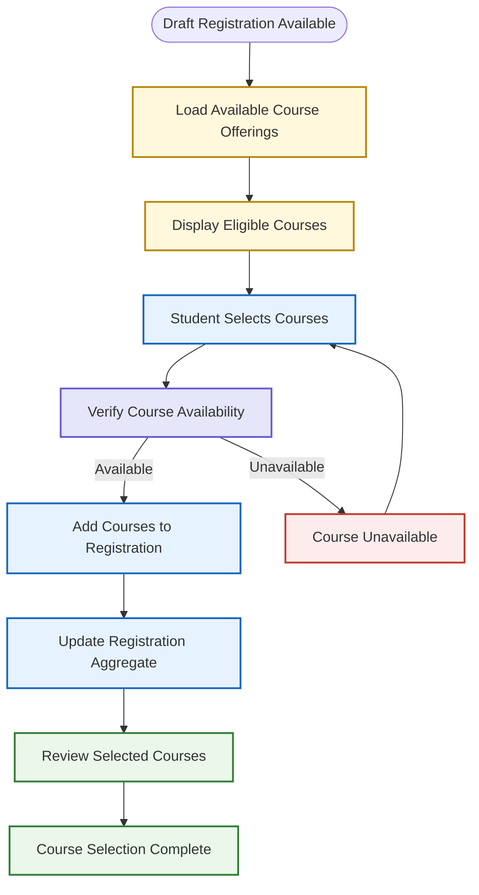

## 21.10 Registration Validation Pipeline

### Purpose

The Registration Validation Pipeline illustrates the canonical sequence of business validations performed before an Academic Registration may be submitted for approval.

The Registration Domain evaluates academic, administrative, financial, and institutional policies in a deterministic order to ensure that every registration satisfies all mandatory business requirements.

Validation failures terminate the pipeline immediately and return the registration to the Draft state for correction. Only registrations that successfully satisfy every validation stage may proceed to submission.

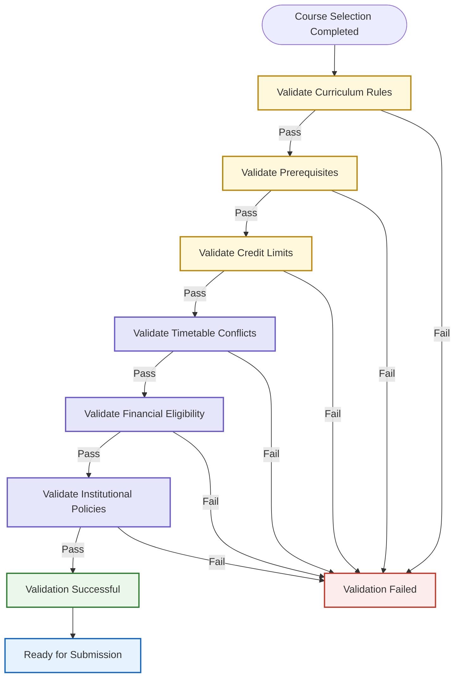
## 21.11 Approval Workflow

### Purpose

The Approval Workflow illustrates the canonical business process for reviewing and approving an Academic Registration after successful validation.

Depending on institutional policy, registrations may be automatically approved or routed through one or more approval levels before becoming effective.

Approvers may approve, reject, or return the registration for correction. Each decision is recorded as part of the Registration Domain's audit history and contributes to the registration lifecycle.

Only approved registrations may progress to the subsequent stages of the registration lifecycle.

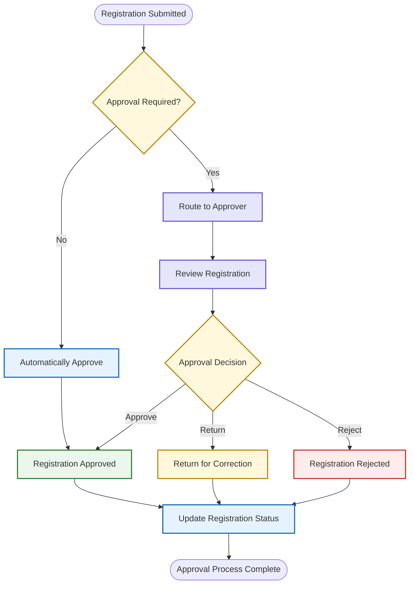

## 21.12 Registration Modification Workflow

### Purpose

The Registration Modification Workflow illustrates the canonical process for modifying an existing Academic Registration.

Modification is permitted only when the registration remains in a modifiable lifecycle state and all institutional policies governing registration amendments are satisfied.

Each modification request updates the existing Academic Registration Aggregate, triggers re-validation of affected business rules, records an audit history entry, and preserves aggregate consistency.

Registrations that are frozen, finalized, or otherwise restricted by institutional policy shall reject modification requests.

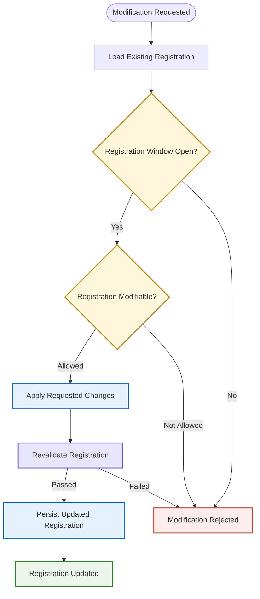

## 21.13 Registration Cancellation Workflow

### Purpose

The Registration Cancellation Workflow illustrates the canonical business process for cancelling an existing Academic Registration.

Cancellation is permitted only when the registration remains in a cancellable lifecycle state and institutional policies authorize cancellation.

Before cancellation is finalized, the Registration Domain verifies policy compliance, evaluates downstream dependencies, updates the registration lifecycle, records the cancellation reason, and creates a permanent audit record.

Registrations that have progressed beyond the permitted cancellation stage shall reject cancellation requests.

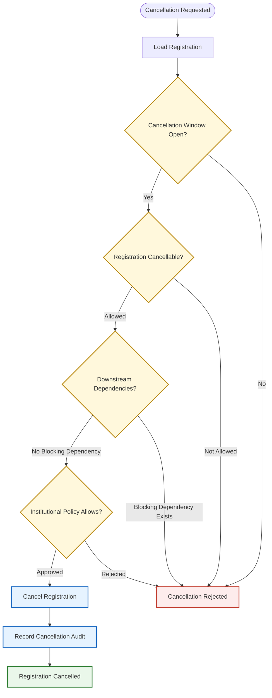

## 21.14 Registration Freeze Workflow

### Purpose

The Registration Freeze Workflow illustrates the canonical process for transitioning an approved Academic Registration into a frozen state.

Registration freezing marks the point at which the registration becomes immutable for normal academic operations. After freezing, modifications and cancellations are prohibited unless exceptional institutional override policies are explicitly authorized.

The Registration Domain verifies all prerequisite conditions, transitions the registration lifecycle, records the freeze event, and publishes the resulting state for consumption by downstream academic domains.

A frozen registration serves as the authoritative academic record for subsequent timetable generation, attendance management, examination processing, reporting, and other dependent services.

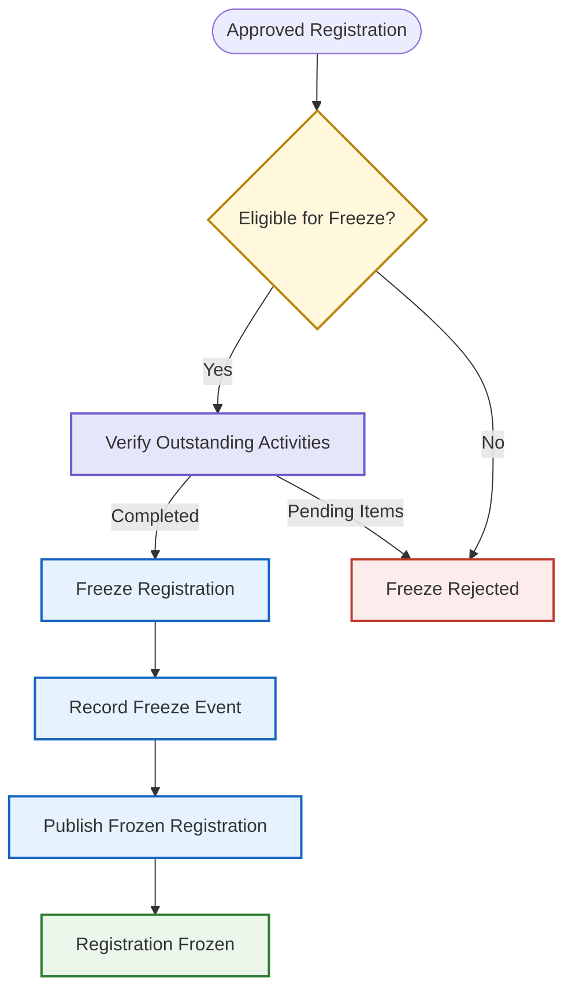

## 21.15 Registration Publication Workflow

### Purpose

The Registration Publication Workflow illustrates the canonical process for publishing a finalized Academic Registration to downstream domains after the registration has been frozen.

Publication makes the registration available through governed Service Contracts and Domain Events, enabling dependent domains to synchronize with the authoritative registration record.

The Registration Domain remains the sole owner of registration data. Downstream domains consume published information but shall never modify the Registration Aggregate directly.

Publication shall occur only after successful completion of all prerequisite lifecycle transitions and shall guarantee eventual consistency across the SutraERP platform.

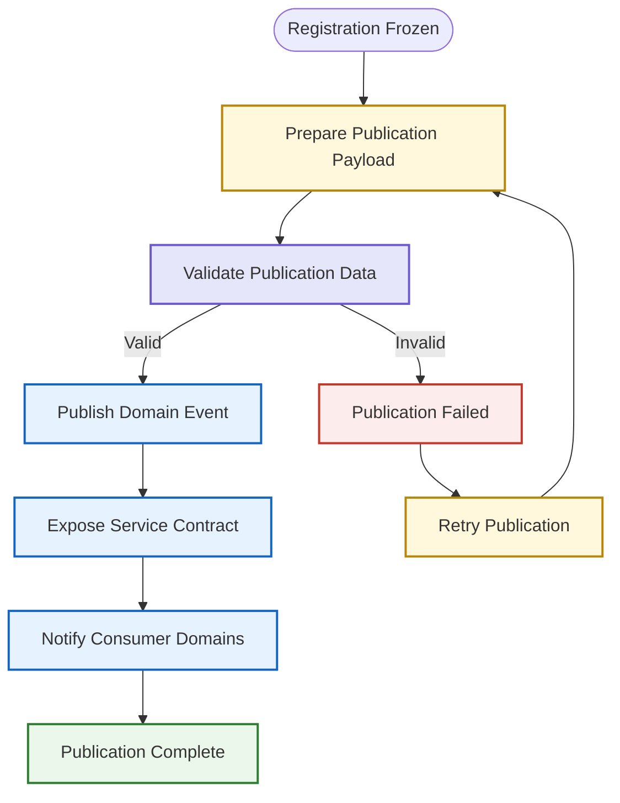

## 21.16 Domain Event Flow

### Purpose

The Domain Event Flow illustrates the canonical event-driven integration model of the Student Academic Registration Domain.

Throughout the registration lifecycle, the Registration Domain publishes immutable Domain Events representing significant business state transitions. These events notify downstream domains of completed business operations while preserving aggregate ownership and transactional boundaries.

The Registration Domain remains the authoritative source of registration information. Downstream domains consume published events to synchronize their own domain models while maintaining eventual consistency across the SutraERP platform.

All Domain Events are immutable and represent facts that have already occurred.

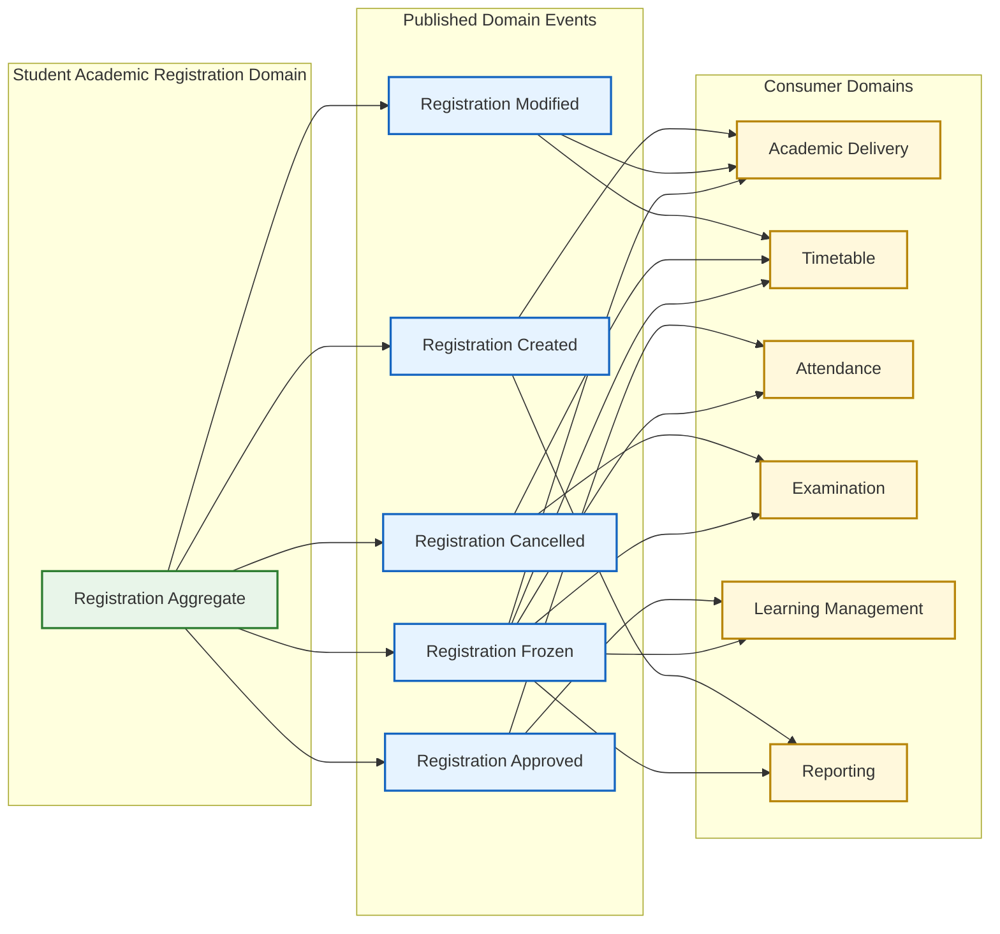

## 21.17 Transactional Outbox Pattern

### Purpose

The Transactional Outbox Pattern illustrates the canonical mechanism used by the Student Academic Registration Domain to publish Domain Events reliably.

When a business transaction modifies the Academic Registration Aggregate, both the aggregate changes and the corresponding Domain Events are persisted atomically within the same database transaction.

A dedicated Outbox Publisher subsequently retrieves unpublished events from the Outbox Store and delivers them to the enterprise message broker. This approach guarantees reliable event delivery while preserving transactional consistency between persistent data and published events.

The Transactional Outbox Pattern eliminates the possibility of successfully committing registration data without publishing the corresponding Domain Events.

```mermaid
flowchart LR

    CMD["Registration Command"]

    APP["Registration Application Service"]

    AGG["Registration Aggregate"]

    DB["Registration Database"]

    OUTBOX["Transactional Outbox"]

    PUBLISHER["Outbox Publisher"]

    BROKER["Message Broker"]

    CONSUMERS["Consumer Domains"]

    CMD --> APP

    APP --> AGG

    AGG --> DB

    AGG --> OUTBOX

    DB --> PUBLISHER

    OUTBOX --> PUBLISHER

    PUBLISHER --> BROKER

    BROKER --> CONSUMERS

    %% Styling

    style CMD fill:#FFF8DC,stroke:#B8860B,stroke-width:2px

    style APP fill:#E6F3FF,stroke:#1565C0,stroke-width:2px
    style AGG fill:#E8F5E9,stroke:#2E7D32,stroke-width:2px

    style DB fill:#F2F2F2,stroke:#666666,stroke-width:2px
    style OUTBOX fill:#E6E6FA,stroke:#6A5ACD,stroke-width:2px

    style PUBLISHER fill:#E6F3FF,stroke:#1565C0,stroke-width:2px
    style BROKER fill:#FFF8DC,stroke:#B8860B,stroke-width:2px
    style CONSUMERS fill:#EAF7EA,stroke:#2E7D32,stroke-width:2px
```
## 21.18 Registration State Machine

### Purpose

The Registration State Machine defines the canonical lifecycle states of the Academic Registration Aggregate and the valid transitions permitted between those states.

Every state transition shall be initiated through governed business operations executed by the Registration Domain. Direct modification of registration state outside the defined lifecycle is prohibited.

The state machine ensures lifecycle consistency, prevents invalid transitions, and establishes the authoritative behavioral model for the Registration Aggregate throughout its operational lifecycle.

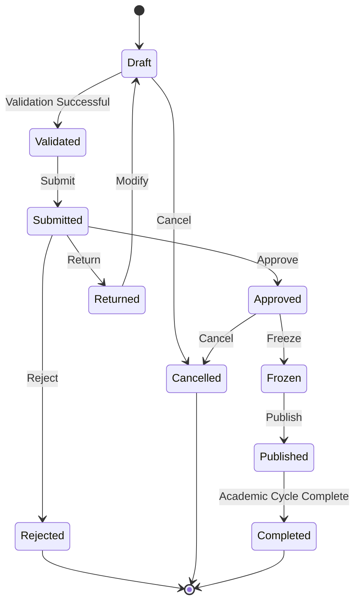

## 21.19 Service Contract Architecture

### Purpose

The Service Contract Architecture illustrates the canonical synchronous integration model of the Student Academic Registration Domain.

External domains shall interact with the Registration Domain exclusively through governed Service Contracts. Direct access to the Academic Registration Aggregate, persistence layer, or internal domain services is prohibited.

Service Contracts provide a stable integration boundary, preserving aggregate ownership, encapsulating business logic, and maintaining bounded context isolation across the SutraERP platform.

All write operations shall execute through the Registration Application Service, while read operations shall be fulfilled through authorized query services or published read models.

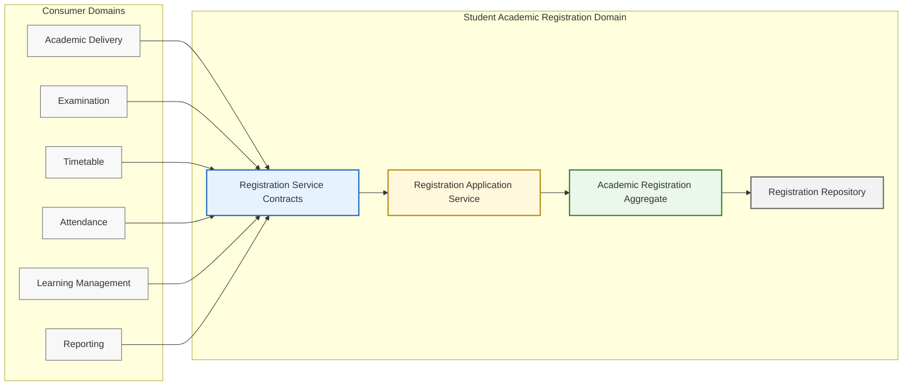
## 21.20 RBAC Architecture

### Purpose

The RBAC Architecture illustrates the canonical authorization model governing access to the Student Academic Registration Domain.

All operations within the Registration Domain shall be protected through Role-Based Access Control (RBAC). Authorization is enforced by the Registration Application Service before any business operation reaches the Academic Registration Aggregate.

Each role is granted only the permissions necessary to perform its authorized business responsibilities, following the principle of least privilege.

Authorization decisions are independent of business validation and lifecycle rules. A successfully authorized request must still satisfy all applicable business policies before execution.

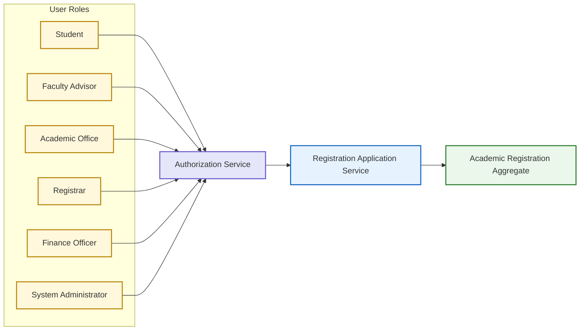

## 21.21 Cross-Domain Integration Map

### Purpose

The Cross-Domain Integration Map illustrates the canonical dependencies of the Student Academic Registration Domain within the SutraERP platform.

The diagram identifies upstream domains that provide authoritative reference information required for registration processing and downstream domains that consume finalized registration information through governed Service Contracts and Domain Events.

The Student Academic Registration Domain remains the sole owner of Academic Registration data. Integration with other domains occurs exclusively through published contracts, ensuring bounded context isolation, clear ownership boundaries, and eventual consistency across the platform.

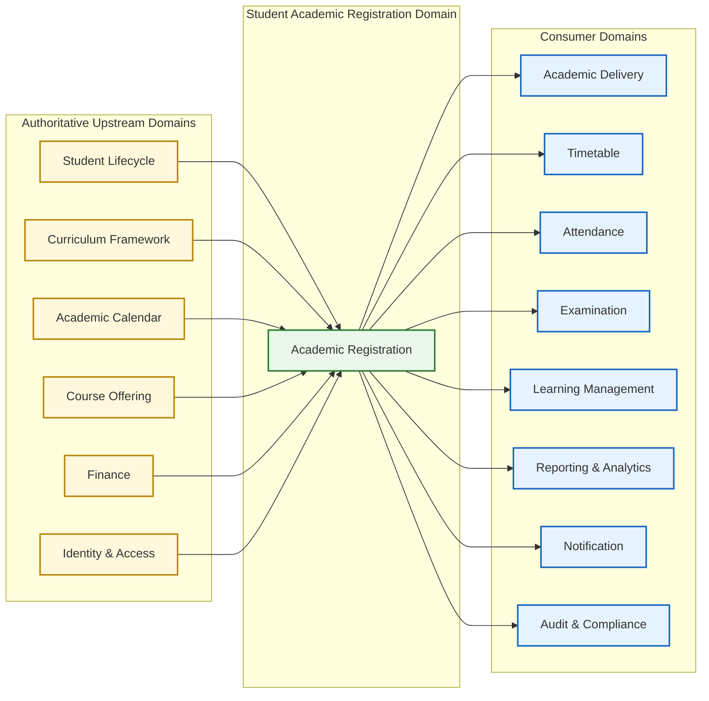

## 21.22 Validation Architecture

### Purpose

The Validation Architecture illustrates the canonical organization of the validation subsystem within the Student Academic Registration Domain.

The Registration Application Service coordinates a sequence of specialized validation components, each responsible for evaluating a distinct category of business rules.

Each validator operates independently and returns deterministic validation results. The Registration Domain aggregates these results before determining whether the Academic Registration may proceed to the next lifecycle stage.

This architecture promotes modularity, extensibility, maintainability, and consistent enforcement of institutional policies while preserving aggregate integrity.

```mermaid
flowchart TD

    REQUEST["Registration Request"]

    APP["Registration Application Service"]

    subgraph Validators["Validation Components"]

        CURRICULUM["Curriculum Validator"]

        PREREQ["Prerequisite Validator"]

        CREDIT["Credit Limit Validator"]

        TIMETABLE["Timetable Conflict Validator"]

        FINANCE["Financial Validator"]

        POLICY["Institution Policy Validator"]

    end

    RESULT["Validation Result"]

    AGG["Academic Registration Aggregate"]

    REQUEST --> APP

    APP --> CURRICULUM
    APP --> PREREQ
    APP --> CREDIT
    APP --> TIMETABLE
    APP --> FINANCE
    APP --> POLICY

    CURRICULUM --> RESULT
    PREREQ --> RESULT
    CREDIT --> RESULT
    TIMETABLE --> RESULT
    FINANCE --> RESULT
    POLICY --> RESULT

    RESULT --> AGG

    %% Styling

    style REQUEST fill:#FFF8DC,stroke:#B8860B,stroke-width:2px

    style APP fill:#E6F3FF,stroke:#1565C0,stroke-width:2px

    style CURRICULUM fill:#E6E6FA,stroke:#6A5ACD,stroke-width:2px
    style PREREQ fill:#E6E6FA,stroke:#6A5ACD,stroke-width:2px
    style CREDIT fill:#E6E6FA,stroke:#6A5ACD,stroke-width:2px
    style TIMETABLE fill:#E6E6FA,stroke:#6A5ACD,stroke-width:2px
    style FINANCE fill:#E6E6FA,stroke:#6A5ACD,stroke-width:2px
    style POLICY fill:#E6E6FA,stroke:#6A5ACD,stroke-width:2px

    style RESULT fill:#EAF7EA,stroke:#2E7D32,stroke-width:2px

    style AGG fill:#EAF7EA,stroke:#2E7D32,stroke-width:2px
```

## 21.23 Exception Handling Flow

### Purpose

The Exception Handling Flow illustrates the canonical process for managing business exceptions, validation failures, integration failures, and unexpected system errors within the Student Academic Registration Domain.

The Registration Domain shall preserve transactional consistency by ensuring that failed operations never leave the Academic Registration Aggregate in a partially updated state.

Every exception shall be classified, logged, audited where required, and returned to the requesting client using standardized error responses. Recoverable failures may be retried according to institutional policies, while unrecoverable failures terminate the operation and maintain the previously committed aggregate state.

This architecture ensures reliability, traceability, and predictable system behavior across all registration operations.

```mermaid
flowchart TD

    START([Registration Request])

    EXECUTE["Execute Business Operation"]

    SUCCESS{"Operation Successful?"}

    COMMIT["Commit Transaction"]

    COMPLETE["Operation Completed"]

    ERROR["Capture Exception"]

    CLASSIFY["Classify Exception"]

    ROLLBACK["Rollback Transaction"]

    LOG["Log & Audit Exception"]

    RESPONSE["Return Standard Error Response"]

    START --> EXECUTE

    EXECUTE --> SUCCESS

    SUCCESS -->|Yes| COMMIT
    SUCCESS -->|No| ERROR

    COMMIT --> COMPLETE

    ERROR --> CLASSIFY

    CLASSIFY --> ROLLBACK

    ROLLBACK --> LOG

    LOG --> RESPONSE

    %% Styling

    style EXECUTE fill:#E6F3FF,stroke:#1565C0,stroke-width:2px

    style SUCCESS fill:#FFF8DC,stroke:#B8860B,stroke-width:2px

    style COMMIT fill:#EAF7EA,stroke:#2E7D32,stroke-width:2px
    style COMPLETE fill:#EAF7EA,stroke:#2E7D32,stroke-width:2px

    style ERROR fill:#FDECEC,stroke:#C0392B,stroke-width:2px
    style CLASSIFY fill:#FDECEC,stroke:#C0392B,stroke-width:2px
    style ROLLBACK fill:#FDECEC,stroke:#C0392B,stroke-width:2px

    style LOG fill:#E6E6FA,stroke:#6A5ACD,stroke-width:2px
    style RESPONSE fill:#E6E6FA,stroke:#6A5ACD,stroke-width:2px
```

## 21.24 Audit & Compliance Architecture

### Purpose

The Audit & Compliance Architecture illustrates the canonical governance model for recording, preserving, and managing audit information within the Student Academic Registration Domain.

Every significant business operation performed on the Academic Registration Aggregate shall generate an immutable audit record containing the business action, lifecycle transition, actor, timestamp, and contextual metadata.

Audit information supports regulatory compliance, institutional governance, forensic investigation, operational monitoring, and historical traceability.

Audit records are append-only and shall never be modified or deleted through normal business operations.

```mermaid
flowchart LR

    USER["User / System"]

    APP["Registration Application Service"]

    AGG["Academic Registration Aggregate"]

    AUDIT["Audit Service"]

    STORE["Audit Repository"]

    REPORT["Compliance & Audit Reports"]

    USER --> APP

    APP --> AGG

    APP --> AUDIT

    AUDIT --> STORE

    STORE --> REPORT

    %% Styling

    style USER fill:#FFF8DC,stroke:#B8860B,stroke-width:2px

    style APP fill:#E6F3FF,stroke:#1565C0,stroke-width:2px

    style AGG fill:#EAF7EA,stroke:#2E7D32,stroke-width:2px

    style AUDIT fill:#E6E6FA,stroke:#6A5ACD,stroke-width:2px

    style STORE fill:#F2F2F2,stroke:#666666,stroke-width:2px

    style REPORT fill:#EAF7EA,stroke:#2E7D32,stroke-width:2px
```

## 21.25 Reporting Architecture

### Purpose

The Reporting Architecture illustrates the canonical mechanism through which operational reports, dashboards, analytics, and institutional intelligence consume Academic Registration information.

The Student Academic Registration Domain remains the authoritative source of registration data. Reporting components access registration information through dedicated read models, reporting projections, or analytical data stores rather than interacting directly with the Academic Registration Aggregate.

This architecture preserves transactional performance, bounded context isolation, and aggregate consistency while enabling efficient operational and analytical reporting across the SutraERP platform.

```mermaid
flowchart LR

    AGG["Academic Registration Aggregate"]

    EVENTS["Domain Events"]

    READMODEL["Registration Read Model"]

    REPORT["Reporting Service"]

    DASHBOARD["Operational Dashboards"]

    ANALYTICS["Analytics & BI"]

    EXPORT["Regulatory Reports"]

    AGG --> EVENTS

    EVENTS --> READMODEL

    READMODEL --> REPORT

    REPORT --> DASHBOARD
    REPORT --> ANALYTICS
    REPORT --> EXPORT

    %% Styling

    style AGG fill:#EAF7EA,stroke:#2E7D32,stroke-width:2px

    style EVENTS fill:#E6F3FF,stroke:#1565C0,stroke-width:2px

    style READMODEL fill:#E6E6FA,stroke:#6A5ACD,stroke-width:2px

    style REPORT fill:#FFF8DC,stroke:#B8860B,stroke-width:2px

    style DASHBOARD fill:#F2F2F2,stroke:#666666,stroke-width:2px
    style ANALYTICS fill:#F2F2F2,stroke:#666666,stroke-width:2px
    style EXPORT fill:#F2F2F2,stroke:#666666,stroke-width:2px
```

## 21.26 Configuration & Policy Architecture

### Purpose

The Configuration & Policy Architecture illustrates the canonical mechanism through which institutional configuration governs the behavior of the Student Academic Registration Domain.

Institution-specific rules, including registration windows, credit limits, approval requirements, eligibility criteria, cancellation policies, and other configurable business rules, are maintained within dedicated policy repositories rather than being embedded within domain logic.

The Registration Application Service retrieves the applicable policies for the current institution and academic context before executing registration operations.

This architecture enables institutions to configure registration behavior while preserving a stable, reusable, and institution-independent domain model.

```mermaid
flowchart LR

    REQUEST["Registration Request"]

    APP["Registration Application Service"]

    POLICY["Policy Engine"]

    CONFIG["Configuration Repository"]

    RULES["Institution Policies"]

    AGG["Academic Registration Aggregate"]

    REQUEST --> APP

    APP --> POLICY

    POLICY --> CONFIG

    CONFIG --> RULES

    POLICY --> APP

    APP --> AGG

    %% Styling

    style REQUEST fill:#FFF8DC,stroke:#B8860B,stroke-width:2px

    style APP fill:#E6F3FF,stroke:#1565C0,stroke-width:2px

    style POLICY fill:#E6E6FA,stroke:#6A5ACD,stroke-width:2px

    style CONFIG fill:#F2F2F2,stroke:#666666,stroke-width:2px
    style RULES fill:#F2F2F2,stroke:#666666,stroke-width:2px

    style AGG fill:#EAF7EA,stroke:#2E7D32,stroke-width:2px
```
## 21.27 Deployment Context Diagram

### Purpose

The Deployment Context Diagram illustrates the canonical runtime deployment architecture of the Student Academic Registration Domain.

It identifies the primary runtime components involved in processing registration operations, including client applications, API Gateway, Registration Service, persistent storage, messaging infrastructure, and downstream consumers.

The deployment model is platform-neutral and supports cloud-native, on-premises, and hybrid deployments while preserving the architectural boundaries of the Registration Domain.

Infrastructure components provide communication, persistence, and messaging capabilities but do not participate in domain business logic.

```mermaid
flowchart LR

    subgraph Clients["Client Applications"]

        WEB["Web Portal"]
        MOBILE["Mobile App"]
        ADMIN["Administrative Console"]

    end

    subgraph Platform["Application Platform"]

        GATEWAY["API Gateway"]

        REGSERVICE["Registration Service"]

    end

    subgraph Infrastructure["Infrastructure"]

        DB["Registration Database"]

        BROKER["Message Broker"]

    end

    subgraph Consumers["Downstream Services"]

        ACADEMIC["Academic Services"]

        EXAM["Examination"]

        REPORT["Reporting"]

    end

    WEB --> GATEWAY
    MOBILE --> GATEWAY
    ADMIN --> GATEWAY

    GATEWAY --> REGSERVICE

    REGSERVICE --> DB

    REGSERVICE --> BROKER

    BROKER --> ACADEMIC
    BROKER --> EXAM
    BROKER --> REPORT

    %% Styling

    style GATEWAY fill:#E6F3FF,stroke:#1565C0,stroke-width:2px

    style REGSERVICE fill:#EAF7EA,stroke:#2E7D32,stroke-width:2px

    style DB fill:#F2F2F2,stroke:#666666,stroke-width:2px
    style BROKER fill:#E6E6FA,stroke:#6A5ACD,stroke-width:2px

    style WEB fill:#FFF8DC,stroke:#B8860B,stroke-width:2px
    style MOBILE fill:#FFF8DC,stroke:#B8860B,stroke-width:2px
    style ADMIN fill:#FFF8DC,stroke:#B8860B,stroke-width:2px

    style ACADEMIC fill:#E6F3FF,stroke:#1565C0,stroke-width:2px
    style EXAM fill:#E6F3FF,stroke:#1565C0,stroke-width:2px
    style REPORT fill:#E6F3FF,stroke:#1565C0,stroke-width:2px
```
## 21.28 Dependency Architecture

### Purpose

The Dependency Architecture illustrates the canonical layering and dependency relationships within the Student Academic Registration Domain.

The architecture follows Domain-Driven Design (DDD) and Clean Architecture principles, ensuring that dependencies always point inward toward the Domain Layer.

Business rules remain isolated within the Domain Layer, while infrastructure concerns such as persistence, messaging, and external integrations are implemented in outer layers.

This layered architecture promotes maintainability, testability, loose coupling, and long-term architectural stability.

```mermaid
flowchart TB

    PRESENTATION["Presentation Layer"]

    APPLICATION["Application Layer"]

    DOMAIN["Domain Layer"]

    INFRASTRUCTURE["Infrastructure Layer"]

    EXTERNAL["External Systems"]

    PRESENTATION --> APPLICATION

    APPLICATION --> DOMAIN

    APPLICATION --> INFRASTRUCTURE

    INFRASTRUCTURE --> EXTERNAL

    INFRASTRUCTURE -. Implements Domain Interfaces .-> DOMAIN

    %% Styling

    style PRESENTATION fill:#FFF8DC,stroke:#B8860B,stroke-width:2px

    style APPLICATION fill:#E6F3FF,stroke:#1565C0,stroke-width:2px

    style DOMAIN fill:#EAF7EA,stroke:#2E7D32,stroke-width:2px

    style INFRASTRUCTURE fill:#E6E6FA,stroke:#6A5ACD,stroke-width:2px

    style EXTERNAL fill:#F2F2F2,stroke:#666666,stroke-width:2px
```
## 21.29 Domain Summary Diagram

### Purpose

The Domain Summary Diagram provides the executive architectural overview of the Student Academic Registration Domain.

It consolidates the domain's primary responsibilities, architectural boundaries, upstream dependencies, downstream consumers, governance mechanisms, and runtime interactions into a single high-level representation.

This diagram serves as the primary reference for architects, developers, reviewers, and stakeholders seeking a concise understanding of the Registration Domain within the broader SutraERP platform.

The diagram complements, but does not replace, the detailed workflow, lifecycle, integration, validation, and governance diagrams presented throughout this section.

```mermaid
flowchart LR

    subgraph Upstream["Authoritative Upstream Domains"]

        ST["Student Lifecycle"]
        CF["Curriculum Framework"]
        CAL["Academic Calendar"]
        CO["Course Offering"]
        FIN["Finance"]
        IAM["Identity & Access"]

    end

    subgraph Registration["Student Academic Registration Domain"]

        APP["Application Services"]

        AGG["Academic Registration Aggregate"]

        VALIDATION["Validation Engine"]

        POLICY["Policy Engine"]

        EVENTS["Domain Events"]

        CONTRACTS["Service Contracts"]

        AUDIT["Audit & Compliance"]

    end

    subgraph Downstream["Consumer Domains"]

        AD["Academic Delivery"]

        TT["Timetable"]

        ATT["Attendance"]

        EX["Examination"]

        LMS["Learning Management"]

        REP["Reporting"]

        NOTIFY["Notification"]

    end

    ST --> APP
    CF --> APP
    CAL --> APP
    CO --> APP
    FIN --> APP
    IAM --> APP

    APP --> POLICY
    APP --> VALIDATION
    APP --> AGG

    AGG --> EVENTS
    AGG --> CONTRACTS
    AGG --> AUDIT

    EVENTS --> AD
    EVENTS --> TT
    EVENTS --> ATT
    EVENTS --> EX
    EVENTS --> LMS
    EVENTS --> REP
    EVENTS --> NOTIFY

    CONTRACTS --> AD
    CONTRACTS --> EX
    CONTRACTS --> REP

    %% Styling

    style APP fill:#E6F3FF,stroke:#1565C0,stroke-width:2px

    style AGG fill:#EAF7EA,stroke:#2E7D32,stroke-width:2px

    style VALIDATION fill:#E6E6FA,stroke:#6A5ACD,stroke-width:2px
    style POLICY fill:#E6E6FA,stroke:#6A5ACD,stroke-width:2px

    style EVENTS fill:#FFF8DC,stroke:#B8860B,stroke-width:2px
    style CONTRACTS fill:#FFF8DC,stroke:#B8860B,stroke-width:2px

    style AUDIT fill:#F2F2F2,stroke:#666666,stroke-width:2px

    style ST fill:#F8F8F8,stroke:#666666
    style CF fill:#F8F8F8,stroke:#666666
    style CAL fill:#F8F8F8,stroke:#666666
    style CO fill:#F8F8F8,stroke:#666666
    style FIN fill:#F8F8F8,stroke:#666666
    style IAM fill:#F8F8F8,stroke:#666666

    style AD fill:#F8F8F8,stroke:#666666
    style TT fill:#F8F8F8,stroke:#666666
    style ATT fill:#F8F8F8,stroke:#666666
    style EX fill:#F8F8F8,stroke:#666666
    style LMS fill:#F8F8F8,stroke:#666666
    style REP fill:#F8F8F8,stroke:#666666
    style NOTIFY fill:#F8F8F8,stroke:#666666
```
# 22. Architectural Decision Records (ADRs)

## 22.1 Overview

This section documents the key architectural decisions that govern the Student Academic Registration Domain.

Architectural Decision Records (ADRs) capture significant design choices, their rationale, alternatives considered, and long-term implications. These records serve as the authoritative reference for future architectural evolution and ensure consistency across implementations.

---

# ADR-001 — Registration as an Independent Domain

## Decision

The Student Academic Registration capability shall exist as an independent business domain.

## Rationale

Academic Registration represents a distinct business capability with its own lifecycle, policies, workflows, and integrations.

## Consequences

### Positive

- Clear ownership
- Independent evolution
- Better scalability
- Stronger domain boundaries

### Trade-offs

- Additional integration points
- Increased event coordination

---

# ADR-002 — Aggregate-Centric Design

## Decision

The **AcademicRegistration** entity shall be implemented as the Aggregate Root.

## Rationale

All registration operations require transactional consistency across registration items, approvals, credit summaries, and lifecycle state.

## Consequences

### Positive

- Strong consistency
- Simplified business rule enforcement
- Controlled state transitions

### Trade-offs

- Aggregate size must be carefully managed
- Cross-aggregate transactions are avoided

---

# ADR-003 — Event-Driven Integration

## Decision

Cross-domain communication shall primarily use immutable Domain Events.

## Rationale

Loose coupling improves scalability, resilience, and deployment independence.

## Consequences

### Positive

- Independent deployments
- Better scalability
- Asynchronous processing
- Reduced runtime coupling

### Trade-offs

- Eventual consistency
- Consumer complexity
- Event version management

---

# ADR-004 — Canonical Service Contracts

## Decision

All synchronous interactions shall occur exclusively through governed Service Contracts.

## Rationale

Direct database access violates domain ownership and weakens architectural boundaries.

## Consequences

### Positive

- Stable APIs
- Strong encapsulation
- Controlled validation
- Version management

### Trade-offs

- Additional API management
- Service governance overhead

---

# ADR-005 — Immutable Audit History

## Decision

Audit records shall be append-only and immutable.

## Rationale

Academic registration is a legally and institutionally significant process requiring complete historical traceability.

## Consequences

### Positive

- Regulatory compliance
- Strong forensic capability
- Non-repudiation

### Trade-offs

- Increased storage requirements
- Long-term archival management

---

# ADR-006 — Configuration Over Customization

## Decision

Institution-specific registration behavior shall be implemented through configuration rather than source code customization.

## Rationale

Universities implement different academic regulations while sharing common registration processes.

## Consequences

### Positive

- Easier upgrades
- Lower maintenance
- Faster onboarding
- Reduced implementation risk

### Trade-offs

- Larger configuration model
- Increased configuration governance

---

# ADR-007 — Strict Domain Ownership

## Decision

The Registration Domain shall own only registration-related business data.

## Rationale

Student, curriculum, programme, and course information are owned by their respective domains.

## Consequences

### Positive

- Clear ownership
- Reduced duplication
- Better consistency

### Trade-offs

- Increased service dependencies
- Greater reliance on canonical master data

---

# ADR-008 — Optimistic Concurrency Control

## Decision

Concurrent modifications shall use optimistic concurrency mechanisms.

## Rationale

Registration activities experience high concurrent access during enrollment periods.

## Consequences

### Positive

- High scalability
- Better throughput
- Reduced database locking

### Trade-offs

- Conflict detection required
- User retry scenarios

---

# ADR-009 — Multi-Tenant by Design

## Decision

The Registration Domain shall support logical multi-tenancy as the default deployment model.

## Rationale

The platform is intended to serve multiple institutions using a shared architecture.

## Consequences

### Positive

- Efficient resource utilization
- Centralized platform management
- Scalable SaaS deployments

### Trade-offs

- Strict tenant isolation requirements
- Enhanced security considerations

---

# ADR-010 — Workflow Externalization

## Decision

Approval workflows shall be orchestrated by the Platform Workflow Engine instead of being embedded within domain logic.

## Rationale

Approval processes vary significantly across institutions and require configurable execution.

## Consequences

### Positive

- Flexible workflow configuration
- Reduced domain complexity
- Reusable workflow engine

### Trade-offs

- Additional runtime dependency
- Workflow version coordination

---

# ADR-011 — Read-Only Master Data Consumption

## Decision

The Registration Domain shall consume master data from upstream domains without local ownership.

## Rationale

Canonical master data eliminates duplication and synchronization issues.

## Consequences

### Positive

- Single Source of Truth
- Reduced inconsistency
- Simplified governance

### Trade-offs

- Dependency on upstream availability
- Service latency considerations

---

# ADR-012 — Standardized Error Contracts

## Decision

All services shall expose standardized error contracts.

## Rationale

Uniform error handling improves interoperability and simplifies client implementations.

## Consequences

### Positive

- Predictable integrations
- Easier troubleshooting
- Consistent API behavior

### Trade-offs

- Error taxonomy governance
- Version compatibility management

---

# ADR-013 — Deployment Independence

## Decision

Business behavior shall remain identical across cloud, hybrid, and on-premises deployments.

## Rationale

Deployment strategy is an infrastructure concern and must not affect domain behavior.

## Consequences

### Positive

- Infrastructure flexibility
- Easier migration
- Consistent testing

### Trade-offs

- Additional abstraction layers
- Environment configuration management

---

# ADR-014 — NEP-Aligned Registration Model

## Decision

The Registration Domain shall support configurable academic structures aligned with the National Education Policy (NEP) without embedding policy-specific logic.

## Rationale

Educational regulations continue to evolve, requiring adaptable architecture.

## Consequences

### Positive

- Future-ready design
- Regulatory adaptability
- Institution-specific flexibility

### Trade-offs

- Expanded configuration complexity
- Increased validation scenarios

---

# 22.2 ADR Governance

Architectural Decision Records shall be maintained under formal governance.

Each ADR shall include:

- Unique identifier
- Decision statement
- Context
- Rationale
- Alternatives considered
- Consequences
- Approval authority
- Version history
- Review status

No architectural decision affecting domain boundaries, aggregate design, service contracts, or integration patterns shall be implemented without an approved ADR.

---

# 22.3 Architectural Decision Summary

The Architectural Decision Records establish the foundational design principles of the Student Academic Registration Domain. These decisions ensure architectural consistency, preserve domain integrity, support long-term maintainability, and provide a documented rationale for key design choices across the SutraERP platform.

# 23. Future Evolution Roadmap

## 23.1 Overview

The Student Academic Registration Domain is designed to evolve incrementally while preserving backward compatibility, architectural consistency, and institutional stability.

Future enhancements shall prioritize extensibility through configuration, standardized Service Contracts, and Domain Events rather than structural redesign.

All enhancements shall comply with the architectural principles defined within the SutraERP platform.

---

# 23.2 Evolution Principles

Future evolution shall adhere to the following principles:

- Backward compatibility.
- Domain ownership preservation.
- Configuration over customization.
- Event-first integration.
- Independent deployment.
- API versioning.
- Security by design.
- Auditability by default.

No enhancement shall compromise aggregate consistency or domain boundaries.

---

# 23.3 Short-Term Roadmap

The following enhancements are expected during the initial platform evolution.

| Capability | Description |
|------------|-------------|
| Self-Service Registration Dashboard | Improved student registration experience |
| Registration Progress Tracking | Real-time workflow visibility |
| Intelligent Validation Messages | User-friendly validation feedback |
| Advisor Workbench | Enhanced faculty approval interface |
| Bulk Administrative Operations | Controlled batch registration processing |
| Registration Analytics | Operational registration dashboards |

These capabilities build upon the existing domain model without requiring architectural restructuring.

---

# 23.4 Medium-Term Roadmap

The following capabilities are targeted for subsequent platform releases.

| Capability | Description |
|------------|-------------|
| AI-Assisted Course Recommendation | Intelligent course suggestions based on curriculum and student history |
| Academic Pathway Planning | Multi-semester registration planning |
| Waitlist Management | Automated waitlist handling for oversubscribed courses |
| Seat Reservation Policies | Dynamic seat allocation and reservation |
| Cross-Institution Registration | Federated registration support where permitted |
| Automated Academic Advising | Rule-based advisory recommendations |

These capabilities shall integrate using existing aggregates, services, and events wherever possible.

---

# 23.5 Long-Term Vision

The Registration Domain shall support future innovations including:

- Adaptive curriculum registration
- Competency-based registration
- Lifelong learning enrolment models
- Micro-credential registration
- Industry certification integration
- International credit transfer
- Academic mobility support
- Digital academic ecosystems

Long-term capabilities shall preserve compatibility with existing institutional deployments.

---

# 23.6 Artificial Intelligence Opportunities

Future AI-enabled capabilities may include:

- Personalized course recommendations
- Registration anomaly detection
- Approval workload prediction
- Credit optimization suggestions
- Student progression forecasting
- Registration risk analysis
- Capacity demand forecasting
- Intelligent academic assistance

AI capabilities shall remain advisory unless explicitly authorized by institutional policy.

---

# 23.7 Analytics Evolution

Future analytical capabilities may include:

- Registration trend analysis
- Programme demand forecasting
- Department capacity utilization
- Student registration behavior analysis
- Registration completion rates
- Approval turnaround analytics
- Policy effectiveness measurement
- Institutional benchmarking

Analytical capabilities shall consume Domain Events rather than directly querying transactional aggregates where feasible.

---

# 23.8 Integration Evolution

Future integrations may include:

- National Academic Depository
- Academic Bank of Credits (ABC)
- Digital University platforms
- Government education portals
- External Learning Management Systems
- Online course providers
- Digital identity platforms
- Third-party academic ecosystems

All integrations shall use governed Service Contracts and standardized Domain Events.

---

# 23.9 Regulatory Evolution

The Registration Domain shall remain adaptable to future changes in:

- National Education Policy (NEP)
- University Grants Commission (UGC) regulations
- AICTE guidelines
- CBCS frameworks
- Credit transfer policies
- Academic mobility regulations
- Institutional ordinances

Regulatory changes shall primarily be implemented through configuration.

---

# 23.10 Technical Evolution

Future technical improvements may include:

- Improved event streaming
- Enhanced distributed caching
- Cloud-native optimization
- Advanced observability
- API gateway enhancements
- Zero-downtime deployments
- Enhanced security controls
- Platform automation

Technical improvements shall remain transparent to business users.

---

# 23.11 Evolution Governance

All future enhancements shall undergo architectural review.

Evaluation criteria include:

- Domain boundary preservation
- Aggregate impact
- Service contract compatibility
- Event schema compatibility
- Security implications
- Performance impact
- Operational complexity
- Regulatory compliance

Major architectural changes shall require approved Architectural Decision Records (ADRs).

---

# 23.12 Backward Compatibility

Future releases shall preserve:

- Existing Service Contracts where practical
- Event compatibility
- Configuration compatibility
- Tenant isolation
- Business semantics
- Audit history
- Historical registration data

Breaking changes shall follow formal versioning and migration procedures.

---

# 23.13 Innovation Guidelines

Future innovation shall prioritize:

- Student experience
- Academic governance
- Institutional flexibility
- Operational efficiency
- Data-driven decision-making
- Platform interoperability
- Regulatory readiness
- Sustainable architecture

Innovation shall enhance, rather than replace, the canonical domain model.

---

# 23.14 Future Evolution Summary

The Student Academic Registration Domain is designed for continuous evolution through configuration-driven extensibility, standardized integrations, and disciplined architectural governance. This roadmap ensures that the domain can accommodate emerging educational models, technological advancements, and regulatory changes while preserving the stability, consistency, and maintainability of the SutraERP platform.

# 24. Glossary

## 24.1 Overview

This glossary defines the canonical terminology used throughout the **Student Academic Registration Domain**. These definitions establish a common vocabulary for architects, developers, business analysts, institutional administrators, implementation teams, and auditors.

Unless explicitly overridden by institutional policy, the following definitions shall apply across the SutraERP platform.

---

# 24.2 Business Terms

| Term | Definition |
|------|------------|
| Academic Registration | The official process through which a student enrolls in academic offerings for a specific academic session. |
| Registration Aggregate | The canonical Aggregate Root representing a student's complete academic registration. |
| Registration Item | An individual academic offering included within a registration. |
| Registration Window | Institution-defined period during which registration activities are permitted. |
| Registration Freeze | The point after which a registration becomes immutable for standard business operations. |
| Registration Cancellation | Formal termination of a registration before completion of the academic session. |
| Registration Approval | Institutional authorization confirming the validity of a submitted registration. |

---

# 24.3 Student Terms

| Term | Definition |
|------|------------|
| Student | A learner officially admitted to an academic programme. |
| Active Student | A student eligible to participate in academic activities. |
| Registration Hold | A restriction preventing academic registration until specified conditions are satisfied. |
| Academic Standing | Institutional evaluation of a student's academic eligibility. |
| Student Identifier | Canonical identifier assigned to a student by the Student Lifecycle Domain. |

---

# 24.4 Academic Structure Terms

| Term | Definition |
|------|------------|
| Academic Session | Institution-defined academic period (e.g., 2026–2027). |
| Semester | Academic subdivision within an academic session. |
| Programme | Approved academic programme leading to a qualification. |
| Department | Academic organizational unit responsible for programme delivery. |
| School / Faculty | Higher-level academic organization overseeing departments. |
| Curriculum | Structured academic requirements for programme completion. |

---

# 24.5 Course Terms

| Term | Definition |
|------|------------|
| Course | Canonical academic offering defined by the Course Catalogue Domain. |
| Mandatory Course | Course that must be completed by every eligible student. |
| Elective Course | Course selected by students from an approved choice group. |
| Audit Course | Course attended without contributing to earned academic credit. |
| Repeat Course | Previously attempted course registered again under institutional policy. |
| Project | Structured academic work contributing toward programme completion. |
| Internship | Practical learning component recognized within the curriculum. |

---

# 24.6 Credit Terms

| Term | Definition |
|------|------------|
| Credit | Standard academic workload measurement assigned to a course. |
| Credit Limit | Institution-defined minimum or maximum credits permitted for registration. |
| Credit Overload | Registration exceeding the normal maximum credit limit under approved conditions. |
| Credit Summary | Consolidated calculation of registered academic credits. |

---

# 24.7 Workflow Terms

| Term | Definition |
|------|------------|
| Draft | Initial editable registration state. |
| Validation | Business rule evaluation before approval. |
| Approval Workflow | Configurable institutional process for reviewing registration. |
| Approved | Registration accepted for academic processing. |
| Rejected | Registration declined during workflow processing. |
| Frozen | Registration finalized and locked for downstream academic operations. |
| Archived | Historical registration retained for audit and reporting purposes. |

---

# 24.8 Architecture Terms

| Term | Definition |
|------|------------|
| Aggregate | Transactional consistency boundary in Domain-Driven Design. |
| Aggregate Root | Primary entity controlling all modifications within an aggregate. |
| Domain Event | Immutable notification describing a completed business event. |
| Service Contract | Canonical interface for synchronous business interactions. |
| Value Object | Immutable object identified by its attributes rather than identity. |
| Entity | Business object possessing a unique identity and lifecycle. |

---

# 24.9 Security Terms

| Term | Definition |
|------|------------|
| Authentication | Verification of user or system identity. |
| Authorization | Validation that an authenticated identity is permitted to perform a business operation. |
| RBAC | Role-Based Access Control model used throughout the platform. |
| Tenant | Independent institution operating within the SutraERP platform. |
| Tenant Isolation | Architectural guarantee preventing access across institutional boundaries. |

---

# 24.10 Audit Terms

| Term | Definition |
|------|------------|
| Audit Record | Immutable historical record of a business operation. |
| Correlation ID | Unique identifier linking related requests, services, and events. |
| Business Event | Significant domain activity recorded for operational or audit purposes. |
| Administrative Override | Authorized exceptional business action performed outside normal workflow rules. |

---

# 24.11 Integration Terms

| Term | Definition |
|------|------------|
| Upstream Domain | Domain providing canonical master data consumed by Registration. |
| Downstream Domain | Domain consuming Registration data or events. |
| Event Consumer | Domain or service subscribing to Domain Events. |
| Event Publisher | Domain responsible for publishing Domain Events. |
| Canonical Data | Authoritative business data owned by its respective domain. |

---

# 24.12 Regulatory Terms

| Term | Definition |
|------|------------|
| NEP | National Education Policy governing higher education reforms in India. |
| CBCS | Choice Based Credit System adopted by many higher education institutions. |
| Academic Ordinance | Institution-approved academic regulations governing student progression and registration. |
| Institutional Policy | Configurable academic or administrative rules defined by an institution. |

---

# 24.13 Platform Terms

| Term | Definition |
|------|------------|
| Platform Foundation | Core SutraERP services providing identity, security, configuration, messaging, auditing, and infrastructure capabilities. |
| Workflow Engine | Platform service responsible for executing configurable business workflows. |
| Notification Platform | Platform service responsible for institutional communications across supported delivery channels. |
| Observability Platform | Platform capability providing monitoring, logging, metrics, and distributed tracing. |

---

# 24.14 Glossary Summary

The Glossary establishes the canonical terminology for the Student Academic Registration Domain, ensuring consistent interpretation of business concepts, architectural components, workflows, and regulatory references across the SutraERP platform. All future documentation, implementation, and integration activities shall conform to these standardized definitions unless explicitly superseded by approved architectural governance.

# 25. Appendices

---

# Appendix A — Domain Event Catalog

| Event | Trigger | Published By | Subscribers |
|--------|----------|--------------|-------------|
| StudentRegistrationInitiated.v1 | Registration process initiated | Student Academic Registration | Workflow Engine, Audit Infrastructure |
| StudentRegistrationValidated.v1 | Validation completed successfully | Student Academic Registration | Workflow Engine |
| StudentRegistrationSubmitted.v1 | Student submits registration | Student Academic Registration | Workflow Engine |
| StudentRegistrationApproved.v1 | Registration approved | Student Academic Registration | Academic Delivery, Finance, Examination, Notification Service |
| StudentRegistrationRejected.v1 | Registration rejected | Student Academic Registration | Notification Service |
| StudentRegistrationReturned.v1 | Registration returned for correction | Student Academic Registration | Notification Service |
| StudentRegistrationCancelled.v1 | Registration cancelled | Student Academic Registration | Academic Delivery, Finance |
| CourseRegistered.v1 | Course successfully registered | Student Academic Registration | Timetable, Attendance, Examination |
| CourseDropped.v1 | Registered course dropped | Student Academic Registration | Timetable, Attendance, Finance |
| CourseAdded.v1 | Additional course registered | Student Academic Registration | Timetable, Examination |
| RegistrationFrozen.v1 | Registration locked | Student Academic Registration | Examination |
| RegistrationCompleted.v1 | Registration lifecycle completed | Student Academic Registration | Academic Delivery, Finance, Examination, Reporting |

---

# Appendix B — Service Contract Catalog

## Outbound Commands

| Contract | Target Domain |
|----------|---------------|
| ValidateStudentStatus | Student Lifecycle |
| ValidateAcademicPeriod | Academic Calendar |
| ValidateProgrammeEligibility | Curriculum Framework |
| ValidateCoursePrerequisites | Academic Delivery |
| ValidateSeatAvailability | Course Offering |
| ReserveCourseSeat | Course Offering |
| ReleaseCourseSeat | Course Offering |
| CalculateFeeImpact | Finance |
| InitiateApprovalWorkflow | Workflow Engine |
| CreateAuditEntry | Audit Infrastructure |
| PublishNotification | Notification Service |

### Outbound Read Contracts

| Read Contract | Target Domain |
|--------------|---------------|
| GetStudentContext | Student Lifecycle |
| GetAcademicPeriod | Academic Calendar |
| GetProgrammeRules | Curriculum Framework |
| GetCourseOffering | Academic Delivery |
| GetRegistrationPolicy | Configuration Service |
| GetOutstandingFinancialStatus | Finance |

---

# Appendix C — Registration State Machine

```text
                Draft
                  │
             Submit Request
                  │
                  ▼
        Pending Approval
          │      │      │
          │      │      │
      Approve Reject Return
          │      │      │
          ▼      ▼      ▼
      Approved Rejected Returned
          │              │
          │         Resubmit
          │              │
          ▼              │
      Registration Frozen
          │
          ▼
      Registration Completed

Approved
    │
Cancel
    ▼
Cancelled
```

---

# Appendix D — Business Rule Index

| Rule ID | Description |
|----------|-------------|
| BR-REG-001 | Student must be Active before registration. |
| BR-REG-002 | Registration is allowed only during an active registration window. |
| BR-REG-003 | Academic Period must be Open. |
| BR-REG-004 | Programme eligibility must be satisfied. |
| BR-REG-005 | Course prerequisites must be fulfilled. |
| BR-REG-006 | Seat availability shall be validated before enrollment. |
| BR-REG-007 | Duplicate registrations are prohibited. |
| BR-REG-008 | Minimum and maximum credit rules shall be enforced. |
| BR-REG-009 | Mandatory courses cannot be skipped without approved policy. |
| BR-REG-010 | Registration events shall be published only after successful transaction commit. |
| BR-REG-011 | Add/Drop operations shall respect configured policy windows. |
| BR-REG-012 | Frozen registrations are immutable except through approved administrative override. |

---

# Appendix E — Cross-Domain Interaction Matrix

| Domain | Purpose | Communication |
|----------|---------|---------------|
| Student Lifecycle | Validate student status | Read Contract |
| Academic Calendar | Validate registration window | Read Contract |
| Curriculum Framework | Programme & curriculum validation | Read Contract |
| Academic Delivery | Course offering validation | Command + Read Contract |
| Finance | Financial clearance validation | Read Contract |
| Workflow Engine | Registration approval | Command |
| Audit Infrastructure | Audit recording | Platform Service |
| Notification Service | Student communication | Domain Event |
| Examination | Examination eligibility preparation | Domain Event |
| Reporting | Analytics projection | Domain Event |

---

# Appendix F — Configuration Reference

## Supported Configuration Parameters

### Registration Policies

- Registration Window
- Late Registration Window
- Add/Drop Window
- Registration Freeze Date
- Administrative Override Policy

### Academic Policies

- Minimum Credits
- Maximum Credits
- Mandatory Course Rules
- Elective Rules
- Open Elective Rules
- Minor Programme Rules
- Major Programme Rules
- CBCS Configuration
- CBCR Configuration

### NEP Configuration

- Multiple Entry Multiple Exit (MEME)
- Academic Bank of Credits (ABC)
- APAAR Integration
- Credit Ledger Synchronization
- Multidisciplinary Registration Rules

### Approval Configuration

- Auto Approval
- Manual Approval
- Multi-Level Approval
- Registrar Approval
- HOD Approval
- Dean Approval

---

# Appendix G — Glossary

| Term | Definition |
|------|------------|
| Academic Registration | Process of enrolling a student into an academic period. |
| Course Offering | Deliverable instance of a course for a specific term. |
| Registration Window | Configured duration during which registration is permitted. |
| Add/Drop | Controlled modification of registered courses after initial registration. |
| Credit Limit | Configured academic credit constraints. |
| Waitlist | Ordered queue maintained for full course offerings. |
| Registration Freeze | Final state after which registration cannot normally be modified. |
| Registration Approval | Workflow governing registration authorization. |
| Academic Context | Programme, Batch, Semester, Curriculum and Academic Period information applicable during registration. |

---

# Appendix H — Architectural Compliance Checklist

| Requirement | Status |
|-------------|--------|
| Canonical Aggregate Defined | ✅ |
| Domain Ownership Defined | ✅ |
| State Machine Defined | ✅ |
| Business Rules Defined | ✅ |
| Domain Events Defined | ✅ |
| Service Contracts Defined | ✅ |
| Authorization Model Defined | ✅ |
| Cross-Domain Dependencies Defined | ✅ |
| Configuration Model Defined | ✅ |
| Audit Requirements Defined | ✅ |
| Error Handling Defined | ✅ |
| NFR Defined | ✅ |
| Testing Strategy Defined | ✅ |
| Deployment Considerations Defined | ✅ |
| NEP 2020 Alignment Verified | ✅ |
| ABC Compatibility Verified | ✅ |
| APAAR Compatibility Verified | ✅ |
| Repository Standards Verified | ✅ |

---

# Appendix I — Revision History

| Version | Date | Author | Description |
|----------|------|--------|-------------|
| 1.0.0 | YYYY-MM-DD | Architecture Team | Initial version of L2-C03 Student Academic Registration Workflows. |
| 1.x.x | Future | Architecture Review Board | Controlled architectural enhancements after governance approval. |

---

# End of Document

