# L2-C04 — Student Academic Progression Workflows

---

# 1. Introduction

## 1.1 Purpose

This document defines the canonical architecture for **Student Academic Progression** within the SutraERP Student Lifecycle domain.

Academic Progression governs how an enrolled student advances through an academic programme over time by evaluating academic achievements, credit accumulation, institutional policies, examination outcomes, curriculum requirements, and progression regulations.

This architecture establishes the authoritative workflow for progressing a student from one academic stage to the next while preserving academic integrity, regulatory compliance, auditability, and institutional flexibility.

The document is intentionally workflow-centric and defines business responsibilities, ownership boundaries, state transitions, domain events, synchronous contracts, and governance rules required for academic progression.

---

## 1.2 Architectural Intent

The Academic Progression domain exists to transform verified academic outcomes into authoritative progression decisions.

It provides the institutional mechanism for determining whether a student:

- Continues to the next academic period.
- Remains in the current academic period.
- Progresses with academic conditions.
- Enters probation.
- Is detained due to policy violations.
- Takes an approved academic break.
- Rejoins after interruption.
- Transfers between approved programmes.
- Transfers approved academic credits.
- Becomes academically eligible for Qualification Completion & Student Exit.

Progression decisions are institutional records and therefore shall be deterministic, auditable, policy-driven, and reproducible.

---

## 1.3 Domain Definition

Student Academic Progression is the canonical owner of a student's academic advancement throughout the programme lifecycle.

The domain maintains the student's academic standing by combining:

- Official examination outcomes.
- Credit ledger status.
- Curriculum completion status.
- Institutional progression policies.
- Academic regulations.
- NEP 2020 progression requirements.
- Academic history.

The resulting progression decision becomes the authoritative academic state for all downstream institutional operations.

---

## 1.4 Scope

This document defines workflows for:

- Academic standing evaluation.
- Semester and annual progression.
- Credit accumulation tracking.
- Academic Credit Ledger maintenance.
- Multiple Entry Multiple Exit (MEME) progression.
- Academic Bank of Credits (ABC) synchronization.
- Credit transfer validation.
- Programme migration.
- Academic probation.
- Conditional promotion.
- Academic detention.
- Academic interruption.
- Student rejoining.
- Progression approvals.
- Progression audit history.
- Progression notifications.
- Progression governance.

---

## 1.5 Out of Scope

The following responsibilities are intentionally excluded from this architecture.

| Responsibility | Owning Domain |
|----------------|---------------|
| Student Admission | L2-C01 |
| Student Activation | L2-C02 |
| Academic Registration | L2-C03 |
| Course Offering | Academic Delivery |
| Faculty Assignment | Academic Delivery |
| Teaching Operations | Academic Delivery |
| Attendance | Academic Delivery |
| Examination Scheduling | Examination |
| Hall Ticket Generation | Examination |
| Evaluation | Examination |
| Result Processing | Examination |
| Financial Clearance | Finance |
| Degree Award | L2-C05 |
| Alumni Transition | L2-C05 |

This document consumes these capabilities through approved contracts and published domain events but does not redefine or duplicate their responsibilities.

---

## 1.6 Position within Student Lifecycle

The Student Academic Progression domain occupies the decision point between Academic Registration and Qualification Completion & Student Exit.

```text
Admission
      │
      ▼
Student Activation
      │
      ▼
Academic Registration
      │
      ▼
Academic Delivery
      │
      ▼
Examination
      │
      ▼
Official Results
      │
      ▼
Student Academic Progression
      │
      ▼
Qualification Completion & Student Exit
      │
      ▼
Student Exit
```

Academic Progression transforms completed academic activity into institutional progression decisions.

---

## 1.7 Architectural Objectives

The architecture exists to achieve the following objectives.

- Establish a single authoritative progression model.
- Support NEP 2020 academic progression principles.
- Support Multiple Entry Multiple Exit (MEME).
- Support Academic Bank of Credits (ABC).
- Maintain an institutional Academic Credit Ledger.
- Preserve canonical ownership of progression decisions.
- Eliminate duplicate progression logic across domains.
- Enable configurable progression policies.
- Support autonomous, affiliated, and university institutions.
- Maintain complete auditability.
- Enable future regulatory evolution without architectural redesign.

---

## 1.8 Design Principles

The Academic Progression architecture follows these principles.

### AP-01 Policy Driven Progression

Progression shall be determined through approved institutional policies rather than hard-coded business logic.

---

### AP-02 Official Outcomes Only

Academic Progression shall consume only officially approved examination outcomes.

Draft, provisional, or unpublished results shall never trigger authoritative progression.

---

### AP-03 Canonical Ownership

Student Academic Progression exclusively owns:

- Progression decisions.
- Academic standing.
- Academic progression history.
- Progression state.
- Academic Credit Ledger ownership within the student lifecycle context.

No other business domain may independently promote or detain a student.

---

### AP-04 NEP First

The progression architecture shall remain fully compatible with NEP 2020 including:

- Multiple Entry Multiple Exit.
- Academic Bank of Credits.
- Flexible curriculum.
- Choice Based Credit Registration.
- Major/Minor programmes.
- Multidisciplinary progression.

---

### AP-05 Event Driven Collaboration

Academic Progression shall react to published academic events while maintaining exclusive ownership of progression decisions.

---

### AP-06 Complete Auditability

Every progression decision shall produce immutable institutional audit records.

---

## 1.9 Architectural Boundaries

Student Academic Progression owns:

- Progression workflows.
- Progression policies.
- Academic standing.
- Credit accumulation status.
- Academic progression history.
- Academic interruptions.
- Rejoining workflows.
- Conditional promotion.
- Academic probation.
- Progression eligibility.

Student Academic Progression does not own:

- Examination evaluation.
- Marks processing.
- Attendance.
- Course delivery.
- Registration.
- qualification completion execution.

---

## 1.10 Expected Outcomes

After implementing this architecture, SutraERP shall provide a single authoritative academic progression engine capable of supporting:

- Traditional semester systems.
- Annual academic systems.
- CBCS-based institutions.
- NEP 2020 institutions.
- Autonomous colleges.
- Affiliated colleges.
- Universities.
- Future academic policy extensions.

This architecture forms the authoritative foundation for Qualification Completion & Student Exit, Student Exit, Qualification Completion Processing, Alumni Transition, and long-term Academic Credit Ledger management.

---

---

# 2. Domain Context

## 2.1 Business Overview

Student Academic Progression is the institutional process responsible for determining whether a student has successfully satisfied the academic requirements necessary to continue within a programme of study.

Unlike examination, which determines academic performance for a specific assessment period, Academic Progression evaluates the student's overall academic position by combining examination outcomes, earned credits, curriculum completion status, institutional regulations, and progression policies.

Progression decisions are institutional decisions rather than examination decisions.

The domain serves as the authoritative decision engine that converts verified academic achievements into officially recognised academic standing.

---

## 2.2 Business Responsibilities

The Academic Progression domain is responsible for:

- Evaluating progression eligibility.
- Determining academic standing.
- Calculating earned academic credits.
- Managing cumulative academic credit records.
- Applying institutional progression policies.
- Applying semester and annual promotion rules.
- Managing conditional progression.
- Managing academic probation.
- Managing detention decisions.
- Supporting programme migration.
- Managing approved academic interruptions.
- Managing student rejoining.
- Supporting Multiple Entry Multiple Exit (MEME).
- Synchronising Academic Bank of Credits (ABC).
- Publishing authoritative progression decisions.
- Maintaining complete progression history.

The domain shall not perform examination evaluation or modify examination results.

---

## 2.3 Business Goals

The architecture aims to achieve the following institutional objectives.

### BG-01

Ensure every progression decision is deterministic and policy driven.

---

### BG-02

Support all recognised Indian higher education progression models including:

- Semester Pattern
- Annual Pattern
- CBCS
- NEP 2020
- Credit Based Programmes
- Integrated Programmes
- Multidisciplinary Programmes

---

### BG-03

Provide complete institutional traceability for every progression decision.

---

### BG-04

Enable future regulatory changes through configurable progression policies rather than software modifications.

---

### BG-05

Support lifelong academic record continuity through Academic Credit Ledger integration.

---

## 2.4 Primary Business Capabilities

The Academic Progression domain provides the following core capabilities.

| Capability | Description |
|------------|-------------|
| Progression Evaluation | Determines eligibility for progression |
| Academic Standing | Maintains official student standing |
| Credit Evaluation | Calculates earned academic credits |
| Credit Ledger | Maintains cumulative institutional credits |
| Conditional Promotion | Applies policy-based promotion conditions |
| Academic Probation | Manages probation lifecycle |
| Academic Detention | Manages detention decisions |
| Programme Migration | Supports approved programme movement |
| Academic Break | Manages authorised interruptions |
| Student Rejoining | Restores academic continuity |
| ABC Synchronisation | Synchronises approved academic credits |
| MEME Management | Supports Multiple Entry Multiple Exit |
| Progression Audit | Maintains immutable progression history |

---

## 2.5 Core Business Concepts

The following concepts form the vocabulary of this domain.

| Concept | Description |
|----------|-------------|
| Academic Standing | Official academic status assigned to a student |
| Progression Decision | Institution-approved outcome of progression evaluation |
| Earned Credit | Credit successfully completed according to curriculum rules |
| Credit Ledger | Authoritative record of accumulated academic credits |
| Promotion | Advancement to the next academic stage |
| Conditional Promotion | Promotion subject to policy-defined conditions |
| Academic Probation | Temporary academic monitoring period |
| Academic Detention | Prevention from progressing due to policy violations |
| Academic Break | Approved temporary interruption of studies |
| Rejoining | Resumption of studies after approved interruption |
| Programme Migration | Approved movement between academic programmes |
| Credit Transfer | Recognition of approved academic credits |
| Academic Eligibility | Readiness to continue or complete programme requirements |

---

## 2.6 Domain Inputs

Academic Progression consumes authoritative information from multiple business domains.

| Source Domain | Consumed Information |
|---------------|----------------------|
| Student Lifecycle | Student identity and lifecycle state |
| Academic Registration | Registered academic period |
| Curriculum Framework | Curriculum structure and credit rules |
| Examination | Official examination results |
| Academic Delivery | Completion status where applicable |
| Policy Management | Progression regulations |
| Finance | Financial clearance where institution requires |
| Identity Platform | Authentication and audit context |

Only officially published institutional information may participate in progression evaluation.

---

## 2.7 Domain Outputs

Academic Progression publishes authoritative institutional outcomes.

| Published Output | Consuming Domains |
|------------------|-------------------|
| Progression Approved | Qualification Completion & Student Exit |
| Progression Deferred | Student Services |
| Academic Probation | Student Lifecycle |
| Academic Detention | Registration |
| Credit Ledger Updated | ABC Integration |
| Programme Migration Approved | Academic Registration |
| Academic Break Approved | Student Lifecycle |
| Student Rejoined | Academic Registration |
| Progression Completed | Qualification Completion & Student Exit |

---

## 2.8 Business Constraints

The following institutional constraints govern progression processing.

- Progression shall never occur without officially published examination outcomes.
- Every progression decision shall reference an approved institutional policy.
- Credit calculations shall remain immutable after progression approval unless formally revised.
- Historical progression decisions shall never be overwritten.
- Academic standing changes shall always be auditable.
- Manual overrides shall require authorised approval and complete audit history.
- Progression decisions shall be reproducible using the same policy version and academic data.

---

## 2.9 Success Criteria

The Academic Progression domain shall be considered architecturally successful when:

- Every student has exactly one authoritative academic standing.
- Progression decisions are completely traceable.
- Credit accumulation remains consistent throughout the programme lifecycle.
- NEP 2020 progression requirements are fully supported.
- ABC integration remains synchronised.
- MEME transitions are fully governed.
- Downstream domains consume progression outcomes without redefining business rules.

---
---

# 3. Domain Model

## 3.1 Domain Overview

The Student Academic Progression domain manages the authoritative academic advancement of a student throughout the programme lifecycle.

Unlike Academic Registration, which governs a student's enrolment into an academic period, Academic Progression governs whether the student is academically eligible to continue, repeat, pause, migrate, or complete the programme based on institutional policies and verified academic achievements.

The domain acts as the authoritative owner of progression decisions and academic standing while consuming verified information from Registration, Examination, Curriculum, and Policy domains.

---

## 3.2 Aggregate Overview

The Academic Progression domain is composed of multiple business aggregates that collectively govern progression throughout a student's academic lifecycle.

| Aggregate | Purpose |
|------------|---------|
| Academic Progression | Governs overall progression decisions |
| Academic Standing | Maintains the student's current academic status |
| Progression Evaluation | Executes institutional progression policies |
| Academic Credit Ledger | Maintains cumulative earned credits |
| Credit Transfer | Manages recognised external/internal credits |
| Programme Migration | Governs approved programme transfers |
| Academic Probation | Manages probation lifecycle |
| Academic Detention | Manages detention lifecycle |
| Academic Break | Governs approved interruptions |
| Student Rejoining | Governs resumption after interruption |

Each aggregate owns its own lifecycle while collaborating through published domain events.

---

## 3.3 Aggregate Root — Academic Progression

The **Academic Progression** aggregate is the primary aggregate root of this domain.

It owns the authoritative progression decision for a student during a specific academic evaluation cycle.

### Responsibilities

- Initiate progression evaluation.
- Coordinate policy execution.
- Determine progression outcome.
- Maintain progression status.
- Publish progression events.
- Coordinate downstream progression activities.
- Preserve progression history.

### Owns

- Progression Status
- Progression Decision
- Evaluation Cycle
- Applied Policy Version
- Decision Timestamp
- Decision Authority
- Linked Academic Standing

---

## 3.4 Supporting Aggregates

### 3.4.1 Academic Standing

Maintains the student's current official academic standing.

Examples include:

- Good Standing
- Conditional Promotion
- Probation
- Detention
- Academic Break
- Programme Completed

Only the Academic Progression aggregate may Get Academic Standing.

---

### 3.4.2 Progression Evaluation

Responsible for evaluating institutional progression rules using verified academic information.

It consumes:

- Examination Results
- Credit Ledger
- Curriculum Rules
- Institutional Policies
- Academic Regulations

It never modifies source information.

---

### 3.4.3 Academic Credit Ledger

Maintains cumulative academic credits earned throughout the programme.

Responsibilities include:

- Earned Credits
- Transferred Credits
- Recognised Credits
- Remaining Credits
- Qualification Credits

The ledger represents the student's authoritative academic credit history.

---

### 3.4.4 Credit Transfer

Manages recognition of approved credits originating from:

- Internal mobility
- External institutions
- Academic Bank of Credits
- NEP Credit Transfer

Credit recognition remains subject to institutional approval.

---

### 3.4.5 Programme Migration

Controls approved movement between academic programmes.

Examples include:

- Branch Change
- Major Change
- Minor Addition
- Programme Upgrade
- Programme Downgrade

Migration never occurs without institutional approval.

---

### 3.4.6 Academic Probation

Maintains students placed under academic monitoring.

Responsibilities include:

- Probation Start
- Probation Conditions
- Review Schedule
- Exit Evaluation

Probation status shall always reference the triggering progression decision.

---

### 3.4.7 Academic Detention

Represents institutional decisions preventing academic progression.

Reasons may include:

- Credit Deficiency
- Examination Failure
- Policy Violation
- Academic Misconduct
- Attendance Deficiency (where applicable)

Detention decisions remain fully auditable.

---

### 3.4.8 Academic Break

Represents an approved temporary interruption of academic studies.

Examples include:

- Medical Leave
- Personal Leave
- Research Leave
- Institutional Leave

The aggregate preserves programme continuity without terminating the student lifecycle.

---

### 3.4.9 Student Rejoining

Represents restoration of academic progression following an approved interruption.

Responsibilities include:

- Eligibility Validation
- Policy Verification
- Curriculum Mapping
- Semester Assignment
- Registration Eligibility

---

## 3.5 Entities

The following entities participate within the Academic Progression aggregates.

| Entity | Parent Aggregate |
|---------|------------------|
| Progression Decision | Academic Progression |
| Evaluation Record | Progression Evaluation |
| Standing Record | Academic Standing |
| Credit Entry | Academic Credit Ledger |
| Credit Transfer Request | Credit Transfer |
| Migration Request | Programme Migration |
| Probation Record | Academic Probation |
| Detention Record | Academic Detention |
| Academic Break Record | Academic Break |
| Rejoining Record | Student Rejoining |

Entities possess independent identity within their parent aggregate but shall never exist independently.

---

## 3.6 Value Objects

The following value objects are immutable within the domain.

| Value Object | Purpose |
|--------------|---------|
| Academic Standing Type | Defines standing classification |
| Progression Result | Defines evaluation outcome |
| Credit Summary | Summarises earned credits |
| Progression Policy Version | References governing policy |
| Evaluation Period | Academic period under evaluation |
| Academic Level | Current programme level |
| Programme Stage | Current curriculum stage |
| Semester Number | Academic semester reference |
| Academic Year | Academic year reference |
| Decision Authority | Approving authority details |

Value objects are immutable and replaceable rather than modifiable.

---

## 3.7 Aggregate Ownership Matrix

| Business Responsibility | Owning Aggregate |
|--------------------------|------------------|
| Progression Decision | Academic Progression |
| Academic Standing | Academic Standing |
| Policy Evaluation | Progression Evaluation |
| Academic Credit Ledger | Academic Credit Ledger |
| Credit Recognition | Credit Transfer |
| Programme Migration | Programme Migration |
| Probation Management | Academic Probation |
| Detention Management | Academic Detention |
| Academic Break | Academic Break |
| Student Rejoining | Student Rejoining |

Ownership shall remain exclusive to avoid duplicated business logic.

---

## 3.8 Aggregate Relationships

```text
                 Academic Progression
                          │
        ┌─────────────────┼─────────────────┐
        │                 │                 │
        ▼                 ▼                 ▼
Academic Standing   Progression Evaluation   Credit Ledger
        │                 │                 │
        │                 │                 │
        ▼                 ▼                 ▼
Probation         Examination Results   Credit Transfer
Detention          Curriculum Rules          │
Academic Break     Policy Rules              ▼
        │                                   ABC
        ▼
Student Rejoining
        │
        ▼
Qualification Completion & Student Exit (L2-C05)
```

The Academic Progression aggregate orchestrates domain collaboration while preserving aggregate autonomy.

---

## 3.9 Aggregate Invariants

The following invariants shall always remain true.

- Every progression decision belongs to exactly one student.
- Every progression decision references one academic evaluation period.
- A student shall have only one active academic standing.
- Academic standing shall only change through an approved progression decision.
- Credit Ledger balances shall never become negative.
- Approved credits shall remain immutable unless formally revised.
- Programme migration shall preserve academic history.
- Academic breaks shall never delete progression history.
- Rejoining shall always reference an approved academic break.
- Every aggregate modification shall produce immutable audit records.

Violation of any invariant shall invalidate the transaction.

---

---

# 4. Domain State Model

## 4.1 Overview

The Student Academic Progression domain is fundamentally state-driven.

Every student progresses through a well-defined sequence of academic states based upon institutional policies, verified academic achievements, curriculum requirements, and approved administrative decisions.

State transitions shall never occur through direct database modification.

All transitions shall be executed through approved business workflows, validated against institutional policies, and recorded within the institutional audit trail.

---

## 4.2 Academic Progression Lifecycle

The Academic Progression aggregate follows the lifecycle illustrated below.

```text
                 Created
                    │
                    ▼
         Awaiting Evaluation
                    │
                    ▼
          Evaluation Running
                    │
                    ▼
        ┌───────────┼────────────┐
        │           │            │
        ▼           ▼            ▼
 Progressed   Conditional   Detained
                  │            │
                  ▼            ▼
             Probation    Academic Break
                  │            │
                  ▼            ▼
            Re-Evaluation   Rejoining
                  │            │
                  └──────┬─────┘
                         ▼
                  Progressed
                         │
                         ▼
             Qualification Eligible
```

This lifecycle represents the authoritative progression journey within the institution.

---

## 4.3 Progression States

### State 1 — Created

The progression record has been created but evaluation has not yet begun.

**Entry Conditions**

- Academic period completed.
- Student eligible for evaluation.
- Official student record exists.

**Exit Conditions**

- Evaluation initiated.

---

### State 2 — Awaiting Evaluation

The institution is waiting for all required academic information before progression evaluation.

Required inputs may include:

- Published examination results.
- Credit calculations.
- Curriculum completion.
- Institutional approvals.

No progression decision exists in this state.

---

### State 3 — Evaluation Running

Institutional progression policies are currently being executed.

Activities include:

- Credit validation.
- Rule evaluation.
- Standing calculation.
- Eligibility verification.
- Policy execution.

This state is temporary.

---

### State 4 — Progressed

The student has successfully satisfied institutional progression requirements.

Possible outcomes include:

- Semester Promotion.
- Annual Promotion.
- Academic Level Advancement.
- Programme Continuation.

Progression becomes the authoritative academic decision.

---

### State 5 — Conditional Progression

The student progresses subject to institutional conditions.

Examples include:

- Backlog subjects.
- Credit deficiency.
- Mandatory improvement.
- Limited registration.

Institutional policies define permitted conditions.

---

### State 6 — Academic Probation

The student continues academic studies under institutional monitoring.

Probation may include:

- Academic counselling.
- Credit targets.
- Performance monitoring.
- Restricted academic privileges.

Probation remains policy governed.

---

### State 7 — Detained

The student is prevented from progressing.

Typical reasons include:

- Failed progression policy.
- Minimum credit deficiency.
- Academic regulations.
- Institutional decisions.

The student shall remain detained until institutional requirements are satisfied.

---

### State 8 — Academic Break

The student has temporarily interrupted studies through approved institutional processes.

Examples include:

- Medical Leave
- Personal Leave
- Maternity Leave
- Research Leave

The academic history remains preserved.

---

### State 9 — Rejoining

The student is returning after an approved academic interruption.

Activities include:

- Eligibility verification.
- Curriculum mapping.
- Semester allocation.
- Registration eligibility.

Upon successful completion the student resumes normal progression.

---

### State 10 — Qualification Eligible

The student has successfully completed all progression requirements necessary for Qualification Completion & Student Exit.

Responsibility now transfers to:

**L2-C05 — Qualification Completion & Student Exit & Student Exit**

---

## 4.4 State Transition Matrix

| Current State | Event | Next State |
|---------------|-------|------------|
| Created | Evaluation Scheduled | Awaiting Evaluation |
| Awaiting Evaluation | Evaluation Started | Evaluation Running |
| Evaluation Running | Promotion Approved | Progressed |
| Evaluation Running | Conditional Promotion Approved | Conditional Progression |
| Evaluation Running | Probation Assigned | Academic Probation |
| Evaluation Running | Detention Approved | Detained |
| Progressed | Programme Completed | Qualification Eligible |
| Conditional Progression | Conditions Satisfied | Progressed |
| Conditional Progression | Conditions Failed | Academic Probation |
| Academic Probation | Review Passed | Progressed |
| Academic Probation | Review Failed | Detained |
| Detained | Appeal Approved | Evaluation Running |
| Detained | Requirements Completed | Progressed |
| Progressed | Approved Academic Break | Academic Break |
| Academic Break | Rejoining Approved | Rejoining |
| Rejoining | Registration Completed | Progressed |

Only approved business workflows may execute these transitions.

---

## 4.5 Invalid State Transitions

The following transitions are prohibited.

| Invalid Transition | Reason |
|--------------------|--------|
| Created → Progressed | Evaluation skipped |
| Awaiting Evaluation → Progressed | Policy execution missing |
| Detained → Qualification Eligible | Academic requirements incomplete |
| Academic Break → Qualification Eligible | Student not active |
| Rejoining → Qualification Eligible | Progression not re-established |
| Probation → Qualification Eligible | Review incomplete |
| Created → Detained | Evaluation missing |

Attempting an invalid transition shall result in transaction rejection.

---

## 4.6 State Ownership

| State | Owning Aggregate |
|--------|------------------|
| Created | Academic Progression |
| Awaiting Evaluation | Academic Progression |
| Evaluation Running | Progression Evaluation |
| Progressed | Academic Progression |
| Conditional Progression | Academic Progression |
| Academic Probation | Academic Probation |
| Detained | Academic Detention |
| Academic Break | Academic Break |
| Rejoining | Student Rejoining |
| Qualification Eligible | Academic Progression |

Each state shall be managed only by its owning aggregate.

---

## 4.7 State Invariants

The following conditions shall always remain true.

- A student shall have only one active progression state.
- Every progression state shall reference exactly one academic period.
- State transitions shall always be chronological.
- Historical states shall never be modified.
- Every transition shall generate an audit record.
- Every transition shall reference the applicable institutional policy version.
- Manual overrides shall require authorised institutional approval.
- Qualification eligibility shall only occur after successful progression.

Violation of any invariant shall invalidate the transition.

---

---

# 5. Business Workflow Architecture

## 5.1 Workflow Overview

The Student Academic Progression domain consists of multiple independent but interconnected business workflows responsible for evaluating, governing, and maintaining a student's academic journey throughout the programme lifecycle.

Each workflow owns a specific business capability while collaborating through published domain events and approved service contracts.

The workflows are deterministic, policy-driven, auditable, and configurable to accommodate institutional regulations, NEP 2020 guidelines, and future academic policy changes.

---

## 5.2 Workflow Landscape

The Academic Progression domain consists of the following core workflows.

| Workflow ID | Workflow | Primary Owner |
|-------------|----------|---------------|
| APW-01 | Progression Evaluation | Academic Progression |
| APW-02 | Academic Standing Management | Academic Standing |
| APW-03 | Credit Accumulation & Ledger Update | Academic Credit Ledger |
| APW-04 | Conditional Promotion | Academic Progression |
| APW-05 | Academic Probation | Academic Probation |
| APW-06 | Academic Detention | Academic Detention |
| APW-07 | Credit Transfer Recognition | Credit Transfer |
| APW-08 | Programme Migration | Programme Migration |
| APW-09 | Academic Break Management | Academic Break |
| APW-10 | Student Rejoining | Student Rejoining |
| APW-11 | Qualification Eligibility Evaluation | Academic Progression |
| APW-12 | Academic Bank of Credits Synchronisation | Academic Credit Ledger |

---

# APW-01 — Progression Evaluation Workflow

## Purpose

Determine whether a student satisfies institutional progression requirements after completion of an academic evaluation cycle.

---

### Trigger

One or more of the following:

- Official Examination Results Published
- Academic Evaluation Window Opens
- Manual Institutional Evaluation
- Approved Re-evaluation
- Appeal Decision
- Supplementary Result Publication

---

### Preconditions

- Student is Active.
- Academic Registration completed.
- Examination officially published.
- Curriculum available.
- Progression policy active.
- Academic calendar permits evaluation.

---

### Workflow

```text
Results Published
        │
        ▼
Collect Academic Data
        │
        ▼
Validate Eligibility
        │
        ▼
Calculate Earned Credits
        │
        ▼
Apply Progression Policies
        │
        ▼
Determine Academic Standing
        │
        ▼
Publish Progression Decision
        │
        ▼
Update Student Progression
```

---

### Outputs

- Progression Decision
- Academic Standing
- Credit Summary
- Policy Reference
- Audit Record

---

### Published Events

- ProgressionEvaluated
- StudentProgressed
- StudentDetained
- StudentOnProbation
- QualificationEligibilityUpdated

---

# APW-02 — Academic Standing Management

## Purpose

Maintain the authoritative academic standing for every student.

---

### Standing Types

- Good Standing
- Conditional Progression
- Probation
- Detained
- Academic Break
- Programme Completed

---

### Trigger

- Progression Approved
- Probation Assigned
- Detention Approved
- Break Approved
- Rejoining Approved

---

### Outputs

- Updated Standing
- Standing History
- Standing Audit

---

# APW-03 — Academic Credit Ledger Workflow

## Purpose

Maintain the student's authoritative institutional credit ledger.

---

### Responsibilities

- Record Earned Credits
- Record Transfer Credits
- Record Recognised Credits
- Record Remaining Credits
- Record Qualification Credits

---

### Workflow

```text
Progression Decision
        │
        ▼
Calculate Credits
        │
        ▼
Validate Rules
        │
        ▼
Evaluate Student Progression
        │
        ▼
Synchronise ABC
```

---

### Outputs

- Updated Credit Ledger
- Credit Summary
- ABC Synchronisation Event

---

# APW-04 — Conditional Promotion Workflow

## Purpose

Allow a student to progress while satisfying defined academic conditions.

---

### Typical Conditions

- Backlog Subjects
- Credit Deficiency
- Improvement Examination
- Mandatory Credit Recovery
- Department Approval

---

### Workflow

```text
Progression Evaluation
        │
        ▼
Conditions Identified
        │
        ▼
Institution Approval
        │
        ▼
Conditional Promotion
        │
        ▼
Condition Monitoring
        │
        ▼
Satisfied ?
      /     \
    Yes      No
    │         │
    ▼         ▼
Progressed Probation
```

---

# APW-05 — Academic Probation Workflow

## Purpose

Monitor students requiring academic improvement.

---

### Trigger

- Conditional Promotion Failure
- Academic Policy
- Progression Evaluation

---

### Activities

- Create Probation Record
- Assign Conditions
- Monitor Progress
- Periodic Review
- Exit or Escalation

---

### Possible Outcomes

- Continue Probation
- Return to Good Standing
- Academic Detention

---

# APW-06 — Academic Detention Workflow

## Purpose

Prevent progression where institutional requirements remain unsatisfied.

---

### Reasons

- Failed Credit Requirement
- Failed Progression Rule
- Attendance Deficiency (Institution Policy)
- Academic Misconduct
- Examination Failure

---

### Outcomes

- Repeat Semester
- Repeat Academic Year
- Appeal
- Re-evaluation
- Academic Exit (where policy permits)

---

# APW-07 — Credit Transfer Workflow

## Purpose

Recognise valid academic credits obtained outside the student's current programme.

---

### Sources

- Internal Mobility
- External University
- ABC
- NEP Transfer
- Exchange Programme

---

### Activities

- Receive Request
- Verify Credits
- Curriculum Mapping
- Equivalency Review
- Institutional Approval
- Ledger Update

---

# APW-08 — Programme Migration Workflow

## Purpose

Support approved academic programme changes.

---

### Examples

- Branch Change
- Major Change
- Minor Addition
- Specialisation Change
- Programme Upgrade

---

### Activities

- Eligibility Check
- Seat Validation
- Curriculum Mapping
- Credit Mapping
- Migration Approval
- Student Update

---

# APW-09 — Academic Break Workflow

## Purpose

Temporarily suspend academic progression while preserving institutional records.

---

### Examples

- Medical Leave
- Personal Leave
- Research Leave
- Maternity Leave

---

### Activities

- Request
- Review
- Approval
- Suspend Progression
- Preserve Credits
- Preserve Standing

---

# APW-10 — Student Rejoining Workflow

## Purpose

Restore academic progression following an approved interruption.

---

### Activities

- Verify Eligibility
- Review Current Curriculum
- Map Credits
- Assign Semester
- Enable Registration
- Resume Progression

---

# APW-11 — Qualification Eligibility Workflow

## Purpose

Determine whether the student has completed all academic progression requirements necessary for Qualification Completion & Student Exit.

---

### Evaluation Includes

- Programme Credits
- Mandatory Courses
- Curriculum Completion
- Institutional Requirements
- Exit Requirements
- NEP Requirements

---

### Output

- Qualification Eligible
- Qualification Pending

This workflow hands control to **L2-C05 — Qualification Completion & Student Exit Workflows**.

---

# APW-12 — Academic Bank of Credits (ABC) Synchronisation Workflow

## Purpose

Synchronise institutional academic credit records with the Academic Bank of Credits wherever applicable.

---

### Activities

- Validate Student Identity
- Validate Credit Ledger
- Identify Eligible Credits
- Prepare ABC Payload
- Synchronise
- Record Response
- Audit Transaction

---

## 5.3 Workflow Governance Principles

All workflows within the Academic Progression domain shall adhere to the following principles.

- Workflow execution shall remain policy-driven.
- Business rules shall never be hard-coded.
- Every workflow shall be fully auditable.
- Workflows shall publish immutable domain events.
- Manual intervention shall require authorised approval.
- Historical workflow executions shall never be modified.
- Workflow failures shall not corrupt progression history.
- Downstream domains shall consume published events rather than directly modifying progression data.

---

---

# 6. Business Rules Architecture

## 6.1 Overview

The Student Academic Progression domain is governed entirely through configurable institutional business rules.

Progression decisions shall never depend upon hard-coded application logic.

Every progression outcome shall be reproducible using:

- Institutional Regulations
- Academic Policies
- Curriculum Rules
- Credit Requirements
- NEP 2020 Guidelines
- Applicable Policy Version
- Academic Data available at the time of evaluation

Business rules shall remain configurable to accommodate institutional autonomy while preserving architectural consistency.

---

# 6.2 Rule Categories

The Academic Progression domain applies the following categories of business rules.

| Rule Category | Purpose |
|--------------|---------|
| Progression Rules | Determine promotion eligibility |
| Credit Rules | Validate earned credits |
| Academic Standing Rules | Determine official standing |
| Conditional Promotion Rules | Apply progression conditions |
| Probation Rules | Govern probation lifecycle |
| Detention Rules | Govern detention decisions |
| Credit Transfer Rules | Validate transferred credits |
| Programme Migration Rules | Govern migration eligibility |
| Academic Break Rules | Validate interruption requests |
| Rejoining Rules | Validate restoration of studies |
| Qualification Eligibility Rules | Determine completion readiness |
| ABC Synchronisation Rules | Validate academic credit publication |

---

# 6.3 Progression Rules

### BR-PROG-001

Only officially published examination results may participate in progression evaluation.

---

### BR-PROG-002

A progression evaluation shall reference exactly one approved institutional progression policy.

---

### BR-PROG-003

A student shall receive exactly one authoritative progression decision for each academic evaluation cycle.

---

### BR-PROG-004

Progression decisions shall be generated only after completion of all mandatory academic evaluations.

---

### BR-PROG-005

Progression shall remain blocked while mandatory academic data is incomplete.

---

### BR-PROG-006

Re-evaluation or supplementary examination outcomes shall trigger a fresh progression evaluation where institutional policy permits.

---

### BR-PROG-007

Historical progression decisions shall remain immutable.

Policy-approved revisions shall generate new progression records rather than modifying existing decisions.

---

# 6.4 Credit Rules

### BR-CRD-001

Only successfully earned credits shall contribute toward academic progression.

---

### BR-CRD-002

Transferred credits shall contribute only after institutional approval.

---

### BR-CRD-003

Duplicate academic credits shall never be recognised.

---

### BR-CRD-004

Credit calculations shall follow the applicable curriculum structure.

---

### BR-CRD-005

Credit Ledger balances shall remain non-negative.

---

### BR-CRD-006

Academic Credit Ledger entries shall remain fully auditable.

---

# 6.5 Academic Standing Rules

### BR-STD-001

Every active student shall possess exactly one active Academic Standing.

---

### BR-STD-002

Academic Standing shall only change following an approved progression workflow.

---

### BR-STD-003

Standing history shall never be deleted.

---

### BR-STD-004

Standing modifications shall generate institutional audit records.

---

# 6.6 Conditional Promotion Rules

### BR-CON-001

Conditional Promotion shall only occur where explicitly permitted by institutional policy.

---

### BR-CON-002

Every conditional promotion shall define measurable completion criteria.

---

### BR-CON-003

Failure to satisfy defined conditions shall invoke institutional review.

---

### BR-CON-004

Conditional Promotion shall possess an institutional review deadline.

---

# 6.7 Academic Probation Rules

### BR-PRB-001

Academic Probation shall reference the progression decision that initiated it.

---

### BR-PRB-002

Probation shall include documented review criteria.

---

### BR-PRB-003

Students may not remain indefinitely on probation.

Institutional policy shall define maximum probation duration.

---

### BR-PRB-004

Probation review outcomes shall produce one of:

- Continue Probation
- Good Standing
- Academic Detention

---

# 6.8 Academic Detention Rules

### BR-DTN-001

Academic Detention shall only occur through approved institutional authority.

---

### BR-DTN-002

Detention reasons shall remain permanently recorded.

---

### BR-DTN-003

Students shall retain complete academic history while detained.

---

### BR-DTN-004

Detention removal shall require institutional approval.

---

# 6.9 Credit Transfer Rules

### BR-CTR-001

Credit Transfer shall require institutional verification.

---

### BR-CTR-002

Transferred credits shall satisfy curriculum equivalency requirements.

---

### BR-CTR-003

Previously rejected credit transfers shall not update the Credit Ledger.

---

### BR-CTR-004

ABC-imported credits shall remain subject to institutional recognition policies.

---

# 6.10 Programme Migration Rules

### BR-MIG-001

Programme Migration shall only occur following approved institutional processes.

---

### BR-MIG-002

Migration shall preserve academic history.

---

### BR-MIG-003

Migration shall preserve recognised academic credits unless institutional policy specifies otherwise.

---

### BR-MIG-004

Curriculum mapping shall complete before migration approval.

---

# 6.11 Academic Break Rules

### BR-BRK-001

Academic Break shall require institutional approval.

---

### BR-BRK-002

Academic history shall remain unchanged during approved interruption.

---

### BR-BRK-003

Credits earned before interruption shall remain preserved.

---

### BR-BRK-004

Academic Break duration shall comply with institutional regulations.

---

# 6.12 Student Rejoining Rules

### BR-REJ-001

Only approved Academic Break records may initiate Student Rejoining.

---

### BR-REJ-002

Rejoining shall validate curriculum changes occurring during interruption.

---

### BR-REJ-003

Semester assignment shall comply with institutional regulations.

---

### BR-REJ-004

Successful rejoining shall restore eligibility for Academic Registration.

---

# 6.13 Qualification Eligibility Rules

### BR-QLF-001

Qualification Eligibility shall only occur after successful progression evaluation.

---

### BR-QLF-002

All mandatory curriculum requirements shall be completed.

---

### BR-QLF-003

Minimum programme credits shall be satisfied.

---

### BR-QLF-004

Institution-specific completion requirements shall be fulfilled.

---

### BR-QLF-005

Qualification Eligibility shall transfer ownership to L2-C05.

---

# 6.14 ABC Synchronisation Rules

### BR-ABC-001

Only institution-approved academic credits shall be synchronised with Academic Bank of Credits.

---

### BR-ABC-002

ABC synchronisation failures shall never invalidate institutional Credit Ledger records.

---

### BR-ABC-003

Every synchronisation attempt shall generate an audit record.

---

### BR-ABC-004

Duplicate synchronisation requests shall be safely ignored using idempotent processing.

---

# 6.15 Cross-Domain Rules

| Rule | Description |
|------|-------------|
| Examination owns examination outcomes | Academic Progression shall never modify examination data |
| Curriculum owns programme structure | Academic Progression consumes curriculum information only |
| Registration owns enrolment | Academic Progression shall not create academic registrations |
| Qualification Completion & Student Exit owns degree processing | Academic Progression only determines eligibility |
| Finance owns financial clearance | Academic Progression consumes financial status where institution policy requires |

---

# 6.16 Rule Governance

The following governance principles apply to every business rule within this domain.

- Business rules shall remain version controlled.
- Rule execution shall be deterministic.
- Rule revisions shall never invalidate historical progression decisions.
- Every rule execution shall be auditable.
- Institutional policy versions shall remain traceable.
- Rule changes shall require authorised institutional approval.
- Configuration shall be preferred over software modification.

---

---

# 7. Domain Events Architecture

## 7.1 Overview

The Student Academic Progression domain collaborates with the remainder of SutraERP through immutable domain events.

Academic Progression is an event-driven domain.

It consumes authoritative events from upstream business domains, performs policy-driven progression evaluation, and publishes authoritative progression outcomes for downstream consumers.

Events represent completed business facts.

Once published, domain events shall never be modified or withdrawn.

---

# 7.2 Event Design Principles

The following architectural principles govern all progression events.

### DEP-01

Events represent completed business activities.

---

### DEP-02

Events are immutable.

---

### DEP-03

Events shall contain sufficient information for downstream consumers without exposing internal implementation details.

---

### DEP-04

Business domains consume events but never directly modify another domain's aggregates.

---

### DEP-05

Every published event shall be auditable.

---

### DEP-06

Event publication shall occur only after successful transaction completion.

---

### DEP-07

Duplicate event processing shall be safely handled using idempotent event handling.

---

# 7.3 Upstream Event Consumption

The Academic Progression domain subscribes to the following business events.

| Event | Published By | Purpose |
|--------|--------------|---------|
| StudentActivated | Student Lifecycle | Student becomes academically active |
| ExaminationResultsPublished | Examination | Primary progression trigger |
| RevaluationResultsPublished | Examination | Recalculate progression |
| SupplementaryResultsPublished | Examination | Recalculate progression |
| CurriculumUpdated | Curriculum Framework | Validate curriculum impact |
| AcademicPolicyUpdated | Policy Management | Future evaluations use revised policies |
| CreditTransferApproved | Credit Transfer | Update Academic Credit Ledger |
| AcademicBreakApproved | Student Lifecycle | Suspend progression |
| StudentRestored | Student Lifecycle | Resume progression evaluation |

These events initiate or influence progression workflows but never directly alter progression decisions.

---

# 7.4 Published Domain Events

The Academic Progression domain publishes the following authoritative events.

| Event | Purpose |
|--------|---------|
| ProgressionEvaluationStarted | Evaluation initiated |
| ProgressionEvaluated | Evaluation completed |
| StudentProgressed | Student promoted |
| StudentConditionallyProgressed | Conditional promotion approved |
| StudentPlacedOnProbation | Probation assigned |
| StudentDetained | Academic detention approved |
| AcademicStandingUpdated | Standing updated |
| CreditLedgerUpdated | Credits recalculated |
| CreditTransferRecognised | Approved transfer recorded |
| ProgrammeMigrationApproved | Migration completed |
| AcademicBreakApproved | Academic interruption started |
| StudentRejoined | Rejoining completed |
| QualificationEligible | Student ready for qualification processing |
| AcademicCreditsSynchronized | Credit ledger synchronised |

These events become authoritative inputs for downstream domains.

---

# 7.5 Event Specifications

## Event — ProgressionEvaluationStarted

### Trigger

Progression evaluation begins.

### Published By

Academic Progression

### Consumers

- Audit
- Monitoring
- Workflow Engine

---

## Event — ProgressionEvaluated

### Trigger

Institutional progression evaluation completed.

### Consumers

- Student Lifecycle
- Registration
- Analytics
- Reporting

---

## Event — StudentProgressed

### Trigger

Student promoted.

### Consumers

- Academic Registration
- Student Lifecycle
- Timetable
- Hostel
- Library
- Finance
- Analytics

---

## Event — StudentConditionallyProgressed

### Trigger

Conditional Promotion approved.

### Consumers

- Academic Advising
- Student Lifecycle
- Registration

---

## Event — StudentPlacedOnProbation

### Trigger

Probation assigned.

### Consumers

- Student Services
- Faculty Advisor
- Student Lifecycle
- Notifications

---

## Event — StudentDetained

### Trigger

Academic detention approved.

### Consumers

- Registration
- Examination
- Student Lifecycle
- Notifications

---

## Event — AcademicStandingUpdated

### Trigger

Official standing modified.

### Consumers

All domains requiring current academic status.

---

## Event — CreditLedgerUpdated

### Trigger

Academic Credit Ledger modified.

### Consumers

- ABC Integration
- Qualification Completion & Student Exit
- Analytics

---

## Event — CreditTransferRecognised

### Trigger

Approved transfer credits recognised.

### Consumers

- Academic Credit Ledger
- Qualification Completion & Student Exit

---

## Event — ProgrammeMigrationApproved

### Trigger

Migration completed.

### Consumers

- Academic Registration
- Curriculum
- Student Lifecycle

---

## Event — AcademicBreakApproved

### Trigger

Academic Break approved.

### Consumers

- Student Lifecycle
- Registration
- Hostel
- Library
- Finance

---

## Event — StudentRejoined

### Trigger

Student restored after interruption.

### Consumers

- Registration
- Student Lifecycle
- Timetable

---

## Event — QualificationEligible

### Trigger

Student satisfies all progression requirements.

### Consumers

- L2-C05 Qualification Completion & Student Exit
- Qualification Completion Processing
- Student Exit

---

## Event — AcademicCreditsSynchronized

### Trigger

Academic Credit Ledger successfully synchronised.

### Consumers

- Integration Services
- Audit
- Reporting

---

# 7.6 Event Lifecycle

```text
Official Results Published
            │
            ▼
ProgressionEvaluationStarted
            │
            ▼
ProgressionEvaluated
            │
      ┌─────┼──────────────────────┐
      │     │          │           │
      ▼     ▼          ▼           ▼
Student  Conditional  Probation  Detention
Progressed Promotion
      │     │          │           │
      └─────┼──────────┴───────────┘
            ▼
AcademicStandingUpdated
            │
            ▼
CreditLedgerUpdated
            │
            ▼
QualificationEligible
            │
            ▼
L2-C05
```

---

# 7.7 Event Ownership

| Event | Owning Aggregate |
|--------|------------------|
| ProgressionEvaluationStarted | Academic Progression |
| ProgressionEvaluated | Academic Progression |
| StudentProgressed | Academic Progression |
| StudentConditionallyProgressed | Academic Progression |
| StudentPlacedOnProbation | Academic Probation |
| StudentDetained | Academic Detention |
| AcademicStandingUpdated | Academic Standing |
| CreditLedgerUpdated | Academic Credit Ledger |
| CreditTransferRecognised | Credit Transfer |
| ProgrammeMigrationApproved | Programme Migration |
| AcademicBreakApproved | Academic Break |
| StudentRejoined | Student Rejoining |
| QualificationEligible | Academic Progression |
| AcademicCreditsSynchronized | Academic Credit Ledger |

---

# 7.8 Event Governance

The following governance principles apply.

- Events shall remain immutable.
- Events shall only represent completed business facts.
- Event publication shall occur after successful transaction completion.
- Every event shall include correlation identifiers.
- Every event shall include causation identifiers.
- Every event shall include tenant context.
- Every event shall include institution context.
- Events shall be versioned.
- Historical events shall never be modified.
- Event replay shall produce deterministic business outcomes.

---

---

# 8. Service Contract Architecture

## 8.1 Overview

The Student Academic Progression domain exposes business capabilities through well-defined service contracts.

Service contracts define synchronous interactions between business domains where immediate responses are required.

These contracts expose business capabilities only.

They shall never expose internal aggregate implementations, database structures, or infrastructure concerns.

---

# 8.2 Architectural Principles

The following principles govern all service contracts.

### SCP-01

Service contracts expose business capabilities rather than CRUD operations.

---

### SCP-02

Only the owning domain may modify its aggregates.

---

### SCP-03

Consumers shall never bypass published service contracts.

---

### SCP-04

Service contracts shall remain versioned.

---

### SCP-05

Every request shall execute within tenant and institution boundaries.

---

### SCP-06

Authorization shall be validated before business execution.

---

### SCP-07

All service invocations shall be auditable.

---

# 8.3 Inbound Service Contracts

These services are owned and exposed by the Academic Progression domain.

| Contract | Purpose |
|----------|---------|
| Evaluate Student Progression | Execute progression evaluation |
| Get Academic Standing | Retrieve current standing |
| Get Progression History | Retrieve progression history |
| Get Academic Credit Ledger | Retrieve cumulative credits |
| Validate Qualification Eligibility | Verify completion readiness |
| Submit Credit Transfer | Initiate credit transfer review |
| Submit Programme Migration | Initiate migration request |
| Approve Academic Break | Register approved interruption |
| Approve Student Rejoining | Restore academic progression |
| Retrieve Progression Summary | Obtain institutional progression summary |

---

# 8.4 Outbound Service Contracts

Academic Progression consumes services owned by other business domains.

| Service | Owning Domain | Purpose |
|----------|---------------|---------|
| Get Student Profile | Student Lifecycle | Validate student identity |
| Get Registration Details | Academic Registration | Validate enrolment |
| Get Examination Results | Examination | Obtain official results |
| Get Curriculum Structure | Curriculum Framework | Validate curriculum |
| Get Academic Policy | Policy Management | Execute progression rules |
| Get Programme Details | Programme Management | Programme validation |
| Get Financial Clearance | Finance | Institutional prerequisite where applicable |
| Get ABC Credits | ABC Integration | Credit verification |

Academic Progression consumes these services but never assumes ownership.

---

# 8.5 Service Contract Specifications

---

## Service — Evaluate Student Progression

### Purpose

Execute institutional progression evaluation.

### Inputs

- Student Identifier
- Academic Period
- Evaluation Policy
- Institution Context

### Outputs

- Progression Decision
- Academic Standing
- Earned Credits
- Qualification Status

### Business Rules

- Official examination results required.
- Active progression policy required.
- Student must possess completed registration.

---

## Service — Get Academic Standing

### Purpose

Return the student's current institutional academic standing.

### Outputs

- Standing Type
- Effective Date
- Current Policy Version
- Progression Reference

Read-only operation.

---

## Service — Get Academic Credit Ledger

### Purpose

Return cumulative academic credits.

### Outputs

- Earned Credits
- Remaining Credits
- Transfer Credits
- Qualification Credits

Read-only operation.

---

## Service — Validate Qualification Eligibility

### Purpose

Determine whether progression requirements have been satisfied for qualification processing.

### Outputs

- Eligible
- Pending
- Missing Requirements

Consumed primarily by L2-C05.

---

## Service — Submit Credit Transfer

### Purpose

Submit an institutional credit recognition request.

### Inputs

- Student
- Source Institution
- Credit Details
- Supporting Evidence

### Outputs

- Request Identifier
- Validation Status

---

## Service — Submit Programme Migration

### Purpose

Initiate approved programme migration.

### Inputs

- Student
- Existing Programme
- Requested Programme
- Migration Reason

### Outputs

- Migration Request
- Review Status

---

## Service — Approve Academic Break

### Purpose

Record an institution-approved interruption.

### Outputs

- Break Record
- Updated Standing
- Progression Status

---

## Service — Approve Student Rejoining

### Purpose

Restore progression after approved interruption.

### Outputs

- Updated Standing
- Registration Eligibility
- Progression Status

---

## Service — Retrieve Progression Summary

### Purpose

Provide an institutional overview of a student's progression status.

### Outputs

- Current Standing
- Progression History
- Credit Summary
- Qualification Progress
- Outstanding Requirements

---

# 8.6 Service Interaction Matrix

| Consumer Domain | Service Used | Interaction Type |
|-----------------|--------------|------------------|
| Academic Registration | Get Academic Standing | Read |
| Qualification Completion & Student Exit | Validate Qualification Eligibility | Read |
| Student Lifecycle | Get Progression Summary | Read |
| Academic Advising | Get Academic Standing | Read |
| Examination | Retrieve Progression Summary | Read |
| Analytics | Get Credit Ledger | Read |
| ABC Integration | Get Credit Ledger | Read |
| Student Portal | Get Progression Summary | Read |

---

# 8.7 Transaction Boundaries

The following business operations execute as atomic business transactions.

| Transaction | Atomic Boundary |
|-------------|-----------------|
| Progression Evaluation | Complete Evaluation |
| Standing Update | Standing Modification |
| Credit Ledger Update | Credit Calculation |
| Programme Migration | Migration Approval |
| Academic Break | Break Approval |
| Student Rejoining | Rejoining Approval |

Each transaction shall either complete successfully or roll back entirely.

---

# 8.8 Error Handling Principles

Service contracts shall fail safely.

Typical business failures include:

- Missing Examination Results
- Registration Not Completed
- Invalid Academic Period
- Policy Not Found
- Student Not Active
- Duplicate Progression Evaluation
- Invalid Credit Ledger
- Qualification Rules Incomplete

Business failures shall never corrupt progression history.

---

# 8.9 Service Governance

The following governance rules apply.

- Services shall remain version controlled.
- Backward compatibility shall be maintained whenever possible.
- Service ownership shall remain exclusive.
- Every invocation shall be authenticated.
- Every invocation shall be authorised.
- Every invocation shall be auditable.
- Consumers shall depend only upon published contracts.
- Internal implementation changes shall not affect contract consumers.

---

---

# 9. Exception Handling Architecture

## 9.1 Overview

Academic Progression operates in a highly regulated academic environment where exceptional situations are expected rather than rare.

This architecture defines how the Student Academic Progression domain shall identify, evaluate, manage, resolve, and audit exceptional business situations without compromising academic integrity, institutional governance, or historical records.

Exceptions shall be resolved through approved business workflows rather than manual database modifications.

---

# 9.2 Exception Categories

The Academic Progression domain recognises the following categories of business exceptions.

| Category | Description |
|----------|-------------|
| Academic Exceptions | Exceptional academic outcomes requiring institutional review |
| Policy Exceptions | Institutional policy deviations |
| Credit Exceptions | Credit calculation or recognition anomalies |
| Registration Exceptions | Registration-related progression blockers |
| Examination Exceptions | Result or evaluation irregularities |
| Administrative Exceptions | Institution-approved manual interventions |
| Integration Exceptions | ABC or external integration failures |
| System Exceptions | Technical failures requiring retry mechanisms |

Each exception category follows its own governed resolution process.

---

# 9.3 Academic Exceptions

The following academic situations require institutional handling.

| Exception | Resolution |
|-----------|------------|
| Failed Progression | Evaluate detention or repeat policy |
| Insufficient Credits | Conditional promotion or detention |
| Pending Examination Result | Defer progression evaluation |
| Supplementary Examination Pending | Await revised evaluation |
| Revaluation Pending | Suspend final progression decision |
| Academic Misconduct | Refer to disciplinary authority |
| Attendance Deficiency (where applicable) | Apply institutional policy |

Academic exceptions shall always reference applicable institutional regulations.

---

# 9.4 Policy Exceptions

Examples include:

- Vice Chancellor Override
- Dean Approval
- Academic Council Resolution
- Court Order
- Regulatory Directive
- Senate Decision

Policy exceptions shall:

- Require authorised approval.
- Record approving authority.
- Record justification.
- Preserve original progression decision.
- Maintain complete audit history.

Institutional overrides shall never overwrite historical records.

---

# 9.5 Credit Exceptions

Credit-related exceptions include:

- Credit mismatch
- Duplicate credits
- Invalid transfer credits
- Curriculum equivalency disputes
- ABC credit inconsistencies
- Manual credit correction requests

Resolution shall require institutional validation before modifying the Academic Credit Ledger.

---

# 9.6 Registration Exceptions

Examples include:

- Late Registration
- Retroactive Registration Approval
- Registration Cancellation
- Incorrect Semester Allocation
- Programme Mapping Errors

Academic Progression consumes corrected registration information but does not modify registration records.

---

# 9.7 Examination Exceptions

Examples include:

- Result Revision
- Revaluation Outcome
- Supplementary Result
- Examination Appeal
- Marks Correction
- Withheld Result

Such exceptions shall trigger re-evaluation rather than directly altering progression decisions.

---

# 9.8 Programme Migration Exceptions

Exceptional migration situations include:

- Curriculum discontinued
- Seat unavailable
- Credit mapping conflict
- Regulatory restrictions
- Institutional approval withdrawal

Migration shall remain pending until all mandatory conditions are satisfied.

---

# 9.9 Academic Break Exceptions

Exceptional situations include:

- Break duration exceeded
- Expired approval
- Regulatory changes
- Curriculum revisions during interruption

Student rejoining shall validate all applicable changes before restoring progression.

---

# 9.10 Qualification Exceptions

Examples include:

- Missing mandatory course
- Credit shortfall
- Pending disciplinary case
- Pending financial clearance (where policy applies)
- Pending institutional approval

Qualification eligibility shall remain blocked until resolution.

---

# 9.11 Integration Exceptions

Integration failures include:

- ABC unavailable
- Credit synchronisation failure
- Duplicate synchronisation request
- Invalid identity mapping
- External validation failure

Institutional progression shall remain authoritative regardless of external integration status.

External synchronisation may be retried independently.

---

# 9.12 Manual Override Governance

Manual intervention is permitted only under authorised institutional processes.

Manual overrides shall require:

- Authorised approver
- Justification
- Policy reference
- Timestamp
- Audit record
- Previous state
- New state

Manual overrides shall never bypass institutional governance.

---

# 9.13 Exception Resolution Workflow

```text
Exception Detected
         │
         ▼
Categorise Exception
         │
         ▼
Validate Authority
         │
         ▼
Review Institutional Policy
         │
         ▼
Approve Resolution
         │
         ▼
Execute Approved Action
         │
         ▼
Publish Domain Events
         │
         ▼
Create Audit Record
```

Every exception shall conclude with a definitive institutional outcome.

---

# 9.14 Exception Ownership Matrix

| Exception | Owning Aggregate |
|-----------|------------------|
| Failed Progression | Academic Progression |
| Credit Issues | Academic Credit Ledger |
| Probation Review | Academic Probation |
| Academic Detention | Academic Detention |
| Programme Migration | Programme Migration |
| Academic Break | Academic Break |
| Student Rejoining | Student Rejoining |
| Qualification Eligibility | Academic Progression |

Ownership shall remain exclusive.

---

# 9.15 Exception Audit Requirements

Every exception shall permanently record:

- Exception Identifier
- Student Identifier
- Institution
- Academic Period
- Exception Category
- Exception Type
- Root Cause
- Resolution
- Approving Authority
- Policy Version
- Resolution Timestamp
- Related Workflow
- Related Aggregate

Historical exception records shall remain immutable.

---

# 9.16 Exception Handling Principles

The following architectural principles apply.

- Business exceptions shall never corrupt progression history.
- Exceptions shall be resolved through approved workflows.
- Manual intervention shall remain exceptional.
- Historical decisions shall never be overwritten.
- Exception resolution shall remain fully auditable.
- Technical failures shall never invalidate approved academic decisions.
- External integration failures shall not affect institutional progression records.
- Every resolved exception shall publish the appropriate domain events.

---

# 11. Security & Authorization Architecture

## 11.1 Overview

The Student Academic Progression domain manages authoritative academic decisions that directly affect a student's educational journey, qualification eligibility, academic standing, and institutional records.

Accordingly, all progression-related operations shall be protected through layered authentication, authorization, policy enforcement, audit logging, and institutional governance.

Security within this domain follows the principles established in:

- L2-A03 — Authentication Workflows
- L2-A04 — Authorization & Policy Workflows

This document defines domain-specific authorization responsibilities rather than authentication mechanisms.

---

# 11.2 Security Objectives

The Academic Progression domain shall ensure:

- Only authorised users initiate progression workflows.
- Academic decisions cannot be modified without approval.
- Institutional boundaries remain enforced.
- Student records remain protected.
- Credit records remain tamper resistant.
- Progression history remains immutable.
- Administrative overrides remain fully auditable.

---

# 11.3 Security Principles

### SEC-01

Authentication shall be performed before any progression operation.

---

### SEC-02

Authorization shall be validated before every business action.

---

### SEC-03

No user shall possess unrestricted progression privileges.

---

### SEC-04

Business authorization shall remain policy driven.

---

### SEC-05

All privileged operations shall generate audit records.

---

### SEC-06

Institutional isolation shall always be enforced.

---

### SEC-07

Progression data shall never be directly modified outside approved workflows.

---

# 11.4 Role-Based Authorization

The following roles typically participate in Academic Progression workflows.

| Role | Responsibilities |
|------|------------------|
| Student | View personal progression status |
| Faculty Advisor | View advisee progression information |
| Programme Coordinator | Review progression cases |
| Department Administrator | Initiate authorised progression workflows |
| Controller of Examination | Publish progression inputs from examination outcomes |
| Dean | Approve exceptional progression decisions |
| Registrar | Authorise institutional progression decisions |
| Academic Council | Approve policy exceptions |
| System Administrator | Platform administration only (no academic decision authority) |

Institutions may configure additional roles through the Authorization domain.

---

# 11.5 Permission Matrix

| Business Capability | Student | Faculty | Coordinator | Department Admin | Registrar | Academic Council |
|---------------------|:------:|:-------:|:-----------:|:----------------:|:---------:|:----------------:|
| View Progression Status | ✓ | ✓ | ✓ | ✓ | ✓ | ✓ |
| Execute Progression Evaluation | ✗ | ✗ | ✓ | ✓ | ✓ | ✗ |
| Get Academic Standing | ✗ | ✗ | ✗ | ✓ | ✓ | ✗ |
| Approve Conditional Promotion | ✗ | ✗ | ✓ | ✓ | ✓ | ✗ |
| Assign Probation | ✗ | ✗ | ✓ | ✓ | ✓ | ✗ |
| Approve Detention | ✗ | ✗ | ✗ | ✓ | ✓ | ✗ |
| Approve Programme Migration | ✗ | ✗ | ✓ | ✓ | ✓ | ✗ |
| Approve Academic Break | ✗ | ✗ | ✓ | ✓ | ✓ | ✗ |
| Manual Override | ✗ | ✗ | ✗ | ✗ | ✓ | ✓ |
| View Audit History | ✗ | Limited | Limited | ✓ | ✓ | ✓ |

Actual permissions shall be determined through configurable institutional policies.

---

# 11.6 Data Access Rules

Access to progression information shall comply with the following rules.

- Students may access only their own academic records.
- Faculty members may access only authorised student groups.
- Departments shall access only students under their academic jurisdiction.
- Institutions shall never access records belonging to another tenant.
- Historical progression records shall remain read-only.
- Credit Ledger modifications shall occur only through approved workflows.

---

# 11.7 Segregation of Duties

To preserve institutional integrity, the following separation of responsibilities shall be maintained.

| Activity | Responsible Authority |
|----------|-----------------------|
| Examination Evaluation | Examination Domain |
| Progression Evaluation | Academic Progression |
| Policy Approval | Academic Council |
| Qualification Award | Qualification Completion & Student Exit Domain |
| Audit Verification | Audit Domain |

No single actor should control the complete academic decision lifecycle where institutional policy requires segregation.

---

# 11.8 Sensitive Operations

The following operations are classified as high-risk institutional activities.

- Manual progression override
- Academic Standing modification
- Credit Ledger correction
- Programme Migration approval
- Detention removal
- Qualification eligibility override
- Credit Transfer approval
- Policy exception approval

Each operation requires elevated authorization and comprehensive audit logging.

---

# 11.9 Security Audit Requirements

Every privileged operation shall record:

- User Identifier
- Institution Identifier
- Role
- Permission Used
- Business Operation
- Aggregate
- Timestamp
- Correlation Identifier
- Client Information
- Outcome

Security audit records shall remain immutable.

---

# 11.10 Security Governance

The following governance principles apply.

- Authentication responsibilities remain within Platform Security.
- Authorization policies remain centrally managed.
- Least privilege shall be enforced.
- Privileged actions shall require explicit authorization.
- Institutional isolation shall never be bypassed.
- Security policies shall remain configurable.
- Every denied operation shall be auditable.
- Academic integrity shall take precedence over operational convenience.

---

---

# 12. Configuration Architecture

## 12.1 Overview

The Student Academic Progression domain shall support highly configurable institutional behaviour without requiring software modifications.

All institution-specific academic regulations, progression policies, credit rules, NEP configurations, and governance parameters shall be maintained through configuration rather than application code.

Configuration enables the platform to support universities, autonomous colleges, affiliated colleges, deemed universities, and future regulatory frameworks using the same architecture.

---

# 12.2 Configuration Principles

The following principles govern all Academic Progression configurations.

### CFG-01

Business behaviour shall be configuration-driven wherever possible.

---

### CFG-02

Configuration changes shall not invalidate historical progression decisions.

---

### CFG-03

Every configuration shall be version controlled.

---

### CFG-04

Configuration changes shall require authorised institutional approval.

---

### CFG-05

Historical evaluations shall always reference the configuration version active at the time of execution.

---

### CFG-06

Institution-specific configurations shall remain isolated within tenant boundaries.

---

# 12.3 Configuration Categories

| Category | Purpose |
|----------|---------|
| Progression Policies | Promotion and detention rules |
| Academic Standing | Standing definitions |
| Credit Rules | Credit calculation parameters |
| Curriculum Rules | Programme completion requirements |
| NEP Configuration | NEP 2020 specific behaviour |
| ABC Configuration | Academic Bank of Credits integration |
| MEME Configuration | Multiple Entry Multiple Exit rules |
| Programme Migration | Migration eligibility policies |
| Academic Break | Leave and interruption rules |
| Probation Policies | Academic monitoring rules |
| Qualification Eligibility | qualification completion readiness parameters |
| Notification Policies | Progression communication rules |

---

# 12.4 Progression Policy Configuration

Institutions shall configure progression policies including:

- Semester promotion rules
- Annual promotion rules
- Minimum passing criteria
- Credit completion thresholds
- Backlog limits
- Conditional promotion eligibility
- Repeat semester policies
- Repeat year policies
- Academic standing mappings

Policies shall remain version controlled.

---

# 12.5 Academic Standing Configuration

Institutions may define standing classifications.

Examples include:

- Good Standing
- Conditional Promotion
- Academic Warning
- Academic Probation
- Academic Detention
- Academic Break
- Qualification Eligible

Additional institution-specific standing categories may be configured without architectural changes.

---

# 12.6 Credit Configuration

Configurable credit parameters include:

- Programme credits
- Semester credits
- Minimum earned credits
- Elective credit requirements
- Major credit requirements
- Minor credit requirements
- Research credits
- Internship credits
- Project credits
- Credit transfer limits

Credit calculations shall always remain policy-driven.

---

# 12.7 NEP Configuration

The architecture shall support configurable NEP 2020 behaviour.

Typical configuration includes:

- Multiple Entry Multiple Exit
- Major-Minor combinations
- Multidisciplinary learning
- Skill-based credits
- Vocational credits
- Academic Credit Bank participation
- Flexible curriculum
- Multiple qualification pathways

Future NEP revisions shall be accommodated through configuration updates.

---

# 12.8 Academic Bank of Credits (ABC) Configuration

ABC integration parameters include:

- Synchronisation enablement
- Credit publication rules
- Eligible credit categories
- Synchronisation schedule
- Retry policies
- Identity validation rules
- Regulatory compliance settings

Institutional Credit Ledger remains the authoritative internal record regardless of external synchronisation status.

---

# 12.9 Programme Migration Configuration

Configurable parameters include:

- Eligible migration windows
- Minimum CGPA requirements
- Seat availability policies
- Curriculum mapping requirements
- Credit recognition rules
- Approval hierarchy
- Migration deadlines

Migration rules may differ between institutions.

---

# 12.10 Academic Break Configuration

Institutions may configure:

- Break categories
- Maximum duration
- Rejoining deadlines
- Supporting documentation requirements
- Approval hierarchy
- Credit preservation policies
- Academic standing impact

---

# 12.11 Notification Configuration

Progression-related communications may be configured for:

- Student
- Parent/Guardian (where applicable)
- Faculty Advisor
- Programme Coordinator
- Department
- Registrar
- Academic Office

Notification channels may include:

- Portal
- Email
- SMS
- Mobile Push Notification
- Workflow Inbox

Notification delivery remains event-driven.

---

# 12.12 Configuration Governance

Every configuration change shall record:

- Configuration Identifier
- Configuration Category
- Previous Version
- New Version
- Institution Identifier
- Effective Date
- Approval Authority
- Change Justification
- Timestamp

Configuration history shall remain permanently auditable.

---

# 12.13 Configuration Versioning

Configuration versions shall satisfy the following principles.

- Historical progression evaluations shall remain reproducible.
- Previous configuration versions shall remain accessible.
- Configuration rollback shall not modify historical progression decisions.
- Effective dates shall determine active configuration.
- Version conflicts shall be rejected.

---

# 12.14 Configuration Principles

The following principles conclude the configuration architecture.

- Configuration shall replace hard-coded business logic.
- Institutions shall configure behaviour within approved architectural boundaries.
- Configuration changes shall never bypass governance.
- Configuration shall remain tenant-aware.
- Configuration shall remain institution-specific.
- Every configuration revision shall be auditable.
- Historical business decisions shall remain linked to their originating configuration version.
- Future regulatory changes shall primarily require configuration rather than software redevelopment.

---

# 14. Audit & Compliance Architecture

## 14.1 Overview

The Student Academic Progression domain manages critical academic decisions that directly affect a student's educational journey, eligibility for continued study, Qualification Completion & Student Exit, and regulatory compliance.

Every business action within this domain shall therefore be fully auditable, traceable, historically reproducible, and compliant with institutional, statutory, and regulatory requirements.

Audit capabilities are provided by the Platform Audit Infrastructure. This domain publishes audit records through approved platform contracts and does not own the audit subsystem, consistent with the Platform Foundation architecture and domain ownership model. :contentReference[oaicite:0]{index=0} :contentReference[oaicite:1]{index=1}

---

# 14.2 Audit Objectives

The audit architecture shall ensure:

- Complete accountability.
- Historical traceability.
- Regulatory compliance.
- Academic transparency.
- Policy verification.
- Investigation support.
- Appeals support.
- Institutional governance.
- External audit readiness.
- Tamper-resistant historical records.

---

# 14.3 Audit Principles

### AUD-01

Every completed business transaction shall generate an audit record.

---

### AUD-02

Audit records shall be immutable.

---

### AUD-03

Audit history shall remain available throughout institutional retention periods.

---

### AUD-04

Audit records shall include sufficient contextual information to reconstruct business decisions.

---

### AUD-05

Audit generation shall not alter business outcomes.

---

### AUD-06

Audit recording failures shall follow Platform Audit Infrastructure policies and shall not permit silent loss of critical audit information.

---

# 14.4 Auditable Business Activities

The following activities shall always be audited.

| Activity | Audit Required |
|-----------|----------------|
| Progression Evaluation Started | Yes |
| Progression Decision | Yes |
| Academic Standing Updated | Yes |
| Conditional Promotion Granted | Yes |
| Academic Probation Applied | Yes |
| Academic Probation Removed | Yes |
| Academic Detention Applied | Yes |
| Credit Ledger Updated | Yes |
| Credit Transfer Approved | Yes |
| Credit Transfer Rejected | Yes |
| Programme Migration Approved | Yes |
| Academic Break Approved | Yes |
| Student Rejoining Approved | Yes |
| Qualification Eligibility Declared | Yes |
| ABC Synchronisation Completed | Yes |

---

# 14.5 Audit Record Contents

Each audit record shall capture sufficient business context.

Typical attributes include:

| Attribute | Description |
|----------|-------------|
| Audit Identifier | Unique audit reference |
| Event Timestamp | Business completion time |
| Institution | Institution context |
| Academic Year | Applicable academic year |
| Academic Period | Semester or term |
| Student Identifier | Canonical student reference |
| Business Activity | Completed operation |
| Previous State | Prior business state |
| New State | Resulting business state |
| Decision | Academic decision taken |
| Responsible Actor | User, system, or workflow |
| Approval Reference | Workflow instance (if applicable) |
| Correlation Identifier | Cross-domain traceability |

---

# 14.6 Compliance Requirements

The Academic Progression domain shall support compliance with:

- NEP 2020
- Multiple Entry Multiple Exit (MEME)
- Academic Bank of Credits (ABC)
- UGC academic regulations
- AICTE regulations (where applicable)
- University academic ordinances
- Institutional academic policies
- Accreditation requirements (NAAC, NBA where applicable)
- Government reporting obligations

Compliance ownership remains distributed across the respective authoritative domains.

---

# 14.7 Academic Decision Traceability

Every academic decision shall remain traceable.

Examples include:

- Why progression was approved.
- Why progression was denied.
- Why probation was applied.
- Why detention occurred.
- Why migration was approved.
- Why credits were transferred.
- Why qualification eligibility was granted.

Each decision shall reference:

- Applicable academic policy.
- Evaluation criteria.
- Official examination outcomes.
- Authorized approver (where required).
- Supporting workflow.

---

# 14.8 Historical Reconstruction

The audit architecture shall support reconstruction of historical progression decisions.

Institutions shall be capable of determining:

- Student status on any historical date.
- Academic standing history.
- Credit accumulation history.
- Programme migration history.
- Academic interruption history.
- Qualification eligibility history.
- Progression policy applied at the time of decision.

Historical reconstruction shall rely upon immutable business facts rather than recalculation from current data.

---

# 14.9 Appeals & Review Support

Audit history shall support academic appeals.

Examples include:

- Promotion appeals.
- Detention appeals.
- Credit transfer appeals.
- Migration appeals.
- Qualification disputes.
- Academic standing reviews.

Audit information shall provide complete evidence without modifying historical business records.

---

# 14.10 Compliance Reporting Support

Audit data contributes to institutional compliance reporting.

Examples include:

- Internal academic audits.
- University inspections.
- Regulatory inspections.
- NAAC evidence.
- NBA evidence.
- Academic Council reviews.
- Governing Body reviews.
- Government verification.
- ABC verification.

The audit subsystem supplies evidence; reporting remains a read-model concern and does not change authoritative progression data. :contentReference[oaicite:2]{index=2}

---

# 14.11 Retention Policy

Audit retention shall comply with institutional and regulatory policies.

General principles include:

- Audit records shall never be modified.
- Archived audit records shall remain searchable.
- Historical evidence shall remain reproducible.
- Retention schedules shall be policy driven.
- Secure archival shall preserve audit integrity.

Deletion shall occur only in accordance with approved legal or regulatory retention policies.

---

# 14.12 Security & Privacy

Audit access shall follow institutional authorization policies.

Examples:

- Students may view only their own progression history where permitted.
- Faculty access shall be limited to authorized academic scope.
- Academic administrators may access institutional records within assigned authority.
- Auditors shall receive read-only access.
- Regulatory authorities shall receive access according to institutional policy and applicable law.

Personally identifiable information shall be protected throughout the audit lifecycle.

---

# 14.13 Governance Rules

The following governance principles apply.

- Audit infrastructure remains owned by the Platform Foundation.
- Academic Progression publishes audit events through approved platform contracts.
- Audit records shall remain immutable.
- Every significant business decision shall be traceable.
- Audit history shall support regulatory verification.
- Historical evidence shall remain reproducible.
- Audit data shall never modify operational aggregates.
- Compliance reviews shall consume audit projections rather than operational write models.

---

---

# 15. Reporting & Analytics Architecture

## 15.1 Overview

The Student Academic Progression domain provides authoritative academic progression data for institutional reporting, analytics, accreditation, and regulatory compliance.

This domain owns operational progression information but does not own reporting infrastructure. Reporting is performed through approved read models, analytical projections, and reporting services in accordance with the SutraERP architecture. :contentReference[oaicite:0]{index=0}

---

# 15.2 Reporting Objectives

The reporting architecture shall support:

- Academic monitoring.
- Student success analysis.
- Progression trend analysis.
- Credit analytics.
- Qualification monitoring.
- Institutional decision support.
- Regulatory reporting.
- Accreditation reporting.
- Executive dashboards.
- Long-term academic planning.

---

# 15.3 Reporting Principles

### REP-01

Operational aggregates remain the authoritative source.

---

### REP-02

Reporting shall consume published read contracts or reporting projections.

---

### REP-03

Reports shall not modify progression data.

---

### REP-04

Historical reports shall remain reproducible.

---

### REP-05

Institution-specific reporting shall remain configurable.

---

### REP-06

Analytics shall remain separated from transactional business workflows.

---

# 15.4 Operational Reports

Typical operational reports include:

| Report | Purpose |
|----------|---------|
| Progressed Students | Students promoted to next academic period |
| Conditionally Promoted Students | Monitor conditional progression |
| Academic Probation Register | Students currently under probation |
| Academic Detention Register | Students detained |
| Credit Deficiency Report | Missing academic credits |
| Credit Ledger Summary | Student credit accumulation |
| Programme Migration Register | Approved programme migrations |
| Academic Break Register | Students on approved academic break |
| Student Rejoining Register | Students successfully rejoined |
| Qualification Eligibility Register | Eligible students completing their qualification |

---

# 15.5 Management Reports

Institutional management reports include:

- Programme-wise progression percentage.
- Department progression analysis.
- Semester-wise promotion analysis.
- Academic standing distribution.
- Credit completion statistics.
- Programme migration trends.
- Student retention analysis.
- Academic interruption analysis.
- qualification completion readiness summary.
- Historical progression comparison.

---

# 15.6 Executive Dashboards

Executive dashboards may present:

- Overall progression rate.
- Probation percentage.
- Detention percentage.
- qualification completion readiness.
- Credit completion trends.
- Academic performance indicators.
- Student success metrics.
- Programme health indicators.
- Institutional academic KPIs.

Dashboard ownership belongs to Institutional Intelligence and consumes approved read models rather than operational aggregates. :contentReference[oaicite:1]{index=1}

---

# 15.7 Regulatory Reporting

The domain shall support data required for:

- UGC reporting.
- AICTE reporting.
- University reporting.
- NEP implementation reporting.
- Academic Bank of Credits (ABC) reporting.
- AISHE reporting.
- Accreditation evidence.
- Institutional statutory submissions.

Preparation and publication remain responsibilities of the reporting domain.

---

# 15.8 NEP Analytics

The reporting architecture shall support NEP 2020 analysis.

Examples include:

- Multiple Entry Multiple Exit statistics.
- Academic mobility.
- Credit portability.
- Major/Minor completion.
- Multidisciplinary participation.
- ABC credit utilization.
- Qualification pathways.
- Flexible curriculum adoption.

---

# 15.9 Student Analytics

Student-focused analytics include:

- Individual progression timeline.
- Credit accumulation trend.
- Academic standing history.
- Qualification readiness.
- Programme movement history.
- Academic interruption history.
- qualification completion prediction indicators.
- Historical academic progression.

---

# 15.10 Institutional Analytics

Institution-wide analytics include:

- Department comparison.
- Programme comparison.
- Batch comparison.
- Academic year comparison.
- Semester comparison.
- Student retention.
- qualification completion success.
- Progression bottlenecks.
- Credit utilization.
- Curriculum effectiveness indicators.

---

# 15.11 Reporting Data Sources

The Academic Progression domain publishes information from:

- Progression decisions.
- Academic standing.
- Credit ledger.
- Programme migration.
- Academic break.
- Student rejoining.
- Qualification eligibility.
- Published progression events.

Additional contextual information shall be obtained from the authoritative owning domains through approved read contracts.

---

# 15.12 Report Consumers

Primary report consumers include:

- Registrar.
- Controller of Examination.
- Dean.
- Principal.
- Academic Council.
- Programme Coordinators.
- Heads of Department.
- Faculty Advisors.
- Regulatory Authorities.
- Institutional Intelligence Services.

Access shall follow institutional authorization policies.

---

# 15.13 Analytics Governance

Analytics shall comply with the following principles.

- Operational ownership remains unchanged.
- Reporting consumes published data.
- Personally identifiable information shall be protected.
- Historical analytics shall remain reproducible.
- Aggregated metrics shall be traceable.
- Analytics shall not alter business decisions.
- Derived metrics shall clearly identify their calculation methodology.

---

# 15.14 Reporting Governance

The following governance rules apply.

- Reporting infrastructure is not owned by this domain.
- Academic Progression remains the authoritative owner of progression data.
- Reports shall consume approved read contracts or projections.
- Dashboard data shall be eventually consistent where applicable.
- Historical reporting shall preserve point-in-time accuracy.
- Regulatory reports shall remain auditable.
- Institutional reporting shall respect tenant and organizational boundaries.
- Reporting shall not bypass domain ownership or dependency rules.

---

---

# 16. Non-Functional Requirements

## 16.1 Overview

The Student Academic Progression domain shall satisfy enterprise-grade non-functional requirements to ensure reliability, consistency, scalability, maintainability, security, and regulatory compliance.

These requirements define quality characteristics of the domain and are independent of business rules and workflows.

---

# 16.2 Availability

The Academic Progression domain shall support high operational availability.

Requirements include:

- Continuous availability during academic operations.
- Planned maintenance with controlled impact.
- Graceful degradation of non-critical capabilities.
- Recovery after infrastructure failures.
- Operational continuity during peak progression periods.

Mission-critical academic decisions shall remain protected from partial failures.

---

# 16.3 Reliability

The domain shall ensure reliable execution of every progression workflow.

Requirements include:

- Deterministic business decisions.
- Reliable transaction processing.
- Consistent workflow execution.
- Guaranteed persistence of progression decisions.
- Reliable publication of domain events.
- Protection against duplicate processing.

Business operations shall be idempotent where retries are supported.

---

# 16.4 Performance

The domain shall support efficient execution under normal institutional workloads.

Performance objectives include:

- Low-latency progression evaluation.
- Efficient credit calculations.
- Fast retrieval of progression history.
- Responsive academic standing queries.
- Efficient qualification eligibility evaluation.

Performance optimization shall never compromise business correctness.

---

# 16.5 Scalability

The architecture shall scale to support:

- Multiple institutions.
- Multiple campuses.
- Large student populations.
- Concurrent progression processing.
- Parallel academic sessions.
- Multiple academic calendars.

Scalability shall be achieved without altering domain boundaries.

---

# 16.6 Consistency

The domain shall maintain strong consistency for authoritative academic data.

Examples include:

- Academic standing.
- Progression decisions.
- Credit ledger.
- Qualification eligibility.
- Programme migration status.

Read models and reporting projections may exhibit eventual consistency where architecturally appropriate.

---

# 16.7 Data Integrity

The Academic Progression domain shall preserve academic data integrity.

Requirements include:

- Referential integrity.
- Business rule validation.
- Immutable historical decisions.
- Transactional consistency.
- Credit balance accuracy.
- Prevention of duplicate progression.

Invalid state transitions shall be rejected.

---

# 16.8 Security

The domain shall enforce institutional security requirements.

Requirements include:

- Authentication before execution.
- Authorization before business operations.
- Tenant isolation.
- Protection of student information.
- Secure audit generation.
- Secure configuration management.

Security responsibilities remain aligned with Platform Authentication and Authorization architectures.

---

# 16.9 Auditability

Every critical academic operation shall remain auditable.

The architecture shall support:

- Complete decision history.
- Historical reconstruction.
- Regulatory verification.
- Institutional investigation.
- Academic appeals.
- Compliance reviews.

Audit records shall remain immutable.

---

# 16.10 Maintainability

The architecture shall support long-term maintainability.

Requirements include:

- Modular domain boundaries.
- Clear ownership.
- Configuration-driven policies.
- Versioned business rules.
- Minimal cross-domain coupling.
- Consistent architectural patterns.

Changes to academic policy should primarily require configuration updates rather than software redesign.

---

# 16.11 Extensibility

The architecture shall support future evolution.

Examples include:

- New academic regulations.
- Revised NEP policies.
- Additional qualification pathways.
- New credit models.
- Emerging government integrations.
- Future institutional requirements.

Extensibility shall preserve backward compatibility wherever practical.

---

# 16.12 Recoverability

The system shall support recovery from failures.

Requirements include:

- Recovery of committed progression decisions.
- Preservation of audit history.
- Recovery of workflow state.
- Recovery of published events through approved platform mechanisms.
- Recovery of configuration history.

Recovery procedures shall not introduce duplicate academic decisions.

---

# 16.13 Observability

The domain shall expose sufficient operational telemetry.

Examples include:

- Workflow execution metrics.
- Business error metrics.
- Progression processing statistics.
- Event publication status.
- Integration health.
- Performance indicators.

Observability shall support operational monitoring without exposing sensitive student information.

---

# 16.14 Compliance

The domain shall remain compliant with:

- NEP 2020.
- Academic Bank of Credits (ABC).
- Multiple Entry Multiple Exit (MEME).
- UGC regulations.
- AICTE regulations (where applicable).
- Institutional academic ordinances.
- Accreditation requirements.
- Applicable data protection policies.

Compliance requirements shall be traceable and auditable.

---

# 16.15 Non-Functional Quality Attributes

| Attribute | Requirement |
|-----------|-------------|
| Availability | High operational availability |
| Reliability | Deterministic workflow execution |
| Performance | Efficient progression processing |
| Scalability | Support institutional growth |
| Consistency | Strong consistency for operational data |
| Security | Role-based and tenant-aware access |
| Auditability | Complete immutable audit trail |
| Maintainability | Modular and configuration-driven |
| Extensibility | Support future academic regulations |
| Recoverability | Reliable recovery without data loss |
| Observability | Comprehensive operational monitoring |

---

# 16.16 Governance Principles

The following principles conclude the non-functional architecture.

- Business correctness takes precedence over performance optimization.
- Operational resilience shall not compromise academic integrity.
- Quality attributes shall apply uniformly across all progression workflows.
- Non-functional requirements shall remain technology independent.
- Cross-domain integrations shall preserve reliability and consistency.
- Future enhancements shall maintain compliance with established architectural standards.
- All implementations shall conform to the Platform Foundation and dependency architecture.
- Non-functional characteristics shall be validated during architecture and implementation reviews.

---
---

# 17. Architectural Decision Records (ADR)

## 17.1 Overview

This section records the major architectural decisions governing the Student Academic Progression domain.

Each Architectural Decision Record (ADR) documents the rationale, architectural impact, and consequences of decisions that significantly influence domain design.

These ADRs provide long-term architectural traceability and shall be updated only through approved architecture governance.

---

# ADR-001 — Academic Progression as the Canonical Owner

## Status

**Accepted**

## Decision

The Student Academic Progression domain shall be the canonical owner of:

- Academic Progression
- Academic Standing
- Progression History
- Student Progression State
- Progression Decisions

## Rationale

Centralizing ownership eliminates conflicting progression logic across multiple domains and ensures consistent academic state management.

## Consequences

- No other domain may directly modify progression state.
- Cross-domain consumers shall use approved contracts or published events.
- Business ownership remains explicit.

---

# ADR-002 — Credit Ledger Ownership

## Status

**Accepted**

## Decision

The Student Academic Progression domain shall own the institutional Academic Credit Ledger.

## Rationale

The Credit Ledger represents cumulative academic achievement and is fundamental to progression and qualification.

## Consequences

- Examination publishes academic outcomes.
- Academic Progression updates earned credits.
- Qualification consumes ledger information.
- External systems consume synchronized credit data.

---

# ADR-003 — Examination Results are External Inputs

## Status

**Accepted**

## Decision

Official examination outcomes shall be consumed from the Examination domain.

Academic Progression shall never calculate or modify examination results.

## Rationale

The Examination domain is the canonical owner of assessment outcomes.

## Consequences

- Clear ownership separation.
- No duplicate grade calculations.
- Consistent academic governance.

---

# ADR-004 — Configuration-Driven Progression Policies

## Status

**Accepted**

## Decision

Progression rules shall be configuration-driven rather than hard-coded.

## Rationale

Institutions follow different academic regulations that evolve over time.

## Consequences

- Improved flexibility.
- Reduced software changes.
- Better institutional adaptability.
- Support for future regulatory updates.

---

# ADR-005 — Event-Driven Cross-Domain Communication

## Status

**Accepted**

## Decision

Completed progression activities shall publish domain events after successful transaction completion.

## Rationale

Loose coupling improves maintainability and supports modular evolution.

## Consequences

- Independent domain evolution.
- Reduced direct dependencies.
- Better scalability.
- Reliable downstream integration through approved event infrastructure.

---

# ADR-006 — Immutable Academic History

## Status

**Accepted**

## Decision

Historical progression decisions shall never be overwritten.

Corrections shall be represented through new governed business actions rather than modifying historical records.

## Rationale

Academic decisions require legal and institutional traceability.

## Consequences

- Complete historical reconstruction.
- Reliable appeals support.
- Regulatory compliance.
- Strong audit integrity.

---

# ADR-007 — Academic Standing as a Derived Business State

## Status

**Accepted**

## Decision

Academic Standing shall represent the authoritative derived state of a student's academic progression.

## Rationale

Standing communicates overall academic status independent of individual examination events.

## Consequences

- Simplified institutional monitoring.
- Consistent progression reporting.
- Uniform workflow behavior.

---

# ADR-008 — NEP 2020 as a Cross-Domain Capability

## Status

**Accepted**

## Decision

NEP 2020 capabilities shall be implemented collaboratively across multiple domains rather than as an isolated module.

## Rationale

NEP concepts such as Multiple Entry Multiple Exit (MEME), Academic Bank of Credits (ABC), multidisciplinary learning, and flexible curriculum span several business domains.

## Consequences

- Better architectural alignment.
- Elimination of duplicate ownership.
- Future regulatory adaptability.
- Clear domain responsibilities.

---

# ADR-009 — Qualification Eligibility is Separate from Qualification Award

## Status

**Accepted**

## Decision

The Academic Progression domain determines qualification eligibility only.

Awarding qualifications remains the responsibility of the Qualification Completion & Student Exit domain.

## Rationale

Eligibility evaluation and qualification issuance represent separate business responsibilities.

## Consequences

- Clear ownership boundaries.
- Independent workflow evolution.
- Simplified governance.

---

# ADR-010 — Reporting through Read Models

## Status

**Accepted**

## Decision

Operational aggregates shall never be queried directly for institutional reporting.

Reporting and dashboards shall consume published read models or analytical projections.

## Rationale

Operational workloads and analytical workloads have different performance and consistency characteristics.

## Consequences

- Improved scalability.
- Reduced transactional impact.
- Cleaner architectural separation.
- Better reporting performance.

---

# ADR-011 — Platform-Owned Audit Infrastructure

## Status

**Accepted**

## Decision

The Academic Progression domain shall publish audit information through the Platform Audit Infrastructure and shall not implement an independent audit subsystem.

## Rationale

Audit capabilities are shared platform services with centralized governance.

## Consequences

- Consistent enterprise auditing.
- Reduced duplication.
- Centralized compliance management.
- Uniform audit standards across domains.

---

# ADR-012 — Strict Domain Ownership

## Status

**Accepted**

## Decision

Every business capability shall have exactly one canonical owner.

Academic Progression shall neither duplicate nor directly modify entities owned by other domains.

## Rationale

Canonical ownership prevents architectural drift and cross-domain inconsistency.

## Consequences

- Stable dependency direction.
- Improved maintainability.
- Clear architectural accountability.
- Repository-wide consistency.

---

# 17.2 ADR Governance

Architectural Decision Records shall comply with the following governance principles.

- ADRs shall remain version controlled.
- Superseded decisions shall remain historically available.
- Architectural changes shall create new ADRs rather than modifying historical decisions.
- Every major architectural change shall reference affected ADRs.
- ADR approval shall follow repository governance processes.
- Business implementation shall remain consistent with accepted ADRs.
- Cross-domain architectural changes require Lead Architect approval.
- ADRs shall remain traceable throughout the architecture lifecycle.

---

---

# 18. Traceability Matrix

## 18.1 Overview

This traceability matrix establishes end-to-end architectural traceability for the Student Academic Progression domain.

It maps business objectives to domain capabilities, workflows, business rules, services, events, security, audit, reporting, and downstream architecture.

The matrix ensures that every major architectural capability is traceable throughout the repository and remains aligned with the Level 1 architecture, dependency hierarchy, and Platform Foundation. This aligns with the repository's dependency governance and ownership model. :contentReference[oaicite:0]{index=0} :contentReference[oaicite:1]{index=1}

---

# 18.2 Business Objective Traceability

| Business Objective | Supporting Capability |
|--------------------|----------------------|
| Student Academic Progression | Progression Engine |
| Credit Management | Academic Credit Ledger |
| Academic Standing | Standing Evaluation |
| Student Success | Progression Policies |
| Qualification Completion Readiness | Qualification Eligibility |
| Academic Mobility | Programme Migration |
| Academic Continuity | Academic Break & Rejoining |
| Regulatory Compliance | Policy & Audit Framework |
| Institutional Governance | Approval Workflows |
| NEP Compliance | ABC & MEME Integration |

---

# 18.3 Capability Traceability

| Capability | Workflow | Primary Owner |
|------------|----------|---------------|
| Progression Evaluation | Student Progression | Academic Progression |
| Credit Ledger | Credit Update | Academic Progression |
| Academic Standing | Standing Assignment | Academic Progression |
| Conditional Promotion | Promotion Workflow | Academic Progression |
| Academic Probation | Probation Workflow | Academic Progression |
| Academic Detention | Detention Workflow | Academic Progression |
| Programme Migration | Migration Workflow | Academic Progression |
| Academic Break | Break Workflow | Academic Progression |
| Student Rejoining | Rejoining Workflow | Academic Progression |
| Qualification Eligibility | Eligibility Evaluation | Academic Progression |

---

# 18.4 Business Rule Traceability

| Business Rule | Supported Workflow |
|---------------|-------------------|
| Credit Validation | Progression Evaluation |
| Promotion Rules | Progression Decision |
| Standing Assignment | Standing Evaluation |
| Conditional Promotion Rules | Promotion Workflow |
| Probation Rules | Probation Workflow |
| Detention Rules | Detention Workflow |
| Migration Eligibility | Migration Workflow |
| Break Eligibility | Academic Break Workflow |
| Rejoining Rules | Student Rejoining Workflow |
| Qualification Rules | Qualification Eligibility |

---

# 18.5 Service Traceability

| Service                            | Primary Purpose                 |
| ---------------------------------- | ------------------------------- |
| Evaluate Progression               | Academic progression evaluation |
| Update Credit Ledger               | Credit accumulation             |
| Update Academic Standing           | Standing maintenance            |
| Validate Qualification Eligibility | qualification completion readiness            |
| Process Programme Migration        | Migration handling              |
| Approve Academic Break             | Academic interruption           |
| Process Student Rejoining          | Academic continuation           |

---

# 18.6 Domain Event Traceability

| Domain Event | Published By | Typical Consumers |
|--------------|-------------|-------------------|
| StudentProgressed | Academic Progression | Student Lifecycle, Reporting |
| AcademicStandingUpdated | Academic Progression | Dashboard, Reporting |
| CreditLedgerUpdated | Academic Progression | Qualification, ABC Integration |
| ConditionalPromotionGranted | Academic Progression | Notifications |
| AcademicProbationAssigned | Academic Progression | Academic Monitoring |
| AcademicDetentionApplied | Academic Progression | Notifications |
| ProgrammeMigrationApproved | Academic Progression | Academic Delivery |
| AcademicBreakApproved | Academic Progression | Student Lifecycle |
| StudentRejoined | Academic Progression | Academic Delivery |
| QualificationEligible | Academic Progression | Qualification Completion & Student Exit |

---

# 18.7 Security Traceability

| Security Requirement | Protected Capability |
|----------------------|----------------------|
| Authentication | All domain services |
| Authorization | Administrative operations |
| Tenant Isolation | Student data |
| Role-Based Access | Academic workflows |
| Audit Logging | Critical operations |
| Immutable History | Progression decisions |
| Approval Governance | Manual interventions |
| Secure Reporting | Institutional analytics |

---

# 18.8 Audit Traceability

| Business Activity | Audit Required |
|-------------------|----------------|
| Progression Evaluation | Yes |
| Standing Change | Yes |
| Credit Ledger Update | Yes |
| Conditional Promotion | Yes |
| Probation Assignment | Yes |
| Detention Assignment | Yes |
| Migration Approval | Yes |
| Academic Break | Yes |
| Student Rejoining | Yes |
| Qualification Eligibility | Yes |

---

# 18.9 Reporting Traceability

| Operational Data | Reporting Consumer |
|------------------|--------------------|
| Progression Status | Operational Reports |
| Academic Standing | Executive Dashboard |
| Credit Ledger | Student Analytics |
| Qualification Eligibility | Qualification Completion Reports |
| Migration History | Management Reports |
| Academic Break | Compliance Reports |
| Rejoining Statistics | Institutional Analytics |
| Historical Progression | Trend Analysis |

---

# 18.10 Cross-Domain Dependency Traceability

| External Domain | Dependency Purpose |
|-----------------|--------------------|
| Student Lifecycle | Student status |
| Academic Delivery | Course completion context |
| Examination | Official examination outcomes |
| Qualification Completion & Student Exit | qualification completion processing |
| Platform Audit | Enterprise audit |
| Authorization | Access control |
| Workflow Engine | Approval orchestration |
| Notification | Event notifications |
| Reporting | Analytical projections |
| APAAR & ABC Integration | Credit synchronization |

All dependencies shall comply with approved dependency direction and canonical ownership rules defined for the repository. :contentReference[oaicite:2]{index=2}

---

# 18.11 Architecture Level Traceability

| Architecture Level | Relationship |
|--------------------|-------------|
| L0 | Institutional Vision |
| L1 | Student Lifecycle Domain |
| L2 | Academic Progression Domain |
| L3 | Cross-Domain Academic Scenarios |
| L4 | System Behaviour Specifications |
| L5 | Technical Solution Architecture |
| L6 | User Experience & Interface |

This document serves as the authoritative Level 2 workflow architecture for Student Academic Progression and shall be consumed by downstream architecture levels without redefining business ownership.

---

# 18.12 Repository Traceability

This architecture maintains traceability with the following repository artifacts:

| Repository Artifact | Relationship |
|---------------------|-------------|
| Platform Foundation | Shared architectural contracts |
| Dependency Map | Dependency validation |
| Architecture Index | Repository registration |
| L2 Workflow Matrix | Domain workflow planning |
| Student Lifecycle Architecture | Parent domain |
| Qualification Completion & Student Exit Architecture | Downstream dependency |

---

# 18.13 Traceability Governance

The following governance principles apply.

- Every architectural capability shall remain traceable to a business objective.
- Every workflow shall reference its governing business rules.
- Every service shall support one or more workflows.
- Every published event shall have a defined business meaning.
- Every dependency shall reference its canonical owning domain.
- Traceability shall remain intact across future architectural revisions.
- Changes to architectural ownership shall require corresponding updates to this matrix.
- Downstream architecture shall reference this document rather than redefining its responsibilities.

---

---

# 19. Glossary

## 19.1 Purpose

This glossary defines the canonical terminology used throughout the Student Academic Progression domain.

These definitions establish a common vocabulary for architects, developers, reviewers, testers, and institutional stakeholders.

Where a term is canonically owned by another domain, this glossary adopts that definition without redefining ownership.

---

# 19.2 Academic Progression Terms

| Term | Definition |
|------|------------|
| Academic Progression | Formal advancement of a student from one academic stage to the next based on approved progression policies. |
| Progression Decision | The final governed decision determining whether a student advances, repeats, or is otherwise classified. |
| Progression Evaluation | The process of evaluating a student's academic record against institutional progression rules. |
| Academic Standing | The official academic status assigned to a student following progression evaluation. |
| Progression Cycle | The complete sequence from evaluation through final progression decision. |

---

# 19.3 Credit Management Terms

| Term | Definition |
|------|------------|
| Academic Credit | Official academic value awarded upon successful completion of curriculum requirements. |
| Credit Ledger | Canonical record of all earned, transferred, recognized, and remaining academic credits. |
| Earned Credit | Credit successfully completed through approved academic activities. |
| Credit Transfer | Recognition of externally earned academic credit according to institutional policy. |
| Credit Deficiency | Required academic credits that remain incomplete. |
| Credit Requirement | Minimum credits required for progression or qualification. |

---

# 19.4 Academic Standing Terms

| Term | Definition |
|------|------------|
| Good Standing | Student satisfies all academic progression requirements. |
| Conditional Promotion | Temporary progression subject to defined academic conditions. |
| Academic Probation | Formal academic warning requiring improved academic performance. |
| Academic Detention | Restriction preventing academic progression until specified conditions are satisfied. |
| Academic Recovery | Institutional process supporting restoration from probation or detention. |

---

# 19.5 Student Status Terms

| Term | Definition |
|------|------------|
| Active Student | Student currently participating in approved academic activities. |
| Academic Break | Approved temporary interruption of academic progression. |
| Rejoining | Official continuation of studies following an approved academic break. |
| Programme Migration | Approved transfer from one academic programme to another. |
| Exit Pathway | Approved conclusion of academic participation through qualification or other institutional process. |

---

# 19.6 Qualification Terms

| Term | Definition |
|------|------------|
| Qualification Eligibility | Determination that all academic requirements for qualification have been satisfied. |
| Qualification Completion & Student Exit | Formal award of an academic qualification by the owning domain. |
| Qualification Completion Readiness | Institutional indication that a student is eligible for qualification processing. |

---

# 19.7 NEP 2020 Terms

| Term | Definition |
|------|------------|
| NEP 2020 | National Education Policy 2020 governing modern higher education practices in India. |
| MEME | Multiple Entry Multiple Exit framework defined by NEP 2020. |
| ABC | Academic Bank of Credits framework for national academic credit portability. |
| Academic Mobility | Student movement supported through recognized academic credit portability. |
| Flexible Curriculum | Curriculum structure supporting multidisciplinary academic pathways. |

---

# 19.8 Workflow Terms

| Term | Definition |
|------|------------|
| Workflow | Structured sequence of governed business activities. |
| Workflow Instance | Runtime execution of a workflow. |
| Approval Workflow | Configurable approval sequence executed through the Workflow Engine. |
| Business Rule | Institutional policy governing workflow behaviour. |
| Business State | Authoritative operational state of the Academic Progression aggregate. |

---

# 19.9 Event Terms

| Term | Definition |
|------|------------|
| Domain Event | Immutable notification describing a completed business fact. |
| Event Publisher | Domain responsible for publishing an event. |
| Event Consumer | Domain subscribing to published business events. |
| Event Version | Version identifier ensuring event compatibility. |

---

# 19.10 Security Terms

| Term | Definition |
|------|------------|
| Authentication | Verification of user identity. |
| Authorization | Verification of permission to perform a business operation. |
| Tenant Isolation | Separation of institutional data and execution contexts. |
| Least Privilege | Principle of granting only required permissions. |
| Segregation of Duties | Separation of sensitive academic responsibilities across different authorized roles. |

---

# 19.11 Audit Terms

| Term | Definition |
|------|------------|
| Audit Record | Immutable historical record of a completed business activity. |
| Correlation Identifier | Identifier linking related business operations. |
| Audit Trail | Chronological history of business decisions and changes. |
| Historical Reconstruction | Ability to reproduce historical academic decisions from immutable records. |

---

# 19.12 Reporting Terms

| Term | Definition |
|------|------------|
| Read Model | Optimized projection used for reporting and analytics. |
| Dashboard | Read-only presentation of aggregated academic information. |
| KPI | Key Performance Indicator measuring institutional academic performance. |
| Analytical Projection | Derived reporting dataset generated from authoritative business events. |

---

# 19.13 Architectural Terms

| Term | Definition |
|------|------------|
| Aggregate | Canonical business consistency boundary within Domain-Driven Design. |
| Canonical Owner | Single authoritative owner of a business capability or entity. |
| Read Contract | Approved interface for consuming information from another domain. |
| Command | Synchronous request requesting an authoritative business action. |
| Configuration-Driven Behaviour | Business behaviour determined through governed configuration rather than application code. |

---

# 19.14 Governance Principles

The glossary shall comply with the following principles.

- Definitions shall remain consistent across the repository.
- Every business concept shall have exactly one canonical owner.
- Domain-specific terminology shall not redefine Platform terminology.
- Future terminology additions shall preserve backward compatibility.
- Superseded terminology shall remain historically traceable.
- Cross-domain definitions shall reference the owning architecture where applicable.
- Repository-wide terminology shall remain standardized across all Level 2 documents.

---

---
# 20. Architecture Visual Models
20.1 Domain Context
## 20.1 Domain Context

The following diagram illustrates the architectural position of the **Student Academic Progression** domain within the SutraERP ecosystem.

It identifies authoritative upstream providers, downstream consumers, and shared platform services while preserving canonical ownership and approved dependency direction.

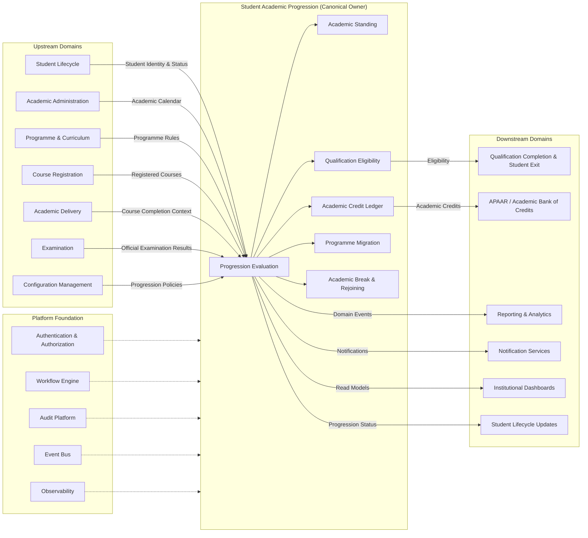

20.2 Aggregate Model
## 20.2 Aggregate Model

The following diagram represents the canonical Domain-Driven Design (DDD) Aggregate Model for the **Student Academic Progression** domain.

The **Academic Progression Aggregate** is the transactional consistency boundary for progression-related business operations. All state changes within the aggregate occur atomically, while references to external domains are maintained only through identifiers and approved service contracts.

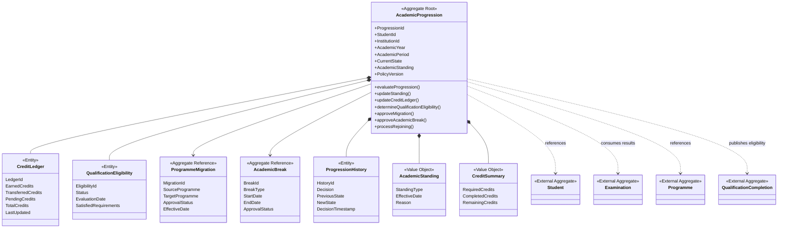

20.3 State Machine

## 20.3 State Machine

The following state machine represents the lifecycle of the **Academic Progression Aggregate**.

It illustrates only the valid lifecycle states of the aggregate. Supporting business concepts such as Academic Standing, Credit Ledger, Programme Migration, Academic Break, and Qualification Eligibility are maintained as internal entities or value objects and do not represent aggregate lifecycle states.

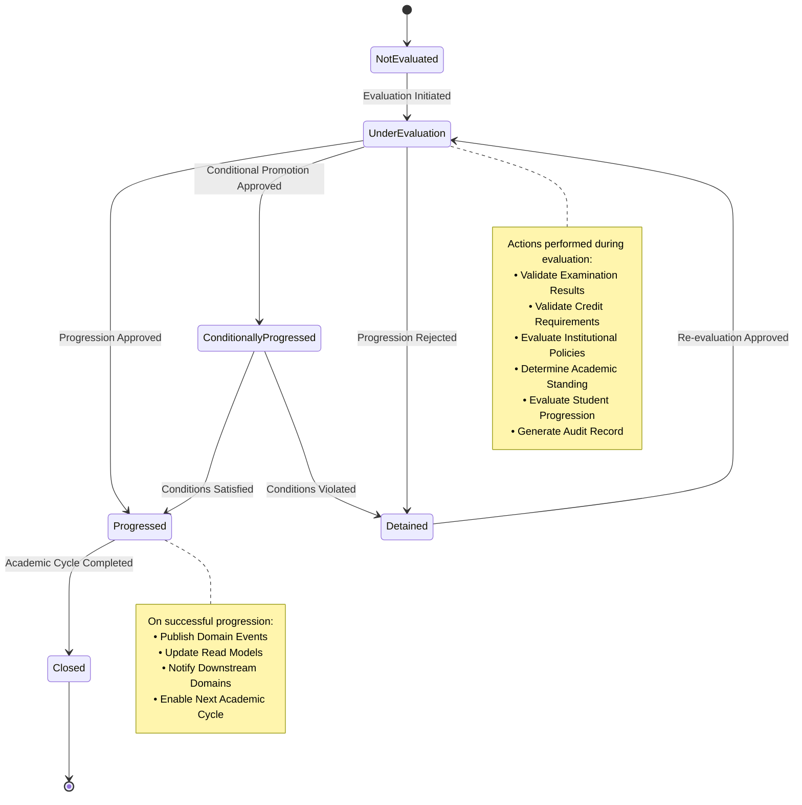

20.4 Progression Workflow
## 20.4 Progression Workflow

The following workflow illustrates the canonical academic progression process executed by the Student Academic Progression domain.

The workflow begins with publication of official examination results and concludes only after the progression decision has been committed, audited, and published to downstream consumers.

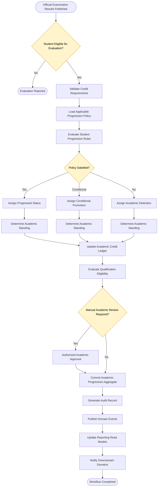
20.5 Credit Lifecycle
## 20.5 Credit Lifecycle

The following diagram illustrates the lifecycle of academic credits from official examination outcomes through credit validation, ledger updates, qualification evaluation, and external synchronization.

The **Academic Credit Ledger** remains the canonical source of truth for earned academic credits within the Student Academic Progression domain.

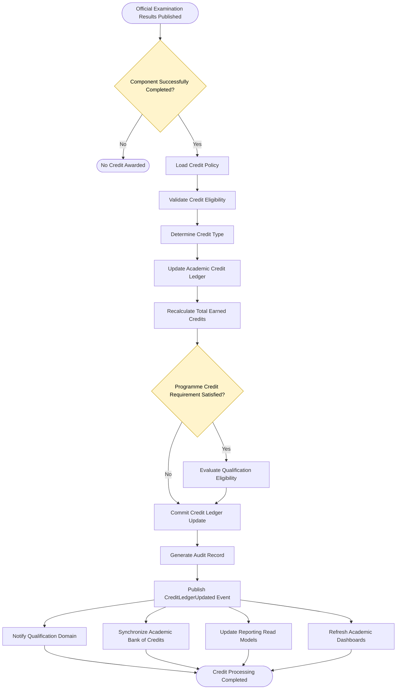
20.6 Qualification Evaluation
## 20.6 Qualification Evaluation

The following diagram illustrates the canonical workflow for evaluating qualification eligibility within the Student Academic Progression domain.

This workflow determines whether a student satisfies all academic requirements for qualification. The formal award of a qualification is performed by the **Qualification Completion & Student Exit** domain.

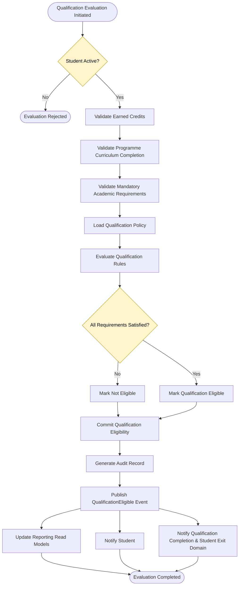

20.7 Cross Domain Sequence
## 20.7 Cross Domain Sequence

The following sequence diagram illustrates the canonical cross-domain interaction during the academic progression process.

The diagram demonstrates ownership boundaries, synchronous service interactions, asynchronous event publication, and downstream event consumption.

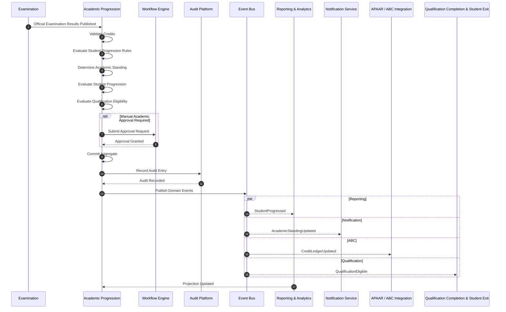

20.8 Event Flow
## 20.8 Event Flow

The following diagram illustrates the canonical event flow for the Student Academic Progression domain.

Business events are published only after successful transaction completion and are asynchronously consumed by downstream domains and platform services.

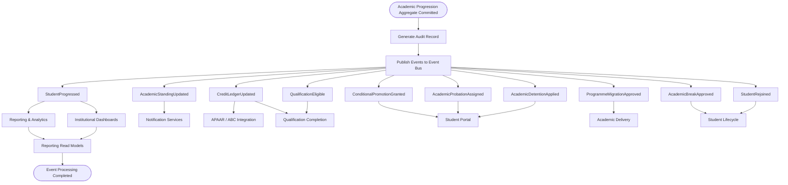
20.9 Dependency Graph
## 20.9 Dependency Graph

The following dependency graph illustrates the architectural dependencies of the **Student Academic Progression** domain.

The graph distinguishes upstream providers, the canonical owning domain, downstream consumers, and shared platform services while enforcing unidirectional dependency flow and canonical ownership.

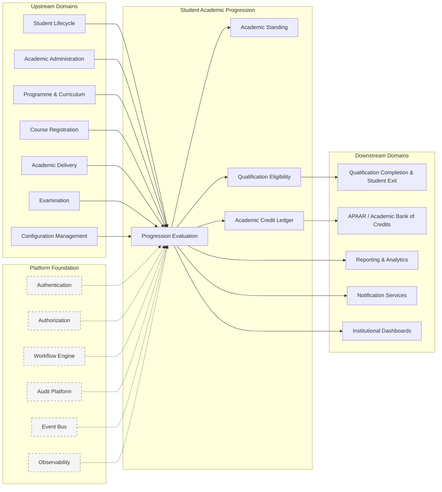

20.10 Service Interaction
## 20.10 Service Interaction

The following diagram illustrates the canonical service interaction model for the Student Academic Progression domain.

The diagram demonstrates how external service requests are validated, executed through the aggregate, committed transactionally, and subsequently propagated through published domain events and read models.

```mermaid
flowchart TD

%% =====================================================
%% EXTERNAL REQUESTS
%% =====================================================

CLIENT([Authorized User / External Domain])

CLIENT --> CMD

%% =====================================================
%% COMMAND LAYER
%% =====================================================

subgraph COMMANDS["Command Layer"]

CMD[Progression Command]

end

%% =====================================================
%% APPLICATION SERVICES
%% =====================================================

CMD --> APP

subgraph APPLICATION["Application Services"]

APP[Academic Progression Application Service]

end

%% =====================================================
%% DOMAIN SERVICES
%% =====================================================

APP --> DOMAIN

subgraph DOMAIN["Domain Services"]

DOMAIN[Progression Evaluation Service]

end

%% =====================================================
%% AGGREGATE
%% =====================================================

DOMAIN --> AGG

subgraph AGGREGATE["Academic Progression Aggregate"]

AGG[Aggregate Root]

STANDING[Academic Standing]

LEDGER[Credit Ledger]

QUALIFICATION[Qualification Eligibility]

AGG --> STANDING
AGG --> LEDGER
AGG --> QUALIFICATION

end

%% =====================================================
%% TRANSACTION
%% =====================================================

AGG --> COMMIT[Commit Transaction]

COMMIT --> AUDIT[Generate Audit Record]

AUDIT --> EVENT[Publish Domain Events]

%% =====================================================
%% EVENT CONSUMERS
%% =====================================================

EVENT --> READMODEL[Reporting Read Models]

EVENT --> NOTIFICATION[Notification Services]

EVENT --> ABC[APAAR / ABC Integration]

EVENT --> QUALIFICATIONDOMAIN[Qualification Completion]

%% =====================================================
%% QUERY SIDE
%% =====================================================

READMODEL --> QUERY

subgraph QUERYSIDE["Query Layer"]

QUERY[Read Contracts / Queries]

end

QUERY --> USERS([Dashboards / Reports / APIs])

%% =====================================================
%% STYLING
%% =====================================================

classDef aggregate fill:#E8F5E9,stroke:#2E7D32,color:#000;
classDef service fill:#E3F2FD,stroke:#1565C0,color:#000;
classDef event fill:#FFF3E0,stroke:#EF6C00,color:#000;

class AGG,STANDING,LEDGER,QUALIFICATION aggregate;
class APP,DOMAIN service;
class EVENT event;
```

20.11 Audit Flow
## 20.11 Audit Flow

The following diagram illustrates the canonical audit lifecycle for the Student Academic Progression domain.

Audit records are generated only after successful transaction commitment and are persisted through the Platform Audit Infrastructure. Every critical business operation remains fully traceable using correlation and causation identifiers.

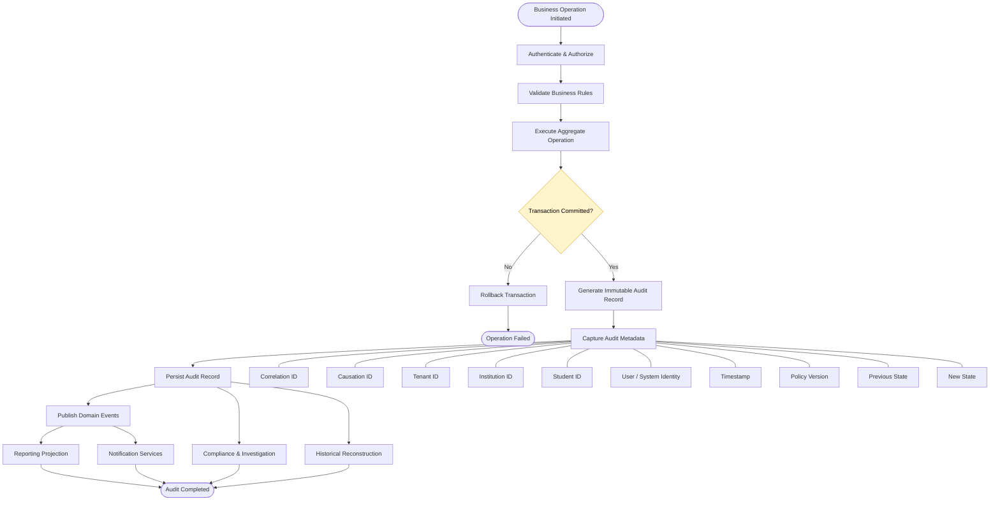

20.12 Reporting Flow
## 20.12 Reporting Flow

The following diagram illustrates the canonical reporting architecture for the Student Academic Progression domain.

Operational transactions never serve reporting requests directly. Reporting data is generated through asynchronous event-driven projections, ensuring scalability, consistency, and complete separation between transactional and analytical workloads.

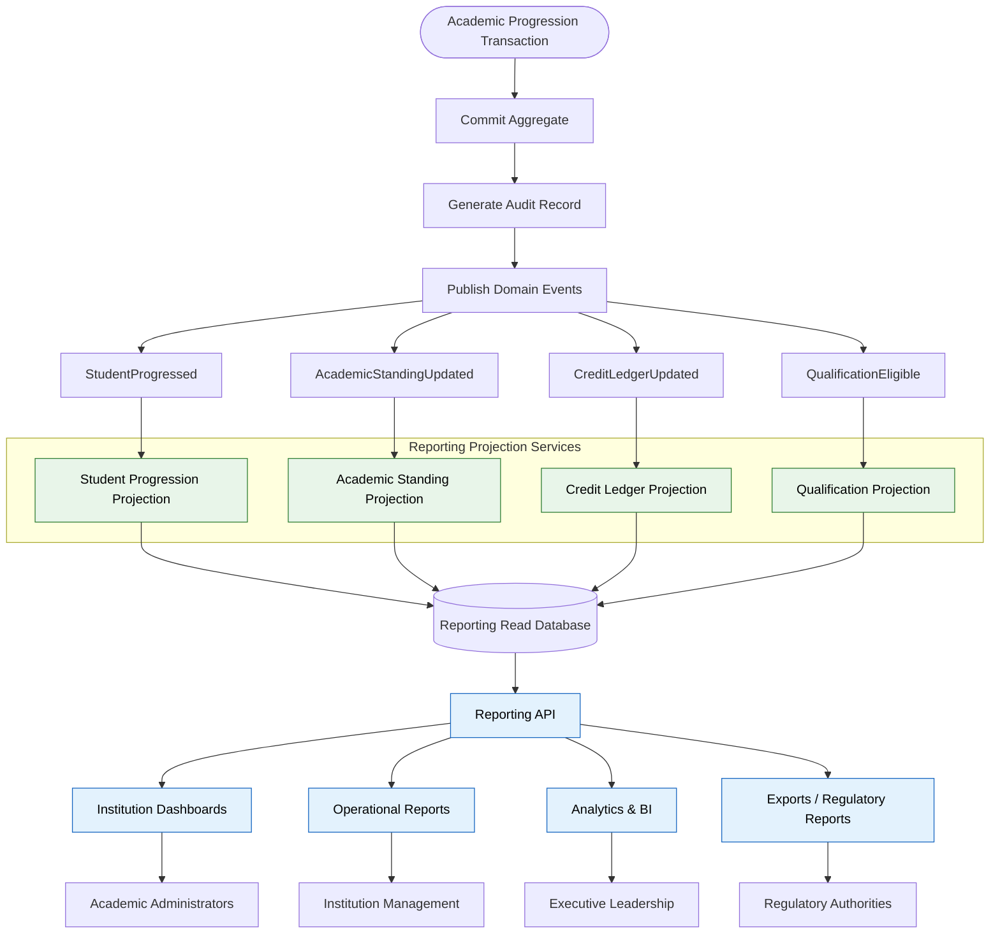

20.13 Configuration Hierarchy
## 20.13 Configuration Hierarchy

The following diagram illustrates the hierarchical configuration model for the Student Academic Progression domain.

Progression policies are configuration-driven and resolved using hierarchical inheritance. Lower levels inherit configuration from higher levels unless explicitly overridden.

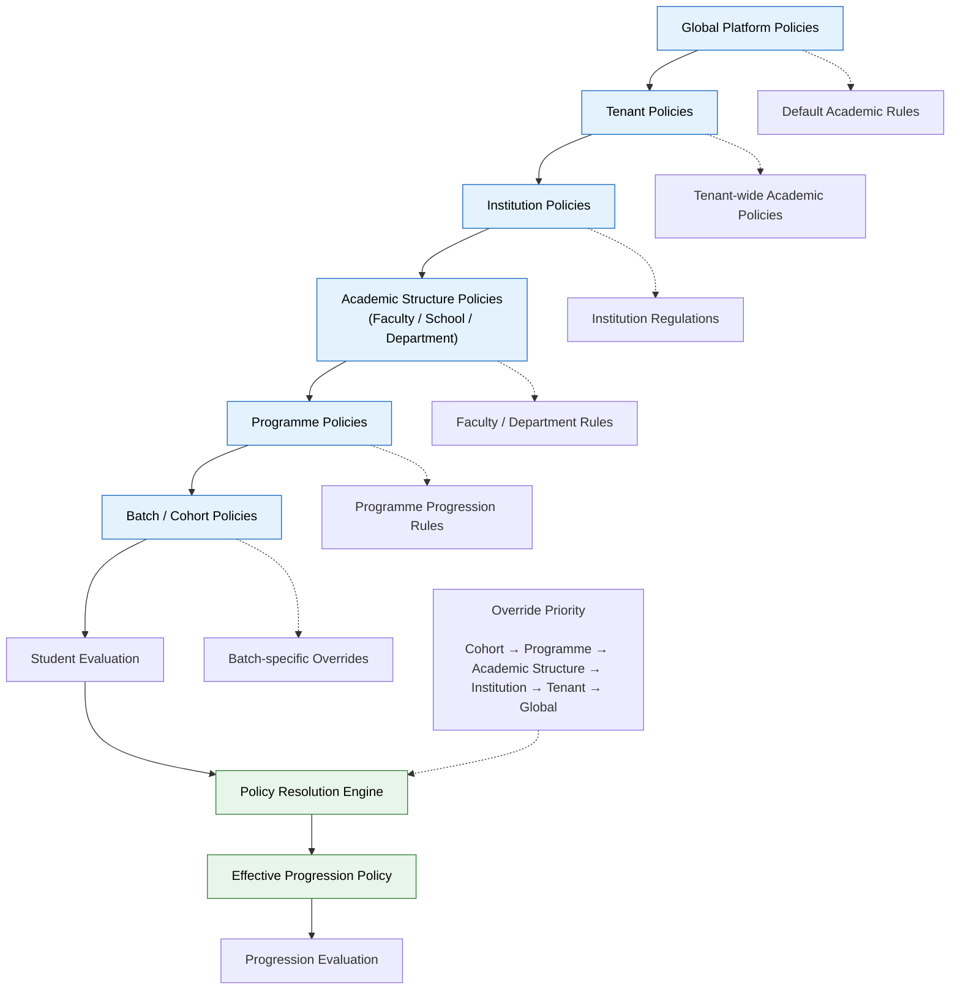

# 21. Appendix A — Domain State Matrix

## 21.1 Purpose

This appendix provides the consolidated state transition matrix for the Student Academic Progression aggregate.

The matrix summarizes all valid business states and permitted transitions defined throughout this architecture.

This appendix is intended as a reference for architects, reviewers, developers, and testers and does not redefine the authoritative lifecycle described earlier in this document.

---

# 21.2 Academic Progression State Matrix

| Current State | Allowed Transition | Trigger | Result |
|---------------|-------------------|----------|--------|
| Not Evaluated | Under Evaluation | Progression Evaluation Initiated | Evaluation Started |
| Under Evaluation | Progressed | Evaluation Successful | Student Progressed |
| Under Evaluation | Conditionally Progressed | Conditional Rules Satisfied | Conditional Promotion |
| Under Evaluation | Academic Probation | Probation Rules Satisfied | Probation Assigned |
| Under Evaluation | Academic Detention | Detention Rules Satisfied | Student Detained |
| Under Evaluation | Evaluation Failed | Processing Failure | Evaluation Terminated |
| Evaluation Failed | Under Evaluation | Re-evaluation Approved | Evaluation Restarted |
| Conditionally Progressed | Progressed | Conditions Successfully Completed | Normal Progression |
| Academic Probation | Good Standing | Probation Cleared | Standing Updated |
| Academic Probation | Academic Detention | Conditions Not Satisfied | Student Detained |
| Academic Detention | Under Evaluation | Authorized Reassessment | Re-evaluation Initiated |
| Progressed | Qualification Eligible | Qualification Requirements Met | Qualification Completion Ready |
| Progressed | Programme Migration | Migration Approved | Programme Changed |
| Progressed | Academic Break | Break Approved | Academic Interruption |
| Academic Break | Rejoined | Rejoining Approved | Academic Continuation |
| Rejoined | Under Evaluation | Next Academic Cycle | Progression Evaluation |

---

# 21.3 Academic Standing Matrix

| Standing | Meaning |
|-----------|---------|
| Good Standing | Student satisfies progression requirements |
| Conditional Promotion | Temporary progression under defined conditions |
| Academic Probation | Student requires academic improvement |
| Academic Detention | Student cannot progress until deficiencies are resolved |
| Qualification Eligible | Student has satisfied qualification eligibility criteria |

Academic Standing represents the authoritative academic status maintained by this domain.

---

# 21.4 Credit Ledger State Matrix

| Credit Status | Description |
|---------------|-------------|
| Not Started | No earned credits recorded |
| In Progress | Credits accumulated through ongoing academic activity |
| Credit Deficient | Required credits remain incomplete |
| Credit Requirement Satisfied | Required credits completed |
| Qualification Ready | Credit requirements satisfied for qualification eligibility |

---

# 21.5 Programme Migration Matrix

| Current State | Allowed Transition |
|---------------|-------------------|
| Not Requested | Migration Requested |
| Migration Requested | Under Review |
| Under Review | Approved |
| Under Review | Rejected |
| Approved | Migration Completed |
| Rejected | Migration Requested |

---

# 21.6 Academic Break Matrix

| Current State | Allowed Transition |
|---------------|-------------------|
| Active | Break Requested |
| Break Requested | Approved |
| Break Requested | Rejected |
| Approved | Academic Break |
| Academic Break | Rejoining Requested |
| Rejoining Requested | Rejoined |

---

# 21.7 Qualification Eligibility Matrix

| Current State | Allowed Transition |
|---------------|-------------------|
| Not Eligible | Under Evaluation |
| Under Evaluation | Eligible |
| Under Evaluation | Not Eligible |
| Eligible | Qualification Process Initiated (L2-C05) |

Qualification award itself is outside the responsibility of this domain.

---

# 21.8 Invalid State Transitions

The following transitions are prohibited.

| Invalid Transition | Reason |
|--------------------|--------|
| Academic Detention → Progressed | Mandatory re-evaluation required |
| Academic Break → Qualification Eligible | Academic continuation required |
| Credit Deficient → Qualification Eligible | Credit requirements incomplete |
| Not Evaluated → Qualification Eligible | Progression evaluation required |
| Under Evaluation → Academic Break | Evaluation must complete first |
| Rejected Migration → Migration Completed | Approval missing |
| Not Eligible → Qualification Process Initiated | Eligibility not satisfied |
| Evaluation Failed → Progressed | Re-evaluation required |

---

# 21.9 State Transition Principles

The following principles govern all state transitions.

- Every transition shall be initiated by an approved business workflow.
- Every transition shall satisfy applicable business rules.
- Every transition shall generate appropriate audit records.
- Every completed transition shall publish applicable domain events.
- Invalid transitions shall be rejected.
- Historical state changes shall remain immutable.
- State transitions shall preserve aggregate consistency.
- Cross-domain workflows shall not bypass this lifecycle.

---

# 21.10 State Governance

The Academic Progression aggregate shall remain the canonical owner of all progression state transitions.

External domains may request progression-related operations only through approved service contracts or published business events.

Direct modification of aggregate state by external domains is prohibited.

---

---

# 22. Appendix B — Workflow Matrix

## 22.1 Purpose

This appendix provides a consolidated view of all business workflows implemented within the Student Academic Progression domain.

The matrix serves as a reference for architecture validation, implementation planning, testing, integration, and dependency verification.

This appendix summarizes workflows already defined in the Business Workflow Architecture section and does not introduce additional business behaviour.

---

# 22.2 Workflow Catalogue

| Workflow ID | Workflow Name | Primary Owner |
|-------------|---------------|---------------|
| APW-01 | Student Progression Evaluation | Academic Progression |
| APW-02 | Academic Standing Assignment | Academic Progression |
| APW-03 | Conditional Promotion | Academic Progression |
| APW-04 | Academic Probation Management | Academic Progression |
| APW-05 | Academic Detention Management | Academic Progression |
| APW-06 | Academic Credit Ledger Update | Academic Progression |
| APW-07 | Programme Migration | Academic Progression |
| APW-08 | Academic Break Processing | Academic Progression |
| APW-09 | Student Rejoining | Academic Progression |
| APW-10 | Qualification Eligibility Evaluation | Academic Progression |
| APW-11 | Academic Bank of Credits Synchronization | Academic Progression |
| APW-12 | Manual Academic Review & Override | Academic Progression |

---

# 22.3 Workflow Dependency Matrix

| Workflow | Primary Inputs | Primary Outputs |
|----------|----------------|-----------------|
| Student Progression Evaluation | Examination Results, Credit Ledger | Progression Decision |
| Academic Standing Assignment | Progression Decision | Academic Standing |
| Conditional Promotion | Progression Evaluation | Conditional Promotion Decision |
| Academic Probation Management | Standing Rules | Probation Assignment |
| Academic Detention Management | Standing Rules | Detention Decision |
| Credit Ledger Update | Passed Academic Components | Updated Credit Ledger |
| Programme Migration | Approved Migration Request | Updated Programme Association |
| Academic Break Processing | Approved Break Request | Academic Break Status |
| Student Rejoining | Approved Rejoining Request | Active Academic Status |
| Qualification Eligibility Evaluation | Credit Ledger, Progression History | Eligibility Decision |
| ABC Synchronization | Credit Ledger | Published Credit Information |
| Manual Academic Review | Authorized Review Request | Approved Manual Decision |

---

# 22.4 Workflow Trigger Matrix

| Workflow | Trigger |
|----------|---------|
| Student Progression Evaluation | Official examination outcomes published |
| Academic Standing Assignment | Progression decision completed |
| Conditional Promotion | Conditional rules satisfied |
| Academic Probation Management | Probation rules triggered |
| Academic Detention Management | Detention rules triggered |
| Credit Ledger Update | Academic component completed |
| Programme Migration | Approved migration request |
| Academic Break Processing | Approved academic break |
| Student Rejoining | Approved rejoining request |
| Qualification Eligibility Evaluation | Qualification evaluation initiated |
| ABC Synchronization | Credit ledger updated |
| Manual Academic Review | Authorized manual intervention |

---

# 22.5 Workflow Service Matrix

| Workflow | Primary Service |
|----------|-----------------|
| Student Progression Evaluation | Evaluate Student Progression |
| Academic Standing Assignment | Get Academic Standing |
| Conditional Promotion | Process Conditional Promotion |
| Academic Probation Management | Assign Academic Probation |
| Academic Detention Management | Apply Academic Detention |
| Credit Ledger Update | Evaluate Student Progression |
| Programme Migration | Submit Programme Migration |
| Academic Break Processing | Approve Academic Break |
| Student Rejoining | Approve Student Rejoining |
| Qualification Eligibility Evaluation | Validate Qualification Eligibility |
| ABC Synchronization | Synchronize Academic Credits |
| Manual Academic Review | Execute Manual Override |

---

# 22.6 Workflow Event Matrix

| Workflow | Published Events |
|----------|------------------|
| Student Progression Evaluation | StudentProgressed |
| Academic Standing Assignment | AcademicStandingUpdated |
| Conditional Promotion | ConditionalPromotionGranted |
| Academic Probation Management | AcademicProbationAssigned |
| Academic Detention Management | AcademicDetentionApplied |
| Credit Ledger Update | CreditLedgerUpdated |
| Programme Migration | ProgrammeMigrationApproved |
| Academic Break Processing | AcademicBreakApproved |
| Student Rejoining | StudentRejoined |
| Qualification Eligibility Evaluation | QualificationEligible |
| ABC Synchronization | AcademicCreditsSynchronized |
| Manual Academic Review | ManualAcademicDecisionRecorded |

---

# 22.7 Workflow Security Matrix

| Workflow | Required Authorization |
|----------|------------------------|
| Student Progression Evaluation | Academic Progression Execute |
| Academic Standing Assignment | Academic Progression Manage |
| Conditional Promotion | Academic Authority Approval |
| Academic Probation Management | Academic Authority Approval |
| Academic Detention Management | Academic Authority Approval |
| Credit Ledger Update | Academic Progression Manage |
| Programme Migration | Academic Administration Approval |
| Academic Break Processing | Academic Administration Approval |
| Student Rejoining | Academic Administration Approval |
| Qualification Eligibility Evaluation | Qualification Completion Evaluation |
| ABC Synchronization | System Integration |
| Manual Academic Review | Senior Academic Authority |

---

# 22.8 Workflow Audit Matrix

| Workflow | Audit Required |
|----------|----------------|
| Student Progression Evaluation | Yes |
| Academic Standing Assignment | Yes |
| Conditional Promotion | Yes |
| Academic Probation Management | Yes |
| Academic Detention Management | Yes |
| Credit Ledger Update | Yes |
| Programme Migration | Yes |
| Academic Break Processing | Yes |
| Student Rejoining | Yes |
| Qualification Eligibility Evaluation | Yes |
| ABC Synchronization | Yes |
| Manual Academic Review | Mandatory |

---

# 22.9 Workflow Failure Handling Matrix

| Workflow | Failure Handling |
|----------|------------------|
| Student Progression Evaluation | Rollback and retry after correction |
| Academic Standing Assignment | Reject inconsistent transition |
| Conditional Promotion | Escalate for academic review |
| Academic Probation Management | Retry after validation |
| Academic Detention Management | Retry after validation |
| Credit Ledger Update | Restore transactional consistency |
| Programme Migration | Cancel migration transaction |
| Academic Break Processing | Restore previous academic state |
| Student Rejoining | Resume after validation |
| Qualification Eligibility Evaluation | Recalculate eligibility |
| ABC Synchronization | Retry synchronization through integration platform |
| Manual Academic Review | Escalate to approving authority |

---

# 22.10 Workflow Governance

The following governance principles apply.

- Every workflow shall have a single canonical owner.
- Workflow execution shall follow approved business rules.
- Cross-domain workflows shall use approved service contracts or domain events.
- Every workflow shall produce complete audit records.
- Workflow execution shall preserve aggregate consistency.
- Workflow implementations shall remain idempotent where retries are supported.
- Future workflows shall be added through approved architectural governance.
- This appendix shall remain synchronized with the Business Workflow Architecture section.

---

---

# 23. Appendix C — Domain Event Matrix

## 23.1 Purpose

This appendix provides the consolidated Domain Event Matrix for the Student Academic Progression domain.

The matrix serves as the authoritative reference for all business events published and consumed by this domain.

This appendix summarizes event interactions defined throughout this architecture and does not redefine event ownership or lifecycle semantics.

---

# 23.2 Published Domain Events

| Event ID | Domain Event | Trigger | Canonical Publisher |
|----------|--------------|---------|---------------------|
| APE-01 | StudentProgressed | Student successfully progresses to the next academic period | Academic Progression |
| APE-02 | AcademicStandingUpdated | Academic standing changes | Academic Progression |
| APE-03 | ConditionalPromotionGranted | Conditional promotion approved | Academic Progression |
| APE-04 | AcademicProbationAssigned | Probation assigned | Academic Progression |
| APE-05 | AcademicDetentionApplied | Detention decision finalized | Academic Progression |
| APE-06 | CreditLedgerUpdated | Academic credits updated | Academic Progression |
| APE-07 | ProgrammeMigrationApproved | Programme migration completed | Academic Progression |
| APE-08 | AcademicBreakApproved | Academic break approved | Academic Progression |
| APE-09 | StudentRejoined | Student successfully rejoins | Academic Progression |
| APE-10 | QualificationEligible | Qualification eligibility confirmed | Academic Progression |
| APE-11 | AcademicCreditsSynchronized | ABC synchronization completed | Academic Progression |
| APE-12 | ManualAcademicDecisionRecorded | Authorized manual override completed | Academic Progression |

---

# 23.3 Consumed Domain Events

| Consumed Event | Published By | Purpose |
|----------------|--------------|---------|
| ExaminationResultsPublished | Examination | Trigger progression evaluation |
| AssessmentRevaluationCompleted | Examination | Re-Evaluate Student Progression |
| StudentProgrammeChanged | Student Lifecycle | Maintain academic context |
| StudentStatusChanged | Student Lifecycle | Validate progression eligibility |
| AcademicCalendarActivated | Academic Administration | Open progression cycle |
| AcademicPeriodClosed | Academic Administration | Finalize progression processing |
| MigrationRequestApproved | Programme Management | Execute programme migration |
| QualificationProcessCompleted | Qualification Completion & Student Exit | Complete progression lifecycle |

---

# 23.4 Event Consumer Matrix

| Published Event | Primary Consumers |
|-----------------|-------------------|
| StudentProgressed | Student Lifecycle, Reporting, Notifications |
| AcademicStandingUpdated | Reporting, Dashboard Services |
| ConditionalPromotionGranted | Notifications, Student Portal |
| AcademicProbationAssigned | Student Portal, Notifications |
| AcademicDetentionApplied | Notifications, Academic Administration |
| CreditLedgerUpdated | Qualification Completion & Student Exit, ABC Integration |
| ProgrammeMigrationApproved | Academic Delivery, Student Lifecycle |
| AcademicBreakApproved | Student Lifecycle, Reporting |
| StudentRejoined | Academic Delivery, Student Lifecycle |
| QualificationEligible | Qualification Completion & Student Exit |
| AcademicCreditsSynchronized | Integration Monitoring |
| ManualAcademicDecisionRecorded | Audit & Reporting |

---

# 23.5 Event Classification Matrix

| Event | Classification |
|--------|----------------|
| StudentProgressed | Business Event |
| AcademicStandingUpdated | Business Event |
| ConditionalPromotionGranted | Business Event |
| AcademicProbationAssigned | Business Event |
| AcademicDetentionApplied | Business Event |
| CreditLedgerUpdated | Business Event |
| ProgrammeMigrationApproved | Business Event |
| AcademicBreakApproved | Business Event |
| StudentRejoined | Business Event |
| QualificationEligible | Business Event |
| AcademicCreditsSynchronized | Integration Event |
| ManualAcademicDecisionRecorded | Governance Event |

---

# 23.6 Event Delivery Characteristics

| Characteristic | Requirement |
|----------------|-------------|
| Delivery Model | Asynchronous |
| Ordering | Guaranteed per Aggregate |
| Persistence | Durable Event Store |
| Delivery | At Least Once |
| Idempotency | Mandatory for Consumers |
| Versioning | Mandatory |
| Correlation ID | Mandatory |
| Causation ID | Mandatory |
| Tenant Context | Mandatory |

---

# 23.7 Event Payload Requirements

Every published event shall include, where applicable:

- Event Identifier
- Event Version
- Event Timestamp
- Aggregate Identifier
- Student Identifier
- Institution Identifier
- Academic Year
- Academic Period
- Tenant Identifier
- Correlation Identifier
- Causation Identifier
- Event Source
- Business Context

Sensitive or personally identifiable information shall not be unnecessarily included in event payloads.

---

# 23.8 Event Versioning Rules

The following versioning principles apply.

- Event schemas shall remain backward compatible whenever possible.
- Breaking changes shall require a new event version.
- Consumers shall explicitly support published versions.
- Deprecated versions shall follow repository governance before removal.
- Event names shall remain stable across compatible versions.

---

# 23.9 Event Reliability Rules

The event infrastructure shall ensure:

- Events are published only after successful transaction completion.
- Duplicate deliveries do not create duplicate business outcomes.
- Failed deliveries are retried through approved platform mechanisms.
- Failed consumers do not invalidate completed business transactions.
- Event publication remains auditable.
- Event ordering is preserved within the same aggregate.

---

# 23.10 Event Governance

The following governance principles apply.

- Every event shall represent a completed business fact.
- Every event shall have exactly one canonical publisher.
- Event ownership shall never be shared across domains.
- Consumers shall never modify publisher-owned aggregates.
- Events shall not replace authoritative business queries where current state is required.
- Event contracts shall remain version controlled.
- Cross-domain communication shall follow the repository dependency architecture.
- New events shall be introduced only through approved architectural governance.

---
---

# 24. Appendix D — Cross-Domain Dependency Matrix

## 24.1 Purpose

This appendix defines the authoritative dependency relationships between the Student Academic Progression domain and other domains within the SutraERP architecture.

The objective is to ensure:

- Clear ownership boundaries.
- Canonical data ownership.
- Unidirectional dependency governance.
- Elimination of cyclic dependencies.
- Repository-wide architectural consistency.

This appendix complements the repository Dependency Map and Level 1 Architecture and shall not redefine enterprise dependency rules.

---

# 24.2 Dependency Principles

The Student Academic Progression domain shall comply with the following principles.

- Every business capability shall have exactly one canonical owner.
- Dependencies shall follow approved repository direction.
- Circular dependencies are prohibited.
- Cross-domain communication shall occur only through approved service contracts or domain events.
- External domains shall never directly modify Academic Progression aggregates.
- Business ownership shall never be duplicated.

---

# 24.3 Upstream Dependencies

The following domains provide authoritative information consumed by Academic Progression.

| Upstream Domain | Consumed Capability | Integration Mechanism |
|-----------------|--------------------|-----------------------|
| Student Lifecycle | Student identity and lifecycle status | Service Contract |
| Academic Administration | Academic year, semester, calendar | Service Contract |
| Programme & Curriculum | Programme structure and curriculum rules | Service Contract |
| Course Registration | Registered academic load | Service Contract |
| Academic Delivery | Course completion context | Domain Event / Read Contract |
| Examination | Official examination outcomes | Domain Event |
| Configuration Management | Institutional progression policies | Service Contract |
| Identity & Authorization | Authentication and authorization | Platform Service |

Academic Progression shall consume these capabilities without assuming ownership.

---

# 24.4 Downstream Dependencies

The following domains consume authoritative information published by Academic Progression.

| Downstream Domain | Consumed Capability | Integration Mechanism |
|-------------------|--------------------|-----------------------|
| Qualification Completion & Student Exit | Qualification eligibility | Domain Event / Read Contract |
| Student Lifecycle | Updated academic status | Domain Event |
| Academic Delivery | Progression status | Read Contract |
| APAAR & ABC Integration | Credit ledger information | Domain Event |
| Notification Services | Student academic notifications | Domain Event |
| Reporting & Analytics | Progression projections | Read Model |
| Institutional Dashboards | Aggregated progression metrics | Read Model |
| Audit Platform | Audit records | Platform Service |

---

# 24.5 Platform Dependencies

The domain depends upon shared Platform Foundation capabilities.

| Platform Capability | Purpose |
|---------------------|---------|
| Authentication | Identity verification |
| Authorization | Access control |
| Workflow Engine | Approval orchestration |
| Audit Platform | Enterprise audit |
| Notification Platform | Message delivery |
| Event Bus | Domain event distribution |
| Configuration Platform | Policy management |
| Observability Platform | Monitoring and diagnostics |
| File Management | Supporting document references |

Platform services shall remain infrastructure capabilities and shall not own business data.

---

# 24.6 Dependency Responsibility Matrix

| Capability | Canonical Owner | Academic Progression Role |
|------------|-----------------|---------------------------|
| Student Profile | Student Lifecycle | Consumer |
| Programme Definition | Programme & Curriculum | Consumer |
| Examination Results | Examination | Consumer |
| Academic Credit Ledger | Academic Progression | Owner |
| Academic Standing | Academic Progression | Owner |
| Progression Decision | Academic Progression | Owner |
| Qualification Eligibility | Academic Progression | Owner |
| Degree Award | Qualification Completion & Student Exit | Consumer |
| Authentication | Platform Foundation | Consumer |
| Audit Infrastructure | Platform Foundation | Publisher |

---

# 24.7 Dependency Validation Rules

The following architectural rules shall always apply.

| Rule ID | Validation Rule |
|----------|-----------------|
| DEP-01 | No circular dependencies are permitted. |
| DEP-02 | Business ownership shall remain unique. |
| DEP-03 | Cross-domain updates require approved contracts. |
| DEP-04 | Published events shall never violate ownership boundaries. |
| DEP-05 | Read models shall never become systems of record. |
| DEP-06 | Platform services shall not contain business logic. |
| DEP-07 | Domain services shall remain technology independent. |
| DEP-08 | All dependencies shall conform to repository governance. |

---

# 24.8 Integration Pattern Matrix

| Dependency Type | Preferred Pattern |
|-----------------|-------------------|
| Business Command | Service Contract |
| Business Notification | Domain Event |
| Read-Only Data | Read Contract |
| Reporting | Read Model |
| Workflow Approval | Workflow Engine |
| Audit Recording | Platform Audit |
| Configuration Retrieval | Configuration Service |
| Authentication | Platform Identity |
| Authorization | Platform Authorization |

Selection of an integration pattern shall preserve domain autonomy and canonical ownership.

---

# 24.9 Dependency Risk Assessment

| Risk | Mitigation |
|------|------------|
| Circular dependency | Enforce dependency validation during architecture review |
| Duplicate business ownership | Maintain canonical ownership registry |
| Tight coupling | Prefer event-driven integration where appropriate |
| Inconsistent academic state | Consume only authoritative sources |
| Event contract changes | Apply versioned event schemas |
| Configuration drift | Centralized configuration governance |
| Unauthorized updates | Enforce service boundary validation |
| Reporting inconsistency | Generate reports from approved projections |

---

# 24.10 Repository Alignment

This architecture aligns with the following repository artifacts.

| Repository Artifact | Alignment Purpose |
|---------------------|-------------------|
| Level 1 Architecture | Parent business architecture |
| Dependency Map | Dependency validation |
| Platform Foundation | Shared infrastructure services |
| Architecture Index | Repository organization |
| Domain Interaction Matrix | Cross-domain communication |
| Repository Governance Standards | Architectural compliance |

---

# 24.11 Final Architectural Governance

The Student Academic Progression domain shall comply with the following governance principles.

- Academic Progression remains the canonical owner of progression, academic standing, credit ledger, and qualification eligibility.
- Cross-domain communication shall occur exclusively through approved service contracts, read contracts, or published domain events.
- Platform services shall provide shared infrastructure capabilities without assuming business ownership.
- Architectural dependencies shall remain acyclic and repository compliant.
- Future integrations shall preserve domain autonomy and backward compatibility.
- Any modification to dependency direction or ownership shall require repository-level architectural review and approval.
- This appendix serves as the authoritative dependency reference for all downstream Level 3, Level 4, Level 5, and implementation artifacts derived from this domain.

---

**End of Document**

