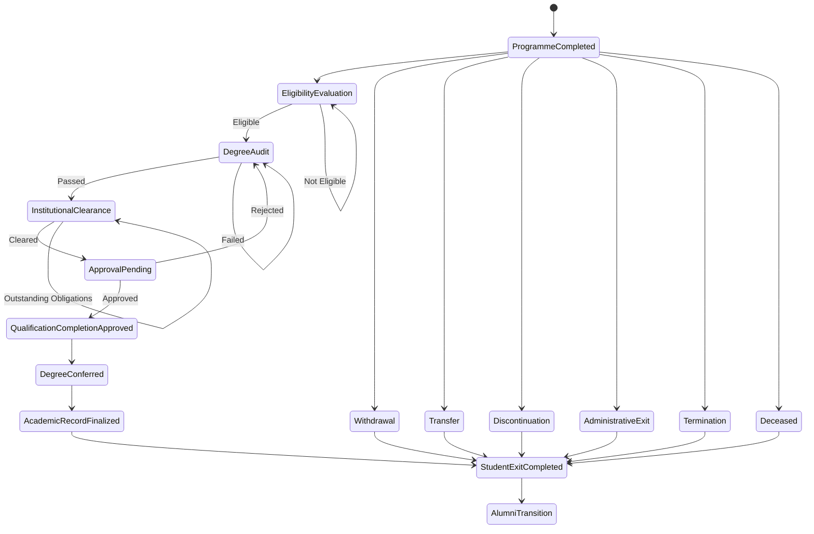
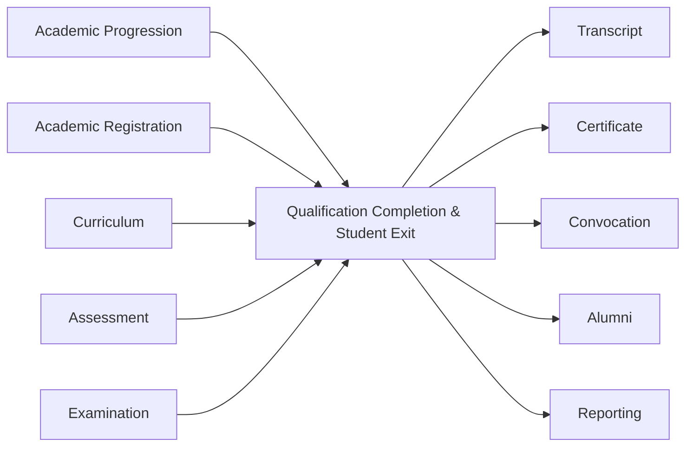
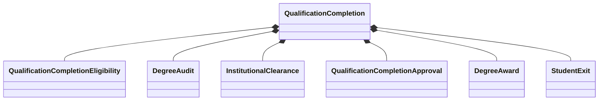
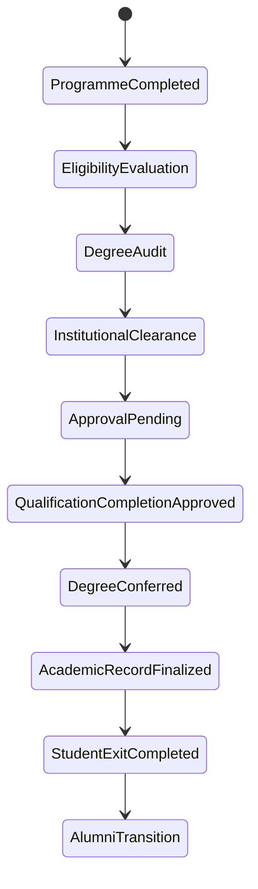
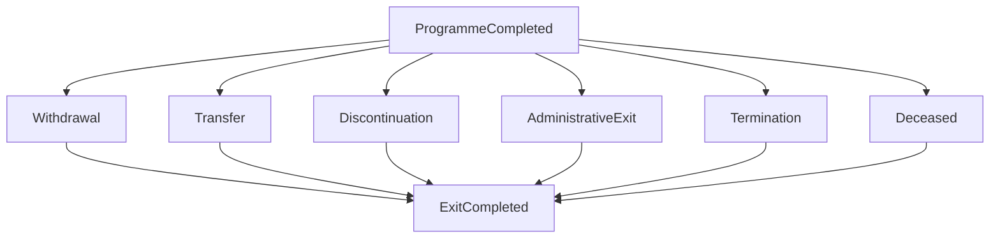
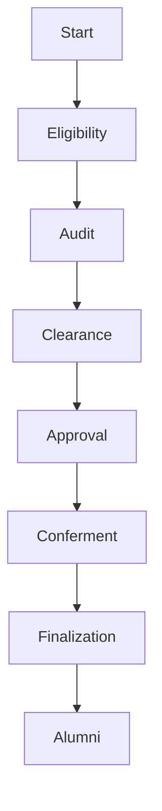
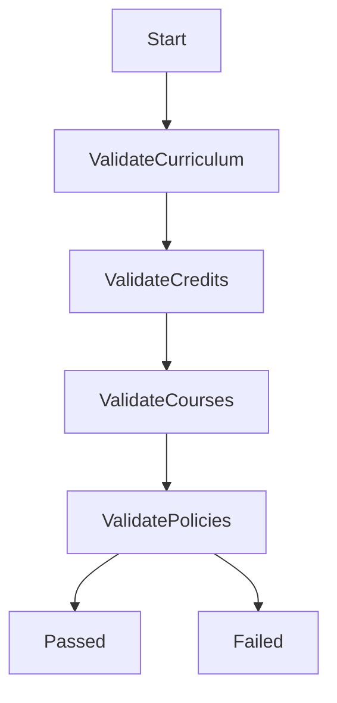
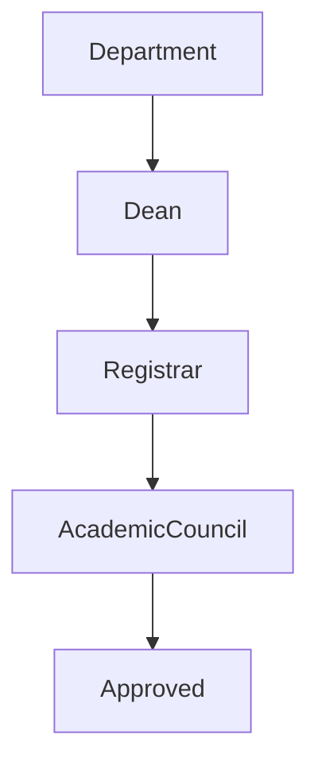
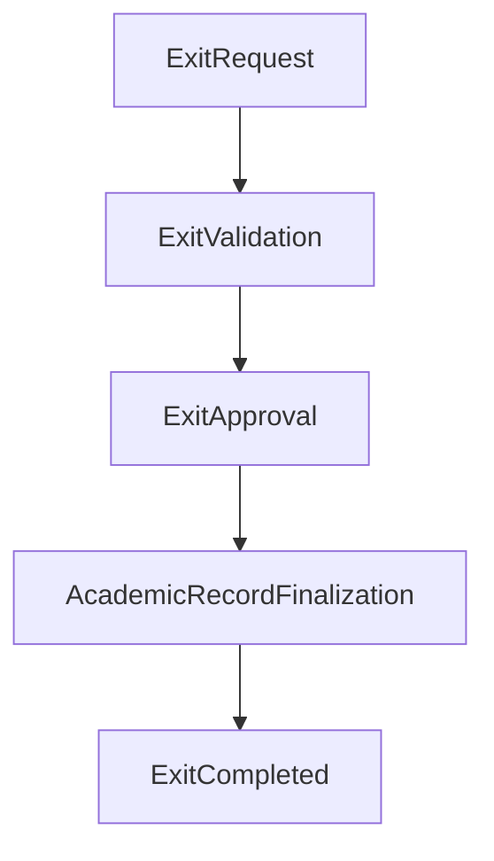
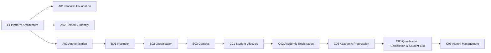

# L2-C05 — Qualification Completion & Student Exit Workflows

**Document ID:** L2-C05

**Domain:** Student Lifecycle Management

**Bounded Context:** Student Lifecycle

**Architecture Level:** Level 2 — Domain Workflows

**Document Status:** Draft

**Owner:** Student Lifecycle Domain Team

**Document Owner:** Varad

---

# 1. Introduction

The Qualification Completion & Student Exit Domain represents the final bounded context within the academic lifecycle of the SutraERP platform. It governs the business capabilities responsible for determining how a student's formal relationship with an academic institution reaches its authorized conclusion.

Unlike operational academic domains that manage admission, enrolment, registration, and progression, this domain is responsible for validating academic completion, coordinating institutional exit obligations, authorizing qualification completion, recording degree conferment, and managing all non-qualification completion exit scenarios in accordance with institutional regulations.

Qualification Completion is treated as a regulated academic decision rather than an administrative activity. Every qualification completion outcome is supported by verifiable academic evidence, curriculum completion, institutional clearance, regulatory compliance, and formal academic approval.

The domain also manages situations where a student's relationship with the institution concludes without qualification completion. These include voluntary withdrawal, institutional transfer, discontinuation, termination, administrative separation, or other institution-defined exit pathways.

As the terminal academic domain within the Student Lifecycle bounded context, Qualification Completion & Student Exit produces the authoritative completion records upon which numerous downstream domains depend, including Transcript Management, Certificate Management, Alumni Management, Convocation Management, Reporting, Digital Credentials, and Regulatory Compliance.

The domain guarantees that every academic completion or exit decision is consistent, traceable, policy-driven, auditable, and institutionally governed.

---

# 2. Purpose

The purpose of the Qualification Completion & Student Exit Domain is to provide a centralized, policy-driven, and auditable framework for managing academic completion and institutional exit throughout the SutraERP platform.

The domain ensures that qualification completion decisions are based exclusively on validated academic achievement, successful programme completion, institutional compliance, and authorized academic approval.

It further standardizes institutional exit processes by providing a common framework for managing all terminal student lifecycle outcomes while preserving academic integrity and regulatory compliance.

Specifically, this domain shall:

- Evaluate qualification completion eligibility.
- Validate programme completion requirements.
- Perform comprehensive degree audits.
- Verify curriculum completion.
- Validate earned academic credits.
- Coordinate institutional clearance workflows.
- Consume financial clearance status.
- Consume library clearance status.
- Consume hostel clearance status.
- Verify departmental obligations.
- Manage qualification completion approval processes.
- Record official degree conferment.
- Manage non-qualification completion exit scenarios.
- Finalize academic records.
- Publish authoritative qualification completion and exit events.
- Support transcript generation.
- Support certificate generation.
- Support alumni transition.
- Support convocation processes.
- Maintain complete audit history.
- Support institutional governance.
- Support accreditation requirements.
- Support regulatory reporting.

---

# 3. Scope

The Qualification Completion & Student Exit Domain governs every business process occurring after a student's academic progression reaches a terminal outcome.

The domain includes responsibility for:

## Academic Completion

- Programme completion verification
- Qualification Completion eligibility evaluation
- Degree audit
- Curriculum requirement validation
- Credit completion validation
- Mandatory course validation
- Elective completion validation
- Academic standing verification
- Qualification Completion rule evaluation

---

## Institutional Clearance

- Financial clearance
- Library clearance
- Hostel clearance
- Departmental clearance
- Laboratory clearance
- Scholarship obligation validation
- Asset return verification
- Institution-specific clearance processes

---

## Qualification Completion Governance

- Qualification Completion recommendation
- Academic approval workflow
- Degree approval
- Degree conferment
- Qualification Completion status management
- Qualification Completion publication
- Qualification Completion notifications

---

## Student Exit

- Qualification Completion exit
- Withdrawal
- Transfer
- Discontinuation
- Administrative exit
- Termination
- Deceased student closure
- Institution-defined exit categories

---

## Academic Record Finalization

- Academic record locking
- Qualification Completion record preservation
- Exit record preservation
- Audit history preservation
- Qualification Completion event publication
- Exit event publication

---

## Integration Responsibilities

The domain provides authoritative completion information for:

- Transcript Domain
- Certificate Domain
- Alumni Domain
- Convocation Domain
- Reporting Domain
- Notification Domain
- Digital Credential Domain
- Analytics Domain
- Archive Services

---

The domain explicitly excludes:

- Admissions
- Student Identity Management
- Academic Registration
- Attendance
- Teaching & Learning
- Assessment
- Examination execution
- Curriculum Management
- Certificate generation
- Transcript generation
- Alumni relationship management
- Finance operations
- Library operations
- Hostel operations

These responsibilities remain within their respective bounded contexts.

---

# 4. Domain Responsibilities

The Qualification Completion & Student Exit Domain is the canonical owner of all business capabilities associated with academic completion and institutional exit.

Its responsibilities include the following functional areas.

## 4.1 Qualification Completion Eligibility Management

Determine whether a student satisfies all institutional, programme, curriculum, academic, and regulatory requirements required for qualification completion.

---

## 4.2 Degree Audit Management

Perform comprehensive verification of:

- Curriculum completion
- Earned credits
- Mandatory courses
- Elective requirements
- Academic standing
- Programme regulations
- Institutional qualification completion policies

---

## 4.3 Programme Completion Verification

Verify that every academic requirement defined by the applicable curriculum version has been successfully completed before qualification completion can proceed.

---

## 4.4 Institutional Clearance Coordination

Coordinate clearance validation across organizational units including:

- Finance
- Library
- Hostel
- Academic Departments
- Examination Office
- Laboratory Services
- Scholarship Office
- Institution-specific departments

The Qualification Completion Domain coordinates these validations but does not own the underlying operational processes.

Each participating domain remains the authoritative owner of its own clearance decision. The Qualification Completion Domain aggregates and evaluates the resulting clearance statuses according to institutional qualification completion policy without re-evaluating domain-specific business rules.

---

## 4.5 Qualification Completion Approval

Manage configurable academic approval workflows required before degree conferment.

Approval chains may include:

- Department
- Faculty
- Dean
- Controller of Examination
- Academic Council
- Senate
- Vice Chancellor
- Institution-defined approval authorities

---

## 4.6 Degree Conferment

Record the official award of academic qualifications following successful completion of all approval stages.

The domain records the authoritative conferment decision but does not generate certificates or transcripts.

---

## 4.7 Student Exit Management

Manage every approved institutional exit pathway including:

- Qualification Completion
- Withdrawal
- Transfer
- Discontinuation
- Administrative separation
- Termination
- Deceased
- Institution-defined exit categories

---

## 4.8 Academic Record Finalization

Protect finalized academic records by preventing unauthorized modification following qualification completion or approved institutional exit.

---

## 4.9 Domain Event Publication

Publish authoritative domain events that notify downstream systems of significant qualification completion and exit lifecycle changes.

All Qualification Completion Domain events are published exclusively by the Qualification Completion Aggregate after successful completion of aggregate state transitions. Application services, integration adapters, and external domains shall not publish Qualification Completion business events.


Typical consumers include:

- Transcript Management
- Certificate Management
- Alumni Management
- Convocation Management
- Reporting
- Notification Services
- Digital Credentials
- Government Reporting

---

## 4.10 Governance & Compliance

Maintain complete, immutable, and traceable audit history for every qualification completion decision, approval, clearance, and institutional exit event.

---

# 5. Domain Boundaries

The Qualification Completion & Student Exit Domain owns only the business capabilities directly associated with academic completion and institutional separation.

## Upstream Dependencies

The domain consumes information from:

- Student Lifecycle Domain
- Curriculum Framework Domain
- Academic Registration Domain
- Academic Progression Domain
- Curriculum Framework Domain (L2-B04)
- Assessment & Grading Domain
- Examination Domain
- Finance Domain
- Library Domain
- Hostel Domain
- Authentication Workflows (L2-A03)
- Authorization & Policy Workflows (L2-A04)
- Academic Calendar Domain

These domains remain the authoritative owners of their respective data.

---

## Domain Ownership

This domain owns:

- Qualification Completion lifecycle
- Degree audit
- Qualification Completion eligibility
- Programme completion verification
- qualification completion approval
- Institutional clearance orchestration
- Degree conferment records
- Student exit records
- Academic completion status
- Exit status management
- Qualification Completion business rules
- Qualification Completion domain events
- Academic completion audit history
- Academic record finalization

---

## Explicitly Out of Scope

This domain does **not** own:

### Student Admission

Owned by **L2-C01 — Student Admission Workflows**

---

### Student Identity & Lifecycle

Owned by **L2-C02 — Student Lifecycle Workflows**

---

### Academic Registration

Owned by **L2-C03 — Student Academic Registration Workflows**

---

### Academic Progression

Owned by **L2-C04 — Academic Progression Workflows**

---

### Curriculum Management

Owned by the Academic Structure Domain.

---

### Assessment & Grading

Owned by the Assessment Domain.

---

### Examination Operations

Owned by the Examination Domain.

---

### Finance Operations

Owned by the Finance Domain.

Only financial clearance status is consumed.

---

### Library Operations

Owned by the Library Domain.

Only library clearance status is consumed.

---

### Hostel Operations

Owned by the Hostel Domain.

Only hostel clearance status is consumed.

---

### Certificate Generation

Owned by the Certificate Management Domain.

Qualification Completion publishes the authoritative degree conferment event.

---

### Transcript Generation

Owned by the Transcript Management Domain.

Qualification Completion publishes verified academic completion information.

---

### Convocation Management

Owned by the Convocation Domain.

Qualification Completion authorizes eligibility but does not manage ceremonies.

---

### Alumni Relationship Management

Owned by the Alumni Domain.

Qualification Completion publishes the transition event that enables alumni onboarding.

---

The ownership boundaries defined above preserve bounded context integrity, eliminate overlapping responsibilities, and ensure that the Qualification Completion & Student Exit Domain remains the single authoritative source for academic completion and institutional exit within the Student Lifecycle architecture.

# 6. Ubiquitous Language

The Qualification Completion & Student Exit Domain establishes a common business vocabulary that shall be used consistently throughout the SutraERP platform. Every business rule, workflow, integration, event, API, and architectural component within this bounded context shall adopt the terminology defined in this section.

---

## Qualification Completion

The formal institutional process through which a student is recognized as having successfully completed all academic and institutional requirements required for the award of an academic qualification.

Qualification Completion represents an authorized academic decision rather than an administrative activity.

---

## Programme Completion

The state in which a student has successfully satisfied every curriculum requirement defined for an academic programme.

Programme completion is a prerequisite for qualification completion but does not automatically result in degree conferment.

---

## Qualification Completion Eligibility

The evaluated outcome indicating whether a student satisfies every academic, administrative, financial, and institutional requirement necessary to proceed toward qualification completion.

Eligibility may change whenever academic records, institutional clearance status, applicable qualification completion policies, or other governing business conditions affecting qualification completion are modified.

---

## Degree Audit

A comprehensive evaluation that verifies whether every qualification completion requirement defined by the applicable curriculum version has been satisfied.

The degree audit evaluates academic records but does not grant qualification completion approval.

---

## Curriculum Completion

The successful completion of every mandatory academic requirement defined by the approved curriculum.

Curriculum completion includes:

- Mandatory courses
- Elective requirements
- Credit requirements
- Programme-specific rules
- Institutional qualification completion policies

---

## Academic Completion

The successful completion of all academic obligations associated with a programme of study.

Academic completion represents the academic component of qualification completion eligibility.

---

## Institutional Clearance

The coordinated verification that the student has fulfilled all institutional obligations outside academic completion.

Institutional clearance may include:

- Financial clearance
- Library clearance
- Hostel clearance
- Departmental clearance
- Laboratory clearance
- Asset return
- Scholarship obligations
- Institution-defined clearance requirements

---

## Qualification Completion Approval

The formal authorization granted by designated academic authorities permitting degree conferment.

Approval authority is determined by institutional governance policies.

---

## Degree Conferment

The official award of an academic qualification following successful completion of all qualification completion requirements and approvals.

Degree conferment represents the authoritative completion event produced by this domain.

---

## Student Exit

The formal conclusion of a student's institutional relationship.

Student Exit includes both qualification completion and non-qualification completion exit scenarios.

---

## Exit Type

The classification describing how a student's institutional relationship concludes.

Examples include:

- Qualification Completion
- Withdrawal
- Transfer
- Discontinuation
- Administrative Exit
- Termination
- Deceased

---

## Exit Clearance

The successful completion of all institutional obligations required before final student separation.

---

## Academic Record Finalization

The process of permanently preserving finalized academic records following qualification completion or institutional exit.

Finalized records become immutable except through institutionally governed correction procedures.

---

## Alumni Transition

The business event through which a qualification completed student transitions from active student status into alumni status.

Ownership of the relationship transfers to the Alumni Domain.

---

## Qualification Completion Cohort

A logical grouping of students expected to graduate within a defined qualification completion cycle.

Qualification Completion cohorts support planning, approval, reporting, and convocation activities.

---

## Qualification Completion Cycle

The institution-defined period during which qualification completion processing occurs.

Examples include:

- Annual
- Semester
- Trimester
- Rolling Qualification Completion

---

## Academic Standing

The evaluated academic status of a student used during qualification completion eligibility assessment.

---

## Qualification Completion Decision

The authoritative institutional decision determining whether qualification completion is approved, rejected, deferred, or cancelled.

---

## Domain Event

An immutable business event representing a significant state transition within the Qualification Completion & Student Exit Domain.

---

# 7. Aggregate Architecture

The Qualification Completion & Student Exit Domain is centered around the **Qualification Completion Aggregate**, which acts as the authoritative consistency boundary for academic completion and institutional exit.

The aggregate guarantees that every qualification completion decision, degree conferment, institutional clearance, and exit transition satisfies the business invariants defined by institutional policy.

All modifications to qualification completion records shall occur exclusively through the Qualification Completion Aggregate.

---

## Aggregate Root

### Qualification Completion

The Qualification Completion Aggregate Root represents the complete lifecycle of academic completion and student exit.

It owns:

- Qualification Completion lifecycle
- Eligibility status
- Degree audit outcome
- Institutional clearances
- Approval state
- Degree conferment
- Student exit state
- Final academic status
- Domain event generation

No external component may modify child entities directly.

---

## Child Entities

### Qualification Completion Eligibility

Represents the evaluated academic eligibility status of the student.

---

### Degree Audit

Represents the comprehensive evaluation of curriculum completion and qualification completion requirements.

---

### Institutional Clearance

Represents the collection of clearance validations received from institutional departments.

---

### Qualification Completion Approval

Represents one or more approval decisions required before degree conferment.

Supports configurable approval hierarchies.

---

### Degree Award

Represents the officially conferred academic qualification.

---

### Student Exit

Represents the finalized institutional exit record.

---

## Value Objects

The aggregate utilizes immutable value objects including:

### Qualification Completion Status

Examples include:

- Draft
- Under Evaluation
- Eligible
- Pending Approval
- Approved
- Degree Conferred
- Exit Completed
- Cancelled

---

### Eligibility Result

Represents the outcome of qualification completion eligibility evaluation.

---

### Exit Type

Represents the institutional exit classification.

---

### Degree Classification

Represents the awarded academic classification where applicable.

Examples may include:

- Distinction
- First Class
- Second Class
- Pass

Institution-specific classifications remain configurable.

---

### Clearance Status

Represents the completion state of institutional clearances.

---

### Approval Decision

Represents the outcome of an approval authority.

---

### Completion Summary

Represents the immutable summary of academic completion at qualification completion.

---

## Aggregate Invariants

The Qualification Completion Aggregate shall enforce the following invariants.

### Qualification Completion cannot occur unless programme completion has been verified.

---

### Degree conferment cannot occur without successful qualification completion approval.

---

### qualification completion approval cannot occur while mandatory institutional clearances remain incomplete.

---

### Academic records cannot be finalized before qualification completion or approved institutional exit.

---

### Exit completion shall permanently preserve the student's final academic outcome.

---

### Once the Qualification Completion Aggregate reaches a terminal state (Student Exit Completed), no further business state transitions shall be permitted except through explicitly governed institutional correction or revocation procedures.

---

### Every state transition shall generate appropriate audit records.

---

### Every externally visible lifecycle transition shall publish the corresponding domain event.

---

### All business operations shall execute within a single aggregate consistency boundary.

---

# 8. Domain Model

The Qualification Completion & Student Exit Domain follows Domain-Driven Design principles by separating business behavior into Entities, Value Objects, Domain Services, Repositories, Factories, Policies, and Domain Events.

---

## Aggregate Root

- Qualification Completion

---

## Entities

- Qualification Completion Eligibility
- Degree Audit
- Institutional Clearance
- Qualification Completion Approval
- Degree Award
- Student Exit

---

## Value Objects

- Qualification Completion Status
- Eligibility Result
- Exit Type
- Degree Classification
- Clearance Status
- Approval Decision
- Completion Summary

---

## Domain Services

The domain exposes business services responsible for operations that cannot naturally belong to a single entity.

Examples include:

- Qualification Completion Eligibility Service
- Degree Audit Service
- Clearance Coordination Service
- Qualification Completion Approval Service
- Degree Conferment Service
- Student Exit Service
- Academic Record Finalization Service

---

## Repositories

The domain persists aggregates through repository abstractions.

Primary repositories include:

- Qualification Completion Repository

The Qualification Completion Repository is responsible for persisting and retrieving the complete Qualification Completion Aggregate, including all child entities such as Degree Audit, Institutional Clearance, Qualification Completion Approval, Degree Award, and Student Exit. Child entities shall not expose independent repository abstractions.

---

## Factories

Factories construct aggregates while ensuring valid initial state.

Examples include:

- Qualification Completion Factory
- Student Exit Factory

---

## Domain Policies

Configurable policies govern domain behavior without embedding institution-specific rules inside the domain model.

Examples include:

- Qualification Completion Policy
- Degree Classification Policy
- Exit Policy
- Clearance Policy
- Approval Policy

---

## Domain Events

The aggregate publishes immutable domain events representing significant business transitions.

Examples include:

- Qualification CompletionEvaluationStarted
- Qualification CompletionEligibilityEvaluated
- DegreeAuditCompleted
- InstitutionalClearanceCompleted
- QualificationCompletionApproved
- Qualification CompletionRejected
- DegreeConferred
- StudentExitInitiated
- AcademicRecordFinalized
- StudentExitCompleted
- AlumniTransitionInitiated

---

The domain model preserves strict separation between business rules, infrastructure concerns, application orchestration, and external integrations, ensuring long-term maintainability, consistency, and alignment with the overall SutraERP architecture.

# 9. Qualification Completion & Student Exit Lifecycle

The Qualification Completion & Student Exit Domain governs the terminal phase of the student academic lifecycle.

Unlike previous domains that support continuous academic progression, this domain is responsible for determining and recording the authoritative outcome that permanently concludes a student's academic relationship with an institution.

Every student entering this domain shall ultimately reach one—and only one—terminal institutional outcome. These outcomes may represent successful academic completion or an authorized non-qualification completion exit.

The lifecycle is governed by institutional regulations, programme requirements, academic policies, approval workflows, and organizational governance.

No student may bypass mandatory validation, institutional clearance, or approval stages.

---

## 9.1 Lifecycle Objectives

The Qualification Completion & Student Exit lifecycle is designed to ensure that:

- Academic completion is objectively validated.
- Qualification Completion eligibility is consistently evaluated.
- Programme requirements are fully satisfied.
- Institutional obligations are completed.
- Academic approvals are properly authorized.
- Degree conferment is governed and auditable.
- Student exits are standardized across institutions.
- Final academic records are preserved permanently.
- Downstream domains receive authoritative completion events.

---

## 9.2 Canonical Lifecycle States

The Qualification Completion Aggregate progresses through the following lifecycle states.

### Programme Completed

The student's academic progression has reached programme completion and the Qualification Completion Domain becomes responsible for further processing.

Entry into this state does not imply qualification completion eligibility.

---

### Eligibility Evaluation

The Qualification Completion Domain evaluates whether the student satisfies institutional qualification completion requirements.

Evaluation includes:

- Curriculum completion
- Credit completion
- Academic standing
- Programme regulations
- Institutional qualification completion policies

---

### Degree Audit

A comprehensive audit validates every academic requirement defined by the applicable curriculum version.

The audit identifies:

- Missing requirements
- Credit deficiencies
- Outstanding curriculum obligations
- Academic policy violations

Students failing the audit cannot progress further until deficiencies are resolved.

---

### Institutional Clearance

After successful academic validation, the domain coordinates institutional clearance.

Typical clearances include:

- Finance
- Library
- Hostel
- Laboratory
- Department
- Scholarship
- Institution-specific organizational units

Outstanding obligations prevent qualification completion approval.

---

### Approval Pending

Qualification Completion awaits authorization from configured academic authorities.

Approval workflows are fully configurable and may include multiple approval levels.

---

### Qualification Completion Approved

The institution has formally approved the student's qualification completion.

At this stage:

- Qualification Completion becomes irreversible through normal business operations.
- Degree conferment may proceed.
- Qualification Completion events become eligible for publication.

---

### Degree Conferred

The institution officially awards the academic qualification.

The Qualification Completion Domain records the authoritative conferment decision.

Certificate generation remains outside this bounded context.

---

### Academic Record Finalized

Academic records are permanently finalized.

After finalization:

- Academic history becomes immutable.
- Qualification Completion outcome becomes authoritative.
- Downstream systems consume finalized information.

---

### Student Exit Completed

The institutional relationship officially concludes.

This represents the terminal state of every Qualification Completion Aggregate.

---

### Alumni Transition

For qualification completed students, ownership of the institutional relationship transfers to the Alumni Domain through published domain events.

This is an integration outcome rather than an aggregate state.

---

## 9.3 Alternative Exit Lifecycles

Not every student completes the qualification completion pathway.

The Qualification Completion Domain also governs authorized institutional exits including:

### Withdrawal

Student voluntarily leaves the institution.

---

### Transfer

Student exits due to approved transfer to another institution.

---

### Discontinuation

Student permanently ceases academic participation without qualification completion.

---

### Administrative Exit

Institution administratively closes the student's academic relationship.

---

### Termination

Student is permanently separated through institutional disciplinary or regulatory action.

---

### Deceased

Institution closes the academic record following verified notification.

---

Each alternative exit follows institution-specific governance while preserving complete audit history.

---

## 9.4 Lifecycle Transitions

The lifecycle supports the following canonical transitions.

| Current State | Event | Next State |
|---------------|-------|------------|
| Programme Completed | Qualification Completion Evaluation Initiated | Eligibility Evaluation |
| Eligibility Evaluation | Eligibility Verified | Degree Audit |
| Eligibility Evaluation | Eligibility Failed | Eligibility Evaluation |
| Degree Audit | Audit Passed | Institutional Clearance |
| Degree Audit | Audit Failed | Degree Audit |
| Institutional Clearance | All Clearances Completed | Approval Pending |
| Institutional Clearance | Clearance Failed | Institutional Clearance |
| Approval Pending | Qualification Completion Approved | Qualification Completion Approved |
| Approval Pending | Qualification Completion Rejected | Degree Audit |
| Qualification Completion Approved | Degree Conferred | Degree Conferred |
| Degree Conferred | Academic Record Finalized | Academic Record Finalized |
| Academic Record Finalized | Exit Completed | Student Exit Completed |

---

## 9.5 Lifecycle Constraints

The following constraints govern lifecycle progression.

- Qualification Completion cannot bypass eligibility evaluation.
- Degree audit must succeed before institutional clearance begins.
- All mandatory clearances must complete before approval.
- Degree conferment requires approved qualification completion.
- Academic records cannot be finalized before degree conferment or approved exit.
- Exit completion permanently concludes the aggregate lifecycle.
- No business workflow shall transition a Qualification Completion Aggregate from Student Exit Completed to any preceding lifecycle state. Any post-completion amendment shall occur only through institutionally governed correction or revocation procedures and shall not reopen the completed lifecycle.
- Every lifecycle transition shall generate audit records.
- Every externally visible transition shall publish corresponding domain events.

---

## 9.6 Lifecycle Diagram

### Purpose

The following diagram illustrates the canonical lifecycle of the Qualification Completion Aggregate from programme completion through qualification completion or alternative institutional exit.



---

### Architectural Notes

- The Qualification Completion Aggregate has a single authoritative lifecycle.
- Qualification Completion and non-qualification completion exits converge into a common terminal state.
- Degree conferment is possible only through the qualification completion pathway.
- Alternative exit pathways never result in degree conferment.
- Academic records become immutable after finalization.
- Alumni transition occurs only for successful graduates.
- Every terminal outcome generates immutable audit records and corresponding domain events.
- The lifecycle is deterministic, fully auditable, and institution-policy driven.

# 10. Business Rules

The Qualification Completion & Student Exit Domain enforces a comprehensive set of business rules that govern academic completion, institutional exit, and degree conferment.

These rules ensure that qualification completion decisions remain academically valid, institutionally governed, operationally consistent, and fully auditable.

Business rules defined within this section represent domain invariants and shall be enforced regardless of user interface, integration channel, or deployment architecture.

---

# 10.1 Programme Completion Rules

## BR-001

A student shall not enter the Qualification Completion process unless the academic programme has reached a completed state.

---

## BR-002

Programme completion shall be evaluated against the curriculum version assigned to the student.

---

## BR-003

Every mandatory curriculum requirement shall be successfully completed before qualification completion eligibility is evaluated.

---

## BR-004

Elective requirements shall satisfy the minimum programme rules defined by the curriculum.

---

## BR-005

Programme substitutions, exemptions, equivalencies, and waivers shall be considered only when officially approved.

---

## BR-006

Curriculum changes shall not invalidate historical qualification completion decisions.

---

# 10.2 Qualification Completion Eligibility Rules

## BR-007

Qualification Completion eligibility shall be determined exclusively through the Qualification Completion Domain.

---

## BR-008

Eligibility shall be evaluated using institutional qualification completion policies effective during the student's qualification completion cycle.

---

## BR-009

A student shall not become qualification completion eligible while academic deficiencies remain unresolved.

---

## BR-010

Eligibility shall be re-evaluated whenever academic records affecting qualification completion requirements change.

---

## BR-011

Qualification Completion eligibility does not imply qualification completion approval.

---

# 10.3 Degree Audit Rules

## BR-012

Every qualification completion candidate shall undergo a complete degree audit.

---

## BR-013

Degree audits shall validate:

- Curriculum completion
- Credit completion
- Mandatory courses
- Elective requirements
- Academic standing
- Institutional qualification completion policies

---

## BR-014

Degree audits shall be reproducible using historical academic records.

---

## BR-015

Audit outcomes shall remain permanently traceable.

---

## BR-016

Failed audits shall identify every unmet qualification completion requirement.

---

# 10.4 Credit Completion Rules

## BR-017

Minimum programme credit requirements shall be satisfied before qualification completion.

---

## BR-018

Transferred credits shall be included only when officially recognized by institutional policy.

---

## BR-019

Waived credits shall be counted only when institutionally approved.

---

## BR-020

Excess credits shall not invalidate qualification completion eligibility.

---

# 10.5 Institutional Clearance Rules

## BR-021

Institutional clearance shall begin only after successful academic validation.

---

## BR-022

All mandatory organizational clearances shall be completed before qualification completion approval.

---

## BR-023

Outstanding financial obligations may prevent qualification completion where institutional policy requires financial clearance.

---

## BR-024

Outstanding library obligations may prevent qualification completion according to institutional policy.

---

## BR-025

Institution-specific organizational clearances shall be configurable.

---

## BR-026

Clearance failures shall identify the responsible organizational unit.

---

# 10.6 Qualification Completion Approval Rules

## BR-027

qualification completion approval shall require authorization from configured academic authorities.

---

## BR-028

Approval workflows shall support multiple approval levels.

---

## BR-029

Approval authority shall be institution configurable.

---

## BR-030

Rejected qualification completion requests shall return to an appropriate review state.

---

## BR-031

Every approval decision shall be permanently audited.

---

# 10.7 Degree Conferment Rules

## BR-032

Degrees shall only be conferred after successful qualification completion approval.

---

## BR-033

Degree conferment represents the official academic completion decision.

---

## BR-034

Degree conferment shall produce immutable institutional records.

---

## BR-035

A conferred degree shall not be modified through ordinary operational workflows.

---

## BR-036

Revocation or correction of a conferred degree shall require institutionally governed exceptional procedures.

---

# 10.8 Student Exit Rules

## BR-037

Every student shall conclude the Student Lifecycle through exactly one approved exit pathway.

---

## BR-038

Exit pathways shall include both qualification completion and non-qualification completion outcomes.

---

## BR-039

Each exit shall preserve the student's final academic status.

---

## BR-040

Non-qualification completion exits shall never produce degree conferment.

---

## BR-041

Student exit records shall remain permanently available for institutional reporting and compliance.

---

# 10.9 Academic Record Finalization Rules

## BR-042

Academic records shall be finalized only after qualification completion or approved institutional exit.

---

## BR-043

Finalized academic records shall become read-only.

---

## BR-044

Subsequent corrections shall occur only through governed correction procedures.

---

## BR-045

Historical qualification completion information shall never be physically deleted.

---

# 10.10 Domain Event Rules

## BR-046

Every significant lifecycle transition shall generate a corresponding domain event.

---

## BR-047

Domain events shall be immutable after publication.

---

## BR-048

Published events shall represent completed business facts.

---

## BR-049

Domain events shall support eventual consistency across downstream domains.

---

# 10.11 Audit & Compliance Rules

## BR-050

Every qualification completion decision shall generate an immutable audit trail.

---

## BR-051

Every approval action shall record:

- Approver
- Timestamp
- Decision
- Comments
- Source system

---

## BR-052

Every institutional clearance decision shall be auditable.

---

## BR-053

All qualification completion records shall satisfy institutional retention policies.

---

## BR-054

Audit history shall remain available throughout the institutional retention period.

---

# 10.12 Security Rules

## BR-055

Only authorized academic personnel may approve qualification completion.

---

## BR-056

Students shall not directly modify qualification completion decisions.

---

## BR-057

Role-based authorization shall govern every qualification completion operation.

---

## BR-058

Administrative overrides shall always be audited.

---

# 10.13 Configuration Rules

## BR-059

Qualification Completion policies shall be institution configurable.

---

## BR-060

Approval workflows shall be configurable without modifying domain logic.

---

## BR-061

Institutional clearance requirements shall be configurable.

---

## BR-062

Degree classifications shall support institution-specific definitions.

---

## BR-063

Exit types shall support institution-defined extensions while preserving canonical exit semantics.

---

# 10.14 Architectural Constraints

The following architectural constraints apply across the Qualification Completion & Student Exit Domain.

- The Qualification Completion Aggregate is the single source of truth for qualification completion state.
- No external domain may directly modify qualification completion records.
- All business state transitions shall occur through aggregate methods.
- Every externally visible business transition shall publish domain events.
- Multi-domain communication shall occur through events or application services rather than direct database access.
- All business invariants defined in this section shall be enforced consistently regardless of deployment topology or integration mechanism.

# 11. Workflows

The Qualification Completion & Student Exit Domain orchestrates a collection of policy-driven business workflows that collectively determine the terminal outcome of a student's academic lifecycle.

Unlike operational domains that manage continuous academic activities, this domain coordinates independent validation, approval, and institutional processes before recording an authoritative qualification completion or exit decision.

Each workflow is governed by institutional policy, produces immutable audit records, and may publish one or more domain events.

---

# 11.1 Qualification Completion Processing Workflow

## Objective

Determine whether a student successfully satisfies every academic and institutional requirement necessary for qualification completion.

## Trigger

- Programme completed
- Qualification Completion batch initiated
- Manual qualification completion evaluation
- Scheduled qualification completion cycle

## Preconditions

- Student exists.
- Programme is active.
- Academic progression is complete.
- Required assessment data is finalized.

## Workflow

1. Receive qualification completion initiation request.
2. Validate programme completion.
3. Evaluate qualification completion eligibility.
4. Execute degree audit.

5. If the degree audit fails, record deficiencies, publish the appropriate audit outcome where applicable, and suspend further qualification completion processing until deficiencies are resolved.

6. Validate institutional clearances.

7. If mandatory institutional clearances remain incomplete, suspend qualification completion processing until all required clearances are satisfied.

8. Initiate qualification completion approval workflow.
9. Record qualification completion approval.
10. Confer degree.
11. Finalize academic records.
12. Publish qualification completion events.
13. Complete student exit.
14. Initiate alumni transition.

## Outcome

The student successfully graduates and transitions into Alumni status.

---

# 11.2 Programme Completion Verification Workflow

## Objective

Verify that every academic requirement defined by the assigned curriculum version has been completed.

## Validation Includes

- Mandatory courses
- Elective completion
- Credit requirements
- Programme rules
- Institutional qualification completion rules
- Curriculum version compliance

## Possible Outcomes

- Programme Completed
- Programme Incomplete

---

# 11.3 Qualification Completion Eligibility Evaluation Workflow

## Objective

Determine whether a student is academically eligible to proceed toward qualification completion.

## Evaluation Criteria

- Curriculum completion
- Credit completion
- Academic standing
- Programme regulations
- Qualification Completion policies
- Institutional exceptions

## Outcomes

- Eligible
- Conditionally Eligible
- Not Eligible

---

# 11.4 Degree Audit Workflow

## Objective

Perform a comprehensive academic audit prior to qualification completion.

## Degree Audit Validates

- Programme completion
- Credit completion
- Required courses
- Elective requirements
- GPA requirements
- Academic regulations
- Qualification Completion policy compliance

## Possible Outcomes

- Audit Passed
- Audit Failed
- Manual Review Required

---

# 11.5 Institutional Clearance Workflow

## Objective

Coordinate institutional clearance before qualification completion approval.

## Typical Clearance Sources

- Finance
- Library
- Hostel
- Department
- Laboratory
- Scholarship Office
- Placement Cell
- Institution-specific departments

## Workflow

1. Request clearance.
2. Receive departmental responses.
3. Consolidate results.
4. Await authoritative resolution from the owning domains for any outstanding obligations.
5. Re-evaluate consolidated clearance status.
6. Mark institutional clearance complete when all mandatory clearances are satisfied.

## Outcomes

- Cleared
- Pending
- Failed

---

# 11.6 Qualification Completion Approval Workflow

## Objective

Obtain institutional authorization for degree conferment.

## Approval Authorities

Approval hierarchy is configurable and may include:

- Department
- Faculty
- Dean
- Controller of Examination
- Academic Council
- Senate
- Vice Chancellor

## Outcomes

- Approved
- Rejected
- Returned for Review

---

# 11.7 Degree Conferment Workflow

## Objective

Officially record the award of an academic qualification.

## Workflow

1. Validate approval.
2. Validate audit completion.
3. Validate institutional clearance.
4. Record degree award.
5. Lock qualification completion decision.
6. Publish Degree Conferred event.

## Outcome

Official degree award recorded.

---

# 11.8 Student Exit Workflow

## Objective

Finalize the student's institutional relationship.

## Supported Exit Types

- Qualification Completion
- Withdrawal
- Transfer
- Discontinuation
- Administrative Exit
- Termination
- Deceased

## Workflow

1. Validate exit authorization.
2. Validate that the requested exit pathway is permitted for the current aggregate state.
3. Verify that no conflicting or completed terminal exit already exists.
4. Record exit type.
5. Finalize academic status.
6. Preserve historical records.
7. Publish exit events.

## Outcome

Student lifecycle permanently concluded.

---

# 11.9 Academic Record Finalization Workflow

## Objective

Protect completed academic records against unauthorized modification.

## Activities

- Lock academic records
- Lock qualification completion records
- Freeze completion summary
- Preserve audit history
- Enable downstream publication

## Outcome

Academic history becomes authoritative.

---

# 11.10 Alumni Transition Workflow

## Objective

Transfer ownership of the institutional relationship to the Alumni Domain.

## Workflow

1. Verify qualification completion completion.
2. Publish Alumni Transition event.
3. Notify Alumni Domain.
4. Complete ownership transfer.

## Outcome

Student becomes Alumni.

---

# 11.11 Alternative Exit Workflow

Students who do not graduate follow an alternative institutional exit process.

Supported pathways include:

- Withdrawal
- Transfer
- Discontinuation
- Administrative Exit
- Termination
- Deceased

Each pathway shall:

- Preserve academic history.
- Record exit reason.
- Finalize institutional relationship.
- Publish appropriate domain events.
- Maintain complete audit history.

No alternative exit pathway shall result in degree conferment.

---

# 11.12 Exception Handling Workflow

The Qualification Completion Domain supports controlled handling of exceptional situations including:

- Failed degree audit
- Outstanding clearances
- Approval rejection
- Policy exceptions
- Administrative overrides
- Qualification Completion deferrals
- Qualification Completion cancellation before conferment

Every exception shall:

- Be policy governed.
- Generate audit records.
- Preserve historical state.
- Require authorized resolution.

---

# 11.13 Workflow Characteristics

Every workflow within the Qualification Completion & Student Exit Domain shall satisfy the following architectural characteristics:

- Deterministic execution.
- Policy-driven decision making.
- Complete auditability.
- Idempotent retry capability where applicable.
- Event-driven integration.
- Transactional consistency within the aggregate.
- Eventual consistency across bounded contexts.
- Configurable institutional policies without domain model modification.
- Full traceability from initiation through terminal completion.

These workflows collectively define the authoritative operational behavior of the Qualification Completion Aggregate and provide the foundation for application services, domain services, integration events, and the architecture visual models described in subsequent sections.

# 12. Domain Events

The Qualification Completion & Student Exit Domain publishes immutable business events representing authoritative changes in the Qualification Completion Aggregate lifecycle.

These events enable loose coupling between bounded contexts while ensuring eventual consistency across the SutraERP platform.

Each domain event represents a completed business fact and shall never describe an intended future action.

The Qualification Completion Aggregate is the exclusive publisher of these events.

---

# 12.1 Domain Event Principles

All events published by this domain shall satisfy the following principles.

- Events represent completed business facts.
- Events are immutable after publication.
- Events are uniquely identifiable.
- Events include complete business context.
- Events are timestamped.
- Events are auditable.
- Events support idempotent processing.
- Events shall never expose internal implementation details.
- Events shall remain backward compatible where possible.

---

# 12.2 Qualification Completion Lifecycle Events

## Qualification CompletionEvaluationStarted

Published when qualification completion processing begins.

### Purpose

Notifies interested domains that qualification completion evaluation has started.

### Typical Consumers

- Reporting
- Audit
- Monitoring

---

## Qualification CompletionEligibilityEvaluated

Published after qualification completion eligibility has been evaluated.

### Payload Summary

- Student
- Programme
- Eligibility Result
- Evaluation Date
- Policy Version

### Consumers

- Degree Audit
- Reporting

---

## DegreeAuditCompleted

Published after completion of the degree audit.

### Payload Summary

- Audit Result
- Outstanding Requirements
- Audit Timestamp

### Consumers

- Qualification Completion Approval
- Reporting

---

## InstitutionalClearanceCompleted

Published when every required institutional clearance has been successfully completed.

### Consumers

- Qualification Completion Approval
- Reporting

---

## QualificationCompletionApproved

Published after all academic authorities approve qualification completion.

### Consumers

- Degree Conferment
- Reporting
- Audit

---

## Qualification CompletionRejected

Published when qualification completion approval is denied.

### Consumers

- Academic Administration
- Reporting

---

## DegreeConferred

Published after the institution officially awards the academic qualification.

### Payload Summary

- Student
- Award
- Degree Classification
- Conferment Date

### Consumers

- Transcript Domain
- Certificate Domain
- Convocation Domain
- Alumni Domain
- Digital Credential Domain
- Reporting

---

# 12.3 Student Exit Events

## StudentExitInitiated

Published when an approved institutional exit begins.

---

## StudentExitCompleted

Published when the student's institutional relationship officially concludes.

### Consumers

- Identity Domain
- Reporting
- Archive Services

---

## AcademicRecordFinalized

Published after academic records become immutable.

### Consumers

- Transcript Domain
- Certificate Domain
- Regulatory Reporting

---

## AlumniTransitionInitiated

Published when ownership transfers to the Alumni Domain.

### Consumers

- Alumni Management

---

# 12.4 Exception Events

The domain may publish exception events including:

- Qualification CompletionDeferred
- Qualification CompletionCancelled
- DegreeConfermentRevoked
- ClearanceFailed
- DegreeAuditFailed
- Qualification CompletionApprovalRejected

Publication of exception events depends upon institutional policy.

---

# 12.5 Event Publication Rules

The following rules govern publication of domain events.

## DE-001

Events shall only be published after successful aggregate transaction completion.

---

## DE-002

Events shall never be published for rolled-back transactions.

---

## DE-003

Each business state transition shall publish at most one authoritative Qualification Completion Domain lifecycle event. Additional platform-level audit, notification, monitoring, or integration events may be generated by their respective canonical domains without changing the authoritative business event for the transition.

---

## DE-004

Events shall include sufficient business identifiers for downstream processing.

---

## DE-005

Events shall remain immutable after publication.

---

## DE-006

Consumers shall treat events as notifications of completed business facts rather than operational commands.

---

## DE-007

Events shall support replay for disaster recovery and event reconstruction.

---

## DE-008

Duplicate event processing shall not change business outcomes.

---

# 12.6 Event Ordering

For successful qualification completion, events shall be published in the following logical order.

1. Qualification CompletionEvaluationStarted
2. Qualification CompletionEligibilityEvaluated
3. DegreeAuditCompleted
4. InstitutionalClearanceCompleted
5. QualificationCompletionApproved
6. DegreeConferred
7. AcademicRecordFinalized
8. StudentExitCompleted
9. AlumniTransitionInitiated

Alternative exit pathways publish only the events relevant to their respective lifecycle.

---

# 12.7 Event Ownership

The Qualification Completion Aggregate exclusively owns publication of:

- Qualification CompletionEvaluationStarted
- Qualification CompletionEligibilityEvaluated
- DegreeAuditCompleted
- InstitutionalClearanceCompleted
- QualificationCompletionApproved
- Qualification CompletionRejected
- DegreeConferred
- StudentExitInitiated
- StudentExitCompleted
- AcademicRecordFinalized
- AlumniTransitionInitiated

No external bounded context shall publish or modify these business events.

---

# 12.8 Event Consistency Model

The Qualification Completion & Student Exit Domain requires reliable and atomic publication of authoritative business events in coordination with the platform Event Infrastructure. The implementation mechanism shall be selected by the underlying platform architecture and shall preserve transactional integrity between aggregate state changes and event publication.

Business state changes and corresponding domain events shall be committed atomically within the same business transaction.

Downstream domains shall process events asynchronously using eventual consistency.

This architecture ensures:

- Reliable event delivery
- Transactional integrity
- Loose coupling
- Horizontal scalability
- Replay capability
- Failure recovery
- Distributed consistency across bounded contexts

# 13. Integrations

The Qualification Completion & Student Exit Domain operates as the terminal bounded context within the Student Lifecycle architecture. It consumes validated academic information from upstream domains, coordinates with institutional service domains, and publishes authoritative completion events for downstream consumers.

The domain never assumes ownership of external business capabilities. Instead, it consumes verified information, applies qualification completion-specific business policies, and publishes immutable business events representing completed academic outcomes.

All integrations shall preserve bounded context autonomy and prevent direct multi-domain data modification.

---

# 13.1 Integration Principles

The Qualification Completion & Student Exit Domain follows the following architectural integration principles.

- Bounded contexts remain independently authoritative.
- Multi-domain communication shall occur through well-defined application services or domain events.
- Direct database access between domains is prohibited.
- Business ownership shall never be transferred implicitly.
- Eventual consistency shall be used for asynchronous workflows.
- Synchronous interactions shall be limited to validation and query operations.
- Every integration shall remain independently versionable.
- Failures in downstream systems shall not invalidate completed qualification completion decisions.

---

# 13.2 Upstream Domain Dependencies

The Qualification Completion Domain consumes information from several upstream domains.

These domains remain the authoritative owners of their respective business data.

| Upstream Domain | Purpose |
|-----------------|---------|
| Student Lifecycle | Student identity and lifecycle status |
| Programme Management | Programme definition |
| Curriculum Framework | Qualification Completion requirements |
| Academic Registration | Registered academic history |
| Academic Progression | Academic completion status |
| Assessment & Grading | Final grades and academic results |
| Examination | Examination completion status |
| Finance | Financial clearance |
| Library | Library clearance |
| Hostel | Hostel clearance |
| Authentication Workflows (L2-A03) | Authenticated identity context |
| Authorization & Policy Workflows (L2-A04) | Authorization and policy evaluation |
| Academic Calendar | Qualification Completion cycle scheduling |

The Qualification Completion Domain never modifies data owned by these domains.

---

# 13.3 Downstream Domain Consumers

Following successful qualification completion or approved institutional exit, authoritative events are consumed by downstream bounded contexts.

| Downstream Domain | Consumed Information |
|-------------------|----------------------|
| Transcript Management | Final academic completion |
| Certificate Management | Degree conferment |
| Convocation Management | Qualification Completion eligibility |
| Alumni Management | Alumni transition |
| Notification | Student notifications |
| Reporting | Qualification Completion statistics |
| Analytics | Completion analytics |
| Digital Credential Services | Degree verification |
| Regulatory Reporting | Compliance reporting |
| Archive Services | Academic record preservation |

---

# 13.4 Synchronous Integrations

The Qualification Completion Domain performs synchronous interactions only where immediate validation is required.

Typical synchronous interactions include:

## Academic Completion Validation

Obtains verified programme completion status from Academic Progression.

---

## Financial Clearance Validation

Retrieves current financial clearance status.

---

## Library Clearance Validation

Retrieves current library obligations.

---

## Hostel Clearance Validation

Retrieves hostel clearance information.

---

## Identity Validation

Authentication Validation

Consumes the authenticated identity context provided by the Authentication Workflows.

Authorization & Policy Validation

Consumes authorization decisions and policy evaluations provided by the Authorization & Policy Workflows before protected qualification completion operations proceed.

---

Synchronous integrations shall remain read-only.

---

# 13.5 Asynchronous Integrations

The domain publishes asynchronous business events whenever authoritative lifecycle transitions occur.

Primary asynchronous consumers include:

- Transcript Domain
- Certificate Domain
- Alumni Domain
- Reporting
- Analytics
- Notification
- Digital Credentials
- Regulatory Services

Asynchronous communication improves scalability and reduces runtime coupling.

---

# 13.6 Integration Contracts

Every external interaction shall occur through stable application contracts.

Integration contracts shall define:

- Request model
- Response model
- Business identifiers
- Version
- Authorization requirements
- Error handling
- Timeout expectations
- Idempotency guarantees

Contracts shall evolve independently of internal aggregate implementation.

---

# 13.7 Integration Ownership

The Qualification Completion Domain owns only:

- Qualification Completion decisions
- Degree conferment records
- Student exit records
- Qualification Completion status
- Completion status
- Qualification Completion domain events

The following information remains externally owned:

| Domain | Owned Information |
|---------|-------------------|
| Academic Progression | Academic history |
| Assessment | Grades |
| Examination | Examination outcomes |
| Finance | Financial accounts |
| Library | Borrowing records |
| Hostel | Accommodation records |
| Identity | Authentication and authorization |

Ownership boundaries shall never be violated.

---

# 13.8 Consistency Model

The Qualification Completion Domain applies different consistency models depending on business criticality.

## Strong Consistency

Required within the Qualification Completion Aggregate for:

- qualification completion approval
- Degree conferment
- Student exit
- Academic record finalization

---

## Eventual Consistency

Used between bounded contexts for:

- Transcript generation
- Certificate generation
- Alumni onboarding
- Notifications
- Reporting
- Analytics

This approach balances transactional integrity with distributed scalability.

---

# 13.9 Failure Handling

Integration failures shall not compromise completed qualification completion decisions.

Typical recovery strategies include:

- Retry policies
- Idempotent processing
- Dead-letter queues
- Outbox replay
- Manual reconciliation
- Idempotent recovery procedures ensuring replayed integrations do not produce duplicate business outcomes.
- Audit verification

Business transactions remain authoritative even when downstream integrations temporarily fail.

---

# 13.10 Security Considerations

All integrations shall enforce institutional security policies.

Minimum requirements include:

- Authenticated communication
- Authorized service access
- Encrypted transport
- Audit logging
- Service identity validation
- API version management
- Principle of least privilege

---

# 13.11 Integration Architecture Summary

The Qualification Completion & Student Exit Domain occupies a strategic position within the overall SutraERP architecture.

It consumes validated academic information from upstream domains, applies qualification completion-specific business policies, and publishes authoritative completion events to downstream consumers.

The architecture preserves bounded context autonomy, guarantees transactional consistency within the Qualification Completion Aggregate, enables eventual consistency across the platform, and ensures that qualification completion outcomes remain the single authoritative source for academic completion throughout the SutraERP ecosystem.

The domain also depends upon canonical Platform Foundation capabilities for authentication, authorization, workflow orchestration, event publication, and audit recording, while remaining independent of their internal implementations.

# 14. Security

The Qualification Completion & Student Exit Domain manages highly sensitive academic decisions that permanently affect a student's institutional record.

Accordingly, all operations within this domain shall be governed by strict authentication, authorization, auditability, and institutional governance policies.

Security controls protect both the integrity of qualification completion decisions and the confidentiality of student academic records.

---

# 14.1 Security Objectives

The security architecture of the Qualification Completion & Student Exit Domain shall ensure:

- Only authorized users perform qualification completion operations.
- Qualification Completion decisions cannot be modified without authorization.
- Academic records remain protected from unauthorized access.
- Degree conferment is institutionally governed.
- Administrative actions remain fully auditable.
- Sensitive academic information is protected throughout its lifecycle.

---

# 14.2 Authentication

Every interaction with the Qualification Completion Domain shall originate from an authenticated user, service, or trusted integration.

Authentication responsibilities remain within L2-A03 — Authentication Workflows. Authorization and policy evaluation remain the responsibility of L2-A04 — Authorization & Policy Workflows.

The Qualification Completion Domain consumes authenticated identities but does not perform identity verification itself.

---

# 14.3 Authorization

Authorization shall be enforced for every business operation.

Typical authorization scopes include:

- Qualification Completion evaluation
- Degree audit
- Clearance management
- qualification completion approval
- Degree conferment
- Student exit processing
- Academic record finalization
- Administrative correction

Authorization policies shall be institution configurable.

---

# 14.4 Role-Based Access Control

Typical organizational roles include:

- Academic Administrator
- Registrar
- Controller of Examination
- Department Head
- Dean
- Academic Council Member
- Finance Officer
- Library Administrator
- Hostel Administrator
- System Administrator
- Auditor

Actual role definitions remain configurable by each institution.

---

# 14.5 Principle of Least Privilege

Users shall receive only the permissions necessary to perform their institutional responsibilities.

No role shall receive broader access than required by institutional policy.

---

# 14.6 Segregation of Duties

Critical qualification completion operations shall support separation of responsibilities.

Examples include:

- Eligibility evaluation
- Degree audit
- Institutional clearance
- qualification completion approval
- Degree conferment

Institutional policy may require different organizational authorities for each stage.

---

# 14.7 Data Protection

Sensitive information managed by this domain includes:

- Qualification Completion decisions
- Academic completion records
- Degree classifications
- Institutional approvals
- Exit decisions
- Student academic history

Access shall be governed according to institutional privacy policies and applicable regulations.

---

# 14.8 Administrative Overrides

Exceptional administrative actions shall require:

- Appropriate authorization
- Recorded justification
- Complete audit trail
- Organizational accountability

Administrative overrides shall never bypass audit requirements.

---

# 14.9 Audit Security

Every security-sensitive operation shall generate immutable audit records.

Typical audited activities include:

- qualification completion approval
- Degree conferment
- Student exit authorization
- Administrative override
- Record correction
- Configuration changes affecting qualification completion policies

---

# 14.10 Security Principles

The Qualification Completion Domain follows these architectural security principles:

- Defense in depth
- Least privilege
- Separation of duties
- Immutable auditability
- Institutional accountability
- Secure integration
- Policy-driven authorization
- Protection of permanent academic records

---

# 15. Validation

Validation ensures that qualification completion and student exit decisions are academically valid, institutionally compliant, and internally consistent before business state transitions occur.

Validation rules protect aggregate integrity and enforce business invariants.

---

# 15.1 Validation Objectives

Validation shall ensure:

- Academic requirements are satisfied.
- Institutional policies are respected.
- Qualification Completion decisions remain consistent.
- Student exits are authorized.
- Invalid state transitions are prevented.
- Aggregate invariants remain intact.

---

# 15.2 Academic Validation

Academic validation may include:

- Programme completion
- Curriculum completion
- Credit completion
- Mandatory course completion
- Elective requirements
- Academic standing
- Programme regulations
- Qualification Completion policies

---

# 15.3 Institutional Validation

Institutional validation may include:

- Financial clearance
- Library clearance
- Hostel clearance
- Departmental clearance
- Laboratory clearance
- Scholarship obligations
- Institution-specific organizational requirements

---

# 15.4 Approval Validation

Prior to degree conferment, the domain shall verify:

- qualification completion approval completed
- Required authorities approved
- Approval workflow completed
- Approval policies satisfied

---

# 15.5 Exit Validation

Every non-qualification completion exit shall validate:

- Authorized exit type
- Supporting documentation where required
- Institutional approval
- Academic status preservation

---

# 15.6 Aggregate Validation

The Qualification Completion Aggregate shall enforce:

- Valid lifecycle transitions
- Required business invariants
- Immutable terminal states
- Consistent qualification completion status
- Consistent exit status

---

# 15.7 Validation Failure Handling

Validation failures shall:

- Prevent invalid state transitions.
- Validation failures shall not advance the Qualification Completion Aggregate to a subsequent lifecycle state. The aggregate shall remain in its current valid business state until the validation failure has been resolved through normal business processes or approved exception procedures.
- Preserve existing aggregate state.
- Return meaningful business validation results.
- Generate audit records where institutionally required.

---

# 15.8 Validation Principles

Validation within this domain shall be:

- Deterministic
- Policy-driven
- Repeatable
- Auditable
- Institution configurable
- Independent of presentation technology

---

# 16. Exception Handling

The Qualification Completion & Student Exit Domain supports controlled handling of exceptional business situations while preserving aggregate integrity and institutional governance.

Exceptions represent business conditions requiring controlled resolution rather than technical failures.

---

# 16.1 Exception Handling Objectives

Exception management shall ensure:

- Invalid qualification completion decisions are prevented.
- Business consistency is preserved.
- Institutional governance is maintained.
- Historical information remains protected.
- Exceptional actions remain fully auditable.

---

# 16.2 Typical Business Exceptions

Examples include:

- Qualification Completion eligibility failure
- Degree audit failure
- Outstanding institutional clearance
- Approval rejection
- Qualification Completion deferral
- Qualification Completion cancellation before conferment
- Administrative override
- Invalid exit request
- Duplicate qualification completion attempt
- Unsupported lifecycle transition

---

# 16.3 Exception Resolution

Business exceptions may require:

- Manual review
- Policy exception approval
- Additional documentation
- Departmental intervention
- Administrative authorization
- Academic committee decision

Resolution procedures remain institution configurable.

---

# 16.4 Aggregate Recovery

The Qualification Completion Aggregate shall remain in a valid business state following any exception.

No exception shall produce partially completed business transactions.

Where an exception prevents successful completion of an aggregate operation, no partial aggregate state shall be committed. The aggregate shall remain transactionally consistent in accordance with its defined consistency boundary.
---

# 16.5 Exception Audit

Every exceptional business decision shall record:

- Exception type
- Business context
- Responsible authority
- Resolution
- Timestamp
- Supporting justification where applicable

---

# 16.6 Architectural Principles

Exception handling within this domain follows these principles:

- Business consistency before operational convenience.
- Aggregate integrity is never compromised.
- Exceptions do not bypass business rules.
- Every exceptional action remains auditable.
- Recovery procedures preserve authoritative academic records.
- Terminal qualification completion and exit decisions remain protected from unauthorized modification.

# 17. Audit & Compliance

The Qualification Completion & Student Exit Domain records permanent academic outcomes that form part of an institution's official academic history.

Accordingly, every qualification completion decision, degree conferment, student exit, and exceptional administrative action shall be fully auditable and compliant with institutional governance requirements.

Audit records generated by this domain constitute authoritative institutional evidence and shall support academic verification, regulatory compliance, legal inquiries, accreditation reviews, and historical record preservation.

---

## 17.1 Audit Objectives

The audit architecture shall ensure:

- Complete traceability of qualification completion decisions.
- Accountability for every approval.
- Historical preservation of academic outcomes.
- Verification of institutional compliance.
- Support for regulatory reporting.
- Long-term preservation of qualification completion history.

---

## 17.2 Auditable Activities

The following business activities shall generate audit records.

### Qualification Completion Processing

- Qualification Completion initiation
- Eligibility evaluation
- Degree audit
- qualification completion approval
- Degree conferment

---

### Student Exit

- Withdrawal
- Transfer
- Discontinuation
- Administrative Exit
- Termination
- Deceased

---

### Administrative Activities

- Manual overrides
- Policy exceptions
- Qualification Completion cancellation
- Qualification Completion deferral
- Record correction
- Configuration changes affecting qualification completion

---

## 17.3 Audit Information

Audit records may include:

- Business identifier
- Student identifier
- Programme
- Qualification Completion cycle
- Business action
- Previous lifecycle state
- New lifecycle state
- Responsible authority
- Timestamp
- Supporting justification
- Source application
- Correlation identifier

---

## 17.4 Compliance Principles

The Qualification Completion Domain shall support institutional compliance with:

- University regulations
- Accreditation requirements
- Government reporting obligations
- Academic governance policies
- Institutional record retention policies

Implementation of jurisdiction-specific regulatory requirements remains configurable.

---

## 17.5 Audit Principles

The audit architecture follows these principles:

- Immutable history
- Complete traceability
- Accountability
- Non-repudiation
- Historical preservation
- Authorized access
- Long-term retention

---

# 18. Reporting

The Qualification Completion & Student Exit Domain provides authoritative qualification completion and completion information for institutional reporting, operational monitoring, executive decision-making, and regulatory submissions.

Reporting consumes finalized business information without modifying aggregate state.

---

## 18.1 Reporting Objectives

Reporting shall support:

- Operational monitoring
- Academic administration
- Institutional planning
- Executive dashboards
- Accreditation reporting
- Regulatory submissions
- Qualification Completion analytics

---

## 18.2 Operational Reports

Typical operational reports include:

- Qualification Completion candidates
- qualification completion approvals
- Pending degree audits
- Outstanding institutional clearances
- Qualification Completion exceptions
- Pending approvals
- Student exits

---

## 18.3 Academic Reports

Examples include:

- Programme completion rates
- Qualification Completion rates
- Degree classifications
- Qualification Completion by programme
- Qualification Completion by department
- Qualification Completion by faculty
- Qualification Completion by academic session

---

## 18.4 Administrative Reports

Administrative reporting may include:

- Withdrawal statistics
- Transfer statistics
- Discontinuation analysis
- Administrative exits
- Degree conferment summaries
- Clearance completion statistics

---

## 18.5 Executive Analytics

Executive reporting may provide:

- Institutional completion trends
- Qualification Completion performance indicators
- Faculty comparisons
- Programme effectiveness
- Historical qualification completion trends
- Exit pattern analysis

---

## 18.6 Reporting Principles

Reporting within this domain follows these principles:

- Read-only access
- Authoritative data
- Historical accuracy
- Reproducibility
- Auditability
- Institutional configurability

---

# 19. Configuration

The Qualification Completion & Student Exit Domain supports controlled institutional configuration without modifying core business logic.

Configuration enables institutions to implement local academic policies while preserving canonical domain behaviour.

---

## 19.1 Configuration Objectives

Configuration shall allow institutions to adapt:

- Qualification Completion policies
- Approval workflows
- Degree classifications
- Institutional clearances
- Exit policies
- Qualification Completion cycles

without changing domain architecture.

---

## 19.2 Configurable Components

Institution-specific configuration may include:

### Qualification Completion

- Qualification Completion cycles
- Qualification Completion windows
- Eligibility policies
- Approval hierarchy
- Degree classifications

---

### Institutional Clearance

- Required departments
- Mandatory clearances
- Clearance sequencing
- Clearance exemptions

---

### Student Exit

- Supported exit reasons
- Exit approval requirements
- Documentation requirements
- Administrative workflows

---

### Notifications

- Qualification Completion notifications
- Exit notifications
- Approval notifications
- Administrative alerts

---

## 19.3 Configuration Principles

Configuration shall satisfy the following principles:

- Institution specific
- Version controlled
- Auditable
- Backward compatible
- Policy driven
- Independent of domain implementation
- Configuration values are consumed by the Qualification Completion Domain but are governed through the platform configuration capabilities. The Qualification Completion Aggregate shall evaluate configuration-derived policies without assuming ownership of configuration lifecycle management.

---

# 20. Deployment & Operational Considerations

The Qualification Completion & Student Exit Domain shall support deployment within distributed, cloud-native, hybrid, and institution-hosted environments while preserving business integrity and architectural consistency.

Deployment architecture shall not affect canonical business behaviour.

---

## 20.1 Deployment Objectives

Deployment shall support:

- High availability
- Business continuity
- Disaster recovery
- Horizontal scalability
- Operational resilience
- Secure institutional operations

---

## 20.2 Scalability Considerations

The domain shall support scalable processing for:

- Large qualification completion batches
- Institutional clearance workflows
- Degree audits
- qualification completion approvals
- Reporting workloads
- Event publication
- Event replay and historical reconstruction workloads

---

## 20.3 Availability

Critical qualification completion operations shall remain available during institutional qualification completion periods.

Recovery strategies shall minimize disruption to qualification completion processing while preserving transactional integrity.

---

## 20.4 Disaster Recovery

Recovery architecture shall preserve:

- Qualification Completion decisions
- Degree conferment records
- Student exit records
- Audit history
- Published business events

Recovery procedures shall ensure no authoritative academic decision is lost.

---

## 20.5 Performance Considerations

The architecture should support efficient processing of:

- Qualification Completion eligibility evaluation
- Degree audit execution
- Institutional clearances
- Approval workflows
- Qualification Completion event publication

Performance optimization shall not compromise business correctness or auditability.

---

## 20.6 Operational Monitoring

Operational monitoring may include:

- Qualification Completion processing status
- Approval workflow progress
- Degree audit execution
- Integration health
- Event publication
- Exception trends

Monitoring supports operational visibility without modifying business state.

---

## 20.7 Business Continuity

Business continuity planning shall ensure:

- Qualification Completion processing can resume after interruption.
- Completed qualification completion decisions remain authoritative.
- Published business events remain recoverable.
- Institutional operations continue with minimal disruption.

---

## 20.8 Architectural Principles

Deployment of the Qualification Completion & Student Exit Domain shall preserve the following principles regardless of infrastructure topology:

- Domain autonomy
- Aggregate consistency
- Reliable event publication
- Immutable academic history
- High availability
- Operational resilience
- Horizontal scalability
- Technology independence

Infrastructure choices shall influence operational characteristics but shall never alter the canonical business behaviour defined by this architecture.

# 21. Architecture Visual Models

This section provides the canonical visual representation of the Qualification Completion & Student Exit Domain.

The diagrams illustrate aggregate relationships, lifecycle progression, business workflows, integration boundaries, event flows, and domain interactions.

These diagrams are normative architectural views intended to complement the textual architecture defined throughout this document.

---

# 21.1 Domain Context Diagram

## Purpose

Illustrates the Qualification Completion & Student Exit Domain within the overall SutraERP bounded context landscape.



---

# 21.2 Aggregate Structure

## Purpose

Illustrates the Qualification Completion Aggregate and its internal entities.



---

# 21.3 Qualification Completion Lifecycle

## Purpose

Illustrates the canonical qualification completion lifecycle.



---

# 21.4 Alternative Exit Lifecycle

## Purpose

Illustrates non-qualification completion exit pathways.



---

# 21.5 Qualification Completion Processing Workflow

## Purpose

Illustrates the end-to-end qualification completion workflow.



---

# 21.6 Degree Audit Workflow



---

# 21.7 Institutional Clearance Workflow

```mermaid
flowchart LR

Finance --> Clearance
Library --> Clearance
Hostel --> Clearance
Department --> Clearance
Laboratory --> Clearance

Clearance --> Qualification CompletionApproval
```

---

# 21.8 Qualification Completion Approval Workflow



---

# 21.9 Student Exit Workflow



---

# 21.10 Domain Event Flow

The following diagram illustrates the successful qualification completion event sequence only. Alternative lifecycle events (such as Qualification CompletionRejected, Qualification CompletionDeferred, StudentExitInitiated, and other exception events) are intentionally omitted for clarity and are defined in Section 12.

```mermaid
flowchart LR

Qualification Completion --> EligibilityEvaluated

EligibilityEvaluated --> DegreeAuditCompleted

DegreeAuditCompleted --> QualificationCompletionApproved

QualificationCompletionApproved --> DegreeConferred

DegreeConferred --> AcademicRecordFinalized

AcademicRecordFinalized --> StudentExitCompleted

StudentExitCompleted --> AlumniTransition
```

---

# 21.11 Integration Architecture

```mermaid
flowchart LR

AcademicProgression --> Qualification Completion

Assessment --> Qualification Completion

Finance --> Qualification Completion

Library --> Qualification Completion

Qualification Completion --> Transcript

Qualification Completion --> Certificate

Qualification Completion --> Alumni

Qualification Completion --> Reporting
```

---

# 21.12 Security Responsibility Model

```mermaid
flowchart TD

User --> Authentication

Authentication --> Authorization

Authorization --> Qualification CompletionDomain

Qualification CompletionDomain --> Audit
```

---

# 21.13 Reporting Architecture

```mermaid
flowchart LR

Qualification Completion --> OperationalReports

Qualification Completion --> ExecutiveDashboards

Qualification Completion --> RegulatoryReporting

Qualification Completion --> Analytics
```

---

# 21.14 Overall Architecture Summary

```mermaid
flowchart LR

AcademicLifecycle --> Qualification Completion

Qualification Completion --> Degree

Degree --> Exit

Exit --> Alumni

Qualification Completion --> Reporting

Qualification Completion --> Transcript

Qualification Completion --> Certificate

Qualification Completion --> Convocation
```
# 22. Architectural Decision Records (ADRs)

This section documents the significant architectural decisions that shape the Qualification Completion & Student Exit Domain.

These decisions establish the long-term architectural direction of the bounded context and provide the rationale for major design choices.

Future architectural changes should evaluate these decisions before introducing modifications that alter the canonical domain model.

---

# ADR-001 — Qualification Completion as an Independent Bounded Context

## Decision

Qualification Completion & Student Exit is implemented as an independent bounded context rather than being embedded within Academic Progression.

## Rationale

Academic Progression determines whether a student has successfully completed academic activities.

Qualification Completion determines whether the institution officially recognizes that completion through governed academic and administrative processes.

These represent different business capabilities with different responsibilities, stakeholders, and policies.

## Consequences

- Clear separation of responsibilities.
- Independent policy evolution.
- Reduced coupling.
- Better long-term maintainability.

---

# ADR-002 — Qualification Completion Aggregate as the Single Source of Truth

## Decision

The Qualification Completion Aggregate is the authoritative owner of qualification completion status, degree conferment, and student exit outcomes.

## Rationale

Maintaining multiple authoritative sources would introduce inconsistency across academic systems.

## Consequences

- Consistent qualification completion decisions.
- Simplified integrations.
- Improved data integrity.

---

# ADR-003 — Student Exit Included Within the Same Domain

## Decision

All terminal student outcomes are managed within the Qualification Completion & Student Exit Domain.

These include:

- Qualification Completion
- Withdrawal
- Transfer
- Discontinuation
- Administrative Exit
- Termination
- Deceased

## Rationale

Every pathway represents a terminal outcome of the Student Lifecycle.

Managing them within a single bounded context ensures consistent lifecycle management, auditing, and downstream integration.

## Consequences

- Unified exit processing.
- Consistent audit history.
- Simplified lifecycle management.
- Reduced architectural fragmentation.

---

# ADR-004 — Policy-Driven Qualification Completion

## Decision

Qualification Completion behaviour is governed by configurable institutional policies rather than hard-coded business rules.

## Rationale

Institutions differ in curriculum structures, approval hierarchies, qualification completion requirements, and administrative processes.

## Consequences

- Institution-specific flexibility.
- Stable domain model.
- Reduced customization effort.

---

# ADR-005 — Degree Conferment Requires Explicit Approval

## Decision

Completion of academic requirements alone does not authorize degree conferment.

Formal institutional approval is mandatory.

## Rationale

Academic completion and institutional recognition are separate business decisions.

## Consequences

- Improved governance.
- Regulatory compliance.
- Stronger institutional accountability.

---

# ADR-006 — Event-Driven Integration

## Decision

The Qualification Completion Domain communicates completed business outcomes using immutable domain events.

## Rationale

Event-driven integration reduces runtime coupling and enables independent evolution of downstream bounded contexts.

## Consequences

- Loose coupling.
- Better scalability.
- Eventual consistency.
- Reliable downstream processing.

---

# ADR-007 — Immutable Academic Outcomes

## Decision

Qualification Completion decisions, degree conferment records, and finalized student exits are treated as immutable business facts.

## Rationale

Official academic outcomes become part of the institution's permanent academic record.

## Consequences

- Improved auditability.
- Historical accuracy.
- Strong regulatory support.

---

# ADR-008 — Separation of Academic Validation and Administrative Clearance

## Decision

Academic validation and institutional clearance remain independent business processes.

## Rationale

Academic eligibility is determined by academic rules, while institutional clearance evaluates administrative obligations.

Neither process owns the other's business rules.

## Consequences

- Clear business ownership.
- Independent policy evolution.
- Simplified organizational responsibility.

---

# ADR-009 — Alumni Transition Through Domain Events

## Decision

The Alumni Domain receives ownership through published domain events rather than direct aggregate modification.

## Rationale

Alumni Management represents an independent bounded context with its own lifecycle and business rules.

## Consequences

- Preserved bounded context autonomy.
- Loose coupling.
- Independent scalability.

---

# ADR-010 — Configuration Without Domain Model Changes

## Decision

Institution-specific qualification completion behaviour shall be implemented through configuration rather than modifying the domain model.

## Rationale

Canonical architecture must remain stable while supporting diverse institutional policies.

## Consequences

- Lower maintenance cost.
- Consistent architecture across deployments.
- Simplified upgrades.

---

# ADR-011 — Aggregate-Level Consistency

## Decision

Strong consistency is enforced within the Qualification Completion Aggregate, while multi-domain communication follows eventual consistency.

## Rationale

Business invariants must remain protected inside the aggregate without sacrificing platform scalability.

## Consequences

- Reliable business transactions.
- Distributed scalability.
- Clear consistency boundaries.

---

# ADR-012 — Technology-Independent Architecture

## Decision

The Qualification Completion & Student Exit Domain remains independent of implementation technologies, programming languages, messaging platforms, databases, and deployment environments.

## Rationale

The canonical repository defines business architecture rather than implementation architecture.

Technology decisions belong to lower architectural levels.

## Consequences

- Long-term architectural stability.
- Technology flexibility.
- Easier platform evolution.
- Alignment with Domain-Driven Design principles.

---

# 23. Glossary

The glossary establishes the canonical vocabulary for the Qualification Completion & Student Exit Domain.

Its purpose is to ensure that architects, developers, analysts, implementers, and institutional stakeholders interpret domain terminology consistently throughout the SutraERP architecture repository.

The definitions contained within this glossary are normative for this bounded context.

Where institutional terminology differs, these definitions represent the canonical terminology adopted by the SutraERP architecture.

---

# 23.1 Glossary Objectives

The glossary serves the following objectives:

- Establish a common business vocabulary.
- Eliminate ambiguity across architecture documents.
- Promote consistent terminology across bounded contexts.
- Support repository-wide architectural consistency.
- Provide authoritative definitions for business, technical, and architectural concepts.
- Simplify communication between functional and technical teams.

---

# 23.2 Academic Terms

## Academic Completion

The point at which a student has successfully fulfilled every academic requirement defined by the applicable curriculum and programme regulations.

Academic completion is an academic determination and does not, by itself, constitute qualification completion.

---

## Academic Record

The authoritative institutional record containing a student's academic history, registrations, assessments, progression, and completion outcomes.

---

## Academic Record Finalization

The process of permanently closing and protecting a student's academic record following qualification completion or an approved institutional exit.

After finalization, the academic record becomes an immutable institutional record.

---

## Academic Standing

The officially recognized academic status of a student based upon institutional academic regulations.

Academic standing may influence qualification completion eligibility.

---

## Curriculum Completion

Confirmation that every mandatory curriculum requirement applicable to the student's curriculum version has been successfully satisfied.

---

## Degree

The academic qualification formally awarded by an institution after successful completion of programme requirements and institutional approval.

---

## Degree Audit

A comprehensive evaluation of the student's academic record against curriculum requirements, institutional policies, and qualification completion regulations to determine qualification completion readiness.

---

## Degree Classification

The official academic classification associated with a conferred degree according to institutional regulations.

Examples may include:

- First Class
- Distinction
- Second Class
- Merit
- Pass

Actual classifications remain institution configurable.

---

## Degree Conferment

The formal institutional act of awarding an academic qualification following successful qualification completion approval.

Degree conferment represents the official academic recognition of programme completion.

---

## Qualification Completion

The official institutional recognition that a student has successfully completed every academic and institutional requirement necessary to receive an academic qualification.

Qualification Completion is a governed business decision rather than merely an academic calculation.

---

## Qualification Completion Approval

Formal authorization granted by the institution permitting degree conferment after successful completion of academic validation and institutional clearance.

---

## Qualification Completion Cycle

A defined institutional period during which qualification completion processing, approvals, degree conferment, and associated academic activities are performed.

Qualification Completion cycles are institution configurable.

---

## Qualification Completion Eligibility

The determination that a student satisfies all academic conditions required to proceed toward qualification completion approval.

Eligibility does not imply that qualification completion has been approved.

---

## Institutional Clearance

Verification that all required organizational units have completed their respective obligations before qualification completion or student exit may proceed.

Typical organizational units include Finance, Library, Hostel, Laboratory, and other institution-specific departments.

---

## Programme Completion

Confirmation that the student has successfully completed every academic requirement defined by the assigned programme and curriculum version.

Programme completion is a prerequisite for qualification completion processing.

# 23.3 Qualification Completion Terms

## Completion Summary

A consolidated business representation of a student's final academic completion status used during qualification completion processing.

The completion summary aggregates programme completion, curriculum completion, degree audit results, institutional clearances, and qualification completion decisions into a single authoritative business view.

---

## Qualification Completion Aggregate

The Aggregate Root responsible for governing the complete qualification completion lifecycle.

The Qualification Completion Aggregate owns qualification completion eligibility, degree audit, institutional clearance coordination, qualification completion approval, degree conferment, and student exit processing.

It serves as the consistency boundary for all qualification completion-related business operations.

---

## Qualification Completion Decision

The authoritative institutional determination regarding a student's qualification completion outcome.

Possible decisions include:

- Approved
- Rejected
- Deferred
- Cancelled (before conferment)

Every qualification completion decision is permanently auditable.

---

## Qualification Completion Eligibility Evaluation

The business process through which the Qualification Completion Domain determines whether a student satisfies all academic conditions required to proceed toward degree audit and qualification completion approval.

---

## Qualification Completion Processing

The end-to-end institutional process responsible for validating, approving, and recording successful academic completion prior to degree conferment.

Qualification Completion processing includes academic validation, institutional clearance, approval workflows, degree conferment, and academic record finalization.

---

## Qualification Completion Status

The authoritative business status representing the current position of the Qualification Completion Aggregate within its lifecycle.

Examples include:

- Eligibility Evaluation
- Degree Audit
- Institutional Clearance
- Approval Pending
- Qualification Completion Approved
- Degree Conferred
- Academic Record Finalized
- Student Exit Completed

---

## Qualification Completion Workflow

The collection of coordinated business processes responsible for evaluating, approving, and completing qualification completion.

Qualification Completion workflows are policy-driven and institution configurable.

---

## Institutional Approval

The governed authorization process through which designated academic authorities approve qualification completion after successful academic and administrative validation.

Institutional approval is independent of programme completion.

---

## Outstanding Obligation

Any unresolved academic or institutional requirement that prevents progression through the qualification completion lifecycle.

Outstanding obligations may originate from academic, financial, library, hostel, laboratory, or institution-specific organizational units.

---

## Policy Exception

An institutionally authorized deviation from standard qualification completion policies granted under controlled governance procedures.

Policy exceptions remain fully auditable and require explicit authorization.

---

# 23.4 Student Exit Terms

## Administrative Exit

A student exit initiated by the institution for administrative reasons in accordance with institutional policy.

Administrative exits permanently conclude the student's institutional relationship without degree conferment.

---

## Discontinuation

A permanent cessation of academic participation by a student without successful programme completion.

---

## Exit Authorization

Formal institutional approval permitting execution of an approved student exit pathway.

---

## Exit Pathway

The governed business process through which a student's institutional relationship concludes.

Supported pathways include:

- Qualification Completion
- Withdrawal
- Transfer
- Discontinuation
- Administrative Exit
- Termination
- Deceased

Each pathway represents a mutually exclusive terminal outcome.

---

## Exit Reason

The institutional justification recorded for a student's exit.

Exit reasons support reporting, compliance, audit, and historical analysis.

---

## Exit Status

The authoritative lifecycle status representing progression through an approved student exit workflow.

---

## Student Exit

The authoritative business process that permanently concludes a student's institutional relationship with an institution.

Student Exit represents the terminal phase of the Student Lifecycle.

---

## Student Exit Completed

The terminal lifecycle state indicating that all required academic and institutional activities have concluded and the student's relationship with the institution has been formally closed.

---

## Termination

A student exit resulting from disciplinary, regulatory, or other institutionally governed actions that permanently conclude the student's enrolment.

---

## Transfer

A student exit resulting from an approved transfer to another institution or academic organization in accordance with institutional policy.

---

## Withdrawal

A voluntary student-initiated exit from the institution before successful qualification completion.

Withdrawal permanently concludes the student's current academic relationship unless future institutional policies permit re-admission.

# 23.5 Domain-Driven Design Terms

## Aggregate

A cluster of closely related business objects that are treated as a single consistency boundary.

Within this bounded context, the **Qualification Completion Aggregate** is responsible for maintaining all business invariants associated with qualification completion, degree conferment, and student exit.

---

## Aggregate Root

The primary business entity responsible for controlling access to an Aggregate.

The Aggregate Root ensures that all business rules, lifecycle transitions, and consistency requirements are enforced before business state changes occur.

Within this domain, **Qualification Completion** is the Aggregate Root.

---

## Bounded Context

A clearly defined business boundary within which terminology, business rules, data ownership, and domain models remain consistent.

The Qualification Completion & Student Exit Domain represents one bounded context within the overall SutraERP architecture.

---

## Domain Event

An immutable business fact published after successful completion of a significant business transaction.

Domain Events enable independent bounded contexts to synchronize business state using eventual consistency.

---

## Domain Model

The collection of aggregates, entities, value objects, domain services, policies, repositories, and business rules that collectively represent the Qualification Completion Domain.

---

## Domain Service

A business capability containing domain behaviour that cannot naturally belong to a single entity or value object.

Domain Services coordinate complex business operations while preserving aggregate consistency.

---

## Entity

A business object possessing a unique identity throughout its lifecycle.

Entities may evolve over time while retaining the same business identity.

---

## Repository

An abstraction responsible for persisting and retrieving Aggregate instances.

Repositories provide access to aggregates without exposing persistence implementation details.

---

## Ubiquitous Language

The common vocabulary shared by domain experts, architects, analysts, developers, and institutional stakeholders.

The terminology defined within this document forms the canonical Ubiquitous Language for the Qualification Completion & Student Exit Domain.

---

## Value Object

An immutable business object representing descriptive information without independent identity.

Value Objects are compared by their attributes rather than by identity.

Examples within this domain include Qualification Completion Status, Exit Type, Degree Classification, and Clearance Status.

---

# 23.6 Architectural Terms

## Canonical Architecture

The authoritative architectural representation adopted throughout the SutraERP repository.

Canonical architecture establishes the standard business model against which all implementation designs are validated.

---

## Consistency Boundary

The transactional scope within which all business invariants are guaranteed.

Within this domain, the Qualification Completion Aggregate defines the consistency boundary.

---

## Eventual Consistency

A distributed consistency model in which independent bounded contexts synchronize business information asynchronously through Domain Events.

---

## Integration Contract

A formally defined agreement governing communication between bounded contexts.

Integration contracts define the business information exchanged while preserving domain autonomy.

---

## Policy-Driven Behaviour

Business behaviour determined through configurable institutional policies rather than implementation-specific logic.

This approach allows institutions to adapt qualification completion processes without modifying the canonical domain model.

---

## Single Source of Truth

The architectural principle that a single bounded context authoritatively owns and manages a specific business capability.

Within SutraERP, the Qualification Completion Domain is the single source of truth for qualification completion decisions, degree conferment, and student exit outcomes.

---

## Strong Consistency

Immediate enforcement of business invariants within a single aggregate transaction.

Strong consistency is maintained inside the Qualification Completion Aggregate.

---

## Technology Independence

The architectural principle that business architecture shall remain independent of implementation technologies, programming languages, databases, messaging platforms, deployment models, and infrastructure choices.

---

## Transaction Boundary

The scope within which business operations execute atomically.

Transactions within this domain shall preserve aggregate consistency and guarantee reliable publication of business events.

---

# 23.7 Abbreviations

| Abbreviation | Meaning |
|--------------|---------|
| ADR | Architectural Decision Record |
| API | Application Programming Interface |
| DDD | Domain-Driven Design |
| ERP | Enterprise Resource Planning |
| IAM | Identity & Access Management |
| RBAC | Role-Based Access Control |
| UUID | Universally Unique Identifier |
| CQRS | Command Query Responsibility Segregation |
| ACID | Atomicity, Consistency, Isolation, Durability |
| SLA | Service Level Agreement |
| KPI | Key Performance Indicator |
| RTO | Recovery Time Objective |
| RPO | Recovery Point Objective |
| PII | Personally Identifiable Information |

---

# Section Summary

The glossary establishes the canonical terminology for the Qualification Completion & Student Exit Domain and forms part of the repository-wide Ubiquitous Language.

All future architecture documents, implementation specifications, APIs, workflows, business rules, and integration contracts shall use these definitions consistently to preserve semantic integrity across the SutraERP platform.

# 24. Appendices

The appendices provide structured reference material that supplements the normative architecture defined throughout this document.

Unlike the preceding sections, which define the canonical business architecture, the appendices serve as quick-reference artifacts for architects, solution designers, developers, implementation teams, reviewers, auditors, and institutional stakeholders.

The appendices are informative unless explicitly referenced by a normative section.

---

# Appendix A — Domain Ownership Matrix

This appendix summarizes the ownership boundaries of the Qualification Completion & Student Exit Domain and its relationship with adjacent bounded contexts.

| Business Capability | Owning Domain | Responsibility |
|---------------------|---------------|----------------|
| Qualification Completion Eligibility | Qualification Completion & Student Exit | Determine qualification completion readiness |
| Degree Audit | Qualification Completion & Student Exit | Validate curriculum completion |
| Institutional Clearance Coordination | Qualification Completion & Student Exit | Coordinate organizational clearances |
| Qualification Completion Approval | Qualification Completion & Student Exit | Govern institutional approval |
| Degree Conferment | Qualification Completion & Student Exit | Record official academic award |
| Student Exit | Qualification Completion & Student Exit | Complete institutional relationship |
| Academic Progression | Academic Progression | Academic performance and completion |
| Assessment Results | Assessment & Grading | Assessment outcomes |
| Examination Results | Examination | Examination completion |
| Transcript Generation | Transcript Management | Academic transcript production |
| Certificate Generation | Certificate Management | Certificate production |
| Convocation | Convocation Management | Ceremony management |
| Alumni Lifecycle | Alumni Management | Alumni engagement |

---

# Appendix B — Qualification Completion Aggregate Reference

## Aggregate Root

**Qualification Completion**

---

## Child Entities

- Qualification Completion Eligibility
- Degree Audit
- Institutional Clearance
- Qualification Completion Approval
- Degree Award
- Student Exit

---

## Value Objects

- Qualification Completion Status
- Eligibility Result
- Degree Classification
- Clearance Status
- Approval Decision
- Exit Type
- Completion Summary

---

## Aggregate Responsibilities

The Qualification Completion Aggregate is responsible for:

- Qualification Completion eligibility
- Degree audit
- Institutional clearance coordination
- qualification completion approval
- Degree conferment
- Student exit
- Academic record finalization
- Publication of qualification completion domain events

---

## Aggregate Invariants

The aggregate shall always enforce the following invariants:

- Programme completion precedes qualification completion.
- Degree audit precedes qualification completion approval.
- Institutional clearance precedes degree conferment.
- Degree conferment requires qualification completion approval.
- Student exit permanently concludes the lifecycle.
- Finalized academic records are immutable.

---

# Appendix C — Canonical Lifecycle Reference

| Lifecycle State | Description | Terminal |
|-----------------|-------------|----------|
| Programme Completed | Academic completion confirmed | No |
| Eligibility Evaluation | Qualification Completion eligibility under evaluation | No |
| Degree Audit | Curriculum validation in progress | No |
| Institutional Clearance | Organizational clearances pending | No |
| Approval Pending | Awaiting academic approval | No |
| Qualification Completion Approved | Qualification Completion officially approved | No |
| Degree Conferred | Degree formally awarded | No |
| Academic Record Finalized | Academic history permanently finalized | No |
| Student Exit Completed | Institutional relationship concluded | Yes |
| Alumni Transition | Ownership transferred to Alumni Domain | Integration Outcome |

---

# Appendix D — Business Rule Catalogue

| Rule Range | Subject Area |
|------------|--------------|
| BR-001 – BR-006 | Programme Completion |
| BR-007 – BR-011 | Qualification Completion Eligibility |
| BR-012 – BR-016 | Degree Audit |
| BR-017 – BR-020 | Credit Completion |
| BR-021 – BR-026 | Institutional Clearance |
| BR-027 – BR-031 | Qualification Completion Approval |
| BR-032 – BR-036 | Degree Conferment |
| BR-037 – BR-041 | Student Exit |
| BR-042 – BR-045 | Academic Record Finalization |
| BR-046 – BR-049 | Domain Events |
| BR-050 – BR-054 | Audit & Compliance |
| BR-055 – BR-058 | Security |
| BR-059 – BR-063 | Configuration |

---

# Appendix E — Domain Event Catalogue

| Domain Event | Publisher | Primary Consumers |
|--------------|-----------|-------------------|
| Qualification CompletionEvaluationStarted | Qualification Completion Aggregate | Reporting |
| Qualification CompletionEligibilityEvaluated | Qualification Completion Aggregate | Degree Audit, Reporting |
| DegreeAuditCompleted | Qualification Completion Aggregate | Qualification Completion Approval |
| InstitutionalClearanceCompleted | Qualification Completion Aggregate | Qualification Completion Approval |
| QualificationCompletionApproved | Qualification Completion Aggregate | Degree Conferment |
| Qualification CompletionRejected | Qualification Completion Aggregate | Reporting |
| DegreeConferred | Qualification Completion Aggregate | Transcript, Certificate, Alumni, Convocation |
| StudentExitInitiated | Qualification Completion Aggregate | Reporting |
| StudentExitCompleted | Qualification Completion Aggregate | Identity, Reporting |
| AcademicRecordFinalized | Qualification Completion Aggregate | Transcript, Archive |
| AlumniTransitionInitiated | Qualification Completion Aggregate | Alumni Domain |

---

# Appendix F — Integration Matrix

| External Domain | Direction | Integration Type | Purpose |
|-----------------|-----------|------------------|---------|
| Academic Progression | Incoming | Synchronous | Programme completion |
| Assessment & Grading | Incoming | Synchronous | Grade validation |
| Examination | Incoming | Synchronous | Examination completion |
| Finance | Incoming | Synchronous | Financial clearance |
| Library | Incoming | Synchronous | Library clearance |
| Hostel | Incoming | Synchronous | Hostel clearance |
| Transcript Management | Outgoing | Event | Transcript generation |
| Certificate Management | Outgoing | Event | Certificate generation |
| Convocation Management | Outgoing | Event | Ceremony eligibility |
| Alumni Management | Outgoing | Event | Alumni onboarding |
| Reporting | Outgoing | Event | Institutional reporting |
| Analytics | Outgoing | Event | Institutional analytics |

---

# Appendix G — Security Responsibility Matrix

| Business Activity | Authorized Authority |
|-------------------|----------------------|
| Qualification Completion Evaluation | Academic Administrator |
| Degree Audit | Academic Administrator |
| Institutional Clearance | Authorized Organizational Units |
| Qualification Completion Approval | Academic Authorities |
| Degree Conferment | Registrar / Authorized Academic Authority |
| Student Exit Approval | Authorized Institutional Authority |
| Administrative Override | Authorized Senior Administrator |
| Policy Configuration | System Administrator |
| Audit Review | Auditor |

Actual organizational roles remain institution configurable.

---

# Appendix H — Configuration Matrix

| Configuration Area | Institution Configurable |
|--------------------|--------------------------|
| Qualification Completion Cycles | Yes |
| Qualification Completion Windows | Yes |
| Eligibility Policies | Yes |
| Degree Classification Rules | Yes |
| Approval Hierarchies | Yes |
| Institutional Clearances | Yes |
| Exit Types | Yes |
| Exit Approval Policies | Yes |
| Notification Policies | Yes |
| Reporting Parameters | Yes |

Configuration changes shall never require modification of the canonical domain model.

# Appendix I — Future Extension Points

The Qualification Completion & Student Exit Domain has been designed to support future functional expansion without requiring changes to its core architectural principles or aggregate boundaries.

Future capabilities shall extend the domain through configuration, domain services, application services, or new bounded contexts while preserving the canonical business model.

---

## Academic Extensions

Potential future enhancements include:

- Multiple qualification completion cycles within a single academic session.
- Rolling qualification completion processing.
- Joint degree programmes.
- Dual degree programmes.
- Cross-institution qualification completion.
- International qualification frameworks.
- Micro-credential aggregation.
- Stackable qualifications.

---

## Digital Credential Extensions

The architecture supports future integration with:

- Digital degree certificates.
- Blockchain-based credential verification.
- National Academic Depositories.
- International credential verification platforms.
- Employer verification services.
- Digital transcript exchanges.

---

## Institutional Extensions

Future institutional capabilities may include:

- Multi-campus qualification completion coordination.
- Consortium-based qualification completion.
- Shared academic governance.
- International exchange completion.
- Cross-border academic recognition.

---

## Automation Opportunities

Future automation may include:

- Automated qualification completion eligibility detection.
- Intelligent degree audit recommendations.
- Automated institutional clearance orchestration.
- AI-assisted qualification completion exception analysis.
- Predictive qualification completion readiness analytics.

---

## Architectural Principles

Future enhancements shall preserve:

- Aggregate consistency.
- Domain ownership.
- Immutable qualification completion outcomes.
- Event-driven integration.
- Technology independence.
- Backward compatibility of published business events.

---

# Appendix J — Repository Reference Map

The Qualification Completion & Student Exit Domain occupies the terminal academic phase of the Student Lifecycle architecture.

The following diagram illustrates its relationship with adjacent repository documents.



---

## Upstream Dependencies

The Qualification Completion & Student Exit Domain depends upon:

- L1 Platform Architecture
- L2-A01 Platform Foundation
- L2-A02 Person & Identity
- L2-A03 Authentication & Authorization
- L2-B01 Institution Lifecycle
- L2-B02 Organisation Workflows
- L2-B03 Campus & Infrastructure
- L2-C01 Student Lifecycle
- L2-C02 Academic Registration
- L2-C03 Academic Progression

---

## Downstream Successors

The authoritative outputs produced by this domain are consumed by:

- Alumni Management
- Transcript Management
- Certificate Management
- Convocation Management
- Reporting & Analytics
- Regulatory Reporting
- Digital Credential Services

---

# Appendix K — Domain Traceability Matrix

The following matrix provides end-to-end traceability between the major architectural elements defined throughout this document.

| Domain Responsibility | Primary Workflow | Business Rule Range | Primary Domain Events | Related ADRs |
|----------------------|------------------|---------------------|-----------------------|--------------|
| Qualification Completion Eligibility | Qualification Completion Eligibility Evaluation | BR-007 – BR-011 | Qualification CompletionEligibilityEvaluated | ADR-001, ADR-004 |
| Degree Audit | Degree Audit Workflow | BR-012 – BR-016 | DegreeAuditCompleted | ADR-002 |
| Institutional Clearance | Institutional Clearance Workflow | BR-021 – BR-026 | InstitutionalClearanceCompleted | ADR-008 |
| Qualification Completion Approval | Qualification Completion Approval Workflow | BR-027 – BR-031 | QualificationCompletionApproved | ADR-005 |
| Degree Conferment | Degree Conferment Workflow | BR-032 – BR-036 | DegreeConferred | ADR-002, ADR-005 |
| Student Exit | Student Exit Workflow | BR-037 – BR-041 | StudentExitCompleted | ADR-003 |
| Academic Record Finalization | Academic Record Finalization Workflow | BR-042 – BR-045 | AcademicRecordFinalized | ADR-007 |
| Domain Event Publication | Domain Event Processing | BR-046 – BR-049 | All Domain Events | ADR-006 |
| Audit & Compliance | Cross-Cutting Governance | BR-050 – BR-054 | Audit records generated through the Audit Infrastructure (L2-A07) | ADR-007 |
| Security & Authorization | Security Controls | BR-055 – BR-058 | Security Audit Records | ADR-011 |
| Configuration | Configuration Management | BR-059 – BR-063 | Configuration Audit Events | ADR-004, ADR-010 |

---

# End of Document

This document defines the canonical Level-2 architecture for the **Qualification Completion & Student Exit Domain** within the SutraERP architecture repository.

It establishes the authoritative business architecture governing qualification completion eligibility, degree audit, institutional clearance, qualification completion approval, degree conferment, student exit, academic record finalization, and transition to downstream bounded contexts.

The architecture defines clear aggregate boundaries, domain ownership, business invariants, integration contracts, domain events, and governance principles while remaining independent of implementation technologies and deployment environments.

All subsequent Level-3 designs, application services, APIs, persistence models, integrations, workflows, and implementation artifacts shall conform to the architectural principles, bounded context boundaries, and business semantics established by this document.

The Qualification Completion & Student Exit Domain represents the canonical terminal bounded context of the Student Lifecycle and serves as the single authoritative source of truth for academic completion outcomes throughout the SutraERP platform.

