# L2-C06 — Guardian Workflows

| Metadata | Value |
|----------|-------|
| **Document ID** | L2-C06 |
| **Document Title** | Guardian Workflows |
| **Architecture Level** | Level 2 — Domain Architecture |
| **Domain** | Student Information System (SIS) |
| **Bounded Context** | Guardian Workflows |
| **Architecture Style** | Domain-Driven Design (DDD) |
| **Primary Aggregate** | Guardian Relationship |
| **Authoritative Owner** | Student Information System Domain |
| **Document Owner** | Varad |
| **Status** | Draft |
| **Version** | 1.0 |

---

# 1. Purpose

The Guardian Workflows Domain defines the canonical business architecture governing institutional guardian relationships throughout the student lifecycle.

Educational institutions maintain long-lived relationships with parents, legal guardians, custodians, sponsors, and other authorized representatives who participate in a student's academic journey. These relationships carry legal, administrative, financial, and communication responsibilities that extend across multiple institutional processes.

The purpose of this bounded context is to establish a single authoritative model for managing guardian relationships while preserving clear ownership boundaries with the Person & Identity, Student Lifecycle, Academic, Finance, Communication, and Security domains.

Rather than managing guardian identities, this domain governs the institutional relationship between a student and one or more guardians. It defines how guardian relationships are created, verified, maintained, authorized, modified, suspended, and concluded in accordance with institutional policies.

This document establishes the canonical architecture for Guardian Workflows and serves as the authoritative reference for all subsequent Level-3 architecture, application services, APIs, integrations, persistence models, and implementation artefacts.

---

# 2. Scope

The Guardian Workflows Domain owns the complete business lifecycle of guardian relationships within the SutraERP platform.

Its responsibilities begin when a guardian relationship is established with a student and continue until that relationship is formally terminated or becomes historically inactive.

The domain provides governance for institutional responsibilities associated with guardians while remaining independent of identity management, authentication, academic operations, and financial processing.

## In Scope

The Guardian Workflows Domain owns the following business capabilities:

- Guardian relationship establishment
- Guardian verification
- Student–Guardian association
- Legal guardian management
- Parent and local guardian management
- Custody relationship management
- Emergency contact governance
- Guardian consent management
- Communication authorization
- Student pickup authorization
- Financial responsibility assignment
- Multi-guardian relationship management
- Guardian relationship lifecycle management
- Historical relationship preservation
- Guardian relationship auditability

## Explicitly Out of Scope

The following capabilities are owned by other bounded contexts and shall not be managed within this domain.

| Capability | Authoritative Domain |
|------------|----------------------|
| Person identity | L2-A02 — Person & Identity |
| Authentication | L2-A03 — Authentication |
| Authorization | L2-A04 — Authorization |
| Student lifecycle | Student Lifecycle |
| Academic registration | Academic Registration |
| Academic progression | Academic Progression |
| Attendance management | Attendance |
| Examination management | Examination |
| Financial transactions | Finance |
| Hostel allocation | Hostel |
| Transport allocation | Transport |
| Communication delivery | Communication Services |
| Alumni lifecycle | Alumni Transition |

## Architectural Objectives

The Guardian Workflows Domain shall:

- Establish a single authoritative source of truth for guardian relationships.
- Support multiple guardians associated with a single student.
- Support a guardian associated with multiple students.
- Preserve complete historical relationship continuity.
- Enforce institution-configurable guardian policies.
- Support legal and regulatory compliance requirements.
- Maintain complete auditability of relationship changes.
- Preserve clear bounded-context ownership throughout the architecture.
- Remain independent of implementation technologies and deployment models.
- Support future functional expansion without modification of the canonical domain model.

# 3. Upstream Dependencies

The Guardian Workflows Domain depends upon multiple upstream bounded contexts that provide authoritative business information required to establish, validate, and govern guardian relationships.

The Guardian domain shall consume business information from upstream domains but shall not assume ownership of any upstream business capabilities.

No upstream dependency transfers ownership of business rules into this bounded context.

---

## Upstream Dependency Principles

The Guardian Workflows Domain shall adhere to the following architectural principles when interacting with upstream domains:

- Every upstream domain remains the single source of truth for its own business information.
- Guardian Workflows shall consume upstream business information without duplicating ownership.
- Upstream identifiers shall be referenced but never recreated.
- Multi-domain communication shall preserve bounded-context autonomy.
- Guardian business rules shall never modify upstream domain state directly.
- All integrations shall occur through defined service contracts and domain events.

---

## Upstream Dependency Matrix

| Upstream Domain | Dependency Type | Business Purpose | Consumed Information |
|-----------------|-----------------|------------------|----------------------|
| L2-A02 — Person & Identity | Authoritative | Guardian identity resolution | Person identifiers, demographic identity, contact identity |
| L2-A03 — Authentication | Authoritative | Guardian authentication | Authentication status, security identity |
| L2-A04 — Authorization | Authoritative | Institutional access | Authorization context |
| L2-B01 — Institution Lifecycle | Context | Institutional ownership | Institution identifier, institutional policies |
| L2-B02 — Organisation Workflows | Context | Organizational ownership | Departments, schools, divisions, administrative units |
| L2-B03 — Campus & Infrastructure | Context | Campus association | Campus identifiers, campus hierarchy |
| L2-C02 — Student Lifecycle | Authoritative | Student existence and lifecycle state | Student identity, enrollment status, lifecycle status |
| Admission Domain | Context | Initial guardian establishment | Admission application guardian information |
| Academic Registration | Reference | Academic relationship validation | Academic session and registration context |

---

## Dependency Responsibilities

### Person & Identity

The Person & Identity Domain remains the authoritative owner of every individual represented within the platform.

Guardian Workflows references Person identities but shall not create, modify, merge, or govern person identities.

---

### Authentication & Authorization

Authentication services determine whether guardians may access institutional services.

Guardian Workflows governs institutional permissions associated with guardian relationships but does not authenticate users.

---

### Student Lifecycle

The Student Lifecycle Domain remains the authoritative source for student existence and lifecycle progression.

Guardian relationships cannot exist independently of an existing student.

---

### Institution & Organisation

Institutional and organizational structures define the administrative context within which guardian relationships operate.

Guardian Workflows shall inherit institutional governance without owning organizational hierarchies.

---

## Architectural Dependency Constraints

The Guardian Workflows Domain shall:

- Depend only upon published business contracts.
- Avoid direct persistence-level coupling with upstream domains.
- Preserve eventual consistency where synchronous ownership is unnecessary.
- Reject operations referencing non-existent upstream business entities.
- Maintain referential integrity using authoritative upstream identifiers.

---

# 4. Downstream Dependencies

The Guardian Workflows Domain publishes authoritative guardian relationship information to downstream bounded contexts that require guardian participation in institutional processes.

Downstream domains consume guardian information but shall not assume ownership of guardian relationships.

---

## Downstream Dependency Principles

The Guardian Workflows Domain publishes business information while retaining ownership of guardian relationships.

Downstream domains shall consume published information without extending or modifying guardian relationship state.

---

## Downstream Dependency Matrix

| Downstream Domain | Dependency Type | Business Purpose | Published Information |
|-------------------|-----------------|------------------|-----------------------|
| Academic Registration | Operational | Guardian verification during registration | Guardian relationship status |
| Attendance | Operational | Attendance notifications | Authorized guardians, communication permissions |
| Examination | Operational | Examination communications | Guardian contact authorization |
| Finance | Operational | Financial responsibility | Responsible guardian assignments |
| Hostel | Operational | Residential guardian information | Emergency contacts, guardian authorization |
| Transport | Operational | Student pickup authorization | Pickup permissions, emergency contacts |
| Health Centre | Operational | Medical emergencies | Authorized guardians, emergency contact hierarchy |
| Communication Services | Shared Service | Institutional communication | Communication preferences and consent |
| Reporting & Analytics | Information | Institutional reporting | Guardian relationship metrics |
| Scholarship Eligibility | Reference | Guardian eligibility validation | Guardian relationship attributes |
| Alumni Transition | Reference | Historical continuity | Guardian relationship history |

---

## Published Business Responsibilities

The Guardian Workflows Domain publishes authoritative information regarding:

- Guardian relationship existence.
- Guardian verification status.
- Legal guardian designation.
- Emergency contact hierarchy.
- Communication authorization.
- Consent status.
- Financial responsibility assignments.
- Pickup authorization.
- Relationship lifecycle status.

No downstream domain shall redefine these business concepts.

---

## Architectural Guarantees

The Guardian Workflows Domain guarantees that:

- Published guardian relationships represent the current authoritative institutional state.
- Historical relationship records remain immutable once archived.
- Business events accurately reflect completed state transitions.
- Relationship ownership remains exclusively within this bounded context.
- Downstream consumers receive consistent guardian relationship semantics.

---

## Dependency Boundary Summary

The Guardian Workflows Domain occupies a central coordination role within the Student Information System.

It consumes authoritative identity, student, institutional, and organizational information from upstream bounded contexts while publishing governed guardian relationship information to operational domains responsible for academic administration, finance, student services, communication, reporting, and future institutional capabilities.

Throughout all integrations, ownership of guardian relationships remains exclusively within the Guardian Workflows Domain, preserving bounded-context autonomy and maintaining the architectural integrity of the SutraERP platform.

# 5. Domain Ownership Boundaries

The Guardian Workflows Domain is the sole authoritative bounded context responsible for governing institutional guardian relationships throughout the student lifecycle.

The domain establishes and manages the business relationship between a student and one or more guardians while preserving strict ownership boundaries with adjacent domains.

Guardian Workflows does **not** own guardian identities. Instead, it governs the institutional responsibilities, permissions, legal relationships, and lifecycle of guardian associations.

All business capabilities defined within this bounded context shall remain internally consistent and shall not be duplicated by other domains.

---

## Architectural Ownership Principles

The Guardian Workflows Domain shall operate according to the following architectural principles:

- Own the complete lifecycle of guardian relationships.
- Never own person identity.
- Never own student identity.
- Never own authentication or authorization credentials.
- Maintain a single authoritative representation of every guardian relationship.
- Preserve complete historical continuity of relationship changes.
- Support institution-specific governance without altering the canonical domain model.
- Publish authoritative business events for downstream consumers.

---

## Business Capabilities Owned by this Domain

The Guardian Workflows Domain exclusively owns the following business capabilities.

| Business Capability | Ownership |
|---------------------|-----------|
| Guardian Relationship Lifecycle | Guardian Workflows |
| Student–Guardian Association | Guardian Workflows |
| Guardian Assignment | Guardian Workflows |
| Guardian Verification Workflow | Guardian Workflows |
| Legal Guardian Designation | Guardian Workflows |
| Parent Relationship Management | Guardian Workflows |
| Local Guardian Management | Guardian Workflows |
| Emergency Contact Hierarchy | Guardian Workflows |
| Consent Management | Guardian Workflows |
| Communication Authorization | Guardian Workflows |
| Pickup Authorization | Guardian Workflows |
| Financial Responsibility Assignment | Guardian Workflows |
| Guardian Relationship Status | Guardian Workflows |
| Guardian Relationship History | Guardian Workflows |
| Multi-Guardian Governance | Guardian Workflows |

---

## Business Capabilities Explicitly Not Owned

The following business capabilities belong to other bounded contexts and shall never be implemented within the Guardian Workflows Domain.

| Business Capability | Authoritative Domain |
|---------------------|----------------------|
| Person Identity | L2-A02 — Person & Identity |
| Identity Resolution | L2-A02 — Person & Identity |
| Authentication | L2-A03 — Authentication |
| Authorization Credentials | L2-A04 — Authorization |
| Student Identity | Student Lifecycle |
| Academic Registration | Academic Registration |
| Academic Progression | Academic Progression |
| Attendance Recording | Attendance |
| Examination Management | Examination |
| Fee Collection | Finance |
| Payment Processing | Finance |
| Hostel Management | Hostel |
| Transport Allocation | Transport |
| Notification Delivery | Communication Services |
| Alumni Lifecycle | Alumni Transition |

---

## Domain Responsibility Matrix

| Responsibility | Own | Consume | Publish |
|---------------|:---:|:-------:|:-------:|
| Guardian Relationship | ✓ | | ✓ |
| Guardian Assignment | ✓ | | ✓ |
| Guardian Verification | ✓ | Person Identity | ✓ |
| Consent Status | ✓ | | ✓ |
| Communication Authorization | ✓ | Authentication Context | ✓ |
| Emergency Contact Hierarchy | ✓ | Person Identity | ✓ |
| Pickup Authorization | ✓ | Student Context | ✓ |
| Financial Responsibility Mapping | ✓ | Finance Reference | ✓ |
| Guardian History | ✓ | | ✓ |

---

## Multi-Domain Ownership Rules

The following rules preserve bounded-context integrity across the SutraERP platform.

### Rule 1 — Identity Ownership

Guardian Workflows shall reference Person identities using authoritative identifiers supplied by the Person & Identity Domain.

No guardian identity shall be independently created or maintained within this bounded context.

---

### Rule 2 — Student Ownership

Guardian relationships shall only reference students managed by the Student Lifecycle Domain.

Guardian Workflows shall not create, modify, merge, or retire student records.

---

### Rule 3 — Authentication Ownership

Authentication and credential management remain exclusively owned by the Authentication & Authorization Domain.

Guardian Workflows may evaluate institutional permissions but shall never authenticate users.

---

### Rule 4 — Financial Ownership

Guardian Workflows may designate financial responsibility for institutional purposes.

Financial obligations, invoices, payments, concessions, refunds, and settlements remain exclusively owned by the Finance Domain.

---

### Rule 5 — Communication Ownership

Guardian Workflows owns communication authorization and consent.

Message composition, routing, delivery, retry mechanisms, and notification infrastructure remain the responsibility of Communication Services.

---

### Rule 6 — Historical Integrity

Once a guardian relationship becomes historical, its business history shall remain immutable.

Subsequent guardian assignments shall create new relationship records rather than modifying historical relationships.

---

## Ownership Invariants

The Guardian Workflows Domain shall continuously enforce the following architectural invariants:

- Every guardian relationship shall reference one authoritative student.
- Every guardian relationship shall reference one authoritative person.
- A guardian relationship shall always possess exactly one lifecycle state.
- Guardian permissions shall never exist independently of a guardian relationship.
- Historical guardian relationships shall never be physically deleted.
- Ownership of guardian relationships shall never be delegated to another bounded context.
- Downstream domains shall consume guardian information without extending ownership.
- All guardian relationship state transitions shall occur exclusively within the Guardian Workflows Aggregate.

---

## Ownership Boundary Summary

The Guardian Workflows Domain forms the exclusive consistency boundary for institutional guardian relationships.

It coordinates legal, administrative, communication, emergency, and financial responsibilities associated with guardians while relying upon adjacent bounded contexts for identity, authentication, academic operations, and financial processing.

This separation of responsibilities preserves domain autonomy, prevents ownership ambiguity, and establishes Guardian Workflows as the single authoritative source of truth for guardian relationships across the SutraERP platform.


# 6. Domain Model / Aggregate / Lifecycle

The Guardian Workflows Domain is centered around the **Guardian Relationship Aggregate**, which governs the complete institutional relationship between a student and one or more guardians.

The aggregate acts as the consistency boundary for all business operations involving guardian assignment, verification, legal authority, consent, communication permissions, financial responsibility, and relationship lifecycle management.

All business invariants defined within this domain shall be enforced by the Guardian Relationship Aggregate.

---

# 6.1 Domain Model

The Guardian Workflows Domain models institutional guardian relationships independently of person identity.

Guardian identities are provided by the Person & Identity Domain. Student identities are provided by the Student Lifecycle Domain.

This bounded context models **how** those identities are related within an educational institution.

---

## Core Business Concepts

| Business Concept | Description |
|------------------|-------------|
| Guardian Relationship | Institutional relationship between a student and a guardian |
| Guardian Assignment | Association of a guardian with a student |
| Guardian Role | Nature of institutional responsibility held by a guardian |
| Legal Authority | Legal authority granted to a guardian |
| Communication Authority | Institutional communication permissions |
| Consent Record | Guardian approvals and institutional consents |
| Emergency Contact | Emergency contact designation |
| Financial Responsibility | Financial obligations assigned to a guardian |
| Pickup Authorization | Student collection authorization |
| Guardian Verification | Verification of guardian legitimacy |

---

# 6.2 Aggregate Architecture

## Aggregate Root

```text
Guardian Relationship
```

The Guardian Relationship Aggregate is the sole Aggregate Root within this bounded context.

It owns every business decision that changes the institutional relationship between a guardian and a student.

No external bounded context may modify aggregate state directly.

---

## Aggregate Responsibilities

The aggregate shall be responsible for:

- Establishing guardian relationships.
- Managing guardian assignments.
- Verifying guardian legitimacy.
- Maintaining guardian roles.
- Managing legal custody.
- Governing communication permissions.
- Managing institutional consent.
- Managing emergency contacts.
- Managing financial responsibility assignments.
- Managing pickup authorization.
- Maintaining relationship history.
- Publishing guardian domain events.

---

## Aggregate-managed Entities

### Guardian Assignment

Represents the institutional association between a guardian and a student.

---

### Guardian Verification

Represents the institutional verification process confirming guardian authenticity.

---

### Consent Record

Represents institutional permissions granted or withdrawn by guardians.

---

### Legal Custody

Represents legally recognized custody arrangements applicable to a student.

---

### Emergency Contact

Represents guardian emergency contact information and priority.

---

### Communication Authorization

Represents institutional communication permissions.

---

### Financial Responsibility

Represents institutional financial accountability assigned to a guardian.

---

### Pickup Authorization

Represents authorization allowing a guardian to collect a student from the institution.

---

### Relationship History

Maintains immutable historical records of guardian relationship changes.

---

## Value Objects

The aggregate utilizes immutable Value Objects to represent descriptive business information.

| Value Object | Purpose |
|--------------|---------|
| Guardian Type | Parent, Legal Guardian, Local Guardian, Sponsor, etc. |
| Relationship Status | Current lifecycle state |
| Verification Status | Verification outcome |
| Consent Status | Institutional consent state |
| Custody Type | Nature of legal custody |
| Communication Preference | Preferred communication method |
| Contact Priority | Emergency priority ranking |
| Responsibility Type | Financial responsibility classification |

---

## Aggregate Invariants

The Guardian Relationship Aggregate shall always enforce the following business invariants.

1. Every Guardian Relationship shall reference exactly one Student.
2. Every Guardian Relationship shall reference exactly one Person acting as Guardian.
3. A Guardian Relationship shall possess exactly one active lifecycle state.
4. A Guardian Relationship shall contain at least one Guardian Role.
5. Legal custody assignments shall never overlap with conflicting active custody records.
6. Pickup authorization shall only exist for active guardian relationships.
7. Communication permissions shall always respect guardian consent.
8. Historical relationship records shall never be modified.
9. Aggregate state transitions shall always produce auditable business events.
10. Aggregate consistency shall be maintained within a single transaction boundary.

---

# 6.3 Lifecycle Model

The Guardian Relationship Lifecycle represents the complete institutional evolution of a guardian relationship.

The lifecycle begins when an institution establishes a relationship between a student and a guardian and concludes when that relationship is permanently terminated.

Historical records remain permanently available after lifecycle completion.

---

## Lifecycle States

| State | Description |
|---------|-------------|
| Proposed | Relationship identified but not yet established |
| Pending Verification | Guardian verification in progress |
| Verified | Guardian successfully verified |
| Active | Guardian relationship fully operational |
| Suspended | Relationship temporarily inactive |
| Modified | Guardian relationship updated through institutional processes |
| Terminated | Relationship formally concluded |
| Historical | Immutable archived relationship |

---

## Lifecycle Characteristics

The Guardian Relationship lifecycle exhibits the following characteristics:

- Policy-driven progression.
- Institution-configurable verification requirements.
- Complete auditability.
- Immutable historical preservation.
- Support for multiple concurrent guardian relationships.
- Support for legal custody changes.
- Support for institutional reassignment.
- Event-driven lifecycle transitions.

---

## Lifecycle Principles

The Guardian Workflows Domain shall ensure:

- Every relationship begins with institutional establishment.
- Verification precedes activation where required by policy.
- Active relationships remain continuously governed.
- Suspension shall not destroy relationship history.
- Termination shall preserve historical integrity.
- Historical relationships shall remain immutable.
- Lifecycle transitions shall occur only through aggregate-controlled business operations.

---

## Canonical Lifecycle

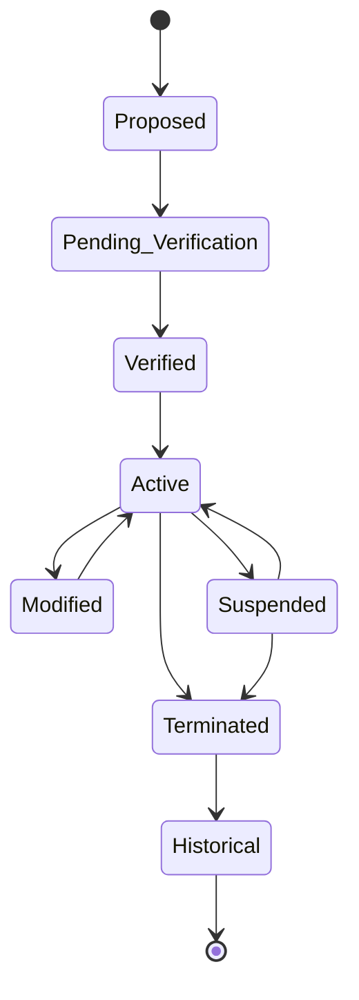

---

## Lifecycle Summary

The Guardian Relationship Aggregate provides the canonical consistency boundary for all institutional guardian relationships.

Its lifecycle governs the complete evolution of guardian responsibilities while preserving strict ownership boundaries with Person Identity, Student Lifecycle, Authentication, Finance, and Communication domains.

All subsequent workflows, business rules, service contracts, and domain events defined within this document derive from this aggregate model and lifecycle architecture.

# 7. Domain Workflows

The Guardian Workflows Domain governs the complete lifecycle of institutional guardian relationships through a set of canonical business workflows.

Each workflow represents a business capability owned exclusively by the Guardian Relationship Aggregate and shall preserve aggregate consistency, enforce institutional policies, and publish authoritative domain events upon successful completion.

Workflows are technology-independent and define business behaviour rather than implementation sequences.

---

# 7.1 Workflow Classification

The Guardian Workflows Domain categorizes workflows into the following business groups:

| Workflow Category | Purpose |
|-------------------|---------|
| Relationship Establishment | Create institutional guardian relationships |
| Verification | Validate guardian authenticity and authority |
| Relationship Administration | Maintain guardian information and responsibilities |
| Consent & Authorization | Govern institutional permissions |
| Communication Governance | Control guardian communication authority |
| Emergency Management | Maintain emergency contact responsibilities |
| Financial Responsibility | Assign institutional financial obligations |
| Lifecycle Management | Suspend, terminate, and archive guardian relationships |

---

# 7.2 Canonical Workflow Catalogue

| Workflow ID | Workflow Name | Primary Outcome |
|-------------|---------------|-----------------|
| GW-01 | Guardian Relationship Establishment | Guardian relationship created |
| GW-02 | Guardian Verification | Guardian verification completed |
| GW-03 | Guardian Assignment | Guardian associated with student |
| GW-04 | Guardian Relationship Modification | Relationship information updated |
| GW-05 | Legal Custody Management | Custody information maintained |
| GW-06 | Consent Management | Institutional consent recorded |
| GW-07 | Communication Authorization Management | Communication permissions governed |
| GW-08 | Emergency Contact Management | Emergency contacts maintained |
| GW-09 | Financial Responsibility Assignment | Financial accountability assigned |
| GW-10 | Pickup Authorization Management | Student pickup authority managed |
| GW-11 | Guardian Suspension | Guardian relationship temporarily suspended |
| GW-12 | Guardian Relationship Termination | Guardian relationship concluded |

---

# 7.3 Workflow Relationships

The following diagram illustrates the logical progression between major guardian workflows.

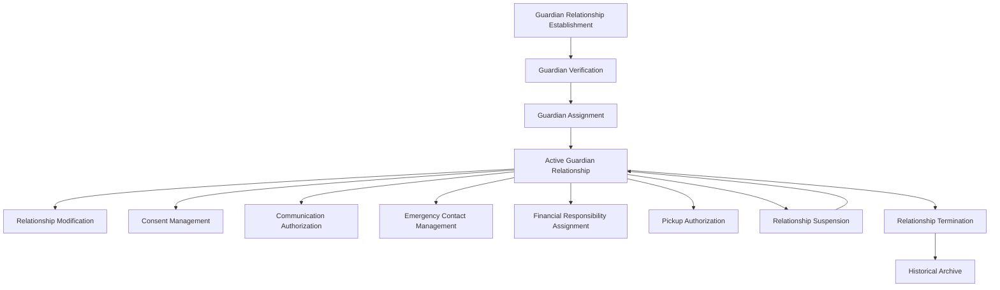

---

# 7.4 Workflow Ownership

All workflows within this domain are exclusively owned by the Guardian Relationship Aggregate.

No external bounded context shall initiate state transitions by directly modifying guardian relationship state.

External domains may request workflow execution only through published service contracts.

---

# 7.5 Workflow Execution Principles

Every Guardian workflow shall comply with the following architectural principles.

### Aggregate Consistency

Each workflow shall execute within the Guardian Relationship Aggregate consistency boundary.

---

### Policy Enforcement

Institutional policies shall be evaluated before any business state transition occurs.

---

### Authorization Validation

Business authorization shall be verified before workflow execution.

---

### Audit Generation

Every successful workflow shall generate complete audit records.

---

### Event Publication

Successful workflows shall publish one or more immutable Domain Events representing completed business facts.

---

### Failure Isolation

Workflow failures shall preserve aggregate consistency and shall never produce partial business state.

---

### Historical Preservation

No workflow shall remove historical guardian relationship information.

Historical integrity shall be maintained throughout the lifecycle.

---

# 7.6 Workflow Dependencies

Guardian workflows rely upon business information provided by upstream domains but remain solely responsible for guardian relationship state.

Typical dependencies include:

- Person identity validation
- Student existence validation
- Institutional policy evaluation
- Authorization context
- Organizational governance

These dependencies shall be resolved through published service contracts without violating bounded-context ownership.

---

# 7.7 Workflow Outcomes

Successful workflow execution may result in one or more of the following business outcomes:

- Guardian relationship established
- Guardian verified
- Guardian assigned
- Custody updated
- Consent granted or withdrawn
- Communication permissions updated
- Emergency contacts modified
- Financial responsibility assigned
- Pickup authorization changed
- Guardian relationship suspended
- Guardian relationship terminated
- Historical relationship archived

Each outcome represents a business state transition and shall be traceable through audit records and corresponding domain events.

---

# 7.8 Workflow Summary

The Guardian Workflows Domain provides a complete set of canonical business workflows governing institutional guardian relationships.

These workflows establish the behavioural foundation for the Guardian Relationship Aggregate and form the basis for the detailed workflow specifications, business rules, service contracts, state transitions, and domain events defined in the subsequent sections of this document.

# 8. Workflow Specifications

This section formally specifies each business workflow owned by the Guardian Workflows Domain.

Each workflow represents a complete business capability executed within the Guardian Relationship Aggregate and defines the business objective, triggering conditions, participating actors, business invariants, lifecycle transitions, outputs, and published domain events.

Workflow specifications are implementation-independent and shall be regarded as the canonical business definition for subsequent Level-3 design.

---

# 8.1 Workflow Specification Template

Every workflow within this bounded context shall be described using the following canonical structure.

| Attribute | Description |
|----------|-------------|
| Workflow ID | Unique workflow identifier |
| Workflow Name | Canonical workflow name |
| Business Objective | Purpose of the workflow |
| Aggregate Owner | Aggregate responsible for execution |
| Trigger | Business event initiating the workflow |
| Preconditions | Conditions required before execution |
| Primary Flow | Canonical business sequence |
| Alternate Flows | Institution-approved variations |
| Failure Conditions | Conditions preventing successful completion |
| Postconditions | Guaranteed business outcome |
| State Transition | Lifecycle transition performed |
| Published Events | Domain Events emitted after successful completion |

---

# 8.2 GW-01 — Guardian Relationship Establishment

| Attribute | Specification |
|----------|---------------|
| Workflow ID | GW-01 |
| Workflow Name | Guardian Relationship Establishment |
| Business Objective | Establish an institutional guardian relationship with a student |
| Aggregate Owner | Guardian Relationship |
| Trigger | Institution requests guardian assignment |
| Preconditions | Student exists, Guardian Person exists, Institution active |
| Postconditions | Guardian relationship created |
| State Transition | Proposed → Pending Verification |
| Published Events | GuardianRelationshipCreated |

### Primary Flow

1. Validate Student reference.
2. Validate Guardian Person reference.
3. Validate institutional policy.
4. Create Guardian Relationship.
5. Initialize lifecycle.
6. Publish domain event.

---

### Alternate Flows

- Verification deferred by institutional policy.
- Guardian imported during admission.
- Existing guardian linked to additional student.

---

### Failure Conditions

- Student does not exist.
- Guardian identity cannot be resolved.
- Duplicate active relationship exists.
- Institutional policy violation.

---

# 8.3 GW-02 — Guardian Verification

| Attribute | Specification |
|----------|---------------|
| Workflow ID | GW-02 |
| Workflow Name | Guardian Verification |
| Business Objective | Verify guardian legitimacy |
| Aggregate Owner | Guardian Relationship |
| Trigger | Verification requested |
| Preconditions | Relationship pending verification |
| Postconditions | Guardian verified |
| State Transition | Pending Verification → Verified |
| Published Events | GuardianVerificationCompleted

### Primary Flow

1. Validate guardian identity.
2. Validate institutional documentation.
3. Evaluate policy.
4. Approve verification.
5. Update relationship.
6. Publish verification event.

---

### Failure Conditions

- Verification rejected.
- Documentation incomplete.
- Duplicate verification request.
- Policy violation.

---

# 8.4 GW-03 — Guardian Assignment

| Attribute | Specification |
|----------|---------------|
| Workflow ID | GW-03 |
| Workflow Name | Guardian Assignment |
| Business Objective | Activate guardian responsibilities |
| Aggregate Owner | Guardian Relationship |
| Trigger | Verification completed |
| Preconditions | Guardian verified |
| Postconditions | Guardian relationship activated |
| State Transition | Verified → Active |
| Published Events | GuardianRelationshipActivated |

---

# 8.5 GW-04 — Guardian Relationship Modification

Business Objective

Maintain institutional guardian relationship information without violating aggregate consistency.

Typical modifications include:

- Contact priority
- Guardian role
- Communication permissions
- Financial responsibility
- Emergency designation

State Transition

Active → Modified → Active

Published Events

- GuardianRelationshipUpdated

---

# 8.6 GW-05 — Legal Custody Management

Business Objective

Maintain legally recognized custody information for guardian relationships.

State Transition

Active → Modified

Published Events

- LegalCustodyUpdated

---

# 8.7 GW-06 — Consent Management

Business Objective

Record, update, revoke, and audit guardian consent for institutionally governed activities.

State Transition

Active → Modified

Published Events

- GuardianConsentGranted
- GuardianConsentWithdrawn

---

# 8.8 GW-07 — Communication Authorization Management

Business Objective

Govern institutional communication permissions assigned to guardians.

State Transition

Active → Modified

Published Events

- CommunicationAuthorizationUpdated

---

# 8.9 GW-08 — Emergency Contact Management

Business Objective

Maintain authoritative emergency contact hierarchy.

State Transition

Active → Modified

Published Events

- EmergencyContactUpdated

---

# 8.10 GW-09 — Financial Responsibility Assignment

Business Objective

Assign institutional financial responsibility to guardians without assuming ownership of financial transactions.

State Transition

Active → Modified

Published Events

- FinancialResponsibilityAssigned

---

# 8.11 GW-10 — Pickup Authorization Management

Business Objective

Manage institutional authorization permitting guardians to collect students.

State Transition

Active → Modified

Published Events

- PickupAuthorizationUpdated

---

# 8.12 GW-11 — Guardian Suspension

Business Objective

Temporarily suspend guardian responsibilities while preserving relationship history.

State Transition

Active → Suspended

Published Events

- GuardianRelationshipSuspended

---

# 8.13 GW-12 — Guardian Relationship Termination

Business Objective

Permanently conclude an institutional guardian relationship.

State Transition

Suspended → Terminated

or

Active → Terminated

Postconditions

- Historical record preserved.
- Relationship closed.
- Future modifications prohibited.

Published Events

- GuardianRelationshipTerminated
- GuardianRelationshipArchived

---

# Workflow Specification Summary

The workflow specifications define the canonical business execution model for every workflow owned by the Guardian Relationship Aggregate.

These specifications establish the authoritative behavioural contract from which Business Rules, Service Contracts, State Transition Matrices, Decision Matrices, Failure Matrices, Validation Rules, and Domain Events are derived.

# 9. Business Rules

The Guardian Workflows Domain shall enforce the following canonical business rules governing institutional guardian relationships.

These rules represent the normative business constraints of the Guardian Relationship Aggregate and shall remain technology-independent.

All workflow execution, state transitions, service contracts, validation rules, authorization decisions, and domain events shall conform to these rules.

---

# 9.1 Relationship Establishment Rules

### BR-001 — Student Existence

A Guardian Relationship shall only be established for an existing Student managed by the Student Lifecycle Domain.

---

### BR-002 — Guardian Identity

Every Guardian Relationship shall reference exactly one authoritative Person identity provided by the Person & Identity Domain.

The Guardian Workflows Domain shall never create independent guardian identities.

---

### BR-003 — Aggregate Ownership

Every Guardian Relationship shall be created and managed exclusively by the Guardian Relationship Aggregate.

No external bounded context shall directly modify aggregate state.

---

### BR-004 — Unique Active Relationship

A Student shall not possess multiple active Guardian Relationships representing the same Guardian Role for the same Person unless explicitly permitted by institutional policy.

---

### BR-005 — Relationship Initialization

Every newly established Guardian Relationship shall begin in the **Proposed** lifecycle state.

---

# 9.2 Verification Rules

### BR-006 — Verification Requirement

A Guardian Relationship shall not become Active until institutional verification requirements have been satisfied where verification is mandated by policy.

---

### BR-007 — Verification Immutability

Completed verification decisions shall remain permanently auditable.

Subsequent verification activities shall create new verification records rather than modifying historical decisions.

---

### BR-008 — Verification Authority

Only authorized institutional authorities may approve or reject Guardian Verification.

---

# 9.3 Guardian Assignment Rules

### BR-009 — Active Assignment

Only Verified Guardian Relationships may receive institutional responsibilities.

---

### BR-010 — Multiple Guardians

A Student may possess multiple active Guardian Relationships simultaneously.

The Guardian Relationship Aggregate shall distinguish responsibilities through Guardian Roles.

---

### BR-011 — Multiple Students

A Guardian may maintain active relationships with multiple Students.

Each relationship shall be governed independently.

---

### BR-012 — Guardian Roles

Every Guardian Relationship shall possess at least one Guardian Role.

Examples include:

- Parent
- Legal Guardian
- Local Guardian
- Financial Guardian
- Emergency Guardian
- Sponsor

Guardian Roles shall be institution configurable.

---

# 9.4 Consent Rules

### BR-013 — Consent Ownership

Guardian consent shall be managed exclusively within the Guardian Workflows Domain.

---

### BR-014 — Consent Traceability

Every consent decision shall record:

- decision
- timestamp
- initiating authority
- applicable policy
- audit reference

---

### BR-015 — Consent Revocation

Consent may be withdrawn in accordance with institutional policy.

Withdrawal shall never remove historical consent records.

---

# 9.5 Communication Rules

### BR-016 — Communication Authorization

Institutional communications shall only be delivered to Guardians authorized to receive them.

---

### BR-017 — Communication Preferences

Communication preferences shall influence message delivery but shall not override mandatory institutional notifications required by law or institutional policy.

---

# 9.6 Emergency Contact Rules

### BR-018 — Emergency Priority

Emergency Contacts shall possess a unique institutional priority ranking.

---

### BR-019 — Active Emergency Contacts

Only Active Guardian Relationships may function as Emergency Contacts.

---

# 9.7 Financial Responsibility Rules

### BR-020 — Financial Responsibility Assignment

Guardian Workflows may assign financial responsibility but shall never manage financial transactions.

---

### BR-021 — Financial Ownership

Invoices, payments, concessions, penalties, refunds, and settlements remain exclusively owned by the Finance Domain.

---

# 9.8 Lifecycle Rules

### BR-022 — Aggregate Consistency

Every lifecycle transition shall occur within the Guardian Relationship Aggregate transaction boundary.

---

### BR-023 — Suspension

Suspending a Guardian Relationship shall preserve all business history.

---

### BR-024 — Termination

Termination permanently concludes institutional guardian responsibilities.

Termination shall not physically delete historical records.

---

### BR-025 — Historical Preservation

Historical Guardian Relationships shall remain immutable.

---

# 9.9 Authorization Rules

### BR-026 — Institutional Authority

Guardian Relationship state transitions shall require appropriate institutional authorization.

---

### BR-027 — Separation of Duties

Verification, approval, suspension, and termination may require different institutional authorities according to institutional policy.

---

# 9.10 Multi-Domain Rules

### BR-028 — Identity Ownership

Person Identity remains exclusively owned by the Person & Identity Domain.

---

### BR-029 — Student Ownership

Student records remain exclusively owned by the Student Lifecycle Domain.

---

### BR-030 — Authentication Ownership

Authentication remains exclusively owned by the Authentication & Authorization Domain.

---

### BR-031 — Communication Ownership

Notification delivery remains exclusively owned by Communication Services.

Guardian Workflows governs only communication authorization.

---

# 9.11 Audit Rules

### BR-032 — Complete Auditability

Every business operation shall produce sufficient audit information to reconstruct the complete history of a Guardian Relationship.

---

### BR-033 — Immutable Business History

Historical Guardian Relationship information shall never be altered once archived.

---

# 9.12 Configuration Rules

### BR-034 — Policy Configuration

Institutions may configure Guardian policies without modifying the canonical domain model.

---

### BR-035 — Role Configuration

Guardian Roles shall be institution configurable while preserving canonical aggregate behavior.

---

### BR-036 — Future Compatibility

Future Guardian capabilities shall extend the aggregate without violating existing business invariants.

---

# Business Rule Summary

The Guardian Workflows Domain defines thirty-six canonical business rules that collectively govern the creation, verification, administration, authorization, suspension, and termination of institutional guardian relationships.

These rules establish the normative behavioral contract of the Guardian Relationship Aggregate and form the architectural foundation for the remaining sections of this document, including Domain Events, Service Contracts, State Transition Matrix, Decision Matrix, Failure Matrix, Validation Rules, Authorization Model, and Architecture Decision Records.

# 10. Domain Events

The Guardian Workflows Domain publishes immutable Domain Events representing completed business facts within the Guardian Relationship Aggregate.

Domain Events serve as the canonical mechanism for communicating significant business state changes to downstream bounded contexts while preserving aggregate autonomy and consistency.

Events shall only be published after successful completion of a business transaction and shall accurately reflect the final committed state of the aggregate.

---

# 10.1 Domain Event Principles

The Guardian Workflows Domain shall adhere to the following architectural principles when publishing Domain Events.

### Business Fact

Every Domain Event shall represent a completed business fact.

Events shall never represent commands, requests, intentions, or partially completed operations.

---

### Immutability

Once published, a Domain Event shall never be modified, withdrawn, or republished with altered business meaning.

Corrections shall be represented through subsequent Domain Events.

---

### Aggregate Authority

Only the Guardian Relationship Aggregate may publish Guardian Domain Events.

External bounded contexts shall never publish events on behalf of this aggregate.

---

### Transactional Consistency

Domain Events shall only be emitted after successful aggregate transaction completion.

Failed transactions shall not produce Domain Events.

---

### Historical Permanence

Published Domain Events shall become part of the permanent business history of the institution.

---

# 10.2 Canonical Domain Events

| Event ID | Domain Event | Description |
|-----------|--------------|-------------|
| GDE-001 | GuardianRelationshipCreated | Guardian relationship established |
| GDE-002 | GuardianVerificationCompleted | Verification successfully completed |
| GDE-003 | GuardianRelationshipActivated | Guardian relationship became active |
| GDE-004 | GuardianRelationshipUpdated | Guardian relationship modified |
| GDE-005 | GuardianRoleChanged | Guardian responsibilities changed |
| GDE-006 | LegalCustodyUpdated | Legal custody information changed |
| GDE-007 | GuardianConsentGranted | Institutional consent granted |
| GDE-008 | GuardianConsentWithdrawn | Institutional consent withdrawn |
| GDE-009 | CommunicationAuthorizationUpdated | Communication permissions changed |
| GDE-010 | EmergencyContactUpdated | Emergency contact hierarchy changed |
| GDE-011 | FinancialResponsibilityAssigned | Financial responsibility assigned |
| GDE-012 | PickupAuthorizationUpdated | Pickup authorization modified |
| GDE-013 | GuardianRelationshipSuspended | Relationship suspended |
| GDE-014 | GuardianRelationshipReactivated | Suspended relationship restored |
| GDE-015 | GuardianRelationshipTerminated | Relationship terminated |
| GDE-016 | GuardianRelationshipArchived | Relationship entered historical state |

---

# 10.3 Event Lifecycle Mapping

| Lifecycle Transition | Published Event |
|----------------------|-----------------|
| Proposed → Pending Verification | GuardianRelationshipCreated |
| Pending Verification → Verified | GuardianVerificationCompleted |
| Verified → Active | GuardianRelationshipActivated |
| Active → Modified | GuardianRelationshipUpdated |
| Active → Suspended | GuardianRelationshipSuspended |
| Suspended → Active | GuardianRelationshipReactivated |
| Active → Terminated | GuardianRelationshipTerminated |
| Suspended → Terminated | GuardianRelationshipTerminated |
| Terminated → Historical | GuardianRelationshipArchived |

---

# 10.4 Event Producers

The following business operations produce Domain Events.

| Business Operation | Published Event |
|--------------------|-----------------|
| Guardian Relationship Establishment | GuardianRelationshipCreated |
| Guardian Verification | GuardianVerificationCompleted |
| Guardian Assignment | GuardianRelationshipActivated |
| Relationship Modification | GuardianRelationshipUpdated |
| Guardian Role Update | GuardianRoleChanged |
| Custody Modification | LegalCustodyUpdated |
| Consent Granted | GuardianConsentGranted |
| Consent Withdrawn | GuardianConsentWithdrawn |
| Communication Permission Update | CommunicationAuthorizationUpdated |
| Emergency Contact Update | EmergencyContactUpdated |
| Financial Responsibility Assignment | FinancialResponsibilityAssigned |
| Pickup Authorization Update | PickupAuthorizationUpdated |
| Relationship Suspension | GuardianRelationshipSuspended |
| Relationship Reactivation | GuardianRelationshipReactivated |
| Relationship Termination | GuardianRelationshipTerminated |
| Historical Archival | GuardianRelationshipArchived |

---

# 10.5 Event Consumers

The Guardian Workflows Domain publishes business events for consumption by downstream bounded contexts.

| Consuming Domain | Business Purpose |
|------------------|------------------|
| Academic Registration | Guardian availability during enrollment |
| Attendance | Parent and guardian notifications |
| Examination | Examination communications |
| Finance | Financial responsibility synchronization |
| Hostel | Authorized guardian management |
| Transport | Pickup and transportation authorization |
| Health Centre | Emergency guardian reference |
| Communication Services | Notification recipient determination |
| Scholarship | Guardian-related eligibility evaluation |
| Reporting & Analytics | Institutional reporting and audit |
| Alumni Transition | Historical guardian reference |

Consumer domains shall treat Guardian Domain Events as read-only business facts.

---

# 10.6 Event Ordering Rules

The Guardian Workflows Domain shall maintain the following event ordering guarantees.

1. Events shall be published in aggregate lifecycle order.
2. Earlier events shall never be superseded by unpublished historical changes.
3. Event timestamps shall reflect committed transaction time.
4. Duplicate publication shall be prevented.
5. Consumers shall be able to reconstruct aggregate history solely from published events.

---

# 10.7 Event Versioning Principles

To preserve long-term compatibility across the SutraERP platform:

- Existing event semantics shall remain stable.
- New business information shall be introduced through backward-compatible event evolution where possible.
- Deprecated events shall remain understandable to existing consumers until formally retired.
- Event identity shall remain immutable throughout its lifecycle.

---

# 10.8 Event Publication Guarantees

The Guardian Workflows Domain guarantees that:

- Every published event corresponds to a successfully committed aggregate transaction.
- Every event is uniquely identifiable.
- Every event is permanently auditable.
- Every event references the authoritative Guardian Relationship.
- Every event preserves business ordering within the aggregate.
- Every event is safe for downstream consumption without exposing aggregate internals.

---

# 10.9 Domain Event Summary

The Guardian Workflows Domain publishes sixteen canonical Domain Events that collectively represent the complete lifecycle of institutional guardian relationships.

These events establish the authoritative event contract for all downstream bounded contexts, enabling event-driven integration while preserving strict aggregate ownership, transactional consistency, historical integrity, and long-term architectural stability across the SutraERP platform.
# 11. Service Contracts

The Guardian Workflows Domain exposes a set of canonical business service contracts through which external bounded contexts may interact with the Guardian Relationship Aggregate.

Service Contracts define business capabilities rather than technical interfaces.

They establish the only supported interaction model for creating, querying, and managing Guardian Relationships while preserving aggregate integrity, bounded-context isolation, and long-term architectural stability.

External domains shall interact with the Guardian Workflows Domain exclusively through these contracts or through published Domain Events.

---

# 11.1 Service Contract Principles

The Guardian Workflows Domain shall expose service contracts according to the following architectural principles.

### Business-Oriented Contracts

Every service contract shall represent a business capability rather than a technical operation.

---

### Aggregate Protection

No service contract shall expose internal aggregate implementation details.

All business invariants shall remain enforced within the Guardian Relationship Aggregate.

---

### Technology Independence

Service contracts define business semantics only.

They are independent of REST, GraphQL, gRPC, messaging protocols, database structures, or implementation frameworks.

---

### Explicit Ownership

Only the Guardian Workflows Domain may create, modify, suspend, reactivate, or terminate Guardian Relationships.

External domains shall request these operations through published contracts.

---

### Stable Contract Evolution

Service contracts shall evolve in a backward-compatible manner whenever possible.

Breaking changes shall require explicit architectural approval.

---

# 11.2 Command Service Contracts

The following command contracts modify the state of the Guardian Relationship Aggregate.

| Contract ID | Service Contract | Business Purpose |
|-------------|------------------|------------------|
| GSC-C01 | Establish Guardian Relationship | Create a new institutional guardian relationship |
| GSC-C02 | Verify Guardian Relationship | Complete institutional verification |
| GSC-C03 | Activate Guardian Relationship | Activate a verified guardian relationship |
| GSC-C04 | Update Guardian Relationship | Modify institutional guardian information |
| GSC-C05 | Update Guardian Roles | Change guardian responsibilities |
| GSC-C06 | Record Guardian Consent | Grant or withdraw institutional consent |
| GSC-C07 | Update Communication Authorization | Maintain communication permissions |
| GSC-C08 | Update Emergency Contact | Maintain emergency contact hierarchy |
| GSC-C09 | Assign Financial Responsibility | Assign institutional financial accountability |
| GSC-C10 | Update Pickup Authorization | Manage student pickup authorization |
| GSC-C11 | Suspend Guardian Relationship | Temporarily suspend a relationship |
| GSC-C12 | Reactivate Guardian Relationship | Restore a suspended relationship |
| GSC-C13 | Terminate Guardian Relationship | Permanently conclude a relationship |

---

# 11.3 Query Service Contracts

The following query contracts provide authoritative guardian information without modifying aggregate state.

| Contract ID | Service Contract | Business Purpose |
|-------------|------------------|------------------|
| GSC-Q01 | Get Guardian Relationship | Retrieve a guardian relationship |
| GSC-Q02 | Get Student Guardians | Retrieve all guardians assigned to a student |
| GSC-Q03 | Get Guardian Students | Retrieve all students associated with a guardian |
| GSC-Q04 | Get Guardian Permissions | Retrieve institutional permissions |
| GSC-Q05 | Get Emergency Contacts | Retrieve emergency contact hierarchy |
| GSC-Q06 | Get Financial Responsibility | Retrieve financial responsibility assignments |
| GSC-Q07 | Get Guardian History | Retrieve historical relationship information |
| GSC-Q08 | Search Guardian Relationships | Search guardian relationships using business criteria |

Query contracts shall never modify aggregate state.

---

# 11.4 Contract Ownership Matrix

| Service Contract | Owner | Consumers |
|------------------|-------|-----------|
| Establish Guardian Relationship | Guardian Workflows | Admission Domain, Student Lifecycle |
| Verify Guardian Relationship | Guardian Workflows | Admission Domain |
| Activate Guardian Relationship | Guardian Workflows | Student Lifecycle |
| Update Guardian Relationship | Guardian Workflows | Student Lifecycle |
| Record Guardian Consent | Guardian Workflows | Academic Registration, Examination, Communication Services |
| Update Communication Authorization | Guardian Workflows | Communication Services |
| Update Emergency Contact | Guardian Workflows | Health Centre, Hostel, Transport |
| Assign Financial Responsibility | Guardian Workflows | Finance Domain |
| Update Pickup Authorization | Guardian Workflows | Transport, Campus Security |
| Suspend / Reactivate Relationship | Guardian Workflows | All dependent domains |
| Terminate Guardian Relationship | Guardian Workflows | All dependent domains |

The listed consumers request execution of business capabilities but do not acquire ownership of Guardian Relationship data.

---

# 11.5 Contract Preconditions

Before executing a command service contract, the Guardian Relationship Aggregate shall validate:

- Student existence.
- Guardian Person existence.
- Aggregate lifecycle state.
- Institutional authorization.
- Applicable institutional policies.
- Business rule compliance.
- Domain ownership constraints.

Execution shall not proceed if any mandatory precondition is violated.

---

# 11.6 Contract Postconditions

Successful execution of a command contract guarantees:

- Aggregate consistency is preserved.
- Lifecycle state reflects the completed business operation.
- All applicable business rules have been enforced.
- Audit records have been created.
- Required Domain Events have been published.
- Downstream bounded contexts may safely consume the resulting business state.

---

# 11.7 Error Contract Principles

Service contracts shall communicate business failures using canonical business outcomes rather than implementation-specific exceptions.

Typical business outcomes include:

| Outcome | Description |
|---------|-------------|
| Guardian Relationship Not Found | Requested relationship does not exist |
| Duplicate Guardian Relationship | Relationship already exists |
| Guardian Verification Failed | Verification requirements not satisfied |
| Invalid Lifecycle Transition | Requested transition violates lifecycle rules |
| Authorization Denied | Requesting authority lacks required permissions |
| Policy Violation | Institutional policy prevents execution |
| Business Rule Violation | Aggregate invariant would be violated |

These outcomes represent business semantics and are independent of transport-specific error mechanisms.

---

# 11.8 Service Interaction Model

The Guardian Workflows Domain supports two complementary interaction models.

### Synchronous Interaction

External domains invoke business service contracts to request execution of guardian-related capabilities.

The Guardian Relationship Aggregate evaluates business rules, performs the requested operation, and returns the resulting business outcome.

---

### Asynchronous Interaction

Following successful execution, the aggregate publishes immutable Domain Events describing the completed business fact.

Interested bounded contexts consume these events to synchronize their own models without introducing direct dependencies.

---

# 11.9 Service Contract Summary

The Guardian Workflows Domain exposes thirteen command contracts and eight query contracts that collectively define the canonical interaction surface for institutional guardian management.

These contracts provide the exclusive business interface through which external bounded contexts may request guardian-related capabilities while preserving aggregate ownership, enforcing business invariants, supporting event-driven integration, and maintaining long-term architectural stability across the SutraERP platform.

# 12. State Transition Matrix

The State Transition Matrix defines the canonical lifecycle transitions of the Guardian Relationship Aggregate.

Each transition represents a valid business state change governed by the Guardian Workflows Domain. No lifecycle transition may occur unless explicitly defined within this section.

The Guardian Relationship Aggregate shall reject any attempted transition that violates this state model.

---

# 12.1 State Transition Principles

The Guardian Relationship lifecycle shall comply with the following architectural principles.

### Controlled Evolution

Every Guardian Relationship shall evolve through explicitly defined lifecycle states.

---

### Aggregate Authority

Only the Guardian Relationship Aggregate may execute lifecycle transitions.

---

### Business Rule Enforcement

Every transition shall satisfy all applicable business rules before execution.

---

### Auditability

Every successful transition shall generate a complete audit record.

---

### Event Publication

Every successful transition shall publish the corresponding Domain Event.

---

### Historical Preservation

Historical lifecycle states shall remain permanently traceable.

---

# 12.2 Canonical Lifecycle States

| State | Description |
|--------|-------------|
| Proposed | Relationship identified but not yet established institutionally |
| Pending Verification | Verification activities in progress |
| Verified | Verification completed successfully |
| Active | Guardian relationship fully operational |
| Modified | Relationship temporarily reflects an approved business modification |
| Suspended | Relationship temporarily inactive |
| Terminated | Institutional relationship concluded |
| Historical | Immutable archived relationship |

---

# 12.3 Canonical State Transition Matrix

| Current State | Business Operation | Next State | Allowed | Published Event |
|---------------|--------------------|------------|:-------:|-----------------|
| Proposed | Submit for Verification | Pending Verification | ✓ | GuardianRelationshipCreated |
| Pending Verification | Complete Verification | Verified | ✓ | GuardianVerificationCompleted |
| Verified | Activate Relationship | Active | ✓ | GuardianRelationshipActivated |
| Active | Modify Relationship | Modified | ✓ | GuardianRelationshipUpdated |
| Modified | Complete Modification | Active | ✓ | GuardianRelationshipUpdated |
| Active | Suspend Relationship | Suspended | ✓ | GuardianRelationshipSuspended |
| Suspended | Reactivate Relationship | Active | ✓ | GuardianRelationshipReactivated |
| Active | Terminate Relationship | Terminated | ✓ | GuardianRelationshipTerminated |
| Suspended | Terminate Relationship | Terminated | ✓ | GuardianRelationshipTerminated |
| Terminated | Archive Relationship | Historical | ✓ | GuardianRelationshipArchived |

---

# 12.4 Invalid State Transitions

The following lifecycle transitions are explicitly prohibited.

| Invalid Transition | Reason |
|--------------------|--------|
| Proposed → Active | Verification bypassed |
| Proposed → Historical | Relationship never established |
| Pending Verification → Active | Verification incomplete |
| Pending Verification → Historical | Verification lifecycle incomplete |
| Verified → Historical | Activation or termination required |
| Active → Proposed | Lifecycle reversal prohibited |
| Active → Verified | Completed lifecycle stage cannot be revisited |
| Suspended → Verified | Verification already concluded |
| Suspended → Proposed | Lifecycle rollback prohibited |
| Terminated → Active | Terminated relationships cannot be restored |
| Historical → Any State | Historical state is immutable |

The aggregate shall reject all invalid transitions regardless of the requesting client or integration mechanism.

---

# 12.5 Transition Preconditions

Before executing any lifecycle transition, the aggregate shall verify:

- Guardian Relationship exists.
- Current lifecycle state matches the requested transition.
- Required institutional authorization is present.
- Applicable business rules are satisfied.
- Institutional policies permit the transition.
- Aggregate consistency will be preserved.

Failure of any mandatory precondition shall prevent the transition.

---

# 12.6 Transition Postconditions

Every successful lifecycle transition guarantees:

- Aggregate state has been updated.
- Business invariants remain satisfied.
- Audit records have been generated.
- Appropriate Domain Events have been published.
- Downstream bounded contexts may safely consume the new business state.

---

# 12.7 State Responsibility Matrix

| Lifecycle State | Aggregate Responsibility |
|-----------------|--------------------------|
| Proposed | Relationship initialization |
| Pending Verification | Verification governance |
| Verified | Eligibility for activation |
| Active | Full guardian governance |
| Modified | Controlled business update |
| Suspended | Temporary relationship suspension |
| Terminated | Formal relationship closure |
| Historical | Immutable business history |

---

# 12.8 Lifecycle State Machine

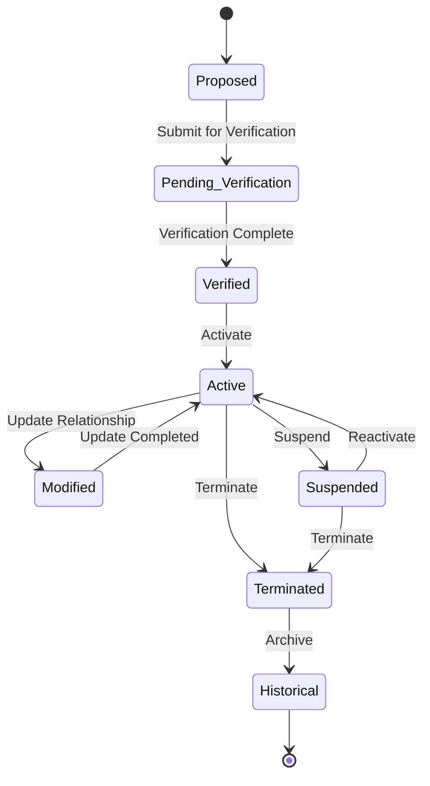

---

# 12.9 Transition Governance Rules

The Guardian Relationship Aggregate shall enforce the following governance rules for all lifecycle transitions.

- Every transition shall be initiated through a canonical Service Contract.
- Every transition shall execute within a single aggregate transaction boundary.
- Every successful transition shall publish exactly one primary lifecycle Domain Event.
- Lifecycle transitions shall never bypass mandatory verification or authorization requirements.
- Historical states shall never be modified or reactivated.
- Aggregate consistency shall always take precedence over external workflow requests.

---

# 12.10 State Transition Summary

The State Transition Matrix establishes the authoritative lifecycle model for the Guardian Relationship Aggregate.

It defines every permissible state, every valid transition, the corresponding business operation, and the associated Domain Event. This matrix serves as the canonical reference for workflow execution, business rule enforcement, service contract implementation, authorization decisions, audit generation, and downstream event-driven integration across the SutraERP platform.
# 13. Decision Matrix

The Decision Matrix defines the canonical business decisions evaluated by the Guardian Relationship Aggregate during workflow execution.

Each decision represents a deterministic business outcome derived from institutional policies, aggregate state, authorization context, and business invariants.

Decision evaluation shall occur entirely within the Guardian Relationship Aggregate.

External bounded contexts may provide reference information but shall not determine Guardian Relationship decisions.

---

# 13.1 Decision Principles

The Guardian Workflows Domain shall evaluate business decisions according to the following architectural principles.

### Aggregate Authority

Business decisions affecting Guardian Relationships shall be made exclusively within the Guardian Relationship Aggregate.

---

### Deterministic Outcomes

Identical business inputs shall always produce identical business decisions.

---

### Policy-Driven Evaluation

Institutional configuration may influence decision outcomes without altering canonical aggregate behavior.

---

### Business Rule Compliance

Every decision shall satisfy all applicable Business Rules before execution.

---

### Auditability

Every significant business decision shall be permanently auditable.

---

# 13.2 Decision Catalogue

| Decision ID | Business Decision | Purpose |
|-------------|-------------------|---------|
| GD-001 | Establish Guardian Relationship | Determine whether a new relationship may be created |
| GD-002 | Require Guardian Verification | Determine whether verification is mandatory |
| GD-003 | Activate Guardian Relationship | Determine eligibility for activation |
| GD-004 | Assign Guardian Role | Determine appropriate guardian responsibilities |
| GD-005 | Accept Legal Custody | Validate legal custody information |
| GD-006 | Accept Guardian Consent | Evaluate institutional consent |
| GD-007 | Authorize Communication | Determine communication permissions |
| GD-008 | Approve Emergency Contact | Validate emergency contact assignment |
| GD-009 | Assign Financial Responsibility | Determine financial accountability |
| GD-010 | Authorize Pickup | Determine pickup authorization |
| GD-011 | Suspend Relationship | Determine suspension eligibility |
| GD-012 | Terminate Relationship | Determine termination eligibility |

---

# 13.3 Relationship Establishment Decision

| Evaluation Condition | Decision |
|----------------------|----------|
| Student exists and Guardian identity exists | Continue evaluation |
| Duplicate active relationship detected | Reject establishment |
| Required institutional policy violated | Reject establishment |
| All mandatory conditions satisfied | Create Guardian Relationship |

---

# 13.4 Verification Decision

| Evaluation Condition | Decision |
|----------------------|----------|
| Institution requires verification | Initiate verification workflow |
| Verification successfully completed | Approve verification |
| Verification rejected | Maintain Pending Verification state |
| Required documentation incomplete | Await additional documentation |

---

# 13.5 Activation Decision

| Evaluation Condition | Decision |
|----------------------|----------|
| Verification completed | Activate relationship |
| Verification pending | Reject activation |
| Relationship suspended | Reject activation request |
| Aggregate invariant violated | Reject activation |

---

# 13.6 Guardian Role Decision

| Evaluation Condition | Decision |
|----------------------|----------|
| Parent relationship declared | Assign Parent role |
| Court-recognized custody provided | Assign Legal Guardian role |
| Institution approves local guardian | Assign Local Guardian role |
| Institution assigns financial accountability | Assign Financial Guardian role |
| Emergency responsibility approved | Assign Emergency Guardian role |

Institutions may introduce additional Guardian Roles through configuration without modifying the canonical aggregate model.

---

# 13.7 Consent Decision

| Evaluation Condition | Decision |
|----------------------|----------|
| Guardian provides valid consent | Record consent |
| Guardian withdraws consent | Record withdrawal |
| Policy prohibits withdrawal | Reject withdrawal |
| Consent no longer applicable | Mark consent expired |

---

# 13.8 Communication Decision

| Evaluation Condition | Decision |
|----------------------|----------|
| Guardian authorized for communication | Enable communication |
| Guardian communication revoked | Disable communication |
| Mandatory institutional notification | Deliver regardless of communication preference |
| Relationship inactive | Deny routine communication |

---

# 13.9 Emergency Contact Decision

| Evaluation Condition | Decision |
|----------------------|----------|
| Active Guardian Relationship | Eligible as emergency contact |
| Priority already assigned | Recalculate contact hierarchy |
| Relationship terminated | Remove emergency designation |

---

# 13.10 Financial Responsibility Decision

| Evaluation Condition | Decision |
|----------------------|----------|
| Institution assigns financial responsibility | Create financial responsibility mapping |
| Existing assignment updated | Replace institutional assignment |
| Relationship terminated | Remove active responsibility mapping |

The Finance Domain remains responsible for all financial transactions resulting from this assignment.

---

# 13.11 Pickup Authorization Decision

| Evaluation Condition | Decision |
|----------------------|----------|
| Active relationship with pickup authority | Grant authorization |
| Authorization revoked | Remove authorization |
| Relationship suspended | Suspend pickup authorization |
| Relationship terminated | Permanently revoke authorization |

---

# 13.12 Suspension Decision

| Evaluation Condition | Decision |
|----------------------|----------|
| Institutional authority approves suspension | Suspend relationship |
| Active investigation pending | Suspend relationship |
| Suspension request unauthorized | Reject request |
| Relationship already terminated | Reject request |

---

# 13.13 Termination Decision

| Evaluation Condition | Decision |
|----------------------|----------|
| Institutional authority approves termination | Terminate relationship |
| Student lifecycle completed | Evaluate institutional policy before termination |
| Active legal restriction exists | Reject termination |
| Relationship already historical | Reject request |

---

# 13.14 Decision Priority Rules

When multiple business decisions apply simultaneously, the Guardian Relationship Aggregate shall evaluate them in the following precedence order.

| Priority | Decision Category |
|----------|-------------------|
| 1 | Aggregate consistency |
| 2 | Authorization validation |
| 3 | Legal and regulatory compliance |
| 4 | Institutional policy |
| 5 | Business Rules |
| 6 | Workflow-specific evaluation |
| 7 | Optional institutional configuration |

Higher-priority decisions shall always override lower-priority decisions.

---

# 13.15 Decision Outcomes

Every business decision shall result in one of the following canonical outcomes.

| Outcome | Description |
|---------|-------------|
| Approved | Requested business operation may proceed |
| Rejected | Business operation prohibited |
| Deferred | Additional business action required before evaluation can continue |
| Escalated | Decision requires higher institutional authority |
| Cancelled | Business operation intentionally discontinued |

These outcomes shall be interpreted consistently across all Guardian Workflows.

---

# 13.16 Decision Summary

The Decision Matrix defines twelve canonical business decisions governing the lifecycle of Guardian Relationships.

By centralizing decision logic within the Guardian Relationship Aggregate, the Guardian Workflows Domain ensures deterministic behavior, policy-driven governance, auditability, and consistent business outcomes across all institutional workflows while preserving strict bounded-context ownership and aggregate integrity.

# 14. Failure Matrix

The Failure Matrix defines the canonical business failure conditions that may occur during the execution of Guardian Workflows.

Business failures represent valid business outcomes resulting from policy evaluation, authorization decisions, lifecycle constraints, aggregate invariants, or domain ownership boundaries.

Technical failures, infrastructure exceptions, network failures, and implementation-specific errors are outside the scope of this document.

The Guardian Relationship Aggregate shall preserve consistency by rejecting business operations that violate the failure conditions defined herein.

---

# 14.1 Failure Handling Principles

The Guardian Workflows Domain shall govern business failures according to the following principles.

### Aggregate Consistency

No business failure shall leave the Guardian Relationship Aggregate in a partially modified state.

---

### Transaction Atomicity

Business operations shall either complete successfully or leave the aggregate unchanged.

---

### Explicit Failure Semantics

Every business failure shall represent a meaningful business outcome rather than a technical exception.

---

### Auditability

Business failures affecting institutional governance shall be auditable in accordance with institutional policy.

---

### Predictable Behaviour

Identical business conditions shall always produce identical business failure outcomes.

---

# 14.2 Canonical Failure Catalogue

| Failure ID | Business Failure | Description |
|------------|------------------|-------------|
| GF-001 | Student Not Found | Referenced Student does not exist |
| GF-002 | Guardian Identity Not Found | Referenced Person identity cannot be resolved |
| GF-003 | Duplicate Guardian Relationship | Equivalent active relationship already exists |
| GF-004 | Verification Required | Relationship cannot proceed until verification completes |
| GF-005 | Verification Failed | Guardian verification unsuccessful |
| GF-006 | Invalid Lifecycle Transition | Requested state transition is not permitted |
| GF-007 | Unauthorized Operation | Requesting authority lacks required permissions |
| GF-008 | Policy Violation | Institutional policy prohibits execution |
| GF-009 | Aggregate Invariant Violation | Requested operation would violate aggregate consistency |
| GF-010 | Legal Restriction | Applicable legal or custody requirements prevent execution |
| GF-011 | Relationship Already Terminated | Relationship is permanently closed |
| GF-012 | Historical Record Modification Attempt | Immutable historical information cannot be altered |

---

# 14.3 Relationship Establishment Failures

| Business Condition | Failure Outcome |
|--------------------|-----------------|
| Student does not exist | Student Not Found |
| Guardian Person cannot be resolved | Guardian Identity Not Found |
| Duplicate active relationship exists | Duplicate Guardian Relationship |
| Mandatory institutional policy violated | Policy Violation |
| Aggregate invariant violated | Aggregate Invariant Violation |

Successful execution shall only occur after all failure conditions have been resolved.

---

# 14.4 Verification Failures

| Business Condition | Failure Outcome |
|--------------------|-----------------|
| Required verification not completed | Verification Required |
| Verification rejected | Verification Failed |
| Mandatory documentation incomplete | Verification Failed |
| Unauthorized verification approval | Unauthorized Operation |

---

# 14.5 Relationship Administration Failures

| Business Condition | Failure Outcome |
|--------------------|-----------------|
| Attempt to modify terminated relationship | Relationship Already Terminated |
| Attempt to modify historical relationship | Historical Record Modification Attempt |
| Requested role violates policy | Policy Violation |
| Aggregate invariant violated | Aggregate Invariant Violation |

---

# 14.6 Consent & Authorization Failures

| Business Condition | Failure Outcome |
|--------------------|-----------------|
| Consent recorded for inactive relationship | Invalid Lifecycle Transition |
| Unauthorized consent modification | Unauthorized Operation |
| Mandatory consent missing | Policy Violation |
| Consent conflicts with institutional policy | Policy Violation |

---

# 14.7 Emergency Contact Failures

| Business Condition | Failure Outcome |
|--------------------|-----------------|
| Emergency contact assigned to inactive relationship | Invalid Lifecycle Transition |
| Duplicate priority assignment violates policy | Aggregate Invariant Violation |
| Relationship terminated | Relationship Already Terminated |

---

# 14.8 Financial Responsibility Failures

| Business Condition | Failure Outcome |
|--------------------|-----------------|
| Financial responsibility assigned to inactive relationship | Invalid Lifecycle Transition |
| Unauthorized financial assignment | Unauthorized Operation |
| Policy prohibits assignment | Policy Violation |

The Guardian Workflows Domain shall not evaluate financial transactions, payment status, or accounting validations.

---

# 14.9 Pickup Authorization Failures

| Business Condition | Failure Outcome |
|--------------------|-----------------|
| Relationship inactive | Invalid Lifecycle Transition |
| Authorization revoked by institution | Policy Violation |
| Legal restriction applies | Legal Restriction |

---

# 14.10 Lifecycle Failures

| Business Condition | Failure Outcome |
|--------------------|-----------------|
| Invalid state transition requested | Invalid Lifecycle Transition |
| Attempt to reactivate terminated relationship | Relationship Already Terminated |
| Attempt to restore historical relationship | Historical Record Modification Attempt |
| Aggregate consistency cannot be maintained | Aggregate Invariant Violation |

---

# 14.11 Failure Recovery Principles

Following a business failure, the Guardian Workflows Domain shall ensure:

- The aggregate remains unchanged.
- No partial lifecycle transition occurs.
- No Domain Events are published.
- Audit records are generated where institutionally required.
- The requesting bounded context receives an explicit business outcome.
- Subsequent requests may be re-evaluated after corrective action.

---

# 14.12 Failure Responsibility Matrix

| Failure Category | Responsible Domain |
|------------------|--------------------|
| Guardian Relationship failures | Guardian Workflows |
| Identity resolution failures | Person & Identity |
| Student reference failures | Student Lifecycle |
| Authentication failures | Authentication & Authorization |
| Institutional policy failures | Guardian Workflows |
| Financial transaction failures | Finance |
| Notification delivery failures | Communication Services |

Each bounded context shall remain responsible only for failures within its ownership boundary.

---

# 14.13 Failure Severity Classification

| Severity | Business Impact | Aggregate Behaviour |
|----------|-----------------|---------------------|
| Critical | Aggregate consistency at risk | Reject operation immediately |
| High | Business rule or policy violation | Reject operation |
| Medium | Additional institutional action required | Defer operation |
| Low | Informational condition | Continue where policy permits |

Severity classifications guide operational governance but shall not override business rules.

---

# 14.14 Failure Matrix Summary

The Failure Matrix defines the canonical business failure conditions governing Guardian Workflows.

By explicitly modelling business failures, the Guardian Relationship Aggregate guarantees deterministic behaviour, transactional consistency, auditability, and preservation of aggregate integrity while preventing invalid lifecycle transitions, policy violations, ownership conflicts, and historical inconsistencies across the SutraERP platform.

# 15. Validation Rules

The Validation Rules define the canonical business validations that shall be performed before executing operations within the Guardian Relationship Aggregate.

Validation ensures that all business operations satisfy aggregate invariants, institutional policies, lifecycle constraints, authorization requirements, and domain ownership boundaries before any state transition occurs.

Validation shall always precede business execution.

Failure to satisfy any mandatory validation rule shall prevent execution of the requested business operation.

---

# 15.1 Validation Principles

The Guardian Workflows Domain shall enforce validation according to the following architectural principles.

### Pre-Execution Validation

All mandatory business validations shall complete successfully before aggregate state is modified.

---

### Aggregate Integrity

Validation shall protect the consistency boundary of the Guardian Relationship Aggregate.

---

### Deterministic Behaviour

Equivalent business inputs shall always produce identical validation outcomes.

---

### Technology Independence

Validation rules define business semantics only.

Implementation frameworks, UI validation, API validation, database constraints, and infrastructure mechanisms are outside the scope of this document.

---

### Ownership Preservation

Validation shall respect bounded-context ownership and shall never duplicate responsibilities owned by other domains.

---

# 15.2 Validation Categories

| Category | Purpose |
|----------|---------|
| Identity Validation | Validate authoritative Person references |
| Student Validation | Validate Student references |
| Relationship Validation | Validate Guardian Relationship integrity |
| Lifecycle Validation | Validate lifecycle state |
| Authorization Validation | Validate institutional authority |
| Policy Validation | Validate institutional policies |
| Role Validation | Validate guardian responsibilities |
| Consent Validation | Validate guardian consent |
| Financial Responsibility Validation | Validate responsibility assignments |
| Historical Integrity Validation | Preserve immutable business history |

---

# 15.3 Identity Validation Rules

| Validation ID | Validation Rule |
|---------------|-----------------|
| GV-001 | Guardian Person reference shall exist within the Person & Identity Domain. |
| GV-002 | Guardian identity shall reference exactly one authoritative Person. |
| GV-003 | Guardian identity shall never be duplicated within the aggregate. |
| GV-004 | Identity references shall remain immutable throughout the relationship lifecycle. |

Guardian identity ownership remains exclusively within the Person & Identity Domain.

---

# 15.4 Student Validation Rules

| Validation ID | Validation Rule |
|---------------|-----------------|
| GV-005 | Student reference shall exist. |
| GV-006 | Student reference shall identify exactly one Student. |
| GV-007 | Student shall belong to the current institutional context. |
| GV-008 | Student lifecycle shall permit guardian assignment. |

Student ownership remains exclusively within the Student Lifecycle Domain.

---

# 15.5 Guardian Relationship Validation Rules

| Validation ID | Validation Rule |
|---------------|-----------------|
| GV-009 | Every Guardian Relationship shall reference one Student. |
| GV-010 | Every Guardian Relationship shall reference one Guardian Person. |
| GV-011 | Duplicate active Guardian Relationships shall not exist unless permitted by institutional policy. |
| GV-012 | Guardian Relationship Aggregate invariants shall remain satisfied. |

---

# 15.6 Lifecycle Validation Rules

| Validation ID | Validation Rule |
|---------------|-----------------|
| GV-013 | Requested lifecycle transition shall be valid according to the State Transition Matrix. |
| GV-014 | Current lifecycle state shall permit the requested operation. |
| GV-015 | Historical relationships shall not accept modifications. |
| GV-016 | Terminated relationships shall not be reactivated except through approved future lifecycle extensions. |

---

# 15.7 Authorization Validation Rules

| Validation ID | Validation Rule |
|---------------|-----------------|
| GV-017 | Requesting authority shall possess required institutional permissions. |
| GV-018 | Separation-of-duties requirements shall be satisfied where applicable. |
| GV-019 | Authorization shall be evaluated before aggregate modification. |
| GV-020 | Authorization decisions shall be auditable. |

Authentication remains outside the ownership of this domain.

---

# 15.8 Policy Validation Rules

| Validation ID | Validation Rule |
|---------------|-----------------|
| GV-021 | Institution-specific guardian policies shall be evaluated before execution. |
| GV-022 | Mandatory verification policies shall be enforced. |
| GV-023 | Legal and regulatory policies shall take precedence over institutional configuration. |
| GV-024 | Policy evaluation shall produce deterministic outcomes. |

---

# 15.9 Guardian Role Validation Rules

| Validation ID | Validation Rule |
|---------------|-----------------|
| GV-025 | Every Guardian Relationship shall contain at least one Guardian Role. |
| GV-026 | Assigned Guardian Roles shall comply with institutional policy. |
| GV-027 | Multiple roles may coexist where explicitly permitted. |
| GV-028 | Role assignments shall remain traceable throughout the relationship lifecycle. |

---

# 15.10 Consent Validation Rules

| Validation ID | Validation Rule |
|---------------|-----------------|
| GV-029 | Consent shall originate from an Active Guardian Relationship unless institutional policy explicitly permits earlier collection. |
| GV-030 | Consent shall reference the applicable institutional policy. |
| GV-031 | Consent withdrawals shall preserve historical records. |
| GV-032 | Mandatory consent requirements shall be satisfied before dependent workflows execute. |

---

# 15.11 Financial Responsibility Validation Rules

| Validation ID | Validation Rule |
|---------------|-----------------|
| GV-033 | Financial responsibility assignments shall reference an Active Guardian Relationship. |
| GV-034 | Multiple financial responsibilities shall comply with institutional policy. |
| GV-035 | Guardian Workflows shall validate responsibility assignment only, not financial transactions. |
| GV-036 | Responsibility history shall remain permanently auditable. |

---

# 15.12 Historical Integrity Validation Rules

| Validation ID | Validation Rule |
|---------------|-----------------|
| GV-037 | Historical Guardian Relationships shall remain immutable. |
| GV-038 | Historical audit records shall never be overwritten. |
| GV-039 | Historical Domain Events shall remain unchanged. |
| GV-040 | Archived relationships shall preserve complete business traceability. |

---

# 15.13 Validation Execution Order

The Guardian Relationship Aggregate shall perform business validations in the following canonical sequence.

| Order | Validation Category |
|------:|---------------------|
| 1 | Identity Validation |
| 2 | Student Validation |
| 3 | Relationship Validation |
| 4 | Lifecycle Validation |
| 5 | Authorization Validation |
| 6 | Policy Validation |
| 7 | Guardian Role Validation |
| 8 | Consent Validation |
| 9 | Financial Responsibility Validation |
| 10 | Historical Integrity Validation |

Validation execution shall terminate immediately upon encountering a mandatory validation failure.

---

# 15.14 Validation Responsibility Matrix

| Validation Area | Responsible Domain |
|-----------------|--------------------|
| Person Identity | Person & Identity |
| Student Identity | Student Lifecycle |
| Authentication | Authentication & Authorization |
| Guardian Relationship | Guardian Workflows |
| Guardian Roles | Guardian Workflows |
| Consent | Guardian Workflows |
| Financial Responsibility Assignment | Guardian Workflows |
| Financial Transactions | Finance |
| Notification Delivery | Communication Services |

Each bounded context remains solely responsible for validating data and business rules within its ownership boundary.

---

# 15.15 Validation Summary

The Validation Rules establish the canonical pre-execution validation model for the Guardian Workflows Domain.

By defining forty business validation rules across identity, student references, relationship integrity, lifecycle state, authorization, policy evaluation, guardian roles, consent, financial responsibility, and historical preservation, the Guardian Relationship Aggregate ensures that every business operation is executed against a complete, deterministic, and auditable set of business validations while maintaining strict bounded-context ownership and aggregate consistency across the SutraERP platform.

# 16. Authorization Model

The Authorization Model defines the canonical business authorization requirements governing operations within the Guardian Workflows Domain.

Authorization determines whether an authenticated and permission-bearing actor may perform a requested business operation on a Guardian Relationship.

Authentication, credential validation, identity verification, session management, and permission assignment remain exclusively owned by the Authentication & Authorization Domain.

The Guardian Workflows Domain consumes authorization context and evaluates business authorization according to institutional policies, aggregate state, lifecycle constraints, and business rules.

---

# 16.1 Authorization Principles

The Guardian Workflows Domain shall enforce authorization according to the following architectural principles.

### Business Authorization

Authorization decisions shall be based on business context rather than technical authentication mechanisms.

---

### Separation of Responsibilities

Authentication shall always precede business authorization.

The Guardian Workflows Domain shall never authenticate users.

---

### Least Privilege

Actors shall receive only the minimum authority required to perform institutional responsibilities.

---

### Aggregate Protection

Every operation capable of modifying the Guardian Relationship Aggregate shall require explicit business authorization.

---

### Auditability

All authorization decisions affecting aggregate state shall be permanently auditable.

---

# 16.2 Authorization Responsibilities

| Responsibility | Owning Domain |
|---------------|---------------|
| Identity Authentication | Authentication & Authorization |
| Session Management | Authentication & Authorization |
| Permission Assignment | Authentication & Authorization |
| Role Management | Authentication & Authorization |
| Business Authorization | Guardian Workflows |
| Guardian Policy Evaluation | Guardian Workflows |
| Lifecycle Authorization | Guardian Workflows |
| Audit of Authorization Decisions | Guardian Workflows |

---

# 16.3 Authorization Subjects

The Guardian Workflows Domain recognizes the following categories of institutional actors.

| Subject | Description |
|----------|-------------|
| System Administrator | Platform-level administrative authority |
| Institution Administrator | Institution-wide guardian administration |
| Admission Officer | Guardian establishment during admissions |
| Student Administrator | Guardian relationship administration |
| Academic Administrator | Academic operations requiring guardian access |
| Finance Administrator | Financial responsibility administration |
| Hostel Administrator | Hostel guardian management |
| Transport Administrator | Pickup authorization administration |
| Health Centre Staff | Emergency guardian access |
| Authorized Guardian | Limited self-service operations |
| System Integration | Approved system-to-system interaction |

Subject definitions represent business responsibilities rather than authentication roles.

---

# 16.4 Authorization Matrix

| Business Operation | Required Business Authority |
|--------------------|-----------------------------|
| Establish Guardian Relationship | Admission or Institution Administration authority |
| Verify Guardian Relationship | Authorized Verification authority |
| Activate Guardian Relationship | Institution Administration authority |
| Update Guardian Relationship | Student Administration authority |
| Modify Guardian Roles | Institution Administration authority |
| Record Guardian Consent | Authorized institutional operator or Guardian (where permitted) |
| Update Communication Authorization | Student Administration authority |
| Update Emergency Contact | Student Administration authority |
| Assign Financial Responsibility | Finance Administration authority |
| Update Pickup Authorization | Transport or Student Administration authority |
| Suspend Guardian Relationship | Institution Administration authority |
| Reactivate Guardian Relationship | Institution Administration authority |
| Terminate Guardian Relationship | Institution Administration authority |

Authorization requirements may be strengthened by institutional policy but shall never be weakened below the canonical baseline.

---

# 16.5 Authorization Decision Factors

Business authorization shall evaluate the following factors before approving an operation.

| Decision Factor | Purpose |
|-----------------|---------|
| Authenticated Identity | Confirm authenticated subject |
| Granted Permissions | Verify assigned permissions |
| Institutional Scope | Verify institutional ownership |
| Organizational Scope | Verify organizational authority |
| Lifecycle State | Verify operation is permitted in current state |
| Business Rules | Verify aggregate invariants |
| Institutional Policy | Apply configurable institutional governance |
| Legal Restrictions | Enforce statutory or custody-related limitations |

Every authorization decision shall consider all applicable factors before aggregate modification.

---

# 16.6 Authorization Rules

### AR-001

Only authenticated subjects may invoke Guardian Workflows service contracts.

---

### AR-002

Authorization shall be evaluated before any aggregate state transition.

---

### AR-003

Authorization approval shall not bypass aggregate business rules.

---

### AR-004

Authorization approval shall not override lifecycle constraints.

---

### AR-005

Institutional policy may strengthen authorization requirements.

It shall not reduce canonical security requirements.

---

### AR-006

Legal custody restrictions shall take precedence over institutional configuration.

---

### AR-007

Historical Guardian Relationships shall remain read-only regardless of subject authority.

---

### AR-008

Authorization shall be evaluated independently for every business operation.

Previous approvals shall not imply future authorization.

---

# 16.7 Authorization Outcomes

Every authorization evaluation shall produce one of the following canonical outcomes.

| Outcome | Description |
|----------|-------------|
| Authorized | Business operation may proceed |
| Denied | Operation prohibited |
| Escalation Required | Higher institutional authority required |
| Deferred | Await prerequisite business condition |
| Restricted | Limited operation permitted under institutional policy |

These outcomes represent business decisions and are independent of transport-layer response codes.

---

# 16.8 Multi-Domain Authorization Boundaries

The Guardian Workflows Domain shall observe the following ownership boundaries.

| Concern | Authoritative Domain |
|----------|----------------------|
| Authentication | Authentication & Authorization |
| Identity Resolution | Person & Identity |
| Permission Assignment | Authentication & Authorization |
| Business Authorization | Guardian Workflows |
| Institutional Policy Evaluation | Guardian Workflows |
| Guardian Lifecycle Authorization | Guardian Workflows |

No external bounded context shall authorize modifications to Guardian Relationships independently of the Guardian Workflows Domain.

---

# 16.9 Authorization Audit Requirements

The following information shall be recorded for every authorization decision affecting aggregate state.

- Authorization Subject
- Business Operation
- Guardian Relationship Identifier
- Authorization Outcome
- Applicable Institutional Policy
- Lifecycle State
- Decision Timestamp
- Decision Authority
- Audit Reference Identifier

Authorization audit records shall remain immutable throughout the Guardian Relationship lifecycle.

---

# 16.10 Authorization Summary

The Authorization Model establishes the canonical business authorization framework for the Guardian Workflows Domain.

It separates authentication from business authorization, preserves bounded-context ownership, enforces aggregate integrity, and ensures that every modification to a Guardian Relationship is evaluated against institutional authority, lifecycle constraints, business rules, and policy requirements before execution. This model provides a deterministic and auditable authorization framework aligned with the broader SutraERP security architecture.

# 17. Audit Requirements

The Guardian Workflows Domain shall maintain a complete and immutable audit trail for all business operations affecting the Guardian Relationship Aggregate.

Audit records provide authoritative business evidence supporting institutional governance, legal compliance, operational accountability, historical traceability, and post-event investigation.

Audit requirements define **what business evidence shall be preserved**.

The mechanisms used to persist, replicate, archive, or retrieve audit information are outside the scope of this document.

---

# 17.1 Audit Principles

The Guardian Workflows Domain shall enforce auditing according to the following architectural principles.

### Business Evidence

Audit records shall represent completed business activities rather than technical system events.

---

### Immutability

Audit information shall never be modified or deleted after successful recording.

Corrections shall be represented through additional audit records.

---

### Completeness

Every business operation affecting the Guardian Relationship Aggregate shall generate sufficient audit evidence to reconstruct the complete business history.

---

### Traceability

Every Guardian Relationship shall remain fully traceable from establishment through historical archival.

---

### Technology Independence

Audit requirements define business obligations and are independent of databases, storage technologies, logging frameworks, or implementation mechanisms.

---

# 17.2 Auditable Business Operations

The following operations shall generate audit records.

| Audit ID | Business Operation |
|-----------|-------------------|
| GA-001 | Guardian Relationship Establishment |
| GA-002 | Guardian Verification |
| GA-003 | Guardian Relationship Activation |
| GA-004 | Guardian Relationship Modification |
| GA-005 | Guardian Role Assignment |
| GA-006 | Legal Custody Modification |
| GA-007 | Consent Granted |
| GA-008 | Consent Withdrawn |
| GA-009 | Communication Authorization Update |
| GA-010 | Emergency Contact Update |
| GA-011 | Financial Responsibility Assignment |
| GA-012 | Pickup Authorization Update |
| GA-013 | Guardian Relationship Suspension |
| GA-014 | Guardian Relationship Reactivation |
| GA-015 | Guardian Relationship Termination |
| GA-016 | Historical Archival |

---

# 17.3 Mandatory Audit Information

Every audit record shall preserve the following business information.

| Audit Attribute | Description |
|-----------------|-------------|
| Audit Identifier | Unique business audit reference |
| Guardian Relationship Identifier | Authoritative aggregate reference |
| Student Identifier | Student involved |
| Guardian Person Identifier | Guardian involved |
| Business Operation | Executed business capability |
| Previous Lifecycle State | State before execution |
| New Lifecycle State | State after execution |
| Decision Outcome | Approved, Rejected, Deferred, Escalated, or Restricted |
| Executing Authority | Business actor responsible |
| Institutional Context | Institution within which the operation occurred |
| Organizational Context | Organization responsible for execution |
| Applicable Policy | Governing institutional policy |
| Business Timestamp | Time of completed business operation |
| Related Domain Event | Published Domain Event reference |

These attributes define the canonical minimum audit dataset.

---

# 17.4 Authorization Audit Requirements

Every business authorization decision shall preserve:

- Authorization Subject
- Requested Business Operation
- Authorization Outcome
- Applicable Business Rules
- Institutional Policy
- Guardian Relationship Identifier
- Business Timestamp
- Decision Authority

Authorization evidence shall remain permanently linked to the corresponding Guardian Relationship.

---

# 17.5 Lifecycle Audit Requirements

Every lifecycle transition shall record:

| Lifecycle Information |
|------------------------|
| Previous State |
| Target State |
| Transition Reason |
| Transition Authority |
| Transition Timestamp |
| Related Service Contract |
| Published Domain Event |

Lifecycle audit records shall permit complete reconstruction of the aggregate lifecycle.

---

# 17.6 Consent Audit Requirements

Every consent operation shall preserve:

- Consent Type
- Consent Outcome
- Guardian Identity
- Student Reference
- Applicable Institutional Policy
- Effective Date
- Expiration Date (where applicable)
- Revocation Information (if applicable)

Historical consent evidence shall remain immutable.

---

# 17.7 Financial Responsibility Audit Requirements

The Guardian Workflows Domain shall audit:

- Financial Responsibility Assignment
- Assignment Modification
- Assignment Removal
- Responsible Guardian
- Student Reference
- Effective Period
- Institutional Authority

The Finance Domain shall independently audit financial transactions.

---

# 17.8 Historical Integrity Requirements

Historical Guardian Relationships shall preserve:

- Complete lifecycle history
- Complete authorization history
- Complete consent history
- Complete role history
- Complete custody history
- Complete financial responsibility history
- Complete Domain Event history
- Complete service invocation history

Historical evidence shall never be altered.

---

# 17.9 Multi-Domain Audit Responsibilities

| Business Concern | Responsible Domain |
|------------------|--------------------|
| Guardian Relationship Audit | Guardian Workflows |
| Person Identity Audit | Person & Identity |
| Authentication Audit | Authentication & Authorization |
| Student Audit | Student Lifecycle |
| Financial Transaction Audit | Finance |
| Communication Delivery Audit | Communication Services |

Each bounded context shall remain solely responsible for auditing business operations within its ownership boundary.

---

# 17.10 Audit Retention Principles

The Guardian Workflows Domain shall preserve audit information according to the following principles.

- Audit evidence shall remain available throughout the Guardian Relationship lifecycle.
- Historical audit information shall survive relationship termination.
- Archived Guardian Relationships shall retain complete audit histories.
- Audit retention policies may exceed operational data retention requirements.
- Audit evidence shall remain independently verifiable.

Retention duration shall be governed by institutional policy and applicable legal or regulatory obligations.

---

# 17.11 Audit Traceability Matrix

| Business Artifact | Audit Requirement |
|-------------------|-------------------|
| Guardian Relationship | Fully Traceable |
| Guardian Verification | Fully Traceable |
| Guardian Roles | Fully Traceable |
| Legal Custody | Fully Traceable |
| Consent History | Fully Traceable |
| Communication Authorization | Fully Traceable |
| Emergency Contact Changes | Fully Traceable |
| Financial Responsibility | Fully Traceable |
| Pickup Authorization | Fully Traceable |
| Lifecycle Transitions | Fully Traceable |
| Domain Events | Fully Traceable |
| Authorization Decisions | Fully Traceable |

Every business artifact owned by the Guardian Workflows Domain shall support end-to-end traceability.

---

# 17.12 Audit Summary

The Audit Requirements establish the canonical business audit model for the Guardian Workflows Domain.

By defining mandatory audit evidence for lifecycle transitions, authorization decisions, guardian responsibilities, consent management, financial responsibility, and historical preservation, the Guardian Relationship Aggregate provides a complete, immutable, and institutionally authoritative audit trail. This framework ensures governance, regulatory compliance, operational accountability, and long-term historical traceability while preserving strict bounded-context ownership throughout the SutraERP platform.


# 18. Security Considerations

The Security Considerations define the canonical security requirements governing the Guardian Workflows Domain.

The Guardian Workflows Domain manages highly sensitive institutional information, including guardian relationships, legal custody information, consent records, emergency contacts, financial responsibility assignments, and pickup authorizations.

Accordingly, all business operations performed within this domain shall comply with the enterprise security architecture defined by the Authentication & Authorization Domain while preserving domain ownership, business integrity, confidentiality, and auditability.

This section defines **business security requirements** only.

Authentication mechanisms, authorization infrastructure, encryption algorithms, network security, infrastructure security, and implementation-specific controls remain outside the scope of this document.

---

# 18.1 Security Principles

The Guardian Workflows Domain shall operate according to the following security principles.

### Confidentiality

Guardian information shall only be accessible to appropriately authorized business actors.

---

### Integrity

Guardian Relationship information shall remain accurate, complete, and protected from unauthorized modification.

---

### Availability

Authorized institutional operations shall have reliable access to Guardian Relationship information in accordance with institutional operational requirements.

---

### Least Privilege

Business operations shall require only the minimum permissions necessary to perform institutional responsibilities.

---

### Defense in Depth

Business security shall be enforced through multiple complementary validation, authorization, auditing, and policy evaluation layers.

---

### Separation of Duties

Business responsibilities involving approval, verification, authorization, and lifecycle administration shall remain independently enforceable where institutional policy requires.

---

# 18.2 Security Classification

The Guardian Workflows Domain manages business information with varying levels of sensitivity.

| Information Category | Security Classification |
|----------------------|-------------------------|
| Guardian Relationship | Confidential |
| Legal Custody Information | Highly Confidential |
| Guardian Consent | Confidential |
| Emergency Contact Information | Confidential |
| Pickup Authorization | Confidential |
| Financial Responsibility Assignment | Confidential |
| Guardian Verification Status | Internal Confidential |
| Lifecycle History | Internal Confidential |
| Audit History | Restricted |
| Domain Events | Internal |

Institutional policy may strengthen these classifications but shall not reduce the canonical minimum protections.

---

# 18.3 Security Responsibilities

| Security Responsibility | Responsible Domain |
|-------------------------|--------------------|
| Authentication | Authentication & Authorization |
| Identity Verification | Person & Identity |
| Permission Assignment | Authentication & Authorization |
| Business Authorization | Guardian Workflows |
| Policy Enforcement | Guardian Workflows |
| Aggregate Validation | Guardian Workflows |
| Audit Logging | Guardian Workflows |
| Infrastructure Security | Platform Infrastructure |

Security ownership shall remain aligned with bounded-context responsibilities.

---

# 18.4 Access Control Requirements

The Guardian Workflows Domain shall ensure that:

- Every business operation is performed by an authenticated actor.
- Business authorization is evaluated before aggregate modification.
- Access is restricted according to institutional scope.
- Organizational boundaries are respected.
- Guardian information is disclosed only to authorized business actors.
- Historical information remains protected after relationship termination.

Access control decisions shall be evaluated independently for every business operation.

---

# 18.5 Sensitive Business Information

The following business information shall receive enhanced protection.

- Legal custody information
- Court-recognized guardian assignments
- Consent records
- Emergency contact information
- Pickup authorization information
- Financial responsibility assignments
- Guardian verification history
- Historical audit evidence

Access to sensitive information shall be governed by institutional policy and applicable legal or regulatory obligations.

---

# 18.6 Business Security Rules

### SR-001

Only authenticated actors may invoke Guardian Workflows service contracts.

---

### SR-002

Every modifying operation shall require successful business authorization.

---

### SR-003

Unauthorized business operations shall never modify aggregate state.

---

### SR-004

Business security controls shall not bypass aggregate invariants.

---

### SR-005

Historical Guardian Relationships shall remain immutable.

---

### SR-006

Legal custody information shall only be accessible to appropriately authorized institutional actors.

---

### SR-007

Guardian consent information shall only be modified through approved business workflows.

---

### SR-008

Financial responsibility assignments shall only be modified by authorized institutional authorities.

---

### SR-009

Emergency contact information shall remain protected throughout the Guardian Relationship lifecycle.

---

### SR-010

Business security events affecting Guardian Relationships shall be auditable.

---

# 18.7 Multi-Domain Security Boundaries

The Guardian Workflows Domain shall consume security services provided by other bounded contexts without duplicating their responsibilities.

| Security Concern | Authoritative Domain |
|------------------|----------------------|
| Authentication | Authentication & Authorization |
| Identity Management | Person & Identity |
| Permission Management | Authentication & Authorization |
| Guardian Business Authorization | Guardian Workflows |
| Student Ownership Validation | Student Lifecycle |
| Financial Transaction Security | Finance |
| Notification Security | Communication Services |

No external bounded context shall directly modify Guardian Relationship information without passing through the Guardian Workflows Domain.

---

# 18.8 Privacy Considerations

The Guardian Workflows Domain shall support institutional privacy obligations by ensuring:

- Guardian information is collected only for legitimate institutional purposes.
- Personally identifiable information is disclosed only to authorized actors.
- Historical records remain protected.
- Consent history remains traceable.
- Sensitive information is processed in accordance with institutional policy and applicable regulations.

Privacy implementation mechanisms are outside the scope of this document.

---

# 18.9 Security Monitoring Requirements

Business security monitoring shall support the detection and investigation of:

- Unauthorized modification attempts
- Repeated authorization failures
- Suspicious guardian relationship changes
- Unauthorized custody modifications
- Unauthorized consent changes
- Unauthorized pickup authorization changes
- Unauthorized financial responsibility changes
- Abnormal lifecycle transition activity

Monitoring requirements define business expectations and do not prescribe monitoring technologies.

---

# 18.10 Security Incident Support

When a business security incident occurs, the Guardian Workflows Domain shall provide sufficient business evidence to support institutional investigation.

This includes:

- Guardian Relationship history
- Authorization decisions
- Lifecycle transitions
- Consent history
- Custody history
- Audit records
- Related Domain Events

Incident management processes remain outside the ownership of this domain.

---

# 18.11 Security Governance

The Guardian Workflows Domain shall ensure that:

- Security controls preserve aggregate integrity.
- Business authorization remains policy-driven.
- Security responsibilities remain aligned with bounded-context ownership.
- Security decisions remain auditable.
- Institutional security policies are consistently enforced.
- Security controls do not compromise deterministic business behavior.

---

# 18.12 Security Summary

The Security Considerations establish the canonical business security framework for the Guardian Workflows Domain.

By defining security principles, access control requirements, information classification, business authorization responsibilities, privacy expectations, monitoring requirements, and multi-domain security boundaries, the Guardian Workflows Domain protects sensitive guardian information while preserving aggregate integrity, deterministic business behavior, bounded-context ownership, and alignment with the enterprise security architecture of the SutraERP platform.

# 19. Performance & Scalability

The Performance & Scalability requirements define the canonical non-functional expectations governing the Guardian Workflows Domain.

The Guardian Workflows Domain shall support institutions of varying sizes while maintaining deterministic business behavior, aggregate consistency, bounded-context integrity, and predictable operational performance.

This section defines **architectural scalability requirements** only.

Performance optimization techniques, infrastructure sizing, caching strategies, database optimization, distributed deployment, and implementation-specific scalability mechanisms remain outside the scope of this document.

---

# 19.1 Performance Principles

The Guardian Workflows Domain shall operate according to the following architectural principles.

### Predictable Performance

Business operations shall exhibit consistent execution characteristics regardless of institutional scale.

---

### Aggregate Consistency

Performance optimization shall never compromise aggregate consistency or business correctness.

---

### Deterministic Behaviour

Performance improvements shall not alter business outcomes.

Equivalent business requests shall always produce equivalent business results.

---

### Horizontal Institutional Growth

The domain shall support growth in institutions, organizations, campuses, students, guardians, and relationships without requiring architectural redesign.

---

### Independent Scalability

The Guardian Workflows Domain shall scale independently from other bounded contexts wherever architectural boundaries permit.

---

# 19.2 Scalability Objectives

The Guardian Workflows Domain shall support growth across the following business dimensions.

| Business Dimension | Scalability Expectation |
|--------------------|-------------------------|
| Institutions | Support increasing numbers of institutions |
| Organizations | Support organizational expansion |
| Campuses | Support multi-campus institutions |
| Students | Support increasing student populations |
| Guardian Persons | Support increasing guardian populations |
| Guardian Relationships | Support increasing relationship volumes |
| Academic Sessions | Support long-term operational continuity |
| Historical Records | Support continuous accumulation of historical information |

Scalability expectations apply without altering the canonical business architecture.

---

# 19.3 Business Performance Requirements

The Guardian Workflows Domain shall ensure that:

- Guardian Relationship establishment remains operationally efficient.
- Relationship verification supports institutional admission workloads.
- Lifecycle transitions remain predictable under increasing business volume.
- Guardian searches remain effective across large institutional datasets.
- Consent and authorization operations remain responsive.
- Historical relationship retrieval remains consistently available.
- Reporting and audit retrieval do not compromise aggregate consistency.

Performance requirements describe business expectations and not implementation metrics.

---

# 19.4 Aggregate Performance Requirements

The Guardian Relationship Aggregate shall be designed to ensure:

- Aggregate boundaries remain appropriately sized.
- Business invariants are evaluated efficiently.
- Aggregate consistency is preserved during concurrent business activity.
- Aggregate lifecycle transitions remain deterministic.
- Aggregate ownership remains independent of institutional size.

Aggregate optimization shall never weaken business correctness.

---

# 19.5 Business Growth Scenarios

The architecture shall support institutional growth including:

- Expansion from a single institution to multi-institution groups.
- Growth from hundreds to hundreds of thousands of Guardian Relationships.
- Multiple Guardian Relationships per Student where institutionally permitted.
- Multiple Students associated with a single Guardian.
- Long-term accumulation of historical Guardian Relationship records.
- Continuous operation across successive academic sessions.

Such growth shall not require changes to the canonical Guardian Workflows architecture.

---

# 19.6 Concurrency Considerations

The Guardian Workflows Domain shall support concurrent business operations while preserving aggregate integrity.

Concurrent operations may include:

- Simultaneous guardian registrations.
- Concurrent relationship updates.
- Parallel consent recording.
- Concurrent emergency contact updates.
- Concurrent authorization evaluations.
- Concurrent lifecycle transitions.

The aggregate shall prevent business inconsistencies resulting from concurrent modifications.

Implementation-specific concurrency mechanisms remain outside the scope of this document.

---

# 19.7 Historical Scalability

Historical Guardian Relationship information shall support long-term institutional operation.

The architecture shall ensure:

- Historical relationships remain retrievable.
- Audit evidence remains available.
- Historical lifecycle transitions remain traceable.
- Consent history remains preserved.
- Custody history remains preserved.
- Authorization history remains available.

Historical growth shall not compromise current business operations.

---

# 19.8 Multi-Domain Scalability

The Guardian Workflows Domain shall remain independently scalable while collaborating with other bounded contexts.

| Domain | Scalability Relationship |
|---------|--------------------------|
| Person & Identity | Independent |
| Student Lifecycle | Independent |
| Authentication & Authorization | Independent |
| Finance | Independent |
| Communication Services | Independent |

Multi-domain collaboration shall not introduce architectural coupling that limits independent scalability.

---

# 19.9 Performance Governance

The Guardian Workflows Domain shall ensure that:

- Business correctness takes precedence over optimization.
- Aggregate boundaries remain stable as the platform grows.
- Institutional growth does not require redesign of domain ownership.
- Performance improvements preserve deterministic business behavior.
- Scalability enhancements do not violate bounded-context principles.
- Non-functional improvements remain transparent to business semantics.

---

# 19.10 Architectural Constraints

Performance optimization shall never:

- Violate aggregate consistency.
- Bypass business validation.
- Circumvent authorization decisions.
- Ignore lifecycle constraints.
- Modify domain ownership boundaries.
- Compromise auditability.
- Alter published Domain Events.
- Reduce historical traceability.

Architectural integrity shall always take precedence over optimization.

---

# 19.11 Future Scalability Considerations

The architecture is designed to accommodate future enterprise growth, including:

- Additional institutional hierarchies.
- International deployments.
- Increased regulatory requirements.
- Expanded Guardian Role classifications.
- Additional consent categories.
- Future business capabilities introduced through approved Extension Points.

Such growth shall be accommodated without requiring fundamental redesign of the Guardian Relationship Aggregate.

---

# 19.12 Performance & Scalability Summary

The Performance & Scalability requirements establish the canonical non-functional architecture for the Guardian Workflows Domain.

By defining principles for predictable performance, aggregate consistency, institutional growth, concurrency, historical scalability, and independent bounded-context evolution, the Guardian Workflows Domain ensures that the architecture remains stable, deterministic, and scalable across institutions of all sizes while preserving the core domain model, business semantics, and enterprise architectural integrity of the SutraERP platform.

# 20. Extension Points

The Extension Points define the canonical architectural locations where the Guardian Workflows Domain may be extended without requiring modification of the core Guardian Relationship Aggregate, its business invariants, or its bounded-context responsibilities.

Extension Points provide controlled mechanisms for accommodating future institutional, regulatory, and business requirements while preserving the stability of the canonical domain model.

Extensions shall enhance domain capabilities without violating aggregate consistency, lifecycle semantics, ownership boundaries, or published domain contracts.

---

# 20.1 Extension Principles

The Guardian Workflows Domain shall support extensibility according to the following architectural principles.

### Aggregate Stability

Extensions shall preserve the integrity and consistency of the Guardian Relationship Aggregate.

---

### Backward Compatibility

Approved extensions shall remain compatible with previously established Guardian Relationships unless an explicit repository-wide migration strategy is adopted.

---

### Business Semantics Preservation

Extensions shall complement existing business capabilities without altering canonical business meaning.

---

### Domain Ownership Preservation

Extensions shall not transfer ownership of business concepts to other bounded contexts.

---

### Technology Independence

Extension Points define architectural capabilities rather than implementation mechanisms.

---

# 20.2 Extension Categories

| Extension Category | Purpose |
|--------------------|---------|
| Guardian Roles | Additional institutional guardian classifications |
| Relationship Types | Additional relationship classifications |
| Verification Policies | Institution-specific verification models |
| Consent Models | Additional consent categories |
| Custody Models | Future custody classifications |
| Communication Preferences | Additional communication policies |
| Pickup Authorization | Extended authorization models |
| Financial Responsibility | Additional responsibility classifications |
| Institutional Policies | Institution-specific governance rules |
| Regulatory Compliance | Jurisdiction-specific compliance requirements |

---

# 20.3 Guardian Role Extensions

Institutions may introduce additional Guardian Roles beyond the canonical roles defined by the Guardian Workflows Domain.

Examples include:

- Alumni Guardian
- Sponsor Guardian
- Welfare Guardian
- Residential Guardian
- Exchange Program Guardian
- International Representative

Additional Guardian Roles shall:

- Preserve aggregate invariants.
- Remain compatible with the canonical lifecycle.
- Comply with institutional policy.
- Preserve authorization and audit requirements.

---

# 20.4 Relationship Type Extensions

Future business requirements may introduce additional Guardian Relationship classifications.

Examples include:

- Temporary Guardian Relationship
- Seasonal Guardian Relationship
- Visiting Student Guardian
- Exchange Student Guardian
- Special Care Guardian

Relationship extensions shall not alter the canonical Guardian Relationship Aggregate.

---

# 20.5 Verification Extensions

Institutions may extend verification processes through approved policies.

Potential extensions include:

- Multi-stage verification
- Jurisdiction-specific verification
- External authority verification
- Periodic re-verification
- Risk-based verification

Verification extensions shall preserve the canonical verification lifecycle.

---

# 20.6 Consent Extensions

Future institutional or regulatory requirements may introduce additional consent categories.

Examples include:

- Medical consent
- Research participation consent
- Digital learning consent
- Transportation consent
- International travel consent
- Media publication consent

Consent extensions shall remain governed by the Guardian Relationship Aggregate.

---

# 20.7 Custody Extensions

Future custody models may include:

- Shared legal custody
- Temporary custody
- Court-supervised custody
- Emergency custody
- International custody recognition

Custody extensions shall preserve legal traceability and historical auditability.

---

# 20.8 Communication Extensions

Institutions may introduce additional communication capabilities including:

- Event-specific communication preferences
- Department-specific communication permissions
- Emergency-only communication preferences
- Regulatory communication categories
- Future communication channels

Communication extensions shall remain policy-driven.

---

# 20.9 Pickup Authorization Extensions

Future pickup authorization capabilities may include:

- Time-bound authorizations
- Event-specific pickup permissions
- Campus-specific authorization
- Temporary pickup delegation
- Multi-stage approval models

Such extensions shall preserve aggregate consistency and authorization rules.

---

# 20.10 Financial Responsibility Extensions

Future institutional requirements may support:

- Percentage-based responsibility allocation
- Conditional financial responsibility
- Scholarship-linked responsibility
- Sponsorship responsibility
- Government-sponsored responsibility

Financial transaction processing shall remain the responsibility of the Finance Domain.

---

# 20.11 Institutional Policy Extensions

Institutions may configure additional business policies governing:

- Guardian eligibility
- Verification requirements
- Consent obligations
- Pickup authorization rules
- Custody evaluation
- Communication permissions
- Financial responsibility assignment

Policy extensions shall strengthen institutional governance without altering canonical business semantics.

---

# 20.12 Regulatory Extensions

The Guardian Workflows Domain shall support future regulatory requirements including:

- Country-specific guardian regulations
- Regional education authority requirements
- Child protection legislation
- Privacy and data protection obligations
- International student governance

Regulatory extensions shall preserve the canonical domain architecture while enabling jurisdiction-specific compliance.

---

# 20.13 Multi-Domain Extension Boundaries

Extensions shall respect bounded-context ownership.

| Extension Area | Authoritative Domain |
|----------------|----------------------|
| Guardian Relationship | Guardian Workflows |
| Person Identity | Person & Identity |
| Student Lifecycle | Student Lifecycle |
| Authentication | Authentication & Authorization |
| Financial Transactions | Finance |
| Communication Delivery | Communication Services |

No extension shall duplicate or transfer ownership across bounded contexts.

---

# 20.14 Extension Governance

All extensions shall satisfy the following architectural requirements.

- Preserve aggregate consistency.
- Preserve business invariants.
- Preserve lifecycle semantics.
- Preserve published service contracts.
- Preserve published Domain Events.
- Preserve auditability.
- Preserve authorization requirements.
- Preserve deterministic business behavior.
- Preserve backward compatibility unless explicitly superseded by repository governance.

Extensions failing to satisfy these requirements shall not become part of the canonical architecture.

---

# 20.15 Extension Summary

The Extension Points establish the controlled architectural evolution model for the Guardian Workflows Domain.

By defining stable extension boundaries across guardian roles, relationship types, verification, consent, custody, communication, pickup authorization, financial responsibility, institutional policies, and regulatory compliance, the Guardian Workflows Domain enables future business growth while preserving aggregate integrity, bounded-context ownership, deterministic behavior, and long-term architectural stability across the SutraERP platform.


# 21. Architecture Visual Models

The Architecture Visual Models provide the canonical visual representation of the Guardian Workflows Domain.

These models complement the textual architecture by illustrating domain ownership, aggregate structure, lifecycle progression, bounded-context interactions, business workflows, extension boundaries, and architectural constraints.

The diagrams in this section are normative architectural artifacts.

They shall remain consistent with the canonical architecture defined throughout this document.

---

# 21.1 Visual Model Principles

The Architecture Visual Models shall adhere to the following principles.

- Represent business architecture rather than implementation.
- Preserve bounded-context ownership.
- Illustrate aggregate boundaries explicitly.
- Show authoritative ownership of business concepts.
- Remain technology independent.
- Support long-term repository maintenance.
- Evolve only through approved Architecture Decision Records.

---

# 21.2 Domain Context Diagram

**Purpose**

Illustrates the Guardian Workflows Domain within the overall SutraERP bounded-context landscape.

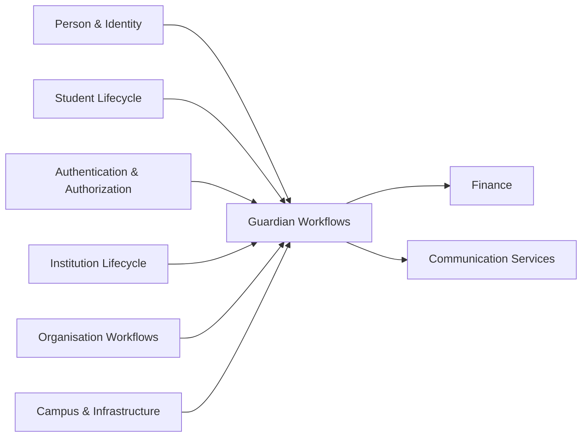

---

# 21.3 Aggregate Structure Diagram

**Purpose**

Illustrates the internal composition of the Guardian Relationship Aggregate.

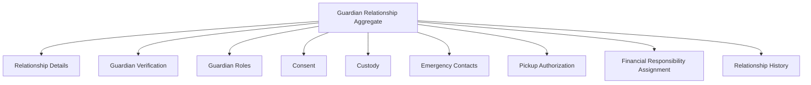

Only the Aggregate Root governs modifications to its internal business components.

---

# 21.4 Aggregate Ownership Model

**Purpose**

Illustrates business ownership boundaries.

```mermaid
flowchart LR

Person((Person))
Student((Student))

GR[Guardian Relationship]

Consent
Custody
Guardian Verification
Communication Authorization
Emergency
Pickup
Financial
Relationship History
Person --> GR
Student --> GR

GR --> Consent
GR --> Custody
GR --> Guardian Verification
GR --> Communication Authorization
GR --> Emergency
GR --> Pickup
GR --> Financial
GR --> Relationship History
```

Guardian Workflows owns the aggregate and all subordinate business concepts.

Person and Student remain externally owned references.

---

# 21.5 Lifecycle State Machine

**Purpose**

Illustrates the canonical lifecycle of a Guardian Relationship.

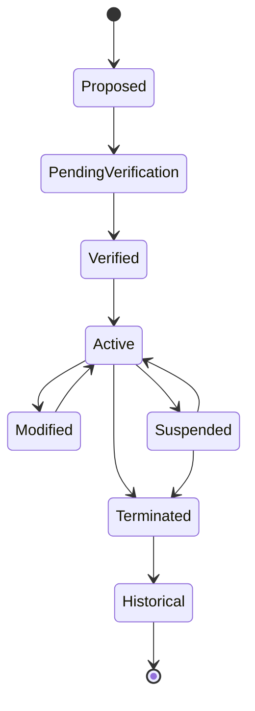

State transitions shall conform to the canonical State Transition Matrix.

---

# 21.6 Domain Event Flow

**Purpose**

Illustrates the publication sequence of major business events.

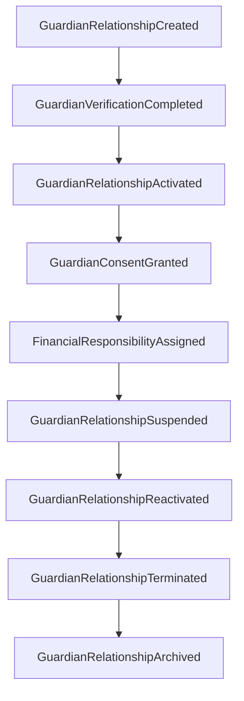

Actual event publication shall remain governed by Section 10.

---

# 21.7 Service Contract Interaction Model

**Purpose**

Illustrates interactions between consumers and the Guardian Workflows Domain.

```mermaid
flowchart LR

Student Admission

Student Lifecycle

Finance Domain

Hostel Domain

Transport Domain

Guardian Portal
GW[Guardian Workflows]

Admission --> GW

StudentAdmin --> GW

Finance --> GW

Hostel --> GW

Transport --> GW

Guardian --> GW
```

External consumers interact only through published Service Contracts.

---

# 21.8 Authorization Decision Flow

**Purpose**

Illustrates business authorization evaluation.

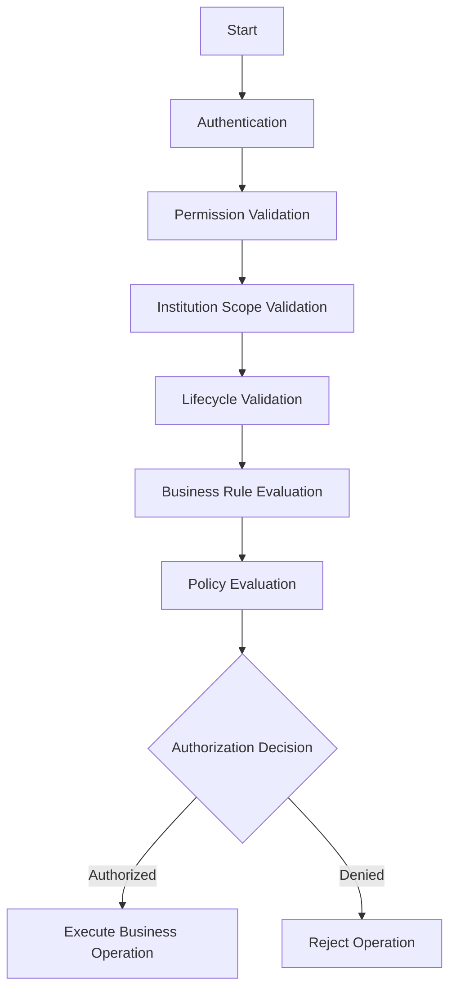

Authentication remains outside the ownership of this domain.

---

# 21.9 Guardian Verification Flow

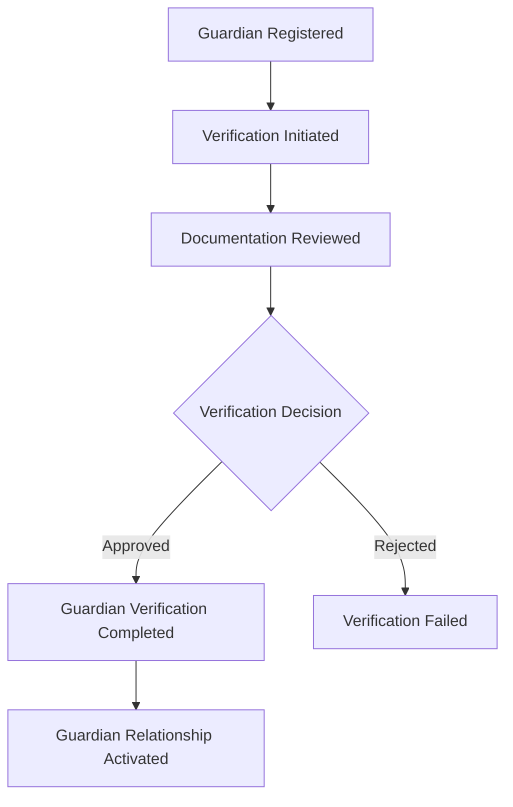

---

# 21.10 Consent Lifecycle

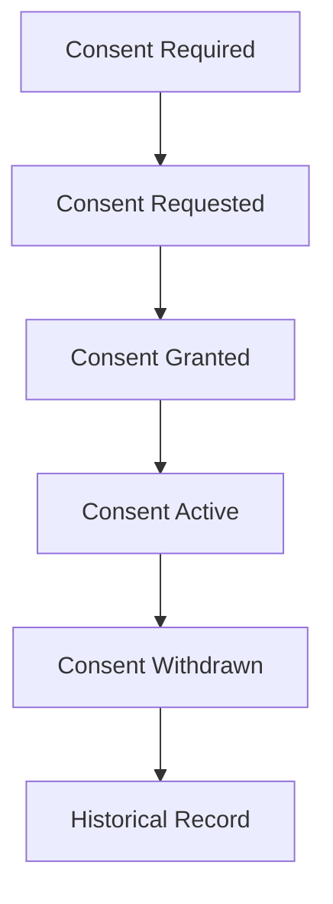

---

# 21.11 Emergency Contact Management

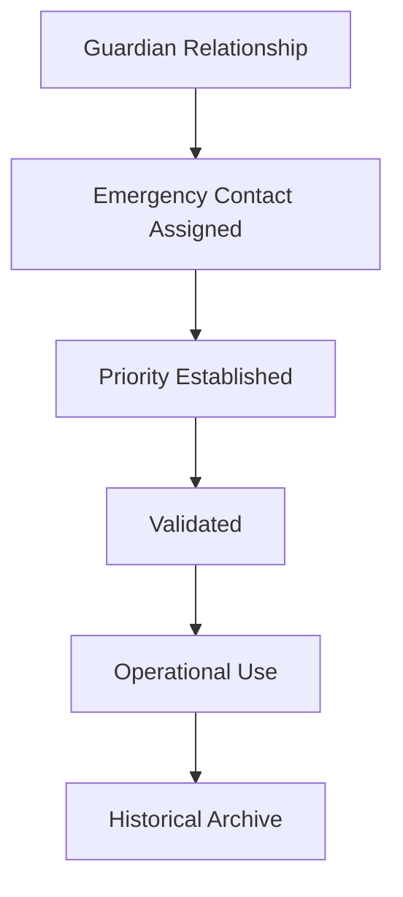

---

# 21.12 Pickup Authorization Model

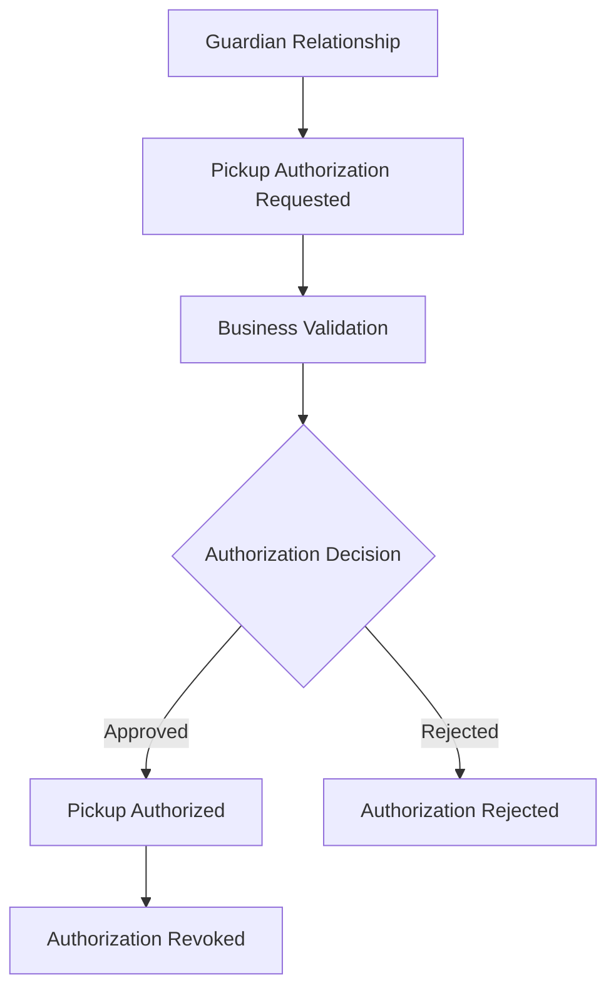

---

# 21.13 Financial Responsibility Assignment

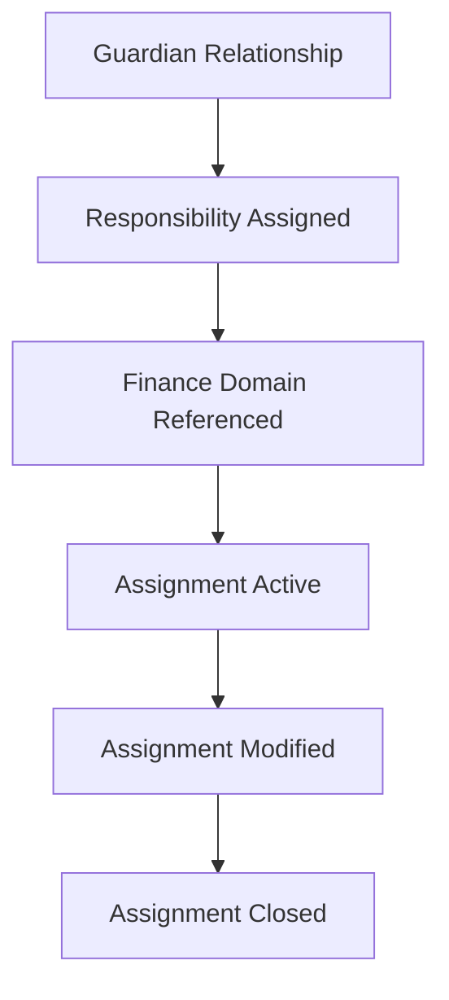

Only the assignment relationship is owned by Guardian Workflows.

Financial processing remains within the Finance Domain.

---

# 21.14 Aggregate Invariant Map

**Purpose**

Illustrates the mandatory invariants protecting aggregate consistency.

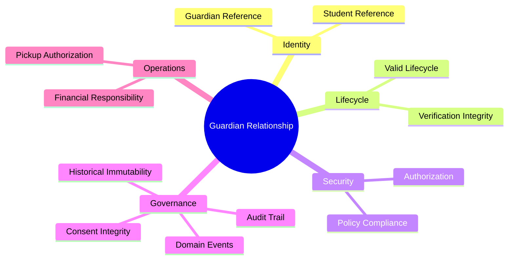

All invariants shall remain satisfied throughout the aggregate lifecycle.

---

# 21.15 Domain Ownership Map

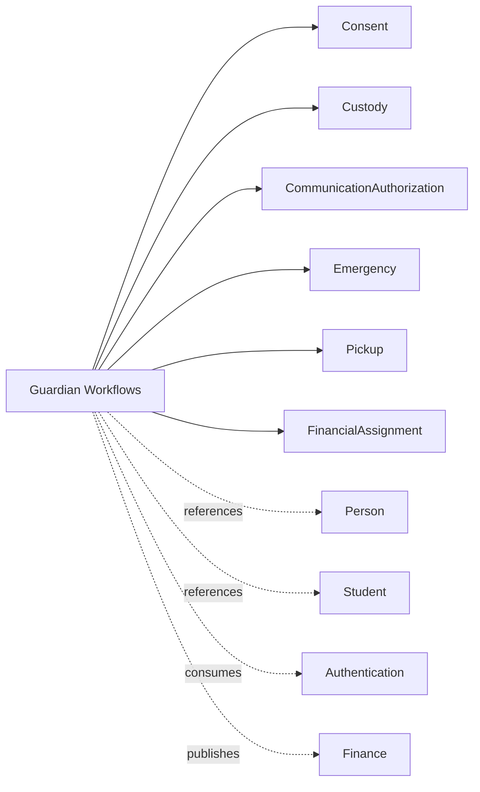

Solid relationships indicate ownership.

Dashed relationships indicate external collaboration.

---

# 21.16 Extension Architecture

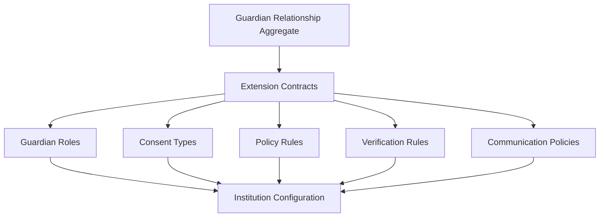

Extensions shall preserve aggregate integrity and canonical contracts.

---

# 21.17 Repository Dependency View

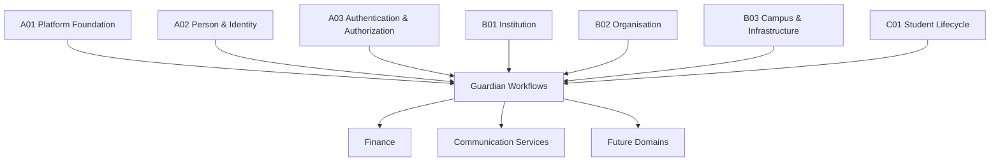

This illustrates the Guardian Workflows Domain as part of the canonical repository dependency graph.

---

# 21.18 Architecture Visual Model Summary

The Architecture Visual Models provide the canonical graphical representation of the Guardian Workflows Domain.

Together, these diagrams define the aggregate structure, lifecycle, ownership boundaries, service interactions, authorization flow, domain event progression, extension architecture, repository dependencies, and bounded-context relationships.

These visual models are normative architectural artifacts and shall remain synchronized with all future revisions of the canonical Guardian Workflows architecture.

# 22. Architecture Decision Records (ADR)

The Architecture Decision Records (ADR) document the significant architectural decisions that define the canonical Guardian Workflows Domain.

Each ADR records the architectural context, decision rationale, alternatives considered, consequences, and governance requirements.

These records provide long-term architectural continuity, prevent design regression, and ensure future evolution remains aligned with the canonical repository.

All ADRs contained within this section are considered normative.

Future architectural changes affecting these decisions shall require an approved repository governance process.

---

# ADR-001

## Title

Guardian Relationship is the Aggregate Root

### Status

Accepted

### Context

Guardian-related business concepts include guardian roles, custody, consent, emergency contacts, pickup authorization, and financial responsibility assignments.

A decision was required regarding aggregate ownership.

### Decision

The Guardian Relationship shall be the sole Aggregate Root of the Guardian Workflows Domain.

All business modifications shall occur through this aggregate.

### Alternatives Considered

- Separate Guardian Aggregate
- Separate Consent Aggregate
- Separate Custody Aggregate
- Shared ownership with Student

### Rationale

A single Aggregate Root preserves transactional consistency, lifecycle integrity, authorization enforcement, and business invariants.

### Consequences

Positive

- Strong consistency
- Clear ownership
- Simplified lifecycle
- Deterministic business behaviour

Negative

- Aggregate requires careful boundary management.

### Governance

Future extensions shall not introduce additional Aggregate Roots.

---

# ADR-002

## Title

Guardian Identity remains outside the domain

### Status

Accepted

### Context

Guardian identity information is shared across multiple domains.

### Decision

Identity ownership remains exclusively within the Person & Identity Domain.

Guardian Workflows stores only authoritative references.

### Alternatives Considered

- Duplicate Guardian identities
- Embed identity inside Guardian Workflows
- Shared ownership

### Rationale

Maintains a single source of truth for identity.

### Consequences

Positive

- Eliminates duplication.
- Preserves identity consistency.
- Simplifies multi-domain integration.

Negative

- Guardian Workflows depends on authoritative identity references.

### Governance

Identity ownership shall never migrate into this domain.

---

# ADR-003

## Title

Consent belongs to Guardian Workflows

### Status

Accepted

### Context

Consent directly governs guardian responsibilities and institutional permissions.

### Decision

Consent ownership shall remain within the Guardian Relationship Aggregate.

### Alternatives Considered

- Separate Consent Domain
- Communication ownership
- Student ownership

### Rationale

Consent is inseparable from the guardian relationship.

### Consequences

Positive

- Unified lifecycle
- Simplified authorization
- Complete audit trail

Negative

- Aggregate contains additional business capabilities.

### Governance

Consent shall not become an independent Aggregate Root.

---

# ADR-004

## Title

Financial Responsibility Assignment remains distinct from Finance

### Status

Accepted

### Context

Guardian Workflows determines **who is financially responsible**, while Finance manages **financial obligations and transactions**.

### Decision

Guardian Workflows owns only the responsibility assignment.

Finance owns all monetary processing.

### Alternatives Considered

- Finance owns responsibility assignment.
- Shared ownership.

### Rationale

Separates business accountability from financial processing.

### Consequences

Positive

- Clear bounded-context ownership.
- Reduced coupling.
- Independent evolution.

Negative

- Requires domain collaboration.

### Governance

No financial transaction logic shall be introduced into Guardian Workflows.

---

# ADR-005

## Title

Lifecycle managed exclusively by Guardian Workflows

### Status

Accepted

### Context

Multiple domains consume Guardian Relationship state.

### Decision

Only Guardian Workflows may perform lifecycle transitions.

### Alternatives Considered

- External lifecycle management.
- Shared lifecycle ownership.

### Rationale

Preserves aggregate consistency.

### Consequences

Positive

- Single authoritative lifecycle.
- Consistent event publication.
- Strong validation.

Negative

- External domains must use published Service Contracts.

### Governance

External domains shall never directly modify Guardian lifecycle state.

---

# ADR-006

## Title

Business Authorization evaluated inside the domain

### Status

Accepted

### Context

Authentication and business authorization represent separate concerns.

### Decision

Authentication remains external.

Business authorization is evaluated by Guardian Workflows.

### Alternatives Considered

- Centralized authorization only.
- External policy evaluation.

### Rationale

Business decisions require aggregate state, lifecycle, and policy awareness.

### Consequences

Positive

- Policy-driven authorization.
- Aggregate protection.
- Consistent governance.

Negative

- Requires collaboration with Authentication & Authorization.

### Governance

Authentication responsibilities shall not migrate into this domain.

---

# ADR-007

## Title

Guardian Workflows publishes business events only

### Status

Accepted

### Context

The domain collaborates with other bounded contexts through Domain Events.

### Decision

Only business-significant events shall be published.

Technical or implementation events are prohibited.

### Alternatives Considered

- Infrastructure events.
- CRUD events.

### Rationale

Maintains event stability and business semantics.

### Consequences

Positive

- Stable integration contracts.
- Lower coupling.
- Business-oriented event model.

Negative

- Requires disciplined event governance.

### Governance

Published Domain Events shall remain backward compatible unless superseded through repository governance.

---

# ADR-008

## Title

Historical records are immutable

### Status

Accepted

### Context

Guardian history forms part of institutional governance and compliance.

### Decision

Historical Guardian Relationships and their audit evidence shall never be modified.

### Alternatives Considered

- Editable history.
- Soft history updates.

### Rationale

Supports legal traceability, audits, and institutional accountability.

### Consequences

Positive

- Complete historical integrity.
- Reliable investigations.
- Regulatory readiness.

Negative

- Corrections require compensating business actions rather than edits.

### Governance

Historical records shall remain immutable for the lifetime of the repository.

---

# ADR Summary

These Architecture Decision Records capture the foundational architectural decisions governing the Guardian Workflows Domain.

Together they establish the aggregate model, ownership boundaries, lifecycle governance, authorization strategy, event publication model, historical integrity, and multi-domain responsibilities.

Future architectural evolution shall preserve these decisions unless explicitly superseded through an approved repository governance process and accompanied by a new Architecture Decision Record.

# 23. Glossary

The Glossary defines the canonical business terminology used throughout the Guardian Workflows Domain.

These definitions establish the ubiquitous language of the domain and shall be used consistently across all repository documents, implementations, integrations, and architectural discussions.

Unless explicitly superseded by a future Architecture Decision Record, these definitions are considered normative.

---

# 23.1 Glossary Principles

The glossary shall:

- Define business terminology unambiguously.
- Align with bounded-context ownership.
- Prevent semantic drift across the repository.
- Preserve consistency between architecture and implementation.
- Distinguish similarly named concepts amulti-domains.

---

# 23.2 Canonical Business Terms

| Term | Canonical Definition | Owned By |
|------|----------------------|----------|
| Guardian Relationship | The authoritative institutional relationship between a Student and a Guardian Person, represented as the Aggregate Root of this domain. | Guardian Workflows |
| Guardian | A Person who has one or more institutional responsibilities toward a Student through a Guardian Relationship. Guardian identity itself is owned by the Person & Identity Domain. | Person & Identity (Identity), Guardian Workflows (Relationship) |
| Student | A Person enrolled or otherwise managed within the Student Lifecycle Domain. | Student Lifecycle |
| Guardian Role | A business responsibility assigned to a Guardian within a Guardian Relationship (e.g., Parent, Legal Guardian, Local Guardian). | Guardian Workflows |
| Custody | Institutional representation of legal or recognized responsibility for a Student. | Guardian Workflows |
| Consent | A recorded business authorization granted or withdrawn by a Guardian for a defined institutional purpose. | Guardian Workflows |
| Emergency Contact | A Guardian designated for emergency communication or action. | Guardian Workflows |
| Pickup Authorization | Institutional authorization permitting a Guardian to collect a Student. | Guardian Workflows |
| Financial Responsibility Assignment | The business assignment identifying which Guardian is responsible for financial obligations. It is not a financial transaction. | Guardian Workflows |
| Verification | The business process confirming that a Guardian Relationship satisfies institutional verification requirements. | Guardian Workflows |

---

# 23.3 Architectural Terms

| Term | Definition |
|------|------------|
| Aggregate | A consistency boundary that enforces business invariants and transactional integrity. |
| Aggregate Root | The only entity through which modifications to the aggregate may occur. |
| Bounded Context | A domain boundary within which business terminology, rules, and ownership remain consistent. |
| Domain Event | A business-significant event representing a completed state change within the domain. |
| Service Contract | A published business capability through which external bounded contexts interact with this domain. |
| Business Rule | A mandatory business constraint governing domain behaviour. |
| Validation Rule | A precondition that must be satisfied before a business operation may execute. |
| Authorization | Business approval to perform an operation after successful authentication. |
| Lifecycle | The ordered progression of a Guardian Relationship through its canonical states. |

---

# 23.4 Lifecycle Terms

| Term | Definition |
|------|------------|
| Proposed | Initial lifecycle state representing a newly established Guardian Relationship before submission for institutional verification. |
| Pending Verification | Initial lifecycle state awaiting successful verification. |
| Verified | Verification completed successfully. |
| Active | Guardian Relationship is fully operational. |
| Modified | Transitional state indicating approved business modifications. |
| Suspended | Relationship is temporarily inactive while remaining recoverable. |
| Terminated | Relationship has permanently concluded. |
| Historical | Immutable archival representation of a completed relationship. |

---

# 23.5 Governance Terms

| Term | Definition |
|------|------------|
| Audit Record | Immutable business evidence of a completed operation. |
| Business Policy | Institution-specific rules that influence business decisions while preserving canonical architecture. |
| Decision Matrix | Canonical evaluation rules used to determine business outcomes. |
| Failure Matrix | Canonical business failure conditions preventing successful execution. |
| Extension Point | An architecturally approved location where future capabilities may be added without violating canonical contracts. |
| Architecture Decision Record (ADR) | A permanent record explaining why a significant architectural decision became canonical. |

---

# 23.6 Explicit Non-Definitions

To prevent ambiguity, the following clarifications apply.

| Term | Explicitly Does Not Mean |
|------|--------------------------|
| Guardian | A user account, login identity, or authentication principal. |
| Guardian Relationship | A family relationship recorded outside institutional context. |
| Financial Responsibility Assignment | Billing, invoicing, payment, accounting, or financial transaction processing. |
| Consent | A legal contract stored independently of the Guardian Relationship Aggregate. |
| Verification | Authentication or identity verification. |
| Authorization | Authentication or permission assignment. |
| Custody | Court-issued legal documentation. The domain records recognized custody status only. |
| Emergency Contact | Notification delivery infrastructure or communication channels. |

These exclusions are normative and prevent overlap with other bounded contexts.

---

# 23.7 Ubiquitous Language Summary

The Glossary establishes the canonical vocabulary for the Guardian Workflows Domain.

All repository documents, Architecture Decision Records, Service Contracts, Domain Events, implementations, integrations, and future architectural extensions shall use these terms consistently to preserve semantic integrity, bounded-context ownership, and long-term maintainability of the SutraERP architecture repository.

# 24. Domain Summary

The Domain Summary consolidates the canonical architectural characteristics of the Guardian Workflows Domain.

It serves as the definitive architectural reference describing the domain's purpose, responsibilities, ownership boundaries, collaboration model, and governing principles.

This summary shall remain consistent with all preceding sections of this document and represents the architectural identity of the Guardian Workflows Domain.

---

# 24.1 Domain Purpose

The Guardian Workflows Domain governs the complete institutional lifecycle of Guardian Relationships.

It establishes, verifies, maintains, authorizes, audits, and retires the business relationships between Students and Guardians while preserving aggregate integrity, institutional policy compliance, and bounded-context ownership.

The domain exists to ensure that guardian-related responsibilities are managed consistently, deterministically, and independently throughout the SutraERP platform.

---

# 24.2 Core Responsibilities

The Guardian Workflows Domain is responsible for:

- Establishing Guardian Relationships.
- Managing Guardian Relationship lifecycles.
- Assigning Guardian Roles.
- Recording and managing Consent.
- Managing Custody information.
- Managing Communication Authorization.
- Managing Emergency Contacts.
- Managing Pickup Authorizations.
- Assigning Financial Responsibility.
- Publishing Guardian business events.
- Enforcing Guardian-specific business rules.
- Maintaining complete audit history.

These responsibilities collectively define the canonical scope of the domain.

---

# 24.3 Domain Ownership

The Guardian Workflows Domain is the authoritative owner of:

| Business Concept |
|------------------|
| Guardian Relationship |
| Guardian Roles |
| Consent |
| Communication Authorization |
| Custody |
| Emergency Contact Assignments |
| Pickup Authorization |
| Financial Responsibility Assignment |
| Guardian Lifecycle |
| Guardian Business Policies |
| Guardian Audit History |

Ownership of these concepts shall not be delegated to another bounded context without an approved Architecture Decision Record.

---

# 24.4 External Dependencies

The Guardian Workflows Domain depends upon the following authoritative domains.

| Domain | Purpose |
|---------|---------|
| Person & Identity | Guardian identity references |
| Student Lifecycle | Student references |
| Authentication & Authorization | Authentication and permission context |
| Institution | Institutional governance |
| Organisation | Organizational context |
| Campus & Infrastructure | Campus context where applicable |

These dependencies provide authoritative information without transferring ownership.

---

# 24.5 Published Capabilities

The Guardian Workflows Domain exposes the following canonical business capabilities.

- Guardian Relationship Management
- Guardian Verification
- Guardian Lifecycle Administration
- Guardian Role Administration
- Consent Management
- Communication Authorization Management
- Custody Management
- Emergency Contact Administration
- Pickup Authorization Management
- Financial Responsibility Assignment
- Guardian Audit Information

These capabilities are exposed exclusively through published Service Contracts.

---

# 24.6 Architectural Characteristics

The Guardian Workflows Domain is characterized by:

- Single Aggregate Root architecture.
- Strong aggregate consistency.
- Explicit bounded-context ownership.
- Deterministic business behaviour.
- Event-driven collaboration.
- Immutable audit history.
- Policy-driven business decisions.
- Technology-independent architecture.
- Controlled extension model.
- Repository-governed evolution.

These characteristics define the architectural identity of the domain.

---

# 24.7 Architectural Constraints

The following constraints are fundamental to the canonical architecture.

The domain shall never:

- Own Guardian identity.
- Own Student identity.
- Authenticate users.
- Process financial transactions.
- Deliver notifications.
- Duplicate ownership of external business concepts.
- Bypass aggregate invariants.
- Bypass authorization evaluation.
- Modify historical records.
- Permit direct modification of aggregate state by external domains.

These constraints preserve bounded-context integrity.

---

# 24.8 Multi-Domain Collaboration

The Guardian Workflows Domain collaborates with external bounded contexts through published Service Contracts and Domain Events.

Collaboration shall always preserve:

- Independent evolution.
- Explicit ownership.
- Loose coupling.
- Stable integration contracts.
- Deterministic business behaviour.
- Canonical business semantics.

No collaboration shall violate aggregate boundaries.

---

# 24.9 Evolution Strategy

Future evolution of the Guardian Workflows Domain shall occur through:

- Approved Extension Points.
- Repository-governed Architecture Decision Records.
- Backward-compatible Service Contract evolution.
- Backward-compatible Domain Event evolution.
- Institution-specific policy extensions.
- Controlled regulatory adaptations.

Fundamental architectural principles defined by this document shall remain stable throughout future evolution.

---

# 24.10 Canonical Architectural Identity

The Guardian Workflows Domain is the authoritative business domain responsible for institutional Guardian Relationships within the SutraERP platform.

Its architecture is founded upon:

- A single Aggregate Root.
- Clear ownership boundaries.
- Deterministic lifecycle management.
- Policy-driven governance.
- Strong business consistency.
- Event-driven collaboration.
- Immutable auditability.
- Long-term architectural stability.

These principles collectively define the permanent architectural identity of the Guardian Workflows Domain.

---

# 24.11 Domain Summary

The Guardian Workflows Domain provides the canonical enterprise architecture for managing Guardian Relationships across the SutraERP platform.

By combining explicit ownership boundaries, aggregate-based consistency, lifecycle governance, business validation, authorization, auditing, extensibility, and repository-governed evolution, the domain establishes a stable and authoritative foundation for all guardian-related institutional operations while maintaining strict alignment with Domain-Driven Design principles and the overall SutraERP enterprise architecture.

# 25. Document Completion & Governance

This section defines the governance model governing the lifecycle of this architecture document.

The Guardian Workflows Domain is part of the canonical SutraERP Architecture Repository.

Once accepted into the repository, this document becomes the authoritative architectural specification for the Guardian Workflows Domain.

All future modifications shall comply with the governance principles defined herein.

---

# 25.1 Repository Status

| Attribute | Value |
|-----------|-------|
| Repository Level | Level 2 (L2) |
| Domain | C06 — Guardian Workflows |
| Document Type | Canonical Domain Architecture |
| Architectural Style | Domain-Driven Design (DDD) |
| Repository Classification | Normative |
| Implementation Independence | Required |

Normative documents define the authoritative architecture and take precedence over implementation-specific documentation.

---

# 25.2 Completion Criteria

This document shall be considered architecturally complete when all of the following conditions are satisfied.

- All mandatory repository sections are present.
- Domain ownership boundaries are fully defined.
- Aggregate boundaries are explicitly documented.
- Business workflows are complete.
- Business rules are internally consistent.
- Domain Events are defined.
- Service Contracts are published.
- State transitions are fully specified.
- Decision, Failure, Validation, Authorization, Audit, Security, Performance, and Extension models are complete.
- Architecture Visual Models are synchronized with the textual architecture.
- Architecture Decision Records are approved.
- Glossary terminology is consistent across the document.

Completion does not imply implementation readiness; it signifies architectural completeness.

---

# 25.3 Change Classification

All future changes shall be classified before implementation.

| Change Type | ADR Required | Backward Compatibility Required |
|--------------|--------------|--------------------------------|
| Typographical correction | No | Yes |
| Clarification of wording | No | Yes |
| Diagram synchronization | No | Yes |
| New business rule | Yes | Evaluate |
| Aggregate boundary modification | Yes | Mandatory Review |
| Lifecycle modification | Yes | Mandatory Review |
| New Domain Event | Yes | Mandatory Review |
| Service Contract modification | Yes | Mandatory Review |
| Ownership boundary modification | Yes | Mandatory Review |
| Security model modification | Yes | Mandatory Review |
| Extension Point modification | Yes | Mandatory Review |

Architectural changes shall not be introduced without proper classification.

---

# 25.4 Mandatory Architecture Review

The following changes require formal architectural review before repository acceptance.

- Aggregate redesign.
- Aggregate Root replacement.
- Ownership boundary changes.
- Lifecycle state modifications.
- Domain Event evolution.
- Service Contract evolution.
- Business Rule modifications affecting canonical behaviour.
- Authorization model changes.
- Audit model changes.
- Security model changes.
- Extension contract changes.

Architectural review shall occur before implementation begins.

---

# 25.5 Architecture Decision Governance

Every significant architectural change shall:

- Record architectural context.
- Evaluate alternative approaches.
- Document the selected decision.
- Explain the architectural rationale.
- Assess long-term consequences.
- Preserve repository traceability.
- Be approved through a new Architecture Decision Record (ADR).

Existing ADRs shall remain immutable.

Architectural evolution shall occur through superseding ADRs rather than modification of historical records.

---

# 25.6 Backward Compatibility Policy

Future revisions shall preserve backward compatibility wherever reasonably possible.

The following artifacts shall be treated as stable architectural contracts.

- Aggregate identity.
- Domain ownership boundaries.
- Published Service Contracts.
- Published Domain Events.
- Canonical lifecycle semantics.
- Business terminology defined in the Glossary.
- Architecture Decision Records.

Any intentional incompatibility shall require explicit repository approval and documented migration guidance.

---

# 25.7 Repository Quality Requirements

Every future revision shall preserve:

- Domain-Driven Design principles.
- Aggregate consistency.
- Bounded-context ownership.
- Deterministic business behaviour.
- Technology independence.
- Auditability.
- Architectural traceability.
- Multi-domain consistency.
- Repository structural consistency.

No revision shall reduce the architectural quality established by this document.

---

# 25.8 Document Ownership

The Guardian Workflows architecture shall remain owned by the SutraERP Architecture Repository.

Ownership of this document includes responsibility for:

- Architectural correctness.
- Repository consistency.
- Multi-domain alignment.
- Canonical terminology.
- ADR governance.
- Long-term architectural evolution.

Implementation teams consume this document but do not redefine it.

---

# 25.9 Repository Compliance Checklist

Before any revision is accepted, the following checklist shall be satisfied.

| Requirement | Status |
|-------------|--------|
| Repository structure preserved | □ |
| Domain ownership preserved | □ |
| Aggregate integrity preserved | □ |
| Business invariants preserved | □ |
| Lifecycle consistency preserved | □ |
| Service Contracts reviewed | □ |
| Domain Events reviewed | □ |
| ADRs updated where required | □ |
| Visual Models synchronized | □ |
| Glossary consistency verified | □ |
| Multi-domain impacts assessed | □ |
| Repository review completed | □ |

Completion of this checklist is mandatory for repository acceptance.

---

# 25.10 Repository Governance Principles

The SutraERP Architecture Repository shall evolve according to the following principles.

- Architecture precedes implementation.
- Repository consistency takes precedence over local optimization.
- Business semantics take precedence over technical convenience.
- Bounded-context ownership shall remain explicit.
- Architectural decisions shall be traceable.
- Historical architectural decisions shall remain preserved.
- Repository evolution shall be deliberate, reviewable, and governed.

These principles apply uniformly across all Level 2 architecture documents.

---

# 25.11 Document Completion Statement

This document constitutes the canonical Level 2 architecture specification for the Guardian Workflows Domain.

It defines the authoritative aggregate model, business capabilities, ownership boundaries, workflows, governance rules, security expectations, extensibility model, and architectural decisions governing Guardian Relationships within the SutraERP platform.

Future architectural evolution shall occur exclusively through the governance processes defined in this section, ensuring long-term consistency, traceability, and architectural integrity across the SutraERP Architecture Repository.

# 26. Appendices

The Appendices provide supplementary reference material supporting the Guardian Workflows Domain architecture.

Appendix content expands, summarizes, or cross-references the canonical architecture defined in this document.

Appendices shall not introduce new architectural responsibilities, ownership boundaries, business rules, or design decisions.

Normative architectural guidance remains exclusively within Sections 1 through 25.

---

# Appendix A — Domain Capability Catalogue

The Guardian Workflows Domain provides the following canonical business capabilities.

| Capability ID | Capability |
|---------------|------------|
| GW-CAP-001 | Guardian Relationship Management |
| GW-CAP-002 | Guardian Verification |
| GW-CAP-003 | Guardian Lifecycle Management |
| GW-CAP-004 | Guardian Role Management |
| GW-CAP-005 | Consent Management |
| GW-CAP-006 | Communication Authorization Management |
| GW-CAP-007 | Custody Management |
| GW-CAP-008 | Emergency Contact Management |
| GW-CAP-009 | Pickup Authorization Management |
| GW-CAP-010 | Financial Responsibility Assignment |
| GW-CAP-011 | Guardian Audit Management |

These capabilities summarize the functional responsibilities of the domain.

---

# Appendix B — Aggregate Ownership Reference

| Business Concept | Owning Domain |
|------------------|---------------|
| Guardian Relationship | Guardian Workflows |
| Guardian Roles | Guardian Workflows |
| Consent | Guardian Workflows |
| Custody | Guardian Workflows |
| Emergency Contact Assignment | Guardian Workflows |
| Pickup Authorization | Guardian Workflows |
| Financial Responsibility Assignment | Guardian Workflows |
| Person Identity | Person & Identity |
| Student Identity | Student Lifecycle |
| Authentication | Authentication & Authorization |
| Financial Transactions | Finance |
| Communication Delivery | Communication Services |

This appendix provides a consolidated ownership reference.

---

# Appendix C — Lifecycle Reference

The canonical Guardian Relationship lifecycle is summarized below.

```text
Proposed
        │
        ▼
Pending Verification
        │
        ▼
Verified
        │
        ▼
Active
        │
        ▼
Modified
        │
        ▼
Active
        │
        ▼
Suspended
        │
        ▼
Active
        │
        ▼
Terminated
        │
        ▼
Historical
```

Refer to Section 12 for the authoritative State Transition Matrix.

---


# Appendix D — Domain Event Catalogue

| Event ID | Domain Event |
|-----------|--------------|
| GDE-001 | GuardianRelationshipCreated |
| GDE-002 | GuardianVerificationCompleted |
| GDE-003 | GuardianRelationshipActivated |
| GDE-004 | GuardianRelationshipUpdated |
| GDE-005 | GuardianRoleChanged |
| GDE-006 | LegalCustodyUpdated |
| GDE-007 | GuardianConsentGranted |
| GDE-008 | GuardianConsentWithdrawn |
| GDE-009 | CommunicationAuthorizationUpdated |
| GDE-010 | EmergencyContactUpdated |
| GDE-011 | FinancialResponsibilityAssigned |
| GDE-012 | PickupAuthorizationUpdated |
| GDE-013 | GuardianRelationshipSuspended |
| GDE-014 | GuardianRelationshipReactivated |
| GDE-015 | GuardianRelationshipTerminated |
| GDE-016 | GuardianRelationshipArchived |
Refer to Section 10 for event definitions.

---

# Appendix E — Service Contract Catalogue

| Service Contract |
|------------------|
| Establish Guardian Relationship |
| Verify Guardian Relationship |
| Activate Guardian Relationship |
| Update Guardian Relationship |
| Update Guardian Roles |
| Record Guardian Consent |
| Update Communication Authorization |
| Update Emergency Contact |
| Assign Financial Responsibility |
| Update Pickup Authorization |
| Suspend Guardian Relationship |
| Reactivate Guardian Relationship |
| Terminate Guardian Relationship |

Refer to Section 11 for complete service contract specifications.

---

# Appendix F — Business Rule Index

| Rule Category | Section |
|---------------|---------|
| Business Rules | Section 9 |
| Validation Rules | Section 15 |
| Authorization Rules | Section 16 |
| Security Rules | Section 18 |

This appendix provides a navigation index rather than duplicating rule definitions.

---

# Appendix G — Cross-Reference Matrix

| Repository Artifact | Reference Section |
|---------------------|-------------------|
| Aggregate Model | Section 6 |
| Domain Workflows | Section 7 |
| Workflow Specifications | Section 8 |
| Business Rules | Section 9 |
| Domain Events | Section 10 |
| Service Contracts | Section 11 |
| State Transition Matrix | Section 12 |
| Decision Matrix | Section 13 |
| Failure Matrix | Section 14 |
| Validation Rules | Section 15 |
| Authorization Model | Section 16 |
| Audit Requirements | Section 17 |
| Security Considerations | Section 18 |
| Performance & Scalability | Section 19 |
| Extension Points | Section 20 |
| Architecture Visual Models | Section 21 |
| Architecture Decision Records | Section 22 |
| Glossary | Section 23 |
| Domain Summary | Section 24 |
| Document Governance | Section 25 |

This matrix serves as a repository navigation aid.

---

# Appendix H — Repository Conformance Checklist

Before implementation or architectural review, verify:

- Domain ownership is preserved.
- Aggregate boundaries remain unchanged.
- Business invariants are maintained.
- Lifecycle semantics are preserved.
- Published Service Contracts remain compatible.
- Published Domain Events remain compatible.
- Business Rules remain internally consistent.
- Authorization model remains aligned with L2-A04.
- Audit requirements remain satisfied.
- Extension Points are respected.
- Architecture Decision Records remain valid.
- Visual Models remain synchronized with the canonical architecture.

This checklist supports implementation reviews and architecture governance.

---

# Appendix I — Future Repository Integration

This document is designed to integrate with future Level 2 and Level 3 repository artifacts, including:

- Student Workflows
- Attendance Management
- Academic Operations
- Examination Management
- Hostel Management
- Transport Management
- Health Centre
- Alumni Management
- Parent Portal
- Analytics & Reporting

Integration shall occur exclusively through published Service Contracts and Domain Events while preserving bounded-context ownership.

---

# Appendix J — Appendix Summary

The appendices provide consolidated reference material supporting the Guardian Workflows Domain architecture.

They offer quick access to capabilities, ownership boundaries, lifecycle references, Domain Events, Service Contracts, rule indexes, repository cross-references, governance checklists, and future integration guidance without introducing additional architectural decisions.

The appendices are informative and complementary. The normative architecture remains fully defined in Sections 1 through 25.