# L2-C07 — Scholarship Eligibility Workflows

| Metadata | Value |
|----------|-------|
| **Document ID** | L2-C07 |
| **Document Title** | Scholarship Eligibility Workflows |
| **Document Owner** | Varad |
| **Architecture Level** | Level 2 — Domain Architecture |
| **Domain** | Student Information System (SIS) |
| **Bounded Context** | Scholarship Eligibility |
| **Architecture Style** | Domain-Driven Design (DDD) |
| **Primary Aggregate** | Student Scholarship Eligibility Record |
| **Authoritative Owner** | Student Information System Domain |
| **Status** | Draft |
| **Version** | 1.0 |

---

# 1. Purpose

The **Scholarship Eligibility** domain establishes the canonical business capability responsible for determining, maintaining, and governing student eligibility for scholarship opportunities throughout the academic lifecycle. It provides a centralized, policy-driven, and auditable framework for evaluating student eligibility against institutional, governmental, private, sponsored, CSR, alumni, research, and externally managed scholarship programs while preserving clear separation from scholarship financial management and disbursement.

This domain enables institutions to define and evaluate scholarship eligibility using configurable eligibility policies, scholarship-specific criteria, institutional regulations, and supporting evidence to produce transparent, explainable, and version-controlled eligibility decisions. Based on these evaluations, the domain identifies scholarship opportunities applicable to individual students, manages reassessment and renewal processes, maintains complete historical traceability, and publishes canonical eligibility outcomes for consumption by downstream business domains.

The Scholarship Eligibility domain serves as the authoritative source of truth for **student scholarship eligibility records** and ensures that every eligibility determination is consistent, reproducible, auditable, and aligned with institutional governance and scholarship provider policies.

The domain is designed to support diverse scholarship ecosystems, including institution-funded scholarships, government scholarship schemes, private foundations, corporate sponsorships, research fellowships, alumni-funded programs, NGO initiatives, and externally administered scholarship providers without requiring architectural changes to the underlying business model.

This domain intentionally excludes scholarship financial allocation, fee concessions, accounting, reimbursement processing, payment execution, budget management, and financial settlement activities. It also does not own external scholarship application processing performed through government or third-party portals, although it may maintain references to externally submitted applications and their published outcomes when such integrations are available.

The primary objectives of this domain are to:

- Establish a single authoritative source for scholarship eligibility determination across the institution.
- Evaluate student eligibility using configurable policy-driven business rules while remaining independent of institution-specific implementation.
- Support multiple scholarship providers through a unified eligibility evaluation framework.
- Generate transparent and explainable scholarship recommendations based on validated eligibility outcomes.
- Manage eligibility reassessment, renewal, expiration, and historical versioning throughout the student's academic journey.
- Enable bulk eligibility evaluation and policy-driven recalculation when scholarship rules or institutional policies change.
- Publish consistent eligibility outcomes and domain events for downstream academic, financial, reporting, workflow, and notification domains.
- Preserve complete auditability, governance, and traceability for every eligibility decision.
- Maintain strict separation between scholarship eligibility determination and scholarship financial processing in accordance with SutraERP Domain-Driven Design principles.

This domain ensures that scholarship eligibility remains a governed institutional capability rather than an isolated operational process, enabling consistent decision-making, regulatory compliance, institutional transparency, and long-term maintainability across the SutraERP platform.
# 2. Scope

## 2.1 In Scope

The Scholarship Eligibility domain is responsible for the complete business lifecycle associated with determining, maintaining, and governing student scholarship eligibility. Its responsibilities include, but are not limited to:

- Management of scholarship definitions and scholarship catalogs available to an institution.
- Registration and lifecycle management of institutional, governmental, private, sponsored, CSR, alumni, research, NGO, and externally managed scholarship opportunities.
- Definition and management of scholarship eligibility policies and eligibility criteria.
- Policy-driven evaluation of student eligibility against scholarship requirements.
- Creation and maintenance of Student Scholarship Eligibility Records.
- Eligibility assessment and eligibility decision management.
- Scholarship recommendation generation based on validated eligibility outcomes.
- Conditional eligibility evaluation and pending eligibility determination.
- Eligibility reassessment following policy changes, student data changes, or authorized reassessment requests.
- Scholarship renewal eligibility evaluation across academic periods.
- Eligibility validity and expiration management.
- Eligibility versioning and historical traceability.
- Eligibility explanation generation and decision transparency.
- Scholarship compatibility and conflict validation based on scholarship policies.
- Bulk eligibility evaluation and policy-driven recalculation.
- Publication of scholarship eligibility outcomes and domain events.
- Recording references to externally submitted scholarship applications and their published statuses where supported.
- Integration with upstream academic, identity, document, and institutional policy domains for eligibility evaluation.

---

## 2.2 Out of Scope

The Scholarship Eligibility domain intentionally excludes responsibilities belonging to other bounded contexts, including:

- Scholarship financial allocation.
- Scholarship amount calculation.
- Scholarship budgeting and fund management.
- Fee concessions and financial adjustments.
- Accounting, ledger posting, reimbursement, and payment processing.
- Scholarship disbursement.
- Financial approval workflows.
- Government reimbursement processing.
- Student financial settlement.
- Document storage and document lifecycle management.
- Identity management.
- Student academic record ownership.
- Admission management.
- External scholarship application processing performed by government or third-party portals.
- External scholarship portal business logic.
- Notification delivery.
- Workflow orchestration owned by the enterprise workflow platform.

---

## 2.3 Domain Responsibilities

The Scholarship Eligibility domain is the authoritative business capability responsible for:

- Maintaining scholarship eligibility definitions.
- Managing scholarship eligibility policies.
- Evaluating student eligibility.
- Producing explainable eligibility decisions.
- Managing scholarship recommendations.
- Managing reassessment workflows.
- Managing renewal eligibility.
- Maintaining eligibility history.
- Publishing canonical eligibility outcomes.
- Providing eligibility information to downstream domains.

---

## 2.4 Domain Ownership Statement

The Scholarship Eligibility domain owns **eligibility determination only**.

Ownership ends once an eligibility outcome has been produced and published.

Subsequent business capabilities including scholarship approval, scholarship allocation, financial processing, payment execution, accounting, reimbursement, and external application processing are owned by their respective bounded contexts.

This ownership boundary ensures strict separation between eligibility evaluation and scholarship financial management while preserving clear Domain-Driven Design ownership across the SutraERP architecture.

# 3. Upstream Dependencies

The Scholarship Eligibility domain consumes authoritative business information from multiple upstream bounded contexts to perform policy-driven eligibility evaluation. Ownership of upstream data always remains within its respective domain. Scholarship Eligibility never duplicates or assumes ownership of information managed elsewhere.

| Upstream Domain | Authoritative Information Consumed | Purpose |
|-----------------|------------------------------------|---------|
| **L2-A02 — Person & Identity** | Student identity, demographic profile, category, disability status, guardian relationships, citizenship, residency, identity attributes | Evaluate identity-based scholarship eligibility criteria. |
| **L2-B01 — Institution Lifecycle** | Institution profile, institutional policies, operational status | Determine institution-specific scholarship availability and governance. |
| **L2-B02 — Organisation Workflows** | Campus, faculty, department, school, organizational hierarchy | Resolve organization-specific scholarship applicability and eligibility constraints. |
| **L2-B03 — Programme Portfolio** | Programme definitions, academic structure, qualification hierarchy, programme offerings | Evaluate programme-specific scholarship eligibility. |
| **L2-C01 — Admissions** | Admission status, admission category, admission quota, admission type, admission cycle | Determine admission-based scholarship eligibility. |
| **L2-C02 — Student Lifecycle** | Student lifecycle status, enrolment status, academic standing, progression status | Validate active student eligibility and lifecycle-dependent scholarship conditions. |
| **L2-C03 — Academic Registration** | Programme registrations, semester registrations, course registrations | Evaluate registration-dependent scholarship requirements. |
| **L2-C04 — Academic Progression** | Academic performance, CGPA, SGPA, credits earned, academic standing, progression decisions | Evaluate merit-based and academic performance scholarship criteria. |
| **L2-C05 — Qualification Completion** | Qualification completion status, qualification completion status, completion outcomes | Determine eligibility for completion-based scholarships and post-completion schemes. |
| **L2-C06 — Guardian Workflows** | Guardian profile, guardian relationship, declared family information | Support scholarships requiring guardian-based eligibility evaluation. |
| **Document Management Domain** | Submitted document references, document verification outcomes, document validity status | Validate documentary evidence required by scholarship policies without owning document lifecycle. |
| **Institution Configuration Domain** | Scholarship policies, configurable eligibility rules, institutional parameters, academic calendars | Apply institution-specific eligibility policies and operational rules. |
| **Hostel & Accommodation Domain** *(where implemented)* | Hostel allocation status, accommodation category, residential information | Evaluate accommodation and hostel-based scholarship eligibility. |
| **Sports & Activities Domain** *(where implemented)* | Sports achievements, extracurricular accomplishments, recognized awards | Evaluate sports and achievement-based scholarship eligibility. |
| **Research Domain** *(where implemented)* | Research enrolment, fellowships, research programme participation | Evaluate research and fellowship scholarship eligibility. |
| **External Scholarship Providers** *(optional integration)* | Published scholarship schemes, eligibility policies, externally published application outcomes | Synchronize externally managed scholarship information where supported. |

---

## Dependency Principles

The Scholarship Eligibility domain shall adhere to the following dependency principles:

- All upstream domains remain the sole authoritative owners of their respective business information.
- Scholarship Eligibility consumes business information but never duplicates ownership of upstream data.
- Eligibility evaluations shall always be performed using the latest valid business information published by upstream domains.
- Upstream business rule changes may trigger eligibility reassessment through published domain events or authorized institutional processes.
- Scholarship Eligibility shall remain resilient to optional upstream integrations by supporting configurable dependency availability.
- Missing upstream information shall be treated as an eligibility validation outcome rather than a system failure wherever business policies permit.

---

## Dependency Constraints

To preserve architectural integrity:

- Scholarship Eligibility shall never directly modify upstream business information.
- Upstream domains shall remain independently deployable and independently governed.
- Dependency relationships shall remain business-oriented rather than implementation-oriented.
- Eligibility calculations shall rely only on authoritative information published by upstream bounded contexts.
- Cross-domain ownership violations are prohibited regardless of implementation architecture.
# 4. Downstream Dependencies

The Scholarship Eligibility domain publishes authoritative eligibility outcomes, scholarship recommendations, reassessment results, renewal decisions, and eligibility events for consumption by downstream bounded contexts. Downstream domains consume these published outcomes while maintaining ownership of their respective business capabilities.

| Downstream Domain | Information Consumed | Purpose |
|-------------------|----------------------|---------|
| **Finance Domain** | Scholarship eligibility decisions, scholarship recommendations, eligibility validity, scholarship references | Perform scholarship financial processing, fee concessions, financial approvals, disbursement, accounting, reimbursement, and payment processing. |
| **Workflow Domain** | Eligibility decisions, reassessment requests, renewal requests, approval requirements, manual intervention events | Orchestrate institutional scholarship workflows, approvals, escalations, and operational processes. |
| **Notification Domain** | Eligibility outcomes, recommendation events, reassessment decisions, renewal reminders, scholarship expiry events | Notify students, guardians, faculty, and administrators regarding scholarship eligibility and lifecycle events. |
| **Reporting & Analytics Domain** | Eligibility records, recommendation statistics, scholarship utilization metrics, historical eligibility outcomes | Produce operational dashboards, institutional reports, regulatory reports, and strategic analytics. |
| **Student Portal** | Scholarship recommendations, eligibility status, eligibility explanations, renewal status, external application references | Present scholarship opportunities and eligibility information to students. |
| **Faculty & Administrative Portal** | Eligibility assessments, reassessment requests, renewal outcomes, audit history | Support institutional scholarship administration and operational oversight. |
| **External Scholarship Providers** *(where integrated)* | Eligibility confirmations, scholarship references, externally synchronized eligibility information | Exchange eligibility information with external scholarship ecosystems where institutional agreements permit. |
| **Integration Platform** | Published domain events, eligibility changes, recommendation events, scholarship lifecycle events | Distribute canonical scholarship eligibility events to enterprise integrations and external systems. |

---

## Published Business Capabilities

The Scholarship Eligibility domain publishes the following business capabilities for downstream consumption:

- Student scholarship eligibility status.
- Scholarship recommendation outcomes.
- Eligibility explanations.
- Eligibility validity information.
- Eligibility reassessment outcomes.
- Scholarship renewal outcomes.
- Eligibility history.
- Scholarship compatibility decisions.
- Published scholarship lifecycle events.
- External scholarship application references and synchronization status (where supported).

---

## Downstream Consumption Principles

The Scholarship Eligibility domain shall adhere to the following principles when publishing business information:

- Scholarship Eligibility remains the single authoritative source for student scholarship eligibility.
- Downstream domains shall consume published eligibility outcomes without independently recalculating eligibility decisions.
- Published eligibility decisions shall be treated as canonical business outcomes.
- Downstream domains may enrich eligibility information with domain-specific data but shall not modify published eligibility decisions.
- Eligibility events shall be published using canonical domain event definitions to ensure enterprise-wide consistency.
- Downstream consumers shall remain loosely coupled to Scholarship Eligibility through published business contracts rather than implementation-specific integrations.

---

## Dependency Constraints

To preserve bounded context ownership:

- Scholarship Eligibility shall not perform downstream financial processing.
- Scholarship Eligibility shall not execute workflow orchestration beyond its own business responsibilities.
- Scholarship Eligibility shall not deliver notifications directly.
- Scholarship Eligibility shall not generate analytical interpretations beyond publishing canonical business information.
- Downstream domains remain independently responsible for their own business decisions after consuming published eligibility outcomes.
# 5. Domain Ownership Boundaries

The Scholarship Eligibility domain is the authoritative bounded context responsible exclusively for determining, governing, and maintaining student scholarship eligibility throughout its complete business lifecycle. Ownership is intentionally limited to eligibility-related business capabilities and explicitly excludes scholarship financial management, external application processing, and business capabilities owned by other domains.

---

## 5.1 Canonical Ownership

The Scholarship Eligibility domain exclusively owns the following business capabilities:

### Scholarship Definition & Availability

- Scholarship registration.
- Scholarship catalogue management.
- Scholarship lifecycle management.
- Scholarship publication and retirement.
- Scholarship categorization.
- Scholarship provider association.
- Scholarship availability within an institution.

---

### Eligibility Management

- Eligibility policy definition.
- Eligibility criteria management.
- Eligibility rule composition.
- Eligibility assessment.
- Eligibility evaluation.
- Eligibility decision generation.
- Conditional eligibility determination.
- Eligibility explanation generation.
- Eligibility validity management.
- Eligibility expiration.
- Eligibility reassessment.
- Eligibility renewal.
- Eligibility history.
- Eligibility version management.

---

### Student Scholarship Eligibility

- Student Scholarship Eligibility Record.
- Student-to-scholarship eligibility association.
- Scholarship recommendation generation.
- Scholarship compatibility validation.
- Scholarship conflict validation.
- Recommendation lifecycle management.

---

### Business Governance

- Scholarship eligibility governance.
- Eligibility auditability.
- Eligibility traceability.
- Eligibility transparency.
- Eligibility decision publication.
- Eligibility event publication.

---

## 5.2 Referenced Business Capabilities

The Scholarship Eligibility domain references—but does not own—the following business information from other bounded contexts:

### Person & Identity

- Student identity.
- Personal profile.
- Demographic information.
- Category.
- Disability information.
- Citizenship.
- Residency.

---

### Student Information

- Admission status.
- Academic programme.
- Registration.
- Academic progression.
- Qualification completion.
- Guardian information.

---

### Institution Management

- Institution profile.
- Campus hierarchy.
- Academic organization.
- Institutional policies.
- Academic calendar.

---

### Supporting Domains

- Verified document references.
- Hostel allocation.
- Sports achievements.
- Research participation.
- External scholarship provider information.

---

## 5.3 Explicitly Excluded Ownership

The Scholarship Eligibility domain shall never own:

### Financial Responsibilities

- Scholarship budgeting.
- Scholarship funding.
- Scholarship allocation.
- Scholarship amount calculation.
- Financial approval.
- Fee concessions.
- Student billing adjustments.
- Accounting.
- Ledger posting.
- Reimbursement.
- Payment processing.
- Financial settlement.

---

### Academic Responsibilities

- Student admission.
- Student registration.
- Academic progression.
- Examination.
- Qualification awarding.
- Student lifecycle management.

---

### Platform Responsibilities

- Identity management.
- Document management.
- Notification delivery.
- Workflow orchestration.
- Authentication.
- Authorization infrastructure.

---

### External Responsibilities

- Government scholarship portal processing.
- Third-party scholarship application processing.
- External approval workflows.
- External payment processing.
- External scholarship lifecycle management.

---

## 5.4 Ownership Principles

The Scholarship Eligibility domain shall adhere to the following ownership principles:

- Scholarship Eligibility is the single authoritative source for all scholarship eligibility decisions.
- Eligibility shall never be recalculated independently by downstream domains.
- Upstream business information shall always remain under the ownership of its originating bounded context.
- Eligibility decisions shall remain explainable, reproducible, and auditable throughout their lifecycle.
- Every reassessment shall preserve historical decision integrity.
- Financial processing shall begin only after canonical eligibility outcomes have been published.
- External scholarship providers remain authoritative for their own application processing while Scholarship Eligibility governs institutional eligibility determination.
- Ownership boundaries shall remain independent of implementation architecture, deployment topology, or integration technology.

---

## 5.5 Ownership Matrix

| Business Capability | Owner |
|---------------------|-------|
| Scholarship Definition | Scholarship Eligibility |
| Scholarship Catalogue | Scholarship Eligibility |
| Scholarship Availability | Scholarship Eligibility |
| Eligibility Policies | Scholarship Eligibility |
| Eligibility Rules | Scholarship Eligibility |
| Eligibility Assessment | Scholarship Eligibility |
| Eligibility Decision | Scholarship Eligibility |
| Student Scholarship Eligibility Record | Scholarship Eligibility |
| Scholarship Recommendation | Scholarship Eligibility |
| Eligibility Renewal | Scholarship Eligibility |
| Eligibility Reassessment | Scholarship Eligibility |
| Eligibility History | Scholarship Eligibility |
| Student Identity | Person & Identity |
| Academic Records | Student Information System |
| Guardian Information | Guardian Workflows |
| Document Lifecycle | Document Management |
| Institution Policies | Institution Management |
| Scholarship Financial Processing | Finance Domain |
| Scholarship Allocation | Finance Domain |
| Scholarship Payment | Finance Domain |
| Accounting & Reimbursement | Finance Domain |
| Workflow Orchestration | Workflow Domain |
| Notification Delivery | Notification Domain |
| External Scholarship Applications | External Scholarship Providers |

# 6. Domain Model / Aggregate / Lifecycle

## 6.1 Domain Overview

The Scholarship Eligibility domain governs the lifecycle of scholarship definitions and student scholarship eligibility by evaluating institutional policies, academic information, eligibility criteria, and supporting evidence to produce transparent, explainable, and auditable eligibility outcomes.

The domain maintains canonical scholarship definitions independently of individual students while managing eligibility through version-controlled Student Scholarship Eligibility Records.

---

## 6.2 Primary Aggregate

### Student Scholarship Eligibility Record

The **Student Scholarship Eligibility Record** is the primary aggregate of this bounded context and represents the complete lifecycle of a student's eligibility for a specific scholarship within a defined institutional and academic context.

The aggregate is responsible for:

- Maintaining student-to-scholarship eligibility relationships.
- Recording eligibility assessments.
- Managing eligibility decisions.
- Maintaining recommendation outcomes.
- Supporting reassessment and renewal.
- Preserving immutable historical versions.
- Publishing canonical eligibility events.

A Student Scholarship Eligibility Record exists independently for each unique combination of:

- Student
- Scholarship
- Institution
- Academic Period

Only one active eligibility record shall exist for the same combination at any point in time.

---

## 6.3 Supporting Aggregates

### Scholarship Definition

Represents the canonical definition of a scholarship offered by an institution or external provider.

Responsibilities include:

- Scholarship identity.
- Scholarship provider association.
- Scholarship category.
- Scholarship availability.
- Eligibility policy association.
- Publication lifecycle.
- Validity period.

A Scholarship Definition exists independently of student eligibility and serves as the reference for all eligibility evaluations.

---

### Eligibility Policy

Represents the business rules governing scholarship eligibility.

Responsibilities include:

- Eligibility criteria.
- Rule composition.
- AND/OR policy groups.
- Conditional eligibility rules.
- Version management.
- Effective dates.
- Policy activation and retirement.

Eligibility Policies may be shared across multiple scholarship definitions.

---

## 6.4 Aggregate Relationships

```
Scholarship Definition
        │
        │ references
        ▼
Eligibility Policy
        │
        │ evaluated against
        ▼
Student Scholarship Eligibility Record
        │
        ├── Eligibility Assessment
        ├── Eligibility Decision
        ├── Recommendation
        ├── Reassessment History
        ├── Renewal History
        └── Version History
```

---

## 6.5 Aggregate Invariants

The following invariants shall always be enforced:

- A Student Scholarship Eligibility Record shall reference exactly one Scholarship Definition.
- A Scholarship Definition may be associated with one or more Eligibility Policies.
- An Eligibility Policy may be reused by multiple Scholarship Definitions.
- Eligibility decisions shall always be derived from the effective Eligibility Policy version.
- Every Student Scholarship Eligibility Record shall permanently reference the exact Eligibility Policy version used to produce each eligibility assessment. Historical policy references shall remain immutable and shall support complete assessment replay and audit reconstruction.
- Recommendations shall never exist without a completed eligibility decision.
- Recommendations shall remain valid only while the associated Scholarship Definition is Active and the corresponding Student Scholarship Eligibility Record remains in an Eligible state. Any lifecycle transition that invalidates eligibility shall withdraw or invalidate the associated recommendation through the appropriate business workflow.
- Historical eligibility versions shall be immutable.
- Renewals shall create new historical versions rather than modifying previous assessments.
- Archived eligibility records shall remain available for audit purposes.

---

## 6.6 Scholarship Definition Lifecycle

```
Draft
   │
   ▼
Published
   │
   ▼
Active
   │
   ├────────► Suspended
   │               │
   │               ▼
   └────────────► Active
   │
   ▼
Expired
   │
   ▼
Archived
```

### Eligibility Policy Lifecycle

Draft
   │
   ▼
Active
   │
   ▼
Retired
   │
   ▼
Archived

---

## 6.7 Student Scholarship Eligibility Lifecycle

```
Created
   │
   ▼
Assessment Pending
   │
   ▼
Under Evaluation
   ├────────► Conditionally Eligible
   │                 │
   │                 ▼
   │          Re-evaluate
   │                 │
   ▼                 │
Eligible ◄───────────┘
   │
   ▼
Recommendation Generated
   │
   ▼
Active
   ├────────► Reassessment
   ├────────► Renewal
   ├────────► Expired
   └────────► Archived

Under Evaluation
   │
   ▼
Not Eligible

```

---

## 6.8 Lifecycle Principles

- Scholarship Definitions shall exist independently of student eligibility.
- Eligibility Records shall always reference published Scholarship Definitions.
- Eligibility evaluations shall remain reproducible using the policy version effective at the time of assessment.
- Every reassessment and renewal shall preserve historical integrity through immutable versioning.
- Aggregate consistency shall be maintained entirely within this bounded context.

# 7. Domain Workflows

The Scholarship Eligibility domain governs the complete business lifecycle of scholarship eligibility, from scholarship publication through eligibility determination, recommendation generation, reassessment, renewal, and archival. The following workflows collectively define the operational behavior of the bounded context.

---

## DW-01 — Scholarship Definition & Publication

**Purpose**

Establish and publish scholarship definitions that become available for eligibility evaluation.

**Outcome**

Published scholarship definitions become available for student eligibility assessment.

---

## DW-02 — Eligibility Policy Management

**Purpose**

Create, version, activate, modify, suspend, and retire scholarship eligibility policies.

**Outcome**

Approved eligibility policies become available for scholarship eligibility evaluation.

---

## DW-03 — Student Eligibility Assessment

**Purpose**

Evaluate an individual student's eligibility against one or more scholarship definitions using the applicable eligibility policies.

**Outcome**

A Student Scholarship Eligibility Record is created or updated with an explainable eligibility decision.

---

## DW-04 — Scholarship Recommendation Generation

**Purpose**

Generate scholarship recommendations for students based on validated eligibility outcomes.

The domain recommends every scholarship for which the student is eligible. It does not rank or prioritize recommendations.

**Outcome**

Eligible scholarship recommendations become available for downstream consumption.

---

## DW-05 — Conditional Eligibility Processing

**Purpose**

Manage eligibility assessments that cannot yet reach a final decision due to missing documents, pending verification, or unresolved eligibility conditions.

**Outcome**

Eligibility remains in a conditional state until all required conditions are satisfied or the assessment expires.
If required conditions remain unresolved beyond the applicable institutional or scholarship deadline, the conditional eligibility assessment shall transition to a final Not Eligible or Expired outcome according to the governing Eligibility Policy while preserving complete historical traceability.

---

## DW-06 — Eligibility Reassessment

**Purpose**

Re-evaluate previously assessed eligibility following changes to student information, institutional policies, scholarship rules, or authorized reassessment requests.

**Outcome**

A new immutable eligibility assessment version is produced while preserving complete historical traceability.

---

## DW-07 — Scholarship Renewal Evaluation

**Purpose**

Determine continued eligibility for renewable scholarships across academic periods or renewal cycles.

**Outcome**

Renewal eligibility is approved, conditionally approved, or rejected while preserving historical renewal records.

---

## DW-08 — Eligibility Expiration & Archival

**Purpose**

Manage the expiration, retirement, and archival of eligibility records according to scholarship validity periods and institutional retention policies.

**Outcome**

Expired eligibility records are archived without loss of historical information.

---

## DW-09 — External Scholarship Synchronization *(Optional)*

**Purpose**

Synchronize scholarship information, eligibility references, and externally published application outcomes with supported external scholarship providers.

External scholarship processing remains outside the ownership of this domain.

**Outcome**

Institutional eligibility information remains synchronized with supported external scholarship ecosystems.

---

## DW-10 — Bulk Eligibility Recalculation

**Purpose**

Recalculate scholarship eligibility for groups of students following policy revisions, academic changes, institutional configuration updates, or authorized administrative requests.

**Outcome**

Updated eligibility assessments and recommendations are published while preserving historical assessment versions.

---

## Workflow Principles

All domain workflows shall adhere to the following principles:

- Every workflow shall produce auditable business outcomes.
- Eligibility decisions shall remain explainable and reproducible.
- Historical eligibility assessments shall be immutable.
- Reassessment and renewal shall create new versions rather than overwrite historical records.
- Scholarship recommendations shall always originate from completed eligibility assessments.
- Workflow execution shall preserve bounded context ownership.
- Business events generated by workflows shall be published for downstream consumption.
- Workflow behavior shall remain independent of implementation technology and deployment architecture.

# 8. Workflow Specifications

This section defines the canonical business specifications for each workflow owned by the Scholarship Eligibility domain. These specifications describe the business intent, participating actors, triggering conditions, expected outcomes, and published business events while remaining implementation independent.

---

# WS-01 — Scholarship Definition & Publication

## Purpose

Register, manage, publish, update, suspend, retire, and archive scholarship definitions available for eligibility evaluation.

## Primary Actors

- Scholarship Administrator
- Institution Administrator

## Trigger

- New scholarship created.
- Existing scholarship modified.
- Scholarship lifecycle transition requested.

## Preconditions

- Scholarship information is complete.
- Scholarship provider is identified.
- Eligibility policy is associated.
- Institution authorization is valid.

## Business Flow

1. Register or update scholarship definition.
2. Associate scholarship provider.
3. Associate eligibility policy.
4. Validate scholarship configuration.
5. Publish or update scholarship.
6. Publish scholarship lifecycle event.

## Postconditions

- Scholarship becomes available for eligibility evaluation.
- Scholarship lifecycle state is updated.
- Audit history is preserved.

## Published Events

- ScholarshipCreated
- ScholarshipUpdated
- ScholarshipPublished
- ScholarshipSuspended
- ScholarshipArchived

---

# WS-02 — Eligibility Policy Management

## Purpose

Manage configurable eligibility policies governing scholarship qualification.

## Primary Actors

- Scholarship Administrator
- Policy Administrator

## Trigger

- Policy creation.
- Policy modification.
- Policy activation.
- Policy retirement.

## Preconditions

- Policy definition is complete.
- Rule groups are valid.
- Effective period is defined.

## Business Flow

1. Create or update policy.
2. Configure eligibility criteria.
3. Define logical rule groups.
4. Validate policy.
5. Activate policy version.
6. Publish policy event.

## Postconditions

- Policy becomes available for eligibility evaluation.
- Previous versions remain historically available.

## Published Events

- EligibilityPolicyCreated
- EligibilityPolicyUpdated
- EligibilityPolicyActivated
- EligibilityPolicyRetired

---

# WS-03 — Student Eligibility Assessment

## Purpose

Determine whether a student satisfies scholarship eligibility requirements.

## Primary Actors

- Eligibility Engine
- Scholarship Administrator

## Trigger

- Student evaluation requested.
- Student information changes.
- Manual eligibility assessment.

## Preconditions

- Published scholarship exists.
- Active eligibility policy exists.
- Required student information is available.

## Business Flow

1. Retrieve scholarship definition.
2. Retrieve applicable eligibility policy.
3. Evaluate student information.
4. Evaluate eligibility rules.
5. Produce explainable decision.
6. Create a new Student Scholarship Eligibility Record or a new immutable historical version of the existing eligibility record, as applicable, and update the active eligibility version reference where required.
7. Publish eligibility outcome.

## Postconditions

- Eligibility decision recorded.
- Assessment explanation stored.
- Historical version preserved.

## Published Events

- EligibilityAssessmentStarted
- EligibilityCalculated
- EligibilityGranted
- EligibilityRejected
- EligibilityConditionallyGranted

---

# WS-04 — Scholarship Recommendation Generation

## Purpose

Generate scholarship recommendations from validated eligibility outcomes.

## Primary Actors

- Eligibility Engine

## Trigger

- Successful eligibility assessment.
- Bulk eligibility recalculation.

## Preconditions

- Student is eligible.
- Scholarship is active.

## Business Flow

1. Identify eligible scholarships.
2. Generate recommendation records.
3. Associate recommendations with eligibility records.
4. Publish recommendation events.

## Postconditions

- Student receives all applicable recommendations.
- No recommendation ranking is performed.

## Published Events

- RecommendationGenerated
- RecommendationWithdrawn

---

# WS-05 — Conditional Eligibility Processing

## Purpose

Manage eligibility requiring additional evidence before final determination.

## Primary Actors

- Eligibility Engine
- Scholarship Administrator

## Trigger

- Missing document.
- Pending verification.
- Outstanding condition.

## Preconditions

- Assessment cannot reach final decision.

## Business Flow

1. Detect pending condition.
2. Record conditional eligibility.
3. Await required information.
4. Re-evaluate when condition is resolved.

## Postconditions

- Eligibility becomes Eligible or Not Eligible.
- Conditional history preserved.

## Published Events

- ConditionalEligibilityAssigned
- ConditionalEligibilityResolved

---

# WS-06 — Eligibility Reassessment

## Purpose

Recalculate eligibility following business changes.

## Primary Actors

- Eligibility Engine
- Scholarship Administrator

## Trigger

- Policy change.
- Student information update.
- Manual reassessment request.

## Preconditions

- Existing eligibility record exists.

## Business Flow

1. Retrieve previous assessment.
2. Load latest policy.
3. Re-evaluate eligibility.
4. Create new eligibility version.
5. Publish updated outcome.

## Postconditions

- Historical assessment retained.
- New assessment becomes active.

## Published Events

- EligibilityReassessmentStarted
- EligibilityRecalculated
- EligibilityChanged

---

# WS-07 — Scholarship Renewal Evaluation

## Purpose

Determine continued eligibility for renewable scholarships.

## Primary Actors

- Eligibility Engine

## Trigger

- Renewal period begins.
- Renewal requested.

## Preconditions

- Scholarship supports renewal.
- Existing eligibility exists.

## Business Flow

1. Retrieve previous eligibility.
2. Evaluate renewal policy.
3. Produce renewal decision.
4. Create renewal version.
5. Publish renewal outcome.

## Postconditions

- Renewal decision recorded.
- Renewal history preserved.

## Published Events

- RenewalAssessmentStarted
- RenewalApproved
- RenewalRejected
- RenewalCompleted

---

# WS-08 — Eligibility Expiration & Archival

## Purpose

Retire expired eligibility while preserving history.

## Primary Actors

- Eligibility Engine

## Trigger

- Validity period expires.
- Administrative archival.

## Preconditions

- Eligibility no longer active.

## Business Flow

1. Identify expired eligibility.
2. Mark eligibility expired.
3. Archive record.
4. Publish archival event.

## Postconditions

- Eligibility becomes inactive.
- Historical information remains immutable.

## Published Events

- EligibilityExpired
- EligibilityArchived

---

# WS-09 — External Scholarship Synchronization

## Purpose

Synchronize eligibility references with supported external scholarship providers.

## Primary Actors

- Integration Platform

## Trigger

- Scheduled synchronization.
- External status update.

## Preconditions

- Integration is configured.

## Business Flow

1. Retrieve external updates.
2. Validate external reference.
3. Update synchronization status.
4. Publish synchronization event.

## Postconditions

- External references remain synchronized.
- External processing ownership remains unchanged.

## Published Events

- ExternalScholarshipSynchronized
- ExternalStatusUpdated

---

# WS-10 — Bulk Eligibility Recalculation

## Purpose

Recalculate eligibility for multiple students following institutional or policy changes.

## Primary Actors

- Eligibility Engine
- Scholarship Administrator

## Trigger

- Policy revision.
- Administrative request.
- Institutional rule change.

## Preconditions

- Recalculation request approved.
- Approval shall be obtained only where institutional governance requires manual authorization. System-initiated recalculations triggered by approved policy activation, scheduled renewal cycles, or authorized system processes may execute without additional manual approval while remaining fully auditable.

## Business Flow

1. Identify affected students.
2. Execute bulk eligibility evaluation.
3. Generate updated eligibility decisions.
4. Publish updated recommendations.
5. Publish bulk completion event.

## Postconditions

- Updated eligibility outcomes become active.
- Previous versions remain available for audit.

## Published Events

- BulkEligibilityEvaluationStarted
- BulkEligibilityEvaluationCompleted
- BulkRecommendationsGenerated

# 9. Business Rules

The following business rules govern all eligibility determination, recommendation, reassessment, renewal, and lifecycle management activities within the Scholarship Eligibility domain. These rules are mandatory unless explicitly superseded by institution-specific policies supported through configurable eligibility rules.

---

## BR-001 — Scholarship Availability

Only scholarships in an **Active** lifecycle state shall be considered for eligibility evaluation and recommendation.

---

## BR-002 — Published Eligibility Policy

Every scholarship shall reference at least one published and active Eligibility Policy before eligibility evaluation can occur.

---

## BR-003 — Single Active Eligibility Record

Only one active **Student Scholarship Eligibility Record** shall exist for the same:

- Student
- Scholarship
- Institution
- Academic Period

at any given time.

---

## BR-004 — Explainable Decisions

Every eligibility decision shall include sufficient information to explain how the outcome was determined.

Eligibility decisions shall never be opaque.

---

## BR-005 — Canonical Eligibility Ownership

Scholarship Eligibility is the sole authoritative source for eligibility decisions.

Downstream domains shall not independently determine scholarship eligibility.

---

## BR-006 — Recommendation Dependency

Scholarship recommendations shall only be generated from completed eligibility assessments.

Recommendations shall never exist independently of eligibility.

---

## BR-007 — No Recommendation Ranking

The domain shall recommend all scholarships for which the student is eligible.

Recommendation prioritization or ranking is outside the scope of this domain.

---

## BR-008 — Conditional Eligibility

Eligibility may remain in a conditional state while mandatory requirements remain unresolved.

Conditional eligibility shall not be treated as Eligible or Not Eligible.

---

## BR-009 — Immutable History

Historical eligibility assessments shall never be modified or deleted.

Every reassessment shall produce a new immutable historical version.

---

## BR-010 — Policy Version Preservation

Eligibility assessments shall always reference the exact Eligibility Policy version used during evaluation.

Historical assessments shall remain reproducible even after policy changes.

---

## BR-011 — Reassessment

Eligibility reassessment may occur when:

- Student information changes.
- Eligibility policies change.
- Scholarship definitions change.
- Institution policies change.
- Authorized reassessment is requested.

---

## BR-012 — Renewal

Renewable scholarships shall undergo renewal eligibility evaluation before entering a new renewal period.

Renewal assessments shall preserve complete historical continuity.

---

## BR-013 — Eligibility Expiration

Eligibility shall expire according to scholarship validity rules or institutional policy.

Expired eligibility shall not participate in future recommendations until reassessed.

---

## BR-014 — Scholarship Conflicts

Where scholarship policies define mutually exclusive scholarships, conflict validation shall occur before recommendation publication.

Conflict evaluation governs eligibility compatibility only.

Scholarship compatibility validation shall be performed during recommendation generation after eligibility determination has completed and before recommendations are published.

Financial allocation decisions remain outside this domain.

---

## BR-015 — Missing Information

Missing required business information shall prevent a final eligibility decision unless explicitly permitted by the associated Eligibility Policy.

---

## BR-016 — Document Verification

Where scholarship policies require supporting documentation, eligibility evaluation shall consider only verified document outcomes.

Document ownership remains within the Document Management domain.

---

## BR-017 — External Scholarship References

External scholarship application references may be associated with eligibility records.

External application processing shall remain outside this domain.

---

## BR-018 — Bulk Recalculation

Bulk eligibility recalculation shall preserve historical eligibility versions and shall not overwrite previously published assessments.

---

## BR-019 — Auditability

Every business action affecting scholarship eligibility shall produce a complete audit trail.

---

## BR-020 — Event Publication

Every significant business outcome shall publish canonical domain events for downstream bounded contexts.

---

## BR-021 — Authorization

Only authorized actors shall create, modify, reassess, renew, suspend, publish, or archive scholarship definitions and eligibility policies.

---

## BR-022 — Policy Configuration

Eligibility Policies may contain nested logical rule groups using configurable AND / OR evaluation semantics.

---

## BR-023 — Policy Activation

Only one active version of an Eligibility Policy shall govern eligibility evaluation at a given point in time.

Eligibility assessments already in progress shall complete using the Eligibility Policy version under which evaluation began. Newly initiated assessments shall use the newly activated policy version.


Superseded policy versions shall remain available for historical assessment replay.

---

## BR-024 — Scholarship Lifecycle Integrity

Scholarship lifecycle transitions shall follow approved lifecycle states.

Direct transitions that violate the defined lifecycle model are prohibited.

---

## BR-025 — Eligibility Integrity

Eligibility decisions shall always be derived from authoritative upstream business information.

Locally modified or manually overridden upstream data shall never become the basis of eligibility evaluation.

---

## BR-026 — Soft Deletion Prohibited

Scholarship Definitions, Eligibility Policies, and Student Scholarship Eligibility Records shall be archived rather than permanently deleted whenever historical retention is required.

---

## BR-027 — Institutional Isolation

Eligibility evaluation shall occur only within the context of the owning institution and its applicable scholarship policies.

Cross-institution eligibility leakage is prohibited.

---

## BR-028 — Business Rule Governance

Institution-specific eligibility rules may extend the evaluation model but shall not violate canonical architectural ownership or domain invariants defined by the Scholarship Eligibility bounded context.

# 10. Domain Events

The Scholarship Eligibility domain publishes canonical business events representing significant business state changes within the bounded context. These events enable downstream domains to react to scholarship eligibility changes while preserving loose coupling and bounded context autonomy.

Domain events represent completed business facts and shall remain immutable once published.

---

# 10.1 Scholarship Lifecycle Events

| Event | Description | Published When |
|--------|-------------|----------------|
| ScholarshipCreated | A new scholarship definition is registered. | Scholarship definition is successfully created. |
| ScholarshipUpdated | Scholarship definition is modified. | Scholarship information is updated. |
| ScholarshipPublished | Scholarship becomes available for eligibility evaluation. | Scholarship enters the Published state. |
| ScholarshipActivated | Scholarship becomes operational. | Scholarship enters the Active state. |
| ScholarshipSuspended | Scholarship is temporarily unavailable. | Scholarship is suspended. |
| ScholarshipExpired | Scholarship validity period ends. | Scholarship expires. |
| ScholarshipArchived | Scholarship is archived. | Scholarship lifecycle completes. |

---

# 10.2 Eligibility Policy Events

| Event | Description | Published When |
|--------|-------------|----------------|
| EligibilityPolicyCreated | New eligibility policy created. | Policy registration completes. |
| EligibilityPolicyUpdated | Policy definition modified. | Policy changes are saved. |
| EligibilityPolicyActivated | Policy becomes active. | Policy activation completes. |
| EligibilityPolicyRetired | Policy is retired. | Policy lifecycle ends. |

---

# 10.3 Eligibility Assessment Events

| Event | Description | Published When |
|--------|-------------|----------------|
| EligibilityAssessmentStarted | Eligibility evaluation begins. | Assessment initiated. |
| EligibilityCalculated | Eligibility calculation completed. | Rule evaluation finishes. |
| EligibilityGranted | Student satisfies scholarship requirements. | Eligibility decision is Eligible. |
| EligibilityRejected | Student fails eligibility requirements. | Eligibility decision is Not Eligible. |
| EligibilityConditionallyGranted | Eligibility remains conditional. | Additional conditions remain unresolved. |
| EligibilityExpired | Eligibility validity ends. | Eligibility expires. |
| EligibilityArchived | Eligibility record archived. | Eligibility lifecycle completes. |

---

# 10.4 Recommendation Events

| Event | Description | Published When |
|--------|-------------|----------------|
| RecommendationGenerated | Scholarship recommendation created. | Eligible scholarship identified. |
| RecommendationWithdrawn | Recommendation withdrawn. | Recommendation no longer valid. |

---

# 10.5 Reassessment & Renewal Events

| Event | Description | Published When |
|--------|-------------|----------------|
| EligibilityReassessmentStarted | Reassessment initiated. | Reassessment requested. |
| EligibilityRecalculated | Reassessment completed. | Updated assessment generated. |
| EligibilityChanged | Eligibility outcome changed. | Reassessment changes decision. |
| RenewalAssessmentStarted | Renewal evaluation begins. | Renewal initiated. |
| RenewalApproved | Scholarship renewed. | Renewal eligibility approved. |
| RenewalRejected | Renewal denied. | Renewal evaluation rejected. |
| RenewalCompleted | Renewal workflow completed. | Renewal finalized. |

---

# 10.6 Bulk Processing Events

| Event | Description | Published When |
|--------|-------------|----------------|
| BulkEligibilityEvaluationStarted | Bulk evaluation begins. | Bulk process initiated. |
| BulkEligibilityEvaluationCompleted | Bulk evaluation completes. | Bulk processing finishes. |
| BulkRecommendationsGenerated | Bulk recommendations published. | Recommendation generation completes. |

---

# 10.7 External Synchronization Events

| Event | Description | Published When |
|--------|-------------|----------------|
| ExternalScholarshipSynchronized | Scholarship information synchronized with an external provider. | Synchronization succeeds. |
| ExternalStatusUpdated | External application reference status updated. | External provider publishes a new status. |

---

## Event Publishing Principles

The Scholarship Eligibility domain shall publish events according to the following principles:

- Events represent completed business facts.
- Published events are immutable.
- Every event shall originate from a successfully completed business transaction.
- Events shall be published only after the corresponding business transaction has been successfully committed, ensuring that downstream consumers never observe business facts that were subsequently rolled back.
- Events shall never expose implementation-specific information.
- Events shall preserve bounded context ownership.
- Event publication shall not transfer business ownership to downstream domains.
- Downstream domains shall treat published events as notifications of business state changes rather than requests for ownership transfer.

---

## Event Consumption Principles

Consumers of Scholarship Eligibility domain events shall adhere to the following principles:

- Consumers shall not modify Scholarship Eligibility business state directly.
- Consumers may enrich published information using their own domain data.
- Consumers shall maintain independent business ownership after event consumption.
- Event replay shall reproduce historical business outcomes without altering previously published events.
- Event processing failures in downstream systems shall not invalidate published business events.

# 11. Service Contracts

The Scholarship Eligibility domain exposes a set of canonical business service contracts that enable other bounded contexts to consume scholarship eligibility capabilities while preserving bounded context ownership and implementation independence.

These contracts define **what business capability is provided**, not **how it is implemented**.

---

## SC-01 — Scholarship Definition Management

### Purpose

Manage the complete lifecycle of scholarship definitions.

### Business Capability

- Register scholarship definitions.
- Update scholarship information.
- Publish scholarships.
- Suspend scholarships.
- Archive scholarships.

### Consumers

- Institution Administration
- Scholarship Administration

---

## SC-02 — Eligibility Policy Management

### Purpose

Manage scholarship eligibility policies and rule definitions.

### Business Capability

- Create eligibility policies.
- Modify eligibility policies.
- Activate policy versions.
- Retire policy versions.
- Validate policy consistency.

### Consumers

- Scholarship Administration
- Institution Administration

---

## SC-03 — Student Eligibility Assessment

### Purpose

Evaluate scholarship eligibility for an individual student.

### Business Capability

- Evaluate eligibility.
- Produce explainable eligibility decisions.
- Create Student Scholarship Eligibility Records.
- Publish eligibility outcomes.

### Consumers

- Student Services
- Workflow Domain
- Administrative Users

---

## SC-04 — Scholarship Recommendation

### Purpose

Generate scholarship recommendations based on validated eligibility outcomes.

### Business Capability

- Discover eligible scholarships.
- Generate recommendations.
- Withdraw obsolete recommendations.

### Consumers

- Student Portal
- Workflow Domain

---

## SC-05 — Eligibility Reassessment

### Purpose

Reassess previously evaluated scholarship eligibility.

### Business Capability

- Trigger reassessment.
- Generate new eligibility versions.
- Preserve historical assessments.

### Consumers

- Workflow Domain
- Administrative Users

---

## SC-06 — Scholarship Renewal

### Purpose

Evaluate renewal eligibility for renewable scholarships.

### Business Capability

- Evaluate renewal conditions.
- Produce renewal decisions.
- Maintain renewal history.

### Consumers

- Workflow Domain
- Scholarship Administration

---

## SC-07 — Eligibility Inquiry

### Purpose

Provide authoritative scholarship eligibility information.

### Business Capability

- Retrieve eligibility status.
- Retrieve eligibility explanation.
- Retrieve eligibility history.
- Retrieve recommendation information.

The Eligibility Inquiry service contract provides read-only access to canonical scholarship eligibility information. Consumers shall not modify business state through this service.

### Consumers

- Student Portal
- Administrative Portal
- Reporting Domain
- Finance Domain

---

## SC-08 — Bulk Eligibility Processing

### Purpose

Perform institution-wide eligibility evaluation following policy or academic changes.

### Business Capability

- Bulk eligibility assessment.
- Bulk recommendation generation.
- Bulk reassessment.

### Consumers

- Scholarship Administration
- Institution Administration

---

## SC-09 — External Scholarship Synchronization

### Purpose

Maintain scholarship eligibility references with supported external scholarship providers.

### Business Capability

- Synchronize external references.
- Update synchronization status.
- Record externally published outcomes.

### Consumers

- Integration Platform

---

## Service Contract Principles

All Scholarship Eligibility service contracts shall comply with the following principles:

- Service contracts represent business capabilities rather than technical interfaces.
- Business ownership remains exclusively within the Scholarship Eligibility bounded context.
- Service contracts shall remain implementation independent.
- Consumers shall rely only on published business capabilities.
- Service contracts shall preserve canonical business rules and domain invariants.
- Service contracts shall remain stable as implementation technologies evolve.
- Cross-domain interactions shall respect bounded context ownership and published business contracts.

---

## Service Ownership Matrix

| Service Contract | Authoritative Owner | Primary Consumers |
|------------------|---------------------|-------------------|
| Scholarship Definition Management | Scholarship Eligibility | Institution Administration |
| Eligibility Policy Management | Scholarship Eligibility | Scholarship Administration |
| Student Eligibility Assessment | Scholarship Eligibility | Student Services, Workflow |
| Scholarship Recommendation | Scholarship Eligibility | Student Portal |
| Eligibility Reassessment | Scholarship Eligibility | Workflow |
| Scholarship Renewal | Scholarship Eligibility | Workflow |
| Eligibility Inquiry | Scholarship Eligibility | Student Portal, Reporting, Finance |
| Bulk Eligibility Processing | Scholarship Eligibility | Scholarship Administration |
| External Scholarship Synchronization | Scholarship Eligibility | Integration Platform |

# 12. State Transition Matrix

This section defines the canonical lifecycle state transitions governed by the Scholarship Eligibility domain. All lifecycle transitions shall comply with the business rules, domain invariants, and governance policies defined within this document.

Invalid state transitions are prohibited unless explicitly authorized by future architectural decisions.

---

# 12.1 Scholarship Definition Lifecycle

| Current State | Allowed Transition | Next State | Business Rule |
|---------------|-------------------|------------|---------------|
| Draft | Publish | Published | BR-002 |
| Published | Activate | Active | BR-024 |
| Active | Suspend | Suspended | BR-024 |
| Suspended | Reactivate | Active | BR-024 |
| Active | Expire | Expired | BR-013 |
| Published | Archive | Archived | BR-026 |
| Suspended | Archive | Archived | BR-026 |
| Expired | Archive | Archived | BR-026 |

---

## Invalid Scholarship Transitions

The following transitions are prohibited:

- Draft → Active
- Draft → Archived
- Active → Draft
- Archived → Active
- Archived → Published
- Expired → Active

---

# 12.2 Eligibility Policy Lifecycle

| Current State | Allowed Transition | Next State | Business Rule |
|---------------|-------------------|------------|---------------|
| Draft | Activate | Active | BR-023 |
| Active | Update Version | Active | BR-010 |
| Active | Retire | Retired | BR-023 |
| Retired | Archive | Archived | BR-026 |

---

## Invalid Policy Transitions

The following transitions are prohibited:

- Draft → Retired
- Draft → Archived
- Archived → Active
- Retired → Active
- Archived → Draft

---

# 12.3 Student Scholarship Eligibility Record Lifecycle

| Current State | Allowed Transition | Next State | Business Rule |
|---------------|-------------------|------------|---------------|
| Created | Start Assessment | Assessment Pending | BR-003 |
| Assessment Pending | Evaluate | Under Evaluation | BR-015 |
| Under Evaluation | Eligible | Eligible | BR-004 |
| Under Evaluation | Not Eligible | Not Eligible | BR-004 |
| Under Evaluation | Conditional | Conditionally Eligible | BR-008 |
| Conditionally Eligible | Re-evaluate | Under Evaluation | BR-008 |
| Eligible | Generate Recommendation | Recommendation Generated | BR-006 |
| Recommendation Generated | Withdraw Recommendation | Eligible | BR-006 |
| Active | Eligibility Invalidated | Eligible | BR-011 |
| Active | Reassess | Reassessment | BR-011 |
| Reassessment | Complete | Active | BR-011 |
| Active | Renew | Renewal | BR-012 |
| Renewal | Complete | Active | BR-012 |
| Active | Expire | Expired | BR-013 |
| Expired | Archive | Archived | BR-026 |

---

## Invalid Eligibility Transitions

The following transitions are prohibited:

- Created → Eligible
- Created → Active
- Assessment Pending → Active
- Not Eligible → Recommendation Generated
- Not Eligible → Active
- Archived → Active
- Archived → Under Evaluation
- Expired → Eligible

---

# 12.4 Lifecycle Governance Principles

The Scholarship Eligibility domain shall enforce the following lifecycle principles:

- Every lifecycle transition shall be auditable.
- State transitions shall occur only through authorized business workflows.
- Invalid transitions shall be rejected.
- Archived records shall remain immutable.
- Historical lifecycle information shall never be removed.
- Lifecycle transitions shall preserve domain invariants.
- State changes shall publish canonical domain events.
- Lifecycle state shall remain consistent with associated business rules.

---

# 12.5 Transition Authorization

Only authorized business actors or approved system processes may initiate lifecycle transitions.

Manual overrides shall be governed by institutional authorization policies and shall always produce audit records.

# 13. Decision Matrix

The Scholarship Eligibility domain evaluates scholarship eligibility by applying configured eligibility policies to authoritative business information obtained from upstream bounded contexts. The following decision matrices define the canonical business outcomes produced by the domain.

---

# 13.1 Scholarship Eligibility Decision Matrix

| Student Meets Eligibility Criteria | Required Documents Verified | Scholarship Active | Eligibility Policy Active | Decision |
|-----------------------------------|-----------------------------|--------------------|---------------------------|----------|
| Yes | Yes | Yes | Yes | Eligible |
| Yes | No | Yes | Yes | Conditionally Eligible |
| No | Yes | Yes | Yes | Not Eligible |
| No | No | Yes | Yes | Not Eligible |
| Yes | Yes | No | Yes | Assessment Cannot Proceed |
| Yes | Yes | Yes | No | Assessment Cannot Proceed |

---

# 13.2 Recommendation Decision Matrix

| Eligibility Status | Scholarship Available | Scholarship Conflict | Recommendation Outcome |
|--------------------|----------------------|----------------------|------------------------|
| Eligible | Yes | No | Generate Recommendation |
| Eligible | Yes | Yes | Generate Recommendation with Conflict Flag |
| Eligible | No | N/A | No Recommendation |
| Conditionally Eligible | Yes | No | Pending Recommendation |
| Not Eligible | Any | Any | No Recommendation |

---

# 13.3 Reassessment Decision Matrix

| Student Information Changed | Policy Changed | Scholarship Changed | Authorized Request | Decision |
|-----------------------------|----------------|---------------------|--------------------|----------|
| Yes | No | No | N/A | Reassess |
| No | Yes | No | N/A | Reassess |
| No | No | Yes | N/A | Reassess |
| No | No | No | Yes | Reassess |
| No | No | No | No | No Action |

---

# 13.4 Renewal Decision Matrix

| Scholarship Renewable | Renewal Criteria Met | Academic Status Valid | Decision |
|------------------------|----------------------|-----------------------|----------|
| Yes | Yes | Yes | Renew Eligibility |
| Yes | No | Yes | Renewal Rejected |
| Yes | Yes | No | Renewal Rejected |
| No | Any | Any | Renewal Not Applicable |

---

# 13.5 Bulk Recalculation Decision Matrix

| Policy Changed | Student Data Changed | Institution Policy Changed | Decision |
|----------------|----------------------|----------------------------|----------|
| Yes | No | No | Bulk Recalculate |
| No | Yes | No | Bulk Recalculate |
| No | No | Yes | Bulk Recalculate |
| No | No | No | No Action |

---

# 13.6 External Synchronization Decision Matrix

| Integration Available | External Reference Exists | External Status Received | Decision |
|-----------------------|---------------------------|--------------------------|----------|
| Yes | Yes | Yes | Update Synchronization Status |
| Yes | Yes | No | Await External Update |
| Yes | No | N/A | No Synchronization |
| No | Any | Any | Integration Not Available |

---

## Decision Principles

All business decisions within the Scholarship Eligibility domain shall comply with the following principles:

- Decisions shall be based exclusively on authoritative business information.
- Eligibility decisions shall be deterministic and reproducible.
- Every decision shall be explainable and auditable.
- Conditional outcomes shall remain distinct from final eligibility decisions.
- Recommendations shall always be derived from eligibility decisions.
- Historical decisions shall never be modified after publication.
- Decision outcomes shall preserve all domain invariants.
- Significant decision outcomes shall publish canonical domain events.

---

## Decision Governance

The Scholarship Eligibility domain shall remain the sole authoritative producer of scholarship eligibility decisions.

Downstream bounded contexts shall consume published decision outcomes and shall not reinterpret or independently recompute scholarship eligibility.
# 15. Validation Rules

The Scholarship Eligibility domain shall validate all business information before performing eligibility assessment, recommendation generation, reassessment, renewal, or lifecycle transitions.

Validation shall ensure business integrity while preserving canonical ownership of upstream information.

---

# 15.1 Scholarship Validation

| Validation Rule | Validation Outcome |
|-----------------|-------------------|
| Scholarship Definition shall exist. | Reject operation. |
| Scholarship shall be published or active. | Reject operation. |
| Scholarship shall belong to the current institution. | Reject operation. |
| Scholarship validity period shall be active where applicable. | Reject operation. |
| Scholarship provider shall be associated. | Reject operation. |

---

# 15.2 Eligibility Policy Validation

| Validation Rule | Validation Outcome |
|-----------------|-------------------|
| Active Eligibility Policy shall exist. | Reject assessment. |
| Eligibility Policy shall contain valid eligibility criteria. | Reject assessment. |
| Eligibility Policy version shall be identifiable. | Reject assessment. |
| Policy effective period shall include the assessment date. | Reject assessment. |

---

# 15.3 Student Validation

| Validation Rule | Validation Outcome |
|-----------------|-------------------|
| Student shall exist. | Reject assessment. |
| Student shall belong to the institution. | Reject assessment. |
| Student lifecycle status shall permit scholarship evaluation. | Reject assessment. |
| Student academic information shall be available where required. | Reject assessment or produce Conditional Eligibility as permitted by policy. |
| Student identity attributes required by policy shall be available. | Reject assessment or produce Conditional Eligibility as permitted by policy. |

---

# 15.4 Document Validation

| Validation Rule | Validation Outcome |
|-----------------|-------------------|
| Required supporting documents shall be submitted. | Produce Conditional Eligibility where permitted. |
| Required documents shall be verified. | Produce Conditional Eligibility or Reject Assessment according to policy. |
| Document validity shall satisfy scholarship requirements. | Reject assessment. |

---

# 15.5 Eligibility Assessment Validation

| Validation Rule | Validation Outcome |
|-----------------|-------------------|
| Student Scholarship Eligibility Record shall reference one Scholarship Definition. | Reject operation. |
| Assessment shall use one active Eligibility Policy version. | Reject assessment. |
| Duplicate active eligibility records shall not exist. | Reject operation. |
| Recommendation shall only be generated from Eligible assessments. | Reject recommendation generation. |

---

# 15.6 Reassessment Validation

| Validation Rule | Validation Outcome |
|-----------------|-------------------|
| Existing Eligibility Record shall exist. | Reject reassessment. |
| Reassessment trigger shall be valid. | Reject reassessment. |
| Historical versions shall remain immutable. | Reject operation if violated. |

---

# 15.7 Renewal Validation

| Validation Rule | Validation Outcome |
|-----------------|-------------------|
| Scholarship shall support renewal. | Reject renewal. |
| Existing active eligibility shall exist. | Reject renewal. |
| Renewal criteria shall be satisfied. | Reject renewal. |
| Renewal period shall be valid. | Reject renewal. |

---

# 15.8 External Reference Validation

| Validation Rule | Validation Outcome |
|-----------------|-------------------|
| External provider integration shall be configured. | Skip synchronization. |
| External application reference shall be valid. | Reject synchronization. |
| External synchronization status shall be traceable. | Record synchronization failure if unavailable. |

---

# 15.9 Authorization Validation

| Validation Rule | Validation Outcome |
|-----------------|-------------------|
| Actor shall possess required business authorization. | Reject operation. |
| Administrative overrides shall be explicitly authorized. | Reject unauthorized override. |
| Lifecycle transitions shall be authorized. | Reject transition. |

---

# 15.10 Validation Principles

The Scholarship Eligibility domain shall comply with the following validation principles:

- Validation shall occur before business state changes.
- Validation shall use authoritative information from upstream bounded contexts.
- Validation failures shall never modify business state.
- Validation shall preserve domain invariants.
- Validation outcomes shall be deterministic and reproducible.
- Validation shall remain independent of implementation technology.
- Validation shall produce auditable outcomes.
- Validation shall support explainable eligibility decisions.

---

# 15.11 Validation Governance

Validation rules define the canonical business validation requirements for the Scholarship Eligibility domain.

Institution-specific validations may extend these rules through configurable Eligibility Policies but shall not weaken domain invariants or violate bounded context ownership.

# 16. Authorization Model

The Scholarship Eligibility domain defines the business authorization requirements governing scholarship management, eligibility evaluation, recommendation generation, reassessment, renewal, and lifecycle management.

Authentication, identity verification, permission enforcement, and technical access control remain the responsibility of the Authentication & Authorization domain.

---

# 16.1 Business Authorization Principles

The Scholarship Eligibility domain shall comply with the following authorization principles:

- Authorization shall be based on authenticated business actors.
- Business authorization shall govern business operations rather than technical implementation.
- Authorization decisions shall preserve domain ownership boundaries.
- Administrative overrides shall require explicit authorization.
- Every authorized business operation shall produce an audit record.
- Unauthorized operations shall not modify business state.
- Business authorization shall remain independent of implementation technology.

---

# 16.2 Business Role Authorization Matrix

| Business Operation | Student | Guardian | Faculty | Scholarship Administrator | Institution Administrator | System Process |
|--------------------|:------:|:--------:|:-------:|:--------------------------:|:--------------------------:|:--------------:|
| View Published Scholarships | ✓ | ✓* | ✓ | ✓ | ✓ | — |
| Create Scholarship Definition | — | — | — | ✓ | ✓ | — |
| Modify Scholarship Definition | — | — | — | ✓ | ✓ | — |
| Publish Scholarship | — | — | — | ✓ | ✓ | — |
| Suspend Scholarship | — | — | — | ✓ | ✓ | — |
| Archive Scholarship | — | — | — | ✓ | ✓ | — |
| Manage Eligibility Policies | — | — | — | ✓ | ✓ | — |
| Initiate Eligibility Assessment | ✓** | — | ✓ | ✓ | ✓ | ✓ |
| View Own Eligibility | ✓ | — | — | ✓ | ✓ | — |
| View Student Eligibility | — | — | ✓*** | ✓ | ✓ | — |
| Generate Recommendations | — | — | — | ✓ | ✓ | ✓ |
| Initiate Reassessment | ✓** | — | ✓ | ✓ | ✓ | ✓ |
| Approve Administrative Reassessment | — | — | — | ✓ | ✓ | — |
| Perform Renewal Evaluation | — | — | — | ✓ | ✓ | ✓ |
| Execute Bulk Recalculation | — | — | — | ✓ | ✓ | ✓ |
| View Eligibility History | ✓**** | — | ✓*** | ✓ | ✓ | — |
| Synchronize External References | — | — | — | ✓ | ✓ | ✓ |

---

### Matrix Notes

- *Guardians may only view scholarship information where institutional policy permits and only for linked students.
- **Student-initiated assessment or reassessment requests remain subject to institutional policy and workflow approval.
- ***Faculty access shall be limited to students within their authorized academic responsibilities.
- ****Students may access only their own eligibility records and history.

---

# 16.3 Administrative Override Rules

Administrative overrides shall be permitted only where institutional governance explicitly authorizes such actions.

Administrative overrides shall never:

- Modify historical eligibility assessments.
- Circumvent immutable eligibility history.
- Bypass mandatory audit requirements.
- Violate domain invariants.
- Alter authoritative upstream business information.

Every administrative override shall:

- Be explicitly authorized.
- Be fully auditable.
- Record the business justification.
- Preserve historical traceability.

---

# 16.4 System Process Authorization

Authorized system processes may perform automated business operations including:

- Scheduled eligibility reassessment.
- Scholarship renewal evaluation.
- Bulk eligibility recalculation.
- Eligibility expiration.
- External synchronization.

Automated business operations shall execute under institutional governance and remain fully auditable.

---

# 16.5 Authorization Constraints

The Scholarship Eligibility domain shall enforce the following constraints:

- Business authorization shall not transfer ownership between bounded contexts.
- Authorization shall never permit modification of authoritative upstream information.
- Business actors shall perform only operations permitted by their institutional responsibilities.
- Archived business records shall remain protected from modification regardless of authorization level.
- Authorization decisions shall preserve all domain invariants.

---

# 16.6 Authorization Governance

Business authorization requirements defined within this domain represent the minimum governance requirements for Scholarship Eligibility.

Implementation-specific authorization mechanisms, permission models, authentication protocols, identity providers, and access-control technologies remain outside the scope of this architectural specification and are governed by the Authentication & Authorization architecture.

# 17. Audit Requirements

The Scholarship Eligibility domain shall maintain complete business auditability for all business operations affecting scholarship definitions, eligibility policies, eligibility assessments, recommendations, reassessments, renewals, and lifecycle transitions.

Auditability shall preserve institutional accountability, regulatory compliance, explainability, and historical traceability throughout the lifecycle of every scholarship eligibility record.

---

# 17.1 Auditable Business Operations

The following business operations shall always produce audit records:

| Business Operation | Audit Required |
|--------------------|:--------------:|
| Scholarship Definition Created | ✓ |
| Scholarship Definition Updated | ✓ |
| Scholarship Published | ✓ |
| Scholarship Suspended | ✓ |
| Scholarship Archived | ✓ |
| Eligibility Policy Created | ✓ |
| Eligibility Policy Modified | ✓ |
| Eligibility Policy Activated | ✓ |
| Eligibility Policy Retired | ✓ |
| Eligibility Assessment Performed | ✓ |
| Eligibility Decision Generated | ✓ |
| Conditional Eligibility Assigned | ✓ |
| Recommendation Generated | ✓ |
| Recommendation Withdrawn | ✓ |
| Eligibility Reassessment | ✓ |
| Renewal Evaluation | ✓ |
| Eligibility Expired | ✓ |
| Eligibility Archived | ✓ |
| Administrative Override | ✓ |
| Bulk Eligibility Recalculation | ✓ |
| External Synchronization | ✓ |

---

# 17.2 Audit Information

Every audit record shall preserve sufficient business information to reconstruct the business decision.

Audit information shall include:

- Business operation performed.
- Business actor or authorized system process.
- Business entity affected.
- Previous business state.
- New business state.
- Business justification where applicable.
- Applicable Eligibility Policy version.
- Institutional context.
- Business outcome.
- Audit timestamp.

Where a business operation publishes one or more domain events, the audit record shall maintain traceable references between the audited business operation and the corresponding published business events.


---

# 17.3 Eligibility Decision Audit

Every eligibility decision shall remain fully explainable.

Audit information shall preserve:

- Scholarship evaluated.
- Student context.
- Eligibility Policy version used.
- Evaluation outcome.
- Business conditions evaluated.
- Eligibility explanation.
- Recommendation outcome where applicable.

Historical decision information shall remain immutable.

---

# 17.4 Administrative Override Audit

Administrative overrides shall receive enhanced audit treatment.

Every override shall record:

- Authorized business actor.
- Business justification.
- Operation performed.
- Business impact.
- Previous state.
- Resulting state.
- Override authorization evidence.

Administrative overrides shall never bypass audit recording.

---

# 17.5 Historical Traceability

The Scholarship Eligibility domain shall preserve complete historical traceability for:

- Scholarship lifecycle.
- Eligibility Policy evolution.
- Eligibility assessment history.
- Recommendation history.
- Reassessment history.
- Renewal history.
- Lifecycle transitions.
- Administrative overrides.

Historical records shall remain immutable after publication.

---

# 17.6 Audit Principles

The Scholarship Eligibility domain shall comply with the following audit principles:

- Every significant business operation shall be auditable.
- Audit records shall accurately represent completed business facts.
- Audit history shall be immutable.
- Audit records shall support business explainability.
- Auditability shall preserve domain ownership.
- Audit information shall remain independent of implementation technology.
- Audit records shall support regulatory, institutional, and operational governance.

---

# 17.7 Audit Governance

Audit requirements defined by the Scholarship Eligibility domain establish the minimum business audit obligations for this bounded context.

Implementation-specific audit storage, retention mechanisms, log management, monitoring platforms, and operational observability remain outside the scope of this architectural specification.

# 18. Security Considerations

The Scholarship Eligibility domain manages confidential institutional and student information that directly influences scholarship recommendations and downstream financial decisions. Business security within this domain focuses on protecting the confidentiality, integrity, isolation, and authorized use of scholarship eligibility information while preserving bounded context ownership.

Implementation-specific security controls remain outside the scope of this architectural specification.

---

# 18.1 Information Classification

The Scholarship Eligibility domain processes information with varying business sensitivity.

| Information Category | Business Classification |
|----------------------|-------------------------|
| Scholarship Definitions | Internal |
| Eligibility Policies | Restricted |
| Student Scholarship Eligibility Records | Confidential |
| Eligibility Decisions | Confidential |
| Eligibility Explanations | Confidential |
| Scholarship Recommendations | Confidential |
| Eligibility History | Confidential |
| Reassessment History | Confidential |
| Renewal History | Confidential |
| External Scholarship References | Restricted |
| Audit Records | Restricted |

---

# 18.2 Business Confidentiality

The Scholarship Eligibility domain shall preserve the confidentiality of:

- Student scholarship eligibility information.
- Eligibility decisions.
- Eligibility explanations.
- Scholarship recommendations.
- Scholarship history.
- Institutional eligibility policies where applicable.
- Administrative reassessment decisions.
- Audit information.

Confidential business information shall be disclosed only to authorized business actors.

---

# 18.3 Data Integrity

The domain shall preserve the integrity of all business information.

The following information shall remain protected from unauthorized modification:

- Scholarship Definitions.
- Eligibility Policies.
- Student Scholarship Eligibility Records.
- Eligibility Decisions.
- Historical Eligibility Assessments.
- Recommendation History.
- Renewal History.
- Audit Records.

Historical business information shall remain immutable after publication.

---

# 18.4 Institutional Isolation

Scholarship Eligibility shall enforce strict institutional isolation.

The domain shall ensure:

- Scholarship Definitions are evaluated only within their owning institution unless explicitly designated as shared.
- Eligibility Policies are applied only within their authorized institutional scope.
- Student Scholarship Eligibility Records remain isolated to the owning institution.
- Scholarship recommendations shall not cross institutional boundaries.
- Cross-institution visibility is prohibited unless explicitly authorized by enterprise governance.

---

# 18.5 Business Access Restrictions

Business information shall be accessible only according to institutional responsibilities.

The domain shall ensure:

- Students may access only their own scholarship eligibility information.
- Guardians may access linked student information only where institutional policy permits.
- Faculty access shall be limited to students within their authorized academic responsibilities.
- Scholarship Administrators shall access scholarship information within their institutional authority.
- Administrative access shall remain fully auditable.

---

# 18.6 Business Governance

The Scholarship Eligibility domain shall comply with the following governance principles:

- Business ownership shall remain within the Scholarship Eligibility bounded context.
- Upstream authoritative information shall never be modified by this domain.
- Downstream domains shall consume published eligibility outcomes without altering canonical business decisions.
- Administrative overrides shall never compromise business integrity.
- Security considerations shall preserve all domain invariants.

---

# 18.7 Privacy Considerations

The domain shall support institutional and regulatory privacy obligations by ensuring:

- Personally identifiable information is accessed only where required for eligibility determination.
- Eligibility decisions are disclosed only to authorized business actors.
- Historical eligibility information remains protected throughout its retention period.
- External scholarship references are shared only where institutional agreements permit.
- Business information sharing complies with applicable institutional governance and regulatory requirements.

---

# 18.8 Security Principles

The Scholarship Eligibility domain shall comply with the following principles:

- Confidential business information shall remain protected throughout its lifecycle.
- Business security shall preserve data confidentiality, integrity, and institutional isolation.
- Security considerations shall remain independent of implementation technology.
- Business security shall not violate bounded context ownership.
- Every security-sensitive business operation shall remain auditable.
- Security governance shall support explainable and trustworthy eligibility decisions.

---

# 18.9 Security Governance

This section defines the business security requirements for the Scholarship Eligibility domain.

Technical security controls—including authentication, authorization enforcement, encryption, key management, secure communication, infrastructure security, vulnerability management, and operational monitoring—are governed by the enterprise security architecture and remain outside the scope of this document.

# 19. Performance & Scalability

The Scholarship Eligibility domain shall support scalable, reliable, and efficient eligibility evaluation across institutions of varying sizes while preserving business correctness, domain integrity, and bounded context ownership.

Performance characteristics defined in this section represent architectural expectations rather than implementation-specific performance targets.

---

# 19.1 Scalability Principles

The Scholarship Eligibility domain shall be designed to support:

- Individual eligibility assessments.
- High-volume institutional eligibility evaluations.
- Bulk scholarship eligibility recalculation.
- Institution-wide policy changes.
- Scholarship renewal cycles.
- Concurrent scholarship evaluations across multiple institutions.
- Growth in scholarship definitions, eligibility policies, and historical eligibility records without compromising business integrity.

---

# 19.2 Business Processing Characteristics

The domain shall efficiently support the following business operations:

| Business Capability | Scalability Expectation |
|---------------------|-------------------------|
| Scholarship Definition Management | Scalable across multiple institutions and scholarship providers. |
| Eligibility Assessment | Support high-volume individual and institutional evaluations. |
| Recommendation Generation | Scale proportionally with eligible student populations. |
| Eligibility Reassessment | Efficiently process policy-driven and event-driven reassessments. |
| Scholarship Renewal | Support periodic institutional renewal cycles. |
| Bulk Eligibility Recalculation | Process large populations without compromising historical integrity. |
| Eligibility Inquiry | Support frequent institutional and student access to eligibility information. |

---

# 19.3 Growth Characteristics

The Scholarship Eligibility domain shall accommodate growth in:

- Number of institutions.
- Scholarship providers.
- Scholarship definitions.
- Eligibility policies and policy versions.
- Student Scholarship Eligibility Records.
- Historical eligibility assessments.
- Recommendation history.
- Audit records.
- External scholarship references.

Architectural scalability shall not require changes to domain ownership or business models.

---

# 19.4 Bulk Processing Principles

Bulk business operations shall:

- Preserve domain invariants.
- Produce deterministic eligibility outcomes.
- Preserve historical versions.
- Publish canonical business events.
- Remain independently auditable.
- Avoid partial business state transitions.

Bulk processing shall be treated as a business capability rather than a technical optimization.

---

# 19.5 Concurrency Principles

The domain shall support concurrent business operations while ensuring:

- Only one active Student Scholarship Eligibility Record exists for the same Student–Scholarship–Institution–Academic Period combination.
- Concurrent reassessments preserve historical integrity.
(Where concurrent reassessments target the same active Student Scholarship Eligibility Record, the domain shall ensure that only one resulting assessment version becomes the active version. Competing reassessments shall be reconciled according to institutional governance while preserving complete historical traceability.)

- Scholarship lifecycle transitions remain consistent.
- Eligibility Policy activation preserves version integrity.
- Recommendation generation remains deterministic.

---

# 19.6 Performance Principles

The Scholarship Eligibility domain shall adhere to the following architectural principles:

- Business correctness shall take precedence over processing speed.
- Eligibility evaluations shall remain deterministic regardless of processing volume.
- Historical traceability shall never be sacrificed for performance.
- Bulk processing shall preserve auditability and explainability.
- Performance optimizations shall not alter business outcomes or violate domain invariants.
- Scalability shall remain independent of deployment architecture.

---

# 19.7 Scalability Governance

The Scholarship Eligibility domain shall remain capable of supporting future institutional growth, additional scholarship providers, evolving eligibility policies, and increased assessment volumes without requiring changes to canonical business responsibilities or bounded context ownership.

Implementation-specific scalability mechanisms—including distributed processing, parallel execution, caching, indexing, asynchronous execution, workload scheduling, infrastructure scaling, and deployment topology—remain outside the scope of this architectural specification.

# 20. Extension Points

The Scholarship Eligibility domain is designed to support future business evolution through well-defined architectural extension points while preserving canonical domain ownership, business invariants, and backward compatibility.

Extension points enable institutions to introduce new scholarship models, eligibility criteria, integrations, and business capabilities without requiring fundamental changes to the core domain architecture.

---

# 20.1 Scholarship Provider Extension

The domain supports extension to additional scholarship providers, including:

- Government agencies.
- Institutional scholarship programs.
- Corporate Social Responsibility (CSR) initiatives.
- Private foundations.
- Alumni associations.
- Research organizations.
- Non-Governmental Organizations (NGOs).
- International funding agencies.
- Industry-sponsored programs.
- Future provider categories.

New provider types shall integrate without modifying the core eligibility model.

---

# 20.2 Eligibility Policy Extension

Eligibility Policies may be extended to support:

- Additional eligibility criteria.
- New rule categories.
- Institution-specific policy extensions.
- Regulatory policy updates.
- Scholarship-specific rule variations.
- Future configurable evaluation models.

Policy extensions shall preserve explainability, determinism, and auditability.

---

# 20.3 Scholarship Category Extension

The domain supports future scholarship categories, including but not limited to:

- Merit-based scholarships.
- Need-based scholarships.
- Sports scholarships.
- Cultural scholarships.
- Research fellowships.
- Minority scholarships.
- Disability support programs.
- International scholarships.
- Emergency assistance programs.
- Future institutional scholarship categories.

Category extensions shall not require changes to the domain ownership model.

---

# 20.4 Integration Extension

The domain may integrate with future enterprise or external systems, including:

- Government scholarship portals.
- Sponsor management platforms.
- Institutional ERP modules.
- National education platforms.
- Scholarship verification services.
- Regulatory reporting systems.
- Future enterprise integrations.

External integrations shall not transfer business ownership outside the Scholarship Eligibility bounded context.

---

# 20.5 Recommendation Extension

The recommendation model may evolve to support:

- Institution-specific recommendation policies.
- Personalized scholarship discovery.
- Recommendation filtering.
- Recommendation grouping.
- Recommendation presentation enhancements.

The domain shall continue to recommend all eligible scholarships.

Recommendation prioritization or ranking shall remain outside the canonical responsibilities of this bounded context unless explicitly introduced through future architectural decisions.

---

# 20.6 Evaluation Extension

The eligibility evaluation model may be extended to support:

- Additional assessment strategies.
- New eligibility evidence sources.
- Future institutional evaluation frameworks.
- Regulatory compliance requirements.
- Emerging scholarship governance models.

Extensions shall preserve deterministic and explainable eligibility decisions.

---

# 20.7 Event Extension

The domain event model may be extended through:

- New scholarship lifecycle events.
- Additional eligibility events.
- Future recommendation events.
- Institutional business events.
- Regulatory notification events.

Existing published events shall remain backward compatible.

---

# 20.8 Reporting Extension

The domain shall support future reporting extensions, including:

- Institutional performance reporting.
- Scholarship utilization analytics.
- Regulatory compliance reporting.
- Provider-specific reporting.
- Strategic decision-support analytics.

Reporting extensions shall consume published business information without altering canonical business ownership.

---

# 20.9 Extension Principles

All extensions within the Scholarship Eligibility domain shall comply with the following architectural principles:

- Preserve bounded context ownership.
- Maintain domain invariants.
- Remain backward compatible wherever practical.
- Preserve historical traceability.
- Maintain deterministic business outcomes.
- Preserve explainability and auditability.
- Avoid introducing ownership overlap with other bounded contexts.
- Remain independent of implementation technology.

---

# 20.10 Extension Governance

Future extensions shall enhance the business capabilities of the Scholarship Eligibility domain without altering its canonical responsibilities, aggregate boundaries, published business contracts, or ownership model.

Architectural changes affecting bounded context ownership or domain responsibilities shall require formal architectural review and approval before adoption.

# 21. Architecture Visual Models

### AVM-01 — Enterprise Context Diagram

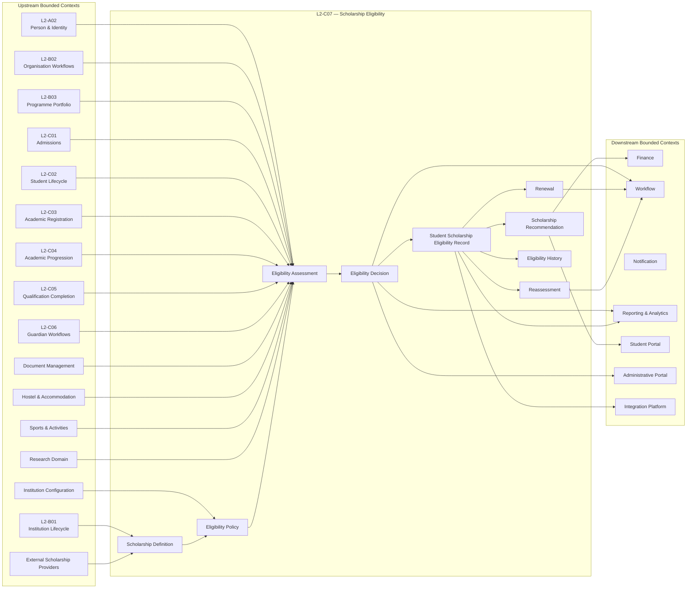

### AVM-02 — Bounded Context Interaction Model

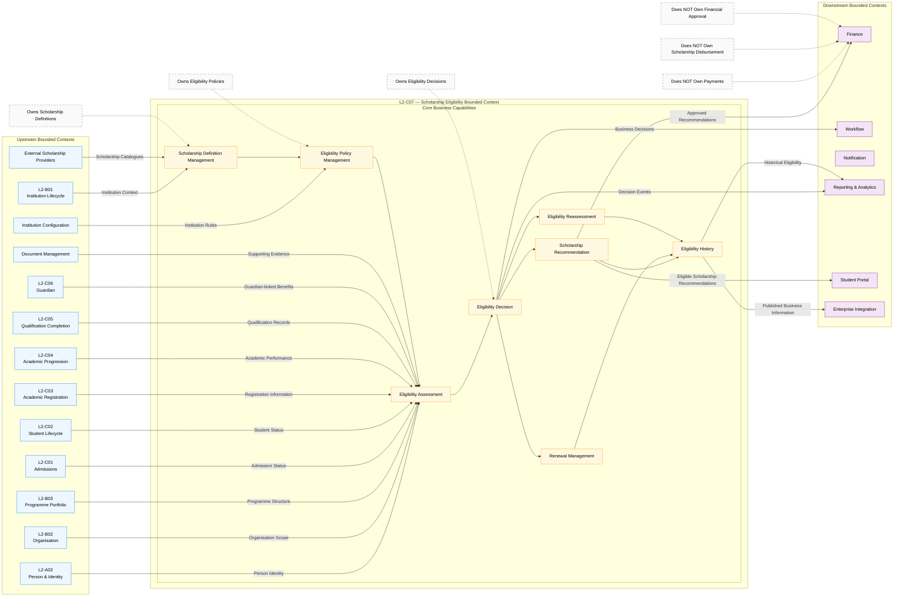

### AVM-03 — Internal Domain Model

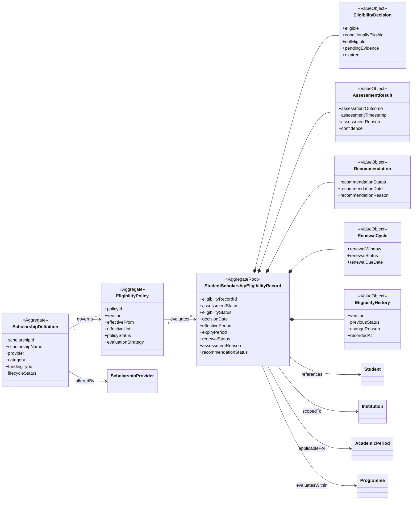

### AVM-04 — Aggregate Collaboration & Consistency Boundaries

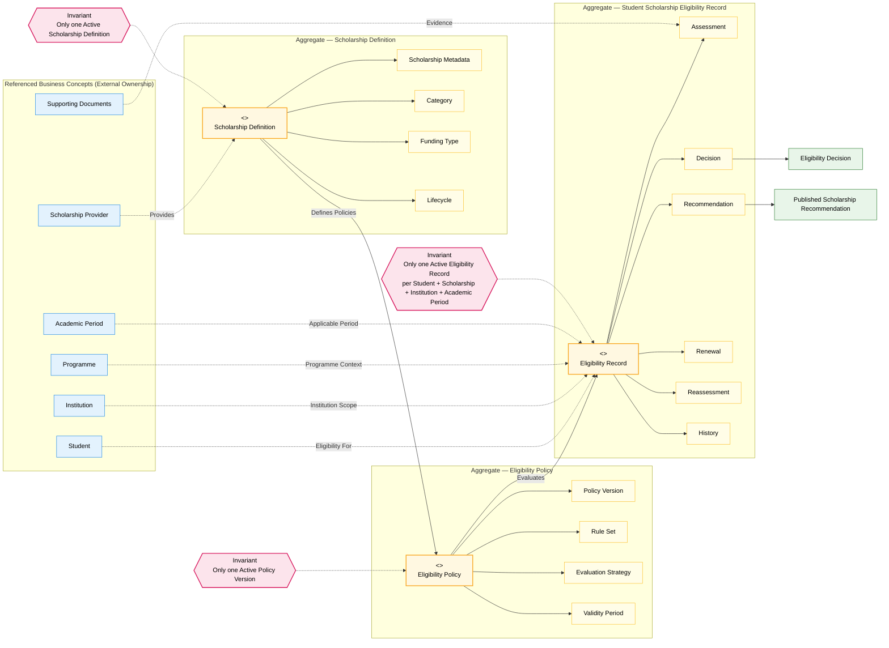

### AVM-05 — Scholarship Definition Lifecycle

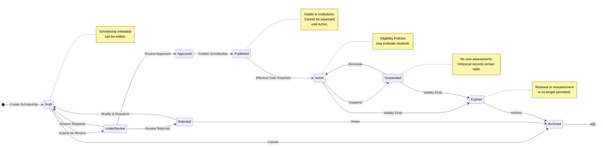

### AVM-06 — Student Scholarship Eligibility Record Lifecycle

```mermaid
stateDiagram-v2
    direction LR

    [*] --> Created : Eligibility Record Created

    Created --> PendingAssessment : Assessment Initiated

    PendingAssessment --> Assessing : Evidence Available
    PendingAssessment --> AwaitingEvidence : Evidence Missing

    AwaitingEvidence --> Assessing : Required Evidence Submitted
    AwaitingEvidence --> Cancelled : Assessment Cancelled

    Assessing --> Eligible : Eligibility Confirmed
    Assessing --> ConditionallyEligible : Conditional Requirements Met
    Assessing --> NotEligible : Eligibility Rejected

    ConditionallyEligible --> Eligible : Conditions Satisfied
    ConditionallyEligible --> NotEligible : Conditions Not Fulfilled

    Eligible --> Recommended : Scholarship Recommended
    Recommended --> Accepted : Student Accepts Recommendation
    Recommended --> Declined : Student Declines Recommendation

    Accepted --> Active : Scholarship Becomes Active

    Active --> Reassessment : Reassessment Triggered
    Active --> RenewalDue : Renewal Window Reached
    Active --> Expired : Validity Ends
    Active --> Suspended : Scholarship Suspended

    Suspended --> Active : Reinstated
    Suspended --> Expired : Validity Ends

    Reassessment --> Assessing : Reassessment Started

    RenewalDue --> RenewalAssessment : Renewal Initiated
    RenewalAssessment --> Eligible : Renewal Approved
    RenewalAssessment --> NotEligible : Renewal Rejected

    Expired --> Archived : Archive Record

    Declined --> Archived : Archive Decision
    Cancelled --> Archived : Archive Record
    NotEligible --> Archived : Retention Period Complete

    Archived --> [*]
```

### AVM-07 — Scholarship Eligibility Assessment Workflow

```mermaid
flowchart LR

%%==================================================
%% Actors
%%==================================================

Actor["Student / Authorized Administrator"]

%%==================================================
%% Assessment Workflow
%%==================================================

subgraph ASSESSMENT["Scholarship Eligibility Assessment"]

direction LR

A["Initiate Eligibility Assessment"]

B["Identify Applicable Scholarships"]

C["Load Active Eligibility Policy"]

D["Collect Student Academic Profile"]

E["Collect Institutional Context"]

F["Collect Supporting Evidence"]

G{"Required Evidence Complete?"}

H["Request Additional Evidence"]

I["Evaluate Eligibility Policy"]

J{"Eligibility Criteria Satisfied?"}

K["Create Eligibility Record"]

L["Eligible"]

M["Conditionally Eligible"]

N["Not Eligible"]

O["Generate Assessment Result"]

P["Persist Eligibility History"]

Q["Publish Eligibility Decision"]

end

%%==================================================
%% Events
%%==================================================

subgraph EVENTS["Published Business Events"]

E1["EligibilityAssessmentCompleted"]

E2["EligibilityDecisionPublished"]

E3["EligibilityRecommendationEligible"]

E4["EligibilityRecommendationRejected"]

end

%%==================================================
%% Aggregate Updates
%%==================================================

subgraph AGG["Aggregate Updates"]

AR1["Student Scholarship Eligibility Record"]

AR2["Eligibility History"]

end

%%==================================================
%% Workflow
%%==================================================

Actor --> A

A --> B

B --> C

C --> D

D --> E

E --> F

F --> G

G -- No --> H

H --> F

G -- Yes --> I

I --> J

J -- Eligible --> K

J -- Conditionally Eligible --> M

J -- Not Eligible --> N

K --> L

L --> O

M --> O

N --> O

O --> P

P --> Q

%%==================================================
%% Aggregate Updates
%%==================================================

K --> AR1

P --> AR2

%%==================================================
%% Events
%%==================================================

Q --> E1

Q --> E2

L --> E3

N --> E4

%%==================================================
%% Styling
%%==================================================

classDef process fill:#FFF8E1,stroke:#F9A825,color:#000;
classDef decision fill:#FCE4EC,stroke:#D81B60,color:#000;
classDef event fill:#E8F5E9,stroke:#2E7D32,color:#000;
classDef aggregate fill:#E3F2FD,stroke:#1E88E5,color:#000;
classDef actor fill:#F3E5F5,stroke:#8E24AA,color:#000;

class A,B,C,D,E,F,H,I,K,L,M,N,O,P,Q process;
class G,J decision;
class E1,E2,E3,E4 event;
class AR1,AR2 aggregate;
class Actor actor;

```

### AVM-08 — Scholarship Recommendation Workflow

```mermaid
flowchart LR

%%==================================================
%% Trigger
%%==================================================

Trigger["Eligibility Decision Published"]

%%==================================================
%% Recommendation Workflow
%%==================================================

subgraph RECOMMENDATION["Scholarship Recommendation Workflow"]

direction LR

A["Receive Eligibility Decision"]

B{"Eligible?"}

C["Retrieve Active Scholarship Definition"]

D["Verify Scholarship Availability"]

E{"Scholarship Active?"}

F["Generate Recommendation"]

G["Attach Eligibility Explanation"]

H["Create Recommendation Record"]

I["Publish Recommendation"]

J["Update Eligibility History"]

K["No Recommendation Generated"]

end

%%==================================================
%% Aggregate Updates
%%==================================================

subgraph AGG["Aggregate Updates"]

AR1["Student Scholarship Eligibility Record"]

AR2["Eligibility History"]

AR3["Recommendation Record"]

end

%%==================================================
%% Published Business Events
%%==================================================

subgraph EVENTS["Published Business Events"]

EV1["ScholarshipRecommendationGenerated"]

EV2["ScholarshipRecommendationPublished"]

EV3["RecommendationUnavailable"]

end

%%==================================================
%% Downstream Consumers
%%==================================================

subgraph DOWNSTREAM["Downstream Consumers"]

Portal["Student Portal"]

Workflow["Workflow Domain"]

Notification["Notification Domain"]

Reporting["Reporting Domain"]

Finance["Finance Domain"]

end

%%==================================================
%% Workflow
%%==================================================

Trigger --> A

A --> B

B -- No --> K

B -- Yes --> C

C --> D

D --> E

E -- No --> K

E -- Yes --> F

F --> G

G --> H

H --> I

I --> J

%%==================================================
%% Aggregate Updates
%%==================================================

H --> AR3

J --> AR1

J --> AR2

%%==================================================
%% Events
%%==================================================

I --> EV1

I --> EV2

K --> EV3

%%==================================================
%% Downstream Publication
%%==================================================

EV2 --> Portal

EV2 --> Workflow

EV2 --> Notification

EV2 --> Reporting

EV2 --> Finance

%%==================================================
%% Styling
%%==================================================

classDef process fill:#FFF8E1,stroke:#F9A825,color:#000;
classDef decision fill:#FCE4EC,stroke:#D81B60,color:#000;
classDef aggregate fill:#E3F2FD,stroke:#1E88E5,color:#000;
classDef event fill:#E8F5E9,stroke:#2E7D32,color:#000;
classDef downstream fill:#F3E5F5,stroke:#8E24AA,color:#000;

class A,C,D,F,G,H,I,J,K process;
class B,E decision;
class AR1,AR2,AR3 aggregate;
class EV1,EV2,EV3 event;
class Portal,Workflow,Notification,Reporting,Finance downstream;

```

### AVM-09 — Scholarship Eligibility Renewal Workflow

```mermaid
flowchart LR

%%==================================================
%% Renewal Trigger
%%==================================================

Trigger["Renewal Window Reached"]

%%==================================================
%% Renewal Workflow
%%==================================================

subgraph RENEWAL["Scholarship Eligibility Renewal Workflow"]

direction LR

A["Identify Active Eligibility Record"]

B{"Renewal Required?"}

C["Load Current Scholarship Definition"]

D["Load Active Eligibility Policy"]

E["Retrieve Historical Eligibility"]

F["Collect Latest Academic Information"]

G["Collect Updated Supporting Evidence"]

H{"Required Evidence Complete?"}

I["Request Additional Evidence"]

J["Evaluate Renewal Eligibility"]

K{"Renewal Approved?"}

L["Create New Eligibility Version"]

M["Update Eligibility History"]

N["Publish Renewal Decision"]

O["Renewal Rejected"]

P["Close Renewal Process"]

end

%%==================================================
%% Aggregate Updates
%%==================================================

subgraph AGG["Aggregate Updates"]

AR1["Student Scholarship Eligibility Record"]

AR2["Eligibility History"]

AR3["Renewal Version"]

end

%%==================================================
%% Published Business Events
%%==================================================
subgraph EVENTS["Published Business Events"]

EV1["ScholarshipRenewalInitiated"]

EV2["ScholarshipRenewalApproved"]

EV3["ScholarshipRenewalRejected"]

EV4["EligibilityVersionCreated"]

end

%%==================================================
%% Workflow
%%==================================================

Trigger --> A

A --> B

B -- No --> P

B -- Yes --> C

C --> D

D --> E

E --> F

F --> G

G --> H

H -- No --> I

I --> G

H -- Yes --> J

J --> K

K -- Yes --> L

K -- No --> O

L --> M

M --> N

%%==================================================
%% Aggregate Updates
%%==================================================

L --> AR3

M --> AR1

M --> AR2

%%==================================================
%% Business Events
%%==================================================

A --> EV1

L --> EV4

N --> EV2

O --> EV3

%%==================================================
%% Styling
%%==================================================

classDef process fill:#FFF8E1,stroke:#F9A825,color:#000;
classDef decision fill:#FCE4EC,stroke:#D81B60,color:#000;
classDef aggregate fill:#E3F2FD,stroke:#1E88E5,color:#000;
classDef event fill:#E8F5E9,stroke:#2E7D32,color:#000;

class A,C,D,E,F,G,I,J,L,M,N,O,P process;
class B,H,K decision;
class AR1,AR2,AR3 aggregate;
class EV1,EV2,EV3,EV4 event;

```

### AVM-10 — Scholarship Eligibility Reassessment Workflow

```mermaid
flowchart LR

%%==================================================
%% Reassessment Triggers
%%==================================================

subgraph TRIGGER["Business Reassessment Triggers"]

T1["Policy Version Changed"]
T2["Student Academic Status Changed"]
T3["Programme Changed"]
T4["Institution Changed"]
T5["Supporting Documents Updated"]
T6["Appeal Approved"]
T7["Manual Administrative Review"]

end

%%==================================================
%% Reassessment Workflow
%%==================================================

subgraph REASSESS["Scholarship Eligibility Reassessment Workflow"]

direction LR

A["Identify Existing Eligibility Record"]

B["Determine Reassessment Reason"]

C["Load Latest Scholarship Definition"]

D["Load Active Eligibility Policy"]

E["Retrieve Previous Assessment History"]

F["Collect Updated Student Information"]

G["Collect Updated Supporting Evidence"]

H{"Sufficient Information Available?"}

I["Request Missing Information"]

J["Execute Eligibility Reassessment"]

K{"Eligibility Changed?"}

L["Create New Eligibility Version"]

M["Retain Previous Version"]

N["Update Eligibility History"]

O["Publish Reassessment Decision"]

P["No Business Change"]

end

%%==================================================
%% Aggregate Updates
%%==================================================

subgraph AGG["Aggregate Updates"]

AR1["Student Scholarship Eligibility Record"]

AR2["Eligibility History"]

AR3["Assessment Version History"]

end

%%==================================================
%% Published Business Events
%%==================================================

subgraph EVENTS["Published Business Events"]

EV1["EligibilityReassessmentInitiated"]

EV2["EligibilityReassessmentCompleted"]

EV3["EligibilityChanged"]

EV4["EligibilityUnchanged"]

EV5["EligibilityVersionCreated"]

end

%%==================================================
%% Trigger Flow
%%==================================================

T1 --> A
T2 --> A
T3 --> A
T4 --> A
T5 --> A
T6 --> A
T7 --> A

%%==================================================
%% Workflow
%%==================================================

A --> B

B --> C

C --> D

D --> E

E --> F

F --> G

G --> H

H -- No --> I

I --> G

H -- Yes --> J

J --> K

K -- Yes --> L

K -- No --> P

L --> M

M --> N

N --> O

%%==================================================
%% Aggregate Updates
%%==================================================

L --> AR1

N --> AR2

L --> AR3

%%==================================================
%% Business Events
%%==================================================

A --> EV1

L --> EV5

O --> EV2

L --> EV3

P --> EV4

%%==================================================
%% Styling
%%==================================================

classDef trigger fill:#E8F5E9,stroke:#2E7D32,color:#000;
classDef process fill:#FFF8E1,stroke:#F9A825,color:#000;
classDef decision fill:#FCE4EC,stroke:#D81B60,color:#000;
classDef aggregate fill:#E3F2FD,stroke:#1E88E5,color:#000;
classDef event fill:#F3E5F5,stroke:#8E24AA,color:#000;

class T1,T2,T3,T4,T5,T6,T7 trigger;
class A,B,C,D,E,F,G,I,J,L,M,N,O,P process;
class H,K decision;
class AR1,AR2,AR3 aggregate;
class EV1,EV2,EV3,EV4,EV5 event;

```
### AVM-11 — Business Event Flow Architecture

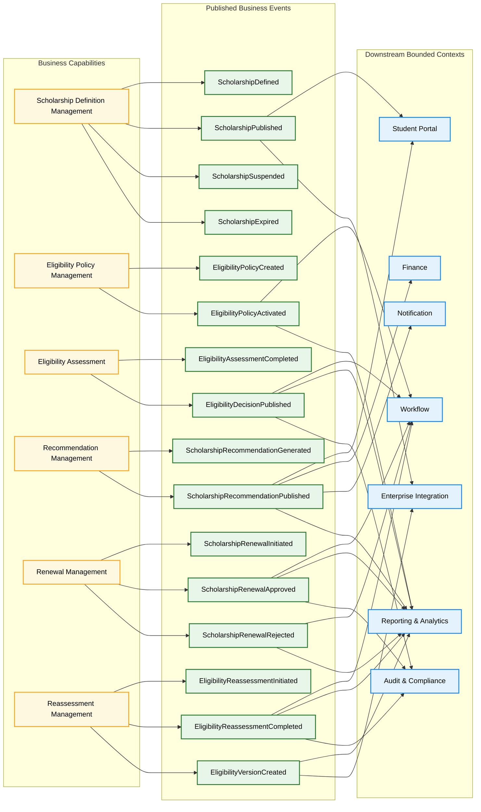

### AVM-12 — Business Information Dependency Flow

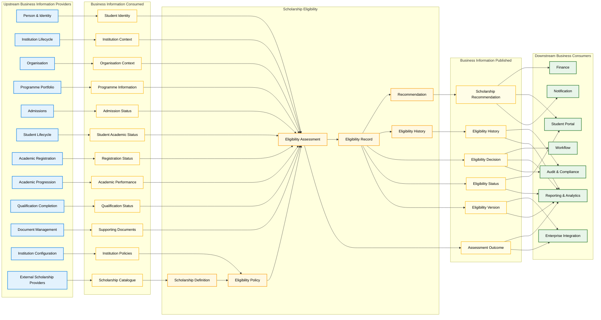
### AVM-13 — Eligibility Policy Evaluation Architecture

```mermaid
flowchart LR

%%==================================================
%% Evaluation Request
%%==================================================

Request["Eligibility Assessment Request"]

%%==================================================
%% Business Inputs
%%==================================================

subgraph INPUT["Business Information"]

Student["Student Profile"]

Academic["Academic Information"]

Programme["Programme Information"]

Institution["Institution Context"]

Documents["Supporting Documents"]

Scholarship["Scholarship Definition"]

Policy["Active Eligibility Policy"]

end

%%==================================================
%% Policy Evaluation Engine
%%==================================================

subgraph ENGINE["Eligibility Policy Evaluation Engine"]

direction TB

Load["Load Active Policy Version"]

Validate["Validate Required Information"]

Check{"Complete Business Information?"}

Evidence["Request Missing Evidence"]

RuleGroups["Resolve Rule Groups"]

ANDGroup["Evaluate AND Groups"]

ORGroup["Evaluate OR Groups"]

BusinessRules["Evaluate Business Rules"]

Decision["Determine Eligibility Decision"]

Explain["Generate Decision Explanation"]

end

%%==================================================
%% Decision Outcomes
%%==================================================

subgraph OUTCOME["Business Decision"]

Eligible["Eligible"]

Conditional["Conditionally Eligible"]

Pending["Pending Evidence"]

Rejected["Not Eligible"]

end

%%==================================================
%% Aggregate Updates
%%==================================================

subgraph AGG["Aggregate Updates"]

EligibilityRecord["Student Scholarship Eligibility Record"]

History["Eligibility History"]

end

%%==================================================
%% Published Events
%%==================================================

subgraph EVENTS["Published Business Events"]

EV1["EligibilityAssessmentCompleted"]

EV2["EligibilityDecisionPublished"]

EV3["EligibilityExplanationGenerated"]

end

%%==================================================
%% Flow
%%==================================================

Request --> Load

Student --> Validate
Academic --> Validate
Programme --> Validate
Institution --> Validate
Documents --> Validate
Scholarship --> Load
Policy --> Load

Load --> Validate

Validate --> Check

Check -- No --> Evidence

Evidence --> Validate

Check -- Yes --> RuleGroups

RuleGroups --> ANDGroup

RuleGroups --> ORGroup

ANDGroup --> BusinessRules

ORGroup --> BusinessRules

BusinessRules --> Decision

Decision --> Eligible
Decision --> Conditional
Decision --> Pending
Decision --> Rejected

Eligible --> Explain
Conditional --> Explain
Pending --> Explain
Rejected --> Explain

Explain --> EligibilityRecord

EligibilityRecord --> History

History --> EV1

EligibilityRecord --> EV2

Explain --> EV3

%%==================================================
%% Styling
%%==================================================

classDef input fill:#E3F2FD,stroke:#1E88E5,stroke-width:2px,color:#000;
classDef process fill:#FFF8E1,stroke:#F9A825,stroke-width:2px,color:#000;
classDef decision fill:#FCE4EC,stroke:#D81B60,stroke-width:2px,color:#000;
classDef aggregate fill:#E8F5E9,stroke:#2E7D32,stroke-width:2px,color:#000;
classDef event fill:#F3E5F5,stroke:#8E24AA,stroke-width:2px,color:#000;

class Student,Academic,Programme,Institution,Documents,Scholarship,Policy input;
class Load,Validate,Evidence,RuleGroups,ANDGroup,ORGroup,BusinessRules,Decision,Explain process;
class Check decision;
class EligibilityRecord,History,Eligible,Conditional,Pending,Rejected aggregate;
class EV1,EV2,EV3 event;

```

### AVM-14 — Bulk Eligibility Recalculation Workflow

```mermaid
flowchart LR

%%==================================================
%% Bulk Recalculation Triggers
%%==================================================

subgraph TRIGGERS["Business Recalculation Triggers"]

T1["Eligibility Policy Version Activated"]

T2["Scholarship Definition Updated"]

T3["Regulatory Rule Changed"]

T4["Institution Policy Modified"]

T5["Bulk Administrative Request"]

end

%%==================================================
%% Bulk Recalculation Process
%%==================================================

subgraph PROCESS["Bulk Eligibility Recalculation"]

direction LR

A["Identify Affected Eligibility Records"]

B["Determine Recalculation Scope"]

C["Load Latest Scholarship Definitions"]

D["Load Active Eligibility Policies"]

E["Group Records by Institution"]

F["Process Eligibility Records"]

G{"Eligibility Changed?"}

H["Create New Eligibility Version"]

I["Retain Existing Version"]

J["Update Eligibility History"]

K["Publish Recalculation Results"]

L["Complete Bulk Operation"]

end

%%==================================================
%% Aggregate Updates
%%==================================================

subgraph AGGREGATES["Aggregate Updates"]

AR1["Student Scholarship Eligibility Record"]

AR2["Eligibility History"]

AR3["Eligibility Version History"]

end

%%==================================================
%% Published Business Events
%%==================================================

subgraph EVENTS["Published Business Events"]

EV1["BulkEligibilityRecalculationStarted"]

EV2["EligibilityVersionCreated"]

EV3["BulkEligibilityUpdated"]

EV4["BulkEligibilityUnchanged"]

EV5["BulkEligibilityRecalculationCompleted"]

end

%%==================================================
%% Trigger Flow
%%==================================================

T1 --> A
T2 --> A
T3 --> A
T4 --> A
T5 --> A

%%==================================================
%% Workflow
%%==================================================

A --> B

B --> C

C --> D

D --> E

E --> F

F --> G

G -- Yes --> H

G -- No --> I

H --> J

I --> J

J --> K

K --> L

%%==================================================
%% Aggregate Updates
%%==================================================

H --> AR1

J --> AR2

H --> AR3

%%==================================================
%% Business Events
%%==================================================

A --> EV1

H --> EV2

H --> EV3

I --> EV4

L --> EV5

%%==================================================
%% Styling
%%==================================================

classDef trigger fill:#E3F2FD,stroke:#1E88E5,stroke-width:2px,color:#000;
classDef process fill:#FFF8E1,stroke:#F9A825,stroke-width:2px,color:#000;
classDef decision fill:#FCE4EC,stroke:#D81B60,stroke-width:2px,color:#000;
classDef aggregate fill:#E8F5E9,stroke:#2E7D32,stroke-width:2px,color:#000;
classDef event fill:#F3E5F5,stroke:#8E24AA,stroke-width:2px,color:#000;

class T1,T2,T3,T4,T5 trigger;
class A,B,C,D,E,F,H,I,J,K,L process;
class G decision;
class AR1,AR2,AR3 aggregate;
class EV1,EV2,EV3,EV4,EV5 event;

```

### AVM-15 — Scholarship Eligibility End-to-End Business Capability Map

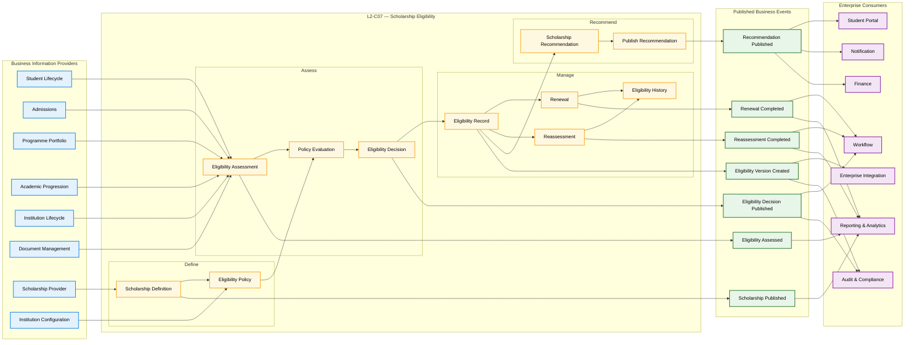

# 22. Architecture Decision Records (ADRs)

The following Architecture Decision Records document the significant architectural decisions that define the Scholarship Eligibility bounded context. These decisions are considered normative and shall guide future evolution of the domain.

---

## ADR-001 — Dedicated Scholarship Eligibility Bounded Context

| Attribute | Value |
|----------|-------|
| **Status** | Accepted |
| **Decision** | Scholarship Eligibility shall exist as an independent bounded context within the Student Information System. |

### Context

Scholarship eligibility involves complex business rules, institutional policies, recommendation generation, reassessment, renewal, explainability, and historical traceability.

### Decision

A dedicated bounded context shall own all scholarship eligibility responsibilities.

### Alternatives Considered

- Implement eligibility within Finance.
- Implement eligibility within Student Lifecycle.
- Implement eligibility within Admissions.

### Consequences

- Clear business ownership.
- Independent policy evolution.
- Improved maintainability.
- Reduced coupling.

---

## ADR-002 — Student Scholarship Eligibility Record as Primary Aggregate

| Attribute | Value |
|----------|-------|
| **Status** | Accepted |
| **Decision** | Student Scholarship Eligibility Record shall be the primary aggregate of the bounded context. |

### Context

Eligibility assessments, recommendations, renewals, reassessments, and history revolve around a student's eligibility state.

### Decision

The Student Scholarship Eligibility Record shall act as the Aggregate Root.

### Alternatives Considered

- Scholarship-centric aggregate.
- Policy-centric aggregate.
- Student aggregate extension.

### Consequences

- Consistent transactional boundary.
- Centralized lifecycle management.
- Simplified auditability.

---

## ADR-003 — Independent Scholarship Definition and Eligibility Policy Aggregates

| Attribute | Value |
|----------|-------|
| **Status** | Accepted |
| **Decision** | Scholarship Definition and Eligibility Policy shall be independent supporting aggregates. |

### Context

Scholarship metadata and policy logic evolve independently of student eligibility.

### Decision

Separate aggregates shall own scholarship lifecycle and policy lifecycle.

### Alternatives Considered

- Embed policy within scholarship definition.
- Embed policy within eligibility record.

### Consequences

- Independent versioning.
- Cleaner aggregate boundaries.
- Better reuse across scholarships.

---

## ADR-004 — Immutable Eligibility History

| Attribute | Value |
|----------|-------|
| **Status** | Accepted |
| **Decision** | Historical eligibility records shall never be modified. |

### Context

Institutional governance requires complete auditability.

### Decision

Every reassessment or renewal shall create a new historical version.

### Alternatives Considered

- Overwrite existing eligibility.
- Maintain latest state only.

### Consequences

- Complete historical traceability.
- Regulatory compliance.
- Explainable decisions.

---

## ADR-005 — Deterministic Policy Evaluation

| Attribute | Value |
|----------|-------|
| **Status** | Accepted |
| **Decision** | Eligibility evaluation shall be deterministic. |

### Context

Identical business inputs must always produce identical business outcomes.

### Decision

Policy evaluation shall not depend on subjective or non-repeatable behaviour.

### Alternatives Considered

- Manual interpretation.
- Non-deterministic evaluation.

### Consequences

- Predictable outcomes.
- Easier validation.
- Consistent institutional governance.

---

## ADR-006 — Explainable Eligibility Decisions

| Attribute | Value |
|----------|-------|
| **Status** | Accepted |
| **Decision** | Every eligibility decision shall be explainable. |

### Context

Students and administrators require transparent decision making.

### Decision

Each decision shall preserve the business rationale supporting the outcome.

### Alternatives Considered

- Decision without explanation.
- External explanation generation.

### Consequences

- Improved transparency.
- Better appeal handling.
- Stronger audit support.

---

## ADR-007 — Recommendation Without Ranking

| Attribute | Value |
|----------|-------|
| **Status** | Accepted |
| **Decision** | The domain shall recommend every eligible scholarship without prioritization or ranking. |

### Context

The purpose of the bounded context is eligibility determination, not scholarship selection.

### Decision

Recommendations shall identify eligibility only.

### Alternatives Considered

- Priority ranking.
- AI-based recommendation scoring.
- Financial optimization.

### Consequences

- Clear bounded-context responsibility.
- Avoids ownership overlap.
- Simpler business model.

---

## ADR-008 — Versioned Eligibility Policies

| Attribute | Value |
|----------|-------|
| **Status** | Accepted |
| **Decision** | Eligibility Policies shall be version-controlled. |

### Context

Institutional policies evolve over time.

### Decision

Only one policy version shall be active while historical versions remain immutable.

### Alternatives Considered

- Mutable policy definitions.
- Single evolving policy.

### Consequences

- Historical reproducibility.
- Stable reassessment.
- Regulatory traceability.

---

## ADR-009 — Event Publication at Business Milestones

| Attribute | Value |
|----------|-------|
| **Status** | Accepted |
| **Decision** | Business events shall be published only after completed business milestones. |

### Context

Downstream domains depend on authoritative business facts.

### Decision

Events shall represent completed business outcomes rather than intermediate processing steps.

### Alternatives Considered

- Publish intermediate events.
- Technical event publication.

### Consequences

- Stable integration contracts.
- Reduced downstream complexity.
- Clear event semantics.

---

## ADR-010 — Strict Bounded Context Ownership

| Attribute | Value |
|----------|-------|
| **Status** | Accepted |
| **Decision** | Scholarship Eligibility shall own eligibility determination only. |

### Context

Finance, Workflow, and other domains interact with eligibility but have distinct responsibilities.

### Decision

Ownership boundaries shall remain explicit and shall not extend into award management, financial disbursement, or payment processing.

### Alternatives Considered

- Merge eligibility with Finance.
- Merge eligibility with Scholarship Administration.

### Consequences

- Strong domain isolation.
- Reduced coupling.
- Independent evolution of downstream domains.

---

# 23. Business Invariants

Business Invariants define the non-negotiable rules that govern the Scholarship Eligibility bounded context. Every business process, policy evaluation, reassessment, renewal, and downstream integration shall preserve these invariants.

---

## BI-001 — Single Active Eligibility Record

For a given combination of:

- Student
- Scholarship
- Institution
- Academic Period

there shall be at most one Active Student Scholarship Eligibility Record.

---

## BI-002 — Immutable Historical Records

Historical Scholarship Eligibility Records shall never be modified or deleted.

All historical versions shall remain permanently available for audit, reporting, and regulatory purposes.

---

## BI-003 — Every Eligibility Record References Exactly One Scholarship Definition

Each Student Scholarship Eligibility Record shall reference one and only one Scholarship Definition.

An eligibility record shall never span multiple scholarships.

---

## BI-004 — Every Eligibility Assessment Uses One Policy Version

Each eligibility assessment shall be performed using exactly one published Eligibility Policy version.

The policy version used during assessment shall remain permanently associated with the resulting eligibility record.

---

## BI-005 — Published Policies Are Immutable

Once an Eligibility Policy version has been published and activated, it shall not be modified.

Changes require creation of a new policy version.

---

## BI-006 — Scholarship Definitions Preserve Version History

Changes to Scholarship Definitions shall preserve historical versions whenever the change affects eligibility semantics.

Historical eligibility decisions shall remain reproducible using the definition that was active at the time of assessment.

---

## BI-007 — Eligibility Decisions Are Deterministic

Identical business inputs evaluated against the same Scholarship Definition and Eligibility Policy version shall always produce identical eligibility outcomes.

---

## BI-008 — Every Decision Is Explainable

Every eligibility decision shall preserve sufficient business rationale to explain why the decision was produced.

An eligibility outcome without business justification is invalid.

---

## BI-009 — Eligibility Does Not Award Scholarships

Determining eligibility does not constitute scholarship approval, allocation, or financial award.

This bounded context concludes with recommendation.

---

## BI-010 — Recommendations Reflect Eligibility Only

Scholarship recommendations shall identify every scholarship for which the student is eligible.

Recommendations shall not rank, prioritize, score, or optimize scholarships.

---

## BI-011 — Renewal Creates a New Eligibility Version

A renewal shall never overwrite an existing eligibility record.

Each successful renewal creates a new immutable eligibility version while preserving historical versions.

---

## BI-012 — Reassessment Creates a New Eligibility Version

A reassessment resulting from policy changes, appeals, academic updates, or supporting evidence shall create a new eligibility version.

Previous versions shall remain unchanged.

---

## BI-013 — Eligibility History Is Chronological

Eligibility versions shall form a complete chronological history representing the evolution of eligibility over time.

Historical ordering shall never be ambiguous.

---

## BI-014 — Only Published Scholarships May Be Assessed

Eligibility assessment shall only occur for Scholarship Definitions that are currently published and active.

Draft, suspended, expired, or archived scholarships are not eligible for assessment.

---

## BI-015 — Only Active Policies May Be Evaluated

Eligibility assessment shall only use Eligibility Policies that are currently active.

Inactive, draft, superseded, or archived policy versions shall never be used for new assessments.

---

## BI-016 — Supporting Evidence Must Be Traceable

Every eligibility decision that depends on supporting evidence shall retain references to the evidence used during assessment.

The decision shall remain reproducible throughout its lifecycle.

---

## BI-017 — Published Business Events Represent Completed Business Facts

Business events shall only be published after the corresponding business activity has reached a completed and authoritative state.

Intermediate processing shall not be exposed as published business events.

---

## BI-018 — Aggregate Ownership Shall Not Be Violated

The Student Scholarship Eligibility Record Aggregate shall be modified only through business operations owned by the Scholarship Eligibility bounded context.

External bounded contexts shall not directly alter eligibility state.

---

## BI-019 — Every Eligibility Record Belongs to One Institution

A Student Scholarship Eligibility Record shall belong to exactly one Institution.

Eligibility ownership shall not span multiple institutions.

---

## BI-020 — Business Consistency Overrides Operational Convenience

Whenever operational efficiency conflicts with business correctness, preservation of business consistency, historical integrity, and auditability shall take precedence.

---

# 24. Architecture Validation Checklist

This checklist provides a standardized mechanism for validating whether future implementations, enhancements, and architectural changes remain compliant with the Scholarship Eligibility architecture defined in this document.

Each item shall be reviewed before approving any significant architectural or functional change.

---

## Domain Boundaries

| Validation Item | Status |
|-----------------|--------|
| Scholarship Eligibility remains an independent bounded context. | ☐ |
| Responsibilities have not expanded into Finance or Award Management. | ☐ |
| External bounded contexts do not modify eligibility state directly. | ☐ |
| Ownership boundaries remain clearly defined. | ☐ |

---

## Aggregate Design

| Validation Item | Status |
|-----------------|--------|
| Student Scholarship Eligibility Record remains the Aggregate Root. | ☐ |
| Scholarship Definition remains an independent supporting aggregate. | ☐ |
| Eligibility Policy remains an independent supporting aggregate. | ☐ |
| Aggregate boundaries remain unchanged. | ☐ |

---

## Business Rules

| Validation Item | Status |
|-----------------|--------|
| Policy evaluation remains deterministic. | ☐ |
| Nested AND/OR rule evaluation is preserved. | ☐ |
| Every decision remains explainable. | ☐ |
| Eligibility recommendations remain business-rule driven. | ☐ |

---

## Versioning

| Validation Item | Status |
|-----------------|--------|
| Published Scholarship Definitions remain version controlled. | ☐ |
| Published Eligibility Policies remain immutable. | ☐ |
| Renewals create new eligibility versions. | ☐ |
| Reassessments create new eligibility versions. | ☐ |
| Historical versions remain immutable. | ☐ |

---

## Lifecycle Integrity

| Validation Item | Status |
|-----------------|--------|
| Scholarship lifecycle remains unchanged. | ☐ |
| Eligibility lifecycle remains unchanged. | ☐ |
| Lifecycle transitions preserve business consistency. | ☐ |
| Invalid transitions are prevented by business rules. | ☐ |

---

## Business Invariants

| Validation Item | Status |
|-----------------|--------|
| Only one active eligibility record exists per Student–Scholarship–Institution–Academic Period combination. | ☐ |
| Eligibility decisions never award scholarships. | ☐ |
| Recommendations never perform ranking or prioritization. | ☐ |
| Eligibility history remains immutable. | ☐ |

---

## Business Events

| Validation Item | Status |
|-----------------|--------|
| Events represent completed business facts. | ☐ |
| Intermediate processing is not published as business events. | ☐ |
| Event ownership remains within the bounded context. | ☐ |
| Downstream consumers rely only on published events. | ☐ |

---

## Information Ownership

| Validation Item | Status |
|-----------------|--------|
| Scholarship Eligibility consumes business information without assuming ownership. | ☐ |
| Published business information remains authoritative. | ☐ |
| Information ownership boundaries remain unchanged. | ☐ |

---

## Governance

| Validation Item | Status |
|-----------------|--------|
| Architecture Decision Records remain valid. | ☐ |
| Business Invariants continue to hold. | ☐ |
| New capabilities do not violate existing architectural principles. | ☐ |
| All architectural changes undergo review before approval. | ☐ |

---

## Overall Compliance

| Result | Status |
|----------|--------|
| Architecture complies with all mandatory design principles. | ☐ Pass |
| Minor deviations require documented architectural approval. | ☐ Review Required |
| Major deviations require architecture redesign before implementation. | ☐ Fail |

---

# 25. Conclusion

The Scholarship Eligibility bounded context establishes the authoritative business capability responsible for determining student eligibility for scholarships within the SutraERP ecosystem.

The architecture separates scholarship definition, eligibility policy management, eligibility assessment, recommendation generation, renewal, and reassessment into clearly defined business capabilities while preserving explicit ownership boundaries. This separation enables institutional policies to evolve independently without compromising the integrity or traceability of historical eligibility decisions.

The Student Scholarship Eligibility Record serves as the central Aggregate Root of the bounded context, ensuring that eligibility state, lifecycle transitions, historical versions, and recommendations remain consistent throughout the business lifecycle. Supporting aggregates, including Scholarship Definition and Eligibility Policy, provide reusable and independently governed business capabilities while maintaining clear aggregate responsibilities.

The architecture adopts immutable historical versioning, deterministic policy evaluation, explainable business decisions, and explicit event publication as foundational principles. Together, these principles ensure that eligibility outcomes remain transparent, reproducible, auditable, and suitable for long-term institutional governance.

This bounded context concludes with the determination and recommendation of scholarship eligibility. Responsibilities related to scholarship approval, quota allocation, financial award processing, fund disbursement, and payment execution remain outside its ownership and are delegated to downstream bounded contexts in accordance with the established enterprise architecture.

The visual models, Architecture Decision Records, Business Invariants, and Architecture Validation Checklist collectively define the normative architectural contract for Scholarship Eligibility. Future enhancements shall preserve these architectural principles, maintain bounded context integrity, and ensure that business correctness, historical consistency, and institutional governance continue to take precedence over implementation-specific concerns.

With these principles established, the Scholarship Eligibility bounded context provides a stable, extensible, and enterprise-ready foundation for scholarship eligibility determination across all institutions supported by the SutraERP platform.

---
# 26. Appendices

The appendices provide supporting reference material for the Scholarship Eligibility bounded context. They consolidate terminology, business rules, lifecycle transitions, published business events, architectural traceability, and cross-document relationships without introducing new architectural decisions.

---

# Appendix A — Business Terminology

The following terminology shall be used consistently throughout the Scholarship Eligibility bounded context.

| Term | Definition |
|------|------------|
| Scholarship | A financial assistance programme offered to eligible students. |
| Scholarship Definition | The authoritative business definition of a scholarship, including its lifecycle and metadata. |
| Eligibility Policy | The version-controlled business rules used to determine scholarship eligibility. |
| Eligibility Assessment | The business process of evaluating a student against a scholarship's eligibility policy. |
| Student Scholarship Eligibility Record | The primary aggregate representing a student's eligibility for a specific scholarship. |
| Eligibility Recommendation | A business recommendation indicating that a student satisfies the eligibility requirements of a scholarship. |
| Renewal | Re-evaluation of eligibility for continued scholarship consideration during a subsequent eligibility period. |
| Reassessment | Re-evaluation triggered by business changes such as policy updates, appeals, academic changes, or new evidence. |
| Supporting Evidence | Business evidence used to validate eligibility requirements. |
| Eligibility Version | An immutable historical snapshot representing the outcome of an eligibility assessment. |
| Active Eligibility | The current authoritative eligibility determination for a student-scholarship combination. |
| Conditionally Eligible | A temporary eligibility outcome requiring additional evidence or business actions before confirmation. |
| Published Policy | An approved Eligibility Policy version available for business evaluation. |
| Eligibility History | The chronological record of all eligibility versions associated with a Student Scholarship Eligibility Record. |

---

# Appendix B — State Transition Matrix

## B.1 Scholarship Definition Lifecycle

| Current State | Business Action | Next State |
|---------------|----------------|------------|
| Draft | Submit for Review | Under Review |
| Under Review | Approve | Approved |
| Approved | Publish | Published |
| Published | Activate | Active |
| Active | Suspend | Suspended |
| Suspended | Reactivate | Active |
| Active | Expire | Expired |
| Expired | Archive | Archived |

---

## B.2 Student Scholarship Eligibility Lifecycle

| Current State | Business Action | Next State |
|---------------|----------------|------------|
| Created | Begin Assessment | Pending Assessment |
| Pending Assessment | Validate Information | Assessing |
| Assessing | Missing Evidence | Awaiting Evidence |
| Awaiting Evidence | Evidence Received | Assessing |
| Assessing | Eligibility Confirmed | Eligible |
| Assessing | Conditional Decision | Conditionally Eligible |
| Assessing | Eligibility Rejected | Not Eligible |
| Eligible | Generate Recommendation | Recommended |
| Recommended | Student Accepts | Accepted |
| Recommended | Student Declines | Declined |
| Accepted | Activate Eligibility | Active |
| Active | Renewal Required | Renewal Due |
| Renewal Due | Begin Renewal | Renewal Assessment |
| Renewal Assessment | Renewal Completed | Active |
| Active | Reassessment Triggered | Reassessment |
| Reassessment | Assessment Completed | Active |
| Active | Eligibility Ends | Expired |
| Expired | Archive | Archived |

---

# Appendix C — Business Event Catalogue

The following business events represent completed business facts published by the Scholarship Eligibility bounded context.

| Business Event | Trigger | Published By | Typical Consumers |
|----------------|----------|--------------|-------------------|
| ScholarshipDefined | Scholarship definition created | Scholarship Definition | Reporting |
| ScholarshipPublished | Scholarship published | Scholarship Definition | Student Portal |
| ScholarshipSuspended | Scholarship suspended | Scholarship Definition | Workflow |
| ScholarshipExpired | Scholarship expired | Scholarship Definition | Reporting |
| EligibilityPolicyCreated | Policy created | Eligibility Policy | Reporting |
| EligibilityPolicyActivated | Policy activated | Eligibility Policy | Workflow |
| EligibilityAssessmentCompleted | Assessment completed | Eligibility Assessment | Reporting |
| EligibilityDecisionPublished | Eligibility finalized | Eligibility Assessment | Workflow, Audit |
| ScholarshipRecommendationGenerated | Recommendation generated | Recommendation Management | Reporting |
| ScholarshipRecommendationPublished | Recommendation published | Recommendation Management | Finance, Student Portal |
| ScholarshipRenewalInitiated | Renewal initiated | Renewal Management | Workflow |
| ScholarshipRenewalApproved | Renewal completed | Renewal Management | Reporting |
| ScholarshipRenewalRejected | Renewal unsuccessful | Renewal Management | Workflow |
| EligibilityReassessmentInitiated | Reassessment initiated | Reassessment Management | Workflow |
| EligibilityReassessmentCompleted | Reassessment completed | Reassessment Management | Reporting |
| EligibilityVersionCreated | New immutable version created | Student Scholarship Eligibility Record | Audit, Reporting |

---

# Appendix D — Business Rule Catalogue

| Rule ID | Business Rule |
|---------|---------------|
| BR-001 | Scholarship Definition must be Active before eligibility assessment may begin. |
| BR-002 | Eligibility assessment shall use exactly one Active Eligibility Policy version. |
| BR-003 | A Student may have only one Active Eligibility Record per Student–Scholarship–Institution–Academic Period combination. |
| BR-004 | Eligibility decisions shall be deterministic. |
| BR-005 | Every eligibility decision shall be explainable. |
| BR-006 | Published Eligibility Policies are immutable. |
| BR-007 | Renewals create new immutable eligibility versions. |
| BR-008 | Reassessments create new immutable eligibility versions. |
| BR-009 | Historical eligibility records shall never be modified. |
| BR-010 | Scholarship recommendations shall include every eligible scholarship. |
| BR-011 | Recommendations shall not perform ranking or prioritization. |
| BR-012 | Eligibility determination does not constitute scholarship approval or financial award. |
| BR-013 | Supporting evidence shall remain traceable throughout the eligibility lifecycle. |
| BR-014 | Published business events shall represent completed business facts only. |
| BR-015 | Aggregate ownership boundaries shall never be violated by external bounded contexts. |

---

# Appendix E — Representative Business Scenarios

The following scenarios illustrate representative business behaviour supported by the architecture.

| Scenario | Description |
|----------|-------------|
| Initial Eligibility Assessment | A student is assessed against an active scholarship policy and becomes eligible. |
| Conditional Eligibility | Assessment identifies missing evidence resulting in a conditionally eligible outcome. |
| Evidence Submission | The student provides additional evidence, allowing reassessment to continue. |
| Policy Change Reassessment | A new Eligibility Policy version triggers reassessment of affected students. |
| Annual Scholarship Renewal | Active eligibility is renewed for a subsequent academic period, producing a new immutable version. |
| Scholarship Expiration | Scholarship lifecycle reaches expiration and future eligibility assessments are prevented. |
| Institutional Scholarship Introduction | A newly published scholarship becomes available for future eligibility assessments. |
| Student Appeal | An appeal results in reassessment while preserving all historical eligibility versions. |

---

# Appendix F — Cross-Document References

The Scholarship Eligibility bounded context collaborates with several other enterprise domains.

| Related Document | Relationship |
|------------------|--------------|
| L2-C01 — Student Lifecycle | Provides student business information. |
| L2-C02 — Admissions | Provides admission context. |
| L2-C03 — Academic Registration | Provides registration status. |
| L2-C04 — Academic Progression | Provides academic performance information. |
| L2-C05 — Qualification Completion | Provides qualification status. |
| L2-C06 — Student Documents | Provides supporting business evidence. |
| Finance Architecture | Consumes scholarship recommendations for downstream financial processing. |
| Workflow Architecture | Coordinates approval and operational workflows. |
| Reporting & Analytics | Consumes published business events and eligibility information. |

---

# Appendix G — Requirements Traceability Matrix

The following matrix maps key architectural requirements to their defining sections within this document.

| Architectural Requirement | Primary Reference |
|---------------------------|-------------------|
| Independent Bounded Context | Section 3, ADR-001 |
| Aggregate Design | Section 5, ADR-002, ADR-003 |
| Scholarship Lifecycle | Section 9, AVM-05 |
| Eligibility Lifecycle | Section 10, AVM-06 |
| Eligibility Assessment | Section 12, AVM-07 |
| Recommendation Generation | Section 14, AVM-08 |
| Renewal Management | Section 15, AVM-09 |
| Reassessment Management | Section 16, AVM-10 |
| Business Event Publication | AVM-11, ADR-009 |
| Business Information Ownership | AVM-12 |
| Policy Evaluation | AVM-13 |
| Bulk Eligibility Recalculation | AVM-14 |
| End-to-End Capability Map | AVM-15 |
| Architecture Decisions | Section 22 |
| Business Invariants | Section 23 |
| Architecture Validation | Section 24 |

---

## End of Document

This concludes the Level 2 architecture specification for the **Scholarship Eligibility** bounded context. Together, the architecture, visual models, Architecture Decision Records, Business Invariants, validation checklist, and appendices establish the authoritative business architecture governing scholarship eligibility within the SutraERP platform.

---