# L2-C08 — Alumni Transition Workflows

| Field | Value |
|--------|-------|
| Document ID | L2-C08 |
| Document Name | Alumni Transition Workflows |
| Document Owner | Student Lifecycle — Alumni Transition |
| Architecture Level | Level 2 — Bounded Context |
| Domain | Student Lifecycle Domain |
| Bounded Context | Alumni Transition |
| Canonical Aggregate | Alumni Transition Record |
| Primary Owner | Student Lifecycle Domain |
| Version | 1.0.1 |
| Status | Locked |
| Dependencies | See Sections 3 & 4 |
| Audience | Enterprise Architects, Solution Architects, Developers, Business Analysts |
| Last Updated | 2026-10-02 |

---

## Canonical Section Crosswalk

> Added 2026-08-04 under integrity finding INT-018. `governance/constitution/Volume_3_Architecture_Framework.md` section 18 requires every L2 document to define eleven sections. This document uses its own numbered-section convention; the table below maps the required sections to where they actually live. No content was moved.

| Required section (Volume 3 §18) | Location in this document |
|---|---|
| Purpose | §1 Purpose |
| Scope | §2 Scope; §17.3 Audit Scope; §2.1 In Scope |
| Actors | §7.6 Workflow Participants; Primary Participants |
| Entities | §6.8 Entities; D05 — Domain Entity Relationship Diagram |
| Business Rules | §9 Business Rules; §9.2 Business Rule Classification; §9.12 Business Rule Dependency Matrix |
| Workflow | §7 Domain Workflows; §7.2 Workflow Design Principles; §7.3 Workflow Landscape |
| State Machine | §12.3 Canonical State Machine; D09 — Alumni Lifecycle State Machine |
| Contracts | §10.9 Event Contract; §11 Service Contracts; §11.2 Service Contract Principles |
| Events | §9.9 Event Rules; §10 Domain Events; §10.2 Event Principles |
| Dependencies | §3 Upstream Dependencies; §4 Downstream Dependencies; §8.11 Workflow Dependency Matrix |
| Locked Decisions | §13 Decision Matrix; §13.2 Decision Principles; §13.3 Decision Lifecycle |

---

# 1. Purpose

## 1.1 Overview

The Alumni Transition bounded context governs the institutional business process that transitions an eligible Student into an Alumni relationship following successful completion of academic requirements.

Its primary responsibility is to ensure that every transition is executed in a controlled, policy-driven, and auditable manner while preserving strict domain ownership boundaries.

The bounded context coordinates the transition process by consuming authoritative business facts from upstream domains, enforcing institutional policies, managing the transition lifecycle, and publishing completed business events for downstream consumers.

This bounded context does **not** own student identities, academic records, qualifications, or alumni engagement capabilities. Instead, it provides the authoritative business process responsible for converting a completed Student relationship into an active Alumni relationship.

---

## 1.2 Business Objective

The objectives of the Alumni Transition bounded context are to:

- Govern the institutional Student-to-Alumni transition.
- Ensure only eligible Students become Alumni.
- Enforce institution-specific transition policies.
- Maintain a complete and immutable transition history.
- Publish authoritative business events for downstream domains.
- Preserve canonical ownership across bounded contexts.
- Prevent duplicate or inconsistent Alumni transitions.

---

## 1.3 Architectural Goals

This bounded context has the following architectural goals:

- Maintain a single authoritative transition process.
- Preserve aggregate consistency throughout the lifecycle.
- Separate transition responsibilities from Alumni Management.
- Support policy-driven institutional customization.
- Enable event-driven integration across the ERP.
- Ensure complete auditability of every transition.
- Remain independent of implementation technology.

---

# 2. Scope

## 2.1 In Scope

The Alumni Transition bounded context is responsible for:

- Alumni transition initiation.
- Transition eligibility evaluation.
- Institutional policy validation.
- Approval coordination.
- Transition execution.
- Publication of the authoritative AlumniRelationshipActivated business event for downstream consumption.
- Transition lifecycle management.
- Transition history management.
- Transition correction management.
- Publication of transition domain events.

---

## 2.2 Out of Scope

The following capabilities are owned by other bounded contexts:

- Person Identity management.
- Student lifecycle management.
- **Student relationship closure and StudentContext mutation.** The exit decision and
  its authorisation are owned by `L2-C05 --- Qualification Completion & Student Exit
  Workflows`, which names itself the sole business authority for Student Exit. The
  StudentContext aggregate itself is owned by `L2-C02 --- Student Lifecycle Workflows`.
  Alumni Transition consumes the completed-exit fact and shall never close, mutate or
  terminate a StudentContext.
- Qualification management.
- Qualification Completion verification.
- Academic result processing.
- Alumni profile management.
- Alumni networking.
- Alumni communication.
- Alumni donations.
- Placement services.
- Notification delivery.
- Audit infrastructure.

---

## 2.3 Success Criteria

The bounded context is considered successful when:

- Every Alumni Transition is uniquely identifiable.
- Only eligible Students become Alumni.
- Institutional policies are consistently enforced.
- Every transition is fully auditable.
- Transition history remains immutable.
- Downstream domains receive authoritative business events.
- Domain ownership boundaries remain uncompromised.
- Aggregate invariants are never violated.

---

## 2.4 Guiding Principles

The Alumni Transition bounded context shall adhere to the following principles:

- Business ownership shall remain singular.
- Aggregate consistency shall be maintained at all times.
- Cross-domain collaboration shall occur through published business facts.
- Completed business history shall be immutable.
- Corrections shall be version-based.
- Business rules shall be policy-driven.
- Architecture shall remain technology independent.
- Every business decision shall be traceable and auditable.

# 3. Upstream Dependencies

## 3.1 Purpose

The Alumni Transition bounded context does not independently determine whether a Student is eligible to become an Alumni.

Instead, it consumes authoritative business facts published by upstream bounded contexts and uses those facts to govern the institutional transition process.

Each upstream dependency remains the sole owner of its respective business capability.

---

## 3.2 Dependency Principles

All upstream integrations shall adhere to the following architectural principles:

- Every business capability has a single canonical owner.
- The Alumni Transition domain consumes business facts but never modifies upstream data.
- Dependencies are established through published contracts rather than shared ownership.
- Business validation remains the responsibility of the owning bounded context.
- Upstream domains remain independently deployable.

---

## 3.3 Upstream Dependency Catalogue

| Bounded Context | Canonical Responsibility | Consumed By |
|-----------------|--------------------------|-------------|
| Person & Identity | Person identity and institutional identity resolution | Alumni Transition |
| Student Lifecycle | Student relationship and enrolment status | Alumni Transition |
| Institution Management | Institution ownership and organisational hierarchy | Alumni Transition |
| Qualification Completion (L2-C05) | Qualification completion outcome, published as the canonical `QualificationAwarded` event | Alumni Transition |
| Examination (L2-I13) | Examination-owned completion evidence via `ExaminationCompletionEvidencePrepared` | Alumni Transition |
| Institutional Clearance (aggregated by `L2-C05`) | Financial, library, hostel and administrative clearances, aggregated by the Qualification Completion Aggregate and published as `InstitutionalClearanceCompleted` | Alumni Transition |
| Institution (`L2-B01`) — institutional policy owner | Institutional transition policy definitions and versions | Alumni Transition (`L2-C08`) |

> **Corrected 2026-08-06 under integrity finding INT-206.** This table previously named
> three upstream bounded contexts that do not exist in the repository:
>
> - **Clearance Management** — replaced above. `L2-C05` line 287 states that each
>   participating domain owns its own clearance decision and the Qualification Completion
>   Aggregate aggregates them; line 4085 confirms it owns institutional clearance
>   coordination. The clearances themselves originate in Sections F, G03 and G05.
> - **Approval Management** — row removed. Alumni transition approval is not upstream of
>   this context; this document publishes `AlumniTransitionApproved` itself (see §10.4,
>   "Institutional approval completed / Approval workflow completed").
> - **Policy Management** — historical shorthand resolved under approved
>   Dependency Map RC-03 (2026-08-15). Institutional **business policy definitions
>   and versions are owned by L2-B01 Institution**, not a separate invented
>   Policy Management bounded context. `L2-C08` evaluates applicable transition
>   policy and publishes its own `TransitionPolicyValidated` decision.
>
> **Controlled RC-03 reconciliation, 2026-10-01 (documentation only).** This note
> governs historical shorthand throughout the service-contract, workflow,
> decision, failure-mode and sequence tables below, without creating any API,
> policy payload, permission or new implementation contract:
>
> | Historical name elsewhere in this document | Canonical interpretation |
> |---|---|
> | Clearance Management | `L2-C05` aggregates institutional clearance; participating F/G03/G05 domains retain individual clearance authority. |
> | Approval Management | The `L2-C08` Alumni Transition approval workflow itself, publishing `AlumniTransitionApproved`; not an upstream domain. |
> | Policy Management / Policy Service | Institutional policy definition/version is owned by `L2-B01`; `L2-C08` independently evaluates and owns its transition-policy decision. No separate Policy Management bounded context. |
>
> `AlumniTransitionPolicyUpdated` is assigned to `L2-C08` as the publisher
> by approved RC-03; it is **not** a new B01-published inbound event. B01
> remains the canonical owner of institutional business policy definitions.
> RC-03 lifts the former blanket ban on legitimate, approved B01 policy
> consumption. This correction does not by itself specify a new subscription,
> event transport, query schema, policy-version validation contract or H06
> activation condition. Such runtime interactions still require traceable
> approved owner evidence before Batch-18 J06 may be certified.

---

## 3.4 Consumed Business Facts

The Alumni Transition domain consumes the following authoritative business facts:

- Person Identity
- Student Identity
- Institution Identity
- Programme Identity
- Qualification Completion, received as the canonical `QualificationAwarded` event published by the Qualification Completion domain (L2-C05)
- Examination Completion Evidence
- Qualification Completion Verification
- Institutional Clearance Status
- Approval Outcome
- Transition Policy Configuration

These facts remain owned by their originating bounded contexts.

---

## 3.5 Dependency Model

```text
Person & Identity
          │
Student Lifecycle
          │
Institution Management
          │
Qualification Completion
          │
Examination
          │
Institution (L2-B01 institutional policy definition)
          │
Approval Management
          │
Clearance Management
          │
          ▼
────────────────────────────────────
     Alumni Transition Domain
────────────────────────────────────
```

The Alumni Transition domain becomes executable only after sufficient upstream business facts have been received.

---

# 4. Downstream Dependencies

## 4.1 Purpose

Upon successful completion of an Alumni Transition, this bounded context publishes authoritative business events that enable downstream domains to perform their own responsibilities.

The Alumni Transition domain never invokes downstream business logic directly.

Downstream systems decide independently how published business facts are consumed.

---

## 4.2 Dependency Principles

Downstream collaboration follows these principles:

- Published events represent completed business facts.
- Downstream domains own their own business processes.
- Event consumers remain loosely coupled.
- Event publication does not imply downstream success.
- No downstream domain may alter Alumni Transition state.

---

## 4.3 Downstream Dependency Catalogue

| Bounded Context | Consumes | Purpose |
|-----------------|----------|---------|
| Alumni Management | AlumniTransitionCompleted | Create Alumni Profile and manage Alumni lifecycle |
| Notification | Transition events | Notify Students and stakeholders |
| Reporting | Transition events | Institutional reporting and analytics |
| Audit | Transition history | Long-term compliance and governance |
| Analytics | Business events | Enterprise dashboards and KPIs |
| Enterprise Integration | Published events | External ERP and third-party integrations |

---

## 4.4 Published Business Facts

Representative business facts published include:

- TransitionEligibilityValidated
- AlumniTransitionInitiated
- AlumniTransitionApproved
- StudentRelationshipClosed
- AlumniRelationshipActivated
- AlumniTransitionCompleted
- AlumniTransitionCorrected

Only completed business facts are published.

---

## 4.5 Downstream Collaboration Model

```text
────────────────────────────────────
     Alumni Transition Domain
────────────────────────────────────
          │
          ├────────► Alumni Management
          │
          ├────────► Notification
          │
          ├────────► Reporting
          │
          ├────────► Audit
          │
          ├────────► Analytics
          │
          └────────► Enterprise Integration
```

The Alumni Transition domain remains independent of downstream implementation details.

---

# 5. Domain Ownership Boundaries

## 5.1 Purpose

The Alumni Transition bounded context owns only the institutional business process responsible for transitioning an eligible Student into an Alumni relationship.

Ownership is intentionally narrow to prevent duplication of business capabilities across the ERP.

---

## 5.2 Canonical Ownership

The Alumni Transition domain exclusively owns:

- Alumni Transition Record.
- Transition lifecycle.
- Transition eligibility decision.
- Transition execution.
- Transition approval coordination.
- Transition history.
- Transition correction lifecycle.
- Transition business events.

No other bounded context may modify these business concepts.

---

## 5.3 Explicit Non-Ownership

The Alumni Transition domain does **not** own:

- Person Identity.
- Student records.
- Academic programmes.
- Qualifications.
- Examination results.
- Qualification Completion verification.
- Institutional hierarchy.
- Alumni profiles.
- Alumni engagement.
- Alumni communications.
- Donations.
- Placement activities.
- Notification delivery.
- Audit repositories.

Ownership remains with the canonical bounded context responsible for each capability.

---

## 5.4 Ownership Interaction Model

```text
                Upstream Domains
                       │
        Publish Authoritative Facts
                       │
                       ▼
─────────────────────────────────────────
      Alumni Transition Domain
─────────────────────────────────────────
 Owns only Transition Business Process
                       │
 Publishes Completed Business Facts
                       ▼
              Downstream Domains
```

---

## 5.5 Ownership Principles

The Alumni Transition bounded context follows these ownership principles:

- One business capability has one canonical owner.
- Aggregate ownership never crosses bounded contexts.
- Business facts are consumed, never re-owned.
- Cross-domain collaboration occurs through published contracts.
- Business state cannot be modified externally.
- Domain ownership remains stable over time.
- Historical ownership is preserved for auditability.
- Transition responsibilities remain isolated from Alumni Management.

---

## 5.6 Boundary Validation Checklist

The following questions should always evaluate to **Yes**:

| Validation Question | Expected Answer |
|---------------------|-----------------|
| Does this domain own the transition process? | Yes |
| Does this domain own Alumni Profiles? | No |
| Does this domain own Student records? | No |
| Does this domain own Qualification Completion Verification? | No |
| Does this domain consume upstream business facts? | Yes |
| Does this domain publish completed business facts? | Yes |
| Can another domain change transition state? | No |
| Is ownership singular and explicit? | Yes |

# 6. Domain Model

## 6.1 Purpose

The Domain Model defines the core business concepts, ownership boundaries, aggregate structures, and invariants that govern the Alumni Transition bounded context.

It provides the authoritative representation of the business process responsible for transforming an eligible Student into an Alumni relationship while maintaining consistency, traceability, and strict domain ownership.

The Domain Model is independent of implementation technology and serves as the canonical business model for all application, integration, and infrastructure layers.

---

# 6.2 Domain Context

## Business Capability

The Alumni Transition bounded context provides the institutional capability to govern the controlled transition of a Student into an Alumni relationship after successful completion of all academic and administrative obligations.

The domain coordinates business decisions but does not own the upstream information used to make those decisions.

---

## Mission

The mission of the Alumni Transition domain is to ensure that every Student-to-Alumni transition is:

- Policy-driven.
- Institutionally governed.
- Fully auditable.
- Historically immutable.
- Consistent across the enterprise.
- Executed exactly once for each qualification completion event.

---

## Business Responsibilities

The domain is responsible for:

- Evaluating transition eligibility.
- Enforcing institutional transition policies.
- Coordinating approvals.
- Executing Alumni transitions.
- Maintaining transition history.
- Managing transition corrections.
- Publishing authoritative transition events.

---

## Business Outcome

The successful outcome of this bounded context is the creation of an authoritative institutional Alumni relationship that downstream domains can safely consume.

---

# 6.3 Ubiquitous Language

The following business terms have precise meanings within this bounded context.

| Term | Definition |
|------|------------|
| Alumni Transition | Controlled business process that converts an eligible Student into an Alumni relationship. |
| Alumni Transition Record | Canonical business record representing one institutional transition. |
| Eligibility | Business decision determining whether transition may proceed. |
| Transition Policy | Institution-specific rules governing Alumni transition. |
| Qualification Completion Event | Verified academic completion event authorizing transition consideration. |
| Transition Approval | Institutional authorization permitting transition execution. |
| Transition History | Immutable record of all transition activities. |
| Transition Correction | Version-controlled amendment to a completed transition. |

These definitions apply only within this bounded context.

---

# 6.4 Aggregate Landscape

The Alumni Transition domain follows Domain-Driven Design by organizing business consistency around explicit aggregate boundaries.

Each aggregate owns one cohesive business responsibility and protects its own invariants.

The domain contains one Aggregate Root supported by internal entities and value objects.

```text
                  Alumni Transition Domain

                   +----------------------+
                   | Alumni Transition    |
                   | Record               |
                   | (Aggregate Root)     |
                   +----------+-----------+
                              |
          +-------------------+-------------------+
          |                   |                   |
          ▼                   ▼                   ▼

 Transition History     Eligibility        Policy Evaluation

          |                   |                   |
          +-------------------+-------------------+
                              |
                              ▼
                  Transition Correction
```

The Aggregate Root is the only entry point for business state changes.

---

# 6.5 Aggregate Root

## Alumni Transition Record

The Alumni Transition Record is the canonical Aggregate Root of this bounded context.

It represents one complete institutional transition from Student to Alumni.

Every business operation affecting the transition lifecycle shall pass through this Aggregate Root.

---

## Aggregate Responsibilities

The Aggregate Root owns:

- Aggregate identity.
- Lifecycle progression.
- Eligibility status.
- Approval status.
- Transition execution.
- Historical consistency.
- Business invariants.
- Published domain events.

---

## Aggregate Identity

A Transition Record is uniquely identified by the following business identity:

```text
Student
      +
Institution
      +
Programme
      +
Qualification Completion Event
      ↓
Alumni Transition Record
```

Exactly one completed transition may exist for this business identity.

The business identity above defines the Aggregate's uniqueness invariant.

Each Alumni Transition Record shall additionally possess a single immutable Aggregate Identifier used for lifecycle management, event correlation, versioning, and service contracts.

The Aggregate Identifier remains stable throughout the Aggregate lifecycle regardless of business corrections.

---

# 6.6 Aggregate Boundaries

The Aggregate Root owns only transition-related business state.

It references external business concepts without assuming ownership.

```text
                     Owns

Transition Lifecycle
Transition Status
Eligibility Decision
Approval Outcome
History References

────────────────────────────────

                 References

Person Identity
Student
Programme
Institution
Qualification
Qualification Completion Verification
Transition Policies
Clearance Results
```

Referenced business concepts remain under the ownership of their canonical bounded contexts.

### Alumni Ownership Boundary

The Alumni Transition Aggregate does not create, own, or manage Alumni entities or Alumni lifecycle state.

Upon successful completion of the transition process, the Aggregate publishes the canonical `AlumniTransitionCompleted` domain event.

Ownership of the post-transition Alumni relationship, Alumni Profile, Alumni Membership, Alumni lifecycle, and all subsequent Alumni business capabilities transfers exclusively to the Alumni Domain (L2-H06).

The Alumni Transition Aggregate shall never modify Alumni-owned aggregates after publication of the completion event.

---

# 6.7 Aggregate Design Principles

The Alumni Transition Aggregate follows these principles:

- One Aggregate Root governs one business transaction.
- Aggregate consistency is maintained internally.
- External aggregates are referenced, never owned.
- Aggregate identity is immutable.
- Completed transitions cannot be modified.
- Cross-domain consistency is achieved through published business events.
- Aggregate boundaries are explicit.
- Business behavior remains technology independent.

## 6.8 Entities

The Alumni Transition Aggregate is composed of multiple Entities that collectively manage the institutional transition process.

Unlike the Aggregate Root, these Entities do not possess independent transactional consistency boundaries. Their lifecycle is governed entirely by the Alumni Transition Record.

---

### 6.8.1 Transition Eligibility

#### Purpose

Represents the evaluated eligibility status of a Student for Alumni Transition.

#### Responsibilities

- Store eligibility outcome.
- Record evaluation timestamp.
- Reference evaluated policies.
- Maintain evaluation rationale.
- Record evaluation authority.

#### Lifecycle

```text
Pending
    │
    ▼
Evaluated
    │
 ┌──┴──┐
 │     │
 ▼     ▼
Eligible Ineligible
```

The Eligibility Entity exists only within the Aggregate boundary.

---

### 6.8.2 Transition Approval

#### Purpose

Represents institutional approval required before transition execution.

#### Responsibilities

- Track approval workflow.
- Record approval authority.
- Record approval decision.
- Maintain approval timestamps.
- Preserve approval history.

Approval status is controlled exclusively by the Aggregate Root.

---

### 6.8.3 Transition History

#### Purpose

Maintains the immutable chronological history of all significant business activities within the transition lifecycle.

#### Responsibilities

- Record lifecycle progression.
- Record policy evaluations.
- Record approvals.
- Record business events.
- Record correction history.
- Preserve audit chronology.

History entries are append-only.

Existing history shall never be modified.

---

### 6.8.4 Transition Correction

#### Purpose

Represents an approved business correction applied after transition completion.

#### Responsibilities

- Maintain correction reason.
- Reference original transition.
- Maintain correction version.
- Preserve correction lineage.
- Record correction authority.

Corrections never replace historical records.

---

## 6.9 Value Objects

Value Objects describe immutable business concepts used throughout the Aggregate.

They possess no independent identity.

---

### 6.9.1 Eligibility Result

Represents the outcome of eligibility evaluation.

Possible values include:

- Eligible
- Ineligible
- Pending Evaluation

The value changes only by replacement.

---

### 6.9.2 Approval Decision

Represents the business outcome of institutional approval.

Possible values include:

- Approved
- Rejected
- Pending

---

### 6.9.3 Transition Status

Represents the current lifecycle stage.

Representative values include:

- Created
- Pending Verification
- Verified
- Pending Approval
- Approved
- Transitioning
- Activated
- Completed
- Archived

Lifecycle progression is governed by the Aggregate Root.

---

### 6.9.4 Policy Snapshot

Represents the exact institutional policy version evaluated during transition.

Contains:

- Policy Identifier.
- Policy Version.
- Effective Date.
- Evaluation Result.

Policy Snapshots preserve historical consistency.

---

### 6.9.5 Qualification Completion Reference

Represents the authoritative qualification completion outcome consumed from upstream domains.

Contains references to:

- Qualification Completion Event.
- Qualification Completion.
- Academic Session.
- Programme.

Ownership remains external.

---

### 6.9.6 Clearance Summary

Represents the consolidated institutional clearance outcome.

Typical components include:

- Financial Clearance.
- Library Clearance.
- Hostel Clearance.
- Administrative Clearance.

The summary is immutable once evaluated.

---

## 6.10 Domain Services

Certain business operations span multiple Entities while remaining inside the same bounded context.

These operations are implemented as Domain Services.

Domain Services coordinate business behavior but never own business state.

---

### Transition Eligibility Service

Responsibilities:

- Evaluate transition eligibility.
- Validate prerequisite business facts.
- Produce eligibility outcome.

---

### Transition Policy Service

Responsibilities:

- Resolve applicable institutional policies.
- Evaluate transition rules.
- Produce policy compliance decision.

---

### Transition Approval Service

Responsibilities:

- Coordinate institutional approvals.
- Validate approval completion.
- Produce approval outcome.

---

### Transition Execution Service

Responsibilities:

- Execute Student-to-Alumni transition.
- Coordinate aggregate updates.
- Publish business events.

---

### Transition History Service

Responsibilities:

- Record immutable business history.
- Preserve audit chronology.
- Record lifecycle progression.

---

### Transition Correction Service

Responsibilities:

- Validate correction requests.
- Create correction versions.
- Preserve historical integrity.

---

## 6.11 Lifecycle

The Aggregate progresses through one forward-only lifecycle.

```text
Created
    │
    ▼
Pending Verification
    │
    ▼
Verified
    │
    ▼
Pending Approval
    │
    ▼
Approved
    │
    ▼
Transitioning
    │
    ▼
Activated
    │
    ▼
Completed
    │
    ▼
Archived
```

Backward progression is prohibited.

Completed transitions are immutable.

Corrections generate new business versions rather than reopening completed transitions.

---

## 6.12 Aggregate Invariants

The Aggregate Root enforces the following invariants:

- One completed transition per Student–Institution–Programme–Qualification Completion Event.
- Aggregate identity is immutable.
- Qualification Completion verification is mandatory.
- Qualification completion is mandatory.
- Required institutional approvals must exist.
- Transition history is immutable.
- Completed transitions cannot be modified.
- Corrections create new versions.
- Business events represent completed facts only.
- Aggregate consistency is preserved throughout the lifecycle.

Invariant violations shall reject the business operation.

---

## 6.13 Identity Model

The Alumni Transition domain references identities owned by upstream bounded contexts.

It does not create alternative identities.

```text
Person Identity
       │
       ▼
Student Identity
       │
       ▼
Institution
       │
       ▼
Programme
       │
       ▼
Qualification Completion Event
       │
       ▼
──────────────────────────────
 Alumni Transition Record
──────────────────────────────
```

### Identity Principles

- Person Identity remains the canonical identity.
- Student Identity remains externally owned.
- Alumni Transition does not create an Alumni Person.
- Alumni Management consumes the completed transition to establish its own business relationship.
- Aggregate identity remains stable for its entire lifecycle.

# 7. Domain Workflows

## 7.1 Purpose

Domain Workflows describe the high-level business processes executed by the Alumni Transition bounded context.

Unlike the Domain Model, which defines business structure and ownership, Domain Workflows describe how business capabilities are orchestrated to achieve a successful Student-to-Alumni transition.

These workflows remain implementation independent and focus exclusively on business behavior.

---

# 7.2 Workflow Design Principles

All workflows within the Alumni Transition domain follow these principles:

- Every workflow has a clearly defined business objective.
- Aggregate consistency shall be preserved throughout execution.
- Business rules shall govern every decision.
- Workflow orchestration shall never violate aggregate boundaries.
- Upstream information shall be consumed as authoritative business facts.
- Downstream communication shall occur through published domain events.
- Every workflow shall be fully auditable.
- Workflow definitions shall remain technology independent.

---

# 7.3 Workflow Landscape

The Alumni Transition bounded context consists of the following business workflows.

| Workflow ID | Workflow Name | Primary Objective |
|--------------|---------------|-------------------|
| AT-WF-01 | Transition Initiation | Create a new Alumni Transition process. |
| AT-WF-02 | Eligibility Evaluation | Determine transition eligibility. |
| AT-WF-03 | Policy Validation | Validate institutional transition policies. |
| AT-WF-04 | Approval Coordination | Obtain institutional approvals. |
| AT-WF-05 | Transition Execution | Execute Student-to-Alumni transition. |
| AT-WF-06 | Transition Completion | Finalize the transition lifecycle. |
| AT-WF-07 | Transition Correction | Apply approved business corrections. |
| AT-WF-08 | Transition Archival | Archive completed transition records. |

---

# 7.4 End-to-End Business Workflow

The overall business process follows a sequential progression.

```text
Student Eligible
        │
        ▼
Transition Initiated
        │
        ▼
Eligibility Evaluated
        │
        ▼
Policy Validated
        │
        ▼
Institutional Approval
        │
        ▼
Transition Executed
        │
        ▼
Alumni Activated
        │
        ▼
Transition Completed
        │
        ▼
Archived
```

Each stage produces business facts consumed by the subsequent stage.

---

# 7.5 Workflow Responsibilities

| Workflow | Primary Responsibility |
|-----------|------------------------|
| Transition Initiation | Register transition process. |
| Eligibility Evaluation | Determine eligibility. |
| Policy Validation | Enforce institutional policies. |
| Approval Coordination | Obtain business authorization. |
| Transition Execution | Execute business transition. |
| Transition Completion | Finalize transition lifecycle. |
| Transition Correction | Preserve historical accuracy. |
| Transition Archival | Preserve long-term records. |

Each workflow owns one distinct business responsibility.

---

# 7.6 Workflow Participants

The following business participants collaborate throughout the workflows.

| Participant | Responsibility |
|-------------|----------------|
| Student Lifecycle | Provides Student relationship information. |
| Examination | Provides Qualification Completion Verification. |
| Qualification Completion | Provides qualification completion outcome. |
| Institution (`L2-B01`) | Owns and provides institutional business policy definitions/versions under approved RC-03. |
| Approval Management | Provides approval decisions. |
| Clearance Management | Provides institutional clearance status. |
| Alumni Transition | Governs transition execution. |
| Alumni Management | Consumes completed transition events. |

Each participant retains ownership of its own business capability.

---

# 7.7 Workflow Inputs

Representative workflow inputs include:

- Student Identity
- Institution
- Programme
- Qualification Completion Verification
- Qualification Completion
- Transition Policies
- Clearance Results
- Approval Decisions

Inputs are consumed as authoritative business facts.

---

# 7.8 Workflow Outputs

Representative workflow outputs include:

- Alumni Transition Record
- Eligibility Decision
- Policy Evaluation
- Approval Outcome
- Completed Transition
- Transition History
- Published Domain Events

Outputs become authoritative business facts for downstream consumers.

---

# 7.9 Workflow Collaboration

```text
Upstream Domains
       │
       ▼
Business Facts
       │
       ▼
─────────────────────────────
 Alumni Transition Workflows
─────────────────────────────
       │
       ▼
Business Decisions
       │
       ▼
Published Domain Events
       │
       ▼
Downstream Domains
```

Workflow collaboration never transfers business ownership.

---

# 7.10 Workflow Boundaries

Within this bounded context:

The workflows may:

- Evaluate business rules.
- Execute transition logic.
- Coordinate approvals.
- Record transition history.
- Publish domain events.

The workflows shall not:

- Modify Student records.
- Modify Qualification Completion Verification.
- Modify Qualification data.
- Modify Person Identity.
- Manage Alumni engagement.
- Deliver notifications.

These responsibilities remain outside the bounded context.

---

# 7.11 Workflow Completion Criteria

A workflow is considered successfully completed only when:

- All required business validations succeed.
- Aggregate invariants remain satisfied.
- Business history has been recorded.
- Required domain events have been published.
- The Aggregate Root reaches the expected lifecycle state.

Partial completion is not considered successful.

---

# 7.12 Workflow Governance

All Domain Workflows operate under the following governance principles:

- One business capability has one workflow owner.
- Business workflows remain deterministic.
- Workflow execution preserves aggregate consistency.
- Business decisions remain policy-driven.
- Historical integrity is never compromised.
- Cross-domain communication occurs through published business facts.
- Technology implementation remains outside the scope of workflow definitions.

# 8. Workflow Specifications

## 8.1 Purpose

This section formally specifies each business workflow executed within the Alumni Transition bounded context.

Unlike the high-level Domain Workflows described in the previous section, Workflow Specifications define the operational business sequence, participating domains, entry criteria, exit criteria, business decisions, and resulting domain events for each workflow.

These specifications are implementation-independent and represent the canonical business orchestration of the Alumni Transition domain.

---

# 8.2 Workflow Specification Template

Each workflow specification follows the same structure to ensure consistency across the SutraERP architecture.

Every workflow defines:

- Business Objective
- Trigger
- Participants
- Preconditions
- Business Flow
- Decision Points
- Postconditions
- Published Events
- Failure Conditions
- Business Rules Referenced

---

# 8.3 AT-WF-01 — Transition Initiation

## Business Objective

Initiate an Alumni Transition for an eligible Student by creating the canonical Alumni Transition Record.

---

## Trigger

One of the following business events initiates this workflow:

- `QualificationAwarded` event received from the Qualification Completion domain (L2-C05).
- Authorized institutional transition request.
- Approved batch qualification completion processing.

---

## Primary Participants

| Participant | Responsibility |
|-------------|----------------|
| Examination | Supplies Qualification Completion Verification. |
| Student Lifecycle | Supplies Student relationship. |
| Institution Management | Supplies Institution context. |
| Alumni Transition | Creates Transition Record. |

---

## Preconditions

The following conditions shall be satisfied:

- Student exists.
- Student relationship is active.
- Qualification Completion Event exists.
- Institution context resolved.
- Duplicate transition does not exist.

---

## Business Flow

```text
Receive Transition Request
            │
            ▼
Resolve Student
            │
            ▼
Resolve Institution
            │
            ▼
Validate Qualification Completion Reference
            │
            ▼
Create Alumni Transition Record
            │
            ▼
Move Aggregate to
Pending Verification
```

---

## Decision Points

| Decision | Action |
|-----------|--------|
| Student not found | Reject initiation. |
| Duplicate transition exists | Reject initiation. |
| Qualification Completion unavailable | Await verification. |
| Validation successful | Create Transition Record. |

---

## Postconditions

Upon successful completion:

- Alumni Transition Record exists.
- Aggregate identity established.
- Lifecycle enters Pending Verification.
- History initialized.

---

## Published Events

- AlumniTransitionInitiated

---

## Failure Conditions

Workflow shall terminate if:

- Student cannot be resolved.
- Qualification Completion Event missing.
- Duplicate transition detected.
- Institution context invalid.

No Aggregate shall be created.

---

## Referenced Business Rules

- BR-AT-001
- BR-AT-009
- BR-AT-010

---

# 8.4 AT-WF-02 — Transition Eligibility Evaluation

## Business Objective

Determine whether the Student satisfies all institutional requirements required to proceed with Alumni Transition.

---

## Trigger

Completion of Transition Initiation.

---

## Primary Participants

| Participant | Responsibility |
|-------------|----------------|
| Qualification Completion | Qualification outcome. |
| Examination | Qualification Completion verification. |
| Clearance Management | Clearance status. |
| Institution (`L2-B01`) | Provides institutional policy definitions/versions; `L2-C08` owns transition eligibility evaluation. |
| Alumni Transition | Eligibility evaluation. |

---

## Preconditions

- Transition Record exists.
- Qualification Completion verification available.
- Qualification completion available.

---

## Business Flow

```text
Load Transition Record
          │
          ▼
Validate Qualification Completion
          │
          ▼
Validate Qualification
          │
          ▼
Validate Clearances
          │
          ▼
Evaluate Policies
          │
          ▼
Eligibility Decision
          │
┌────────────┬────────────┐
│            │            │
Eligible    Ineligible   Awaiting Prerequisites
```

---

## Decision Points

| Decision | Action |
|-----------|--------|
| Qualification Completion missing | Stop evaluation. |
| Qualification incomplete | Reject eligibility. |
| Mandatory clearance missing | Reject eligibility. |
| Policies satisfied | Mark Eligible. |

---

## Postconditions

Successful evaluation results in:

- Eligibility recorded.
- Aggregate updated.
- Lifecycle advances to Verified.

---

## Published Events

- TransitionEligibilityValidated

---

## Failure Conditions

Evaluation fails when:

- Qualification incomplete.
- Qualification Completion not verified.
- Required clearance missing.
- Policy validation fails.

Aggregate remains in Pending Verification.

---

## Referenced Business Rules

- BR-AT-001
- BR-AT-002
- BR-AT-005
- BR-AT-006

# 8.5 AT-WF-03 — Transition Policy Validation

## Business Objective

Validate that the Alumni Transition complies with all applicable institutional policies before approval and execution.

---

## Trigger

Successful completion of Transition Eligibility Evaluation.

---

## Primary Participants

| Participant | Responsibility |
|-------------|----------------|
| Institution (`L2-B01`) | Owns applicable institutional policy definitions/versions; `L2-C08` evaluates transition policy compliance. |
| Institution Management | Provides institutional context. |
| Alumni Transition | Evaluates policy compliance. |

---

## Preconditions

The following conditions shall be satisfied:

- Transition Record exists.
- Student is eligible.
- Applicable institutional policies have been resolved.

---

## Business Flow

```text
Load Transition Record
          │
          ▼
Resolve Applicable Policies
          │
          ▼
Evaluate Policy Rules
          │
          ▼
Check Mandatory Conditions
          │
          ▼
Policy Decision
      ┌────┴────┐
      │         │
 Compliant  Non-Compliant
```

---

## Decision Points

| Decision | Action |
|-----------|--------|
| Policy unavailable | Suspend evaluation. |
| Mandatory policy failed | Reject transition. |
| All policies satisfied | Mark Policy Compliant. |

---

## Postconditions

Upon successful completion:

- Policy evaluation recorded.
- Policy snapshot stored.
- Aggregate eligible for approval.

---

## Published Events

- TransitionPolicyValidated

---

## Failure Conditions

Workflow shall terminate if:

- Policy definition unavailable.
- Mandatory policy violation detected.
- Institutional configuration invalid.

Aggregate remains in the Verified state.

---

## Referenced Business Rules

- BR-AT-005
- BR-AT-006
- BR-AT-007
- BR-AT-008

---

# 8.6 AT-WF-04 — Approval Coordination

## Business Objective

Obtain all mandatory institutional approvals required before executing the Alumni Transition.

---

## Trigger

Successful completion of Policy Validation.

---

## Primary Participants

| Participant | Responsibility |
|-------------|----------------|
| Approval Management | Executes approval workflow. |
| Institutional Authorities | Approve or reject transition. |
| Alumni Transition | Records approval outcome. |

---

## Preconditions

- Eligibility verified.
- Policy validation successful.
- Transition Record exists.

---

## Business Flow

```text
Initiate Approval Workflow
           │
           ▼
Determine Required Approvers
           │
           ▼
Collect Approval Decisions
           │
           ▼
All Required Approvals Received?
        │             │
       No            Yes
        │             │
        ▼             ▼
Await Approval   Record Approval
```

---

## Decision Points

| Decision | Action |
|-----------|--------|
| Approval pending | Continue waiting. |
| Approval rejected | Reject transition. |
| All approvals granted | Mark Approved. |

---

## Postconditions

Upon successful completion:

- Approval recorded.
- Aggregate moves to Approved.
- Approval history updated.

---

## Published Events

- AlumniTransitionApproved

---

## Failure Conditions

Workflow terminates when:

- The business outcome of a rejected approval shall be determined by institutional policy.
- Where resubmission is permitted, the Aggregate shall remain in the Pending Approval state until a new approval workflow is initiated.
- Where institutional policy defines rejection as terminal, no further workflow progression shall occur and a new Alumni Transition process shall be required for any future transition attempt.
- The Alumni Transition bounded context shall never automatically archive a rejected Aggregate.
- Mandatory approval rejected.
- Approval expires.
- Approval workflow cancelled.


---

## Referenced Business Rules

- BR-AT-007
- BR-AT-011
- BR-AT-024

---

# 8.7 AT-WF-05 — Transition Execution

## Business Objective

Execute the approved Student-to-Alumni transition while preserving aggregate consistency and institutional integrity.

---

## Trigger

Successful completion of Approval Coordination.

---

## Primary Participants

| Participant | Responsibility |
|-------------|----------------|
| Alumni Transition | Executes transition. |
| Student Lifecycle | Consumes Student relationship closure. |
| Alumni Management | Consumes Alumni activation event. |

---

## Preconditions

- Transition approved.
- Aggregate valid.
- All invariants satisfied.

---

## Business Flow

```text
Load Approved Transition
            │
            ▼
Determine Transition Completion

        │
        ▼

Commit Alumni Transition Aggregate

        │
        ▼

Publish StudentRelationshipClosed

        │
        ▼

Publish AlumniTransitionCompleted
            │
            ▼
Update Aggregate
            │
            ▼
Record Business History
            │
            ▼
Publish Domain Events
```

---

## Decision Points

| Decision | Action |
|-----------|--------|
| Aggregate validation fails | Abort execution. |
| Business invariants violated | Reject execution. |
| Execution successful | Complete transition. |

---

## Postconditions

Upon successful completion:

- StudentRelationshipClosed
- AlumniTransitionCompleted
- Aggregate enters Activated state.
- Business history updated.

---

## Published Events

- StudentRelationshipClosed
- AlumniRelationshipActivated

---

## Failure Conditions

Execution fails if:

- Aggregate invariants violated.
- Mandatory validations fail.
- Transition already completed.

No partial execution shall remain.

---

## Referenced Business Rules

- BR-AT-009
- BR-AT-011
- BR-AT-012
- BR-AT-016
# 8.8 AT-WF-06 — Transition Completion

## Business Objective

Finalize the Alumni Transition after successful execution, establish the completed business state, and publish the authoritative business facts required by downstream bounded contexts.

---

## Trigger

Successful completion of Transition Execution.

---

## Primary Participants

| Participant | Responsibility |
|-------------|----------------|
| Alumni Transition | Finalizes the transition lifecycle. |
| Audit | Consumes transition history. |
| Reporting | Consumes completed transition facts. |
| Alumni Management | Consumes completion event. |

---

## Preconditions

The following conditions shall be satisfied:

- Transition execution completed.
- Alumni relationship activated.
- Student relationship closed.
- Aggregate consistency verified.

---

## Business Flow

```text
Load Activated Transition
           │
           ▼
Validate Aggregate Integrity
           │
           ▼
Finalize Transition History
           │
           ▼
Publish Completion Events
           │
           ▼
Move Aggregate to Completed
```

---

## Decision Points

| Decision | Action |
|-----------|--------|
| Aggregate validation fails | Reject completion. |
| History recording fails | Retry before completion. |
| Completion successful | Transition Completed. |

---

## Postconditions

Upon successful completion:

- Aggregate state becomes Completed.
- Transition history finalized.
- Completion events published.
- Aggregate becomes immutable.

---

## Published Events

- AlumniTransitionCompleted

---

## Failure Conditions

Workflow shall terminate when:

- Aggregate integrity validation fails.
- Historical recording cannot be completed.
- Completion events cannot be generated.

The Aggregate shall never enter the Completed state unless all completion criteria are satisfied.

---

## Referenced Business Rules

- BR-AT-011
- BR-AT-013
- BR-AT-015
- BR-AT-016
- BR-AT-017

---

# 8.9 AT-WF-07 — Transition Correction

## Business Objective

Apply an approved correction to a completed Alumni Transition while preserving historical immutability and complete business traceability.

---

## Trigger

Receipt of an authorized correction request.

---

## Primary Participants

| Participant | Responsibility |
|-------------|----------------|
| Alumni Transition | Executes correction workflow. |
| Institutional Authority | Approves correction. |
| Audit | Records correction history. |

---

## Preconditions

- Transition completed.
- Authorized correction request exists.
- Correction approval obtained.

---

## Business Flow

```text
Receive Correction Request
             │
             ▼
Validate Correction
             │
             ▼
Verify Approval
             │
             ▼
Create Correction Version
             │
             ▼
Record History
             │
             ▼
Publish Correction Event
```

---

## Decision Points

| Decision | Action |
|-----------|--------|
| Unauthorized request | Reject correction. |
| Invalid correction | Reject correction. |
| Approved correction | Create new version. |

---

## Postconditions

Upon successful completion:

- New correction version created.
- Original transition preserved.
- History updated.
- Correction event published.

---

## Published Events

- AlumniTransitionCorrected

---

## Failure Conditions

Workflow shall terminate if:

- Authorization fails.
- Validation fails.
- Historical consistency cannot be preserved.

Existing transition records shall never be modified.

---

## Referenced Business Rules

- BR-AT-014
- BR-AT-015
- BR-AT-024
- BR-AT-025

---

# 8.10 AT-WF-08 — Transition Archival

## Business Objective

Archive completed Alumni Transition Records according to institutional retention policies while preserving long-term accessibility for governance, reporting, and compliance.

---

## Trigger

Retention policy identifies a completed transition as eligible for archival.

---

## Primary Participants

| Participant | Responsibility |
|-------------|----------------|
| Alumni Transition | Executes archival process. |
| Audit | Consumes archived records. |
| Reporting | Accesses historical information. |

---

## Preconditions

- Transition completed.
- Retention policy satisfied.
- No active correction workflow exists.

---

## Business Flow

```text
Identify Completed Transition
             │
             ▼
Validate Retention Policy
             │
             ▼
Archive Transition Record
             │
             ▼
Preserve Historical Access
```

---

## Decision Points

| Decision | Action |
|-----------|--------|
| Retention period incomplete | Defer archival. |
| Active correction exists | Suspend archival. |
| Validation successful | Archive record. |

---

## Postconditions

Upon successful completion:

- Aggregate enters Archived state.
- Historical accessibility preserved.
- Business processing permanently concluded.

---

## Published Events

- AlumniTransitionArchived

---

## Failure Conditions

Workflow shall terminate when:

- Retention policy validation fails.
- Historical preservation cannot be guaranteed.

Archival shall never compromise historical integrity.

---

## Referenced Business Rules

- BR-AT-013
- BR-AT-015
- BR-AT-022

---

# 8.11 Workflow Dependency Matrix

| Workflow | Depends On | Produces |
|----------|------------|----------|
| AT-WF-01 | Qualification Completion Verification | Transition Record |
| AT-WF-02 | Qualification, Clearance, Policies | Eligibility Decision |
| AT-WF-03 | Institutional Policies | Policy Compliance |
| AT-WF-04 | Approval Management | Approval Decision |
| AT-WF-05 | Approved Transition | Alumni Activation |
| AT-WF-06 | Executed Transition | Completed Transition |
| AT-WF-07 | Authorized Correction | Corrected Transition Version |
| AT-WF-08 | Completed Transition | Archived Transition |

---

# 8.12 Workflow Completion Principles

All workflow specifications adhere to the following architectural principles:

- Every workflow has a single business objective.
- Every workflow begins from a well-defined business trigger.
- Aggregate invariants are validated before state changes.
- Workflow progression is deterministic and forward-only.
- Business history is permanently preserved.
- Domain events represent completed business facts only.
- Workflow failures never leave the Aggregate in an inconsistent state.
- Business ownership remains within the Alumni Transition bounded context.
- Technology implementation details remain outside the scope of workflow specifications.

# 9. Business Rules

## 9.1 Purpose

Business Rules define the mandatory business constraints that govern every Alumni Transition within the SutraERP platform.

These rules ensure that transition decisions remain deterministic, policy-driven, auditable, and architecturally consistent across all institutions.

Business Rules are implementation-independent and shall be enforced by the Alumni Transition Aggregate Root and its Domain Services.

---

# 9.2 Business Rule Classification

Business Rules are organized into the following categories:

| Category | Description |
|----------|-------------|
| Eligibility Rules | Determine transition eligibility. |
| Policy Rules | Enforce institutional policies. |
| Approval Rules | Govern approval requirements. |
| Execution Rules | Control transition execution. |
| Lifecycle Rules | Govern lifecycle progression. |
| Ownership Rules | Preserve bounded context ownership. |
| Event Rules | Govern domain event publication. |
| Audit Rules | Preserve historical integrity. |
| Security Rules | Enforce authorization requirements. |

---

# 9.3 Eligibility Rules

## BR-AT-001 — Verified Qualification Completion Required

An Alumni Transition shall not begin unless a verified Qualification Completion Event has been received from the canonical Examination bounded context.

---

## BR-AT-002 — Qualification Completion Required

A Student shall successfully complete the required qualification before becoming eligible for Alumni Transition.

---

## BR-AT-003 — Active Student Relationship Required

Only Students with an active institutional relationship may enter the Alumni Transition process.

---

## BR-AT-004 — Duplicate Transition Prohibited

Only one completed Alumni Transition may exist for the combination of:

- Student
- Institution
- Programme
- Qualification Completion Event

---

# 9.4 Policy Rules

## BR-AT-005 — Policy Compliance Mandatory

Every Alumni Transition shall satisfy all applicable institutional policies before approval.

---

## BR-AT-006 — Mandatory Clearances

All mandatory institutional clearances shall be completed before transition execution.

Representative clearances include:

- Financial
- Library
- Hostel
- Administrative

---

## BR-AT-007 — Policy Version Consistency

A single policy version shall govern an individual Alumni Transition.

Policy versions shall not change during an active transition.

---

# 9.5 Approval Rules

## BR-AT-008 — Mandatory Approval

Every required institutional approval shall be completed before transition execution.

---

## BR-AT-009 — Approval Authority

Only authorized institutional approvers may approve an Alumni Transition.

---

## BR-AT-010 — Rejected Approval

A rejected approval shall immediately terminate the approval workflow.

Transition execution shall not continue.

---

# 9.6 Transition Execution Rules

## BR-AT-011 — Aggregate Integrity

Aggregate invariants shall be satisfied before execution begins.

---

## BR-AT-012 — Atomic Business Execution

Transition execution shall complete as one logical business operation.

Partial business completion is prohibited.

---

## BR-AT-013 — Alumni Activation

The Alumni relationship shall become active only after successful completion of transition execution.

---

# 9.7 Lifecycle Rules

## BR-AT-014 — Forward-Only Lifecycle

Lifecycle progression shall always move forward.

Backward progression is prohibited.

---

## BR-AT-015 — Completed State Immutability

Completed Alumni Transitions shall never be modified.

---

## BR-AT-016 — Version-Based Corrections

Corrections shall create new business versions.

Historical records shall never be overwritten.

---

# 9.8 Ownership Rules

## BR-AT-017 — Canonical Ownership

Each business capability shall have one canonical owner.

The Alumni Transition domain owns only transition-related business behavior.

---

## BR-AT-018 — External Reference Integrity

Referenced upstream business facts shall never be modified by this bounded context.

---

## BR-AT-019 — Cross-Domain Isolation

External bounded contexts shall never modify Alumni Transition business state directly.

---

# 9.9 Event Rules

## BR-AT-020 — Completed Business Facts Only

Domain Events shall represent completed business facts.

Intentions and partially completed activities shall never be published.

---

## BR-AT-021 — Event Ordering

Domain Events shall be published in the same logical order as business completion.

---

## BR-AT-022 — Duplicate Event Prevention

The same completed business event shall never be published more than once for the same business action.

---

# 9.10 Audit Rules

## BR-AT-023 — Immutable Business History

Every significant business decision shall be permanently recorded.

Historical records shall never be modified.

---

## BR-AT-024 — Full Traceability

Every Alumni Transition shall remain traceable from initiation through archival.

---

# 9.11 Security Rules

## BR-AT-025 — Authorized Operations Only

Only authorized business actors may:

- Initiate transitions.
- Approve transitions.
- Execute transitions.
- Correct transitions.
- Archive transitions.

---

## BR-AT-026 — Tenant Isolation

Business operations shall execute entirely within a single Tenant boundary.

Cross-tenant Alumni Transitions are prohibited.

---

# 9.12 Business Rule Dependency Matrix

| Rule Category | Governs | Enforced By |
|--------------|----------|-------------|
| Eligibility Rules | Eligibility Evaluation | Aggregate Root |
| Policy Rules | Policy Validation | Domain Services |
| Approval Rules | Approval Workflow | Aggregate Root |
| Execution Rules | Transition Execution | Aggregate Root |
| Lifecycle Rules | Lifecycle Progression | Aggregate Root |
| Ownership Rules | Domain Boundaries | Architecture |
| Event Rules | Event Publication | Domain Event Service |
| Audit Rules | Historical Integrity | Transition History |
| Security Rules | Business Authorization | Authorization Layer |

---

# 9.13 Rule Evaluation Order

Business Rules shall be evaluated in the following sequence:

```text
Eligibility Rules
        │
        ▼
Policy Rules
        │
        ▼
Approval Rules
        │
        ▼
Execution Rules
        │
        ▼
Lifecycle Rules
        │
        ▼
Domain Event Rules
        │
        ▼
Audit Rules
```

This evaluation order ensures deterministic business behavior and prevents invalid state progression.

---

# 9.14 Business Rule Governance

The Alumni Transition domain governs Business Rules according to the following principles:

- Business Rules are canonical.
- Aggregate invariants take precedence over workflow progression.
- Business Rules remain implementation-independent.
- Rule evaluation is deterministic.
- Every rule is auditable.
- Rule ownership remains explicit.
- Historical integrity is preserved.
- Institutional policies may extend rules but shall not violate aggregate invariants.

# 10. Domain Events

## 10.1 Purpose

Domain Events represent immutable business facts that have successfully occurred within the Alumni Transition bounded context.

They provide the canonical mechanism for communicating completed business outcomes to downstream bounded contexts while maintaining loose coupling, clear ownership boundaries, and event-driven collaboration.

Domain Events are published only after the Aggregate Root has successfully committed the corresponding business state.

---

# 10.2 Event Principles

All Domain Events shall adhere to the following architectural principles:

Events represent immutable business facts that have successfully occurred.

A business fact may represent either:

- completion of a business milestone within the Aggregate lifecycle, or
- completion of the overall business process.

Only successfully committed business facts may be published as Domain Events.

- Events are immutable after publication.
- Events have a single canonical publisher.
- Events are business-oriented rather than technology-oriented.
- Events shall not expose internal implementation details.
- Events shall be versionable.
- Events shall be idempotent for consumers.
- Events shall preserve business ordering.

---

# 10.3 Event Classification

The Alumni Transition bounded context publishes two categories of events.

| Category | Description |
|----------|-------------|
| Lifecycle Events | Represent progression of the Alumni Transition lifecycle. |
| Business Events | Represent completed business decisions or outcomes. |

---

# 10.4 Published Domain Events

The following Domain Events are published by the Alumni Transition bounded context.

| Event | Description | Trigger |
|--------|-------------|---------|
| AlumniTransitionInitiated | Transition process created. | Transition Record created |
| TransitionEligibilityValidated | Eligibility evaluation completed. | Eligibility determined |
| TransitionPolicyValidated | Policy evaluation completed. | Policy compliance established |
| AlumniTransitionPolicyUpdated | Transition-policy-specific change notification; institutional policy definition remains B01-owned (RC-03). | Authorized transition-policy change notification under the approved policy contract |
| AlumniTransitionApproved | Institutional approval completed. | Approval workflow completed |
| StudentRelationshipClosed | Student relationship closed. | Transition execution |
| AlumniRelationshipActivated | Alumni relationship activated. | Transition execution |
| AlumniTransitionCompleted | Transition finalized. | Completion workflow |
| AlumniTransitionCorrected | Correction version created. | Correction workflow |
| AlumniTransitionArchived | Transition archived. | Archival workflow |

---

# 10.5 Consumed Domain Events

The Alumni Transition bounded context consumes business events published by upstream bounded contexts.

| Publishing Domain | Consumed Event | Purpose |
|-------------------|---------------|---------|
| Examination (`L2-I13`) | ProgrammeCompletionVerified | Initiate transition eligibility |
| Qualification Completion (`L2-C05`) | QualificationAwarded | Validate academic completion |
| Qualification Completion (`L2-C05`) | InstitutionalClearanceCompleted | Validate institutional clearance |

> **Corrected 2026-08-06 under integrity finding INT-206.** Every row in this table
> previously named an event or a publishing domain that does not exist. Each was traced to
> its real publisher:
>
> | Was | Now | Why |
> |---|---|---|
> | Examination / `QualificationCompletionVerified` | `L2-I13` / `ProgrammeCompletionVerified` | `L2-I13` §11.3 defines it with a "Published When" clause and lists it under Events Published. `QualificationCompletionVerified` occurred nowhere in the repository. |
> | Qualification Completion / `QualificationCompleted` | `L2-C05` / `QualificationAwarded` | The canonical completion event, named as C05-published in `L2-C02` lines 1604, 3659 and 4404, and listed in `Volume_2_Repository_Standards.md` line 177. |
> | Clearance Management / `ClearanceCompleted` | `L2-C05` / `InstitutionalClearanceCompleted` | "Clearance Management" is not a repository section. `L2-C05` line 4085 states the Qualification Completion Aggregate owns institutional clearance coordination, and publishes `InstitutionalClearanceCompleted`. |
> | Approval Management / `AlumniTransitionApprovalCompleted` | **row deleted** | Not a consumed event. This bounded context publishes `AlumniTransitionApproved` itself — see §10.4, "Institutional approval completed / Approval workflow completed". The row duplicated our own published event under an invented upstream domain. |
>
> **RC-03 reconciliation (approved 2026-08-15):** The historical
> `AlumniTransitionPolicyUpdated` orphan-publisher finding is superseded.
> `L2-C08` publishes this transition-specific change notification; `L2-B01`
> owns the underlying institutional policy definition/version. The B01 row
> above expresses the **ownership dependency**, not an approved new event name
> or message transport. Actual publication and consumption remain gated by
> their separately approved contracts; neither an inbound C08 self-subscription
> nor an invented B01 event is implied. The existing C08 policy-validation
> responsibility and `TransitionPolicyValidated` remain unchanged.

The Alumni Transition domain never assumes ownership of consumed events.

---

# 10.6 Event Lifecycle

Every published event follows the same business lifecycle.

```text
Business Operation Completed
             │
             ▼
Aggregate State Committed
             │
             ▼
Domain Event Created
             │
             ▼
Domain Event Published
             │
             ▼
Consumed by Downstream Domains
```

Events shall never be published before successful Aggregate completion.

---

# 10.7 Event Publication Rules

The following publication rules apply:

- Only the Aggregate Root authorizes publication.
- Events are published after successful business completion.
- Failed transactions publish no events.
- Duplicate publication is prohibited.
- Event publication order shall match business execution order.
- Events shall include sufficient business context for downstream consumers.

---

# 10.8 Event Ordering

Published events shall follow this logical order.

```text
AlumniTransitionInitiated
             │
             ▼
TransitionEligibilityValidated
             │
             ▼
TransitionPolicyValidated
             │
             ▼
AlumniTransitionApproved
             │
             ▼
StudentRelationshipClosed
             │
             ▼
AlumniRelationshipActivated
             │
             ▼
AlumniTransitionCompleted
             │
             ▼
AlumniTransitionArchived
```

Correction events may occur after completion but never modify previously published events.

---

# 10.9 Event Contract

Every Domain Event shall expose a consistent business contract.

| Field | Description |
|--------|-------------|
| Event Identifier | Unique business event identifier |
| Event Name | Canonical business event name |
| Event Version | Contract version |
| Aggregate Identifier | Alumni Transition Record identifier |
| Event Timestamp | Business occurrence timestamp |
| Institution Identifier | Institution context |
| Student Identifier | Student reference |
| Person Identifier | Person reference |
| Correlation Identifier | Business workflow correlation |
| Event Payload | Business-specific event data |

Infrastructure-specific metadata shall remain outside the business contract.

---

# 10.10 Event Consumers

Representative downstream consumers include:

| Consumer | Purpose |
|----------|---------|
| Alumni Management | Create Alumni relationship |
| Reporting | Enterprise reporting |
| Analytics | KPI computation |
| Notification | Student communication |
| Audit | Compliance recording |
| Enterprise Integration | External system synchronization |

Consumers remain independently deployable.

---

# 10.11 Event Versioning

Domain Events evolve according to the following principles:

- Existing published contracts remain backward compatible.
- Breaking changes require a new event version.
- Event version ownership remains with the Alumni Transition bounded context.
- Version increments shall occur only when the published business contract changes.
- Business workflow execution shall not modify event versions.
- Deprecated versions remain supported according to enterprise governance.
- Consumers determine migration timelines independently.

---

# 10.12 Event Reliability

The Alumni Transition domain guarantees:

- Events are published only after successful Aggregate completion.
- Business ordering is preserved.
- Duplicate publication is prevented.
- Failed workflows publish no business events.
- Events remain immutable after publication.

Delivery guarantees are provided by the messaging infrastructure and are outside the scope of this business architecture.

---

# 10.13 Event Governance

Domain Events are governed by the following principles:

- One Domain publishes one canonical event.
- Events communicate business facts rather than implementation details.
- Published contracts remain stable.
- Consumers remain loosely coupled.
- Event ownership remains explicit.
- Historical business facts are immutable.
- Event publication is fully auditable.
- Domain Events remain implementation independent.

# 11. Service Contracts

## 11.1 Purpose

Service Contracts define the canonical business interfaces exposed by the Alumni Transition bounded context.

These contracts specify the business operations available to internal and external consumers while remaining independent of implementation technologies, communication protocols, and deployment architectures.

Service Contracts establish clear interaction boundaries between bounded contexts and ensure that business capabilities are consumed through well-defined contracts rather than direct access to internal domain objects.

---

# 11.2 Service Contract Principles

Every Service Contract shall adhere to the following principles:

- Represent business capabilities rather than technical operations.
- Preserve Aggregate ownership boundaries.
- Validate business invariants before execution.
- Remain implementation independent.
- Expose stable business contracts.
- Support contract versioning.
- Prevent unauthorized business operations.
- Maintain complete auditability.

---

# 11.3 Service Categories

The Alumni Transition bounded context exposes the following categories of services.

| Service Category | Purpose |
|------------------|---------|
| Command Services | Modify business state. |
| Query Services | Retrieve business information. |
| Validation Services | Evaluate business conditions. |
| Integration Services | Enable bounded context collaboration. |

---

# 11.4 Command Contracts

Command Services initiate business operations that may change Aggregate state.

---

## CMD-AT-01 — Initiate Alumni Transition

### Purpose

Creates a new Alumni Transition process.

### Business Inputs

- Student Identifier
- Institution Identifier
- Programme Identifier
- Qualification Completion Event Identifier
- Request Context

### Business Result

- Alumni Transition Record created.
- Workflow initiated.

### Published Events

- AlumniTransitionInitiated

---

## CMD-AT-02 — Evaluate Transition Eligibility

CMD-AT-02A — Validate Transition Policy

Purpose

Validate institutional transition policies after eligibility evaluation.

Business Inputs

- Alumni Transition Identifier
- Policy Context

Business Result

- Policy compliance recorded.

Published Events

- TransitionPolicyValidated

### Purpose

Evaluates transition eligibility.

### Business Inputs

- Alumni Transition Identifier
- Qualification Reference
- Qualification Completion Reference
- Clearance Summary

### Business Result

- Eligibility recorded.

### Published Events

- TransitionEligibilityValidated

---

## CMD-AT-03 — Approve Transition

### Purpose

Records institutional approval.

### Business Inputs

- Alumni Transition Identifier
- Approval Decision
- Approver Reference

### Business Result

- Transition approved or rejected.

### Published Events

- AlumniTransitionApproved

---

## CMD-AT-04 — Execute Transition

### Purpose

Executes the Student-to-Alumni transition.

### Business Inputs

- Alumni Transition Identifier

### Business Result

- Alumni relationship activated.
- Student relationship closed.

### Published Events

- StudentRelationshipClosed
- AlumniRelationshipActivated

---

## CMD-AT-05 — Complete Transition

### Purpose

Finalizes the Alumni Transition.

### Business Inputs

- Alumni Transition Identifier

### Business Result

- Aggregate completed.

### Published Events

- AlumniTransitionCompleted

---

## CMD-AT-06 — Correct Transition

### Purpose

Creates an approved correction version.

### Business Inputs

- Alumni Transition Identifier
- Correction Request
- Approval Reference

### Business Result

- New correction version created.

### Published Events

- AlumniTransitionCorrected

---

## CMD-AT-07 — Archive Transition

### Purpose

Archives a completed Alumni Transition.

### Business Inputs

- Alumni Transition Identifier

### Business Result

- Aggregate archived.

### Published Events

- AlumniTransitionArchived

---

# 11.5 Query Contracts

Query Services expose business information without modifying Aggregate state.

| Query | Business Result |
|--------|-----------------|
| Get Transition | Complete Transition information |
| Get Transition Status | Current lifecycle state |
| Get Eligibility | Eligibility decision |
| Get Approval History | Institutional approval history |
| Get Transition History | Historical business events |
| Get Correction History | Version history |
| Search Alumni Transitions | Business search results |

Queries shall never modify business state.

---

# 11.6 Validation Contracts

Validation Services evaluate business conditions without executing business operations.

Representative validation services include:

- Validate Transition Eligibility
- Validate Institutional Policies
- Validate Required Clearances
- Validate Transition Approval
- Validate Correction Request
- Validate Archival Eligibility

Validation outcomes are advisory until acted upon by a business command.

---

# 11.7 Integration Contracts

The Alumni Transition bounded context collaborates with external bounded contexts through explicit business contracts.

| External Domain | Contract Purpose |
|-----------------|------------------|
| Student Lifecycle | Student relationship reference |
| Examination | Qualification Completion verification |
| Qualification Completion | Qualification completion |
| Institution (`L2-B01`) | Source ownership of institutional policy definitions/versions; runtime resolution remains subject to separately approved contracts |
| Approval Management | Approval workflow |
| Alumni Management | Completed transition events |
| Reporting | Business reporting |
| Enterprise Integration | External synchronization |

No integration contract transfers business ownership.

---

# 11.8 Contract Versioning

Business contracts evolve according to the following principles:

- Every contract has an explicit version.
- Existing contracts remain backward compatible whenever possible.
- Breaking changes require a new contract version.
- Deprecated versions remain available according to enterprise governance.

---

# 11.9 Contract Security

Every Service Contract shall enforce:

- Authentication.
- Authorization.
- Tenant isolation.
- Institution isolation.
- Business validation.
- Audit recording.

Security enforcement precedes business execution.

---

# 11.10 Contract Failure Behaviour

Service Contracts shall fail when:

- Business validation fails.
- Aggregate invariants are violated.
- Authorization fails.
- Required upstream business facts are unavailable.
- Duplicate business operations are detected.
- Duplicate business commands shall not create additional Aggregate state changes.
- Where the requested business outcome has already been successfully completed, the bounded context shall return the existing business result without creating duplicate Domain Events.

Failed commands shall not modify Aggregate state.

No Domain Events shall be published for failed operations.

---

# 11.11 Contract Governance

Service Contracts follow these governance principles:

- Commands modify business state.
- Queries never modify business state.
- Validation Services evaluate business conditions only.
- Integration Contracts preserve bounded context ownership.
- Aggregate consistency is always protected.
- Business contracts remain implementation independent.
- Contracts evolve through explicit versioning.
- Every contract is fully auditable.

# 12. State Transition Matrix

## 12.1 Purpose

The State Transition Matrix defines the canonical lifecycle progression of the Alumni Transition Aggregate.

It specifies every valid business state, the events that trigger transitions, the required business conditions, and the resulting state changes.

The State Transition Matrix serves as the authoritative definition of Aggregate behavior and shall be enforced exclusively by the Aggregate Root.

---

# 12.2 Transition Principles

State transitions follow these architectural principles:

- State progression is deterministic.
- Lifecycle progression is forward-only.
- Aggregate invariants are validated before every transition.
- Invalid transitions are rejected.
- Completed states are immutable.
- Every successful transition generates an audit record.
- Business events are published only after successful state changes.

---

# 12.3 Canonical State Machine

```text
Created
    │
    ▼
Pending Verification
    │
    ▼
Verified
    │
    ▼
Pending Approval
    │
    ▼
Approved
    │
    ▼
Transitioning
    │
    ▼
Activated
    │
    ▼
Completed
    │
    ▼
Archived
```

Correction workflows create new business versions and do not modify the lifecycle of the completed Aggregate.

---

# 12.4 State Transition Matrix

The Transitioning state is an internal Aggregate execution state.

No Domain Event is published for this transition because no externally consumable business fact has yet been completed.

| Current State | Business Trigger | Validation Required | Next State | Published Event |
|---------------|------------------|---------------------|------------|-----------------|
| Created | Transition Record Created | Aggregate identity established | Pending Verification | AlumniTransitionInitiated |
| Pending Verification | Eligibility Evaluation Completed | Qualification Completion, Qualification, Clearances | Verified | TransitionEligibilityValidated |
| Verified | Policy Validation Completed | Policy compliance confirmed | Pending Approval | TransitionPolicyValidated |
| Pending Approval | Approval Completed | Required approvals received | Approved | AlumniTransitionApproved |
| Approved | Transition Execution Started | Aggregate invariants satisfied | Transitioning | — |
| Transitioning | Student Relationship Closed | Execution successful | Activated | StudentRelationshipClosed, AlumniRelationshipActivated |
| Activated | Completion Finalized | History recorded, events prepared | Completed | AlumniTransitionCompleted |
| Completed | Retention Policy Executed | Archival eligibility confirmed | Archived | AlumniTransitionArchived |

---

# 12.5 State Definitions

## Created

The Aggregate has been instantiated but no business validation has been performed.

Entry Criteria:

- Aggregate identity established.
- Business identifiers resolved.

Exit Trigger:

- Transition initiation completed.

---

## Pending Verification

The Aggregate awaits validation of all mandatory business prerequisites.

Required validations include:

- Qualification Completion Verification.
- Qualification Completion.
- Institutional Clearances.

Exit Trigger:

- Successful eligibility evaluation.

---

## Verified

The Aggregate has successfully passed eligibility validation.

Characteristics:

- Eligible for policy validation.
- Business prerequisites satisfied.

Exit Trigger:

- Policy validation completed.

---

## Pending Approval

The Aggregate awaits institutional approval.

Characteristics:

- Policy compliant.
- Awaiting authorized decision.

Exit Trigger:

- Approval completed.

---

## Approved

Institutional approval has been granted.

Characteristics:

- Ready for business execution.
- Aggregate consistency verified.

Exit Trigger:

- Transition execution initiated.

---

## Transitioning

Business execution is actively progressing.

Characteristics:

- Student relationship closing.
- Alumni relationship activating.

Exit Trigger:

- Successful execution.

---

## Activated

The Alumni relationship has been established.

Characteristics:

- Student relationship closed.
- Alumni relationship active.

Exit Trigger:

- Completion finalized.

---

## Completed

The Alumni Transition has concluded successfully.

Characteristics:

- Aggregate immutable.
- Historical record finalized.
- Business events published.

Exit Trigger:

- Retention policy execution.

---

## Archived

The Aggregate has entered permanent historical retention.

Characteristics:

- Read-only.
- Available for reporting, governance, and audit.
- No further lifecycle progression permitted.

---

# 12.6 Invalid State Transitions

The following transitions are prohibited.

| Invalid Transition | Reason |
|--------------------|--------|
| Created → Approved | Eligibility and approval bypassed. |
| Pending Verification → Transitioning | Mandatory validation skipped. |
| Verified → Completed | Execution not performed. |
| Pending Approval → Activated | Approval workflow bypassed. |
| Transitioning → Verified | Backward progression prohibited. |
| Completed → Approved | Completed state immutable. |
| Archived → Any State | Archived is terminal. |

Invalid transitions shall be rejected by the Aggregate Root.

---

# 12.7 Transition Validation Matrix

| Transition | Mandatory Validation |
|------------|----------------------|
| Created → Pending Verification | Aggregate identity established |
| Pending Verification → Verified | Qualification Completion, Qualification, Clearance validation |
| Verified → Pending Approval | Policy compliance |
| Pending Approval → Approved | Institutional approval |
| Approved → Transitioning | Aggregate invariants |
| Transitioning → Activated | Execution successful |
| Activated → Completed | History finalized |
| Completed → Archived | Retention policy satisfied |

All validations shall succeed before progression.

---

# 12.8 Transition Authority Matrix

| State Transition | Authorized By |
|------------------|---------------|
| Created → Pending Verification | Alumni Transition Aggregate |
| Pending Verification → Verified | Transition Eligibility Service |
| Verified → Pending Approval | Transition Policy Service |
| Pending Approval → Approved | Transition Approval Service |
| Approved → Transitioning | Transition Execution Service |
| Transitioning → Activated | Transition Execution Service |
| Activated → Completed | Aggregate Root |
| Completed → Archived | Transition Archival Service |

Authorization determines **who may initiate** a transition, while the Aggregate Root remains the only component that **commits** state changes.

---

# 12.9 Transition Invariants

The following invariants apply to every state transition:

- Aggregate identity remains immutable.
- Aggregate ownership never changes.
- Business history remains append-only.
- Every successful transition is auditable.
- Published events represent completed business facts.
- External bounded contexts cannot modify Aggregate state.
- Aggregate consistency shall never be violated.

---

# 12.10 State Transition Governance

The State Transition Matrix is governed by the following principles:

- The Aggregate Root is the single authority for lifecycle progression.
- State transitions are deterministic and repeatable.
- Every lifecycle transition shall originate from the Aggregate's current committed state.
- Transition requests referencing stale or superseded Aggregate versions shall be rejected.
- Intermediate states shall never be bypassed.
- Backward progression is prohibited.
- Transition failures preserve Aggregate consistency.
- Business history remains immutable.
- Lifecycle definitions remain technology independent.
- State progression shall always align with the canonical business workflow.

# 13. Decision Matrix

## 13.1 Purpose

The Decision Matrix defines the canonical business decisions made within the Alumni Transition bounded context.

Each decision identifies the governing business conditions, the responsible business authority, the resulting outcome, and the corresponding Aggregate behavior.

The purpose of this section is to ensure that business decisions remain deterministic, auditable, repeatable, and independent of implementation technologies.

---

# 13.2 Decision Principles

All business decisions shall follow these architectural principles:

- Every decision has a single business objective.
- Decisions are based exclusively on validated business facts.
- Decisions are deterministic.
- Decisions are fully auditable.
- Decisions preserve Aggregate consistency.
- Decision outcomes are immutable once committed.
- Every decision has an explicitly defined business authority.

---

# 13.3 Decision Lifecycle

```text
Business Trigger
        │
        ▼
Collect Business Facts
        │
        ▼
Validate Business Rules
        │
        ▼
Business Decision
        │
        ▼
Update Aggregate
        │
        ▼
Publish Business Event
```

---

# 13.4 Canonical Decision Matrix

| Decision ID | Business Decision | Inputs | Decision Authority | Possible Outcomes |
|-------------|-------------------|--------|--------------------|-------------------|
| DM-AT-000 | Initiate Transition | Qualification Completion Event, Student Identity | Alumni Transition Aggregate | Created / Rejected |
| DM-AT-001 | Determine Transition Eligibility | Qualification Completion, Qualification, Clearances | Transition Eligibility Service | Eligible / Not Eligible |
| DM-AT-002 | Validate Institutional Policy | Institutional Policies | Transition Policy Service | Compliant / Non-Compliant |
| DM-AT-003 | Approve Transition | Approval Requests | Institutional Authority | Approved / Rejected |
| DM-AT-004 | Execute Transition | Approved Aggregate | Transition Execution Service | Success / Failure |
| DM-AT-005 | Finalize Transition | Executed Aggregate | Aggregate Root | Completed / Incomplete |
| DM-AT-006 | Approve Correction | Correction Request | Institutional Authority | Approved / Rejected |
| DM-AT-007 | Archive Transition | Retention Policy | Transition Archival Service | Archive / Retain |

---

# 13.5 Decision Specifications

## DM-AT-001 — Determine Transition Eligibility

### Objective

Determine whether the Student satisfies every prerequisite required for Alumni Transition.

### Business Inputs

- Qualification Completion Verification
- Qualification Completion
- Institutional Clearances

### Governing Rules

- BR-AT-001
- BR-AT-002
- BR-AT-003
- BR-AT-004

### Outcomes

| Outcome | Result |
|----------|--------|
| Eligible | Continue to Policy Validation |
| Not Eligible | Workflow terminates |

---

## DM-AT-002 — Validate Institutional Policy

### Objective

Determine compliance with all applicable institutional policies.

### Business Inputs

- Institutional Policies
- Policy Version
- Transition Context

### Governing Rules

- BR-AT-005
- BR-AT-006
- BR-AT-007

### Outcomes

| Outcome | Result |
|----------|--------|
| Compliant | Continue to Approval |
| Non-Compliant | Reject Transition |

---

## DM-AT-003 — Approve Transition

### Objective

Determine whether institutional approval requirements have been satisfied.

### Business Inputs

- Approval Requests
- Approver Decisions

### Governing Rules

- BR-AT-008
- BR-AT-009
- BR-AT-010

### Outcomes

| Outcome | Result |
|----------|--------|
| Approved | Execute Transition |
| Rejected | Workflow Terminated |

---

## DM-AT-004 — Execute Transition

### Objective

Determine whether the Alumni Transition can be successfully executed.

### Business Inputs

- Approved Aggregate
- Aggregate Invariants

### Governing Rules

- BR-AT-011
- BR-AT-012
- BR-AT-013

### Outcomes

| Outcome | Result |
|----------|--------|
| Success | Alumni Activated |
| Failure | Execution Aborted |

---

## DM-AT-005 — Finalize Transition

### Objective

Determine whether the Transition may enter the Completed state.

### Business Inputs

- Executed Aggregate
- Historical Record
- Event Publication Status

### Governing Rules

- BR-AT-014
- BR-AT-015
- BR-AT-016

### Outcomes

| Outcome | Result |
|----------|--------|
| Completed | Aggregate Completed |
| Incomplete | Remain Activated |

---

## DM-AT-006 — Approve Correction

### Objective

Determine whether a completed Transition may be corrected.

### Business Inputs

- Correction Request
- Approval Decision

### Governing Rules

- BR-AT-016
- BR-AT-024
- BR-AT-025

### Outcomes

| Outcome | Result |
|----------|--------|
| Approved | Create New Version |
| Rejected | Preserve Existing Version |

---

## DM-AT-007 — Archive Transition

### Objective

Determine whether a completed Transition satisfies archival requirements.

### Business Inputs

- Retention Policy
- Transition Status

### Governing Rules

- BR-AT-013
- BR-AT-015
- BR-AT-022

### Outcomes

| Outcome | Result |
|----------|--------|
| Archive | Move to Archived State |
| Retain | Remain Completed |

---

# 13.6 Decision Responsibility Matrix

| Decision | Business Owner | Supporting Domains |
|----------|----------------|--------------------|
| Eligibility | Alumni Transition | Examination, Qualification, Clearance |
| Policy Validation | Alumni Transition | Institution (`L2-B01`) — institutional policy definition/version |
| Approval | Alumni Transition | Approval Management |
| Execution | Alumni Transition | Student Lifecycle, Alumni Management |
| Completion | Alumni Transition | Audit |
| Correction | Alumni Transition | Approval Management, Audit |
| Archival | Alumni Transition | Records Management |

The Alumni Transition bounded context remains the canonical owner of every business decision affecting its Aggregate.

---

# 13.7 Decision Dependencies

```text
Eligibility Decision
        │
        ▼
Policy Decision
        │
        ▼
Approval Decision
        │
        ▼
Execution Decision
        │
        ▼
Completion Decision
        │
        ▼
Correction Decision (Optional)
        │
        ▼
Archival Decision
```

Every downstream decision depends upon the successful completion of preceding business decisions.

---

# 13.8 Decision Governance

Business decisions within the Alumni Transition bounded context are governed by the following principles:

- Every decision is based on validated business facts.
- Business Rules determine decision outcomes.
- Decision authority is explicitly defined.
- Decisions are deterministic and repeatable.
- Decision outcomes are permanently auditable.
- Decisions never violate Aggregate invariants.
- Decision ownership cannot be delegated outside the bounded context.
- Decision execution remains independent of implementation technology.

# 14. Failure Matrix

## 14.1 Purpose

The Failure Matrix defines the canonical business failure scenarios that may occur during the Alumni Transition lifecycle.

Its purpose is to ensure that business failures are handled consistently, Aggregate integrity is preserved, recovery responsibilities are clearly defined, and downstream bounded contexts receive only valid business facts.

This section addresses **business failures** rather than technical infrastructure failures. Infrastructure resiliency, retry mechanisms, and platform recovery strategies are defined elsewhere in the enterprise architecture.

---

# 14.2 Failure Handling Principles

All failure handling shall comply with the following principles:

- Aggregate consistency shall never be compromised.
- Failed business operations shall not partially modify Aggregate state.
- Failed operations shall not publish business events.
- Business failures shall be fully auditable.
- Recovery actions shall preserve historical traceability.
- Business ownership remains within the Alumni Transition bounded context.
- Failure handling shall remain deterministic and repeatable.

---

# 14.3 Failure Classification

Business failures are classified into the following categories.

| Category | Description |
|----------|-------------|
| Eligibility Failures | Mandatory eligibility conditions are not satisfied. |
| Policy Failures | Institutional policy validation fails. |
| Approval Failures | Required approvals are rejected or unavailable. |
| Execution Failures | Aggregate execution cannot complete safely. |
| Lifecycle Failures | Invalid lifecycle progression attempted. |
| Authorization Failures | Business actor lacks required authority. |
| Data Integrity Failures | Aggregate consistency cannot be guaranteed. |
| Archival Failures | Retention requirements are not satisfied. |

---

# 14.4 Canonical Failure Matrix

| Failure ID | Failure Scenario | Detected During | Aggregate Impact | Recovery Action | Event Published |
|------------|------------------|-----------------|------------------|-----------------|-----------------|
| FM-AT-001 | Qualification Completion not verified | Eligibility Evaluation | No state progression | Await verified Qualification Completion Event | None |
| FM-AT-002 | Qualification incomplete | Eligibility Evaluation | No state progression | Complete qualification requirements | None |
| FM-AT-003 | Mandatory clearance pending | Eligibility Evaluation | Remain Pending Verification | Complete outstanding clearances | None |
| FM-AT-004 | Policy validation failed | Policy Validation | Transition rejected | Resolve policy violations | None |
| FM-AT-004A | Policy unavailable | Policy Validation | Aggregate remains Verified | Await policy availability | None |
| FM-AT-005 | Required approval rejected | Approval Coordination | Approval workflow terminated | Submit new approval request if permitted | None |
| FM-AT-006 | Aggregate invariant violated | Transition Execution | Execution aborted | Correct business inconsistency | None |
| FM-AT-007 | Invalid lifecycle transition | State Transition | Transition rejected | Restore valid business state | None |
| FM-AT-008 | Unauthorized business operation | Any Workflow | Operation rejected | Obtain proper authorization | None |
| FM-AT-009 | Duplicate Transition detected | Transition Initiation | Creation rejected | Use existing Transition Record | None |
| FM-AT-010 | Retention policy not satisfied | Transition Archival | Remain Completed | Re-evaluate after retention period | None |

---

# 14.5 Failure Specifications

## FM-AT-001 — Qualification Completion Not Verified

### Failure Condition

The Qualification Completion Event has not been successfully verified.

### Business Impact

The Student cannot become eligible for Alumni Transition.

### Aggregate Behaviour

The Aggregate remains in **Pending Verification**.

### Recovery

Await receipt of a verified Qualification Completion Event from the Examination bounded context.

---

## FM-AT-002 — Qualification Incomplete

### Failure Condition

Required academic qualification has not been completed.

### Business Impact

Eligibility evaluation fails.

### Aggregate Behaviour

No lifecycle progression occurs.

### Recovery

Qualification Completion publishes the required completed business fact.

---

## FM-AT-003 — Mandatory Clearance Pending

### Failure Condition

One or more mandatory institutional clearances remain incomplete.

### Business Impact

Eligibility cannot be confirmed.

### Aggregate Behaviour

Aggregate remains in **Pending Verification**.

### Recovery

Outstanding clearances must be completed before eligibility is re-evaluated.

---

## FM-AT-004 — Policy Validation Failed

### Failure Condition

Institutional policy evaluation identifies one or more mandatory violations.

### Business Impact

Transition approval cannot begin.

### Aggregate Behaviour

Aggregate remains **Verified**.

### Recovery

Resolve policy violations and repeat policy validation.

---

## FM-AT-004A — Policy Unavailable

## Failure Condition

The required institutional policy definition or version owned by Institution (`L2-B01`) is unavailable or cannot be resolved through an approved source boundary.

## Business Impact

Policy compliance cannot be evaluated, therefore the Alumni Transition cannot proceed to the Approval Coordination workflow.

## Aggregate Behaviour

The Aggregate remains in the **Verified** state.

No approval workflow shall be initiated until the required policy information becomes available.

# Recovery

Await the required `L2-B01`-owned institutional policy definition/version through an approved source boundary; repeat `L2-C08` Policy Validation using the same Aggregate version. This recovery instruction does not establish an API, event transport or subscription contract.


## FM-AT-005 — Approval Rejected

### Failure Condition

A required institutional approver rejects the Transition.

### Business Impact

Transition execution is prohibited.

### Aggregate Behaviour

Aggregate remains **Pending Approval** unless institutional policy explicitly terminates the process.

### Recovery

Submit a new approval workflow where institutional policy permits.

---

## FM-AT-006 — Aggregate Invariant Violation

### Failure Condition

Execution would violate one or more Aggregate invariants.

### Business Impact

Transition execution is aborted.

### Aggregate Behaviour

Aggregate state remains unchanged.

### Recovery

Resolve business inconsistencies before execution is attempted again.

---

## FM-AT-007 — Invalid Lifecycle Transition

### Failure Condition

An attempt is made to bypass or reverse lifecycle states.

### Business Impact

Lifecycle progression is rejected.

### Aggregate Behaviour

Current state is preserved.

### Recovery

Resume workflow from the current valid state.

---

## FM-AT-008 — Unauthorized Business Operation

### Failure Condition

Business actor lacks the required authority.

### Business Impact

Requested operation is rejected.

### Aggregate Behaviour

No business state changes occur.

### Recovery

Operation may be repeated after successful authorization.

---

## FM-AT-009 — Duplicate Transition

### Failure Condition

A Transition already exists for the same Student, Institution, Programme, and Qualification Completion Event.

### Business Impact

Duplicate Aggregate creation is prevented.

### Aggregate Behaviour

Existing Aggregate remains the canonical record.

### Recovery

Continue processing using the existing Transition Record.

---

## FM-AT-010 — Archival Validation Failed

### Failure Condition

Retention policy requirements have not yet been satisfied.

### Business Impact

Archival cannot proceed.

### Aggregate Behaviour

Aggregate remains in the **Completed** state.

### Recovery

Re-evaluate archival eligibility after the applicable retention period.

---

# 14.6 Failure Recovery Principles

Business recovery shall follow these principles:

- Recover from the earliest failed business condition.
- Preserve Aggregate identity.
- Preserve historical records.
- Never overwrite completed business facts.
- Re-execute only the failed business workflow.
- Previously completed workflows shall not be re-executed unless explicitly required by an approved business correction workflow.
- Recovery processing shall preserve the successful outcomes of all previously completed business stages.
- Prevent duplicate business processing.
- Maintain deterministic outcomes.

---

# 14.7 Failure Audit Requirements

Every business failure shall record:

| Audit Information | Purpose |
|-------------------|---------|
| Failure Identifier | Unique business failure reference |
| Failure Category | Classification of failure |
| Aggregate Identifier | Affected Alumni Transition |
| Business Rule Violated | Governing rule reference |
| Failure Timestamp | Time of occurrence |
| Business Actor | Initiating actor |
| Recovery Outcome | Resolution status |

Failure history forms part of the permanent business audit trail.

---

# 14.8 Failure Governance

Business failure management is governed by the following principles:

- Business failures never compromise Aggregate consistency.
- Failed operations never publish Domain Events.
- Every failure is fully auditable.
- Recovery preserves business history.
- Failure handling remains deterministic.
- Aggregate invariants always take precedence over workflow progression.
- Recovery actions remain within bounded context ownership.
- Business failures remain independent of implementation technology.

# 15. Validation Rules

## 15.1 Purpose

Validation Rules define the canonical business validations that shall be performed before an Alumni Transition business operation is permitted to proceed.

These rules ensure that business operations execute only when all required business conditions have been satisfied while preserving Aggregate consistency, business integrity, and architectural correctness.

Validation Rules evaluate business conditions. They do not modify Aggregate state and they do not make business decisions. Decision outcomes are defined in **Section 13 — Decision Matrix**.

---

# 15.2 Validation Principles

Every validation shall comply with the following principles:

- Validation precedes business execution.
- Validation does not modify Aggregate state.
- Validation is deterministic.
- Validation is repeatable.
- Validation uses only authoritative business facts.
- Validation preserves Aggregate consistency.
- Validation failures shall not publish Domain Events.
- Validation remains implementation independent.

---

# 15.3 Validation Categories

| Validation Category | Purpose |
|---------------------|---------|
| Identity Validation | Verify Aggregate identity. |
| Eligibility Validation | Verify transition prerequisites. |
| Policy Validation | Verify institutional compliance. |
| Approval Validation | Verify institutional approvals. |
| Execution Validation | Verify Aggregate readiness. |
| Lifecycle Validation | Verify state progression. |
| Authorization Validation | Verify business authority. |
| Archival Validation | Verify retention eligibility. |

---

# 15.4 Validation Matrix

| Validation ID | Validation | Performed During | Governing Rules | Success Result |
|---------------|------------|------------------|-----------------|----------------|
| VAL-AT-001 | Aggregate Identity Validation | Transition Initiation | BR-AT-004 | Aggregate identified |
| VAL-AT-002 | Qualification Completion Validation | Eligibility Evaluation | BR-AT-001 | Qualification Completion verified |
| VAL-AT-003 | Qualification Validation | Eligibility Evaluation | BR-AT-002 | Qualification completed |
| VAL-AT-004 | Clearance Validation | Eligibility Evaluation | BR-AT-006 | Clearances completed |
| VAL-AT-005 | Policy Validation | Policy Evaluation | BR-AT-005, BR-AT-007 | Policy compliant |
| VAL-AT-006 | Approval Validation | Approval Coordination | BR-AT-008, BR-AT-009 | Approval granted |
| VAL-AT-007 | Aggregate Invariant Validation | Transition Execution | BR-AT-011 | Aggregate consistent |
| VAL-AT-008 | Lifecycle Validation | Every State Transition | BR-AT-014 | Valid lifecycle progression |
| VAL-AT-009 | Authorization Validation | Every Command | BR-AT-025 | Authorized operation |
| VAL-AT-010 | Archival Validation | Transition Archival | BR-AT-022 | Eligible for archival |

---

# 15.5 Validation Specifications

## VAL-AT-001 — Aggregate Identity Validation

### Purpose

Verify that the Alumni Transition Aggregate can be uniquely identified.

### Validation Criteria

- Transition Identifier exists.
- Student Identifier exists.
- Institution Identifier exists.
- Programme Identifier exists.
- Qualification Completion Event Identifier exists.

### Success Result

Aggregate identity established.

---

## VAL-AT-002 — Qualification Completion Validation

### Purpose

Verify that qualification completion has been successfully completed.

### Validation Criteria

- Verified Qualification Completion Event received.
- Qualification Completion belongs to the referenced Student.
- Qualification Completion belongs to the referenced Programme.

### Success Result

Qualification Completion verified.

---

## VAL-AT-003 — Qualification Validation

### Purpose

Verify completion of required academic qualifications.

### Validation Criteria

- Qualification completed.
- Qualification approved.
- Qualification applicable to Programme.

### Success Result

Qualification requirements satisfied.

---

## VAL-AT-004 — Clearance Validation

### Purpose

Verify completion of all mandatory institutional clearances.

### Validation Criteria

- Financial clearance completed.
- Library clearance completed.
- Administrative clearance completed.
- Institution-specific mandatory clearances completed.

### Success Result

Institutional obligations satisfied.

---

## VAL-AT-005 — Policy Validation

### Purpose

Verify compliance with applicable institutional policies.

### Validation Criteria

- Applicable policy resolved.
- Mandatory policy rules satisfied.
- Policy version established.

### Success Result

Transition policy compliant.

---

## VAL-AT-006 — Approval Validation

### Purpose

Verify completion of all required institutional approvals.

### Validation Criteria

- Required approvals identified.
- Required approvals granted.
- Approval authority verified.

### Success Result

Approval process completed.

---

## VAL-AT-007 — Aggregate Invariant Validation

### Purpose

Verify that execution preserves Aggregate consistency.

### Validation Criteria

- Aggregate invariants satisfied.
- No duplicate transition exists.
- Aggregate lifecycle valid.
- Business identity unchanged.

### Success Result

Aggregate ready for execution.

---

## VAL-AT-008 — Lifecycle Validation

### Purpose

Verify that lifecycle progression follows the canonical state model.

### Validation Criteria

- Current state valid.
- Requested transition permitted.
- Intermediate states not bypassed.

### Success Result

Lifecycle progression authorized.

---

## VAL-AT-009 — Authorization Validation

### Purpose

Verify that the initiating business actor possesses the required authority.

### Validation Criteria

- Actor authenticated.
- Business authorization granted.
- Tenant scope verified.
- Institution scope verified.

### Success Result

Business operation authorized.

---

## VAL-AT-010 — Archival Validation

### Purpose

Verify eligibility for archival.

### Validation Criteria

- Transition completed.
- Retention period satisfied.
- No active correction process.
- Historical integrity preserved.

### Success Result

Aggregate eligible for archival.

---

# 15.6 Validation Execution Order

Business validations shall execute in the following sequence.

```text
Identity Validation
         │
         ▼
Eligibility Validation
         │
         ▼
Policy Validation
         │
         ▼
Approval Validation
         │
         ▼
Execution Validation
         │
         ▼
Lifecycle Validation
         │
         ▼
Authorization Validation
         │
         ▼
Archival Validation
```

Each validation depends upon the successful completion of preceding validations.

---

# 15.7 Validation Responsibility Matrix

| Validation Category | Responsible Component | Business Facts Source |
|---------------------|-----------------------|-----------------------|
| Identity Validation | Aggregate Root | Alumni Transition |
| Eligibility Validation | Eligibility Service | Examination, Qualification, Clearance |
| Policy Validation | Policy Service (`L2-C08` evaluation) | Institution (`L2-B01`) policy definition/version |
| Approval Validation | Approval Service | Approval Management |
| Execution Validation | Aggregate Root | Aggregate State |
| Lifecycle Validation | Aggregate Root | State Transition Matrix |
| Authorization Validation | Authorization Service | Identity & Access Management |
| Archival Validation | Archival Service | Records Management |

Validation responsibility does not imply ownership of upstream business facts.

---

# 15.8 Validation Governance

Validation within the Alumni Transition bounded context is governed by the following principles:

- Validation verifies business conditions without changing business state.
- Validation always precedes business decisions and state transitions.
- Aggregate invariants override workflow progression.
- Validation results are deterministic and repeatable.
- Validation relies exclusively on canonical business facts.
- Validation failures never publish Domain Events.
- Validation remains fully auditable.
- Validation responsibilities remain clearly separated from business decision-making and workflow execution.

# 16. Authorization Model

## 16.1 Purpose

The Authorization Model defines the canonical business authority required to perform operations within the Alumni Transition bounded context.

Its purpose is to ensure that every business operation is executed only by appropriately authorized business actors while preserving Aggregate integrity, institutional governance, tenant isolation, and separation of duties.

This section defines **business authorization**. Authentication mechanisms, identity providers, credential management, and technical access control implementations are outside the scope of this architecture.

---

# 16.2 Authorization Principles

Business authorization shall comply with the following principles:

- Every business operation requires explicit authorization.
- Authorization is evaluated before business execution.
- Authorization shall not bypass Aggregate invariants.
- Authorization remains tenant scoped.
- Authorization remains institution scoped.
- Authorization decisions are auditable.
- Authorization shall follow the principle of least privilege.
- Business authority remains independent of technical implementation.

---

# 16.3 Authorization Domains

Authorization is evaluated across multiple business dimensions.

| Dimension | Purpose |
|-----------|---------|
| Tenant Scope | Restrict operations to a single Tenant. |
| Institution Scope | Restrict operations to authorized Institutions. |
| Business Role | Determine permitted business capabilities. |
| Business Authority | Determine decision-making responsibility. |
| Delegated Authority | Permit temporary business delegation where allowed. |

---

# 16.4 Business Operations

The following business operations require authorization.

| Operation ID | Business Operation | Authorization Required |
|--------------|-------------------|------------------------|
| AUTH-AT-001 | Initiate Alumni Transition | Yes |
| AUTH-AT-002 | Evaluate Eligibility | Yes |
| AUTH-AT-003 | Validate Policies | Yes |
| AUTH-AT-004 | Approve Transition | Yes |
| AUTH-AT-005 | Execute Transition | Yes |
| AUTH-AT-006 | Complete Transition | Yes |
| AUTH-AT-007 | Correct Transition | Yes |
| AUTH-AT-008 | Archive Transition | Yes |
| AUTH-AT-009 | View Transition Information | Yes |

No business operation may bypass authorization.

---

# 16.5 Authorization Matrix

| Business Operation | Authorized Business Authority | Notes |
|--------------------|-------------------------------|-------|
| Initiate Transition | Authorized Institutional Operator | Within institution scope |
| Evaluate Eligibility | Eligibility Authority | Uses authoritative business facts |
| Validate Policies | Policy Authority | Applies institutional policies |
| Approve Transition | Authorized Approver | Independent approval authority |
| Execute Transition | Transition Execution Authority | Executes approved transition |
| Complete Transition | Alumni Transition Aggregate | Aggregate commits completion |
| Correct Transition | Authorized Correction Authority | Requires approved correction request |
| Archive Transition | Records Management Authority | Governed by retention policy |
| View Transition | Authorized Business Consumer | Read-only access |

Business authority represents organizational responsibility rather than a technical user account or application role.

---

# 16.6 Authorization Rules

## AUTH-RULE-001 — Explicit Authorization

Every business operation shall have an explicitly defined business authority.

---

## AUTH-RULE-002 — Tenant Isolation

Authorization shall never extend beyond the active Tenant.

Cross-tenant authorization is prohibited.

---

## AUTH-RULE-003 — Institution Isolation

Business authority shall be restricted to authorized Institutions.

Cross-institution authorization shall occur only where explicitly defined by enterprise governance.

---

## AUTH-RULE-004 — Least Privilege

Business actors shall receive only the minimum authority required to perform their responsibilities.

---

## AUTH-RULE-005 — Separation of Duties

Business responsibilities shall be distributed to prevent inappropriate concentration of authority.

Where institutional policy requires, approval and execution responsibilities shall be performed by different business authorities.

---

## AUTH-RULE-006 — Aggregate Protection

Authorization shall never permit direct modification of Aggregate state outside the Aggregate Root.

---

## AUTH-RULE-007 — Auditability

Every authorization decision shall be permanently recorded.

---

# 16.7 Delegated Authority

Institutions may delegate selected business responsibilities under controlled governance.

Delegated authority shall comply with the following principles:

- Delegation must be explicitly authorized.
- Delegation remains time-bound where required.
- Delegation shall be auditable.
- Delegation shall not transfer business ownership.
- Delegation shall not bypass Business Rules.
- Delegation shall not violate Aggregate invariants.

---

# 16.8 Authorization Decision Flow

```text
Business Operation Requested
             │
             ▼
Authenticate Business Actor
             │
             ▼
Validate Tenant Scope
             │
             ▼
Validate Institution Scope
             │
             ▼
Determine Business Authority
             │
             ▼
Evaluate Authorization Rules
             │
             ▼
Authorized?
      │             │
     No            Yes
      │             │
      ▼             ▼
 Reject      Execute Business Operation
```

Authorization success permits execution but does not guarantee business success. Business validations and Aggregate invariants remain mandatory.

---

# 16.9 Authorization Audit Requirements

Every authorization decision shall record the following business information.

| Audit Information | Purpose |
|-------------------|---------|
| Authorization Identifier | Unique authorization decision |
| Business Operation | Requested operation |
| Business Actor | Initiating authority |
| Tenant Identifier | Tenant context |
| Institution Identifier | Institution context |
| Authorization Result | Approved or rejected |
| Decision Timestamp | Time of decision |
| Delegation Reference | Delegation information where applicable |

Authorization history forms part of the permanent enterprise audit record.

---

# 16.10 Authorization Governance

Authorization within the Alumni Transition bounded context is governed by the following principles:

- Authorization precedes every business operation.
- Authorization never overrides Business Rules.
- Authorization never bypasses Aggregate invariants.
- Authorization remains scoped by Tenant and Institution.
- Business authority is explicitly defined and auditable.
- Separation of duties shall be enforced where required.
- Delegation is controlled and fully traceable.
- Authorization remains independent of implementation technologies and identity management platforms.

# 17. Audit Requirements

## 17.1 Purpose

The Audit Requirements define the canonical business audit obligations for the Alumni Transition bounded context.

The objective is to ensure that every significant business activity, decision, state transition, authorization outcome, and published business fact is permanently traceable throughout the lifecycle of an Alumni Transition.

This section defines **business audit requirements**. Technical logging, infrastructure monitoring, diagnostics, and observability are governed by the enterprise platform architecture and are outside the scope of this document.

---

# 17.2 Audit Principles

Business auditing shall comply with the following principles:

- Every significant business action shall be auditable.
- Audit history shall be immutable.
- Audit records shall be chronologically ordered.
- Audit information shall preserve complete business traceability.
- Audit records shall remain independent of implementation technology.
- Audit ownership shall remain within the owning bounded context.
- Audit information shall support governance, compliance, and investigations.
- Audit records shall never modify business state.

---

# 17.3 Audit Scope

The following business activities require permanent audit recording.

| Audit Category | Description |
|---------------|-------------|
| Aggregate Lifecycle | Lifecycle progression of the Alumni Transition Aggregate. |
| Business Decisions | Eligibility, policy, approval, execution, completion, correction, and archival decisions. |
| State Transitions | Every successful lifecycle transition. |
| Business Rules | Rule evaluation outcomes where business significance exists. |
| Authorization | Authorization decisions for business operations. |
| Domain Events | Publication of completed business facts. |
| Corrections | Version creation and historical corrections. |
| Administrative Actions | Governance-approved business interventions. |

---

# 17.4 Auditable Business Activities

| Activity ID | Business Activity | Audit Required |
|-------------|-------------------|----------------|
| AUD-AT-001 | Transition Initiated | Yes |
| AUD-AT-002 | Eligibility Evaluated | Yes |
| AUD-AT-003 | Policy Validated | Yes |
| AUD-AT-004 | Approval Decision Recorded | Yes |
| AUD-AT-005 | Transition Executed | Yes |
| AUD-AT-006 | Transition Completed | Yes |
| AUD-AT-007 | Transition Corrected | Yes |
| AUD-AT-008 | Transition Archived | Yes |
| AUD-AT-009 | Authorization Decision | Yes |
| AUD-AT-010 | Domain Event Published | Yes |

No business-critical activity shall bypass audit recording.

---

# 17.5 Audit Record Structure

Every audit record shall capture the following business information.

| Audit Field | Description |
|-------------|-------------|
| Audit Identifier | Unique audit record identifier |
| Aggregate Identifier | Alumni Transition identifier |
| Business Activity | Audited business operation |
| Business Actor | Responsible business authority |
| Tenant Identifier | Tenant context |
| Institution Identifier | Institution context |
| Lifecycle State | Aggregate state during the activity |
| Business Rule References | Governing business rules where applicable |
| Decision Reference | Associated business decision |
| Event Reference | Published Domain Event where applicable |
| Business Timestamp | Time of business occurrence |
| Correlation Identifier | Workflow correlation reference |

Infrastructure-specific metadata shall remain outside the business audit model.

---

# 17.6 Audit Traceability Matrix

| Business Artifact | Traceable Through |
|-------------------|-------------------|
| Alumni Transition Aggregate | Aggregate Identifier |
| Workflow Execution | Correlation Identifier |
| Business Decision | Decision Identifier |
| State Transition | Lifecycle History |
| Authorization | Authorization Identifier |
| Domain Event | Event Identifier |
| Correction Version | Version Identifier |
| Business Rule Evaluation | Rule Reference |

Every business artifact shall be traceable throughout its complete lifecycle.

---

# 17.7 Audit Lifecycle

```text
Business Operation Completed
             │
             ▼
Business Decision Recorded
             │
             ▼
Aggregate Updated
             │
             ▼
Audit Record Created
             │
             ▼
Domain Event Published
             │
             ▼
Permanent Audit History
```

Audit recording shall occur as part of successful business processing to preserve chronological integrity.

---

# 17.8 Audit Retention Principles

Business audit records shall comply with the following principles:

- Audit history shall be permanently retained according to enterprise retention policies.
- Audit records shall remain readable throughout the retention period.
- Audit history shall support regulatory, institutional, and governance requirements.
- Retention policies shall not compromise historical integrity.
- Archived business records shall remain auditable.

Specific retention durations are governed by institutional policy and applicable regulatory requirements.

---

# 17.9 Audit Integrity Requirements

Business audit integrity shall ensure:

- Audit records are immutable after creation.
- Historical records are never overwritten.
- Correction workflows create new audit entries rather than modifying existing ones.
- Every audit record is attributable to an identified business authority.
- Audit chronology is preserved.
- Missing audit records are treated as governance exceptions.

---

# 17.10 Audit Governance

Business auditing within the Alumni Transition bounded context is governed by the following principles:

- Every significant business operation is auditable.
- Audit history remains immutable.
- Audit records preserve complete business traceability.
- Audit ownership remains within the bounded context.
- Audit information supports governance, compliance, and investigations.
- Audit records remain independent of implementation technology.
- Historical integrity shall never be compromised.
- Audit requirements apply consistently across the entire Alumni Transition lifecycle.

# 18. Security Considerations

## 18.1 Purpose

The Security Considerations define the business security principles governing the Alumni Transition bounded context.

Their purpose is to protect the confidentiality, integrity, availability, and privacy of Alumni Transition business information while preserving institutional governance, tenant isolation, and Aggregate ownership.

This section defines **business security requirements**. Infrastructure security controls, network security, encryption technologies, endpoint protection, and platform hardening are governed by the Enterprise Security Architecture and are outside the scope of this document.

---

# 18.2 Security Principles

Business security within the Alumni Transition bounded context shall comply with the following principles:

- Business ownership shall be explicitly defined.
- Business information shall be accessed only by authorized business actors.
- Tenant isolation shall be strictly enforced.
- Institutional boundaries shall be preserved.
- Aggregate integrity shall never be compromised.
- Business operations shall be fully auditable.
- Privacy obligations shall be respected.
- Security controls shall remain implementation independent.

---

# 18.3 Security Objectives

The Alumni Transition bounded context supports the following business security objectives.

| Objective | Description |
|-----------|-------------|
| Confidentiality | Protect business information from unauthorized disclosure. |
| Integrity | Preserve correctness and consistency of business information. |
| Availability | Ensure business capabilities remain available according to enterprise commitments. |
| Accountability | Attribute every business action to an authorized business authority. |
| Privacy | Protect personal and institutional information. |
| Governance | Enforce enterprise and institutional security policies. |

---

# 18.4 Business Asset Classification

The Alumni Transition bounded context manages the following categories of business information.

| Business Asset | Classification |
|----------------|----------------|
| Alumni Transition Record | Restricted |
| Student Reference | Restricted |
| Person Reference | Restricted |
| Qualification Completion Reference | Confidential |
| Qualification Reference | Confidential |
| Institutional Approval History | Confidential |
| Audit History | Restricted |
| Domain Events | Internal Business Information |

Business asset classifications are governed by enterprise information governance policies.

---

# 18.5 Security Boundary Model

```text
Enterprise
     │
     ▼
Tenant Boundary
     │
     ▼
Institution Boundary
     │
     ▼
Bounded Context Boundary
     │
     ▼
Aggregate Boundary
```

Each boundary introduces an additional level of business protection.

Business operations shall never bypass these boundaries.

---

# 18.6 Tenant Isolation

Tenant isolation shall comply with the following principles:

- Every Alumni Transition belongs to exactly one Tenant.
- Aggregate identity is unique within its Tenant.
- Cross-tenant business operations are prohibited.
- Cross-tenant visibility is prohibited.
- Domain Events shall not expose information across Tenant boundaries.
- Business searches remain Tenant scoped.

Tenant isolation is mandatory for every business operation.

---

# 18.7 Institution Isolation

Institution isolation shall comply with the following principles:

- Business operations occur within authorized institutional scope.
- Institution-specific policies remain isolated.
- Institutional approvals remain institution owned.
- Institution data shall not be exposed to unauthorized institutions.
- Business reporting respects institutional visibility.

Institution isolation complements Tenant isolation and does not replace it.

---

# 18.8 Aggregate Protection

Aggregate security shall ensure:

- Aggregate identity remains immutable.
- Aggregate state changes occur only through the Aggregate Root.
- Direct modification of internal entities is prohibited.
- Aggregate invariants are always enforced.
- Historical records remain immutable.
- Version-based corrections preserve historical integrity.

The Aggregate Root remains the sole authority for business state changes.

---

# 18.9 Privacy Requirements

Business privacy shall comply with the following principles:

- Personal information shall be processed only for legitimate business purposes.
- Business consumers shall receive only the information necessary to perform their responsibilities.
- Personal information shall remain within approved governance boundaries.
- Historical records shall preserve privacy obligations throughout the retention period.
- Privacy requirements shall apply equally to archived records.

Compliance with jurisdiction-specific privacy regulations is governed by enterprise legal and compliance policies.

---

# 18.10 Security Event Requirements

The following business security activities shall be auditable:

| Security Activity | Audit Required |
|-------------------|----------------|
| Authorization Decision | Yes |
| Access to Restricted Business Information | Yes |
| Transition Correction | Yes |
| Administrative Business Override | Yes |
| Cross-Domain Business Exchange | Yes |
| Domain Event Publication | Yes |

Security auditing complements the business audit requirements defined in Section 17.

---

# 18.11 Separation of Duties

Business security shall enforce separation of duties where required.

Representative examples include:

- The authority approving a Transition should be independent of the authority executing it.
- Correction approval should be independent of correction execution.
- Administrative oversight should remain independent of operational processing.
- Audit responsibilities should remain independent of operational business decisions.

Institutional governance policies may introduce additional separation requirements.

---

# 18.12 Security Governance

Business security within the Alumni Transition bounded context is governed by the following principles:

- Security protects business ownership and Aggregate integrity.
- Authorization precedes every business operation.
- Tenant and Institution isolation are mandatory.
- Business information is classified according to enterprise governance.
- Privacy obligations apply throughout the business lifecycle.
- Aggregate boundaries shall never be bypassed.
- Security events remain fully auditable.
- Business security remains independent of implementation technologies and infrastructure controls.

# 19. Performance & Scalability

## 19.1 Purpose

The Performance & Scalability requirements define the business expectations for the Alumni Transition bounded context as the enterprise grows in scale, organizational complexity, and operational volume.

The purpose of this section is to ensure that the Alumni Transition domain remains responsive, reliable, and operationally sustainable while preserving business correctness, Aggregate consistency, and bounded context autonomy.

This section defines **business scalability expectations** rather than infrastructure sizing, deployment topology, hardware capacity, or technology-specific optimization techniques.

---

# 19.2 Performance Principles

Business performance shall comply with the following principles:

- Business correctness always takes precedence over processing speed.
- Aggregate consistency shall never be sacrificed for throughput.
- Performance optimizations shall not violate Business Rules.
- Scalability shall preserve Tenant isolation.
- Scalability shall preserve Institution isolation.
- Business operations shall remain deterministic.
- Read operations shall not compromise write consistency.
- Performance improvements shall remain transparent to business behavior.

---

# 19.3 Business Performance Objectives

The Alumni Transition bounded context shall support the following operational objectives.

| Objective | Business Expectation |
|-----------|----------------------|
| Transition Processing | Efficient processing of Alumni Transition workflows |
| Business Decision Latency | Timely completion of business decisions |
| Search Responsiveness | Responsive retrieval of Transition information |
| Reporting Availability | Reliable access to completed business facts |
| Archival Processing | Sustainable long-term archival operations |
| Audit Retrieval | Efficient retrieval of historical business records |

Specific service-level objectives (SLOs) are defined by enterprise operational governance and are outside the scope of this document.

---

# 19.4 Scalability Dimensions

The bounded context shall scale across multiple business dimensions.

| Dimension | Scalability Requirement |
|-----------|-------------------------|
| Tenant Growth | Support increasing numbers of Tenants |
| Institution Growth | Support expanding institutional structures |
| Student Population | Support increasing student populations |
| Alumni Population | Support continuously growing alumni records |
| Transition Volume | Support increasing transition processing workloads |
| Historical Records | Support long-term growth of audit and archival records |

Scalability shall not require changes to business behavior.

---

# 19.5 Business Workload Characteristics

Representative workload patterns include:

| Workload | Characteristics |
|----------|-----------------|
| Transition Initiation | Periodic, qualification completion-driven |
| Eligibility Evaluation | Moderate business computation |
| Policy Validation | Policy-dependent evaluation |
| Approval Coordination | Human-driven workflow |
| Transition Execution | Consistency-critical |
| Reporting Queries | Read-intensive |
| Audit Retrieval | Historical read-intensive |
| Archival Processing | Scheduled long-running workload |

Business workloads may vary throughout the academic calendar.

---

# 19.6 Peak Operational Periods

Representative peak business periods include:

- Qualification Completion cycles.
- Academic year completion.
- Institutional convocation periods.
- Large-scale alumni onboarding campaigns.
- Historical reporting periods.
- Regulatory audit activities.

The bounded context shall maintain business correctness during peak operational periods.

---

# 19.7 Business Consistency Requirements

Performance improvements shall never compromise:

- Aggregate invariants.
- Business Rule enforcement.
- State transition correctness.
- Authorization decisions.
- Domain Event ordering.
- Audit completeness.
- Historical integrity.

Consistency requirements always take precedence over throughput optimization.

---

# 19.8 Read and Write Characteristics

Business operations exhibit distinct workload profiles.

| Operation Type | Characteristics |
|----------------|-----------------|
| Command Operations | Consistency-critical, state-changing |
| Query Operations | Read-optimized, non-mutating |
| Audit Retrieval | Historical read workload |
| Reporting | Aggregated business views |
| Analytics | Derived business insights |

Read operations shall never modify Aggregate state.

---

# 19.9 Growth Management

Long-term business growth shall be supported through the following principles:

- Aggregate size remains bounded.
- Historical information remains accessible.
- Completed records transition to archival according to retention policy.
- Business ownership remains unchanged as volume grows.
- Domain Events continue to represent completed business facts.
- Business workflows remain deterministic regardless of scale.

Growth shall not require modification of canonical business rules.

---

# 19.10 Performance Monitoring Requirements

The following business indicators should be monitored by enterprise governance.

| Business Indicator | Purpose |
|--------------------|---------|
| Transition Throughput | Measure processing volume |
| Eligibility Success Rate | Measure transition readiness |
| Approval Cycle Duration | Measure approval efficiency |
| Transition Completion Rate | Measure successful transitions |
| Correction Frequency | Measure data quality trends |
| Archival Volume | Measure historical growth |

These indicators support business governance rather than technical system monitoring.

---

# 19.11 Scalability Governance

Performance and scalability within the Alumni Transition bounded context are governed by the following principles:

- Business correctness has priority over execution speed.
- Aggregate consistency is never compromised.
- Scalability preserves bounded context autonomy.
- Tenant and Institution isolation remain mandatory.
- Business workloads scale independently of implementation technology.
- Historical growth shall remain sustainable.
- Performance optimization shall not alter business behavior.
- Scalability shall support long-term enterprise evolution without changing the canonical domain model.

# 20. Extension Points

## 20.1 Purpose

Extension Points define the approved mechanisms through which the Alumni Transition bounded context may evolve without compromising its canonical business model, Aggregate integrity, or architectural consistency.

The purpose of this section is to enable controlled business evolution while preserving compatibility with existing workflows, business rules, domain events, and service contracts.

Extensions shall enhance business capabilities without altering canonical domain ownership.

---

# 20.2 Extension Principles

All extensions shall comply with the following architectural principles:

- Canonical Aggregate ownership shall remain unchanged.
- Aggregate invariants shall never be violated.
- Existing business rules shall remain valid unless superseded through formal governance.
- Extensions shall remain backward compatible wherever possible.
- Domain Events shall preserve existing business contracts.
- Business workflows shall remain deterministic.
- Extension mechanisms shall be implementation independent.
- Every extension shall be governed through enterprise architecture review.

---

# 20.3 Extension Categories

The Alumni Transition bounded context supports the following categories of business extensions.

| Extension Category | Purpose |
|--------------------|---------|
| Policy Extensions | Institution-specific transition policies |
| Workflow Extensions | Additional business workflow variants |
| Approval Extensions | Institution-specific approval models |
| Validation Extensions | Additional business validations |
| Event Extensions | New business event consumers or publishers |
| Reporting Extensions | Additional reporting requirements |
| Integration Extensions | New bounded context integrations |
| Governance Extensions | Additional compliance and audit requirements |

---

# 20.4 Policy Extension Points

Institutions may introduce additional business policies provided that they comply with the following principles:

- Canonical Business Rules remain enforceable.
- Aggregate invariants remain unchanged.
- Existing lifecycle progression remains valid.
- Policy evaluation remains deterministic.
- Policy ownership remains external to the Alumni Transition Aggregate.

Representative policy extensions include:

- Institution-specific alumni eligibility criteria.
- Additional administrative clearance requirements.
- Department-specific qualification completion validation.
- Alumni registration prerequisites.

---

# 20.5 Workflow Extension Points

Workflow extensions may introduce additional business activities without altering the canonical lifecycle.

Representative workflow extensions include:

- Alumni orientation workflow.
- Exit interview workflow.
- Digital certificate acknowledgement.
- Alumni engagement onboarding.
- Institution-specific qualification completion verification.

Workflow extensions shall integrate through published business events or approved service contracts.

---

# 20.6 Approval Extension Points

Institutions may define additional approval requirements.

Representative examples include:

- Faculty approval.
- Department approval.
- Registrar approval.
- Governing body approval.
- Alumni office approval.

Additional approvals shall integrate within the Approval Coordination workflow and shall not bypass mandatory approval stages defined by the canonical business model.

---

# 20.7 Validation Extension Points

Additional business validations may be introduced for institutional requirements.

Representative examples include:

- Department exit validation.
- Research submission validation.
- Equipment return verification.
- Scholarship obligation verification.
- Professional certification validation.

Additional validations shall execute before business decisions and shall not modify Aggregate state.

---

# 20.8 Integration Extension Points

The Alumni Transition bounded context may integrate with additional enterprise domains.

Representative integrations include:

| Integration Domain | Purpose |
|--------------------|---------|
| Career Services | Qualification Completed Student employability programs |
| Alumni Engagement | Alumni community onboarding |
| Learning Management | Lifelong learning access |
| Credential Services | Digital credential management |
| External Alumni Platforms | Alumni synchronization |

Integration extensions shall preserve bounded context ownership.

---

# 20.9 Event Extension Points

Additional business event consumers may subscribe to existing Domain Events.

Additional business event publishers may be introduced when:

- A new completed business fact is created.
- Event ownership remains explicit.
- Existing event contracts remain compatible.
- Business ordering remains deterministic.

Existing published Domain Events shall not be modified in a manner that breaks downstream consumers.

---

# 20.10 Reporting Extension Points

Institutions may introduce additional reporting capabilities.

Representative examples include:

- Qualification Completed Student employment reports.
- Alumni engagement statistics.
- Institutional completion analytics.
- Accreditation reporting.
- Government compliance reporting.

Reporting extensions shall consume published business facts without modifying Aggregate state.

---

# 20.11 Extension Governance

All extensions shall undergo enterprise architectural governance.

The following evaluation criteria shall be satisfied before approval.

| Evaluation Area | Requirement |
|-----------------|-------------|
| Aggregate Ownership | Preserved |
| Business Rules | Not violated |
| Aggregate Invariants | Preserved |
| Domain Events | Backward compatible |
| Service Contracts | Versioned where required |
| Lifecycle | Canonical progression maintained |
| Authorization | Business authority preserved |
| Auditability | Fully traceable |

Extensions failing any mandatory evaluation criterion shall not be approved.

---

# 20.12 Extension Decision Model

```text
Business Extension Proposed
             │
             ▼
Architecture Review
             │
             ▼
Aggregate Impact Assessment
             │
             ▼
Business Rule Validation
             │
             ▼
Contract Compatibility Review
             │
             ▼
Governance Approval
             │
             ▼
Extension Accepted
```

Every extension shall complete enterprise governance before becoming part of the canonical business architecture.

---

# 20.13 Extension Governance Principles

Business evolution within the Alumni Transition bounded context is governed by the following principles:

- Extensions enhance rather than replace canonical business capabilities.
- Aggregate ownership remains unchanged.
- Business Rules remain authoritative.
- Aggregate invariants are non-negotiable.
- Domain Event contracts remain stable.
- Service Contracts evolve through explicit versioning.
- Tenant and Institution isolation remain preserved.
- Every extension remains fully auditable and governed throughout its lifecycle.

# 21. Architecture Visual Models

## 21.1 Purpose

This section provides the canonical visual representation of the **Alumni Transition Domain Architecture**.

The visual models complement the textual architecture by illustrating business structures, domain boundaries, workflows, decision paths, state transitions, service interactions, ownership boundaries, event propagation, and cross-domain collaboration.

These diagrams are normative architectural artifacts and shall be treated as part of the architecture specification.

---

## 21.2 Diagram Standards

All architecture diagrams in this document shall be authored using **Mermaid** to ensure:

- Version-controlled architecture documentation
- GitHub-native rendering
- Markdown compatibility
- Technology independence
- Architectural consistency
- Easy maintenance
- Text-based review and governance

All diagrams shall represent logical business architecture only.

Implementation details such as databases, APIs, frameworks, deployment topology, programming languages, or infrastructure shall not appear unless explicitly required by the architecture level.

---

## 21.3 Diagram Index

| Diagram ID | Diagram Name | Mermaid Type | Purpose |
|------------|--------------|--------------|---------|
| D01 | Domain Context Map | flowchart | Position of the domain within SutraERP |
| D02 | Upstream & Downstream Dependencies | flowchart | Domain dependencies |
| D03 | Aggregate Ownership Model | flowchart | Aggregate ownership boundaries |
| D04 | Aggregate Relationship Diagram | classDiagram | Aggregate relationships |
| D05 | Domain Entity Relationship Diagram | classDiagram | Entity composition |
| D06 | End-to-End Business Workflow | flowchart | Complete business workflow |
| D07 | Workflow Swimlane | flowchart | Responsibility distribution |
| D08 | Workflow Sequence | sequenceDiagram | Interaction sequence |
| D09 | Lifecycle State Machine | stateDiagram-v2 | Aggregate lifecycle |
| D10 | Decision Flow | flowchart | Business decision logic |
| D11 | Validation Pipeline | flowchart | Validation stages |
| D12 | Authorization Flow | sequenceDiagram | Authorization interactions |
| D13 | Failure Handling Flow | flowchart | Exception handling |
| D14 | Domain Event Flow | sequenceDiagram | Event publication |
| D15 | Service Collaboration | sequenceDiagram | Domain service interactions |
| D16 | Cross-Domain Collaboration | sequenceDiagram | Inter-domain communication |
| D17 | Audit Flow | sequenceDiagram | Audit lifecycle |
| D18 | Data Ownership Map | flowchart | Canonical ownership |
| D19 | Extension Architecture | flowchart | Future extensibility |
| D20 | Complete Business Journey | sequenceDiagram | Complete business process |

---

## 21.4 Diagram Governance

The following rules apply to every architectural diagram contained in this document.

### GV-01 — Canonical

Every diagram is part of the canonical architecture.

---

### GV-02 — Technology Independent

No implementation technologies shall appear.

---

### GV-03 — Business Focused

Diagrams describe business architecture rather than software implementation.

---

### GV-04 — Consistent Naming

All names shall use the ubiquitous language defined by this document.

---

### GV-05 — Version Controlled

Every change to a diagram shall follow architecture governance and document versioning.

---

### GV-06 — Mermaid Standard

All diagrams shall use Mermaid syntax.

ASCII diagrams are not permitted except for temporary architecture discussions.

---

## 21.5 Visual Architecture Coverage

Collectively, the diagrams defined in this section describe:

- Domain positioning
- Ownership boundaries
- Aggregate composition
- Entity relationships
- Business workflows
- Service orchestration
- Event propagation
- Lifecycle transitions
- Validation rules
- Authorization decisions
- Failure handling
- Audit behavior
- Cross-domain collaboration
- Extension points
- Complete business lifecycle

Together these visual models constitute the complete architectural representation of the domain.

# D01 — Domain Context Map   
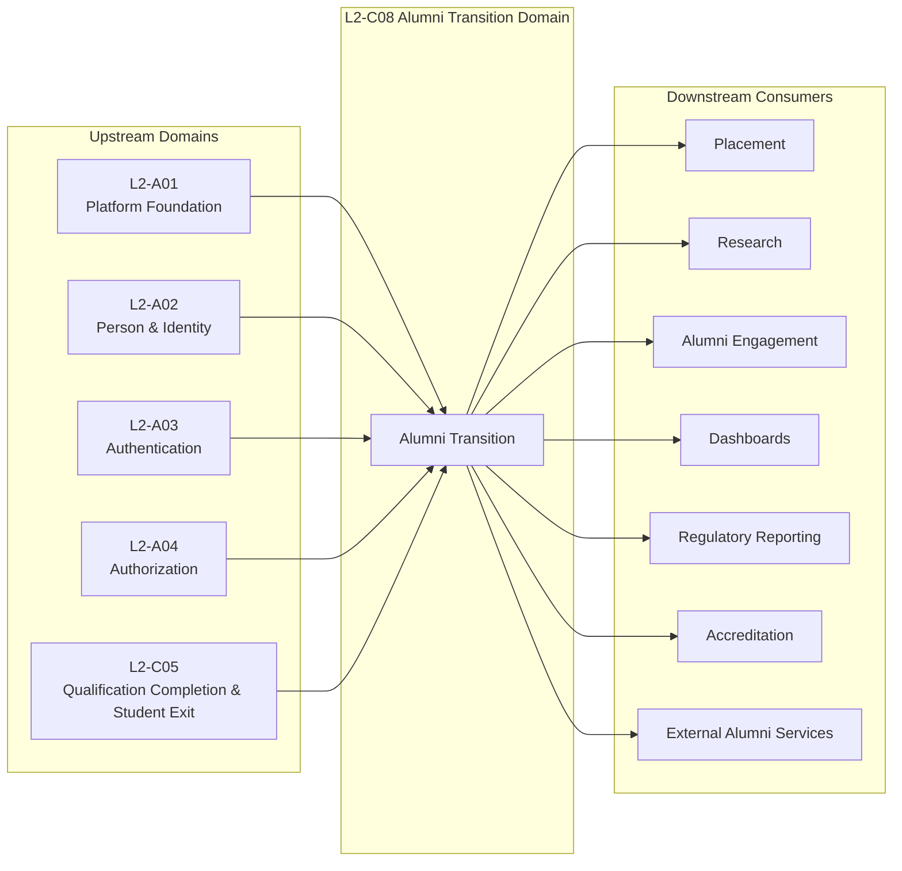

# D02 — Upstream & Downstream Dependency Model

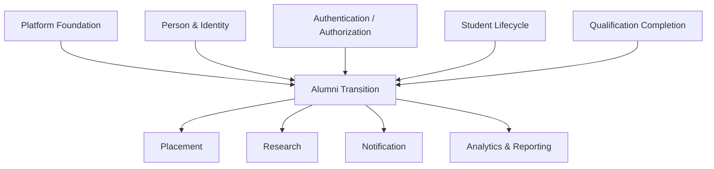

# D03 — Aggregate Ownership Model

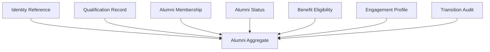

# D04 — Aggregate Relationship Diagram
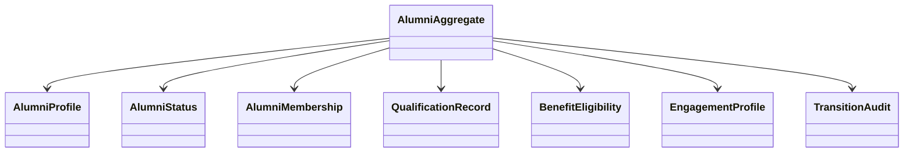

# D05 — Domain Entity Relationship Diagram

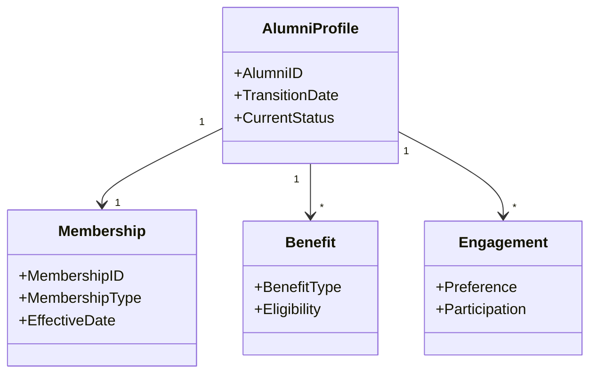

# D06 — End-to-End Alumni Transition Workflow
```mermaid
flowchart TD

Qualification Completed Student["Qualification Completed"]

Validate["Validate Eligibility"]

Decision{"Eligible?"}

Reject["Remain Student"]

Create["Create Alumni Record"]

Assign["Assign Membership"]

Activate["Activate Alumni Status"]

Publish["Publish Alumni Transition Event"]

Complete["Transition Completed"]

Qualification Completed Student --> Validate
Validate --> Decision

Decision -- No --> Reject
Decision -- Yes --> Create

Create --> Assign
Assign --> Activate
Activate --> Publish
Publish --> Complete
```
# D07 — Workflow Swimlane

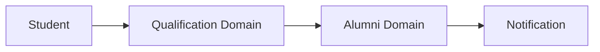

# D08 — Workflow Sequence
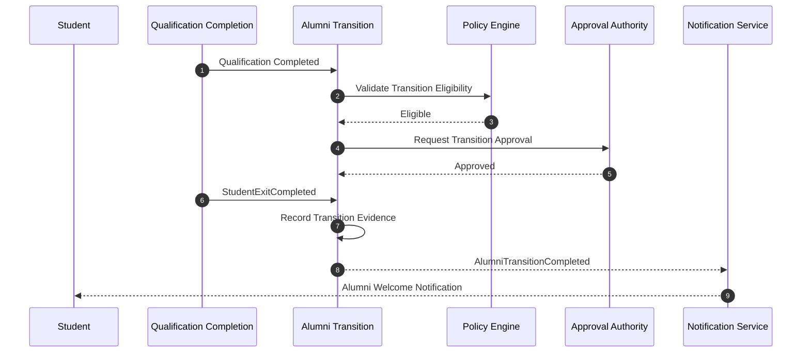

# D09 — Alumni Lifecycle State Machine
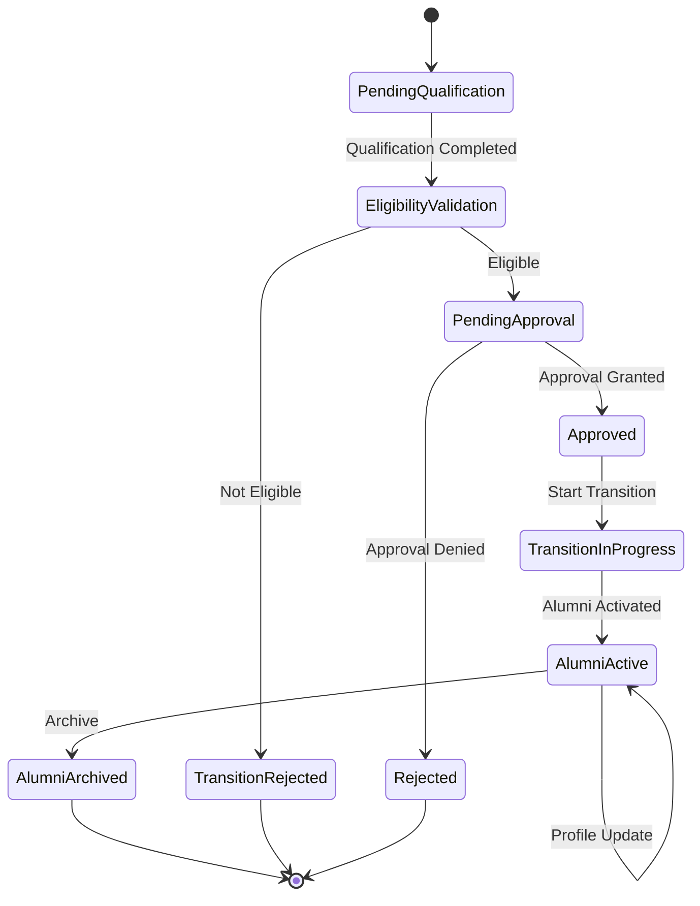

# D10 — Alumni Transition Decision Flow

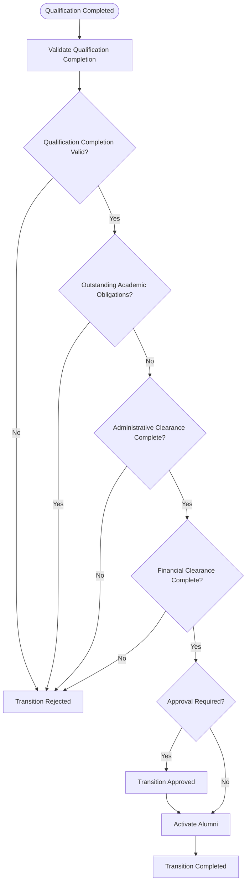

# D11 — Validation Pipeline

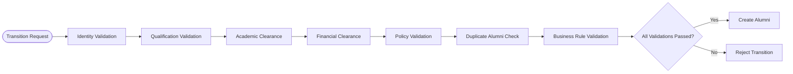

# D12 — Authorization Flow
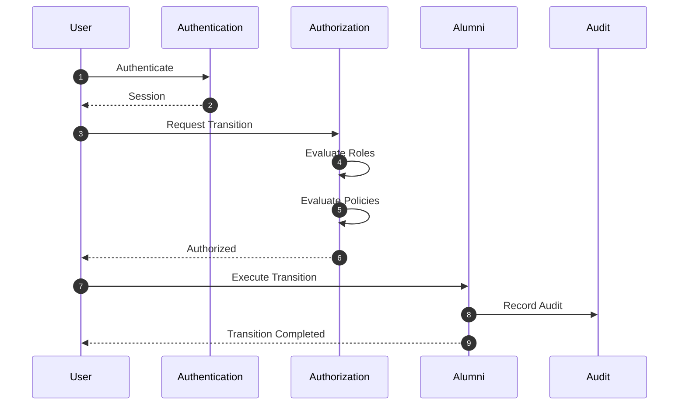

# D13 — Failure Handling Flow

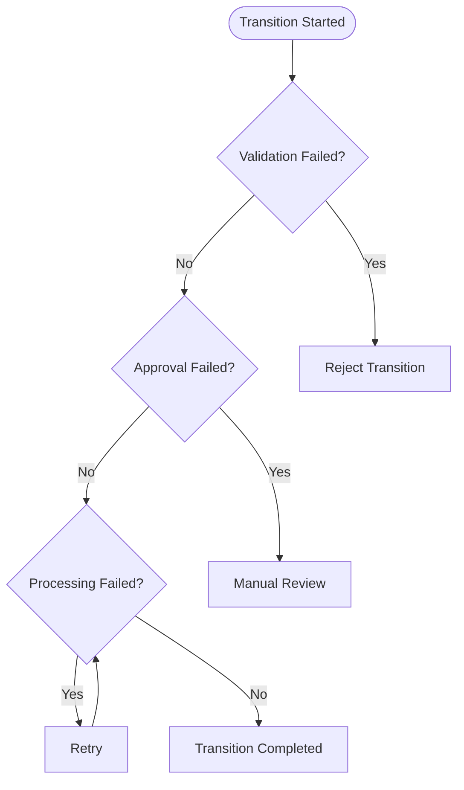

# D14 — Domain Event Flow

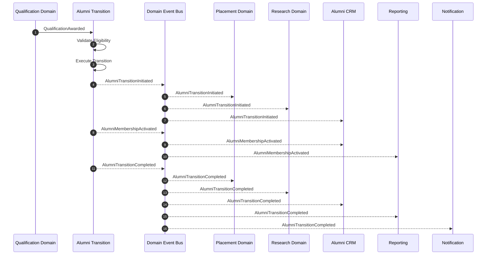

# D15 — Domain Service Collaboration
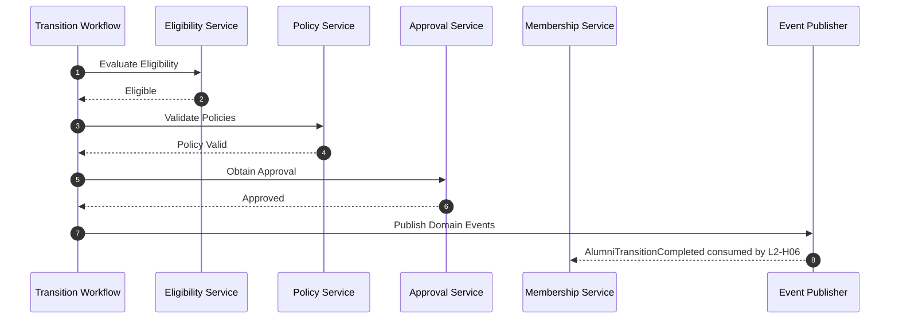

# D16 — Cross-Domain Collaboration

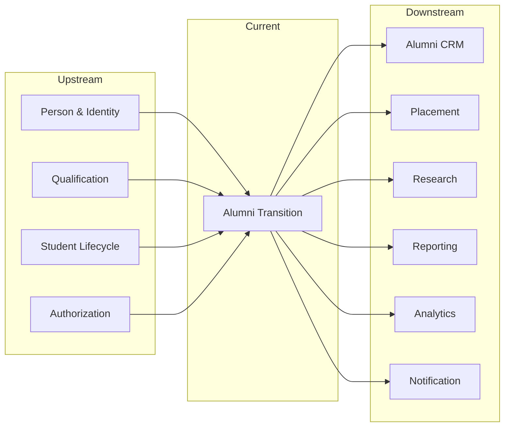

# D17 — Audit Flow

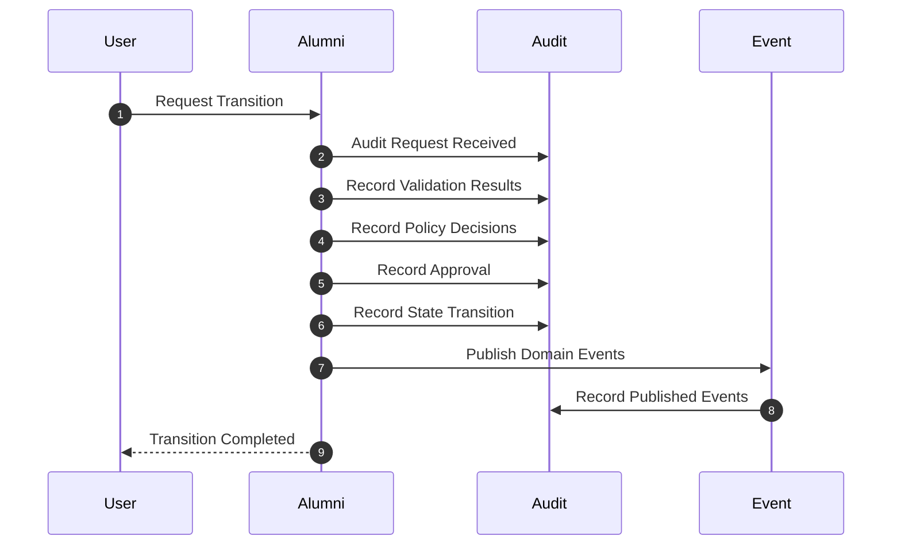

# D18 — Canonical Data Ownership Map

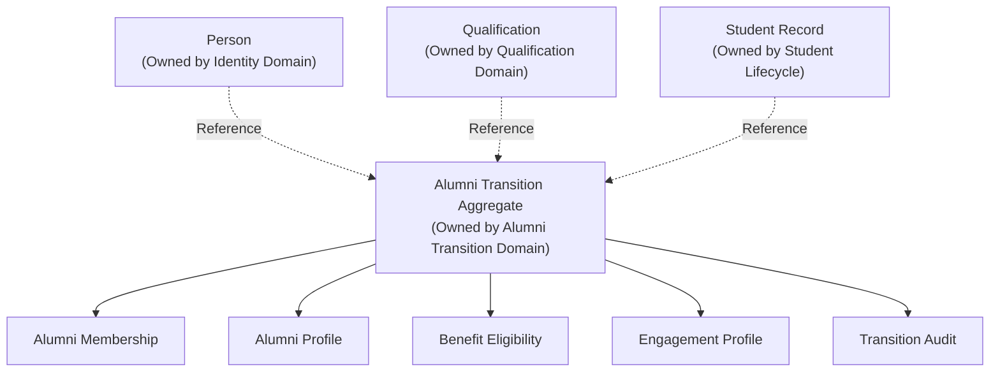

# D19 — Extension Architecture

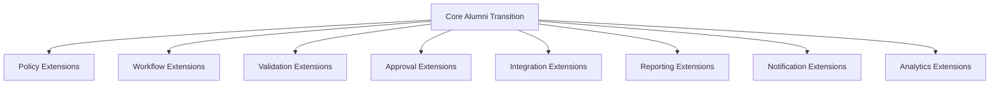

# D20 — Complete End-to-End Business Journey

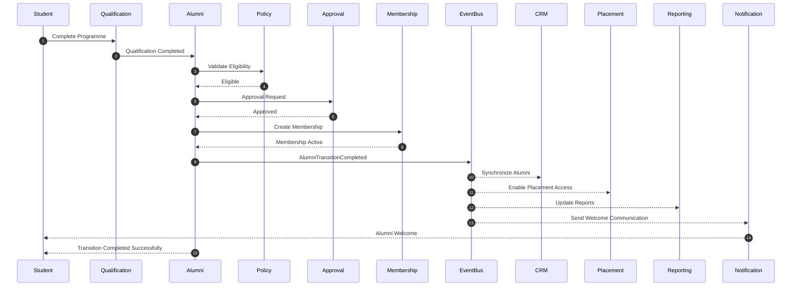

# 22. Architecture Decision Records (ADRs)

## 22.1 Purpose

This section records the significant architectural decisions that govern the Alumni Transition domain.

Each Architecture Decision Record (ADR) captures the context, decision, rationale, alternatives considered, and long-term consequences of an architectural choice.

These ADRs are normative and shall guide future evolution of the domain. Any change to an approved ADR shall follow the project's architecture governance process.

---

# 22.2 ADR-001 — Alumni Transition as an Independent Bounded Context

| Attribute | Value |
|-----------|-------|
| ADR ID | ADR-001 |
| Status | Accepted |
| Decision Date | Architecture Baseline |
| Owner | Enterprise Architecture Board |

### Context

The transition of a Student into an Alumni represents a distinct business lifecycle with its own business rules, policies, workflows, events, and integrations.

Embedding this responsibility within Student Lifecycle or Qualification Completion would increase coupling and violate domain ownership principles.

### Decision

The Alumni Transition capability shall exist as an independent bounded context within the Student Lifecycle section.

### Alternatives Considered

- Implement within Student Lifecycle
- Implement within Qualification Completion
- Implement within Alumni Engagement

### Rationale

A dedicated bounded context provides:

- Clear ownership
- Independent lifecycle
- Independent policy evolution
- Stable integration contracts
- Loose coupling

### Consequences

Positive

- Clear ownership boundaries
- Independent evolution
- Better maintainability
- Improved scalability

Negative

- Additional integration events
- Additional bounded context coordination

---

# 22.3 ADR-002 — Event-Driven Transition Completion

| Attribute | Value |
|-----------|-------|
| ADR ID | ADR-002 |
| Status | Accepted |

### Context

Multiple downstream domains depend upon successful Alumni Transition completion.

### Decision

Completion of an Alumni Transition shall publish canonical domain events instead of invoking downstream workflows directly.

### Alternatives Considered

- Direct service invocation
- Shared workflow ownership
- Polling

### Rationale

Publishing business facts rather than invoking downstream processes preserves loose coupling.

### Consequences

Positive

- Event-driven architecture
- Independent consumers
- Better scalability

Negative

- Event sequencing must be governed.

---

# 22.4 ADR-003 — Immutable Transition History

| Attribute | Value |
|-----------|-------|
| ADR ID | ADR-003 |
| Status | Accepted |

### Context

Alumni transitions represent historical institutional records.

Historical information must remain auditable.

### Decision

Completed Alumni Transition records shall never be modified.

Corrections shall occur through compensating actions.

### Alternatives Considered

- Direct updates
- Record replacement
- Soft overwrite

### Rationale

Immutable history provides:

- Auditability
- Regulatory compliance
- Historical integrity

### Consequences

Positive

- Reliable history
- Simplified auditing

Negative

- Additional correction workflows

---

# 22.5 ADR-004 — Policy-Based Eligibility Evaluation

| Attribute | Value |
|-----------|-------|
| ADR ID | ADR-004 |
| Status | Accepted |

### Context

Eligibility rules vary across institutions and regulatory bodies.

### Decision

Eligibility shall be evaluated through configurable business policies.

### Alternatives Considered

- Hard-coded rules
- Manual evaluation

### Rationale

Configuration provides institutional flexibility without architectural changes.

### Consequences

Positive

- Extensibility
- Configurability

Negative

- Greater policy governance required

---

# 22.6 ADR-005 — Explicit Approval Workflow

| Attribute | Value |
|-----------|-------|
| ADR ID | ADR-005 |
| Status | Accepted |

### Context

Some institutions require formal approval before Alumni activation.

### Decision

Approval shall be modeled explicitly within the workflow rather than assumed.

### Alternatives Considered

- Automatic activation
- Manual activation outside ERP

### Rationale

Explicit approvals improve governance and auditability.

### Consequences

Positive

- Better governance
- Policy compliance

Negative

- Longer workflow duration where approvals are required

---

# 22.7 ADR-006 — Aggregate Ownership Boundaries

| Attribute | Value |
|-----------|-------|
| ADR ID | ADR-006 |
| Status | Accepted |

### Context

Multiple domains reference student and alumni information.

### Decision

The Alumni Transition domain shall own only transition-specific aggregates.

Canonical ownership remains with upstream domains.

### Ownership Model

| Aggregate | Canonical Owner |
|-----------|-----------------|
| Person | L2-A02 Person & Identity |
| Student | Student Lifecycle |
| Qualification | Qualification Completion |
| Alumni Transition | Alumni Transition |
| Alumni Membership | L2-H06 Alumni Workflows |
| Alumni Profile | L2-H06 Alumni Workflows |

### Consequences

Positive

- No ownership duplication
- Strong DDD boundaries

Negative

- Additional cross-domain references

---

# 22.8 ADR-007 — Business Event Publication Strategy

| Attribute | Value |
|-----------|-------|
| ADR ID | ADR-007 |
| Status | Accepted |

### Context

Placement, CRM, Reporting, and Notification depend on Alumni Transition.

### Decision

Only completed business facts shall be published as domain events.

### Alternatives Considered

- Publish every internal workflow step
- Shared database integration

### Rationale

Consumers should receive stable business facts rather than transient workflow states.

### Consequences

Positive

- Stable integration contracts
- Reduced coupling

Negative

- Internal workflow progress remains private

---

# 22.9 ADR-008 — Correction Through Compensating Actions

| Attribute | Value |
|-----------|-------|
| ADR ID | ADR-008 |
| Status | Accepted |

### Context

Business corrections may occasionally be required after transition completion.

### Decision

Historical records shall never be rewritten.

Corrections shall be performed using compensating business actions that preserve historical integrity.

### Alternatives Considered

- Update historical records
- Delete transition records

### Rationale

Compensating actions maintain complete audit history while supporting legitimate business corrections.

### Consequences

Positive

- Immutable audit history
- Regulatory compliance
- Traceable business evolution

Negative

- Additional correction workflows

---

# 22.10 ADR Governance

The following governance principles apply to every Architecture Decision Record.

| Rule | Description |
|------|-------------|
| ADRs are normative | Every downstream architecture shall comply. |
| Changes require review | Approved ADRs shall not be modified without architecture review. |
| Version controlled | Every change shall create a new document revision. |
| Traceable | Every architectural change shall reference the affected ADR(s). |
| Technology independent | ADRs describe architectural intent, not implementation. |
| Backward compatibility | Changes shall consider downstream architectural impact before approval. |

---

## Architecture Summary

The Architecture Decision Records establish the constitutional decisions governing the Alumni Transition domain.

They provide a permanent record of why the architecture has been designed in its current form and ensure that future evolution remains consistent with the architectural principles of SutraERP.

# 23. Glossary

## 23.1 Purpose

This glossary establishes the canonical vocabulary used throughout the Alumni Transition domain.

Every architectural term defined here shall have a single, unambiguous meaning across the SutraERP architecture.

No downstream architecture may redefine these terms without formal architecture approval.

---

## 23.2 Architectural Terms

| Term | Definition |
|------|------------|
| Aggregate | A consistency boundary that encapsulates related business entities governed by a single Aggregate Root. |
| Aggregate Root | The primary entity responsible for enforcing business invariants within an aggregate. |
| Architecture Decision Record (ADR) | A documented architectural decision capturing context, rationale, alternatives, and consequences. |
| Bounded Context | A logical boundary within which a domain model is valid and consistently applied. |
| Business Event | A completed business fact occurring within the domain. |
| Canonical Owner | The single domain responsible for owning the lifecycle and business rules of an entity or concept. |
| Compensating Action | A corrective business operation that preserves historical integrity instead of modifying existing records. |
| Domain Event | A published representation of a completed business fact consumed by other domains. |
| Domain Service | A business capability that coordinates operations across aggregates while preserving ownership boundaries. |
| Integration Event | A public event published for consumption by external domains or services. |
| Invariant | A business rule that must always remain true throughout the aggregate lifecycle. |
| Policy | A configurable business rule that governs decision making without requiring software changes. |
| Transition | The controlled business process that converts an eligible student into an alumnus/alumna. |

---

## 23.3 Alumni Domain Terms

| Term | Definition |
|------|------------|
| Alumni | A former student who has successfully completed the institution's qualification requirements and whose transition has been completed. |
| Alumni Identifier | The immutable identifier assigned to an alumnus within the Alumni domain. |
| Alumni Membership | The formal institutional relationship established after successful transition. |
| Alumni Profile | The canonical profile representing an alumnus after transition. |
| Alumni Status | The current lifecycle state of an alumnus. |
| Alumni Transition | The controlled workflow that converts an eligible student into an alumnus. |
| Benefit Eligibility | The set of institutional privileges and services available to an alumnus. |
| Engagement Profile | The collection of communication preferences, participation history, and engagement metadata associated with an alumnus. |
| Qualification Completion | Confirmation that all academic requirements necessary for qualification completion have been successfully fulfilled. |
| Transition Approval | The formal authorization permitting the Alumni Transition workflow to proceed. |
| Transition Audit | The complete audit history generated throughout the Alumni Transition lifecycle. |

---

## 23.4 Lifecycle Terms

| Term | Definition |
|------|------------|
| Pending Qualification | Student has not yet completed all qualification requirements. |
| Eligibility Validation | Evaluation of academic, financial, administrative, and policy requirements. |
| Pending Approval | Transition is awaiting required institutional approval. |
| Approved | Transition has been authorized to proceed. |
| Transition In Progress | Alumni records are being created and activated. |
| Alumni Active | Transition completed successfully and alumni lifecycle has begun. |
| Archived | Alumni record retained for historical purposes but no longer operational. |
| Rejected | Transition terminated because one or more mandatory conditions were not satisfied. |

---

## 23.5 Workflow Terms

| Term | Definition |
|------|------------|
| Eligibility Check | Business validation confirming that transition requirements have been satisfied. |
| Validation Pipeline | Ordered sequence of business validations executed before transition. |
| Authorization Evaluation | Verification that the requesting user has sufficient privileges to perform the transition. |
| Approval Workflow | Configurable institutional approval process governing Alumni Transition. |
| Failure Handling | Controlled response to validation, policy, authorization, or processing failures. |
| Event Publication | Publication of completed business facts for downstream consumers. |

---

## 23.6 Cross-Domain Terms

| Term | Canonical Owner |
|------|-----------------|
| Person | L2-A02 Person & Identity |
| Student | Student Lifecycle |
| Qualification | Qualification Completion |
| Authentication | L2-A03 Authentication |
| Authorization | L2-A04 Authorization |
| Alumni Transition | Alumni Transition Domain |
| Alumni Membership | L2-H06 Alumni Domain |
| Alumni Profile | L2-H06 Alumni Domain |
| Placement | Placement Domain |
| Research | Research Domain |
| Notification | Notification Domain |

---

## 23.7 Abbreviations

| Abbreviation | Meaning |
|-------------|---------|
| ADR | Architecture Decision Record |
| DDD | Domain-Driven Design |
| ERP | Enterprise Resource Planning |
| UUID | Universally Unique Identifier |
| API | Application Programming Interface |
| RBAC | Role-Based Access Control |
| ABAC | Attribute-Based Access Control |
| CQRS | Command Query Responsibility Segregation |
| SLA | Service Level Agreement |

---

## 23.8 Naming Conventions

The following naming conventions apply throughout this document.

| Item | Convention |
|------|------------|
| Aggregate | PascalCase |
| Domain Event | Past-tense PascalCase |
| Integration Event | Past-tense PascalCase |
| Business Rule | Descriptive sentence |
| Workflow | Verb–Noun format |
| Service | Noun + Service |
| Policy | Noun + Policy |
| State | Singular noun or adjective |
| Decision | Descriptive business phrase |

---

## 23.9 Glossary Governance

The glossary shall be governed according to the following principles.

- Every business term shall have exactly one canonical definition.
- Duplicate terminology across domains is prohibited.
- Cross-domain terms shall reference the owning domain rather than redefining them.
- New terminology introduced into this domain shall be added to this glossary before architecture approval.
- Changes to existing definitions require architecture governance review.

---

## Glossary Summary

The Glossary provides the authoritative business vocabulary for the Alumni Transition domain.

It ensures that architects, developers, analysts, testers, and business stakeholders use a consistent language when designing, implementing, reviewing, and maintaining the domain architecture.

# 24. References

## 24.1 Purpose

This section identifies the authoritative architectural, business, governance, and technical references used in the design of the Alumni Transition domain.

These references provide the normative foundation for architectural decisions, workflow definitions, integration boundaries, and business rules.

---

# 24.2 Internal Architecture References

| Reference ID | Document | Purpose |
|--------------|----------|---------|
| L1-ARCH | SutraERP Level 1 Enterprise Architecture | Defines the enterprise architecture vision and domain decomposition. |
| ARCH-INDEX | Architecture Index | Provides the complete catalogue of architectural documents and dependencies. |
| DEP-MAP | Dependency Map | Defines cross-domain dependencies and ownership relationships. |
| L2-MATRIX | Level 2 Architecture Matrix | Identifies the complete Level 2 bounded context structure. |
| A01 | L2-A01 Platform Foundation | Platform services, infrastructure, and shared architectural capabilities. |
| A02 | L2-A02 Person & Identity | Canonical ownership of person and identity information. |
| A03 | L2-A03 Authentication | Authentication architecture and identity verification. |
| A04 | L2-A04 Authorization & Policy | Authorization, permissions, roles, and policy evaluation. |
| C05 | L2-C05 Qualification Completion & Student Exit | Qualification Completion completion workflow that initiates Alumni Transition. |

---

# 24.3 Downstream Architecture References

| Domain | Purpose |
|--------|---------|
| Alumni Engagement | Alumni communication, participation, and relationship management. |
| Placement | Qualification Completed Student placement services and employer engagement. |
| Research | Alumni participation in institutional research activities. |
| Reporting & Analytics | Operational and executive reporting. |
| Notification | Communication of Alumni Transition events. |
| Regulatory Reporting | Compliance reporting for governing authorities. |

---

# 24.4 Business References

| Reference | Description |
|-----------|-------------|
| Institutional Academic Regulations | Qualification Completion eligibility requirements. |
| Examination Regulations | Academic completion and certification rules. |
| Student Exit Policies | Student clearance and exit procedures. |
| Alumni Membership Policies | Institutional alumni membership rules. |
| Financial Clearance Policies | Outstanding financial obligation rules. |
| Administrative Clearance Policies | Administrative completion requirements. |

---

# 24.5 Architectural Standards

The Alumni Transition architecture follows the enterprise architectural standards adopted throughout SutraERP.

| Standard | Purpose |
|----------|---------|
| Domain-Driven Design (DDD) | Domain decomposition and bounded contexts. |
| Event-Driven Architecture (EDA) | Loose coupling through business events. |
| SOLID Principles | Maintainable application design. |
| Clean Architecture | Separation of concerns and dependency management. |
| CQRS (where applicable) | Separation of command and query responsibilities. |
| Immutable Audit History | Preservation of historical business facts. |

---

# 24.6 Security References

| Standard | Usage |
|----------|-------|
| Authentication Architecture | User identity verification. |
| Authorization Architecture | Role- and policy-based access control. |
| Audit Standards | Recording of security-sensitive business actions. |
| Privacy Policies | Protection of personally identifiable information (PII). |
| Data Retention Policies | Long-term preservation and archival rules. |

---

# 24.7 Integration References

The Alumni Transition domain exchanges information with other domains exclusively through governed integration mechanisms.

| Integration Type | Purpose |
|------------------|---------|
| Domain Events | Publish completed business facts. |
| Integration Events | Notify downstream bounded contexts. |
| Read APIs | Access canonical data owned by upstream domains. |
| Reference Data | Consume shared master and configuration data. |
| Notification Services | Deliver business communications. |

---

# 24.8 Regulatory & Compliance References

| Reference | Purpose |
|-----------|---------|
| Institutional Governance Policies | Institutional operating rules. |
| National Higher Education Regulations | Regulatory compliance requirements. |
| Accreditation Guidelines | Institutional accreditation support. |
| Record Retention Policies | Long-term preservation of institutional records. |
| Audit & Compliance Policies | Operational and legal accountability. |

---

# 24.9 Document Dependencies

The following documents shall be considered prerequisites for understanding or modifying the Alumni Transition architecture.

| Dependency | Relationship |
|------------|--------------|
| L2-A02 Person & Identity | Canonical person ownership. |
| L2-A03 Authentication | Authentication prerequisites. |
| L2-A04 Authorization & Policy | Authorization and policy evaluation. |
| L2-C05 Qualification Completion & Student Exit | Primary upstream workflow. |
| Dependency Map | Cross-domain dependencies. |
| Architecture Index | Repository navigation and traceability. |

---

# 24.10 Reference Governance

The following governance rules apply to all references used within this document.

- References shall point only to approved architectural or business sources.
- Canonical ownership shall always be respected.
- Superseded references shall be replaced through formal architecture governance.
- Cross-domain references shall not duplicate or redefine external domain responsibilities.
- Architectural traceability shall be maintained throughout future revisions.

---

## Reference Summary

The references documented in this section establish the authoritative sources supporting the Alumni Transition architecture.

Together with the Architecture Decision Records, these references provide complete traceability from enterprise architecture and institutional policy to the detailed workflows, business rules, integrations, and governance mechanisms defined within this domain.

# 25. Conclusion

## 25.1 Purpose

This section summarizes the architectural outcomes of the Alumni Transition domain and confirms its alignment with the enterprise architecture principles of SutraERP.

The Alumni Transition domain establishes the controlled business process by which an eligible student is transformed into an alumnus while preserving institutional integrity, auditability, and domain ownership.

---

# 25.2 Architectural Summary

The architecture defines Alumni Transition as an independent bounded context responsible for coordinating the business activities required to complete the transition from Student to Alumni.

The domain:

- Owns the complete Alumni Transition lifecycle.
- Maintains transition-specific aggregates and business rules.
- Publishes canonical domain events after successful transition.
- Preserves immutable historical records.
- Integrates with upstream and downstream domains through governed interfaces.
- Enforces configurable institutional policies.
- Supports institutional variation without architectural modification.

---

# 25.3 Alignment with Enterprise Principles

The Alumni Transition architecture conforms to the core architectural principles adopted across SutraERP.

| Principle | Compliance |
|-----------|------------|
| Domain-Driven Design | ✓ Fully Compliant |
| Bounded Context Isolation | ✓ Fully Compliant |
| Canonical Data Ownership | ✓ Fully Compliant |
| Event-Driven Integration | ✓ Fully Compliant |
| Loose Coupling | ✓ Fully Compliant |
| High Cohesion | ✓ Fully Compliant |
| Immutable Audit History | ✓ Fully Compliant |
| Policy-Driven Behaviour | ✓ Fully Compliant |
| Technology Independence | ✓ Fully Compliant |
| Extensibility | ✓ Fully Compliant |

---

# 25.4 Business Outcomes

Implementation of this architecture provides the following institutional capabilities.

| Capability | Outcome |
|------------|---------|
| Controlled Alumni Transition | Standardized transition workflow across institutions. |
| Policy-Based Eligibility | Institution-specific transition rules without code changes. |
| Complete Auditability | End-to-end traceability of every transition. |
| Event-Driven Integration | Reliable communication with downstream domains. |
| Canonical Ownership | Elimination of duplicate business ownership. |
| Historical Integrity | Preservation of immutable transition history. |
| Governance | Transparent approval and authorization processes. |

---

# 25.5 Operational Benefits

The architecture delivers measurable operational advantages.

- Reduced duplication of business logic.
- Simplified integration across bounded contexts.
- Improved maintainability and scalability.
- Consistent institutional governance.
- Faster onboarding of new institutional policies.
- Improved reporting accuracy.
- Enhanced regulatory compliance.
- Clear separation of business responsibilities.

---

# 25.6 Future Extensibility

The architecture has been designed to accommodate future enhancements without violating existing architectural principles.

Potential extensions include:

- Alumni mentoring programmes.
- Alumni networking services.
- Continuing education participation.
- Donation and fundraising integration.
- Career services integration.
- Professional certification tracking.
- International alumni chapters.
- AI-assisted alumni engagement and analytics.

These extensions shall consume the canonical Alumni domain through published interfaces and events rather than modifying core transition workflows.

---

# 25.7 Implementation Readiness

The Alumni Transition architecture is implementation-ready.

The document provides:

- Business objectives.
- Domain boundaries.
- Aggregate definitions.
- Entity models.
- Business rules.
- Workflow specifications.
- State models.
- Validation logic.
- Authorization requirements.
- Integration contracts.
- Domain events.
- Error handling.
- Audit requirements.
- Visual architecture diagrams.
- Architecture Decision Records.
- Glossary.
- Reference catalogue.

Together, these artefacts provide sufficient architectural guidance for detailed design, implementation, testing, deployment, and long-term maintenance.

---

# 25.8 Governance Statement

Future evolution of the Alumni Transition domain shall comply with the following governance principles.

- Preserve bounded context boundaries.
- Respect canonical ownership.
- Maintain backward-compatible integration contracts where practical.
- Introduce new business capabilities through extension points.
- Record significant architectural changes through new ADRs.
- Preserve auditability and historical integrity.
- Maintain traceability between business requirements and architectural artefacts.

---

# 25.9 Document Status

| Attribute | Value |
|-----------|-------|
| Document Status | Locked |
| Architecture Level | Level 2 (Bounded Context) |
| Domain | Alumni Transition |
| Review Status | Ready for Architecture Review |
| Implementation Status | Ready for Detailed Design |
| Version | 1.0 |

---

# 25.10 Closing Statement

The Alumni Transition architecture provides a complete, technology-agnostic specification for managing the institutional transition from Student to Alumni within SutraERP.

By combining Domain-Driven Design, event-driven integration, policy-based decision making, immutable audit history, and clearly defined ownership boundaries, this architecture establishes a robust foundation that supports institutional governance, regulatory compliance, scalability, and future functional expansion while remaining consistent with the overall SutraERP enterprise architecture.

# 26. Document Metadata

## 26.1 Document Information

| Attribute | Value |
|-----------|-------|
| Document Title | L2-C08 — Alumni Transition Workflows |
| Architecture Level | Level 2 (Bounded Context) |
| Domain | Student Lifecycle |
| Bounded Context | Alumni Transition |
| Document Type | Enterprise Architecture Specification |
| Version | 1.0 |
| Status | Locked |
| Classification | Internal Architecture |
| Language | English |

---

## 26.2 Ownership

| Role | Responsibility |
|------|----------------|
| Document Owner | Student Lifecycle — Alumni Transition |
| Business Owner | Student Lifecycle Domain Owner |
| Technical Owner | Solution Architecture Team |
| Governance Authority | Architecture Review Board |
| Implementation Owner | Engineering Team |
| Custodian | SutraERP Architecture Repository |

---

## 26.3 Review Information

| Attribute | Value |
|-----------|-------|
| Review Status | Approved for Architecture Review |
| Next Review | Prior to implementation or major business change |
| Review Frequency | As required by Architecture Governance |
| Approval Authority | Enterprise Architecture Board |

---

## 26.4 Version History

| Version | Date | Author | Description |
|---------|------|--------|-------------|
| 0.1 | Initial Draft | Enterprise Architecture Team | Initial architecture definition |
| 0.5 | Architecture Review | Enterprise Architecture Team | Domain model, workflows, events, and integrations refined |
| 1.0 | Architecture Baseline | Enterprise Architecture Team | First approved Level 2 baseline |

---

## 26.5 Traceability Matrix

| Requirement Area | Covered In |
|------------------|------------|
| Business Objectives | Section 1 |
| Scope & Boundaries | Section 2 |
| Domain Model | Sections 3–6 |
| Business Rules | Sections 7–9 |
| Workflows | Sections 10–15 |
| Integrations | Sections 16–18 |
| Security & Governance | Sections 19–20 |
| Visual Architecture | Section 21 |
| Architecture Decisions | Section 22 |
| Glossary | Section 23 |
| References | Section 24 |
| Conclusion | Section 25 |

---

## 26.6 Compliance Checklist

| Requirement | Status |
|------------|--------|
| Enterprise Architecture Alignment | ✓ Complete |
| Domain Boundary Defined | ✓ Complete |
| Aggregate Ownership Defined | ✓ Complete |
| Business Rules Documented | ✓ Complete |
| Workflow Definitions Complete | ✓ Complete |
| Domain Events Specified | ✓ Complete |
| Integration Contracts Identified | ✓ Complete |
| Security Considerations Included | ✓ Complete |
| Audit Requirements Included | ✓ Complete |
| Architecture Diagrams Included | ✓ Complete |
| ADRs Documented | ✓ Complete |
| Glossary Included | ✓ Complete |
| References Included | ✓ Complete |

---

## 26.7 Deliverables Produced

This architecture specification includes the following deliverables:

- Enterprise business context
- Domain scope and responsibilities
- Canonical domain model
- Aggregate definitions
- Entity relationships
- Business rules
- Workflow specifications
- Lifecycle state definitions
- Validation and authorization flows
- Domain event catalogue
- Integration architecture
- Security and audit considerations
- Twenty architecture diagrams (Mermaid)
- Architecture Decision Records (ADRs)
- Glossary
- Reference catalogue
- Governance guidance
- Implementation-ready architectural baseline

---

## 26.8 Proposed Repository Structure — Not Yet Created

> Corrected 2026-08-06 under integrity finding INT-212. This section previously presented
> the tree below as the document's actual layout. It is not. `L2-C08` is a single flat
> file at `architecture/L2_Domain_Workflow_Architecture/section-c/`, consistent with all
> 107 L2 documents. None of the `diagrams/`, `adr/` or `assets/` paths below exist, and
> the eight ADRs referenced are unwritten. `governance/constitution/Volume_2_Repository_Standards.md`
> line 83 requires that planned folders not be referenced as existing paths until they are
> created. Treat the tree as a proposal awaiting Lead Architect approval.

```text
L2-C08_Alumni_Transition_Workflows/
├── L2-C08_Alumni_Transition_Workflows.md
├── diagrams/
│   ├── D01_Domain_Context.mmd
│   ├── D02_Dependency_Map.mmd
│   ├── ...
│   └── D20_Complete_Business_Journey.mmd
├── adr/
│   ├── ADR-001.md
│   ├── ADR-002.md
│   ├── ...
│   └── ADR-008.md
└── assets/
    └── supporting-images/
```

---

## 26.9 Approval Sign-Off

| Role | Status |
|------|--------|
| Enterprise Architect | Pending Approval |
| Domain Architect | Pending Approval |
| Business Owner | Pending Approval |
| Solution Architect | Pending Approval |
| Engineering Lead | Pending Approval |

---

## 26.10 Final Statement

This document constitutes the complete **Level 2 Architecture Specification** for the **L2-C08 — Alumni Transition** bounded context within SutraERP.

It is intended to serve as the authoritative source for architecture review, detailed design, implementation, testing, and future evolution. Any modifications to this specification shall follow the established architecture governance process, maintain traceability through Architecture Decision Records, and preserve the enterprise principles of bounded contexts, canonical ownership, event-driven integration, and technology independence.

---

# End of Document

