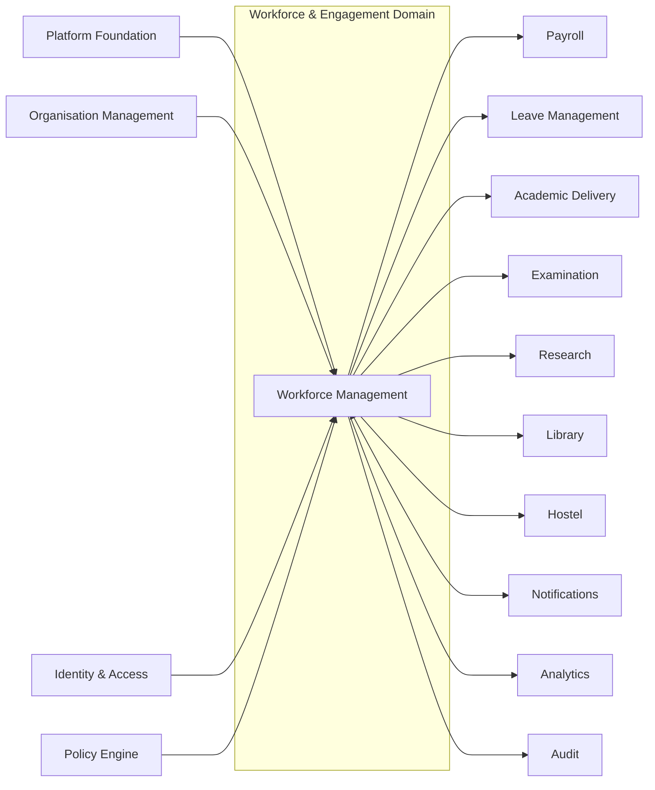
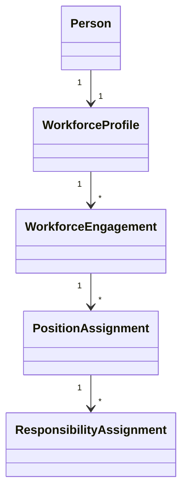
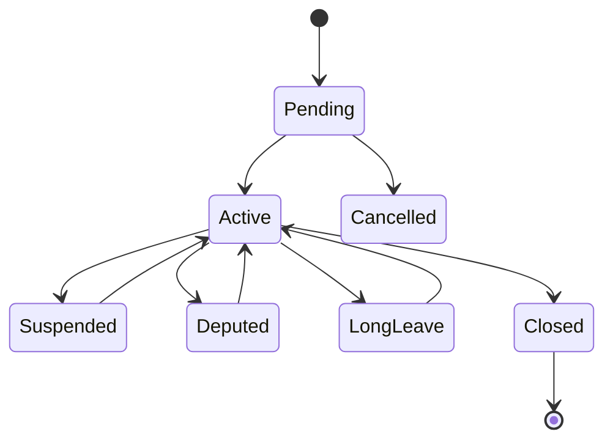
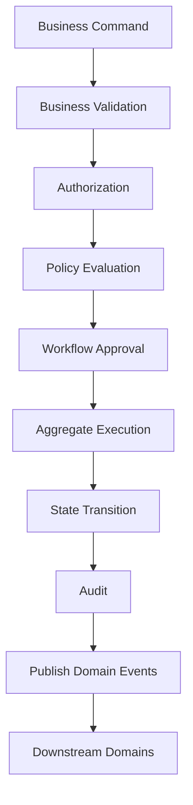
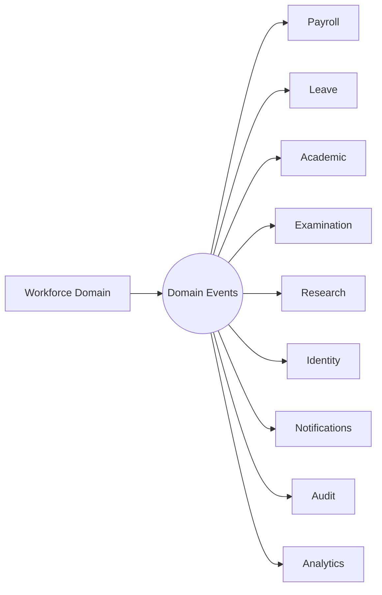
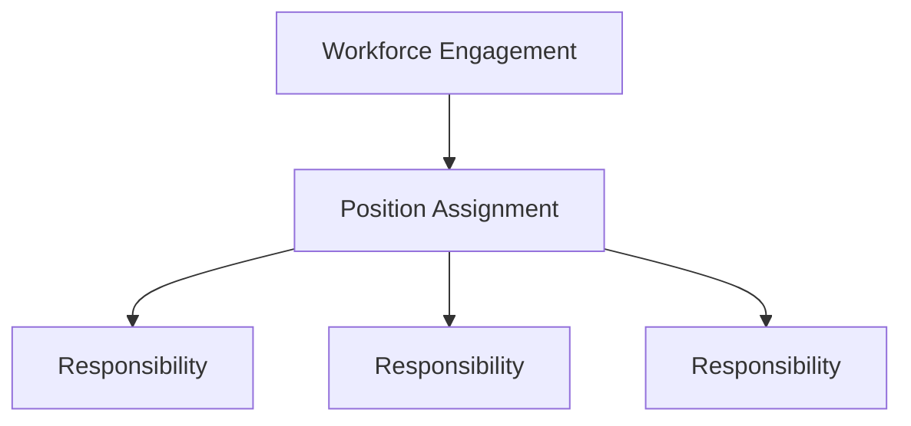
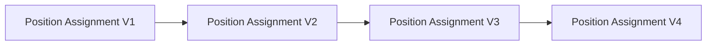
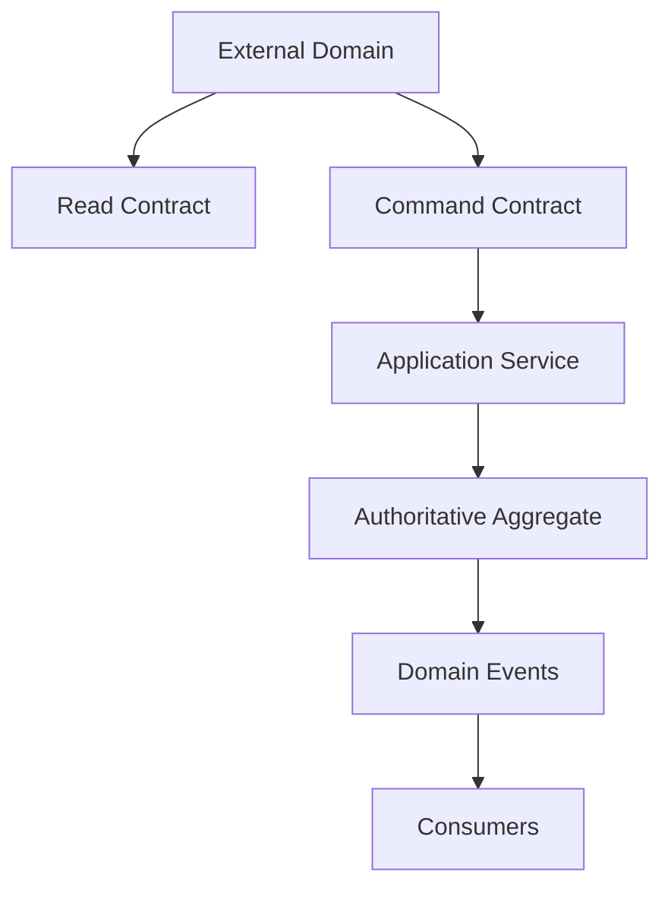
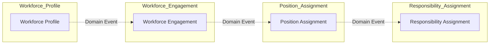

# L2-E01 — Workforce & Engagement Workflows

| Metadata | Value |
|----------|-------|
| **Document ID** | L2-E01 |
| **Document Title** | Workforce & Engagement Workflows |
| **Architecture Level** | Level 2 — Domain Workflow Architecture |
| **Domain** | Workforce & Engagement |
| **Bounded Context** | Workforce & Engagement |
| **Architecture Style** | Domain-Driven Design (DDD), Event-Driven Architecture |
| **Primary Aggregate** | Workforce Engagement |
| **Supporting Aggregates** | Workforce Profile, Position Assignment, Responsibility Assignment |
| **Authoritative Owner** | Workforce Management Domain |
| **Upstream Dependencies** | Platform Foundation (Person), Organisation Management, Identity & Access Management, Policy Engine, Workflow Engine |
| **Downstream Consumers** | Payroll, Leave Management, Academic Delivery, Examination, Research, Library, Hostel, Notifications, Analytics, Audit |
| **Status** | Draft |
| **Version** | 1.0 |
| **Last Updated** | YYYY-MM-DD |
| **Classification** | Enterprise Internal Architecture |

---

# 1. Purpose

## 1.1 Domain Objective

The Workforce & Engagement Domain is the authoritative business domain responsible for governing the complete institutional workforce lifecycle across all educational institutions managed within SutraERP.

This domain establishes, governs, and preserves the employment relationship between an institution and every workforce member, irrespective of employment category, appointment type, contractual arrangement, organisational assignment, academic designation, administrative role, or institutional responsibility.

The domain provides the canonical business architecture for workforce engagement from appointment through activation, operational service, organisational movement, temporary status changes, promotion, transfer, deputation, exit, retirement, re-engagement, and complete historical preservation.

The Workforce & Engagement Domain serves as the single authoritative source of truth for workforce relationships across the entire enterprise architecture.

---

## 1.2 Architectural Mission

The mission of this domain is to establish a unified, consistent, and enterprise-grade workforce architecture capable of supporting institutions ranging from single-campus schools to multi-campus universities, educational trusts, autonomous institutions, higher education groups, and future multi-tenant SaaS deployments without requiring architectural redesign.

The architecture shall preserve complete workforce lifecycle integrity while enabling policy-driven governance, event-driven collaboration, historical reconstruction, enterprise scalability, and long-term business continuity.

---

## 1.3 Business Responsibilities

The Workforce & Engagement Domain shall be responsible for:

- Establishing workforce engagements.
- Activating approved workforce appointments.
- Managing workforce engagement lifecycle transitions.
- Managing workforce organisational movements.
- Managing position assignments.
- Managing institutional responsibilities.
- Managing workforce operational availability.
- Managing temporary workforce states.
- Managing workforce exits and re-engagements.
- Maintaining complete workforce history.
- Publishing authoritative workforce domain events.
- Providing canonical workforce read contracts.
- Preserving complete workforce auditability.
- Maintaining workforce business consistency across the enterprise.

No other business domain shall assume ownership of workforce lifecycle management.

---

## 1.4 Strategic Objectives

The Workforce & Engagement Domain shall achieve the following strategic objectives:

- Establish a canonical workforce architecture for the entire ERP ecosystem.
- Eliminate duplicate workforce ownership across business domains.
- Preserve immutable historical workforce records.
- Support effective-dated workforce operations.
- Enable policy-driven institutional governance.
- Enable event-driven enterprise integration.
- Maintain complete business traceability.
- Support enterprise-scale organisational growth.
- Enable future architectural extensibility without redesign.
- Provide authoritative workforce information to all dependent domains.

---

## 1.5 Architectural Principles

The Workforce & Engagement Domain shall be governed by the following principles.

### Canonical Ownership

Every workforce business capability shall have exactly one authoritative owner.

The Workforce Domain shall remain the exclusive owner of workforce lifecycle information.

---

### Single Source of Truth

All workforce business information shall originate from this domain.

Downstream domains shall consume workforce information exclusively through published read contracts and domain events.

---

### Lifecycle Integrity

Every workforce relationship shall preserve complete lifecycle continuity from initial engagement through permanent closure.

Historical continuity shall never be compromised.

---

### Immutable Business History

Completed business events shall become permanent historical facts.

Historical business records shall never be overwritten or physically deleted.

Business corrections shall be represented through compensating business workflows and new historical events.

---

### Event-Driven Collaboration

The Workforce Domain shall publish business facts after successful business state transitions.

Dependent domains shall independently react to published events without introducing direct business coupling.

---

### Effective Dating

All significant workforce entities shall support effective dating to enable historical reconstruction, future scheduling, policy compliance, and enterprise reporting.

---

### Policy-Driven Governance

Business approvals, authorization rules, workflow routing, and institutional policies shall be externally governed through enterprise Policy and Workflow Engines.

The Workforce Domain shall enforce business outcomes rather than institutional policy definitions.

---

### Enterprise Scalability

The architecture shall support:

- Schools
- Colleges
- Universities
- Educational Trusts
- Multi-Campus Institutions
- Multi-Organisation Educational Groups
- Future Multi-Tenant SaaS Deployments

without modification to the canonical business model.

---

## 1.6 Domain Vision

The Workforce & Engagement Domain forms the foundational people-management capability of SutraERP.

It establishes the canonical workforce architecture upon which Payroll, Leave Management, Academic Delivery, Examination, Research, Library, Hostel, Identity & Access Management, Notifications, Analytics, Audit, and future workforce-dependent domains operate.

Every institutional workforce relationship shall originate, evolve, and conclude within this domain while preserving complete business consistency, organisational integrity, operational continuity, and historical traceability throughout its lifecycle.

# 2. Scope

## 2.1 Domain Scope

The Workforce & Engagement Domain governs the complete lifecycle of institutional workforce engagements and serves as the authoritative business domain responsible for managing workforce relationships throughout their operational existence.

The domain encompasses workforce onboarding, engagement management, organisational assignment, position management, institutional responsibilities, workforce movement, operational availability, workforce separation, re-engagement, and historical workforce governance.

The scope of this domain extends from the successful approval of a workforce appointment until the permanent closure of the workforce engagement while preserving complete historical continuity.

---

## 2.2 In Scope

The Workforce & Engagement Domain shall include responsibility for the following business capabilities.

### Workforce Lifecycle

- Workforce engagement creation.
- Pending workforce engagement management.
- Workforce activation.
- Workforce modification.
- Workforce engagement closure.
- Workforce re-engagement.
- Workforce lifecycle governance.

---

### Workforce Profiles

- Workforce Profile creation.
- Workforce Profile management.
- Workforce Profile consolidation.
- Workforce Profile lifecycle governance.

---

### Workforce Engagements

- Primary workforce engagements.
- Secondary workforce engagements.
- Concurrent workforce engagements.
- Effective-dated workforce engagements.
- Historical engagement preservation.

---

### Position Assignment Management

- Position assignment creation.
- Position assignment modification.
- Position assignment transfer.
- Position assignment closure.
- Historical position assignment management.

---

### Organisational Assignment

- Organisation assignment.
- Department assignment.
- Campus assignment.
- Reporting hierarchy assignment.
- Effective-dated organisational movements.

---

### Workforce Responsibilities

- Responsibility assignment.
- Responsibility delegation.
- Responsibility activation.
- Responsibility suspension.
- Responsibility completion.
- Responsibility withdrawal.
- Responsibility history.

---

### Workforce Movement

- Department transfers.
- Campus transfers.
- Organisation transfers.
- Temporary transfers.
- Permanent transfers.
- Bulk workforce transfers.

---

### Workforce Operational Availability

- Active workforce.
- Suspended workforce.
- Deputation.
- Sabbatical.
- Administrative leave.
- Study leave.
- Long-duration leave.
- Extraordinary leave.
- Operational availability management.

---

### Workforce Separation

- Resignation.
- Retirement.
- Termination.
- Contract completion.
- Dismissal.
- Voluntary retirement.
- Medical separation.
- Death in service.
- Administrative separation.

---

### Workforce Re-Engagement

- Workforce return.
- Rejoining.
- Adjunct engagement.
- Contract re-engagement.
- Consultant engagement.
- Historical continuity preservation.

---

### Workforce Governance

- Effective dating.
- Historical versioning.
- Business audit.
- Policy enforcement.
- Workflow orchestration.
- Event publication.
- Read contract publication.
- Compliance management.

---

## 2.3 Out of Scope

The following capabilities are explicitly outside the responsibility of the Workforce & Engagement Domain.

### Recruitment

The Workforce Domain shall not manage recruitment activities including:

- Job requisitions.
- Candidate management.
- Interview management.
- Offer generation.
- Recruitment pipelines.

Recruitment shall provide approved appointments to the Workforce Domain.

---

### Identity & Access Management

The Workforce Domain shall not manage:

- Authentication.
- User credentials.
- Password policies.
- Login sessions.
- Identity federation.

The Workforce Domain shall publish workforce events consumed by the Identity Domain.

---

### Payroll Processing

The Workforce Domain shall not calculate or process:

- Salary.
- Payroll.
- Taxation.
- Compensation.
- Benefits.
- Financial settlements.

Payroll shall consume authoritative workforce information published by this domain.

---

### Leave Administration

Leave calculations, leave balances, leave approvals, leave encashment, and leave accounting remain outside this domain.

The Workforce Domain only governs workforce operational availability.

---

### Academic Delivery

The Workforce Domain shall not manage:

- Teaching assignments.
- Subject allocations.
- Timetable assignments.
- Course delivery.
- Academic workload planning.

Academic Delivery shall reference Position Assignments published by this domain.

---

### Examination

The Workforce Domain shall not manage:

- Examiner allocation.
- Invigilator scheduling.
- Evaluation assignments.
- Examination committee formation.

The Examination Domain shall consume workforce eligibility information.

---

### Research

Research project allocation, grant administration, publication management, and research supervision workflows remain outside this domain.

Research shall consume workforce eligibility through published contracts.

---

### Organisation Structure

The Workforce Domain shall not create or modify:

- Institutions.
- Organisations.
- Departments.
- Campuses.
- Organisational hierarchy.

Organisation Management remains the authoritative owner of organisational structures.

The Workforce Domain references organisational structures through authoritative read contracts.

---

### Person Management

The Workforce Domain shall not own the canonical Person aggregate.

Person identity, demographic information, and global person lifecycle remain under Platform Foundation.

The Workforce Domain consumes canonical Person information.

---

## 2.4 Architectural Boundaries

The Workforce & Engagement Domain shall exclusively own:

- Workforce Profiles.
- Workforce Engagements.
- Position Assignments.
- Responsibility Assignments.
- Workforce operational lifecycle.
- Workforce organisational lifecycle.
- Workforce historical continuity.

No external business domain shall directly modify these business capabilities.

All modifications shall occur exclusively through authoritative Workforce business workflows.

---

## 2.5 Scope Principles

The following architectural principles govern the scope of this domain.

### Single Ownership Principle

Every workforce capability shall have exactly one authoritative owner.

---

### No Duplicate Business Logic

Business logic implemented within the Workforce Domain shall not be duplicated by downstream domains.

---

### Consumer-Provider Architecture

The Workforce Domain acts as an authoritative provider of workforce information.

Dependent domains consume workforce capabilities without assuming ownership.

---

### Stable Aggregate Boundaries

Aggregate ownership shall remain stable irrespective of institutional configuration, deployment model, organisational size, or future functional expansion.

---

### Future Extensibility

The scope defined by this document shall accommodate future workforce capabilities without requiring changes to the canonical aggregate model or architectural ownership boundaries.

# 3. Upstream Dependencies

## 3.1 Overview

The Workforce & Engagement Domain operates as a downstream consumer of several authoritative enterprise domains. These upstream domains provide canonical business information, policies, organizational context, identity references, and workflow governance required for workforce lifecycle management.

The Workforce Domain shall consume information exclusively through published service contracts and shall not duplicate ownership of upstream business capabilities.

---

## 3.2 Dependency Principles

All upstream integrations shall satisfy the following architectural principles:

- Upstream domains remain the authoritative owners of their respective business capabilities.
- Workforce shall consume upstream information through canonical read contracts.
- Workforce shall not persist duplicated master data except where explicitly required for business continuity.
- Upstream changes shall be propagated through published domain events.
- Workforce workflows shall validate upstream references before authoritative state transitions.

---

## 3.3 Upstream Dependency Matrix

| Upstream Domain | Consumed Capability | Purpose | Ownership |
|-----------------|--------------------|----------|-----------|
| Platform Foundation | Canonical Person | Workforce identity foundation | Platform Foundation |
| Organisation Management | Institution, Organisation, Department, Campus, Hierarchy | Organisational assignment | Organisation Domain |
| Identity & Access Management | Identity Reference | User identity association | Identity Domain |
| Policy Engine | Business Policies | Institutional policy evaluation | Policy Engine |
| Workflow Engine | Workflow Orchestration | Approval orchestration and routing | Workflow Engine |
| Recruitment *(Future)* | Approved Appointment | Workforce engagement initiation | Recruitment Domain |

---

## 3.4 Platform Foundation

### Consumed Business Capabilities

The Workforce Domain consumes:

- Canonical Person
- Global Person Identifier
- Demographic Reference
- Person Lifecycle Status

The Platform Foundation remains the sole authoritative owner of the Person aggregate.

The Workforce Domain shall never create, modify, merge, or delete canonical Person records.

---

### Consumed Read Contracts

- Person Details
- Person Status
- Person Identity Reference
- Person Validation
- Person Existence Verification

---

### Consumed Events

- PersonCreated
- PersonUpdated
- PersonMerged
- PersonDeactivated

---

## 3.5 Organisation Management

The Organisation Domain provides the organisational context within which workforce members operate.

The Workforce Domain references organisational structures but shall never own or modify them.

---

### Consumed Business Objects

- Institution
- Organisation
- Department
- Campus
- Division
- Reporting Hierarchy
- Organisational Unit

---

### Consumed Read Contracts

- Organisation Lookup
- Department Lookup
- Campus Lookup
- Position Hierarchy
- Organisation Validation

---

### Consumed Events

- OrganisationCreated
- OrganisationModified
- OrganisationClosed
- DepartmentCreated
- DepartmentModified
- DepartmentDissolved
- CampusCreated
- CampusClosed

Organisation structural changes shall trigger Workforce transfer workflows where applicable.

---

## 3.6 Identity & Access Management

The Identity Domain remains responsible for authentication and user identity.

The Workforce Domain maintains only the business relationship between workforce members and institutional identities.

---

### Consumed Business Information

- Identity Reference
- Identity Status
- Account Association
- Authentication State

---

### Consumed Read Contracts

- Identity Lookup
- Identity Association
- Account Validation

---

### Consumed Events

- IdentityCreated
- IdentityActivated
- IdentityDisabled
- IdentityRemoved

---

## 3.7 Policy Engine

Institution-specific governance rules shall remain external to the Workforce Domain.

The Policy Engine evaluates configurable institutional policies that influence workforce workflows.

---

### Consumed Policy Categories

- Activation Policies
- Transfer Policies
- Promotion Policies
- Delegation Policies
- Suspension Policies
- Exit Policies
- Re-engagement Policies
- Effective Dating Policies
- Approval Policies

---

### Consumed Services

- Policy Evaluation
- Rule Resolution
- Policy Validation
- Business Constraint Evaluation

---

## 3.8 Workflow Engine

The Workflow Engine orchestrates institutional approval processes.

The Workforce Domain shall remain responsible for business state transitions after successful workflow completion.

---

### Consumed Workflow Capabilities

- Approval Routing
- Dynamic Approver Resolution
- Escalation
- Workflow Execution
- Workflow Completion
- Workflow Cancellation

---

### Consumed Events

- WorkflowStarted
- WorkflowApproved
- WorkflowRejected
- WorkflowCancelled
- WorkflowCompleted

---

## 3.9 Recruitment Domain (Future)

Recruitment remains outside the Workforce bounded context.

Upon successful appointment approval, Recruitment shall initiate workforce onboarding through canonical business contracts.

---

### Consumed Business Information

- Approved Candidate
- Appointment Order
- Employment Terms
- Proposed Joining Date
- Position Reference

---

### Workforce Responsibility

Following appointment approval, the Workforce Domain becomes the authoritative owner of the workforce lifecycle.

Recruitment shall not modify workforce engagements after successful handover.

---

## 3.10 Dependency Validation Requirements

Before executing any authoritative workforce workflow, the following validations shall succeed.

| Validation | Required |
|------------|----------|
| Person Exists | Mandatory |
| Organisation Exists | Mandatory |
| Department Exists | Mandatory |
| Campus Exists | Mandatory |
| Identity Reference Available *(where applicable)* | Mandatory |
| Applicable Policies Resolved | Mandatory |
| Workflow Authorization Completed *(where applicable)* | Mandatory |

Failure of any mandatory dependency validation shall prevent authoritative state transitions.

---

## 3.11 Dependency Failure Principles

If an upstream dependency becomes unavailable:

- Workforce shall not assume ownership of upstream data.
- Workforce shall not fabricate missing master data.
- Workforce workflows shall fail gracefully with complete auditability.
- Temporary retries may be performed according to enterprise retry policies.
- Business consistency shall take precedence over workflow completion.

---

## 3.12 Architectural Dependency Principles

The Workforce Domain shall remain a consumer of authoritative enterprise master data while preserving complete ownership of workforce business capabilities.

No upstream dependency shall directly modify Workforce aggregates.

All multi-domain interaction shall occur through:

- Canonical Read Contracts
- Published Domain Events
- Enterprise Workflow Orchestration
- Policy Evaluation Services

This dependency model preserves clear bounded-context ownership, minimizes coupling, and ensures long-term architectural stability across the SutraERP platform.

# 4. Downstream Dependencies

## 4.1 Overview

The Workforce & Engagement Domain serves as a foundational provider domain within the SutraERP architecture.

Multiple enterprise domains depend upon authoritative workforce information to execute their respective business capabilities. These domains consume workforce information through canonical read contracts and published domain events without assuming ownership of workforce business data.

The Workforce Domain shall remain the single authoritative source of truth for workforce lifecycle information throughout the enterprise.

---

## 4.2 Provider Principles

The Workforce Domain shall operate according to the following provider principles.

- Workforce remains the authoritative owner of workforce lifecycle information.
- Downstream domains shall consume workforce information without duplicating business ownership.
- Workforce business data shall be exposed exclusively through canonical service contracts and published domain events.
- Downstream domains shall maintain local read models where necessary but shall never become authoritative owners.
- All workforce changes shall originate from Workforce business workflows.

---

## 4.3 Downstream Consumer Matrix

| Downstream Domain | Consumed Capability | Integration Type | Business Purpose |
|-------------------|--------------------|------------------|------------------|
| Payroll | Workforce Lifecycle, Position Assignment, Employment Status | Read Contracts + Events | Salary, Compensation, Payroll Processing |
| Leave Management | Operational Availability, Workforce Status | Read Contracts + Events | Leave Eligibility and Processing |
| Academic Delivery | Faculty Eligibility, Position Assignment | Read Contracts + Events | Teaching Assignment and Academic Operations |
| Examination | Workforce Eligibility, Responsibility Assignment | Read Contracts + Events | Examiner and Examination Management |
| Research | Academic Eligibility, Position Assignment | Read Contracts + Events | Research Supervision and Project Allocation |
| Library | Workforce Identity | Read Contracts + Events | Staff Membership and Access |
| Hostel | Workforce Identity | Read Contracts + Events | Hostel Administration |
| Identity & Access Management | Workforce Activation Status | Domain Events | Account Provisioning and Deactivation |
| Notifications | Workforce Events | Domain Events | Enterprise Notifications |
| Analytics | Workforce History | Read Contracts + Events | Reporting and Decision Support |
| Audit | Workforce Business Events | Domain Events | Compliance and Historical Reconstruction |

---

## 4.4 Payroll Domain

Payroll consumes authoritative workforce information for employment-related financial processing.

The Workforce Domain shall never calculate payroll.

Payroll shall never modify workforce business information.

---

### Consumed Information

- Workforce Engagement Status
- Employment Type
- Position Assignment
- Effective Dates
- Organisational Assignment
- Employment Lifecycle Events
- Workforce Exit Information

---

### Consumed Events

- WorkforceEngagementActivated
- WorkforceEngagementModified
- WorkforceTransferred
- WorkforcePromoted
- WorkforceSuspended
- WorkforceResumed
- WorkforceEngagementClosed
- WorkforceRejoined

---

## 4.5 Leave Management

Leave Management consumes workforce operational availability and workforce eligibility information.

Leave Management remains responsible for leave administration.

The Workforce Domain remains responsible for workforce operational states.

---

### Consumed Information

- Workforce Status
- Operational Availability
- Position Assignment
- Organisation Assignment
- Reporting Structure

---

### Consumed Events

- WorkforceActivated
- WorkforceTransferred
- WorkforceSuspended
- LongLeaveStarted
- LongLeaveEnded
- WorkforceResumed

---

## 4.6 Academic Delivery

Academic Delivery references workforce information for academic operations.

Teaching assignments remain outside the Workforce Domain.

The Workforce Domain determines workforce eligibility.

Academic Delivery determines academic assignments.

---

### Consumed Information

- Faculty Eligibility
- Position Assignment
- Academic Designation
- Organisation Assignment
- Responsibility Assignment
- Workforce Availability

---

### Consumed Events

- WorkforceEngagementActivated
- WorkforceTransferred
- WorkforcePromoted
- ResponsibilityAssigned
- ResponsibilityWithdrawn
- WorkforceSuspended
- WorkforceExited

---

## 4.7 Examination

The Examination Domain consumes workforce eligibility information for examination-related responsibilities.

The Workforce Domain does not manage examination operations.

---

### Consumed Information

- Workforce Status
- Position Assignment
- Examination Responsibility Eligibility
- Operational Availability

---

### Consumed Events

- WorkforceActivated
- ResponsibilityAssigned
- ResponsibilityDelegated
- ResponsibilityCompleted
- WorkforceTransferred
- WorkforceExited

---

## 4.8 Research

Research consumes workforce eligibility for academic research operations.

Research project ownership remains outside the Workforce Domain.

---

### Consumed Information

- Faculty Status
- Position Assignment
- Research Eligibility
- Organisational Assignment
- Responsibility Assignment

---

### Consumed Events

- WorkforceActivated
- WorkforcePromoted
- WorkforceTransferred
- ResponsibilityAssigned
- WorkforceExited

---

## 4.9 Identity & Access Management

Identity consumes workforce lifecycle events for account provisioning and access governance.

Identity shall not determine workforce lifecycle.

Identity reacts to workforce lifecycle decisions.

---

### Consumed Events

- WorkforceEngagementActivated
- WorkforceSuspended
- WorkforceResumed
- WorkforceExited
- WorkforceRejoined

---

### Identity Responsibilities

Identity shall manage:

- User Accounts
- Authentication
- Authorization
- Credential Management
- Session Management

The Workforce Domain shall not manage identity capabilities.

---

## 4.10 Notifications

The Notification Domain subscribes to workforce business events.

Notifications shall always execute asynchronously.

Notification failures shall never affect workforce business transactions.

---

### Notification Triggers

- Workforce Activation
- Promotion
- Transfer
- Responsibility Assignment
- Suspension
- Exit
- Rejoining

---

## 4.11 Analytics

Analytics consumes authoritative workforce information to produce enterprise reporting.

Analytics shall maintain read-optimized models without assuming business ownership.

---

### Reporting Areas

- Workforce Distribution
- Organisation Analytics
- Faculty Analytics
- Historical Workforce Trends
- Workforce Movement
- Operational Availability
- Promotion History
- Transfer History
- Workforce Lifecycle Metrics

---

## 4.12 Audit

The Audit Domain subscribes to authoritative workforce business events.

Audit shall preserve complete business traceability.

Audit records shall remain immutable.

---

### Audited Activities

- Workforce Lifecycle
- Position Assignment
- Responsibility Assignment
- Transfers
- Promotions
- Suspensions
- Deputations
- Exit
- Rejoining
- Business Corrections

---

## 4.13 Downstream Integration Principles

All downstream integrations shall satisfy the following principles.

### Read Contract Principle

Downstream domains shall retrieve authoritative workforce information exclusively through canonical read contracts.

---

### Event Subscription Principle

Business reactions shall occur through published workforce domain events.

Events represent completed business facts.

Events shall never request work.

---

### Ownership Principle

Downstream domains shall never directly modify:

- Workforce Profiles
- Workforce Engagements
- Position Assignments
- Responsibility Assignments

Business modifications shall originate exclusively from Workforce business workflows.

---

### Eventual Consistency Principle

Downstream domains shall maintain business consistency through asynchronous event processing.

Temporary read-model lag shall be acceptable provided authoritative business consistency is preserved.

---

### Failure Isolation Principle

Failure of any downstream consumer shall never prevent successful completion of an authoritative workforce transaction.

Downstream recovery shall occur through retry mechanisms and compensating workflows.

---

## 4.14 Architectural Dependency Summary

The Workforce & Engagement Domain functions as a foundational provider domain within the SutraERP enterprise architecture.

It supplies authoritative workforce information to dependent domains while maintaining strict ownership boundaries, event-driven collaboration, and canonical business consistency.

This architecture minimizes inter-domain coupling, enables independent domain evolution, preserves aggregate ownership, and establishes Workforce as the single enterprise authority for workforce lifecycle management.

# 5. Domain Ownership Boundaries

## 5.1 Overview

The Workforce & Engagement Domain establishes the authoritative ownership boundaries for all workforce-related business capabilities within SutraERP.

The primary objective of these boundaries is to ensure that every workforce business capability has exactly one authoritative owner, thereby eliminating ownership ambiguity, duplicated business logic, conflicting state transitions, and multi-domain coupling.

The ownership model defined within this section shall govern every workforce-related integration across the enterprise architecture.

---

## 5.2 Ownership Principles

The Workforce & Engagement Domain shall operate according to the following architectural ownership principles.

### Canonical Ownership

Every workforce business capability shall have one and only one authoritative owner.

Shared ownership of workforce business data shall not be permitted.

---

### Aggregate Ownership

Each aggregate shall own and protect its internal business invariants.

External domains shall never modify Workforce aggregates directly.

---

### Business Authority

The Workforce Domain shall remain the only domain capable of authoritatively changing:

- Workforce lifecycle
- Workforce engagements
- Position assignments
- Responsibility assignments
- Workforce operational availability
- Workforce historical records

---

### Consumer Responsibility

Consumer domains shall consume workforce information.

Consumer domains shall not redefine workforce information.

---

### Event-Driven Collaboration

Business collaboration shall occur through published domain events.

Domains shall react independently without creating direct business dependencies.

---

## 5.3 Workforce Domain Ownership

The Workforce Domain exclusively owns the following business capabilities.

### Workforce Profile

Ownership includes:

- Workforce Profile lifecycle
- Workforce Profile governance
- Workforce Profile historical continuity
- Workforce Profile consolidation

No external domain shall create or modify Workforce Profiles.

---

### Workforce Engagement

Ownership includes:

- Engagement creation
- Engagement activation
- Engagement modification
- Engagement closure
- Engagement rejoining
- Engagement history
- Engagement lifecycle governance

---

### Position Assignment

Ownership includes:

- Position assignment lifecycle
- Position assignment movement
- Position assignment history
- Effective dating
- Assignment closure

The Workforce Domain remains the authoritative owner of all Position Assignments.

---

### Responsibility Assignment

Ownership includes:

- Responsibility assignment
- Responsibility delegation
- Responsibility activation
- Responsibility completion
- Responsibility withdrawal
- Responsibility history

---

### Workforce Operational Availability

Ownership includes:

- Active
- Suspended
- Deputed
- Sabbatical
- Administrative Leave
- Study Leave
- Long Leave
- Extraordinary Leave

Operational availability shall remain independent of the engagement lifecycle.

---

### Workforce Lifecycle

The Workforce Domain exclusively governs:

- Workforce creation
- Workforce activation
- Transfers
- Promotions
- Deputation
- Suspension
- Exit
- Retirement
- Re-engagement

No downstream domain shall independently perform these lifecycle transitions.

---

## 5.4 Explicit Non-Ownership

The Workforce Domain explicitly does **not** own the following business capabilities.

| Business Capability | Authoritative Owner |
|---------------------|---------------------|
| Canonical Person | Platform Foundation |
| Authentication | Identity & Access Management |
| Authorization Policies | Identity & Access Management / Policy Engine |
| Organisation Structure | Organisation Management |
| Recruitment | Recruitment Domain *(Future)* |
| Payroll Processing | Payroll Domain |
| Leave Administration | Leave Management |
| Teaching Assignment | Academic Delivery |
| Timetable Allocation | Academic Delivery |
| Examination Assignment | Examination Domain |
| Research Allocation | Research Domain |
| Notifications | Notification Domain |
| Analytics | Analytics Domain |
| Audit Repository | Audit Domain |

---

## 5.5 Aggregate Ownership Model

| Aggregate | Owner | External Modification |
|-----------|-------|----------------------|
| Person | Platform Foundation | Not Permitted |
| Workforce Profile | Workforce Domain | Not Permitted |
| Workforce Engagement | Workforce Domain | Not Permitted |
| Position Assignment | Workforce Domain | Not Permitted |
| Responsibility Assignment | Workforce Domain | Not Permitted |
| Identity Account | Identity Domain | Not Permitted |
| Organisation | Organisation Domain | Not Permitted |

---

## 5.6 Multi-Domain Ownership Matrix

| Capability | Workforce | Payroll | Academic | Identity | Organisation |
|------------|:---------:|:-------:|:--------:|:--------:|:------------:|
| Workforce Lifecycle | ✅ | ❌ | ❌ | ❌ | ❌ |
| Employment Relationship | ✅ | ❌ | ❌ | ❌ | ❌ |
| Position Assignment | ✅ | ❌ | ❌ | ❌ | ❌ |
| Responsibility Assignment | ✅ | ❌ | ❌ | ❌ | ❌ |
| Payroll Calculation | ❌ | ✅ | ❌ | ❌ | ❌ |
| Teaching Assignment | ❌ | ❌ | ✅ | ❌ | ❌ |
| Authentication | ❌ | ❌ | ❌ | ✅ | ❌ |
| Organisation Structure | ❌ | ❌ | ❌ | ❌ | ✅ |

---

## 5.7 Business Ownership Rules

The following business rules shall always hold.

### Rule 1

Every workforce member shall have exactly one Workforce Profile.

---

### Rule 2

A Workforce Profile may contain multiple historical Workforce Engagements.

---

### Rule 3

Each Workforce Engagement shall own its Position Assignment history.

---

### Rule 4

Responsibilities shall belong to Position Assignments.

Responsibilities shall never belong directly to Persons or Workforce Profiles.

---

### Rule 5

Teaching Assignments shall never become Workforce Responsibilities.

Academic Delivery owns teaching allocation.

The Workforce Domain provides workforce eligibility only.

---

### Rule 6

Payroll shall consume Workforce information.

Payroll shall never become the authoritative owner of workforce lifecycle data.

---

### Rule 7

Identity shall manage authentication and authorization.

Identity shall not manage workforce lifecycle.

---

### Rule 8

Organisation shall own organisational structures.

The Workforce Domain shall reference organisational structures without assuming ownership.

---

## 5.8 Ownership Enforcement

The architecture shall enforce the following constraints.

### Direct Database Access

External domains shall never directly modify Workforce aggregates.

---

### Multi-Domain Commands

Business commands targeting Workforce capabilities shall be processed exclusively by the Workforce Domain.

---

### Read Contracts

Consumers shall retrieve workforce information exclusively through canonical read contracts.

---

### Domain Events

Multi-domain business communication shall occur through published workforce domain events.

Events shall represent completed business facts.

---

### Compensating Workflows

Business reversals shall be implemented using compensating workflows.

Historical records shall never be overwritten.

---

## 5.9 Forbidden Architectural Patterns

The following architectural patterns are explicitly prohibited.

- Shared ownership of Workforce aggregates.
- Direct database updates by external domains.
- Duplicate workforce lifecycle logic.
- Duplicate position assignment management.
- Duplicate responsibility management.
- Payroll modifying workforce engagements.
- Academic Delivery modifying workforce lifecycle.
- Identity creating workforce records.
- Organisation performing workforce transfers directly.
- Historical workforce record deletion.
- Multi-domain business logic embedded inside Workforce aggregates.

---

## 5.10 Ownership Summary

The Workforce & Engagement Domain serves as the authoritative owner of workforce business capabilities across SutraERP.

It governs workforce engagements, position assignments, institutional responsibilities, workforce operational states, and workforce lifecycle transitions while collaborating with upstream and downstream domains through strict ownership boundaries, canonical service contracts, and event-driven communication.

These ownership boundaries establish Workforce as the single source of truth for workforce lifecycle management while preserving bounded-context isolation, architectural consistency, enterprise scalability, and long-term maintainability.

# 6. Domain Model / Aggregate / Lifecycle

## 6.1 Domain Overview

The Workforce & Engagement Domain models the complete employment relationship between an educational institution and its workforce through a set of stable Domain-Driven Design (DDD) aggregates.

The domain is intentionally designed around long-lived business concepts rather than operational workflows, ensuring architectural stability despite future changes to institutional processes, policies, or regulations.

The architecture separates workforce identity, employment relationships, organisational assignments, operational responsibilities, and workforce availability into independent business concepts with clearly defined ownership boundaries.

This separation enables complete historical reconstruction, enterprise scalability, effective dating, policy-driven governance, and event-driven collaboration across the SutraERP platform.

---

# 6.2 Canonical Aggregate Model

The Workforce Domain is composed of the following authoritative aggregates.

| Aggregate | Purpose | Lifecycle Owner |
|------------|---------|-----------------|
| Workforce Profile | Represents the workforce identity of a person within the institution | Workforce Domain |
| Workforce Engagement | Represents a contractual employment relationship | Workforce Domain |
| Position Assignment | Represents the organisational position held during an engagement | Workforce Domain |
| Responsibility Assignment | Represents operational duties assigned to a position | Workforce Domain |

These aggregates collectively model the complete workforce lifecycle while maintaining strict separation of responsibilities.

---

# 6.3 Aggregate Relationships

```text
                    Platform Foundation
                           │
                           ▼
                       Person
                           │
────────────────────────────────────────────────────────
                 Workforce Domain
────────────────────────────────────────────────────────
                           │
                           ▼
                  Workforce Profile
                           │
             ┌─────────────┴─────────────┐
             ▼                           ▼
 Workforce Engagement 1        Workforce Engagement 2
             │                           │
             ▼                           ▼
 Position Assignment History   Position Assignment History
             │                           │
             ▼                           ▼
 Responsibility History       Responsibility History
```

### Architectural Principles

- One Person may own exactly one Workforce Profile.
- One Workforce Profile may own multiple historical Workforce Engagements.
- Every Workforce Engagement owns its Position Assignment history.
- Every Position Assignment owns its Responsibility Assignment history.
- Historical ownership shall never be reassigned.

---

# 6.4 Workforce Profile

## Purpose

The Workforce Profile represents the permanent institutional workforce identity of a person.

It serves as the stable anchor for every workforce engagement throughout the person's association with the institution.

The Workforce Profile survives promotions, transfers, retirements, contract changes, exits, and future re-engagements.

---

## Characteristics

- Stable aggregate.
- Created once.
- Never duplicated.
- Never reassigned.
- Never deleted.
- Supports multiple Workforce Engagements.
- Preserves complete workforce continuity.

---

## Lifecycle

```text
Created
    │
    ▼
Active
    │
    ▼
Historical
```

A Workforce Profile never returns to a Draft state.

---

# 6.5 Workforce Engagement

## Purpose

A Workforce Engagement represents an authoritative employment relationship between an institution and a Workforce Profile.

Every appointment, contract, permanent employment, adjunct appointment, consultancy engagement, or future institutional engagement shall be represented as an independent Workforce Engagement.

---

## Characteristics

- Effective dated.
- Policy governed.
- Workflow controlled.
- Fully auditable.
- Event sourced.
- Historically immutable after closure.

---

## Engagement Lifecycle

```text
Pending
     │
     ▼
Active
     │
 ┌───┼──────────────┐
 ▼   ▼              ▼
Suspended      Deputed     Long Leave
 │   │              │
 └───┴──────────────┘
         │
         ▼
      Active
         │
         ▼
      Closed
```

Closed engagements shall never be reactivated.

Future employment shall create a new Workforce Engagement.

---

# 6.6 Position Assignment

## Purpose

The Position Assignment aggregate represents the organisational position currently occupied by a Workforce Engagement.

It records organisational placement rather than employment.

Position Assignments provide the organisational context required for institutional operations.

---

## Responsibilities

The aggregate governs:

- Position occupancy.
- Department assignment.
- Organisation assignment.
- Campus assignment.
- Reporting hierarchy.
- Effective dating.
- Historical movement.

---

## Lifecycle

```text
Draft
   │
   ▼
Active
   │
   ├────────► Suspended
   │              │
   ▼              ▼
Transferred    Resumed
   │
   ▼
Closed
```

Every organisational movement creates a new Position Assignment history.

Historical Position Assignments become immutable.

---

# 6.7 Responsibility Assignment

## Purpose

Responsibilities represent operational duties allocated to a Position Assignment.

Responsibilities describe what an individual performs in addition to holding an organisational position.

Responsibilities are operational constructs rather than employment constructs.

---

## Examples

- Examination Coordinator
- IQAC Coordinator
- Hostel Warden
- NAAC Coordinator
- NBA Coordinator
- Research Guide
- Club Coordinator
- Mentor
- Admission Committee Member

Teaching Assignment is intentionally excluded.

Teaching Assignment belongs to Academic Delivery.

---

## Lifecycle

```text
Assigned
     │
     ▼
Active
     │
 ┌───┼────────────┐
 ▼   ▼            ▼
Delegated Completed Withdrawn
```

Responsibilities may overlap.

Multiple active responsibilities may exist concurrently.

---

# 6.8 Aggregate Ownership Rules

The following ownership rules are canonical.

| Aggregate | Owns |
|------------|------|
| Workforce Profile | Workforce identity |
| Workforce Engagement | Employment relationship |
| Position Assignment | Organisational placement |
| Responsibility Assignment | Operational duties |

No aggregate shall assume ownership of another aggregate's business invariants.

---

# 6.9 Aggregate Invariants

The following invariants shall always hold.

### Workforce Profile

- Exactly one Workforce Profile per Person.
- Never duplicated.
- Never deleted.

---

### Workforce Engagement

- Every Engagement belongs to one Workforce Profile.
- Closed engagements cannot be reopened.
- New employment creates a new Engagement.

---

### Position Assignment

- Exactly one primary active Position Assignment per Workforce Engagement.
- Historical assignments are immutable.
- Organisational movements create new assignments.

---

### Responsibility Assignment

- Every Responsibility belongs to a Position Assignment.
- Multiple active responsibilities are permitted.
- Responsibilities are independently lifecycle managed.

---

# 6.10 Effective Dating Model

The following aggregates shall support effective dating.

| Aggregate | Effective Dating |
|------------|-----------------|
| Workforce Engagement | Mandatory |
| Position Assignment | Mandatory |
| Responsibility Assignment | Mandatory |
| Operational Availability | Mandatory |

Effective dating enables:

- Historical reconstruction.
- Future scheduling.
- Policy compliance.
- Audit.
- Enterprise reporting.

---

# 6.11 Operational Availability Model

Operational availability is intentionally separated from the employment lifecycle.

An active Workforce Engagement may simultaneously exist in one operational state.

Supported operational states include:

- Available
- Suspended
- Deputed
- Administrative Leave
- Study Leave
- Sabbatical
- Long Leave
- Extraordinary Leave

Operational availability shall never alter Workforce Engagement ownership.

---

# 6.12 Historical Versioning Strategy

Historical information shall never be overwritten.

Instead:

- New Position Assignments represent organisational movement.
- New Responsibility Assignments represent operational changes.
- New Workforce Engagements represent new employment relationships.
- Business corrections create compensating business events.
- Historical versions remain permanently preserved.

Complete historical reconstruction shall always be possible.

---

# 6.13 Canonical Domain Model Summary

The Workforce Domain is intentionally composed of long-lived, stable aggregates that separate workforce identity, employment, organisational placement, and operational responsibilities into independent business concepts.

This aggregate model provides:

- Complete lifecycle continuity.
- Immutable business history.
- Effective-dated operations.
- Event-driven collaboration.
- Policy-driven governance.
- Enterprise scalability.
- Future extensibility.
- Strict bounded-context ownership.

The aggregate architecture defined within this section constitutes the canonical business model for every Workforce capability implemented throughout the SutraERP platform.

# 7. Domain Workflows

## 7.1 Overview

The Workforce & Engagement Domain governs the complete operational lifecycle of institutional workforce relationships through a set of canonical business workflows.

Each workflow represents a business capability owned exclusively by the Workforce Domain and executed under policy-driven governance through the enterprise Workflow Engine.

These workflows establish, maintain, evolve, suspend, conclude, and preserve workforce engagements while ensuring complete business consistency, historical continuity, auditability, and enterprise scalability.

All workflows defined within this section are authoritative and shall be implemented without violating aggregate ownership, lifecycle integrity, or bounded-context responsibilities.

---

# 7.2 Workflow Classification

The Workforce Domain organizes its business workflows into the following categories.

| Workflow Category | Purpose |
|-------------------|---------|
| Workforce Onboarding | Establish workforce engagements |
| Workforce Lifecycle | Govern employment lifecycle |
| Workforce Movement | Manage organisational movement |
| Position & Responsibility | Manage organisational assignments |
| Operational Availability | Manage temporary workforce states |
| Workforce Separation | Govern exit lifecycle |
| Workforce Re-engagement | Establish subsequent engagements |
| Governance & Administration | Maintain business integrity |

---

# 7.3 Canonical Workflow Catalogue

| Workflow ID | Workflow | Category | Aggregate |
|-------------|----------|----------|-----------|
| WF-001 | Create Pending Workforce Engagement | Workforce Onboarding | Workforce Engagement |
| WF-002 | Activate Workforce Engagement | Workforce Lifecycle | Workforce Engagement |
| WF-003 | Modify Workforce Engagement | Workforce Lifecycle | Workforce Engagement |
| WF-004 | Transfer Workforce | Workforce Movement | Position Assignment |
| WF-005 | Manage Position Assignment | Position Assignment | Position Assignment |
| WF-006 | Manage Responsibility Assignment | Responsibility Assignment | Responsibility Assignment |
| WF-007 | Delegate Responsibilities | Responsibility Assignment | Responsibility Assignment |
| WF-008 | Suspend Workforce | Operational Availability | Workforce Engagement |
| WF-009 | Resume Workforce | Operational Availability | Workforce Engagement |
| WF-010 | Initiate Deputation | Operational Availability | Workforce Engagement |
| WF-011 | Complete Deputation | Operational Availability | Workforce Engagement |
| WF-012 | Initiate Long Leave | Operational Availability | Workforce Engagement |
| WF-013 | Complete Long Leave | Operational Availability | Workforce Engagement |
| WF-014 | Close Workforce Engagement | Workforce Separation | Workforce Engagement |
| WF-015 | Rejoin Workforce | Workforce Re-engagement | Workforce Engagement |
| WF-016 | Merge Workforce Profiles | Governance | Workforce Profile |
| WF-017 | Bulk Workforce Transfer | Governance | Position Assignment |

---

# 7.4 Workforce Onboarding Workflows

## WF-001 — Create Pending Workforce Engagement

### Purpose

Establishes a new Workforce Engagement following successful institutional appointment approval.

---

### Business Outcome

- Workforce Engagement created.
- Position prepared.
- Organisation assigned.
- Effective dates established.
- Approval workflow initiated.
- Historical lifecycle begins.

---

### Resulting State

```text
Pending Workforce Engagement
```

---

## WF-002 — Activate Workforce Engagement

### Purpose

Converts a pending workforce engagement into an operational workforce engagement.

---

### Business Outcome

- Engagement activated.
- Employee ID generated.
- Position Assignment activated.
- Responsibilities initialized.
- Downstream domains notified.
- Historical audit established.

---

### Resulting State

```text
Active Workforce Engagement
```

---

# 7.5 Workforce Lifecycle Workflows

## WF-003 — Modify Workforce Engagement

### Purpose

Applies business-approved modifications to an existing Workforce Engagement without creating a new engagement.

Supported modifications include:

- Employment Type
- Contract Extension
- Engagement Metadata
- Effective Date Corrections
- Business Corrections

Historical integrity shall always be preserved.

---

# 7.6 Workforce Movement Workflows

## WF-004 — Transfer Workforce

Transfers an active workforce member between organisational contexts while preserving employment continuity.

Supported transfer dimensions include:

- Organisation
- Department
- Campus
- Position
- Reporting Structure
- Temporary Assignment
- Permanent Assignment

Transfers shall create new Position Assignment history.

Transfers shall never create new Workforce Engagements.

---

# 7.7 Position Assignment Workflows

## WF-005 — Manage Position Assignment

Responsible for:

- Position Assignment creation
- Position Assignment modification
- Position Assignment closure
- Historical versioning
- Effective dating

Position Assignments remain independent of Workforce Engagement lifecycle transitions.

---

# 7.8 Responsibility Management Workflows

## WF-006 — Manage Responsibility Assignment

Responsible for:

- Responsibility allocation
- Responsibility activation
- Responsibility completion
- Responsibility withdrawal
- Responsibility history

Responsibilities remain operational constructs attached to Position Assignments.

---

## WF-007 — Delegate Responsibilities

Temporarily delegates operational responsibilities while preserving original assignment ownership.

Delegation shall never transfer historical ownership.

---

# 7.9 Operational Availability Workflows

## WF-008 — Suspend Workforce

Temporarily changes workforce operational availability while preserving Workforce Engagement continuity.

Supported suspension categories include:

- Administrative
- Disciplinary
- Investigation
- Temporary Administrative Hold

---

## WF-009 — Resume Workforce

Restores workforce operational availability following completion of suspension.

---

## WF-010 — Initiate Deputation

Creates a Deputation Assignment while temporarily suspending the existing Position Assignment.

Employment continuity shall remain unchanged.

---

## WF-011 — Complete Deputation

Terminates the Deputation Assignment and restores the previous Position Assignment.

---

## WF-012 — Initiate Long Leave

Creates an operational availability record for long-duration leave.

Supported leave categories include:

- Study Leave
- Sabbatical
- Extraordinary Leave
- Long Medical Leave
- Maternity
- Paternity

---

## WF-013 — Complete Long Leave

Returns the workforce member to normal operational availability.

Responsibilities shall be restored according to institutional policy.

---

# 7.10 Workforce Separation Workflows

## WF-014 — Close Workforce Engagement

Terminates an active Workforce Engagement while preserving complete employment history.

Supported separation categories include:

- Resignation
- Retirement
- Contract Completion
- Termination
- Dismissal
- Medical Separation
- Death in Service
- Administrative Separation

The Workforce Profile remains active for historical continuity.

---

# 7.11 Workforce Re-engagement Workflows

## WF-015 — Rejoin Workforce

Creates a new Workforce Engagement beneath an existing Workforce Profile.

Historical Workforce Engagements remain immutable.

Employment continuity is preserved through Workforce Profile history.

---

# 7.12 Governance Workflows

## WF-016 — Merge Workforce Profiles

Resolves duplicate Workforce Profiles through a controlled governance workflow.

Profile merging shall:

- Preserve complete audit history.
- Preserve engagement history.
- Preserve Position Assignment history.
- Preserve Responsibility history.
- Publish authoritative merge events.

Profile deletion shall never occur.

---

## WF-017 — Bulk Workforce Transfer

Supports enterprise-scale organisational restructuring.

Typical scenarios include:

- Campus Closure
- Department Dissolution
- Organisation Merger
- Institutional Reorganisation

Bulk workflows shall execute through transactional batches with complete auditability and recovery support.

---

# 7.13 Workflow Execution Principles

All Workforce workflows shall satisfy the following principles.

### Policy Driven

Business approvals shall be governed by institutional policy.

---

### Workflow Engine Orchestrated

Workflow execution shall be orchestrated through the enterprise Workflow Engine.

---

### Aggregate Protected

Each workflow shall modify only its authoritative aggregate.

Cross-aggregate modifications shall occur through published business events.

---

### Effective Dated

Business changes shall support historical reconstruction and future scheduling.

---

### Event Driven

Every successful workflow shall publish authoritative business events.

---

### Fully Auditable

Every workflow execution shall generate immutable business audit records.

---

### Historically Preserved

Business history shall never be overwritten.

Corrections shall occur through compensating workflows.

---

# 7.14 Workflow Dependency Model

```text
Appointment Approved
        │
        ▼
Create Pending Workforce Engagement
        │
        ▼
Activate Workforce Engagement
        │
        ▼
────────────────────────────────────────────
│ Modify Workforce Engagement             │
│ Transfer Workforce                      │
│ Position Assignment                     │
│ Responsibility Assignment               │
│ Operational Availability                │
────────────────────────────────────────────
        │
        ▼
Close Workforce Engagement
        │
        ▼
Rejoin Workforce
```

---

# 7.15 Workflow Summary

The Workforce & Engagement Domain provides a complete, policy-driven, event-oriented workflow architecture governing every workforce business operation throughout the employment lifecycle.

These workflows establish the authoritative behavioral model for Workforce Management and collectively ensure:

- Canonical business ownership.
- Complete lifecycle governance.
- Immutable historical preservation.
- Event-driven enterprise collaboration.
- Enterprise scalability.
- Policy-driven institutional flexibility.
- Long-term architectural stability.

# 8. Workflow Specifications

## 8.1 Overview

This section defines the canonical execution specification for every authoritative Workforce business workflow.

Each workflow specification follows a standardized architectural template to ensure consistency, completeness, auditability, and enterprise implementation readiness.

Every workflow specification shall define:

- Business Purpose
- Trigger
- Initiator
- Preconditions
- Authorization Model
- Validation Rules
- Business Execution
- Aggregate Ownership
- State Transition
- Published Domain Events
- Downstream Consumers
- Failure Behaviour
- Audit Requirements
- Security Considerations

No workflow may deviate from this specification structure.

---

# WF-001 — Create Pending Workforce Engagement

## Purpose

Creates a new Workforce Engagement following approval of an institutional appointment while preserving aggregate integrity and workforce lifecycle continuity.

---

### Trigger

Successful appointment approval.

---

### Initiator

- HR Officer
- HR Manager
- Registrar
- Recruitment Domain *(Future)*
- Institution Policy

---

### Preconditions

- Canonical Person exists.
- Organisation exists.
- Position exists.
- Employment type selected.
- Engagement type selected.
- Proposed joining date defined.
- Policy validation successful.

---

### Authorization

Policy-driven through Workflow Engine.

---

### Business Execution

- Create Workforce Engagement.
- Establish effective dates.
- Associate Workforce Profile.
- Prepare Position Assignment.
- Publish business events.

---

### Aggregate Modified

- Workforce Engagement

---

### Resulting State

```text
Pending Workforce Engagement
```

---

### Published Events

- PendingWorkforceEngagementCreated

---

### Downstream Consumers

- Workflow Engine
- Notifications
- Audit

---

### Failure Behaviour

- Atomic rollback.
- No partial persistence.
- Complete audit logging.

---

### Audit Requirements

- Appointment reference
- Correlation ID
- Initiator
- Timestamp
- Business justification

---

### Security

Authorized HR personnel only.

---

# WF-002 — Activate Workforce Engagement

## Purpose

Transitions an approved pending engagement into an active workforce relationship.

---

### Trigger

Workflow approval and activation authorization.

---

### Initiator

Workflow Engine

---

### Preconditions

- Pending Engagement exists.
- Person verified.
- Position Assignment prepared.
- Organisation valid.
- Workflow approval completed.
- Institutional policy satisfied.

---

### Authorization

Workflow Engine + Policy Engine

---

### Business Execution

- Activate Engagement.
- Generate Employee ID.
- Activate Position Assignment.
- Initialize operational availability.
- Publish lifecycle events.

---

### Aggregate Modified

- Workforce Engagement

---

### Resulting State

```text
Active
```

---

### Published Events

- WorkforceEngagementActivated

---

### Downstream Consumers

- Payroll
- Leave
- Identity
- Academic Delivery
- Examination
- Research
- Notifications
- Analytics
- Audit

---

### Failure Behaviour

Atomic rollback.

---

### Audit Requirements

- Actual joining date
- Employee ID
- Correlation ID
- Workflow reference
- Approval reference

---

### Security

Workflow authorization mandatory.

---

# WF-003 — Modify Workforce Engagement

## Purpose

Applies approved modifications to an active Workforce Engagement while preserving historical integrity.

---

### Supported Changes

- Employment Type
- Contract Extension
- Engagement Metadata
- Effective Date Corrections
- Business Corrections

---

### Authorization

Policy-driven.

---

### History Strategy

Version history.

No historical overwrite.

---

### Events

Generic

- WorkforceEngagementModified

Specific

- WorkforceEmploymentTypeChanged
- WorkforceContractExtended

---

### Failure Behaviour

Atomic rollback.

---

# WF-004 — Transfer Workforce

## Purpose

Moves an active workforce member between organisational contexts without creating a new Workforce Engagement.

---

### Supported Transfer Dimensions

- Organisation
- Department
- Campus
- Position
- Reporting Structure

---

### Execution

- Close existing Position Assignment.
- Create new Position Assignment.
- Preserve employment continuity.

---

### Events

Generic

- WorkforceTransferred

Specific

- PositionAssignmentClosed
- PositionAssignmentCreated
- DepartmentTransferred
- CampusTransferred
- OrganisationTransferred

---

### History Strategy

Historical Position Assignments become immutable.

---

# WF-005 — Manage Position Assignment

## Purpose

Manages organisational placement throughout the workforce lifecycle.

---

### Responsibilities

- Create
- Modify
- Transfer
- Suspend
- Resume
- Close

---

### Aggregate

Position Assignment

---

### History Strategy

Every structural organisational change creates a new Position Assignment.

---

### Events

- PositionAssignmentCreated
- PositionAssignmentModified
- PositionAssignmentClosed

---

# WF-006 — Manage Responsibility Assignment

## Purpose

Assigns institutional operational responsibilities independently of Position Assignment.

---

### Supported Operations

- Assign
- Activate
- Delegate
- Complete
- Withdraw

---

### Aggregate

Responsibility Assignment

---

### Events

- ResponsibilityAssigned
- ResponsibilityActivated
- ResponsibilityDelegated
- ResponsibilityCompleted
- ResponsibilityWithdrawn

---

### Business Rules

Responsibilities may overlap.

Responsibilities remain independently lifecycle managed.

---

# WF-007 — Suspend Workforce

## Purpose

Temporarily changes workforce operational availability while preserving employment continuity.

---

### Execution

- Operational status becomes Suspended.
- Suspension record created.
- Position Assignment suspended.
- Responsibilities delegated according to policy.

---

### Events

- WorkforceSuspended

---

### Resulting State

```text
Operational Availability = Suspended
```

---

# WF-008 — Resume Workforce

## Purpose

Restores operational availability following suspension.

---

### Events

- WorkforceResumed

---

### Resulting State

```text
Operational Availability = Available
```

---

# WF-009 — Initiate Deputation

## Purpose

Temporarily assigns a workforce member to an alternate institutional assignment while preserving employment continuity.

---

### Execution

- Suspend current Position Assignment.
- Activate Deputation Assignment.
- Preserve Workforce Engagement.

---

### Events

- WorkforceDeputationStarted

---

# WF-010 — Complete Deputation

## Purpose

Completes deputation and restores normal organisational assignment.

---

### Execution

- Close Deputation Assignment.
- Resume previous Position Assignment.

---

### Events

- WorkforceDeputationEnded

---

# WF-011 — Initiate Long Leave

## Purpose

Records long-duration workforce unavailability.

---

### Supported Leave Types

- Study Leave
- Sabbatical
- Extraordinary Leave
- Medical Leave
- Maternity
- Paternity

---

### Events

- LongLeaveStarted

---

# WF-012 — Complete Long Leave

## Purpose

Returns workforce availability following completion of long-duration leave.

---

### Events

- LongLeaveEnded

---

# WF-013 — Close Workforce Engagement

## Purpose

Authoritatively concludes a Workforce Engagement.

---

### Supported Exit Types

- Resignation
- Retirement
- Contract Completion
- Dismissal
- Termination
- Medical Separation
- Death in Service

---

### Execution

- Close Position Assignments.
- Close Responsibilities.
- Disable Identity.
- Notify downstream domains.

---

### Events

- WorkforceEngagementClosed

---

### History Strategy

Historical records become immutable.

---

# WF-014 — Rejoin Workforce

## Purpose

Creates a new Workforce Engagement beneath an existing Workforce Profile.

---

### Execution

- Existing Workforce Profile retained.
- New Workforce Engagement created.
- New lifecycle begins.

---

### Events

- WorkforceRejoined

---

# WF-015 — Merge Workforce Profiles

## Purpose

Resolves duplicate Workforce Profiles through controlled governance.

---

### Execution

- Merge historical references.
- Preserve complete audit history.
- Preserve engagement continuity.

---

### Events

- WorkforceProfilesMerged

---

# WF-016 — Bulk Workforce Transfer

## Purpose

Supports enterprise-scale organisational restructuring.

---

### Typical Scenarios

- Campus Closure
- Department Dissolution
- Institutional Merger
- Organisation Restructuring

---

### Execution Strategy

Transactional batch execution.

---

### Failure Behaviour

Partial failures shall generate compensating workflows while preserving successful completed batches.

---

## 8.2 Canonical Workflow Principles

Every Workforce workflow shall satisfy the following architectural principles.

- Exactly one authoritative aggregate owner.
- Policy-driven authorization.
- Workflow Engine orchestration.
- Immutable historical preservation.
- Effective-dated execution.
- Published business events.
- Atomic aggregate consistency.
- Correlation ID support.
- Complete auditability.
- Eventual consistency across downstream domains.

# 9. Business Rules

## 9.1 Overview

This section defines the canonical business rules governing the Workforce & Engagement Domain.

Business rules represent enterprise-wide constraints that preserve aggregate integrity, lifecycle consistency, auditability, and bounded-context ownership.

These rules are mandatory architectural requirements and shall remain independent of institutional configuration, implementation technology, or deployment model.

Institution-specific policies may refine workflow execution but shall never violate these canonical business rules.

---

# 9.2 Workforce Profile Rules

## BR-WF-001 — Single Workforce Profile

A canonical Person shall own at most one Workforce Profile within a tenant.

Duplicate Workforce Profiles shall not exist.

Where duplicates are identified, resolution shall occur exclusively through the controlled Workforce Profile Merge Workflow.

---

## BR-WF-002 — Workforce Profile Permanence

A Workforce Profile shall never be deleted.

The Workforce Profile remains permanently available for historical reconstruction, audit, reporting, and future workforce engagements.

---

## BR-WF-003 — Workforce Profile Independence

The Workforce Profile represents workforce identity only.

It shall not contain organisational placement, operational responsibilities, authentication details, or payroll information.

---

# 9.3 Workforce Engagement Rules

## BR-WF-004 — Engagement Ownership

Every Workforce Engagement shall belong to exactly one Workforce Profile.

An Engagement shall never exist independently.

---

## BR-WF-005 — Engagement Immutability

Closed Workforce Engagements shall never be reopened.

Subsequent employment relationships shall always create a new Workforce Engagement.

---

## BR-WF-006 — Multiple Historical Engagements

A Workforce Profile may own multiple Workforce Engagements across its lifetime.

Examples include:

- Permanent Employment
- Contract Employment
- Adjunct Appointment
- Consultancy
- Visiting Faculty
- Re-employment after Retirement

Each engagement remains historically independent.

---

## BR-WF-007 — Concurrent Engagements

A Workforce Profile may own multiple active Workforce Engagements where institutional policy explicitly permits.

Each engagement shall independently govern:

- Position Assignments
- Responsibilities
- Operational Availability
- Effective Dating
- Historical Records

---

# 9.4 Position Assignment Rules

## BR-WF-008 — Position Ownership

Every Position Assignment shall belong to exactly one Workforce Engagement.

Position Assignments shall never belong directly to a Person or Workforce Profile.

---

## BR-WF-009 — Organisational Movement

Every organisational movement shall create a new Position Assignment.

Existing Position Assignments become historical records.

Historical assignments shall never be modified.

---

## BR-WF-010 — Primary Position

A Workforce Engagement shall have exactly one primary active Position Assignment at any point in time.

Additional Position Assignments, where supported by policy, shall be explicitly identified as secondary assignments.

---

# 9.5 Responsibility Rules

## BR-WF-011 — Responsibility Ownership

Responsibilities belong exclusively to Position Assignments.

Responsibilities shall never be assigned directly to Persons or Workforce Profiles.

---

## BR-WF-012 — Multiple Responsibilities

A Position Assignment may own multiple concurrent active Responsibilities.

Institutional policy determines assignment eligibility.

---

## BR-WF-013 — Delegation

Delegation shall temporarily transfer operational execution without transferring historical ownership.

The original Responsibility Assignment remains authoritative.

---

## BR-WF-014 — Responsibility Independence

Responsibilities shall remain independently lifecycle-managed.

Modification of one Responsibility shall not affect other active Responsibilities.

---

# 9.6 Operational Availability Rules

## BR-WF-015 — Separation of Concerns

Operational Availability shall remain independent from Workforce Engagement lifecycle.

Temporary operational states shall not terminate employment.

---

## BR-WF-016 — Single Operational State

A Workforce Engagement shall possess exactly one primary Operational Availability state at any point in time.

---

## BR-WF-017 — Supported Operational States

Supported states include:

- Available
- Suspended
- Deputed
- Study Leave
- Sabbatical
- Administrative Leave
- Long Leave
- Extraordinary Leave

Institution-specific operational states may extend this catalogue through controlled configuration.

---

# 9.7 Transfer Rules

## BR-WF-018 — Transfer Continuity

Transfers shall preserve Workforce Engagement continuity.

Transfers shall never create new Workforce Profiles or Workforce Engagements.

---

## BR-WF-019 — Effective Dating

Transfers shall support effective dating.

Historical Position Assignments shall remain permanently preserved.

---

## BR-WF-020 — Atomic Transfer

Every workforce transfer shall execute atomically.

Partial organisational movement shall not be permitted.

---

# 9.8 Exit Rules

## BR-WF-021 — Workforce Exit

Exit concludes a Workforce Engagement only.

The Workforce Profile remains permanently preserved.

---

## BR-WF-022 — Exit Categories

Supported exit categories include:

- Resignation
- Retirement
- Contract Completion
- Termination
- Dismissal
- Medical Separation
- Death in Service
- Administrative Separation

Institution-specific categories may extend this list through configuration.

---

## BR-WF-023 — Rejoining

Rejoining shall always create a new Workforce Engagement.

Historical Workforce Engagements shall remain immutable.

---

# 9.9 Historical Integrity Rules

## BR-WF-024 — Immutable History

Completed historical records shall never be modified or deleted.

Business corrections shall be represented through new historical events and compensating workflows.

---

## BR-WF-025 — Version Preservation

Business modifications shall preserve previous versions.

Complete historical reconstruction shall always be possible.

---

## BR-WF-026 — Effective Dating

Every significant Workforce aggregate shall support:

- Effective From
- Effective To

where applicable.

---

# 9.10 Domain Ownership Rules

## BR-WF-027 — Canonical Ownership

The Workforce Domain exclusively owns:

- Workforce Profiles
- Workforce Engagements
- Position Assignments
- Responsibility Assignments

No downstream domain shall modify these aggregates.

---

## BR-WF-028 — Multi-Domain Modification

External domains shall request Workforce changes through published application services.

Direct aggregate modification shall not be permitted.

---

## BR-WF-029 — Read Contracts

Downstream domains shall consume Workforce information exclusively through canonical read contracts.

Read models shall never become authoritative.

---

# 9.11 Event Rules

## BR-WF-030 — Business Facts

Published Domain Events shall represent completed business facts.

Events shall never represent commands or workflow instructions.

---

## BR-WF-031 — Event Publication

Every successful authoritative workflow shall publish one or more Workforce Domain Events.

Failed workflows shall not publish business events.

---

## BR-WF-032 — Eventual Consistency

Downstream synchronization shall occur through eventual consistency.

Temporary synchronization delays shall not compromise authoritative business state.

---

# 9.12 Audit & Compliance Rules

## BR-WF-033 — Auditability

Every authoritative Workforce business operation shall produce immutable audit records.

---

## BR-WF-034 — Correlation

Every authoritative workflow execution shall possess a Correlation ID.

The Correlation ID shall link all related events, approvals, audit records, and downstream reactions.

---

## BR-WF-035 — Business Justification

Business-critical operations shall require explicit business justification, including but not limited to:

- Promotion
- Transfer
- Suspension
- Termination
- Profile Merge
- Manual Corrections

---

# 9.13 Architectural Rules

## BR-WF-036 — Aggregate Protection

Each command shall modify exactly one authoritative aggregate.

Cross-aggregate consistency shall be achieved through Domain Events.

---

## BR-WF-037 — Historical Reconstruction

The architecture shall support complete reconstruction of workforce history at any point in time.

---

## BR-WF-038 — Business Continuity

Institutional restructuring, organisational changes, ERP upgrades, identity provider changes, and future business extensions shall not compromise historical workforce continuity.

---

## BR-WF-039 — Enterprise Scalability

Business rules shall remain valid across:

- Schools
- Colleges
- Universities
- Educational Trusts
- Multi-campus Institutions
- Multi-organisation Deployments
- Future Multi-tenant SaaS environments

---

# 9.14 Canonical Business Rule Summary

The business rules defined within this section establish the immutable behavioral constraints governing the Workforce & Engagement Domain.

These rules ensure:

- Canonical aggregate ownership.
- Lifecycle consistency.
- Historical preservation.
- Event-driven collaboration.
- Auditability.
- Enterprise scalability.
- Policy-driven extensibility.
- Long-term architectural stability.

All subsequent architectural components—including workflows, services, events, integrations, and implementation artifacts—shall conform to these canonical business rules.

# 10. Domain Events

## 10.1 Overview

The Workforce & Engagement Domain publishes authoritative business events representing completed business facts that have occurred within the Workforce bounded context.

Domain Events enable loosely coupled, event-driven collaboration between enterprise domains while preserving aggregate ownership, business autonomy, and eventual consistency.

Every event published by this domain shall represent an immutable historical fact and shall never be modified, withdrawn, or repurposed.

---

# 10.2 Event Principles

The Workforce Domain shall publish Domain Events according to the following architectural principles.

### Business Facts

Events represent completed business outcomes.

Events shall never represent:

- Commands
- Requests
- Intentions
- UI actions
- Workflow instructions

---

### Immutable

Published events become permanent business history.

Events shall never be modified after publication.

Business corrections shall be represented through subsequent compensating events.

---

### Aggregate Ownership

Every Domain Event shall originate from exactly one authoritative aggregate.

No event shall modify multiple aggregate invariants.

---

### Event Ordering

Events originating from the same aggregate shall preserve business ordering.

Consumers shall process events in published sequence.

---

### Eventual Consistency

Consumers react asynchronously.

The Workforce Domain shall not wait for downstream processing before completing authoritative business transactions.

---

### Correlation

Every published event shall contain:

- Correlation ID
- Aggregate Identifier
- Event Identifier
- Event Timestamp
- Event Version
- Event Source

to support complete business traceability.

---

# 10.3 Event Classification

| Event Category | Purpose |
|----------------|---------|
| Workforce Profile Events | Workforce identity lifecycle |
| Workforce Engagement Events | Employment lifecycle |
| Position Assignment Events | Organisational placement |
| Responsibility Events | Operational duties |
| Operational Availability Events | Temporary workforce states |
| Governance Events | Administrative and governance operations |

---

# 10.4 Workforce Profile Events

| Event ID | Domain Event | Trigger |
|----------|--------------|---------|
| WDE-001 | WorkforceProfileCreated | Workforce Profile created |
| WDE-002 | WorkforceProfileMerged | Duplicate profiles merged |
| WDE-003 | WorkforceProfileUpdated | Canonical profile updated |

---

# 10.5 Workforce Engagement Events

| Event ID | Domain Event | Trigger |
|----------|--------------|---------|
| WDE-101 | PendingWorkforceEngagementCreated | Pending engagement created |
| WDE-102 | WorkforceEngagementActivated | Engagement activated |
| WDE-103 | WorkforceEngagementModified | Engagement modified |
| WDE-104 | WorkforceEmploymentTypeChanged | Employment type updated |
| WDE-105 | WorkforceContractExtended | Contract extended |
| WDE-106 | WorkforcePromotionCompleted | Promotion completed |
| WDE-107 | WorkforceEngagementClosed | Engagement closed |
| WDE-108 | WorkforceRejoined | New engagement created after previous closure |

---

# 10.6 Position Assignment Events

| Event ID | Domain Event | Trigger |
|----------|--------------|---------|
| WDE-201 | PositionAssignmentCreated | New assignment created |
| WDE-202 | PositionAssignmentUpdated | Assignment modified |
| WDE-203 | PositionAssignmentClosed | Assignment closed |
| WDE-204 | WorkforceTransferred | Transfer completed |
| WDE-205 | DepartmentTransferred | Department changed |
| WDE-206 | CampusTransferred | Campus changed |
| WDE-207 | OrganisationTransferred | Organisation changed |
| WDE-208 | ReportingManagerChanged | Reporting hierarchy updated |

---

# 10.7 Responsibility Assignment Events

| Event ID | Domain Event | Trigger |
|----------|--------------|---------|
| WDE-301 | ResponsibilityAssigned | Responsibility allocated |
| WDE-302 | ResponsibilityActivated | Responsibility becomes operational |
| WDE-303 | ResponsibilityDelegated | Responsibility delegated |
| WDE-304 | ResponsibilityCompleted | Responsibility completed |
| WDE-305 | ResponsibilityWithdrawn | Responsibility withdrawn |
| WDE-306 | ResponsibilityReassigned | Responsibility reassigned |

---

# 10.8 Operational Availability Events

| Event ID | Domain Event | Trigger |
|----------|--------------|---------|
| WDE-401 | WorkforceSuspended | Suspension initiated |
| WDE-402 | WorkforceResumed | Suspension completed |
| WDE-403 | WorkforceDeputationStarted | Deputation initiated |
| WDE-404 | WorkforceDeputationCompleted | Deputation completed |
| WDE-405 | LongLeaveStarted | Long leave initiated |
| WDE-406 | LongLeaveCompleted | Long leave completed |
| WDE-407 | SabbaticalStarted | Sabbatical initiated |
| WDE-408 | SabbaticalCompleted | Sabbatical completed |

---

# 10.9 Governance Events

| Event ID | Domain Event | Trigger |
|----------|--------------|---------|
| WDE-501 | WorkforceProfileMergeCompleted | Merge workflow completed |
| WDE-502 | BulkTransferCompleted | Bulk transfer completed |
| WDE-503 | HistoricalCorrectionApplied | Compensating correction completed |
| WDE-504 | WorkforceDataCorrected | Administrative correction completed |

---

# 10.10 Event Consumers

| Event Category | Primary Consumers |
|----------------|-------------------|
| Workforce Lifecycle | Payroll, Leave, Identity, Academic Delivery |
| Position Assignment | Academic Delivery, Examination, Research |
| Responsibility Assignment | Examination, Research, Notifications |
| Operational Availability | Leave, Payroll, Academic Delivery |
| Workforce Exit | Payroll, Identity, Notifications, Analytics |
| Governance | Audit, Analytics |

---

# 10.11 Canonical Event Structure

Every published Workforce Domain Event shall contain the following canonical metadata.

| Attribute | Required |
|------------|----------|
| Event ID | Mandatory |
| Event Name | Mandatory |
| Aggregate Identifier | Mandatory |
| Aggregate Type | Mandatory |
| Correlation ID | Mandatory |
| Event Timestamp | Mandatory |
| Event Version | Mandatory |
| Event Source | Mandatory |
| Business Effective Date | Mandatory |
| Institution Identifier | Mandatory |
| Tenant Identifier | Mandatory |
| Published By | Mandatory |

Business payload shall remain event-specific.

---

# 10.12 Event Publication Rules

The Workforce Domain shall publish events only after successful completion of authoritative business state transitions.

Events shall never be published:

- Before transaction commitment.
- During validation.
- During policy evaluation.
- During approval processing.
- During workflow execution prior to business completion.

Only completed business facts qualify as Domain Events.

---

# 10.13 Event Consumption Rules

Consumers shall adhere to the following rules.

### Read Only

Consumers shall treat published events as authoritative historical facts.

---

### Idempotency

Consumers shall support idempotent processing.

Duplicate event delivery shall not create duplicate business outcomes.

---

### Independent Processing

Consumers shall independently process events without introducing synchronous dependencies.

---

### Failure Recovery

Consumer failures shall trigger retry mechanisms.

Failures shall not require Workforce transaction rollback.

---

### Version Compatibility

Consumers shall remain compatible with published event versions according to enterprise event versioning policies.

---

# 10.14 Compensating Events

Historical corrections shall be represented through compensating events rather than event modification.

Examples include:

| Original Event | Compensating Event |
|----------------|--------------------|
| WorkforcePromotionCompleted | WorkforcePromotionReversed |
| WorkforceTransferred | WorkforceTransferCorrected |
| ResponsibilityAssigned | ResponsibilityAssignmentCorrected |
| WorkforceEngagementClosed | WorkforceEngagementRestored *(Policy Driven)* |

Both original and compensating events remain permanent historical records.

---

# 10.15 Event Versioning

Domain Events shall support controlled version evolution.

The following principles shall apply.

- Published event contracts remain backward compatible whenever possible.
- Breaking changes require a new event version.
- Historical event versions remain valid for audit and replay.
- Consumers migrate independently.

---

# 10.16 Architectural Event Summary

The Workforce & Engagement Domain establishes an event-driven collaboration model based on immutable business facts.

These Domain Events enable downstream domains to react independently while preserving:

- Canonical aggregate ownership.
- Loose coupling.
- Eventual consistency.
- Historical integrity.
- Enterprise scalability.
- Distributed business autonomy.

The event catalogue defined within this section constitutes the authoritative event contract published by the Workforce Domain.

# 11. Service Contracts

## 11.1 Overview

The Workforce & Engagement Domain exposes canonical service contracts to enable controlled interaction with other enterprise domains while preserving aggregate ownership, bounded-context isolation, and architectural consistency.

Service Contracts define the only supported mechanisms through which external domains may consume workforce information or request workforce business operations.

No external domain shall directly access or modify Workforce aggregates outside these contracts.

---

# 11.2 Service Contract Principles

All Workforce service contracts shall adhere to the following principles.

### Canonical Ownership

The Workforce Domain remains the sole authoritative owner of Workforce business information.

Service Contracts expose business capabilities without transferring ownership.

---

### Contract Stability

Published contracts shall remain backward compatible wherever possible.

Breaking contract changes shall require explicit versioning.

---

### Technology Independence

Service Contracts define business capabilities rather than technical implementation.

The architecture intentionally avoids prescribing APIs, protocols, transport mechanisms, or implementation technologies.

---

### Read–Write Separation

Read operations shall be separated from business commands.

Commands modify authoritative business state.

Read Contracts expose authoritative business information.

---

### Policy Enforcement

Business Commands shall execute only after successful authorization, policy evaluation, and workflow approval where applicable.

---

# 11.3 Contract Classification

The Workforce Domain publishes the following categories of service contracts.

| Contract Category | Purpose |
|-------------------|---------|
| Read Contracts | Authoritative workforce information |
| Command Contracts | Authoritative business operations |
| Validation Contracts | Business validation services |
| Query Contracts | Business search and lookup |
| Event Contracts | Published Domain Events |

---

# 11.4 Read Contracts

Read Contracts provide authoritative workforce information to downstream consumers.

Read Contracts shall never modify business state.

---

## RC-001 — Workforce Profile Lookup

### Purpose

Retrieves canonical Workforce Profile information.

---

### Consumers

- Payroll
- Academic Delivery
- Examination
- Research
- Analytics

---

### Business Information

- Workforce Identifier
- Workforce Status
- Employment Summary
- Current Engagement
- Historical Engagement References

---

## RC-002 — Workforce Engagement Lookup

Provides complete Workforce Engagement information.

---

### Consumers

- Payroll
- Leave
- Academic Delivery
- Audit

---

### Information

- Engagement Status
- Engagement Type
- Employment Category
- Effective Dates
- Organisation Assignment

---

## RC-003 — Position Assignment Lookup

Provides current organisational placement.

---

### Information

- Organisation
- Department
- Campus
- Position
- Reporting Hierarchy
- Effective Dates

---

## RC-004 — Responsibility Lookup

Provides operational responsibility information.

---

### Information

- Responsibility
- Status
- Delegate
- Effective Dates
- Assignment History

---

## RC-005 — Workforce Availability Lookup

Provides operational availability information.

---

### Information

- Availability Status
- Suspension
- Deputation
- Sabbatical
- Long Leave
- Administrative Leave

---

# 11.5 Command Contracts

Command Contracts initiate authoritative Workforce business operations.

Every command modifies exactly one authoritative aggregate.

Business commands execute only through Workforce workflows.

---

## CC-001 — Create Workforce Engagement

Creates a Pending Workforce Engagement.

Aggregate:

- Workforce Engagement

---

## CC-002 — Activate Workforce Engagement

Activates an approved Workforce Engagement.

Aggregate:

- Workforce Engagement

---

## CC-003 — Modify Workforce Engagement

Updates Workforce Engagement business information.

Aggregate:

- Workforce Engagement

---

## CC-004 — Transfer Workforce

Creates a new Position Assignment through organisational transfer.

Aggregate:

- Position Assignment

---

## CC-005 — Assign Responsibility

Creates a Responsibility Assignment.

Aggregate:

- Responsibility Assignment

---

## CC-006 — Delegate Responsibility

Delegates operational responsibility.

Aggregate:

- Responsibility Assignment

---

## CC-007 — Suspend Workforce

Changes operational availability.

Aggregate:

- Workforce Engagement

---

## CC-008 — Resume Workforce

Restores operational availability.

Aggregate:

- Workforce Engagement

---

## CC-009 — Close Workforce Engagement

Authoritatively closes Workforce Engagement.

Aggregate:

- Workforce Engagement

---

## CC-010 — Rejoin Workforce

Creates a new Workforce Engagement beneath an existing Workforce Profile.

Aggregate:

- Workforce Engagement

---

# 11.6 Validation Contracts

Validation Contracts determine business eligibility before workflow execution.

Validation Contracts shall never change business state.

---

## VC-001

Person Validation

---

## VC-002

Organisation Validation

---

## VC-003

Position Validation

---

## VC-004

Responsibility Eligibility Validation

---

## VC-005

Transfer Eligibility Validation

---

## VC-006

Promotion Eligibility Validation

---

## VC-007

Workforce Availability Validation

---

## VC-008

Exit Eligibility Validation

---

# 11.7 Query Contracts

Query Contracts support enterprise search and business reporting.

Typical queries include:

- Workforce Search
- Workforce by Department
- Workforce by Campus
- Workforce by Organisation
- Workforce by Position
- Workforce by Responsibility
- Active Workforce
- Suspended Workforce
- Deputed Workforce
- Historical Workforce
- Retired Workforce
- Workforce Timeline

Query Contracts shall remain read-only.

---

# 11.8 Event Contracts

The Workforce Domain publishes immutable Domain Events for enterprise collaboration.

Representative event categories include:

- Workforce Profile Events
- Workforce Engagement Events
- Position Assignment Events
- Responsibility Events
- Operational Availability Events
- Governance Events

Published events constitute public enterprise contracts.

Consumers shall not depend upon internal implementation details.

---

# 11.9 Contract Consumers

| Contract | Primary Consumers |
|-----------|-------------------|
| Workforce Profile | Payroll, Academic Delivery, Analytics |
| Workforce Engagement | Payroll, Leave, Audit |
| Position Assignment | Academic Delivery, Examination, Research |
| Responsibility | Examination, Notifications |
| Availability | Leave, Payroll |
| Validation | Workflow Engine |
| Events | All downstream domains |

---

# 11.10 Contract Security

Every service contract shall enforce:

- Authentication
- Authorization
- Policy Validation
- Tenant Isolation
- Institution Isolation
- Audit Logging

Read Contracts shall expose only authorized business information.

Command Contracts shall require successful policy evaluation prior to execution.

---

# 11.11 Contract Versioning

Service Contracts shall support controlled version evolution.

The following principles apply.

- Backward compatibility shall be maintained whenever possible.
- Breaking changes require explicit contract versioning.
- Deprecated contracts shall remain supported during defined transition periods.
- Consumers migrate independently without affecting Workforce ownership.

---

# 11.12 Contract Failure Principles

If a Service Contract cannot be successfully executed:

- No partial business state shall be committed.
- Aggregate consistency shall be preserved.
- Business failures shall be auditable.
- Retry behaviour shall follow enterprise reliability policies.
- Downstream consumers shall never receive incomplete authoritative information.

---

# 11.13 Architectural Service Summary

Service Contracts establish the formal interaction boundary between the Workforce & Engagement Domain and every external enterprise domain.

They preserve canonical ownership while enabling secure, scalable, policy-driven, and technology-independent business collaboration across the SutraERP architecture.

These contracts constitute the authoritative integration interface of the Workforce Domain.

# 12. State Transition Matrix

## 12.1 Overview

The Workforce & Engagement Domain governs business state transitions through a controlled lifecycle model.

Each aggregate defines its own state machine and transition rules. State transitions shall occur exclusively through authoritative Workforce workflows and shall never be performed directly by external domains.

Every successful transition shall:

- Preserve aggregate invariants.
- Generate immutable audit records.
- Publish authoritative domain events.
- Maintain historical continuity.
- Satisfy policy and authorization requirements.

Unauthorized or invalid state transitions shall be rejected.

---

# 12.2 State Transition Principles

The following principles govern all aggregate state transitions.

### Controlled State Changes

Every state transition shall originate from an approved business workflow.

---

### Aggregate Ownership

Only the owning aggregate may change its own lifecycle state.

Multi-domain state manipulation is prohibited.

---

### Effective Dating

State transitions shall support:

- Effective From
- Effective To

where applicable.

---

### Auditability

Every transition shall generate immutable audit records.

---

### Historical Preservation

Historical states shall never be overwritten.

Business corrections shall create compensating transitions.

---

### Event Publication

Successful transitions shall publish authoritative Domain Events.

Failed transitions shall publish no business events.

---

# 12.3 Workforce Profile Lifecycle

| Current State | Allowed Transition | Target State | Workflow |
|---------------|-------------------|--------------|----------|
| Draft | Create Profile | Active | WF-001 |
| Active | Merge Profile | Active | WF-015 |
| Active | Historical Preservation | Historical | System Governance |

---

### Rules

- Workforce Profiles shall never be deleted.
- Historical Workforce Profiles remain queryable.
- Merge operations preserve historical continuity.

---

# 12.4 Workforce Engagement Lifecycle

| Current State | Allowed Transition | Target State | Workflow |
|---------------|-------------------|--------------|----------|
| Pending | Activate | Active | WF-002 |
| Pending | Cancel | Cancelled | Policy Workflow |
| Active | Suspend | Suspended | WF-007 |
| Suspended | Resume | Active | WF-008 |
| Active | Deputation | Deputed | WF-009 |
| Deputed | Complete Deputation | Active | WF-010 |
| Active | Long Leave | Long Leave | WF-011 |
| Long Leave | Return | Active | WF-012 |
| Active | Close | Closed | WF-013 |

---

### Prohibited Transitions

The following transitions shall never occur.

| Invalid Transition | Reason |
|--------------------|--------|
| Closed → Active | Rejoining creates a new Engagement |
| Closed → Pending | Historical integrity |
| Suspended → Closed (without Exit Workflow) | Lifecycle violation |
| Pending → Closed | Activation required unless cancelled |

---

# 12.5 Position Assignment Lifecycle

| Current State | Allowed Transition | Target State | Workflow |
|---------------|-------------------|--------------|----------|
| Draft | Activate | Active | WF-005 |
| Active | Modify | Active | WF-005 |
| Active | Transfer | Closed + New Assignment | WF-004 |
| Active | Suspend | Suspended | WF-007 |
| Suspended | Resume | Active | WF-008 |
| Active | Close | Closed | WF-013 |

---

### Position Assignment Rules

- Every organisational movement creates a new Position Assignment.
- Historical Position Assignments become immutable.
- Closed Position Assignments shall never be reactivated.

---

# 12.6 Responsibility Assignment Lifecycle

| Current State | Allowed Transition | Target State | Workflow |
|---------------|-------------------|--------------|----------|
| Assigned | Activate | Active | WF-006 |
| Active | Delegate | Delegated | WF-007 |
| Delegated | Return | Active | WF-006 |
| Active | Complete | Completed | WF-006 |
| Active | Withdraw | Withdrawn | WF-006 |

---

### Responsibility Rules

- Responsibilities remain independently lifecycle managed.
- Multiple Responsibilities may remain simultaneously Active.
- Delegation preserves original ownership.

---

# 12.7 Operational Availability Lifecycle

| Current State | Allowed Transition | Target State | Workflow |
|---------------|-------------------|--------------|----------|
| Available | Suspend | Suspended | WF-007 |
| Suspended | Resume | Available | WF-008 |
| Available | Deputation | Deputed | WF-009 |
| Deputed | Return | Available | WF-010 |
| Available | Long Leave | Long Leave | WF-011 |
| Long Leave | Resume | Available | WF-012 |
| Available | Sabbatical | Sabbatical | WF-011 |
| Sabbatical | Return | Available | WF-012 |

---

### Operational Availability Rules

Operational Availability shall not terminate Workforce Engagements.

Operational states modify workforce availability only.

---

# 12.8 Workforce Profile Re-engagement Model

A Workforce Profile may own multiple Workforce Engagements throughout its lifetime.

```text
Person
   │
   ▼
Workforce Profile
   │
   ├──────────────┐
   ▼              ▼
Engagement #1   Engagement #2
Closed          Active
```

Rejoining shall always create a new Workforce Engagement.

Historical engagements remain immutable.

---

# 12.9 Aggregate State Matrix

| Aggregate | Draft | Pending | Active | Suspended | Deputed | Long Leave | Closed | Historical |
|------------|:-----:|:-------:|:------:|:---------:|:--------:|:----------:|:------:|:----------:|
| Workforce Profile | ✔ | — | ✔ | — | — | — | — | ✔ |
| Workforce Engagement | — | ✔ | ✔ | ✔ | ✔ | ✔ | ✔ | ✔ |
| Position Assignment | ✔ | — | ✔ | ✔ | — | — | ✔ | ✔ |
| Responsibility Assignment | ✔ | Assigned | ✔ | Delegated | — | — | Completed | ✔ |

---

# 12.10 Transition Validation Matrix

Every transition shall satisfy the following validations before execution.

| Validation | Mandatory |
|------------|-----------|
| Aggregate Exists | ✔ |
| Current State Valid | ✔ |
| Target State Valid | ✔ |
| Authorization Successful | ✔ |
| Policy Evaluation Successful | ✔ |
| Workflow Approval Completed *(where applicable)* | ✔ |
| Effective Date Valid | ✔ |
| Business Rules Satisfied | ✔ |
| Concurrency Validation Successful | ✔ |

Failure of any mandatory validation shall prevent state transition.

---

# 12.11 Failure Handling

If a transition cannot be completed:

- Aggregate consistency shall be preserved.
- Partial transitions shall not occur.
- Business state shall remain unchanged.
- Failure shall be audited.
- Downstream events shall not be published.
- Retry or compensating workflows shall be initiated according to enterprise policy.

---

# 12.12 State Transition Summary

The Workforce & Engagement Domain adopts controlled aggregate state machines to ensure business consistency, historical integrity, and enterprise governance.

Every state transition is:

- Aggregate-owned.
- Policy-controlled.
- Workflow-driven.
- Fully auditable.
- Effectively dated.
- Historically preserved.
- Event-enabled.

These state transition models establish the canonical lifecycle behavior for all Workforce aggregates within the SutraERP architecture.

# 13. Decision Matrix

## 13.1 Overview

The Decision Matrix defines the authoritative business decisions governing the execution of Workforce & Engagement workflows.

Unlike Business Rules, which define invariant constraints, the Decision Matrix specifies how the Workforce Domain shall determine business outcomes when multiple valid execution paths exist.

All decisions documented in this section shall be deterministic, auditable, policy-aware, and historically traceable.

Institution-specific configuration may influence decision outcomes only where explicitly permitted by this specification.

---

# 13.2 Decision Principles

Every business decision shall satisfy the following principles.

### Deterministic

The same inputs shall always produce the same business decision.

---

### Auditable

Every decision shall generate complete audit evidence.

---

### Policy Driven

Institutional policies may influence decision outcomes without modifying canonical business rules.

---

### Effective Dated

Decision outcomes shall support historical reconstruction.

---

### Explainable

Every decision shall include sufficient business context to explain why the decision was made.

---

### Non-Destructive

Business decisions shall never destroy historical information.

---

# 13.3 Workforce Engagement Decisions

| Decision ID | Business Decision | Outcome |
|-------------|-------------------|---------|
| WD-001 | Appointment Approved | Create Pending Workforce Engagement |
| WD-002 | Activation Approved | Activate Workforce Engagement |
| WD-003 | Activation Rejected | Remain Pending / Cancel |
| WD-004 | Contract Extension Approved | Extend Existing Engagement |
| WD-005 | Employment Type Changed | Modify Engagement |
| WD-006 | Rejoining Approved | Create New Workforce Engagement |
| WD-007 | Duplicate Workforce Profile Found | Initiate Merge Workflow |

---

# 13.4 Position Assignment Decisions

| Decision ID | Business Decision | Outcome |
|-------------|-------------------|---------|
| WD-101 | Department Changed | Create New Position Assignment |
| WD-102 | Campus Changed | Create New Position Assignment |
| WD-103 | Organisation Changed | Create New Position Assignment |
| WD-104 | Reporting Manager Changed | Create New Position Assignment Version |
| WD-105 | Position Vacated | Close Position Assignment |

Historical Position Assignments shall never be modified.

---

# 13.5 Responsibility Decisions

| Decision ID | Business Decision | Outcome |
|-------------|-------------------|---------|
| WD-201 | New Responsibility Assigned | Create Responsibility Assignment |
| WD-202 | Responsibility Delegated | Delegate Operational Execution |
| WD-203 | Responsibility Withdrawn | Close Responsibility Assignment |
| WD-204 | Responsibility Completed | Complete Responsibility Assignment |
| WD-205 | Responsibility Reassigned | Create New Responsibility Assignment |

Delegation shall never transfer historical ownership.

---

# 13.6 Operational Availability Decisions

| Decision ID | Business Decision | Outcome |
|-------------|-------------------|---------|
| WD-301 | Suspension Approved | Suspend Workforce |
| WD-302 | Suspension Revoked | Resume Workforce |
| WD-303 | Deputation Approved | Initiate Deputation |
| WD-304 | Deputation Completed | Restore Previous Assignment |
| WD-305 | Long Leave Approved | Initiate Long Leave |
| WD-306 | Long Leave Completed | Resume Workforce |

Operational Availability shall not alter Workforce Engagement ownership.

---

# 13.7 Workforce Exit Decisions

| Decision ID | Business Decision | Outcome |
|-------------|-------------------|---------|
| WD-401 | Resignation Accepted | Close Workforce Engagement |
| WD-402 | Retirement Approved | Close Workforce Engagement |
| WD-403 | Contract Completed | Close Workforce Engagement |
| WD-404 | Termination Approved | Close Workforce Engagement |
| WD-405 | Death in Service | Execute Controlled Exit Workflow |
| WD-406 | Exit Cancelled Before Effective Date | Reopen Pending Exit Workflow |
| WD-407 | Exit Reversed After Effective Date | Execute Compensating Re-engagement Workflow |

---

# 13.8 Multi-Domain Decisions

| Decision ID | Business Decision | Outcome |
|-------------|-------------------|---------|
| WD-501 | Workforce Activated | Publish Activation Events |
| WD-502 | Workforce Transferred | Notify Dependent Domains |
| WD-503 | Workforce Suspended | Notify Operational Domains |
| WD-504 | Workforce Exited | Disable Identity, Notify Consumers |
| WD-505 | Workforce Rejoined | Publish Re-engagement Events |

Downstream domains shall independently react to published events.

---

# 13.9 Historical Decisions

| Decision ID | Business Decision | Outcome |
|-------------|-------------------|---------|
| WD-601 | Historical Correction Required | Execute Compensating Workflow |
| WD-602 | Backdated Change Requested | Evaluate Policy |
| WD-603 | Future-Dated Change Requested | Schedule Effective Transition |
| WD-604 | Historical Modification Requested | Reject Direct Modification |

Historical records shall never be overwritten.

---

# 13.10 Merge Decisions

| Decision ID | Business Decision | Outcome |
|-------------|-------------------|---------|
| WD-701 | Duplicate Workforce Profiles | Merge Profiles |
| WD-702 | Duplicate Engagements | Administrative Review Required |
| WD-703 | Duplicate Position Assignments | Administrative Review Required |
| WD-704 | Duplicate Responsibilities | Administrative Review Required |

Automatic deletion shall never occur.

---

# 13.11 Decision Ownership Matrix

| Decision Category | Authoritative Decision Owner |
|-------------------|------------------------------|
| Workforce Lifecycle | Workforce Domain |
| Position Assignment | Workforce Domain |
| Responsibility Assignment | Workforce Domain |
| Operational Availability | Workforce Domain |
| Organizational Structure | Organisation Domain |
| Authentication | Identity Domain |
| Payroll Calculation | Payroll Domain |
| Teaching Assignment | Academic Delivery Domain |

Business ownership shall never be shared.

---

# 13.12 Decision Priority

Where multiple decisions are simultaneously applicable, the following priority order shall apply.

| Priority | Decision Type |
|----------|---------------|
| 1 | Business Integrity |
| 2 | Aggregate Invariants |
| 3 | Policy Compliance |
| 4 | Authorization |
| 5 | Workflow Approval |
| 6 | Business Execution |
| 7 | Domain Event Publication |
| 8 | Notifications |

Business integrity shall always take precedence.

---

# 13.13 Decision Resolution

Decision conflicts shall be resolved according to the following order.

1. Canonical Business Rules
2. Aggregate Invariants
3. Policy Engine
4. Workflow Approval
5. Authorized Business Command

Direct administrative overrides shall require explicit policy authorization and complete audit evidence.

---

# 13.14 Decision Summary

The Decision Matrix provides deterministic governance over every authoritative Workforce business decision.

It ensures that workforce lifecycle operations remain:

- Deterministic.
- Auditable.
- Policy-driven.
- Historically consistent.
- Event-driven.
- Enterprise scalable.

These decisions establish the canonical behavioral model for all Workforce workflows implemented within the SutraERP platform.

# 14. Failure Matrix

## 14.1 Overview

The Failure Matrix defines the canonical failure handling strategy for all Workforce & Engagement business operations.

Its primary objective is to ensure that business failures preserve aggregate consistency, maintain historical integrity, prevent partial business execution, and provide deterministic recovery mechanisms.

Failures shall never compromise the authoritative state of Workforce aggregates.

Every failure shall be fully auditable and traceable.

---

# 14.2 Failure Handling Principles

The Workforce Domain shall adhere to the following failure handling principles.

### Atomic Business Execution

Authoritative business operations shall execute atomically within aggregate boundaries.

Partial aggregate updates shall not be permitted.

---

### Aggregate Consistency

Failures shall never violate aggregate invariants.

Business state shall remain internally consistent regardless of execution outcome.

---

### Immutable History

Failures shall never overwrite completed historical records.

Business recovery shall occur through compensating workflows rather than historical modification.

---

### Complete Auditability

Every failed business operation shall generate immutable audit records.

Failure information shall remain permanently available for operational investigation and compliance.

---

### Event Integrity

Domain Events shall only be published after successful business completion.

Failed workflows shall never publish authoritative business events.

---

### Recovery First

Recoverable failures shall support controlled retry or compensating workflows.

Irrecoverable failures shall require administrative intervention.

---

# 14.3 Failure Classification

| Failure Category | Description |
|------------------|-------------|
| Validation Failure | Business validation unsuccessful |
| Authorization Failure | Authorization denied |
| Policy Failure | Institutional policy violation |
| Workflow Failure | Approval workflow unsuccessful |
| Concurrency Failure | Simultaneous conflicting modification |
| Dependency Failure | Upstream dependency unavailable |
| Downstream Failure | Consumer unavailable after event publication |
| System Failure | Infrastructure or platform failure |
| Data Integrity Failure | Aggregate invariant violation |
| Business Failure | Invalid business operation |

---

# 14.4 Validation Failures

| Failure Scenario | System Behaviour | Recovery Strategy |
|------------------|------------------|-------------------|
| Person does not exist | Reject operation | Correct master data |
| Organisation invalid | Reject operation | Update organisation reference |
| Position invalid | Reject operation | Correct organisational assignment |
| Effective date invalid | Reject operation | Correct business input |
| Required fields missing | Reject operation | Complete mandatory information |

Validation failures shall not modify business state.

---

# 14.5 Authorization Failures

| Failure Scenario | System Behaviour | Recovery Strategy |
|------------------|------------------|-------------------|
| Unauthorized user | Reject command | Authorized retry |
| Policy authorization failed | Reject workflow | Policy review |
| Approval missing | Prevent execution | Complete workflow approval |
| Delegated authority expired | Reject command | Renew delegation |

Authorization failures shall always be audited.

---

# 14.6 Policy Failures

| Failure Scenario | System Behaviour | Recovery Strategy |
|------------------|------------------|-------------------|
| Transfer policy violation | Reject transfer | Policy correction |
| Promotion policy violation | Reject promotion | Administrative review |
| Exit policy violation | Reject exit | HR review |
| Effective dating violation | Reject request | Correct scheduling |

Policy failures shall preserve aggregate state.

---

# 14.7 Workflow Failures

| Failure Scenario | System Behaviour | Recovery Strategy |
|------------------|------------------|-------------------|
| Workflow rejected | Cancel business execution | Restart workflow if permitted |
| Workflow cancelled | Abort operation | New workflow initiation |
| Approval timeout | Escalate workflow | Policy-driven escalation |
| Approver unavailable | Reassign approver | Workflow continuation |

Workflow failures shall not modify authoritative business state.

---

# 14.8 Concurrency Failures

| Failure Scenario | System Behaviour | Recovery Strategy |
|------------------|------------------|-------------------|
| Simultaneous engagement update | Detect conflict | User reconciliation and retry |
| Simultaneous transfer | Reject conflicting request | Manual review |
| Duplicate responsibility assignment | Reject duplicate | Administrative correction |
| Concurrent profile merge | Prevent execution | Retry after completion |

The Workforce Domain shall implement optimistic concurrency control for authoritative aggregates.

Last-write-wins shall not be permitted.

---

# 14.9 Dependency Failures

| Failure Scenario | System Behaviour | Recovery Strategy |
|------------------|------------------|-------------------|
| Person unavailable | Suspend operation | Retry after dependency recovery |
| Organisation unavailable | Suspend operation | Retry |
| Policy Engine unavailable | Prevent execution | Retry according to enterprise policy |
| Workflow Engine unavailable | Queue execution | Resume after restoration |

The Workforce Domain shall never fabricate missing upstream business information.

---

# 14.10 Downstream Failures

| Failure Scenario | System Behaviour | Recovery Strategy |
|------------------|------------------|-------------------|
| Payroll unavailable | Publish event | Retry delivery |
| Identity unavailable | Publish event | Retry delivery |
| Notification unavailable | Ignore transaction | Retry notification |
| Analytics unavailable | Retry asynchronously | Event replay |

Authoritative Workforce transactions shall not fail because downstream consumers are unavailable.

---

# 14.11 Aggregate Integrity Failures

| Failure Scenario | System Behaviour | Recovery Strategy |
|------------------|------------------|-------------------|
| Duplicate Workforce Profile | Execute Merge Workflow | Administrative governance |
| Invalid Position Assignment | Reject operation | Correct assignment |
| Invalid Responsibility ownership | Reject operation | Administrative correction |
| Aggregate invariant violation | Abort transaction | Administrative investigation |

Aggregate integrity always takes precedence over workflow completion.

---

# 14.12 Historical Integrity Failures

| Failure Scenario | System Behaviour | Recovery Strategy |
|------------------|------------------|-------------------|
| Historical modification attempted | Reject request | Compensating workflow |
| Historical deletion attempted | Reject request | Administrative review |
| Invalid backdated modification | Policy evaluation | Correct effective dating |

Historical information shall remain immutable.

---

# 14.13 Infrastructure Failures

| Failure Scenario | System Behaviour | Recovery Strategy |
|------------------|------------------|-------------------|
| Database unavailable | Abort transaction | Retry after restoration |
| Event Broker unavailable | Queue events | Publish after recovery |
| Network interruption | Retry according to reliability policy | Automatic recovery |
| Storage failure | Preserve transactional integrity | Disaster recovery procedures |

Infrastructure failures shall never leave authoritative aggregates in inconsistent states.

---

# 14.14 Recovery Principles

Business recovery shall follow the following priority.

1. Preserve aggregate consistency.
2. Preserve business history.
3. Preserve auditability.
4. Retry recoverable operations.
5. Execute compensating workflows where necessary.
6. Escalate unrecoverable failures.

Recovery shall never compromise canonical business ownership.

---

# 14.15 Failure Escalation Matrix

| Failure Severity | Escalation |
|------------------|------------|
| Informational | Audit Only |
| Minor | Automatic Retry |
| Moderate | Workflow Escalation |
| Major | Administrative Review |
| Critical | Enterprise Incident Management |

Escalation policies may be refined through institutional configuration.

---

# 14.16 Failure Summary

The Workforce & Engagement Domain adopts a fail-safe architectural model designed to preserve business consistency under all failure conditions.

The failure handling strategy ensures:

- Aggregate consistency.
- Historical preservation.
- Deterministic recovery.
- Complete auditability.
- Event integrity.
- Enterprise resilience.
- Long-term maintainability.

These failure handling principles constitute the canonical operational resilience model for the Workforce Domain.

# 15. Validation Rules

## 15.1 Overview

The Workforce & Engagement Domain shall enforce comprehensive business validation before executing any authoritative business operation.

Validation ensures that all business operations preserve aggregate integrity, maintain canonical ownership, satisfy institutional policies, and comply with enterprise architectural principles.

No authoritative state transition shall occur until all mandatory validations have been successfully completed.

Validation failures shall prevent business execution without modifying authoritative business state.

---

# 15.2 Validation Principles

The Workforce Domain shall implement validation according to the following principles.

### Business Before Technical

Business validations shall always execute before technical persistence.

---

### Fail Fast

Validation failures shall immediately terminate workflow execution.

Subsequent business processing shall not continue.

---

### Aggregate Integrity

Validation shall protect aggregate invariants before any state transition.

---

### Policy Awareness

Institution-specific validation rules shall be evaluated through the Policy Engine.

---

### Auditability

All validation failures shall generate audit records where required by institutional policy.

---

### Deterministic Behaviour

Identical business inputs shall always produce identical validation outcomes.

---

# 15.3 Validation Categories

| Validation Category | Purpose |
|---------------------|---------|
| Identity Validation | Validate canonical Person |
| Organization Validation | Validate organizational context |
| Engagement Validation | Validate workforce engagement |
| Position Validation | Validate organizational placement |
| Responsibility Validation | Validate operational duties |
| Lifecycle Validation | Validate business state transitions |
| Policy Validation | Evaluate institutional policies |
| Authorization Validation | Validate execution authority |
| Effective Date Validation | Validate temporal correctness |
| Concurrency Validation | Prevent conflicting updates |
| Historical Validation | Protect historical integrity |
| Multi-Domain Validation | Validate external dependencies |

---

# 15.4 Identity Validation

The following validations shall be performed before Workforce creation.

| Validation | Mandatory |
|------------|-----------|
| Person Exists | ✔ |
| Person Active | ✔ |
| Duplicate Workforce Profile Check | ✔ |
| Identity Reference Available *(where applicable)* | ✔ |

Failure of any validation shall prevent Workforce creation.

---

# 15.5 Organization Validation

Before any organizational assignment:

| Validation | Mandatory |
|------------|-----------|
| Institution Exists | ✔ |
| Organization Exists | ✔ |
| Department Exists | ✔ |
| Campus Exists | ✔ |
| Position Exists | ✔ |
| Reporting Hierarchy Valid | ✔ |

Organization references shall always originate from the authoritative Organization Domain.

---

# 15.6 Workforce Engagement Validation

Prior to Engagement creation or modification:

| Validation | Mandatory |
|------------|-----------|
| Workforce Profile Exists | ✔ |
| Engagement Type Valid | ✔ |
| Employment Category Valid | ✔ |
| Effective Dates Valid | ✔ |
| Duplicate Active Engagement Policy | Policy Driven |
| Contract Information Complete | ✔ |

---

# 15.7 Position Assignment Validation

Before Position Assignment execution:

| Validation | Mandatory |
|------------|-----------|
| Position Available | ✔ |
| Position Active | ✔ |
| Department Active | ✔ |
| Campus Active | ✔ |
| Organizational Assignment Valid | ✔ |
| Reporting Structure Valid | ✔ |

---

# 15.8 Responsibility Validation

Before assigning responsibilities:

| Validation | Mandatory |
|------------|-----------|
| Position Assignment Active | ✔ |
| Responsibility Type Valid | ✔ |
| Delegation Eligibility | ✔ |
| Duplicate Assignment Check | ✔ |
| Policy Compliance | ✔ |

Responsibilities shall never be assigned without an active Position Assignment.

---

# 15.9 Lifecycle Validation

Every business state transition shall validate:

| Validation | Mandatory |
|------------|-----------|
| Current State Valid | ✔ |
| Target State Valid | ✔ |
| Transition Allowed | ✔ |
| Aggregate Invariants Preserved | ✔ |
| Workflow Completed | ✔ |

Invalid lifecycle transitions shall be rejected.

---

# 15.10 Policy Validation

Institution-specific policy evaluation shall include:

- Appointment Policies
- Activation Policies
- Promotion Policies
- Transfer Policies
- Delegation Policies
- Suspension Policies
- Deputation Policies
- Exit Policies
- Rejoining Policies
- Effective Dating Policies

Policy evaluation shall occur through the enterprise Policy Engine.

---

# 15.11 Authorization Validation

Before executing any authoritative command:

| Validation | Mandatory |
|------------|-----------|
| Authenticated User | ✔ |
| Authorized Role | ✔ |
| Business Authority | ✔ |
| Workflow Approval Completed | ✔ *(where applicable)* |
| Policy Authorization Successful | ✔ |

Authorization validation shall precede business execution.

---

# 15.12 Effective Date Validation

Every effective-dated operation shall validate:

- Effective From
- Effective To
- Overlapping Assignments
- Historical Conflicts
- Future Scheduling Conflicts
- Organizational Validity During Effective Period

Invalid temporal relationships shall prevent execution.

---

# 15.13 Historical Validation

Historical integrity shall always be preserved.

The following operations shall be rejected:

- Historical deletion
- Historical overwrite
- Direct modification of closed engagements
- Modification of historical Position Assignments
- Modification of historical Responsibilities

Historical corrections shall execute through compensating workflows.

---

# 15.14 Concurrency Validation

Before aggregate modification:

| Validation | Mandatory |
|------------|-----------|
| Aggregate Version Check | ✔ |
| Optimistic Concurrency Validation | ✔ |
| Duplicate Active Workflow Check | ✔ |
| Correlation Validation | ✔ |

Concurrent conflicting modifications shall require conflict resolution.

Last-write-wins shall not be permitted.

---

# 15.15 Multi-Domain Validation

Before workflow execution, Workforce shall validate:

| Dependency | Validation |
|------------|------------|
| Platform Foundation | Person Exists |
| Organization | Organizational Context Valid |
| Identity | Identity Association Available *(where applicable)* |
| Workflow Engine | Approval Completed |
| Policy Engine | Policy Approved |

The Workforce Domain shall never assume upstream validity.

---

# 15.16 Validation Execution Order

Validation shall execute in the following canonical sequence.

1. Identity Validation
2. Organization Validation
3. Aggregate Validation
4. Lifecycle Validation
5. Authorization Validation
6. Policy Validation
7. Effective Date Validation
8. Concurrency Validation
9. Historical Validation
10. Business Execution

This execution order shall remain consistent across all Workforce workflows.

---

# 15.17 Validation Failure Behaviour

If validation fails:

- No business state shall be modified.
- No Domain Events shall be published.
- No downstream consumers shall be notified.
- The aggregate shall remain unchanged.
- Validation failure shall be recorded where required.
- Workflow execution shall terminate immediately.

---

# 15.18 Validation Summary

The validation architecture of the Workforce & Engagement Domain protects aggregate consistency, lifecycle correctness, business integrity, and enterprise governance before every authoritative business operation.

These validation rules establish the canonical quality gate for all Workforce workflows and ensure that only valid, authorized, policy-compliant, and historically consistent business operations become part of the authoritative enterprise record.

# 16. Authorization Model

## 16.1 Overview

The Workforce & Engagement Domain shall enforce a policy-driven authorization model that ensures every authoritative business operation is executed only by appropriately authorized actors operating within defined institutional governance.

Authorization determines **who is permitted to perform a business operation**. It is distinct from authentication, which determines **who the actor is**, and from workflow approval, which determines **whether the institution has approved the operation**.

The Workforce Domain consumes authorization decisions but does not own enterprise authorization policies.

---

# 16.2 Authorization Principles

The authorization architecture shall satisfy the following principles.

### Separation of Concerns

Authentication, authorization, workflow approval, and business execution are independent architectural responsibilities.

Each capability shall remain owned by its respective domain.

---

### Least Privilege

Every actor shall receive only the minimum business permissions required to perform assigned responsibilities.

---

### Policy-Driven Authorization

Business permissions shall be evaluated through the enterprise Authorization and Policy Engines.

Authorization logic shall not be hardcoded within Workforce aggregates.

---

### Explicit Authorization

Every authoritative command shall require explicit authorization.

Implicit authorization shall not be permitted.

---

### Complete Auditability

Every authorization decision shall be traceable through immutable audit records.

---

### Tenant Isolation

Authorization decisions shall always remain isolated within institutional and tenant boundaries.

Cross-tenant authorization shall never be permitted.

---

# 16.3 Authorization Architecture

```text
User
   │
   ▼
Authentication
(Identity Domain)
   │
   ▼
Authorization
(Identity + Policy Engine)
   │
   ▼
Workflow Approval
(Workflow Engine)
   │
   ▼
Workforce Command
(Workforce Domain)
   │
   ▼
Aggregate State Transition
```

The Workforce Domain executes business operations only after successful authorization and workflow approval.

---

# 16.4 Authorization Ownership

| Capability | Authoritative Owner |
|------------|---------------------|
| Authentication | Identity & Access Management |
| Authorization Policies | Identity & Access Management + Policy Engine |
| Workflow Approval | Workflow Engine |
| Business Execution | Workforce Domain |
| Audit | Audit Domain |

The Workforce Domain shall never authenticate users or evaluate enterprise authorization policies.

---

# 16.5 Authorized Actors

The following actors may execute Workforce operations subject to institutional authorization.

| Actor | Typical Responsibilities |
|--------|--------------------------|
| HR Executive | Workforce administration |
| HR Manager | Workforce governance |
| Registrar | Institutional workforce approval |
| Department Head | Position recommendations |
| Campus Administrator | Campus workforce administration |
| Institution Administrator | Administrative governance |
| System Administrator | Technical administration only |
| Workflow Engine | Approved workflow execution |
| Enterprise Scheduler | Future-dated execution |

Institution-specific actors may be introduced through configuration.

---

# 16.6 Authorization Matrix

| Business Operation | HR Executive | HR Manager | Registrar | Department Head | Workflow Engine |
|--------------------|:-----------:|:----------:|:----------:|:---------------:|:---------------:|
| Create Workforce Engagement | ✔ | ✔ | ✔ | ✖ | ✔ |
| Activate Workforce | ✖ | ✔ | ✔ | ✖ | ✔ |
| Modify Workforce | ✔ | ✔ | ✔ | ✖ | ✔ |
| Transfer Workforce | ✖ | ✔ | ✔ | ✔ *(Recommendation)* | ✔ |
| Assign Responsibilities | ✔ | ✔ | ✖ | ✔ | ✔ |
| Suspend Workforce | ✖ | ✔ | ✔ | ✖ | ✔ |
| Resume Workforce | ✖ | ✔ | ✔ | ✖ | ✔ |
| Close Workforce Engagement | ✖ | ✔ | ✔ | ✖ | ✔ |
| Merge Workforce Profiles | ✖ | ✔ | ✔ | ✖ | ✖ |

Institutional policies may further restrict these permissions.

---

# 16.7 Authorization Levels

| Level | Description |
|--------|-------------|
| View | Read-only access |
| Create | Create new business objects |
| Modify | Modify active business information |
| Approve | Authorize workflow completion |
| Delegate | Delegate operational responsibilities |
| Execute | Execute authoritative business workflows |
| Govern | Administrative governance operations |

---

# 16.8 Authorization Validation

Before every authoritative business operation, the following validations shall succeed.

| Validation | Mandatory |
|------------|-----------|
| Authenticated Identity | ✔ |
| Authorized Business Role | ✔ |
| Institution Membership | ✔ |
| Tenant Membership | ✔ |
| Policy Authorization | ✔ |
| Workflow Approval *(where applicable)* | ✔ |
| Aggregate Ownership Validation | ✔ |

Failure of any mandatory validation shall terminate business execution.

---

# 16.9 Segregation of Duties

The architecture shall support segregation of duties for business-critical operations.

Examples include:

- Appointment creation and appointment approval shall be performed by different authorized actors where institutional policy requires.
- Workforce suspension and suspension approval may require independent authorities.
- Workforce termination may require multiple approval stages.
- Workforce Profile merge shall require elevated administrative authorization.

Segregation policies remain institution configurable.

---

# 16.10 Delegated Authority

Temporary delegation of business authority shall be supported.

Delegated authority shall:

- Possess defined effective dates.
- Preserve original authorization ownership.
- Be completely auditable.
- Expire automatically.
- Never permanently transfer institutional authority.

Delegation of authority shall remain independent of responsibility delegation.

---

# 16.11 Emergency Authorization

Institutions may configure emergency authorization procedures for exceptional situations.

Examples include:

- Disaster recovery
- Legal directives
- Government intervention
- Critical operational continuity

Emergency authorization shall require:

- Explicit justification.
- Elevated privileges.
- Complete audit evidence.
- Administrative review.

---

# 16.12 Authorization Failure

Authorization failures shall result in the following behavior.

- Business execution shall terminate immediately.
- Aggregate state shall remain unchanged.
- No Domain Events shall be published.
- Failure shall be audited.
- Downstream domains shall not be notified.

Authorization failure shall never result in partial business execution.

---

# 16.13 Authorization Summary

The Workforce & Engagement Domain adopts a policy-driven authorization architecture that separates authentication, authorization, workflow approval, and business execution into independent enterprise responsibilities.

This authorization model ensures:

- Controlled business execution.
- Least-privilege access.
- Segregation of duties.
- Complete auditability.
- Institutional flexibility.
- Enterprise security.
- Long-term architectural consistency.

Authorization remains an enterprise capability consumed by the Workforce Domain while authoritative business execution remains exclusively owned by Workforce.

# 17. Audit Requirements

## 17.1 Overview

The Workforce & Engagement Domain shall maintain complete, immutable, and reconstructable audit records for every authoritative business operation throughout the workforce lifecycle.

Auditability is a fundamental architectural requirement rather than an implementation feature. Every significant business decision, state transition, authorization outcome, workflow execution, and published domain event shall be traceable throughout the lifetime of the system.

The audit architecture shall support operational governance, regulatory compliance, legal investigations, institutional reporting, and complete historical reconstruction.

---

# 17.2 Audit Objectives

The audit model shall satisfy the following objectives.

- Preserve complete business history.
- Ensure accountability for every business action.
- Support regulatory and statutory compliance.
- Enable complete historical reconstruction.
- Support forensic investigations.
- Enable workflow traceability.
- Support enterprise governance.
- Maintain long-term historical integrity.

---

# 17.3 Audit Principles

### Immutable Audit

Audit records shall never be modified or deleted.

Corrections shall create additional audit records rather than altering existing entries.

---

### Complete Traceability

Every authoritative business operation shall be traceable from initiation through completion.

---

### Business Context Preservation

Audit records shall preserve business meaning rather than only technical execution details.

---

### Historical Reconstruction

The complete workforce lifecycle shall be reconstructable using audit records without requiring modification of historical data.

---

### Correlation

Every audit record shall be associated with a Correlation ID linking:

- Business Workflow
- Authorization Decision
- Policy Evaluation
- Aggregate Modification
- Domain Events
- Downstream Reactions

---

# 17.4 Auditable Operations

The following Workforce operations shall always generate audit records.

## Workforce Profile

- Workforce Profile Creation
- Workforce Profile Merge
- Workforce Profile Administrative Correction

---

## Workforce Engagement

- Engagement Creation
- Engagement Activation
- Engagement Modification
- Contract Extension
- Employment Category Change
- Promotion
- Exit
- Rejoining

---

## Position Assignment

- Assignment Creation
- Assignment Transfer
- Assignment Modification
- Assignment Closure

---

## Responsibility Assignment

- Assignment
- Delegation
- Completion
- Withdrawal
- Reassignment

---

## Operational Availability

- Suspension
- Resumption
- Deputation
- Deputation Completion
- Long Leave
- Return from Leave
- Sabbatical

---

## Governance Operations

- Profile Merge
- Historical Correction
- Administrative Override
- Bulk Workforce Transfer

---

# 17.5 Audit Record Structure

Every audit record shall contain, at minimum, the following information.

| Audit Attribute | Mandatory |
|-----------------|-----------|
| Audit Identifier | ✔ |
| Correlation ID | ✔ |
| Aggregate Identifier | ✔ |
| Aggregate Type | ✔ |
| Business Operation | ✔ |
| Previous State | ✔ |
| New State | ✔ |
| Business Justification | ✔ |
| Initiating Actor | ✔ |
| Authorization Reference | ✔ |
| Workflow Reference | ✔ |
| Policy Reference | ✔ |
| Timestamp | ✔ |
| Effective Date | ✔ |
| Institution Identifier | ✔ |
| Tenant Identifier | ✔ |

---

# 17.6 Business Justification

The following operations shall require explicit business justification.

- Promotion
- Transfer
- Suspension
- Termination
- Workforce Profile Merge
- Historical Correction
- Administrative Override
- Effective Date Backdating

Business justification shall become a permanent component of the audit record.

---

# 17.7 Audit Event Correlation

Every authoritative workflow shall produce a complete audit chain.

```text
Business Command
        │
        ▼
Authorization
        │
        ▼
Workflow Approval
        │
        ▼
Aggregate Transition
        │
        ▼
Audit Record
        │
        ▼
Domain Events
        │
        ▼
Downstream Processing
```

Each element shall reference the same Correlation ID.

---

# 17.8 Historical Reconstruction

Audit records shall support complete reconstruction of:

- Workforce Profile history
- Workforce Engagement history
- Position Assignment history
- Responsibility history
- Organizational movement
- Promotions
- Transfers
- Suspensions
- Deputations
- Exits
- Re-engagements
- Administrative corrections

No historical information shall be lost.

---

# 17.9 Audit Retention

Audit records shall remain permanently preserved unless institutional or statutory retention policies explicitly require archival.

Archival shall preserve:

- Data integrity
- Traceability
- Searchability
- Legal admissibility

Archived audit records shall remain available for authorized reconstruction.

---

# 17.10 Administrative Overrides

Administrative overrides shall be treated as exceptional governance events.

Every override shall record:

- Business reason
- Approving authority
- Authorization evidence
- Previous value
- New value
- Supporting documentation
- Timestamp
- Correlation ID

Administrative overrides shall never bypass audit generation.

---

# 17.11 Audit Security

Audit records shall satisfy the following security requirements.

- Read access shall be authorization controlled.
- Modification shall not be permitted.
- Deletion shall not be permitted.
- Audit exports shall remain traceable.
- Sensitive information shall follow institutional privacy policies.
- Cross-tenant audit visibility shall never be permitted.

---

# 17.12 Audit Compliance

The audit architecture shall support compliance with:

- Institutional governance policies
- Accreditation requirements
- Internal audit procedures
- Government reporting obligations
- Legal investigations
- Regulatory inspections

Compliance frameworks may evolve without requiring modification of historical audit records.

---

# 17.13 Audit Quality Requirements

The audit subsystem shall ensure:

- Complete accuracy.
- Chronological consistency.
- Immutable storage.
- Business-level traceability.
- Correlation amulti-domains.
- Long-term preservation.
- High-volume scalability.
- Enterprise reliability.

---

# 17.14 Audit Summary

The Workforce & Engagement Domain adopts an immutable, event-correlated, and business-centric audit architecture that preserves the complete workforce lifecycle from initial engagement through permanent historical retention.

This audit model ensures:

- Enterprise governance.
- Regulatory compliance.
- Legal defensibility.
- Historical reconstruction.
- Operational transparency.
- Multi-domain traceability.
- Long-term architectural integrity.

Audit is a foundational architectural capability supporting every authoritative Workforce business operation within the SutraERP platform.

# 18. Security Considerations

## 18.1 Overview

The Workforce & Engagement Domain manages highly sensitive workforce information and therefore shall enforce enterprise-grade security principles throughout the complete workforce lifecycle.

Security within this domain extends beyond authentication and authorization to include data protection, privacy, integrity, tenant isolation, operational resilience, and secure multi-domain collaboration.

The Workforce Domain shall consume enterprise security capabilities while remaining responsible for protecting the confidentiality, integrity, and availability of workforce business information.

---

# 18.2 Security Objectives

The security architecture shall satisfy the following objectives.

- Protect workforce business information.
- Preserve business integrity.
- Prevent unauthorized business operations.
- Enforce tenant isolation.
- Protect personally identifiable information (PII).
- Maintain secure multi-domain communication.
- Support regulatory compliance.
- Preserve audit integrity.
- Ensure operational resilience.

---

# 18.3 Security Principles

### Defense in Depth

Security controls shall be implemented across every architectural layer rather than relying on a single control.

---

### Least Privilege

Every actor, service, and business process shall receive only the minimum permissions required to perform authorized operations.

---

### Zero Trust

No user, service, or external domain shall be implicitly trusted.

Every request shall be independently authenticated, authorized, and validated.

---

### Separation of Duties

Critical workforce operations shall require independent authorization, approval, and execution where institutional policy requires.

---

### Security by Design

Security requirements shall be incorporated into every workflow, aggregate, service contract, and integration rather than added after implementation.

---

### Privacy by Design

Collection, storage, processing, and sharing of workforce information shall follow institutional privacy policies and applicable regulatory requirements.

---

# 18.4 Information Classification

The Workforce Domain manages information of varying sensitivity.

| Information Category | Classification |
|----------------------|----------------|
| Workforce Profile | Confidential |
| Personal Information | Restricted |
| Employment Information | Confidential |
| Position Assignment | Internal |
| Responsibility Assignment | Internal |
| Organizational Assignment | Internal |
| Audit Records | Restricted |
| Business Justifications | Restricted |
| Domain Events | Internal *(payload dependent)* |

Institutions may apply stricter classifications through configuration.

---

# 18.5 Identity & Authentication

Authentication shall remain the responsibility of the Identity & Access Management Domain.

The Workforce Domain shall never:

- Authenticate users.
- Store passwords.
- Manage authentication credentials.
- Manage authentication sessions.

The Workforce Domain shall trust authenticated identities only after successful enterprise authentication.

---

# 18.6 Authorization Security

Every authoritative Workforce operation shall require:

- Authenticated identity.
- Authorized business role.
- Policy evaluation.
- Workflow approval where applicable.
- Tenant validation.
- Institution validation.

Unauthorized requests shall be rejected before business execution.

---

# 18.7 Data Protection

The Workforce Domain shall protect workforce information throughout its lifecycle.

Protection requirements include:

- Secure storage.
- Secure transmission.
- Controlled access.
- Controlled disclosure.
- Controlled export.
- Secure archival.
- Secure backup.

Protection mechanisms shall comply with enterprise security standards.

---

# 18.8 Personally Identifiable Information (PII)

The Workforce Domain shall process personally identifiable information according to institutional privacy requirements.

Examples include:

- Legal Name
- Date of Birth
- Government Identifiers
- Contact Information
- Emergency Contacts
- Personal Addresses

Access to PII shall be restricted to authorized actors with legitimate business purpose.

---

# 18.9 Tenant Isolation

Multi-tenant deployments shall enforce complete tenant isolation.

Tenant isolation shall apply to:

- Workforce Profiles
- Workforce Engagements
- Position Assignments
- Responsibilities
- Audit Records
- Service Contracts
- Domain Events
- Administrative Operations

Cross-tenant visibility shall never be permitted.

---

# 18.10 Institution Isolation

Within a tenant, institutional boundaries shall also be enforced.

Business operations shall execute only within authorized institutional scope.

Institutional isolation shall apply to:

- Workforce administration.
- Reporting.
- Audit.
- Authorization.
- Business workflows.

---

# 18.11 Secure Service Contracts

All Service Contracts shall satisfy the following security requirements.

| Requirement | Mandatory |
|-------------|-----------|
| Authentication | ✔ |
| Authorization | ✔ |
| Tenant Validation | ✔ |
| Institution Validation | ✔ |
| Input Validation | ✔ |
| Audit Logging | ✔ |
| Secure Communication | ✔ |

Service Contracts shall expose only the minimum business information required for legitimate business purposes.

---

# 18.12 Domain Event Security

Published Domain Events shall satisfy the following requirements.

- Publish only completed business facts.
- Exclude unnecessary confidential information.
- Preserve tenant isolation.
- Preserve institution isolation.
- Support event integrity verification.
- Remain immutable after publication.

Sensitive information shall not be unnecessarily propagated through enterprise events.

---

# 18.13 Administrative Operations

Administrative operations represent elevated-risk activities.

Examples include:

- Workforce Profile Merge.
- Historical Corrections.
- Administrative Overrides.
- Bulk Workforce Transfers.
- Emergency Operations.

These operations shall require:

- Elevated authorization.
- Explicit justification.
- Complete audit.
- Policy validation.
- Administrative accountability.

---

# 18.14 Secure Workflow Execution

Every Workforce workflow shall enforce security controls during execution.

Security checkpoints shall include:

1. Authentication
2. Authorization
3. Aggregate Validation
4. Policy Evaluation
5. Workflow Approval
6. Business Validation
7. State Transition
8. Audit Generation
9. Domain Event Publication

Failure of any mandatory security checkpoint shall terminate workflow execution.

---

# 18.15 Threat Protection

The Workforce Domain shall be designed to mitigate the following threats.

| Threat | Protection Strategy |
|---------|---------------------|
| Unauthorized Access | Authentication + Authorization |
| Privilege Escalation | Least Privilege + Policy Evaluation |
| Data Tampering | Immutable History + Audit |
| Duplicate Workforce Creation | Aggregate Validation |
| Cross-Tenant Access | Tenant Isolation |
| Insider Misuse | Audit + Segregation of Duties |
| Replay of Business Commands | Correlation and Idempotency Controls |
| Concurrent Modification | Optimistic Concurrency Validation |

---

# 18.16 Business Continuity

Security mechanisms shall not compromise business continuity.

The architecture shall support:

- Secure disaster recovery.
- Secure backup restoration.
- Secure archival retrieval.
- High availability.
- Controlled failover.

Business recovery shall preserve security guarantees.

---

# 18.17 Compliance Considerations

The security architecture shall support compliance with applicable institutional and regulatory requirements, including but not limited to:

- Institutional Information Security Policies.
- Educational Regulatory Requirements.
- Privacy Regulations.
- Internal Governance Standards.
- Accreditation Security Requirements.

Compliance frameworks may evolve independently of the canonical security architecture.

---

# 18.18 Security Monitoring

Security-relevant activities shall be continuously monitored.

Examples include:

- Failed authorization attempts.
- Administrative overrides.
- Privileged operations.
- Bulk modifications.
- Sensitive data access.
- Multi-domain administrative actions.

Security monitoring shall integrate with enterprise monitoring and audit capabilities.

---

# 18.19 Security Summary

The Workforce & Engagement Domain adopts a defense-in-depth security architecture built upon enterprise authentication, policy-driven authorization, immutable auditing, tenant isolation, secure integration, and privacy-by-design principles.

This security model ensures:

- Confidentiality of workforce information.
- Integrity of business operations.
- Availability of critical workforce services.
- Regulatory compliance.
- Enterprise resilience.
- Secure multi-domain collaboration.
- Long-term architectural trustworthiness.

Security is an integral architectural characteristic of the Workforce Domain and shall govern every authoritative workforce business operation throughout its lifecycle.

# 19. Performance & Scalability

## 19.1 Overview

The Workforce & Engagement Domain shall be designed to support enterprise-scale educational institutions while maintaining consistent business behavior, predictable performance, and long-term operational scalability.

The architecture shall support organizations ranging from single-campus institutions to multi-campus universities, educational groups, and future multi-tenant SaaS deployments without requiring changes to the canonical domain model.

Performance optimizations shall never compromise aggregate consistency, business correctness, auditability, or historical integrity.

---

# 19.2 Performance Objectives

The Workforce Domain shall satisfy the following architectural objectives.

- Support enterprise-scale workforce operations.
- Preserve aggregate consistency under high transaction volumes.
- Maintain predictable workflow execution.
- Enable horizontal platform scalability.
- Support concurrent business operations.
- Ensure responsive business query capabilities.
- Minimize inter-domain coupling.
- Enable independent domain evolution.

---

# 19.3 Scalability Principles

### Horizontal Scalability

The architecture shall support horizontal scaling of application services without affecting aggregate consistency.

---

### Stateless Business Services

Application services implementing Workforce workflows shall remain stateless.

Business state shall reside exclusively within authoritative aggregates.

---

### Aggregate Isolation

Each aggregate shall execute independently within its transactional boundary.

Aggregate isolation enables parallel execution of unrelated business operations.

---

### Event-Driven Scalability

Multi-domain collaboration shall occur through asynchronous Domain Events.

The Workforce Domain shall not synchronously wait for downstream processing.

---

### Read Optimization

Read workloads shall be separated from authoritative business transactions through canonical Read Contracts and read-optimized projections where appropriate.

---

### Configuration Scalability

Institution-specific rules shall be introduced through configuration rather than architectural modification.

---

# 19.4 Business Scalability

The architecture shall support growth across the following dimensions.

| Business Dimension | Scalability Requirement |
|--------------------|-------------------------|
| Institutions | Unlimited architectural growth |
| Campuses | Unlimited per tenant |
| Departments | Unlimited |
| Workforce Members | Enterprise Scale |
| Workforce Engagements | Historical accumulation supported |
| Position Assignments | Unlimited historical records |
| Responsibility Assignments | Unlimited concurrent assignments |
| Organizational Transfers | High-volume support |
| Historical Audit Records | Long-term preservation |

The architecture shall remain stable irrespective of business volume.

---

# 19.5 Transaction Scalability

The Workforce Domain shall efficiently support the following business workloads.

### High-Frequency Operations

- Workforce activation
- Position assignment
- Responsibility assignment
- Organizational transfer
- Operational availability updates

---

### Medium-Frequency Operations

- Promotions
- Contract extensions
- Organizational restructuring
- Rejoining

---

### Low-Frequency Operations

- Workforce Profile merge
- Historical corrections
- Administrative overrides
- Bulk institutional restructuring

Each workload category shall preserve aggregate consistency.

---

# 19.6 Concurrent Operations

The architecture shall support concurrent execution of independent business operations.

Examples include:

- Multiple workforce activations.
- Independent departmental transfers.
- Responsibility assignments.
- Bulk onboarding.
- Concurrent read operations.

Conflicting modifications targeting the same aggregate shall be resolved through optimistic concurrency control.

---

# 19.7 Bulk Operations

The Workforce Domain shall support controlled execution of enterprise-scale bulk operations.

Supported examples include:

- Institution onboarding.
- Department restructuring.
- Campus migration.
- Bulk workforce transfer.
- Bulk responsibility assignment.
- Administrative policy migration.

Bulk operations shall:

- Execute in controlled batches.
- Preserve aggregate consistency.
- Generate complete audit records.
- Support partial recovery through compensating workflows.

---

# 19.8 Historical Scalability

Historical growth shall not require deletion or modification of business records.

The architecture shall support indefinite accumulation of:

- Workforce Engagement history.
- Position Assignment history.
- Responsibility history.
- Operational Availability history.
- Domain Events.
- Audit Records.

Historical preservation shall remain independent of operational performance optimization.

---

# 19.9 Read Scalability

Business queries shall support efficient retrieval of:

- Active workforce.
- Historical workforce.
- Organizational hierarchy.
- Department workforce.
- Campus workforce.
- Position occupancy.
- Responsibility assignments.
- Workforce timelines.
- Organizational movement history.

Read optimization techniques shall not compromise authoritative business ownership.

---

# 19.10 Event Scalability

The Domain Event architecture shall support:

- High-volume event publication.
- Independent consumer processing.
- Event replay.
- Event version evolution.
- Consumer recovery.
- Asynchronous scaling.

Slow downstream consumers shall not affect Workforce transaction completion.

---

# 19.11 Workflow Scalability

Workflow orchestration shall support:

- Parallel approvals.
- Multi-stage approvals.
- Dynamic approver resolution.
- Escalation.
- Delegation.
- Future-dated execution.

Workflow complexity shall not increase aggregate complexity.

---

# 19.12 Integration Scalability

The Workforce Domain shall support simultaneous integration with multiple enterprise domains.

Representative consumers include:

- Payroll
- Leave Management
- Academic Delivery
- Examination
- Research
- Library
- Hostel
- Identity & Access Management
- Notifications
- Analytics
- Audit

Addition of future consumer domains shall not require modification of Workforce aggregates.

---

# 19.13 Multi-Tenant Scalability

The architecture shall support secure multi-tenant deployment.

Each tenant shall maintain:

- Independent Workforce Profiles.
- Independent Workforce Engagements.
- Independent organizational structures.
- Independent authorization policies.
- Independent workflows.
- Independent audit history.

Tenant growth shall not affect aggregate ownership or business correctness.

---

# 19.14 Performance Constraints

The following architectural constraints shall always be preserved.

- Aggregate consistency shall never be sacrificed for performance.
- Historical integrity shall never be compromised for storage optimization.
- Business validation shall never be bypassed.
- Audit generation shall never be disabled.
- Authorization shall always precede execution.
- Domain Events shall represent completed business facts only.

Performance optimization shall operate within these architectural constraints.

---

# 19.15 Capacity Planning Principles

Capacity planning shall consider growth across:

- Workforce population.
- Organizational complexity.
- Historical data volume.
- Workflow execution volume.
- Event publication rate.
- Audit accumulation.
- Concurrent users.
- Institutional expansion.

The architecture shall support sustained long-term growth without redesign of the canonical domain model.

---

# 19.16 Performance & Scalability Summary

The Workforce & Engagement Domain adopts an enterprise-scale architecture that combines aggregate isolation, event-driven collaboration, stateless application services, controlled workflow orchestration, and historical preservation to support long-term institutional growth.

This architecture ensures:

- Enterprise scalability.
- Predictable business performance.
- High concurrency.
- Horizontal scalability.
- Long-term historical preservation.
- Loose domain coupling.
- Future extensibility.

Scalability is achieved through architectural discipline rather than by compromising business correctness or aggregate integrity.

# 20. Extension Points

## 20.1 Overview

The Workforce & Engagement Domain shall support controlled extensibility without compromising canonical aggregate ownership, business consistency, historical integrity, or architectural stability.

Extension mechanisms enable institutions to introduce additional business capabilities, organizational policies, approval models, and operational workflows while preserving the integrity of the canonical Workforce architecture.

All extensions shall operate within the architectural boundaries defined by this specification.

---

# 20.2 Extension Principles

Every extension shall satisfy the following architectural principles.

### Canonical Preservation

Extensions shall complement the canonical Workforce model.

They shall never replace or redefine canonical aggregates, workflows, or business rules.

---

### Backward Compatibility

Extensions shall not invalidate existing Workforce workflows or published service contracts.

---

### Configuration over Customization

Institution-specific behavior shall be introduced through configuration wherever possible.

Custom implementations shall be considered only when configuration cannot satisfy legitimate business requirements.

---

### Aggregate Integrity

Extensions shall never violate aggregate invariants or bounded-context ownership.

---

### Historical Preservation

Extensions shall preserve complete historical continuity.

Historical records shall remain compatible with future architectural evolution.

---

### Event Compatibility

Extensions shall publish business events consistent with the Workforce Domain Event model.

---

# 20.3 Configurable Extension Areas

The following business capabilities are intentionally configurable.

| Capability | Extension Supported |
|------------|---------------------|
| Employment Categories | ✔ |
| Engagement Types | ✔ |
| Position Classifications | ✔ |
| Responsibility Types | ✔ |
| Operational Availability Types | ✔ |
| Transfer Categories | ✔ |
| Promotion Categories | ✔ |
| Exit Categories | ✔ |
| Delegation Policies | ✔ |
| Approval Policies | ✔ |

Extensions shall not modify canonical workflow behavior.

---

# 20.4 Workflow Extensions

Institutions may extend workflow execution through configurable policies.

Supported extension areas include:

- Additional approval stages.
- Conditional approval routing.
- Parallel approvals.
- Escalation rules.
- Future-dated execution.
- Automatic delegation.
- Institution-specific notifications.
- Compliance checkpoints.

Workflow extensions shall not bypass canonical business validation.

---

# 20.5 Position Framework Extensions

Institutions may extend organizational position structures.

Examples include:

- Academic Position Frameworks.
- Administrative Position Frameworks.
- Executive Position Frameworks.
- Research Positions.
- Clinical Positions.
- Visiting Positions.
- Adjunct Positions.

Position extensions shall remain compatible with the canonical Position Assignment aggregate.

---

# 20.6 Responsibility Extensions

Institutions may define additional responsibility categories.

Examples include:

- Accreditation Coordinator
- Program Coordinator
- Innovation Cell Coordinator
- Entrepreneurship Cell Coordinator
- Placement Coordinator
- Alumni Coordinator
- Industry Collaboration Lead
- Institutional Committee Member

Responsibilities remain operational constructs attached to Position Assignments.

---

# 20.7 Policy Extensions

The Policy Engine may introduce institution-specific governance for:

- Recruitment handover.
- Workforce activation.
- Probation completion.
- Promotion.
- Confirmation.
- Organizational transfer.
- Deputation.
- Long leave.
- Exit approval.
- Re-engagement.
- Historical correction.

The Workforce Domain shall consume policy outcomes without embedding institution-specific policy logic.

---

# 20.8 Event Extensions

Institutions may publish supplementary events related to Workforce operations.

Supplementary events shall:

- Preserve canonical event semantics.
- Maintain backward compatibility.
- Avoid duplication of canonical Workforce Domain Events.
- Remain clearly distinguishable from authoritative events.

Canonical Workforce Domain Events remain the authoritative enterprise integration contract.

---

# 20.9 Reporting Extensions

Additional reporting models may be introduced for:

- Accreditation.
- Government reporting.
- Institutional analytics.
- Workforce planning.
- Faculty workload analysis.
- HR dashboards.
- Compliance reporting.
- Executive decision support.

Reporting extensions shall consume authoritative Workforce data without introducing alternative business ownership.

---

# 20.10 Integration Extensions

Future enterprise domains may integrate with Workforce through canonical Service Contracts and Domain Events.

Potential future consumers include:

- Performance Management
- Learning & Development
- Competency Management
- Succession Planning
- Faculty Development
- Research Administration
- Asset Management
- Visitor Management
- Compliance Management

Future integrations shall not require modification of existing Workforce aggregates.

---

# 20.11 Business Rule Extensions

Institution-specific rules may extend:

- Eligibility criteria.
- Approval thresholds.
- Organizational restrictions.
- Delegation duration.
- Transfer eligibility.
- Promotion eligibility.
- Exit procedures.
- Effective-dating policies.

Canonical business invariants shall remain unchanged.

---

# 20.12 Security Extensions

Security capabilities may be extended through enterprise security infrastructure.

Supported examples include:

- Multi-factor authentication *(Identity Domain)*.
- Adaptive authorization.
- Risk-based authorization.
- Conditional access.
- Security monitoring.
- Threat intelligence.
- Compliance auditing.

The Workforce Domain consumes these capabilities without assuming security ownership.

---

# 20.13 Localization Extensions

Institutions operating across jurisdictions may extend support for:

- Country-specific employment categories.
- Regional labor regulations.
- Local organizational structures.
- Language localization.
- Regional compliance requirements.
- Institution-specific terminology.

Localization shall not alter the canonical Workforce Domain model.

---

# 20.14 Future Architectural Extensions

The architecture intentionally supports future expansion into the following strategic capabilities.

- Workforce Competency Management.
- Certification Management.
- Professional Development.
- Performance Evaluation.
- Succession Planning.
- Talent Management.
- Faculty Career Progression.
- Workforce Capacity Planning.
- Organizational Planning.
- Workforce Forecasting.

These capabilities shall evolve as independent bounded contexts while integrating with the Workforce Domain through canonical contracts.

---

# 20.15 Extension Governance

Every architectural extension shall satisfy the following governance requirements.

- Preserve canonical ownership.
- Preserve aggregate invariants.
- Preserve service contract compatibility.
- Preserve event compatibility.
- Preserve auditability.
- Preserve historical integrity.
- Preserve tenant isolation.
- Preserve enterprise scalability.

Architectural review shall be mandatory before introducing new extension points affecting canonical business behavior.

---

# 20.16 Extension Summary

The Workforce & Engagement Domain adopts a controlled extensibility model that enables institutional flexibility without compromising architectural integrity.

This extension architecture ensures that future capabilities can be incorporated through configuration, policy, and integration while preserving:

- Canonical aggregate ownership.
- Business consistency.
- Historical continuity.
- Enterprise scalability.
- Event-driven collaboration.
- Long-term maintainability.

The extension points defined within this section establish the approved evolution pathways for the Workforce Domain throughout the lifecycle of the SutraERP platform.

# 21. Architecture Visual Models

## 21.1 Overview

The following architectural visual models provide a complete conceptual representation of the Workforce & Engagement Domain.

Each diagram addresses a distinct architectural concern and collectively describes:

- Domain boundaries
- Aggregate relationships
- Lifecycle progression
- Workflow orchestration
- Multi-domain collaboration
- Event propagation
- Service interactions
- State transitions
- Historical preservation

The diagrams are conceptual architecture models and intentionally avoid implementation-specific details.

---

# 21.2 Domain Context Diagram

**Purpose**

Illustrates the Workforce Domain within the overall SutraERP architecture and identifies authoritative upstream providers and downstream consumers.



---

# 21.3 Canonical Aggregate Model

**Purpose**

Illustrates the aggregate hierarchy and ownership model of the Workforce Domain.



---

# 21.4 Workforce Lifecycle

**Purpose**

Illustrates the complete employment lifecycle governed by the Workforce Domain.



> Rejoining creates a **new Workforce Engagement**, not a transition from `Closed` back to `Active`.

---

# 21.5 Workforce Business Workflow

**Purpose**

Illustrates the canonical orchestration of a Workforce business transaction.



---

# 21.6 Multi-Domain Event Collaboration

**Purpose**

Illustrates how Workforce publishes business facts without direct coupling.



---

# 21.7 Position & Responsibility Model

**Purpose**

Illustrates the relationship between employment, organizational placement, and operational responsibilities.



A Position Assignment may own multiple concurrent Responsibility Assignments.

---

# 21.8 Historical Versioning Model

**Purpose**

Illustrates the immutable history strategy adopted by the Workforce Domain.



Historical versions remain immutable.

Business corrections generate new versions rather than modifying historical records.

---

# 21.9 Service Interaction Model

**Purpose**

Illustrates the interaction boundary between external domains and Workforce.



No external domain directly accesses Workforce aggregates.

---

# 21.10 Aggregate Transaction Boundary Diagram

**purpose**

Illustrates Aggregate Transaction Boundary 



---


# 21.10 Architecture Summary

The visual models collectively define the canonical architecture of the Workforce & Engagement Domain by illustrating:

- Enterprise bounded-context relationships.
- Aggregate ownership.
- Workforce lifecycle progression.
- Workflow orchestration.
- Service interaction boundaries.
- Event-driven collaboration.
- Organizational assignment hierarchy.
- Immutable historical versioning.

These diagrams constitute the authoritative conceptual reference for architects, solution designers, and implementation teams.


# 22. Architecture Decision Records (ADR)

## 22.1 Overview

This section documents the significant architectural decisions governing the Workforce & Engagement Domain.

Each Architecture Decision Record (ADR) captures the architectural context, decision rationale, alternatives considered, consequences, and long-term implications.

These ADRs establish the canonical design philosophy of the Workforce Domain and shall guide future architectural evolution while preserving consistency across the SutraERP platform.

---

# ADR-001 — Workforce as the Canonical Workforce Authority

## Status

Accepted

---

## Context

Multiple enterprise domains require workforce information.

Without a single authoritative owner, workforce lifecycle data becomes duplicated, inconsistent, and difficult to govern.

---

## Decision

The Workforce & Engagement Domain shall serve as the exclusive authoritative owner of:

- Workforce Profiles
- Workforce Engagements
- Position Assignments
- Responsibility Assignments
- Workforce Operational Availability

No other domain may directly modify these business capabilities.

---

## Alternatives Considered

### Shared ownership

Rejected.

Results in duplicated business logic and inconsistent lifecycle management.

---

### Domain-specific workforce ownership

Rejected.

Creates conflicting workforce representations across the ERP.

---

## Consequences

### Positive

- Clear ownership
- Consistent business state
- Simplified integrations
- Strong bounded contexts

### Trade-offs

- All workforce modifications must pass through Workforce.

---

# ADR-002 — Separate Workforce Profile from Workforce Engagement

## Status

Accepted

---

## Context

Employment relationships change over time while workforce identity remains stable.

---

## Decision

Workforce identity shall be represented by Workforce Profile.

Employment relationships shall be represented by Workforce Engagement.

---

## Consequences

Benefits include:

- Rejoining support
- Multiple historical employments
- Clean lifecycle separation
- Stable workforce identity

---

# ADR-003 — Position Assignment as an Independent Aggregate

## Status

Accepted

---

## Context

Organizational placement changes more frequently than employment.

---

## Decision

Position Assignment shall exist independently beneath Workforce Engagement.

Transfers create new Position Assignments instead of modifying Workforce Engagement.

---

## Consequences

- Complete organizational history
- Effective dating
- Immutable movement history

---

# ADR-004 — Responsibilities Independent of Position

## Status

Accepted

---

## Context

Operational duties frequently change without affecting organizational placement.

---

## Decision

Responsibilities shall be modeled as independent aggregates beneath Position Assignment.

Responsibilities may overlap and possess independent lifecycles.

Teaching assignments remain outside this domain.

---

## Consequences

- Flexible institutional governance
- Independent responsibility lifecycle
- Clear ownership boundaries

---

# ADR-005 — Event-Driven Integration

## Status

Accepted

---

## Context

Many enterprise domains depend upon workforce changes.

---

## Decision

The Workforce Domain shall publish immutable Domain Events after successful business state transitions.

Consumers react asynchronously.

---

## Alternatives

### Synchronous service invocation

Rejected.

Creates unnecessary coupling and reduces scalability.

---

## Consequences

- Loose coupling
- Independent deployments
- Enterprise scalability
- Eventual consistency

---

# ADR-006 — Immutable Business History

## Status

Accepted

---

## Context

Educational institutions require permanent workforce history for governance, audit, legal compliance, and reporting.

---

## Decision

Historical business information shall never be overwritten.

Corrections shall occur through:

- Compensating workflows
- New versions
- Additional Domain Events

---

## Consequences

- Complete historical reconstruction
- Strong auditability
- Regulatory compliance

---

# ADR-007 — Effective-Dated Business Model

## Status

Accepted

---

## Context

Future scheduling and historical reconstruction require temporal business modeling.

---

## Decision

The following aggregates shall support effective dating.

- Workforce Engagement
- Position Assignment
- Responsibility Assignment
- Operational Availability

---

## Consequences

Supports:

- Future planning
- Historical reporting
- Policy evaluation
- Enterprise analytics

---

# ADR-008 — Workflow-Oriented Business Execution

## Status

Accepted

---

## Context

Critical workforce operations require approvals and institutional governance.

---

## Decision

Business operations shall execute through enterprise workflow orchestration.

The Workforce Domain remains responsible for business state transitions only.

---

## Consequences

- Configurable approvals
- Institutional flexibility
- Separation of concerns

---

# ADR-009 — Policy-Driven Business Decisions

## Status

Accepted

---

## Context

Institutions possess different operational policies.

Embedding institutional rules inside aggregates reduces maintainability.

---

## Decision

Institution-specific decisions shall be delegated to the Policy Engine.

The Workforce Domain consumes policy outcomes.

---

## Consequences

- Configuration over customization
- Institution flexibility
- Stable aggregates

---

# ADR-010 — One Aggregate per Transaction

## Status

Accepted

---

## Context

Distributed transactions reduce reliability and increase coupling.

---

## Decision

Each authoritative business transaction shall modify exactly one aggregate.

Cross-aggregate consistency shall be achieved through Domain Events.

---

## Consequences

- High scalability
- Aggregate autonomy
- Reliable transaction boundaries

---

# ADR-011 — Workforce Availability Separate from Employment

## Status

Accepted

---

## Context

Temporary operational states should not affect employment continuity.

---

## Decision

Operational Availability shall be modeled independently from Workforce Engagement.

Examples include:

- Suspension
- Deputation
- Sabbatical
- Long Leave

---

## Consequences

- Cleaner lifecycle
- Better policy implementation
- Historical accuracy

---

# ADR-012 — Canonical Read Contract Strategy

## Status

Accepted

---

## Context

External domains require workforce information without becoming authoritative owners.

---

## Decision

All consumers shall access workforce information exclusively through canonical Read Contracts.

Direct aggregate access is prohibited.

---

## Consequences

- Strong encapsulation
- Stable integrations
- Independent domain evolution

---

# ADR-013 — Enterprise Multi-Tenant Readiness

## Status

Accepted

---

## Context

SutraERP shall support future SaaS deployments.

---

## Decision

The Workforce architecture shall remain tenant-aware without altering aggregate boundaries.

Tenant isolation shall be enforced across:

- Business data
- Authorization
- Events
- Audit
- Service Contracts

---

## Consequences

- SaaS readiness
- Enterprise scalability
- Secure tenant isolation

---

# ADR-014 — Historical Engagement Model

## Status

Accepted

---

## Context

Workforce members may leave and later rejoin the institution.

---

## Decision

Rejoining shall create a new Workforce Engagement beneath the existing Workforce Profile.

Closed engagements shall never be reopened.

---

## Consequences

- Accurate employment history
- Immutable lifecycle
- Long-term auditability

---

# ADR-015 — Domain-Driven Aggregate Ownership

## Status

Accepted

---

## Context

Aggregate ownership must remain stable despite organizational growth and future feature expansion.

---

## Decision

Aggregate ownership shall remain unchanged regardless of:

- Institution type
- Campus count
- Organizational complexity
- Future modules
- Regulatory evolution

---

## Consequences

The Workforce Domain remains architecturally stable throughout the evolution of the SutraERP platform.

---

# 22.2 ADR Summary

The Architecture Decision Records documented in this section establish the foundational architectural philosophy of the Workforce & Engagement Domain.

Collectively, these decisions define:

- Canonical ownership boundaries.
- Aggregate modeling strategy.
- Event-driven collaboration.
- Historical preservation.
- Effective-dated lifecycle management.
- Workflow orchestration.
- Policy-driven governance.
- Transaction boundaries.
- Enterprise scalability.
- Long-term architectural stability.

All future enhancements to the Workforce Domain shall be evaluated against these ADRs to ensure continued alignment with the canonical architecture of the SutraERP platform.

# 23. Glossary

## 23.1 Purpose

This glossary defines the canonical terminology used throughout the Workforce & Engagement Domain.

All terms shall be interpreted consistently across architecture documents, workflows, contracts, and future implementation.

---

## 23.2 Canonical Terms

| Term | Definition |
|------|------------|
| Workforce Profile | Canonical representation of a person participating in institutional workforce activities. |
| Workforce Engagement | A contractual or operational relationship between the institution and a workforce member. |
| Employee | A workforce member employed directly by the institution. |
| Faculty | A workforce member performing academic teaching responsibilities. Faculty identity is represented through workforce engagement while teaching responsibilities are assigned separately. |
| Contractor | A workforce member engaged through contractual arrangements. |
| Outsourced Worker | A workforce member supplied by an external organization. |
| Visiting Faculty | Faculty engaged for a limited academic period. |
| Consultant | External professional engaged for advisory or specialist services. |
| Intern | Temporary workforce member engaged for internship purposes. |
| Position | Organizational placement occupied by a workforce member. |
| Position Assignment | Effective-dated assignment of a workforce member to a Position. |
| Responsibility | Operational duty assigned independently of Position. |
| Responsibility Assignment | Effective-dated assignment of operational responsibilities. |
| Organizational Unit | Department, School, Faculty, Campus, or similar institutional structure. |
| Reporting Relationship | Organizational supervision relationship between workforce members. |
| Workforce Availability | Operational availability status independent of employment continuity. |
| Engagement Lifecycle | Complete lifecycle of a Workforce Engagement from creation to closure. |
| Effective Date | Date from which a business state becomes valid. |
| Expiry Date | Date on which a business state ceases to be valid. |
| Historical Record | Immutable representation of completed business history. |
| Domain Event | Immutable business fact published after successful state transition. |
| Read Contract | Canonical read interface exposed to external domains. |
| Policy Engine | Platform capability responsible for institution-specific policy evaluation. |
| Workflow Engine | Platform capability responsible for configurable approval orchestration. |
| Aggregate | Transactional consistency boundary defined using Domain-Driven Design principles. |
| Aggregate Root | Primary entity responsible for protecting aggregate consistency. |

---

## 23.3 Workforce Lifecycle Terms

| Lifecycle State | Meaning |
|-----------------|---------|
| Draft | Initial administrative preparation state. |
| Pending Approval | Awaiting workflow approval. |
| Approved | Administrative approval completed. |
| Active | Workforce engagement operationally active. |
| Suspended | Temporarily unavailable without terminating engagement. |
| Closed | Engagement permanently completed. |
| Archived | Historical state retained for audit purposes. |

---

## 23.4 Position Assignment Terms

| Term | Meaning |
|------|---------|
| Primary Position | Main organizational assignment. |
| Secondary Position | Additional concurrent assignment. |
| Acting Position | Temporary assignment replacing another holder. |
| Temporary Assignment | Time-bound organizational assignment. |
| Permanent Assignment | Long-term organizational assignment. |
| Transfer | Movement between organizational units through new Position Assignment. |

---

## 23.5 Responsibility Terms

| Term | Meaning |
|------|---------|
| Academic Responsibility | Teaching-related operational responsibility owned by Academic Delivery. |
| Administrative Responsibility | Non-academic operational duty. |
| Temporary Responsibility | Time-bound operational assignment. |
| Delegated Responsibility | Responsibility temporarily assigned to another workforce member. |
| Concurrent Responsibility | Multiple active responsibilities simultaneously. |

---

## 23.6 Availability Terms

| Status | Meaning |
|--------|---------|
| Available | Fully operational. |
| On Leave | Temporarily unavailable due to approved leave. |
| Deputed | Assigned externally while engagement remains active. |
| Sabbatical | Temporarily relieved from normal responsibilities. |
| Suspended | Restricted from operational duties pending policy or administrative resolution. |

---

## 23.7 Architectural Terminology

| Concept | Definition |
|---------|------------|
| Canonical Owner | Single domain responsible for authoritative business state. |
| Bounded Context | Explicit business boundary with independent ownership. |
| Event-Driven Integration | Multi-domain collaboration through immutable events. |
| CQRS | Separation of transactional write operations from read models. |
| Effective Dating | Temporal validity of business information. |
| Immutable History | Historical business records are never overwritten. |
| Workflow Orchestration | Approval coordination performed outside business aggregates. |
| Policy Evaluation | Runtime resolution of configurable institutional rules. |

---

## 23.8 Acronyms

| Acronym | Expansion |
|----------|-----------|
| ADR | Architecture Decision Record |
| API | Application Programming Interface |
| CQRS | Command Query Responsibility Segregation |
| DDD | Domain-Driven Design |
| ERP | Enterprise Resource Planning |
| HR | Human Resources |
| ID | Identifier |
| KPI | Key Performance Indicator |
| RBAC | Role-Based Access Control |
| SLA | Service Level Agreement |

---

# 24. Document Completion

## Repository Compliance

This document conforms to the architectural principles established for SutraERP, including:

- Domain-Driven Design
- Event-Driven Architecture
- CQRS
- Canonical Aggregate Ownership
- Immutable Business History
- Effective-Dated Modeling
- Configurable Workflow Orchestration
- Policy-Driven Governance
- Multi-Institution Readiness
- Multi-Campus Support
- Auditability by Design

---

## Final Architectural Summary

The Workforce & Engagement Domain establishes the authoritative enterprise model for institutional workforce management.

Its architecture separates:

- Workforce identity from employment relationships.
- Employment from organizational placement.
- Organizational placement from operational responsibilities.
- Workforce availability from employment continuity.

This separation enables:

- Accurate historical reconstruction.
- Enterprise scalability.
- Flexible institutional governance.
- Multi-domain interoperability.
- Long-term architectural stability.

The domain collaborates with the remainder of SutraERP exclusively through canonical contracts, immutable domain events, and platform services while preserving strict ownership boundaries and transactional consistency.

---

**Document Status:** Architecture Complete  
**Architecture Level:** Level 2 Domain Workflow Specification  
**Repository Status:** Ready for Repository Validation  
**Architecture Verdict:** Production-Ready

# 25. Document Completion & Governance

## 25.1 Document Governance

This document constitutes the authoritative Level 2 Domain Workflow Architecture specification for the Workforce & Engagement Domain within the SutraERP Architecture Repository.

It defines the canonical business architecture governing workforce lifecycle management and shall serve as the baseline reference for subsequent Level 3 and implementation-level artifacts.

---

## 25.2 Architectural Compliance

This document has been designed to comply with the following architectural principles adopted across the SutraERP platform.

| Architectural Principle | Compliance |
|--------------------------|------------|
| Domain-Driven Design (DDD) | ✔ |
| Bounded Context Architecture | ✔ |
| Canonical Aggregate Ownership | ✔ |
| Event-Driven Architecture | ✔ |
| Command Query Responsibility Segregation (CQRS) | ✔ |
| Immutable Business History | ✔ |
| Effective-Dated Business Modeling | ✔ |
| Policy-Driven Governance | ✔ |
| Workflow-Driven Business Execution | ✔ |
| Enterprise Auditability | ✔ |
| Multi-Tenant Readiness | ✔ |
| Multi-Institution Support | ✔ |
| Multi-Campus Support | ✔ |
| Future SaaS Compatibility | ✔ |

---

# 25.3 Repository Dependencies

This document shall be interpreted together with the following architectural specifications.

### Upstream References

- Platform Foundation
- Organization Management
- Identity & Access Management
- Workflow Engine
- Policy Engine
- Architecture Principles
- Dependency Map
- L2 Domain Workflow Matrix

---

### Downstream References

This specification serves as the architectural foundation for:

- Level 3 Functional Architecture
- Application Service Design
- Domain Service Design
- API Specifications
- Event Specifications
- UI Workflows
- Integration Design
- Test Strategy
- Implementation Architecture

---

# 25.4 Ownership

| Attribute | Value |
|-----------|-------|
| Canonical Owner | Workforce & Engagement Domain |
| Architecture Authority | SutraERP Enterprise Architecture |
| Repository Level | Level 2 |
| Document Type | Domain Workflow Architecture |
| Review Authority | Enterprise Architecture Team |

---

# 25.5 Change Management

All future modifications to this document shall preserve the following architectural guarantees.

- Aggregate ownership shall remain unchanged.
- Bounded-context responsibilities shall remain unchanged.
- Historical preservation shall remain mandatory.
- Domain Event semantics shall remain backward compatible wherever possible.
- Service Contracts shall evolve through explicit versioning.
- Architectural Decision Records (ADR) shall govern future structural changes.

Breaking architectural changes shall require:

1. Architectural impact assessment.
2. ADR approval.
3. Repository-wide dependency validation.
4. Multi-domain compatibility verification.
5. Enterprise architecture review.

---

# 25.6 Quality Checklist

The Workforce & Engagement Domain has been verified against the following quality criteria.

| Quality Attribute | Status |
|-------------------|--------|
| Domain Ownership Clearly Defined | ✔ |
| Aggregate Boundaries Well Defined | ✔ |
| Workflow Coverage Complete | ✔ |
| Business Rules Defined | ✔ |
| Domain Events Catalogued | ✔ |
| Service Contracts Specified | ✔ |
| State Models Defined | ✔ |
| Decision Matrix Complete | ✔ |
| Failure Handling Defined | ✔ |
| Validation Rules Complete | ✔ |
| Authorization Model Defined | ✔ |
| Audit Requirements Complete | ✔ |
| Security Considerations Addressed | ✔ |
| Performance & Scalability Addressed | ✔ |
| Extension Strategy Defined | ✔ |
| Visual Models Included | ✔ |
| ADRs Documented | ✔ |
| Repository Consistency Maintained | ✔ |

---

# 25.7 Future Evolution Guidelines

Future enhancements to the Workforce Domain shall:

- Preserve canonical aggregate ownership.
- Extend through configuration before customization.
- Introduce new capabilities as independent bounded contexts where appropriate.
- Publish backward-compatible Domain Events whenever possible.
- Maintain immutable historical records.
- Preserve workflow-driven execution.
- Maintain enterprise scalability.
- Avoid introducing multi-domain transactional coupling.

---

# 25.8 Completion Statement

The Workforce & Engagement Domain Architecture is considered complete when:

- All canonical business capabilities are represented.
- Aggregate ownership is fully defined.
- Lifecycle behavior is formally specified.
- Multi-domain dependencies are documented.
- Service Contracts and Domain Events are established.
- Governance, audit, security, and scalability considerations are addressed.
- Architectural decisions are formally recorded.
- Repository dependency validation has been successfully completed.

This document is intended to remain the authoritative architectural reference for Workforce & Engagement workflows throughout the lifecycle of the SutraERP platform.

---

# 26. Appendices

The appendices provide consolidated architectural reference material supporting the Workforce & Engagement Domain.

These appendices are normative unless explicitly stated otherwise and shall be maintained in alignment with future architectural evolution of the SutraERP repository.

---

# Appendix A — Canonical Aggregate Catalogue

## A.1 Purpose

This appendix provides the authoritative catalogue of all aggregates owned by the Workforce & Engagement Domain.

Each aggregate defines an independent transactional consistency boundary and is responsible for protecting its own business invariants.

No external domain shall directly modify these aggregates.

---

## A.2 Aggregate Catalogue

| Aggregate | Aggregate Root | Primary Purpose | Lifecycle Owner | Historical | Effective Dated |
|------------|----------------|-----------------|-----------------|------------|-----------------|
| Workforce Profile | Workforce Profile | Workforce identity | Workforce Domain | ✔ | No |
| Workforce Engagement | Workforce Engagement | Employment relationship | Workforce Domain | ✔ | ✔ |
| Position Assignment | Position Assignment | Organizational placement | Workforce Domain | ✔ | ✔ |
| Responsibility Assignment | Responsibility Assignment | Operational duties | Workforce Domain | ✔ | ✔ |

---

## A.3 Aggregate Ownership

| Aggregate | Owns |
|------------|------|
| Workforce Profile | Workforce identity and employment continuity |
| Workforce Engagement | Employment lifecycle |
| Position Assignment | Organizational placement and reporting structure |
| Responsibility Assignment | Operational responsibilities |

---

## A.4 Aggregate Relationships

| Parent Aggregate | Child Aggregate | Relationship |
|------------------|-----------------|--------------|
| Workforce Profile | Workforce Engagement | One-to-Many |
| Workforce Engagement | Position Assignment | One-to-Many |
| Position Assignment | Responsibility Assignment | One-to-Many |

---

## A.5 Aggregate Invariants

### Workforce Profile

- One Profile per Person.
- Never deleted.
- Never reassigned.

---

### Workforce Engagement

- Belongs to exactly one Workforce Profile.
- Closed engagements cannot be reopened.
- Rejoining creates a new engagement.

---

### Position Assignment

- One primary active assignment.
- Organizational movement creates new history.
- Historical assignments are immutable.

---

### Responsibility Assignment

- Belongs to one Position Assignment.
- Multiple concurrent responsibilities permitted.
- Delegation does not transfer ownership.

---

## A.6 Aggregate Summary

The Workforce Domain consists of four canonical aggregates.

These aggregates collectively provide:

- Stable workforce identity.
- Employment lifecycle management.
- Organizational assignment history.
- Operational responsibility management.

They constitute the authoritative transactional boundaries of the Workforce & Engagement Domain.


# Appendix B — Complete Domain Event Catalogue

## B.1 Purpose

This appendix defines the authoritative catalogue of Domain Events published by the Workforce & Engagement Domain.

Unlike Section 10, which establishes the event architecture and publication principles, this appendix serves as the operational reference for architects, integration teams, and downstream domain owners.

Every event documented here represents an immutable business fact and forms part of the canonical enterprise integration contract.

---

# B.2 Event Classification

| Event Group | Prefix | Aggregate Owner |
|--------------|--------|-----------------|
| Workforce Profile | WFP | Workforce Profile |
| Workforce Engagement | WFE | Workforce Engagement |
| Position Assignment | WPA | Position Assignment |
| Responsibility Assignment | WRA | Responsibility Assignment |
| Operational Availability | WOA | Workforce Engagement |
| Governance | WGV | Workforce Domain |

---

# B.3 Workforce Profile Events

| Event ID | Event Name | Aggregate | Trigger | Primary Consumers |
|-----------|------------|-----------|----------|-------------------|
| WFP-001 | WorkforceProfileCreated | Workforce Profile | Profile created | Identity, Audit |
| WFP-002 | WorkforceProfileUpdated | Workforce Profile | Administrative update | Analytics |
| WFP-003 | WorkforceProfileMerged | Workforce Profile | Merge completed | Audit, Analytics |

---

# B.4 Workforce Engagement Events

| Event ID | Event Name | Trigger | Consumers |
|-----------|------------|----------|------------|
| WFE-001 | PendingWorkforceEngagementCreated | Pending engagement created | Workflow |
| WFE-002 | WorkforceEngagementActivated | Engagement activated | Payroll, Identity |
| WFE-003 | WorkforceEngagementModified | Engagement modified | Payroll |
| WFE-004 | WorkforceEmploymentTypeChanged | Employment category changed | Payroll |
| WFE-005 | WorkforceContractExtended | Contract extended | Payroll |
| WFE-006 | WorkforceProbationCompleted | Confirmation approved | Payroll |
| WFE-007 | WorkforcePromotionCompleted | Promotion approved | Academic Delivery |
| WFE-008 | WorkforceEngagementClosed | Exit completed | Identity, Payroll |
| WFE-009 | WorkforceRejoined | New engagement created | Payroll |

---

# B.5 Position Assignment Events

| Event ID | Event Name | Trigger |
|-----------|------------|----------|
| WPA-001 | PositionAssignmentCreated | Assignment created |
| WPA-002 | PositionAssignmentUpdated | Assignment modified |
| WPA-003 | PositionAssignmentClosed | Assignment completed |
| WPA-004 | WorkforceTransferred | Organizational transfer |
| WPA-005 | DepartmentTransferred | Department changed |
| WPA-006 | CampusTransferred | Campus changed |
| WPA-007 | OrganizationTransferred | Organization changed |
| WPA-008 | ReportingManagerChanged | Reporting hierarchy updated |

---

# B.6 Responsibility Assignment Events

| Event ID | Event Name | Trigger |
|-----------|------------|----------|
| WRA-001 | ResponsibilityAssigned | Responsibility allocated |
| WRA-002 | ResponsibilityActivated | Responsibility activated |
| WRA-003 | ResponsibilityDelegated | Responsibility delegated |
| WRA-004 | ResponsibilityReturned | Delegation ended |
| WRA-005 | ResponsibilityCompleted | Responsibility completed |
| WRA-006 | ResponsibilityWithdrawn | Responsibility withdrawn |

---

# B.7 Operational Availability Events

| Event ID | Event Name | Trigger |
|-----------|------------|----------|
| WOA-001 | WorkforceSuspended | Suspension approved |
| WOA-002 | WorkforceResumed | Suspension lifted |
| WOA-003 | DeputationStarted | Deputation initiated |
| WOA-004 | DeputationCompleted | Deputation completed |
| WOA-005 | LongLeaveStarted | Long leave initiated |
| WOA-006 | LongLeaveCompleted | Long leave completed |
| WOA-007 | SabbaticalStarted | Sabbatical approved |
| WOA-008 | SabbaticalCompleted | Sabbatical completed |

---

# B.8 Governance Events

| Event ID | Event Name | Trigger |
|-----------|------------|----------|
| WGV-001 | WorkforceProfileMergeCompleted | Merge workflow completed |
| WGV-002 | BulkWorkforceTransferCompleted | Bulk transfer completed |
| WGV-003 | HistoricalCorrectionApplied | Administrative correction |
| WGV-004 | WorkforceAdministrativeOverrideExecuted | Administrative override |

---

# B.9 Event Ownership Matrix

| Event Category | Publisher | Owner |
|----------------|-----------|-------|
| Workforce Profile | Workforce Domain | Workforce Profile |
| Workforce Engagement | Workforce Domain | Workforce Engagement |
| Position Assignment | Workforce Domain | Position Assignment |
| Responsibility | Workforce Domain | Responsibility Assignment |
| Availability | Workforce Domain | Workforce Engagement |
| Governance | Workforce Domain | Workforce Domain |

No downstream domain may publish canonical Workforce events.

---

# B.10 Event Delivery Guarantees

All published Workforce events shall satisfy the following guarantees.

| Guarantee | Requirement |
|------------|-------------|
| Immutable | Mandatory |
| Ordered per Aggregate | Mandatory |
| Idempotent Consumption | Mandatory |
| Correlation ID | Mandatory |
| Event Version | Mandatory |
| Timestamp | Mandatory |
| Aggregate Identifier | Mandatory |
| Tenant Identifier | Mandatory |
| Institution Identifier | Mandatory |

---

# B.11 Event Ordering Rules

Events originating from the same aggregate shall preserve strict business order.

Example:

```text
Pending Created
        │
        ▼
Activated
        │
        ▼
Transferred
        │
        ▼
Suspended
        │
        ▼
Resumed
        │
        ▼
Closed
```

Consumers shall process events according to publication order.

---

# B.12 Event Payload Metadata

Every published Domain Event shall include the following canonical metadata.

| Attribute | Required |
|------------|-----------|
| Event Identifier | ✔ |
| Event Name | ✔ |
| Aggregate Identifier | ✔ |
| Aggregate Type | ✔ |
| Correlation Identifier | ✔ |
| Event Version | ✔ |
| Event Timestamp | ✔ |
| Effective Date | ✔ |
| Tenant Identifier | ✔ |
| Institution Identifier | ✔ |
| Publisher | ✔ |

Business payload shall remain event-specific.

---

# B.13 Consumer Matrix

| Consumer Domain | Event Categories Consumed |
|-----------------|--------------------------|
| Payroll | Engagement, Availability |
| Leave Management | Availability |
| Academic Delivery | Engagement, Position |
| Examination | Position, Responsibility |
| Research | Position, Responsibility |
| Identity & Access | Engagement |
| Notifications | All applicable events |
| Analytics | All business events |
| Audit | All business events |

---

# B.14 Event Versioning Policy

The Workforce Domain adopts the following versioning principles.

- Event contracts are immutable after publication.
- Backward-compatible changes shall retain the same version.
- Breaking changes require a new version.
- Historical event versions remain permanently valid.
- Consumers migrate independently.

---

# B.15 Appendix Summary

This appendix constitutes the canonical event reference for the Workforce & Engagement Domain.

It defines:

- Every published Domain Event.
- Event ownership.
- Event identifiers.
- Publishing rules.
- Consumer relationships.
- Metadata requirements.
- Ordering guarantees.
- Versioning strategy.

This catalogue shall be regarded as the authoritative integration contract for all event-driven collaboration originating from the Workforce Domain.

# Appendix C — Complete Service Contract Catalogue

## C.1 Purpose

This appendix provides the complete catalogue of canonical Service Contracts exposed by the Workforce & Engagement Domain.

While Section 11 defines the architectural principles governing Service Contracts, this appendix serves as the operational reference for integration architects, application developers, and downstream domains.

The Workforce Domain exposes business capabilities—not implementation details.

---

# C.2 Service Contract Classification

| Contract Family | Prefix | Purpose |
|-----------------|--------|---------|
| Read Contracts | RC | Read authoritative Workforce information |
| Command Contracts | CC | Execute authoritative Workforce business operations |
| Validation Contracts | VC | Validate business eligibility |
| Query Contracts | QC | Business search and reporting |
| Event Contracts | EC | Publish immutable business facts |

---

# C.3 Read Contract Catalogue

| Contract ID | Contract | Purpose | Primary Consumers |
|--------------|----------|---------|-------------------|
| RC-001 | Workforce Profile Lookup | Retrieve workforce identity | Payroll, Academic |
| RC-002 | Workforce Engagement Lookup | Retrieve employment information | Payroll |
| RC-003 | Position Assignment Lookup | Retrieve organizational placement | Academic Delivery |
| RC-004 | Responsibility Lookup | Retrieve operational duties | Examination |
| RC-005 | Workforce Availability Lookup | Retrieve availability status | Leave |
| RC-006 | Reporting Hierarchy Lookup | Retrieve reporting chain | Organization |
| RC-007 | Workforce Timeline Lookup | Retrieve historical lifecycle | Analytics |

---

# C.4 Command Contract Catalogue

| Contract ID | Business Command | Aggregate |
|--------------|-----------------|-----------|
| CC-001 | Create Workforce Engagement | Workforce Engagement |
| CC-002 | Activate Workforce Engagement | Workforce Engagement |
| CC-003 | Modify Workforce Engagement | Workforce Engagement |
| CC-004 | Transfer Workforce | Position Assignment |
| CC-005 | Create Position Assignment | Position Assignment |
| CC-006 | Assign Responsibility | Responsibility Assignment |
| CC-007 | Delegate Responsibility | Responsibility Assignment |
| CC-008 | Suspend Workforce | Workforce Engagement |
| CC-009 | Resume Workforce | Workforce Engagement |
| CC-010 | Start Deputation | Workforce Engagement |
| CC-011 | Complete Deputation | Workforce Engagement |
| CC-012 | Start Long Leave | Workforce Engagement |
| CC-013 | Complete Long Leave | Workforce Engagement |
| CC-014 | Close Workforce Engagement | Workforce Engagement |
| CC-015 | Rejoin Workforce | Workforce Engagement |
| CC-016 | Merge Workforce Profiles | Workforce Profile |

---

# C.5 Validation Contract Catalogue

| Contract ID | Validation |
|--------------|------------|
| VC-001 | Person Validation |
| VC-002 | Workforce Profile Validation |
| VC-003 | Organization Validation |
| VC-004 | Position Validation |
| VC-005 | Responsibility Validation |
| VC-006 | Policy Validation |
| VC-007 | Effective Date Validation |
| VC-008 | Authorization Validation |
| VC-009 | Historical Validation |
| VC-010 | Concurrency Validation |

---

# C.6 Query Contract Catalogue

Supported enterprise queries include:

- Active Workforce
- Historical Workforce
- Workforce by Organization
- Workforce by Department
- Workforce by Campus
- Workforce by Position
- Workforce by Responsibility
- Suspended Workforce
- Deputed Workforce
- Workforce Timeline
- Workforce Statistics

Query contracts remain strictly read-only.

---

# C.7 Contract Ownership Matrix

| Contract Type | Owner |
|---------------|-------|
| Read | Workforce Domain |
| Command | Workforce Domain |
| Validation | Workforce Domain |
| Query | Workforce Domain |
| Events | Workforce Domain |

No external bounded context may expose canonical Workforce contracts.

---

# C.8 Contract Guarantees

Every Service Contract shall guarantee:

- Stable business semantics
- Backward compatibility
- Authorization enforcement
- Policy validation
- Tenant isolation
- Institution isolation
- Complete auditability
- Version evolution

---

# C.9 Service Interaction Flow

```text
External Domain
       │
       ▼
Read / Command Contract
       │
       ▼
Application Service
       │
       ▼
Aggregate
       │
       ▼
Domain Events
```

---

# C.10 Appendix Summary

This appendix constitutes the definitive Service Contract catalogue for the Workforce Domain and serves as the authoritative integration reference for all consumer domains.

---

# Appendix D — Complete Workflow Catalogue

## D.1 Purpose

This appendix consolidates every canonical workflow governed by the Workforce & Engagement Domain.

Unlike Section 7, which explains workflow behavior, this appendix provides a repository-friendly catalogue for architectural traceability.

---

# D.2 Canonical Workflow Catalogue

| Workflow ID | Workflow | Aggregate | Lifecycle |
|-------------|----------|-----------|-----------|
| WF-001 | Create Pending Workforce Engagement | Workforce Engagement | Onboarding |
| WF-002 | Activate Workforce Engagement | Workforce Engagement | Onboarding |
| WF-003 | Modify Workforce Engagement | Workforce Engagement | Lifecycle |
| WF-004 | Transfer Workforce | Position Assignment | Movement |
| WF-005 | Create Position Assignment | Position Assignment | Movement |
| WF-006 | Modify Position Assignment | Position Assignment | Movement |
| WF-007 | Assign Responsibility | Responsibility Assignment | Operations |
| WF-008 | Delegate Responsibility | Responsibility Assignment | Operations |
| WF-009 | Withdraw Responsibility | Responsibility Assignment | Operations |
| WF-010 | Suspend Workforce | Workforce Engagement | Availability |
| WF-011 | Resume Workforce | Workforce Engagement | Availability |
| WF-012 | Start Deputation | Workforce Engagement | Availability |
| WF-013 | Complete Deputation | Workforce Engagement | Availability |
| WF-014 | Start Long Leave | Workforce Engagement | Availability |
| WF-015 | Complete Long Leave | Workforce Engagement | Availability |
| WF-016 | Close Workforce Engagement | Workforce Engagement | Separation |
| WF-017 | Rejoin Workforce | Workforce Engagement | Re-engagement |
| WF-018 | Merge Workforce Profiles | Workforce Profile | Governance |
| WF-019 | Bulk Workforce Transfer | Position Assignment | Governance |

---

# D.3 Workflow Classification

| Category | Workflows |
|-----------|-----------|
| Workforce Onboarding | WF-001 to WF-002 |
| Workforce Lifecycle | WF-003 |
| Organizational Movement | WF-004 to WF-006 |
| Responsibility Management | WF-007 to WF-009 |
| Operational Availability | WF-010 to WF-015 |
| Separation | WF-016 |
| Re-engagement | WF-017 |
| Governance | WF-018 to WF-019 |

---

# D.4 Workflow Ownership

| Workflow Category | Owner |
|-------------------|-------|
| Workforce Lifecycle | Workforce Domain |
| Position Assignment | Workforce Domain |
| Responsibility Assignment | Workforce Domain |
| Operational Availability | Workforce Domain |
| Governance | Workforce Domain |

---

# D.5 Workflow Trigger Matrix

| Trigger | Initiated Workflow |
|----------|-------------------|
| Appointment Approved | WF-001 |
| Joining Confirmed | WF-002 |
| Transfer Approved | WF-004 |
| Responsibility Assigned | WF-007 |
| Suspension Approved | WF-010 |
| Deputation Approved | WF-012 |
| Leave Approved | WF-014 |
| Exit Approved | WF-016 |
| Rejoining Approved | WF-017 |

---

# D.6 Workflow Completion Guarantees

Every completed workflow shall guarantee:

- Aggregate consistency.
- Business rule compliance.
- State transition validation.
- Complete audit generation.
- Domain Event publication.
- Historical preservation.
- Correlation ID generation.

---

# D.7 Workflow Execution Order

```text
Validate
     │
Authorize
     │
Policy Evaluation
     │
Workflow Approval
     │
Aggregate Execution
     │
State Transition
     │
Audit
     │
Publish Events
```

---

# D.8 Appendix Summary

This appendix serves as the authoritative workflow catalogue of the Workforce Domain.

Every workflow defined within this appendix is traceable to:

- Business Rules
- Domain Events
- Service Contracts
- State Transitions
- Authorization
- Audit
- Failure Handling

ensuring complete repository-wide architectural traceability.

# Appendix G — Domain Responsibility Matrix

## G.1 Purpose

This appendix defines the authoritative ownership of business responsibilities within the Workforce & Engagement Domain.

It provides a clear separation of concerns between Workforce and other bounded contexts, ensuring that every business capability has exactly one canonical owner.

---

# G.2 Workforce Domain Responsibilities

| Responsibility | Owner |
|----------------|-------|
| Workforce Profile | Workforce Domain |
| Workforce Engagement | Workforce Domain |
| Employment Lifecycle | Workforce Domain |
| Workforce Status | Workforce Domain |
| Position Assignment Reference | Workforce Domain |
| Responsibility Assignment | Workforce Domain |
| Reporting Hierarchy | Workforce Domain |
| Workforce Availability | Workforce Domain |
| Deputation | Workforce Domain |
| Long Leave Status | Workforce Domain |
| Separation Lifecycle | Workforce Domain |
| Workforce Reactivation | Workforce Domain |
| Workforce History | Workforce Domain |

---

# G.3 Responsibilities Owned by Other Domains

| Responsibility | Canonical Owner |
|----------------|-----------------|
| Person Identity | Platform Foundation |
| Authentication | Platform Foundation |
| Authorization | Platform Foundation |
| Organization Structure | Institution & Structure |
| Position Definitions | Institution & Structure |
| Academic Structure | Institution & Structure |
| Faculty Academic Assignment | Academic Delivery |
| Leave Processing | Leave Management |
| Payroll Processing | Payroll |
| Examination Duties | Examination |
| Financial Transactions | Finance |
| Notifications | Institutional Services |
| Audit Infrastructure | Platform Foundation |

The Workforce Domain shall reference these capabilities through approved contracts and shall never duplicate their ownership.

---

# G.4 Multi-Domain Read Contracts

The Workforce Domain consumes authoritative information through read contracts.

| Read Contract | Provider |
|---------------|----------|
| Person Context | Platform Foundation |
| Organization Context | Institution & Structure |
| Position Catalogue | Institution & Structure |
| Academic Context | Academic Delivery |
| Leave Status | Leave Management |
| Payroll Status | Payroll |

---

# G.5 Multi-Domain Command Contracts

The Workforce Domain exposes command contracts for other domains.

| Command | Consumer Examples |
|----------|-------------------|
| Create Workforce Engagement | HR |
| Activate Workforce | HR |
| Transfer Workforce | Organization |
| Assign Responsibility | Academic |
| Suspend Workforce | Leave |
| Resume Workforce | Leave |
| Close Workforce Engagement | HR |

---

# G.6 Published Domain Events

The Workforce Domain publishes immutable business facts.

Examples include:

- WorkforceEngagementCreated
- WorkforceActivated
- WorkforceTransferred
- ResponsibilityAssigned
- WorkforceSuspended
- WorkforceResumed
- DeputationStarted
- DeputationCompleted
- WorkforceSeparated
- WorkforceRejoined

These events are consumed asynchronously by downstream domains.

---

# G.7 Ownership Rules

The following rules are mandatory.

- Workforce owns workforce lifecycle.
- HR owns HR business processes.
- Leave owns leave transactions.
- Payroll owns salary processing.
- Academic owns faculty teaching assignments.
- Examination owns examination assignments.
- Finance owns financial records.
- Platform owns identity and security.

No bounded context may directly modify Workforce aggregates.

---

# G.8 Integration Principles

Every integration shall follow these principles:

- Commands modify state.
- Read Contracts retrieve state.
- Events communicate completed facts.
- No direct database access.
- No shared aggregate ownership.
- No duplicate business identities.

---

# G.9 Responsibility Validation Checklist

The Workforce Domain shall always satisfy:

- Single aggregate ownership
- Clear bounded context separation
- Event-driven integration
- Contract-first communication
- Platform service reuse
- Complete auditability
- Institution configurability

---

# G.10 Appendix Summary

This appendix serves as the definitive ownership matrix for the Workforce Domain and establishes the authoritative responsibility boundaries used throughout the repository.

