# L2-E02 — Position & Assignment Workflows

| Metadata | Value |
|----------|-------|
| **Document ID** | L2-E02 |
| **Document Title** | Position & Assignment Workflows |
| **Document Owner** | Varad |
| **Architecture Level** | Level 2 — Domain Architecture |
| **Domain** | Workforce & Engagement |
| **Bounded Context** | Position & Assignment Management |
| **Architecture Style** | Domain-Driven Design (DDD), CQRS, Event-Driven Architecture |
| **Primary Aggregates** | Position Assignment, Responsibility Assignment |
| **Supporting References** | Position Definition (Organisation Domain), Workforce Engagement (Workforce Domain) |
| **Authoritative Owner** | Workforce & Engagement Domain |
| **Status** | Draft |
| **Version** | 1.0 |
| **Repository** | SutraERP Canonical Architecture Repository |
| **Last Updated** | July 2026 |

# 1. Purpose

## 1.1 Objective

The Position & Assignment Domain provides the canonical enterprise architecture for managing organizational positions, workforce assignments, reporting relationships, operational responsibilities, and organizational authority throughout SutraERP.

The domain establishes the authoritative relationship between an active Workforce Engagement and the organizational Position(s) occupied by that workforce member.

It serves as the enterprise-wide runtime organizational identity engine upon which workflow resolution, authorization, reporting, operational governance, institutional hierarchy, and cross-domain integrations depend.

---

## Canonical Section Crosswalk

> Added 2026-08-04 under integrity finding INT-018. `governance/constitution/Volume_3_Architecture_Framework.md` section 18 requires every L2 document to define eleven sections. This document uses its own numbered-section convention; the table below maps the required sections to where they actually live. No content was moved.

| Required section (Volume 3 §18) | Location in this document |
|---|---|
| Purpose | §1 Purpose; §2.1 Purpose of Scope |
| Scope | §2 Scope; §2.3 Functional Scope; §2.5 Explicit In Scope |
| Actors | §8.2.4 Actors |
| Entities | §5.7 Aggregate Ownership Model; §6 Domain Model / Aggregate / Lifecycle; §6.3 Aggregate Architecture |
| Business Rules | §8.2.16 Business Rules; §14.11 Failure Business Rules; §15.10 Validation Business Rules |
| Workflow | §6.15.12 Transition to Domain Workflows; §7 Domain Workflows; §7.2 Workflow Philosophy |
| State Machine | §12.9 Enterprise State Machine |
| Contracts | §4.5 Integration Contracts; §10.10 Canonical Event Contract; §10.10.11 Event Contract Summary |
| Events | §4.7 Event Consumption Principles; §6.5.8 Domain Events Published; §6.6.8 Commands & Events |
| Dependencies | §3 Upstream Dependencies; §3.2 Dependency Architecture; §3.3 Canonical Upstream Dependency Matrix |
| Locked Decisions | §5.6 Ownership Decision Tree; §13 Decision Matrix; §13.2 Decision Principles |

---

## 1.2 Business Goals

The Position & Assignment Domain exists to achieve the following objectives:

- Establish a single canonical Position Assignment model for the entire ERP.
- Separate organizational Position definitions from workforce occupancy.
- Maintain complete historical lineage of every assignment.
- Support enterprise organizational restructuring without loss of history.
- Enable effective-dated organizational planning.
- Support concurrent, acting, temporary, interim, delegated, and additional assignments.
- Provide authoritative reporting relationships.
- Support multi-campus and multi-institution organizational structures.
- Enable dynamic workflow resolution through occupied Positions.
- Preserve immutable business history through versioned evolution.
- Provide enterprise-grade auditability and governance.

---

## 1.3 Architectural Intent

This domain intentionally separates three independent business concepts:

| Business Concept | Canonical Owner |
|------------------|-----------------|
| Position Definition | Organisation Domain (Section B) |
| Workforce Engagement | Workforce & Engagement Domain (L2-E01) |
| Position Assignment | Position & Assignment Domain (L2-E02) |

This separation ensures organizational structure, employment lifecycle, and organizational occupancy evolve independently while remaining fully integrated.

---

## 1.4 Enterprise Responsibilities

The Position & Assignment Domain is responsible for:

- Position occupancy management
- Assignment lifecycle management
- Organizational placement
- Reporting hierarchy management
- Responsibility assignment
- Assignment versioning
- Effective dating
- Assignment history
- Position occupancy validation
- Organizational authority resolution
- Position delegation
- Assignment governance
- Organizational movement
- Enterprise assignment lineage

The domain intentionally does not own workforce identity, employment contracts, payroll processing, leave transactions, teaching allocations, recruitment, or organizational structure definitions.

---

## 1.5 Repository Role

Within the SutraERP repository, this domain functions as the authoritative organizational assignment engine.

Downstream domains—including Academic Delivery, Leave Management, Payroll, Examination, Workflow Engine, Identity & Access Management, Laboratory, Library, Hostel, Campus Operations, Dashboards, and Institutional Services—shall resolve organizational authority through Position Assignments rather than directly through persons or user accounts.

---

## 1.6 Core Architectural Principles

The Position & Assignment Domain adheres to the following principles:

- Single Canonical Ownership
- Domain-Driven Design
- Event-Driven Collaboration
- CQRS Separation
- Immutable Historical Records
- Versioned Business Evolution
- Effective-Dated Operations
- Policy-Driven Governance
- Configuration over Customization
- Enterprise Auditability
- Organizational Traceability
- Multi-Institution Compatibility

---

## 1.7 Runtime Organizational Identity

The runtime organizational identity of every workforce member shall be represented exclusively through one or more effective Position Assignments linked to an active Workforce Engagement.

Organizational authority shall never be derived directly from:

- Person
- User Account
- Security Role

Instead, authority shall always resolve through occupied organizational Positions.

---

## 1.8 Context Overview

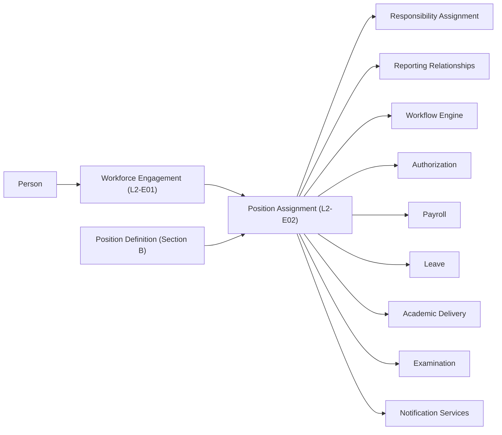

---

## 1.9 Expected Outcomes

Successful implementation of this architecture ensures:

- Every organizational authority is uniquely traceable.
- Every Position Assignment is historically reconstructable.
- Organizational restructuring preserves complete lineage.
- Cross-domain integrations remain loosely coupled.
- Workflow routing remains dynamic and position-driven.
- Enterprise reporting remains historically accurate.
- Institutional governance remains auditable.
- Future ERP modules reuse the same canonical organizational assignment model without duplication.

---

## 1.10 Section Summary

The Position & Assignment Domain establishes the canonical enterprise model for representing organizational occupancy and authority.

It forms one of the foundational bounded contexts within SutraERP and acts as the runtime organizational identity layer connecting workforce engagements to institutional structure while preserving complete historical integrity, versioned evolution, and enterprise governance.

# 2. Scope

## 2.1 Purpose of Scope

The Position & Assignment Domain governs the complete lifecycle of organizational position occupancy within SutraERP.

Its scope extends from the creation of Position Assignments through their operational lifecycle, historical preservation, organizational transitions, governance, and enterprise integration.

The domain establishes the authoritative runtime representation of **who occupies which organizational position, under what authority, during what period, within which organizational context**, while preserving complete historical lineage and organizational traceability.

The scope defined herein is normative for every bounded context consuming organizational assignment information.

---

# 2.2 Architectural Responsibilities

This bounded context SHALL provide the authoritative implementation for the following enterprise capabilities.

| Capability | Description |
|------------|-------------|
| Position Occupancy | Assignment of workforce engagements to institutional positions |
| Assignment Lifecycle | Creation, activation, suspension, closure, reinstatement, retirement and historical preservation |
| Organizational Placement | Campus, Faculty, Department, Division and organizational assignment |
| Reporting Relationships | Administrative, Academic, Functional, Matrix and Temporary reporting structures |
| Responsibility Assignment | Operational responsibilities attached to occupied positions |
| Assignment Versioning | Version-controlled evolution of assignments |
| Effective Dating | Historical, current and future organizational state management |
| Assignment History | Immutable organizational history |
| Organizational Authority | Runtime organizational identity resolution |
| Delegation | Temporary operational authority delegation |
| Organizational Movement | Transfer across departments, campuses and organizations |
| Position Occupancy Validation | Enforcement of occupancy constraints |
| Enterprise Assignment Governance | Administrative controls and policy enforcement |

---

# 2.3 Functional Scope

The Position & Assignment Domain SHALL support the following enterprise functions.

## Position Assignment

- Primary Position Assignment
- Additional Position Assignment
- Concurrent Position Assignment
- Acting Position Assignment
- Interim Position Assignment
- Temporary Position Assignment
- Cross-Campus Assignment
- Cross-Organization Assignment
- Shared Service Assignment

---

## Organizational Relationships

- Administrative Reporting
- Academic Reporting
- Functional Reporting
- Matrix Reporting
- Project Reporting
- Committee Reporting
- Temporary Reporting
- External Reporting

---

## Assignment Governance

- Assignment Approval
- Assignment Validation
- Assignment Delegation
- Assignment Suspension
- Assignment Freeze
- Assignment Cancellation
- Assignment Extension
- Assignment Closure
- Assignment Reinstatement
- Administrative Correction

---

## Organizational Operations

- Department Transfer
- Campus Transfer
- Organization Transfer
- Position Backfill
- Position Vacancy
- Position Reservation
- Position Occupancy
- Organizational Restructuring
- Bulk Assignment Operations

---

## Temporal Operations

- Effective Dating
- Historical Reconstruction
- Future Assignments
- Retroactive Corrections
- Version Lineage
- Assignment Supersession
- Historical Queries

---

# 2.4 Enterprise Use Cases

The Position & Assignment Domain SHALL serve the following enterprise business capabilities.

| Enterprise Capability | Supported |
|------------------------|-----------|
| Human Resource Administration | ✓ |
| Academic Administration | ✓ |
| Examination Administration | ✓ |
| Payroll | ✓ |
| Leave Management | ✓ |
| Workflow Resolution | ✓ |
| Identity & Access Management | ✓ |
| Committee Management | ✓ |
| Laboratory Management | ✓ |
| Hostel Administration | ✓ |
| Library Administration | ✓ |
| Campus Operations | ✓ |
| Institutional Governance | ✓ |
| Enterprise Analytics | ✓ |

---

# 2.5 Explicit In Scope

The following business concepts are canonically owned by this bounded context.

| Business Concept | Ownership |
|------------------|-----------|
| Position Assignment | Canonical |
| Assignment Lifecycle | Canonical |
| Organizational Placement | Canonical |
| Organizational Authority | Canonical |
| Reporting Relationships | Canonical |
| Responsibility Assignment | Canonical |
| Assignment Version History | Canonical |
| Position Occupancy | Canonical |
| Vacancy Management | Canonical |
| Assignment Delegation | Canonical |
| Assignment Lineage | Canonical |
| Assignment Effective Dating | Canonical |
| Organizational Assignment Validation | Canonical |

---

# 2.6 Explicitly Out of Scope

The following concepts SHALL NOT be implemented within this bounded context.

| Business Concept | Canonical Owner |
|------------------|-----------------|
| Person Identity | Platform Foundation |
| Workforce Engagement | L2-E01 Workforce & Engagement |
| Recruitment | Recruitment Domain |
| Payroll Processing | Payroll Domain |
| Leave Transactions | Leave Management |
| Faculty Profile | Faculty Workforce |
| Teaching Allocation | Academic Delivery |
| Timetable | Academic Delivery |
| Organization Structure | L2-B02 Organisation Workflows |
| Position Definition | Organisation Domain |
| Authentication | Platform Foundation |
| Authorization Infrastructure | Platform Foundation |
| Notification Delivery | Notification Services |

This bounded context SHALL consume these capabilities exclusively through published Service Contracts and Domain Events.

---

# 2.7 Scope Boundaries

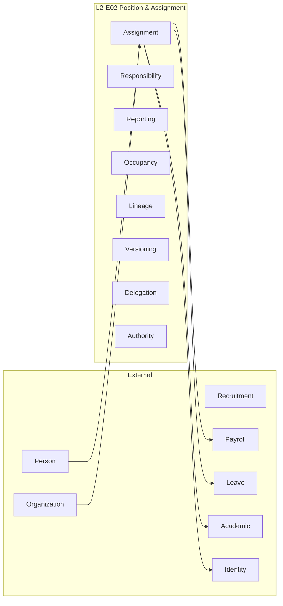

---

# 2.8 Architectural Invariants

The scope of this domain SHALL permanently satisfy the following invariants.

1. Every Position Assignment belongs to exactly one Workforce Engagement.

2. Every Position Assignment references exactly one Position Definition.

3. Every Position Assignment belongs to one authoritative organizational placement.

4. Every historical assignment remains immutable.

5. Every business evolution produces versioned lineage.

6. Organizational authority is derived exclusively from active Position Assignments.

7. Responsibility Assignments never replace Position Assignments.

8. Organizational history shall remain fully reconstructable for any historical point in time.

9. Every downstream domain shall consume organizational assignment information from this bounded context.

10. No downstream bounded context may independently own Position Assignment lifecycle.

---

# 2.9 Enterprise Scope Principles

The Position & Assignment Domain intentionally separates:

- Organizational Structure
- Workforce Lifecycle
- Organizational Occupancy
- Operational Responsibilities
- Security Authorization
- Business Workflow Resolution

This separation minimizes coupling while maximizing historical correctness, organizational traceability and long-term architectural maintainability.

---

# 2.10 Section Summary

The Position & Assignment Domain provides the authoritative enterprise scope for organizational occupancy within SutraERP.

Its responsibilities are intentionally limited to organizational assignment, authority resolution, reporting relationships and assignment governance while delegating identity, employment, organizational master data, payroll, leave and academic delivery to their respective canonical bounded contexts.

This strict ownership model preserves architectural integrity, enables enterprise-scale evolution and establishes Position Assignment as the runtime organizational identity layer for the entire SutraERP ecosystem.

# 3. Upstream Dependencies

## 3.1 Purpose

The Position & Assignment Domain does not operate in isolation.

It consumes authoritative business facts from upstream bounded contexts while maintaining strict ownership boundaries over Position Assignment, Responsibility Assignment, Reporting Relationships, Organizational Authority, and Assignment History.

No upstream dependency transfers ownership.

Each dependency represents a formal enterprise integration contract governed through published Service Contracts, Domain Events, and CQRS read models.

The Position & Assignment Domain SHALL never duplicate or redefine upstream business concepts.

---

# 3.2 Dependency Architecture

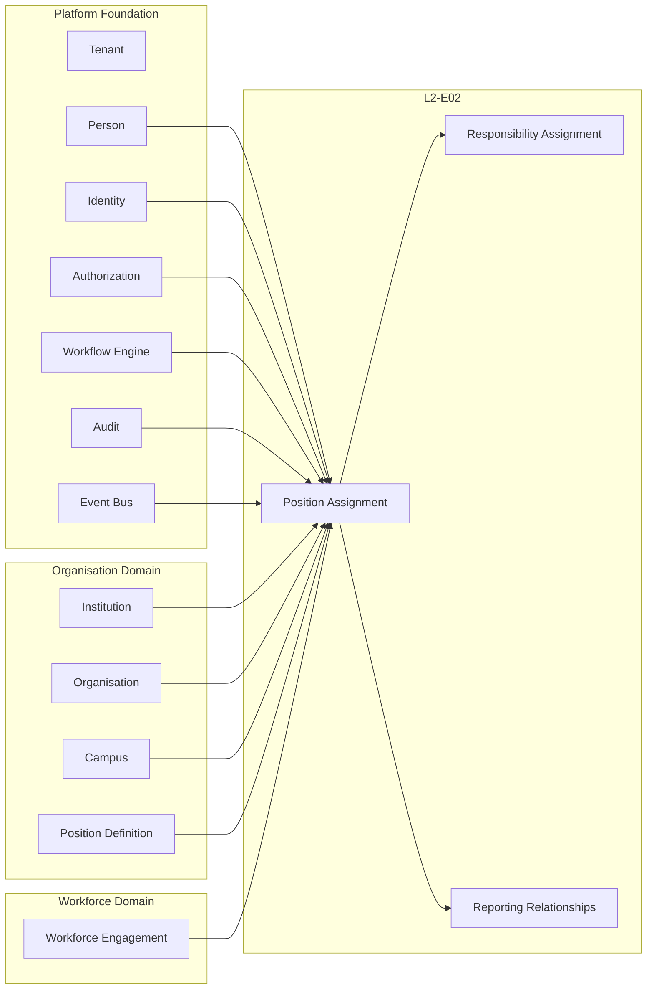

---

# 3.3 Canonical Upstream Dependency Matrix

| Domain | Business Capability Consumed | Ownership | Communication | Consistency |
|---------|------------------------------|-----------|---------------|-------------|
| Tenant | Tenant Context | Platform Foundation | Read Contract | Strong |
| Person | Person Identity | Platform Foundation | Read Contract | Strong |
| Identity | User Identity | Platform Foundation | Read Contract | Strong |
| Authorization | Security Policies | Platform Foundation | Policy Evaluation | Strong |
| Workflow Engine | Approval Execution | Platform Foundation | Service Contract | Strong |
| Audit | Audit Infrastructure | Platform Foundation | Service Contract | Strong |
| Event Bus | Domain Event Transport | Platform Foundation | Event Streaming | Eventually Consistent |
| Institution | Institution Structure | Organisation Domain | Read Contract | Strong |
| Organisation | Organisation Hierarchy | Organisation Domain | Read Contract | Strong |
| Campus | Campus Structure | Organisation Domain | Read Contract | Strong |
| Position Definition | Position Master Data | Organisation Domain | Read Contract | Strong |
| Workforce Engagement | Active Employment Relationship | Workforce Domain | Read Contract | Strong |

---

# 3.4 Upstream Dependency Specifications

## Platform Foundation

The Position & Assignment Domain SHALL consume Platform Foundation services without duplicating implementation.

Consumed capabilities include:

- Tenant Isolation
- Person Identity
- Authentication
- Authorization
- Workflow Engine
- Audit Infrastructure
- Event Transport

These capabilities remain exclusively owned by Platform Foundation.

---

## Organisation Domain

The Organisation Domain provides authoritative organisational master data.

The Position & Assignment Domain SHALL consume:

- Institution
- Organisation Units
- Campus Hierarchy
- Position Definitions

No organisational master data shall be maintained locally.

Only references are stored.

---

## Workforce Domain

The Workforce Domain provides the employment relationship.

The Position & Assignment Domain SHALL only assign Positions to active Workforce Engagements.

Position Assignments SHALL NOT exist independently of Workforce Engagement.

---

# 3.5 Dependency Consumption Rules

Every upstream dependency SHALL satisfy the following architectural rules.

| Rule | Requirement |
|------|-------------|
| Ownership | Never transferred |
| Duplication | Prohibited |
| Synchronization | Through canonical contracts only |
| Database Sharing | Prohibited |
| Direct Updates | Prohibited |
| Event Replay | Supported |
| Version Compatibility | Mandatory |
| Tenant Isolation | Mandatory |
| Institution Isolation | Mandatory |

---

# 3.6 Communication Patterns

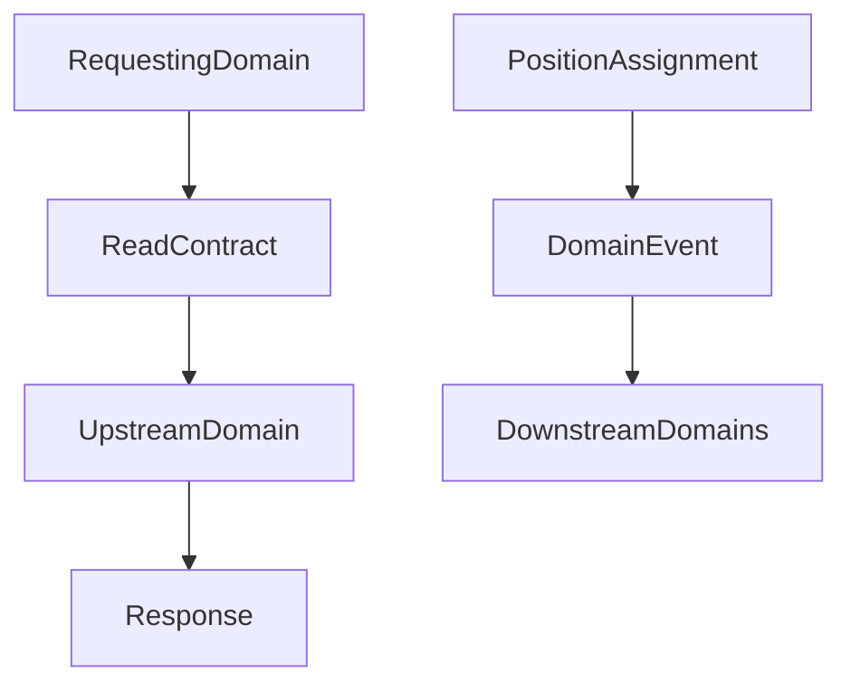

The Position & Assignment Domain SHALL consume upstream information synchronously through Read Contracts and SHALL publish completed business facts asynchronously through immutable Domain Events.

---

# 3.7 Dependency Failure Behaviour

If an upstream dependency becomes unavailable, the Position & Assignment Domain SHALL respond according to the following policies.

| Dependency | Failure Behaviour |
|------------|-------------------|
| Person | Reject Assignment |
| Position Definition | Reject Assignment |
| Workforce Engagement | Reject Assignment |
| Authorization | Reject Operation |
| Workflow Engine | Pause Approval Execution |
| Audit | Reject Transaction |
| Event Bus | Persist via Outbox and Retry |
| Organisation | Reject Organizational Changes |

The domain SHALL never create speculative business state when authoritative upstream information is unavailable.

---

# 3.8 Dependency Ownership Principles

The following ownership principles are absolute.

| Business Concept | Canonical Owner |
|------------------|-----------------|
| Person | Platform Foundation |
| Workforce Engagement | L2-E01 |
| Position Definition | Organisation Domain |
| Organisation Hierarchy | Organisation Domain |
| Authentication | Platform Foundation |
| Authorization Infrastructure | Platform Foundation |
| Workflow Execution | Platform Foundation |
| Audit Infrastructure | Platform Foundation |
| Position Assignment | L2-E02 |
| Responsibility Assignment | L2-E02 |
| Reporting Relationships | L2-E02 |

No upstream dependency may directly modify Position Assignments.

Likewise, the Position & Assignment Domain SHALL never modify upstream business objects.

---

# 3.9 Architectural Constraints

The Position & Assignment Domain SHALL enforce the following dependency constraints.

- Dependencies are contract-driven.
- Database-level coupling is prohibited.
- Integration shall remain event-driven where appropriate.
- Read models shall not become systems of record.
- Ownership boundaries shall never be violated.
- Version compatibility shall be maintained.
- Every dependency shall remain independently deployable.

---

# 3.10 Section Summary

The Position & Assignment Domain depends upon Platform Foundation, Organisation Domain, and Workforce Domain exclusively through canonical enterprise contracts.

These dependencies provide identity, organisational context, workflow capabilities, security infrastructure, and workforce lifecycle information while preserving strict bounded context ownership.

This contract-driven dependency model ensures loose coupling, historical integrity, independent evolution, and enterprise scalability across the SutraERP repository.

# 4. Downstream Dependencies

## 4.1 Purpose

The Position & Assignment Domain serves as the enterprise-wide runtime organizational identity layer for SutraERP.

It publishes authoritative organizational assignment information to downstream bounded contexts while retaining exclusive ownership of Position Assignments, Responsibility Assignments, Reporting Relationships, Organizational Authority, and Assignment History.

Downstream domains SHALL consume organizational assignment information exclusively through published Service Contracts, CQRS Read Models, and immutable Domain Events.

No downstream bounded context shall duplicate or independently manage Position Assignment lifecycle.

---

# 4.2 Enterprise Dependency Landscape

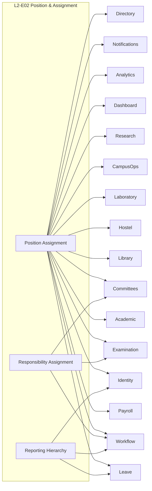

---

# 4.3 Canonical Downstream Dependency Matrix

| Consumer Domain | Business Capability Consumed | Communication Pattern | Consistency | Cache Permitted |
|-----------------|------------------------------|----------------------|-------------|-----------------|
| Payroll | Position Assignment | Read Contract + Events | Strong | Read Model Only |
| Leave Management | Reporting Hierarchy | Read Contract | Strong | Read Model Only |
| Academic Delivery | Faculty Position Assignment | Read Contract | Strong | Read Model Only |
| Examination | Organizational Authority | Read Contract + Events | Strong | Read Model Only |
| Identity & Access | Organizational Authority | Events | Eventual | Projection |
| Workflow Engine | Position Resolution | Read Contract | Strong | No |
| Notification Services | Current Position Occupant | Read Contract | Strong | No |
| Laboratory | Lab Authority | Read Contract | Strong | Projection |
| Library | Library Authority | Read Contract | Strong | Projection |
| Hostel | Hostel Administration | Read Contract | Strong | Projection |
| Campus Operations | Operational Authority | Read Contract | Strong | Projection |
| Research | Research Leadership | Read Contract | Strong | Projection |
| Committee Management | Committee Authority | Read Contract | Strong | Projection |
| Dashboard | Assignment Metrics | Domain Events | Eventual | Yes |
| Analytics | Historical Assignment Data | Domain Events | Eventual | Yes |
| Enterprise Directory | Organizational Placement | Read Contract | Strong | Projection |

---

# 4.4 Consumer Responsibilities

Every downstream bounded context SHALL:

- Consume Position Assignments without duplicating ownership.
- Resolve organizational authority through active Position Assignments.
- Treat published Domain Events as immutable business facts.
- Never modify Position Assignment state directly.
- Respect effective dating and historical reconstruction rules.
- Support version evolution without breaking compatibility.

Consumer-specific ownership restrictions SHALL apply.

Consumers MAY:
- maintain local read projections
- cache assignment information for operational performance
- store historical snapshots required for domain processing

Consumers SHALL NOT:
- create Position Assignments
- modify Assignment lifecycle
- maintain independent organizational authority models
- override effective dates
- become alternative systems of record

---

# 4.5 Integration Contracts

The Position & Assignment Domain exposes three canonical integration mechanisms.

| Integration Mechanism | Purpose | Consumers |
|-----------------------|---------|-----------|
| Read Contracts | Runtime organizational lookup | Payroll, Leave, Workflow, Examination, Academic |
| Command Contracts | Controlled business operations | Administrative applications only |
| Domain Events | Publish completed business facts | Analytics, Identity, Notifications, Dashboards |

---

# 4.6 Organizational Authority Resolution

The following enterprise capabilities SHALL resolve organizational authority through Position Assignments.

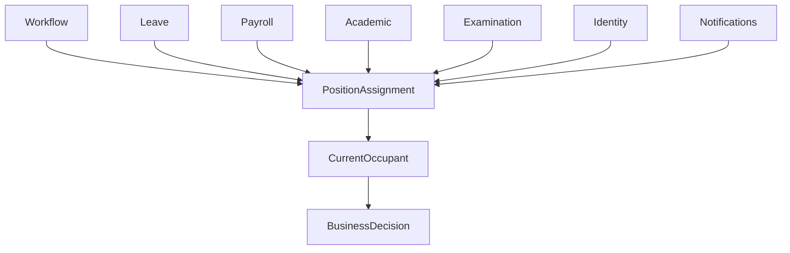

No downstream domain shall derive organizational authority directly from Person, User Account, or Security Role.

---

# 4.7 Event Consumption Principles

Downstream domains consuming Position Assignment events SHALL comply with the following principles.

| Principle | Requirement |
|-----------|-------------|
| Immutable Events | Mandatory |
| Idempotent Consumption | Mandatory |
| Event Replay | Supported |
| Version Compatibility | Mandatory |
| Ordering Preservation | Mandatory |
| Correlation ID | Mandatory |
| Tenant Isolation | Mandatory |
| Institution Isolation | Mandatory |

---

# 4.8 Downstream Failure Behaviour

If the Position & Assignment Domain becomes temporarily unavailable, downstream consumers SHALL behave as follows.

| Consumer | Behaviour |
|----------|-----------|
| Payroll | Delay processing until authoritative assignment is available |
| Leave | Suspend approval resolution |
| Workflow Engine | Retry organizational lookup |
| Identity | Continue using last valid projection until refreshed |
| Notifications | Retry recipient resolution |
| Examination | Reject authority-sensitive operations |
| Analytics | Continue consuming replayable events when available |

Consumers SHALL never invent or infer organizational authority.

---

# 4.9 Dependency Constraints

The following architectural constraints are mandatory.

- Downstream domains SHALL NOT own Position Assignments.
- Direct database access is prohibited.
- Integration shall remain contract-first.
- Position Assignment remains the single runtime organizational identity.
- Read Models shall never become systems of record.
- Business ownership shall remain unchanged across domain boundaries.
- Domain Events shall be published only after successful transaction completion.

---

# 4.10 Section Summary

The Position & Assignment Domain functions as one of the primary integration hubs within the SutraERP architecture.

It provides authoritative organizational assignment information to downstream domains while preserving strict ownership boundaries, contract-driven communication, immutable business events, and enterprise-grade consistency.

Every organizational decision executed outside this bounded context ultimately depends upon the authoritative Position Assignment model defined herein.

# 5. Domain Ownership Boundaries

## 5.1 Purpose

The Position & Assignment Domain exists to provide the single authoritative enterprise model for organizational occupancy and operational authority.

This section formally defines ownership boundaries between bounded contexts to eliminate ambiguity, prevent duplicated business logic, preserve historical integrity, and enable independent evolution of every domain.

Ownership defined herein is normative for the entire SutraERP repository.

No bounded context shall assume ownership of Position Assignment concepts outside the boundaries established in this document.

---

# 5.2 Ownership Philosophy

The architecture follows one fundamental repository principle:

> **One Business Concept → One Canonical Owner**

Every business concept shall have exactly one authoritative bounded context responsible for:

- Lifecycle
- Validation
- Business Rules
- State Transitions
- Historical Preservation
- Version Evolution
- Domain Events

All other bounded contexts SHALL consume these concepts through published Service Contracts, CQRS Read Models, or Domain Events.

Business ownership SHALL NEVER be duplicated.

---

# 5.3 Canonical Ownership Matrix

| Business Concept | Canonical Owner | Notes |
|------------------|-----------------|-------|
| Position Assignment | L2-E02 | Complete lifecycle ownership |
| Responsibility Assignment | L2-E02 | Operational responsibilities |
| Reporting Relationships | L2-E02 | Administrative, Academic, Functional, Matrix |
| Position Occupancy | L2-E02 | Runtime organizational occupancy |
| Vacancy State | L2-E02 | Derived from assignment lifecycle |
| Assignment History | L2-E02 | Immutable historical record |
| Assignment Versioning | L2-E02 | Version lineage |
| Assignment Effective Dating | L2-E02 | Historical reconstruction |
| Organizational Authority | L2-E02 | Runtime authority resolution |
| Delegation | L2-E02 | Operational delegation |
| Additional Charge | L2-E02 | Assignment variation |
| Acting Assignment | L2-E02 | Assignment variation |
| Interim Assignment | L2-E02 | Assignment variation |
| Concurrent Assignment | L2-E02 | Assignment variation |

---

# 5.4 Explicitly Not Owned

The following concepts SHALL NEVER be owned by this bounded context.

| Business Concept | Canonical Owner |
|------------------|-----------------|
| Person | Platform Foundation |
| Workforce Engagement | L2-E01 Workforce & Engagement |
| Employment Contract | L2-E01 Workforce & Engagement |
| Position Definition | L2-B02 Organisation Workflows |
| Organisation Hierarchy | L2-B02 Organisation Workflows |
| Recruitment | Recruitment Domain |
| Faculty Profile | Faculty Workforce |
| Teaching Allocation | Academic Delivery |
| Timetable | Academic Delivery |
| Leave Transactions | Leave Management |
| Payroll Processing | Payroll Domain |
| Authentication | Platform Foundation |
| Authorization Infrastructure | Platform Foundation |
| Notification Delivery | Notification Services |

The Position & Assignment Domain SHALL reference these concepts but SHALL NEVER own or modify them.

---

# 5.5 Shared Reference Matrix

The following concepts are referenced but remain externally owned.

| Referenced Concept | Used For | Ownership |
|--------------------|----------|-----------|
| Workforce Engagement | Assignment Target | L2-E01 |
| Position Definition | Organizational Position | L2-B02 |
| Organisation Unit | Placement | L2-B02 |
| Campus | Placement | L2-B03 |
| Institution | Tenant Scope | L2-B01 |
| Person | Identity Resolution | Platform Foundation |
| User Account | Authentication | Platform Foundation |

Shared references SHALL NOT imply shared ownership.

---

# 5.6 Ownership Decision Tree

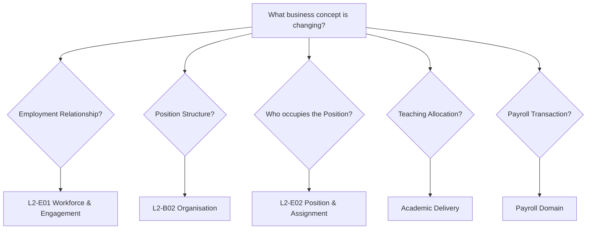

---

# 5.7 Aggregate Ownership Model

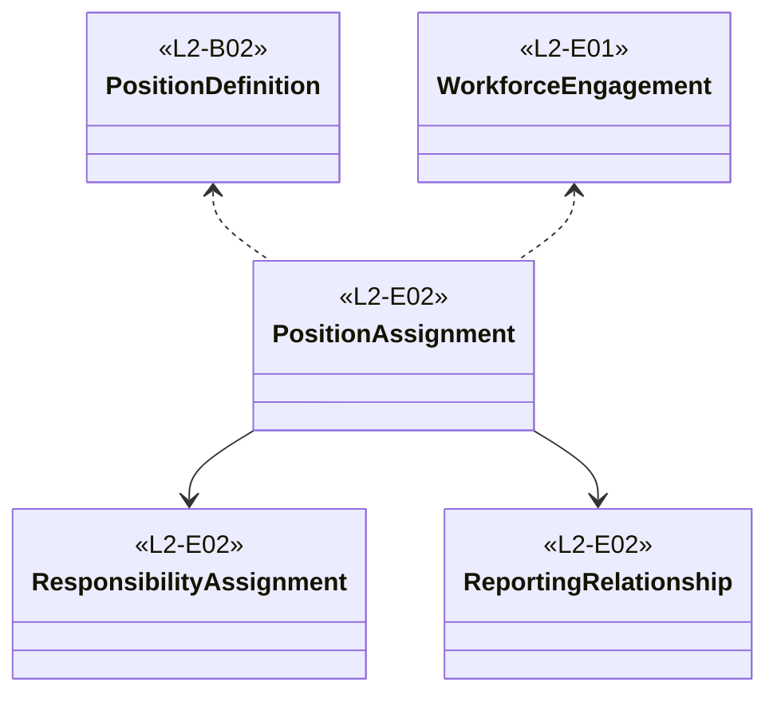

---

# 5.8 Ownership Invariants

The following architectural invariants SHALL NEVER be violated.

### Invariant O-001

A Position Assignment SHALL belong exclusively to the Position & Assignment Domain.

---

### Invariant O-002

A Workforce Engagement SHALL NEVER own organizational occupancy.

---

### Invariant O-003

A Position Definition SHALL NEVER identify the current occupant.

Occupancy belongs exclusively to Position Assignments.

---

### Invariant O-004

Responsibility Assignments SHALL NEVER replace Position Assignments.

Responsibilities extend organizational authority.

They do not define organizational occupancy.

---

### Invariant O-005

Reporting Relationships SHALL be derived from Position Assignments.

They SHALL NOT exist independently.

---

### Invariant O-006

No downstream bounded context may recreate Position Assignment lifecycle.

---

### Invariant O-007

Historical ownership SHALL remain immutable.

Business evolution SHALL occur only through versioned lineage.

---

# 5.9 Forbidden Architectural Patterns

The following repository patterns are explicitly prohibited.

❌ Payroll owning Position Assignments

❌ Leave storing reporting hierarchy

❌ Workflow storing HOD User IDs

❌ Examination maintaining faculty hierarchy

❌ Academic Delivery duplicating organizational assignments

❌ Identity deriving authority directly from User Accounts

❌ Direct database coupling across bounded contexts

❌ Multiple systems of record for organizational occupancy

---

# 5.10 Runtime Organizational Authority

Organizational authority SHALL always resolve according to the following model.

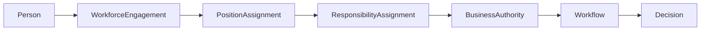

Authority SHALL NEVER resolve directly from:

- Person

- User Account

- Security Role

- Faculty Profile

- Employment Contract

---

# 5.11 Repository Ownership Principles

Every future bounded context developed within SutraERP SHALL comply with the following ownership principles.

1. One business concept has one owner.

2. Ownership is immutable.

3. Consumers never become owners.

4. Read models are not systems of record.

5. Domain Events never transfer ownership.

6. Commands never bypass ownership.

7. Organizational authority always resolves through Position Assignment.

8. Position Assignment remains the runtime organizational identity.

---

# 5.12 Section Summary

The Position & Assignment Domain is the exclusive owner of organizational occupancy, organizational authority, reporting relationships, responsibility assignments, assignment history, and assignment evolution.

This ownership model establishes one of the strongest architectural boundaries within the SutraERP repository and serves as the foundation for Workflow Engine, Leave Management, Payroll, Examination, Identity, Authorization, Academic Delivery, Analytics, and every future module requiring organizational authority.

# 6. Domain Model / Aggregate / Lifecycle

---

# 6.1 Domain Overview

## 6.1.1 Purpose

The Position & Assignment Domain provides the canonical enterprise model for representing organizational occupancy, operational authority, reporting relationships, and responsibility allocation within SutraERP.

Unlike the Organisation Domain, which defines *what organizational structures and Positions exist*, and the Workforce Domain, which defines *who is employed by the institution*, this domain defines **who occupies which organizational Position, under what authority, for what duration, and within which organizational context**.

The domain acts as the runtime organizational identity layer for the entire ERP.

Every operational decision requiring organizational authority—including workflow approvals, reporting resolution, payroll applicability, leave approvals, examination duties, committee participation, security authorization, and enterprise notifications—shall resolve through the Position Assignment model defined within this bounded context.

---

## 6.1.2 Architectural Role

Within the enterprise architecture, the Position & Assignment Domain performs four primary responsibilities.

| Architectural Responsibility | Description |
|------------------------------|-------------|
| Organizational Occupancy | Maintains the authoritative relationship between Workforce Engagements and organizational Positions. |
| Organizational Authority | Resolves operational authority based upon active Position Assignments. |
| Organizational Governance | Manages assignment lifecycle, delegation, reporting relationships, responsibilities, effective dating, and version lineage. |
| Enterprise Integration | Publishes organizational assignment information to downstream bounded contexts through canonical contracts and immutable domain events. |

The domain SHALL NOT assume responsibility for organizational structure, employment lifecycle, payroll processing, leave management, academic delivery, recruitment, or identity management.

---

## 6.1.3 Domain Context

The Position & Assignment Domain exists at the intersection of organizational structure and workforce management.

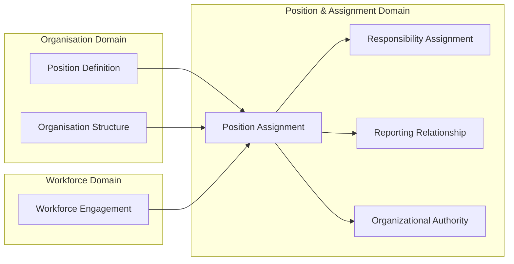

The domain consumes organizational structure and workforce lifecycle as authoritative upstream facts while owning the runtime relationship between the two.

---

## 6.1.4 Core Business Concepts

The domain is composed of the following canonical business concepts.

| Business Concept | Purpose | Canonical Owner |
|------------------|---------|-----------------|
| Position Assignment | Represents occupancy of an organizational Position by a Workforce Engagement. | L2-E02 |
| Responsibility Assignment | Represents operational responsibilities attached to occupied Positions. | L2-E02 |
| Reporting Relationship | Defines organizational reporting structures derived from Position Assignments. | L2-E02 |
| Service Jurisdiction | Defines operational service boundaries for shared assignments. | L2-E02 |
| Assignment Version | Preserves historical evolution of assignments. | L2-E02 |
| Organizational Authority | Runtime authority derived from active assignments. | L2-E02 |

These concepts collectively define the runtime organizational state of the institution.

---

## 6.1.5 Domain Boundaries

The Position & Assignment Domain SHALL own the following business capabilities.

- Position occupancy
- Organizational authority
- Assignment lifecycle
- Responsibility allocation
- Reporting hierarchy
- Delegation
- Assignment versioning
- Assignment history
- Effective dating
- Organizational movement
- Vacancy state
- Position occupancy validation
- Assignment governance

The following capabilities remain explicitly outside this bounded context.

- Workforce lifecycle
- Employment contracts
- Organization hierarchy
- Position master definitions
- Recruitment
- Payroll transactions
- Leave transactions
- Teaching allocation
- Timetable management
- Authentication
- Identity lifecycle

---

## 6.1.6 Runtime Organizational Identity

The Position Assignment Aggregate establishes the runtime organizational identity of every workforce member.

The following principle is normative throughout the repository.

> **Organizational authority SHALL always be derived from active Position Assignments linked to valid Workforce Engagements within an effective organizational hierarchy.**

Authority SHALL NEVER be derived directly from:

- Person
- User Account
- Security Role
- Faculty Profile
- Employment Contract

This principle ensures that organizational authority automatically evolves as assignments change while preserving complete historical integrity.

---

## 6.1.7 Enterprise Characteristics

The domain has been designed to support enterprise-scale organizational complexity, including:

- Multi-campus institutions
- University groups
- Multi-organization governance
- Shared service centres
- Matrix reporting
- Concurrent assignments
- Acting appointments
- Interim appointments
- Delegated authority
- Effective-dated restructuring
- Historical reconstruction
- Government administration
- Enterprise audit
- Cross-domain workflow resolution

No architectural changes shall be required to support these organizational models.

---

## 6.1.8 Architectural Principles

The Domain Model SHALL permanently satisfy the following principles.

1. One Position Assignment represents one organizational placement.

2. One business concept has one canonical owner.

3. Organizational authority is Position-driven.

4. Historical records are immutable.

5. Business evolution occurs through version lineage.

6. Effective dating supports past, present, and future organizational state.

7. Reporting relationships derive from Position Assignments.

8. Responsibilities extend assignments but never replace them.

9. Downstream domains consume assignments but never own them.

10. Organizational state remains reconstructable for any historical point in time.

---

## 6.1.9 Domain Overview Diagram

```mermaid
flowchart TD

Person["Person"]

↓

Workforce["Workforce Engagement"]

↓

Assignment["Position Assignment"]

↓

Authority["Organizational Authority"]

↓

Responsibilities["Responsibility Assignment"]

↓

Reporting["Reporting Relationship"]

↓

Enterprise["Enterprise Services"]

Enterprise --> Workflow
Enterprise --> Payroll
Enterprise --> Leave
Enterprise --> Academic
Enterprise --> Examination
Enterprise --> Notifications
Enterprise --> Analytics
```

---

## 6.1.10 Section Summary

The Position & Assignment Domain establishes the authoritative runtime organizational model for SutraERP.

By separating organizational occupancy from workforce lifecycle and organizational structure, the domain enables enterprise-grade governance, historical traceability, effective-dated organizational planning, and consistent authority resolution across every downstream bounded context.

This domain forms one of the foundational architectural pillars of the SutraERP repository and serves as the canonical source of truth for organizational assignments throughout the platform.

# 6.2 Core Architectural Concepts

## 6.2.1 Purpose

The Position & Assignment Domain is built upon a set of canonical architectural concepts that collectively define the runtime organizational state of an institution.

These concepts constitute the **Ubiquitous Language** of the bounded context and SHALL be used consistently throughout the SutraERP repository.

No downstream bounded context shall redefine these concepts.

---

# 6.2.2 Concept Relationship Overview

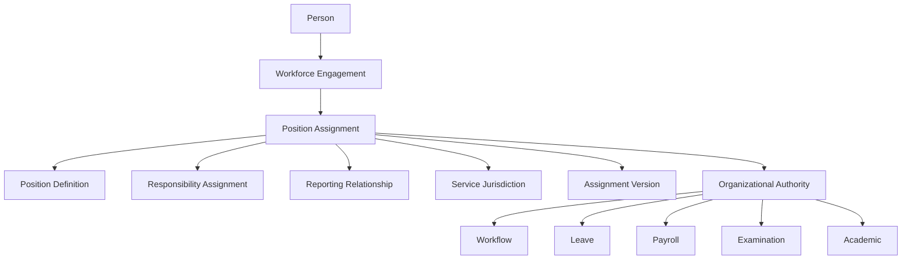

---

# 6.2.3 Canonical Concept Catalogue

| ID | Concept | Purpose | Canonical Owner |
|----|----------|----------|-----------------|
| CC-001 | Position Definition | Defines an organizational role. | Organisation Domain |
| CC-002 | Workforce Engagement | Represents an active institutional relationship. | L2-E01 |
| CC-003 | Position Assignment | Represents organizational occupancy. | L2-E02 |
| CC-004 | Responsibility Assignment | Represents operational responsibilities. | L2-E02 |
| CC-005 | Reporting Relationship | Represents reporting authority. | L2-E02 |
| CC-006 | Service Jurisdiction | Represents operational service boundaries. | L2-E02 |
| CC-007 | Assignment Version | Represents historical evolution. | L2-E02 |
| CC-008 | Organizational Authority | Represents runtime decision authority. | L2-E02 |
| CC-009 | Position Occupancy | Represents current occupancy state. | L2-E02 |
| CC-010 | Vacancy | Represents absence of active occupancy. | L2-E02 |

---

# 6.2.4 Position Definition (CC-001)

A Position Definition represents an organizational role that may be occupied by one or more Workforce Engagements according to defined occupancy policies.

A Position Definition is **structural**, not operational.

It defines:

- Position identity
- Position hierarchy
- Capacity
- Classification
- Organizational ownership

It SHALL NOT define:

- Current occupant
- Historical occupant
- Assignment lifecycle
- Reporting authority

Those belong to Position Assignments.

---

# 6.2.5 Workforce Engagement (CC-002)

A Workforce Engagement represents the authoritative employment or institutional relationship between a Person and the Institution.

It answers:

> "Is this person engaged by the institution?"

It does **not** answer:

> "What organizational authority does this person currently hold?"

Organizational authority begins only after Position Assignment.

---

# 6.2.6 Position Assignment (CC-003)

Position Assignment is the central Aggregate of this bounded context.

It represents the authoritative runtime relationship between:

- Workforce Engagement
- Position Definition

while recording:

- Organizational placement
- Assignment lifecycle
- Effective dates
- Occupancy
- Reporting hierarchy
- Delegation
- Organizational authority

Every Position Assignment SHALL represent exactly one organizational placement.

---

# 6.2.7 Responsibility Assignment (CC-004)

Responsibility Assignments extend organizational authority without altering Position occupancy.

Examples include:

- NAAC Coordinator
- Examination Coordinator
- Research Coordinator
- Anti-Ragging Committee Chair
- Hostel Warden
- IQAC Member

Responsibilities SHALL:

- supplement Position Assignments
- never replace Position Assignments
- remain independently versioned

---

# 6.2.8 Reporting Relationship (CC-005)

Reporting Relationships define organizational accountability derived from active Position Assignments.

Supported relationship types include:

- Administrative
- Academic
- Functional
- Matrix
- Committee
- Project
- Temporary
- External

Reporting SHALL always resolve through Position Assignments.

Never through Person records.

---

# 6.2.9 Service Jurisdiction (CC-006)

Service Jurisdiction defines the organizational scope served by a Position Assignment.

Examples:

- Campus A
- Campus B
- Engineering College
- Medical College

One Position Assignment may legitimately operate across multiple jurisdictions while remaining a single organizational appointment.

Service Jurisdiction SHALL NOT create additional Position Assignments.

---

# 6.2.10 Assignment Version (CC-007)

Assignment Version represents the immutable historical evolution of a Position Assignment.

Each version preserves:

- Effective dates
- Organizational placement
- Reporting hierarchy
- Responsibilities
- Organizational authority

Versions SHALL maintain predecessor and successor lineage.

Historical versions SHALL NEVER be modified.

---

# 6.2.11 Organizational Authority (CC-008)

Organizational Authority represents the authority granted to a Workforce Engagement through an active Position Assignment.

Examples include:

- Workflow approval
- Administrative approval
- Leave approval
- Financial approval
- Examination approval
- Academic approval

Authority SHALL never derive directly from:

- Person
- User Account
- Security Role

---

# 6.2.12 Position Occupancy (CC-009)

Position Occupancy represents the runtime state of a Position.

Supported states include:

- Occupied
- Vacant
- Reserved
- Under Recruitment
- Frozen
- Blocked
- Planned
- Retired

Occupancy SHALL be derived from active Position Assignments.

---

# 6.2.13 Vacancy (CC-010)

A Vacancy exists when a Position Definition has available occupancy but no corresponding active Position Assignment.

Vacancy is therefore:

- operational
- derived
- historical
- auditable

Vacancy SHALL NEVER be manually maintained.

---

# 6.2.14 Concept Dependency Model

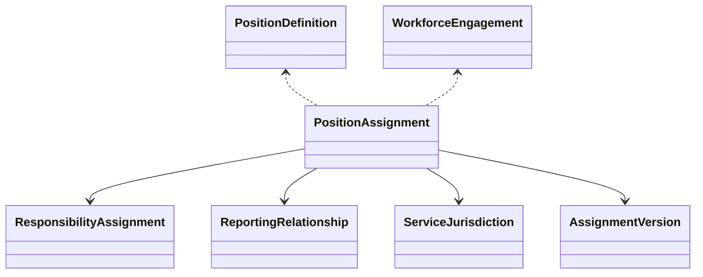

---

# 6.2.15 Canonical Concept Rules

| Rule ID | Rule |
|----------|------|
| CCR-001 | Every Position Assignment references exactly one Position Definition. |
| CCR-002 | Every Position Assignment references exactly one Workforce Engagement. |
| CCR-003 | Responsibilities extend assignments; they never replace them. |
| CCR-004 | Reporting Relationships derive from Position Assignments. |
| CCR-005 | Organizational Authority derives exclusively from active assignments. |
| CCR-006 | Historical versions remain immutable. |
| CCR-007 | Vacancy is derived, never manually maintained. |
| CCR-008 | Service Jurisdiction expands operational scope without changing organizational appointment. |

---

# 6.2.16 Concept Summary

The concepts defined within this section establish the canonical vocabulary of the Position & Assignment Domain.

Every subsequent workflow, business rule, service contract, domain event, authorization policy, and integration described within this document SHALL use these concepts without redefinition, ensuring semantic consistency across the entire SutraERP architecture.

# 6.3 Aggregate Architecture

## 6.3.1 Purpose

The Position & Assignment Domain is implemented as a collection of independently governed aggregates that collectively model organizational occupancy while preserving transactional consistency, historical integrity, and bounded context isolation.

The Position Assignment Aggregate is the primary consistency boundary of this bounded context.

Responsibility Assignment, Reporting Relationship, Operational Scope, and Assignment Version are lifecycle-owned entities of the Position Assignment Aggregate because their existence depends on the lifecycle and validity of an Assignment.

These entities SHALL NOT evolve independently or publish independent business lifecycle events.

Independent aggregate boundaries SHALL only be created for concepts having autonomous lifecycle ownership and independent business invariants.

Concepts including Responsibility Assignment, Reporting Relationship, Operational Scope, and Assignment Version are lifecycle-owned entities within the Position Assignment Aggregate because their existence depends on the parent assignment lifecycle.

These entities SHALL NOT evolve independently from their owning Position Assignment.

Independent aggregate boundaries are reserved only for concepts that possess autonomous lifecycle ownership and independent business invariants.

No aggregate may directly modify another aggregate.

Cross-aggregate collaboration SHALL occur exclusively through identifiers, domain services, published events, or application-layer orchestration.

---

# 6.3.2 Aggregate Architecture Overview

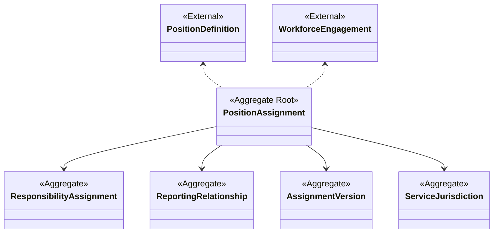

---

# 6.3.3 Aggregate Catalogue

| Aggregate | Aggregate Root | Primary Responsibility | Transaction Boundary |
|------------|----------------|------------------------|----------------------|
| Position Assignment | Position Assignment | Organizational Occupancy | Independent |
| Responsibility Assignment | Responsibility Assignment | Operational Responsibilities | Independent |
| Reporting Relationship | Reporting Relationship | Reporting Authority | Independent |
| Assignment Version | Assignment Version | Historical Evolution | Independent |
| Service Jurisdiction | Service Jurisdiction | Operational Scope | Independent |

Each aggregate SHALL preserve its own consistency while remaining loosely coupled to neighbouring aggregates.

---

# 6.3.4 Aggregate Responsibilities

## Position Assignment

Owns:

- Position Occupancy
- Assignment Lifecycle
- Organizational Placement
- Effective Dates
- Assignment Status
- Primary Assignment
- Assignment Category

Publishes:

- AssignmentCreated
- AssignmentActivated
- AssignmentTransferred
- AssignmentClosed

---

## Responsibility Assignment

Owns:

- Operational Responsibilities
- Committee Roles
- Additional Charges
- Temporary Authority

Publishes:

- ResponsibilityAssigned
- ResponsibilityRevoked

---

## Reporting Relationship

Owns:

- Administrative Reporting
- Academic Reporting
- Functional Reporting
- Matrix Reporting
- Temporary Reporting

Publishes:

- ReportingRelationshipChanged

---

## Assignment Version

Owns:

- Historical Versions
- Lineage
- Effective Timeline
- Superseded Versions

Publishes:

- AssignmentVersionCreated

---

## Service Jurisdiction

Owns:

- Campus Scope
- Organization Scope
- Shared Service Areas
- Operational Coverage

Publishes:

- JurisdictionChanged

---

# 6.3.5 Aggregate Consistency Boundaries

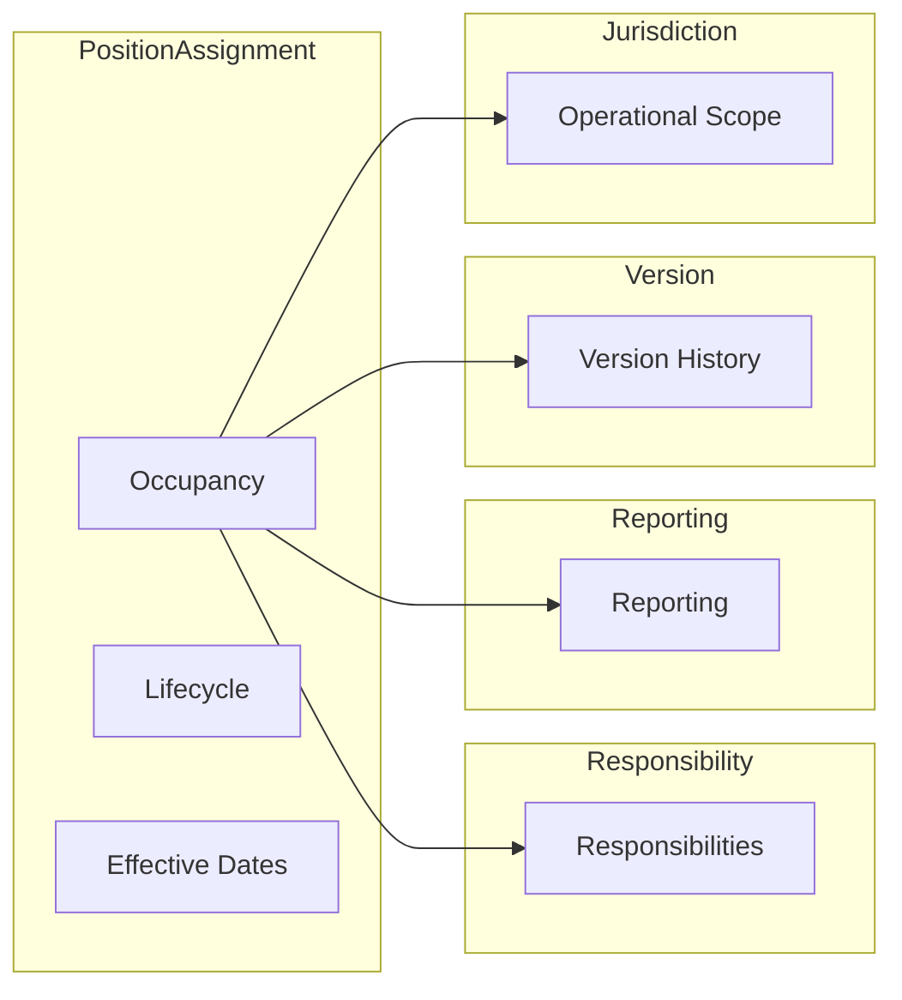

Each aggregate SHALL validate its own invariants.

Cross-aggregate validation SHALL occur through domain services.

---

# 6.3.6 Aggregate Communication Principles

Aggregates SHALL communicate according to the following principles.

| Mechanism | Permitted |
|------------|-----------|
| Identifier References | ✓ |
| Domain Events | ✓ |
| Domain Services | ✓ |
| Application Services | ✓ |
| Direct Aggregate Mutation | ✗ |
| Shared Database State | ✗ |
| Cross-Aggregate Transactions | ✗ |

This ensures loose coupling and independent evolution.

---

# 6.3.7 Aggregate Transaction Model

```mermaid
flowchart TD

Command

↓

Aggregate

↓

Business Validation

↓

State Change

↓

Domain Event

↓

Transaction Commit

↓

Event Publication
```

An aggregate SHALL either complete successfully as a whole or fail without leaving partial business state.

No aggregate transaction may extend beyond its own consistency boundary.

---

# 6.3.8 Aggregate Reference Rules

The following reference rules are mandatory.

| Source Aggregate | Target Aggregate | Reference Type |
|------------------|------------------|----------------|
| Position Assignment | Workforce Engagement | External Identifier |
| Position Assignment | Position Definition | External Identifier |
| Responsibility Assignment | Position Assignment | Aggregate Identifier |
| Reporting Relationship | Position Assignment | Aggregate Identifier |
| Assignment Version | Position Assignment | Aggregate Identifier |
| Service Jurisdiction | Position Assignment | Aggregate Identifier |

Aggregates SHALL reference one another by identity only.

Entire aggregate state SHALL NEVER be embedded.

---

# 6.3.9 Aggregate Invariants

The following invariants apply across the aggregate architecture.

### AI-001

Every Position Assignment references exactly one Position Definition.

---

### AI-002

Every Position Assignment references exactly one Workforce Engagement.

---

### AI-003

Responsibilities SHALL NOT exist without an active Position Assignment.

---

### AI-004

Reporting Relationships SHALL reference Position Assignments only.

---

### AI-005

Historical Assignment Versions SHALL NEVER be modified.

---

### AI-006

Service Jurisdictions SHALL extend operational scope without altering organizational placement.

---

### AI-007

Aggregate identity SHALL remain stable throughout lifecycle evolution.

---

# 6.3.10 Aggregate Lifecycle Interaction

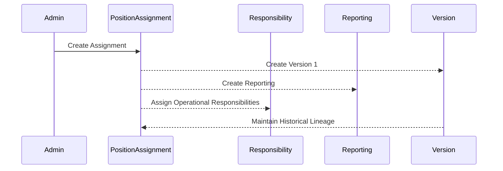

---

# 6.3.11 Aggregate Design Principles

Every aggregate within this bounded context SHALL satisfy the following principles.

- Single Aggregate Root
- Explicit Consistency Boundary
- Independent Lifecycle
- Immutable Historical Evolution
- Stable Aggregate Identity
- Event-Driven Collaboration
- No Shared Mutable State
- Identifier-Based References
- Versioned Evolution
- Transactional Isolation

---

# 6.3.12 Section Summary

The Aggregate Architecture establishes the transactional foundation of the Position & Assignment Domain.

By defining explicit consistency boundaries, aggregate responsibilities, communication rules, lifecycle interactions, and architectural invariants, the domain achieves strong consistency within aggregates, loose coupling between aggregates, and enterprise-grade scalability.

This aggregate model forms the implementation blueprint for every Position Assignment operation performed throughout the SutraERP ecosystem.

# 6.4 Position Definition Integration Model

---

# 6.4.1 Purpose

The Position & Assignment Domain does not own Position Definitions.

Position Definitions are canonically owned by the Organisation Domain (L2-B02).

This section specifies how Position Assignments consume and reference Position Definitions while preserving strict bounded context ownership.

The Position & Assignment Domain SHALL treat Position Definitions as immutable external references during assignment processing.

---

# 6.4.2 Architectural Relationship

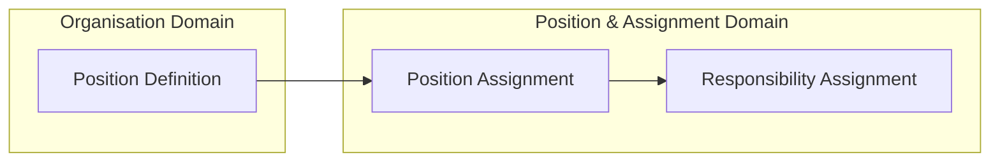

Position Definitions provide organizational structure.

Position Assignments provide organizational occupancy.

The two concepts SHALL remain independently versioned and independently governed.

---

# 6.4.3 Reference Model

Each Position Assignment SHALL reference exactly one Position Definition.

The reference SHALL be identity-based.

Embedded copies of Position Definition data are prohibited.

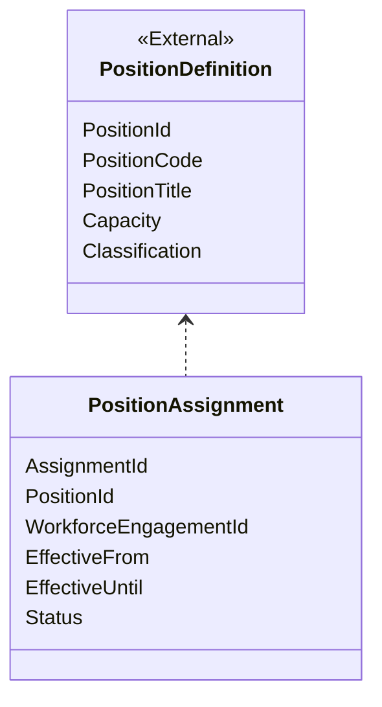

---

# 6.4.4 Consumed Business Information

The Position & Assignment Domain may consume the following Position Definition attributes.

| Attribute | Purpose |
|------------|----------|
| Position Identifier | Canonical reference |
| Position Code | Business identification |
| Position Name | Human-readable display |
| Position Classification | Validation |
| Position Capacity | Occupancy validation |
| Organizational Owner | Organizational placement |
| Position Status | Assignment eligibility |

No additional Position Definition information shall be persisted unless explicitly required for audit or historical reconstruction.

---

# 6.4.5 Integration Constraints

The following constraints are mandatory.

- Position Definitions SHALL exist before Position Assignments.
- Deleted Position Definitions SHALL NOT orphan existing Position Assignments.
- Retired Position Definitions SHALL preserve historical references.
- Position Assignment SHALL validate Position Definition existence before activation.
- Position Assignment SHALL NOT modify Position Definitions.

---

# 6.4.6 Position Resolution

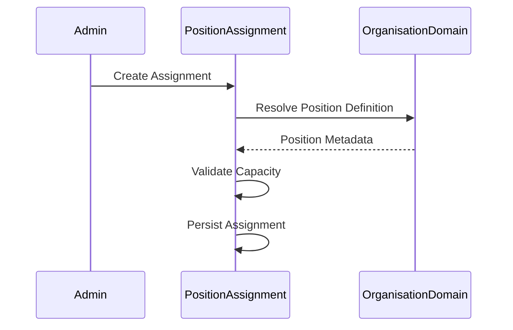

---

# 6.4.7 Position Lifecycle Interaction

```mermaid
stateDiagram-v2

[*] --> Draft

Draft --> Active

Active --> Frozen

Frozen --> Retired

Retired --> Archived
```

Position lifecycle is owned by the Organisation Domain.

The Position & Assignment Domain SHALL observe lifecycle state but SHALL NOT manage it.

---

# 6.4.8 Dependency Rules

| Rule | Requirement |
|------|-------------|
| Ownership | Organisation Domain |
| Communication | Read Contract |
| Mutation | Prohibited |
| Versioning | Independent |
| History | Preserved |
| Consistency | Strong |

---

# 6.4.9 Architectural Invariants

**PI-001**

Every Position Assignment SHALL reference exactly one Position Definition.

**PI-002**

Position Assignment SHALL NOT duplicate Position Definition state.

**PI-003**

Position retirement SHALL NOT invalidate historical assignments.

**PI-004**

Occupancy SHALL be computed exclusively by Position Assignments.

**PI-005**

Position Definition SHALL remain the canonical structural representation of organizational roles.

---

# 6.4.10 Section Summary

The Position Definition Integration Model establishes the contractual relationship between organizational structure and organizational occupancy.

By preserving strict ownership boundaries while enabling strong runtime validation, this model ensures that Position Definitions remain structural assets owned by the Organisation Domain while Position Assignments remain the authoritative runtime representation of organizational occupancy.

# 6.5 Position Assignment Aggregate Architecture

---

# 6.5.1 Purpose

The Position Assignment Aggregate is the primary Aggregate Root of the Position & Assignment Domain.

It represents the authoritative runtime relationship between an active Workforce Engagement and a Position Definition within a specific organizational context.

The aggregate establishes:

- Organizational occupancy
- Organizational authority
- Assignment lifecycle
- Reporting foundation
- Responsibility inheritance
- Effective dating
- Historical lineage
- Organizational traceability

Every organizational authority exercised within SutraERP SHALL ultimately resolve through an active Position Assignment.

The Position Assignment Aggregate therefore represents the runtime organizational identity of every workforce member.

---

# 6.5.2 Aggregate Responsibilities

The aggregate SHALL exclusively own:

| Responsibility | Description |
|---------------|-------------|
| Position Occupancy | Occupies organizational Positions |
| Assignment Lifecycle | Complete lifecycle management |
| Organizational Placement | Campus, Faculty, Department, Division |
| Assignment Classification | Primary, Additional, Acting, Interim, Temporary, Concurrent |
| Effective Dating | Past, Present and Future validity |
| Assignment Status | Draft through Closed |
| Organizational Authority | Runtime authority |
| Vacancy Computation | Derived occupancy |
| Assignment Version Linkage | Historical evolution |
| Organizational Traceability | Complete audit lineage |

The aggregate SHALL NOT own:

- Workforce Lifecycle
- Position Definition
- Payroll
- Leave
- Recruitment
- Teaching Allocation
- Timetable
- Identity

---

# 6.5.3 Aggregate Boundary

```mermaid
classDiagram

class PositionAssignment{
<<Aggregate Root>>

AssignmentId
StableAssignmentId
VersionNumber

WorkforceEngagementId

PositionDefinitionId

AssignmentCategory

AssignmentStatus

EffectiveFrom

EffectiveUntil

PrimaryAssignment

OrganizationUnit

Campus

ReportingRoot

VersionRoot

CreatedOn

LastModifiedOn
}

class WorkforceEngagement{
<<External>>
}

class PositionDefinition{
<<External>>
}

PositionDefinition <.. PositionAssignment

WorkforceEngagement <.. PositionAssignment
```

The aggregate boundary SHALL terminate at the Position Assignment Aggregate Root.

No external component may modify internal aggregate state directly.

---

# 6.5.4 Aggregate Identity

Every Position Assignment SHALL possess two independent identities.

| Identity | Purpose |
|----------|----------|
| Stable Assignment ID | Permanent business identity |
| Version Number | Historical evolution |

Example

```text
Assignment

PA-000145

↓

Version 1

↓

Version 2

↓

Version 3
```

The Stable Assignment Identifier SHALL NEVER change.

Only versions evolve.

---

# 6.5.5 Aggregate State Model

The Position Assignment Aggregate SHALL maintain the following state.

| State | Purpose |
|---------|----------|
| Draft | Under preparation |
| Pending Approval | Awaiting governance |
| Approved | Ready for activation |
| Scheduled | Future effective assignment |
| Active | Operational |
| Suspended | Temporarily inactive |
| Frozen | Operational but immutable |
| Closed | Completed |
| Superseded | Replaced by successor version |
| Archived | Historical preservation |


The lifecycle SHALL also support negative and administrative terminal states:

Rejected:
Assignment request denied during approval.

Cancelled:
Approved or scheduled assignment withdrawn before activation.

Revoked:
Previously granted authority removed due to governance action.

Expired:
Assignment automatically ended because effective validity elapsed.

The Position Assignment lifecycle SHALL include operational recovery states for distributed workflow failures.

ActivationPending:
Assignment has passed governance approval but external dependency completion is pending.

ActivationFailed:
Activation attempt failed due to dependency or infrastructure failure.

RecoveryRequired:
Assignment requires administrative intervention before lifecycle continuation.

Operational failure states SHALL never represent business rejection.
They represent technical or integration recovery conditions.

Every recovery transition SHALL maintain:
- failure reason
- failed dependency
- retry count
- recovery owner
- audit reference


---

# 6.5.6 Aggregate Lifecycle

```mermaid
stateDiagram-v2

[*] --> Draft

Draft --> PendingApproval

PendingApproval --> Approved

Approved --> Scheduled

Scheduled --> Active

Active --> Frozen

Frozen --> Active

Active --> Suspended

Suspended --> Active

Active --> Closed

Closed --> Archived

Active --> Superseded

Superseded --> Archived
```

Historical lifecycle transitions SHALL NEVER be reversed.

---

# 6.5.7 Commands Accepted

The aggregate SHALL process the following commands.

| Command | Purpose |
|----------|----------|
| CreatePositionAssignment | Create assignment |
| ApproveAssignment | Governance approval |
| ActivateAssignment | Operational activation |
| SuspendAssignment | Temporary suspension |
| ExtendAssignment | Extend validity |
| CloseAssignment | End assignment |
| TransferAssignment | Organizational movement |
| DelegateAuthority | Temporary delegation |
| CorrectAssignment | Administrative correction |
| CreateAssignmentVersion | Version evolution |

Every command SHALL execute within a single aggregate transaction.

---

# 6.5.8 Domain Events Published

Successful aggregate state transitions SHALL publish immutable domain events.

| Event | Trigger |
|--------|---------|
| PositionAssignmentCreated | Creation |
| PositionAssignmentApproved | Approval |
| PositionAssignmentActivated | Activation |
| PositionAssignmentTransferred | Transfer |
| PositionAssignmentDelegated | Delegation |
| PositionAssignmentSuspended | Suspension |
| PositionAssignmentClosed | Closure |
| PositionAssignmentVersionCreated | Version evolution |
| PositionAssignmentSuperseded | Historical replacement |

The aggregate SHALL also publish events for negative and corrective lifecycle transitions.

Additional Events:

PositionAssignmentRejected
Triggered when approval governance rejects an assignment.

PositionAssignmentCancelled
Triggered when a scheduled or approved assignment is withdrawn.

PositionAssignmentExpired
Triggered when effective validity completes automatically.

PositionAssignmentCorrected
Triggered when an administrative correction creates a new valid version.

PositionAssignmentActivationFailed
Triggered when activation cannot complete due to dependency failure.

PositionAssignmentRecovered
Triggered when a failed lifecycle operation is successfully restored.

Events SHALL be published only after successful transaction commit.

---

# 6.5.9 Aggregate Transaction Boundary

```mermaid
sequenceDiagram

participant Client

participant Aggregate

participant EventStore

participant EventBus

Client->>Aggregate: Execute Command

Aggregate->>Aggregate: Validate Invariants

Aggregate->>Aggregate: Apply State Change

Aggregate->>EventStore: Persist Aggregate

EventStore-->>Aggregate: Commit Successful

Aggregate->>EventBus: Publish Domain Events
```

The aggregate SHALL remain the sole consistency boundary.

---

# 6.5.10 Aggregate Invariants

The following invariants SHALL NEVER be violated.

### PA-INV-001

Exactly one Position Definition SHALL be referenced.

---

### PA-INV-002

Exactly one Workforce Engagement SHALL be referenced.

---

### PA-INV-003

Only one Primary Assignment may exist per Workforce Engagement at any point in time.

---

### PA-INV-004

Historical versions SHALL NEVER be modified.

---

### PA-INV-005

Every state transition SHALL preserve complete auditability.

---

### PA-INV-006

Organizational placement SHALL remain internally consistent.

---

### PA-INV-007

Authority SHALL derive exclusively from Active effective assignments.

---

### PA-INV-008

Every assignment SHALL maintain predecessor/successor lineage where applicable.

---

# 6.5.11 Aggregate Consistency Rules

The aggregate SHALL guarantee:

- Strong transactional consistency
- Historical immutability
- Version lineage
- Effective-date integrity
- Organizational integrity
- Position occupancy correctness
- Assignment uniqueness
- Deterministic authority resolution

Cross-aggregate consistency SHALL be achieved through Domain Events and application orchestration.

---

# 6.5.12 Aggregate Summary

The Position Assignment Aggregate is the canonical runtime organizational identity aggregate of SutraERP.

It provides the transactional foundation for organizational authority, workflow routing, reporting hierarchy, effective-dated organizational planning, assignment governance, and enterprise integration.

Every downstream domain requiring organizational context SHALL ultimately resolve through this aggregate, making it one of the most critical architectural components within the entire SutraERP ecosystem.

# 6.6 Responsibility Assignment Aggregate Architecture

---

# 6.6.1 Purpose

The Responsibility Assignment Aggregate extends the organizational authority granted by a Position Assignment by representing operational, administrative, academic, statutory, regulatory, and project-specific responsibilities assigned to the occupant of an organizational Position.

Unlike a Position Assignment, a Responsibility Assignment **does not establish organizational occupancy**.

Instead, it defines **what additional authority, accountability, obligations, or operational functions** the Position occupant performs while occupying an organizational Position.

Responsibility Assignments SHALL always derive from an effective Position Assignment.

They SHALL NEVER exist independently.

---

# 6.6.2 Aggregate Role

The Responsibility Assignment Aggregate exists to separate organizational occupancy from operational responsibility.

This separation allows:

- committee appointments
- statutory appointments
- temporary operational roles
- project leadership
- accreditation responsibilities
- institutional initiatives

to evolve independently without affecting organizational structure.

This distinction prevents unnecessary Position proliferation while preserving enterprise governance.

---

# 6.6.3 Supported Responsibility Categories

The aggregate SHALL support, but not be limited to, the following responsibility categories.

| Category | Examples |
|-----------|----------|
| Administrative | Hostel Warden, Chief Proctor |
| Academic | IQAC Coordinator, NAAC Coordinator |
| Committee | Anti-Ragging Committee Chair |
| Regulatory | NIRF Coordinator, AISHE Coordinator |
| Project | ERP Project Lead |
| Operational | Examination Coordinator |
| Research | Research Centre Coordinator |
| Institutional | Innovation Cell Coordinator |

Institutions may configure additional responsibility categories without modifying the canonical model.

---

# 6.6.4 Aggregate Relationships

```mermaid
classDiagram

class PositionAssignment{
<<Aggregate Root>>
}

class ResponsibilityAssignment{
<<Aggregate>>
}

class ResponsibilityType{
<<Reference>>
}

PositionAssignment --> ResponsibilityAssignment

ResponsibilityAssignment --> ResponsibilityType
```

Every Responsibility Assignment SHALL reference exactly one Position Assignment.

Multiple Responsibility Assignments MAY reference the same Position Assignment.

---

# 6.6.5 Lifecycle

```mermaid
stateDiagram-v2

[*] --> Draft

Draft --> Approved

Approved --> Active

Active --> Suspended

Suspended --> Active

Active --> Closed

Closed --> Archived
```

The lifecycle of a Responsibility Assignment SHALL NOT alter the lifecycle of its parent Position Assignment.

---

# 6.6.6 Responsibility Resolution Model

```mermaid
flowchart TD

PositionAssignment

-->

ResponsibilityAssignment

-->

OperationalAuthority

-->

Workflow

OperationalAuthority

-->

Committee

OperationalAuthority

-->

AcademicAdministration

OperationalAuthority

-->

Examination

OperationalAuthority

-->

CampusOperations
```

Responsibilities extend organizational authority.

They do not replace Position authority.

---

# 6.6.7 Aggregate Invariants

### RA-INV-001

Every Responsibility Assignment SHALL reference an active Position Assignment.

---

### RA-INV-002

Responsibilities SHALL NEVER establish organizational occupancy.

---

### RA-INV-003

Closing a Position Assignment SHALL automatically terminate or transition dependent Responsibility Assignments according to institutional policy.

---

### RA-INV-004

Historical Responsibility Assignments SHALL remain immutable.

---

### RA-INV-005

Responsibilities SHALL be independently versioned.

---

# 6.6.8 Commands & Events

### Commands

- Assign Responsibility
- Update Responsibility
- Suspend Responsibility
- Close Responsibility
- Extend Responsibility

### Events

- ResponsibilityAssigned
- ResponsibilityUpdated
- ResponsibilitySuspended
- ResponsibilityClosed
- ResponsibilityTransferred

---

# 6.6.9 Enterprise Design Principles

Responsibility Assignments SHALL:

- remain lightweight
- remain reusable
- support concurrent responsibilities
- support temporary responsibilities
- support effective dating
- preserve complete history
- avoid Position duplication

---

# 6.6.10 Section Summary

The Responsibility Assignment Aggregate provides the operational extension layer of the Position & Assignment Domain.

By separating organizational occupancy from operational responsibilities, the architecture enables institutions to model complex governance structures—including committees, accreditation initiatives, statutory appointments, projects, and temporary institutional responsibilities—without compromising organizational integrity or introducing unnecessary Position complexity.

# 6.7 Enterprise Reporting & Authority Model

---

# 6.7.1 Purpose

The Enterprise Reporting & Authority Model defines how organizational authority flows throughout the institution.

Rather than merely representing reporting relationships between workforce members, this model establishes the authoritative organizational graph used by every downstream bounded context to resolve approvals, governance, escalation, delegation, supervision, accountability, and institutional decision making.

The model is entirely derived from active Position Assignments.

Reporting relationships SHALL NEVER be maintained independently of Position Assignments.

---

# 6.7.2 Architectural Role

The Enterprise Reporting & Authority Model serves as the canonical authority resolution engine for SutraERP.

The model enables downstream domains to determine:

- Organizational authority SHALL not directly grant system permissions.

- Effective authorization SHALL be resolved through Platform Authorization policies using organizational context supplied by Position Assignment.

- Resolution model:

Position Assignment
        +
Responsibility Assignment
        +
Authorization Policy
        ↓
Effective Permission

- Position Assignment provides business context.
- Platform Authorization provides security enforcement.

- Administrative reporting
- Academic reporting
- Functional reporting
- Matrix reporting
- Committee reporting
- Project reporting
- Delegated authority
- Acting authority
- Escalation hierarchy
- Organizational supervision

without requiring any domain-specific organizational logic.

This ensures that organizational authority evolves automatically as Position Assignments evolve.

---

# 6.7.3 Enterprise Authority Graph

```mermaid
graph TD

VC["Vice Chancellor"]

REG["Registrar"]

DEAN["Dean"]

HOD["Head of Department"]

FAC["Faculty"]

STAFF["Staff"]

VC --> REG

REG --> DEAN

DEAN --> HOD

HOD --> FAC

HOD --> STAFF
```

The graph represents organizational authority.

It SHALL NEVER reference Persons.

Only occupied organizational Positions.

---

# 6.7.4 Supported Relationship Types

| Relationship Type | Purpose |
|-------------------|----------|
| Administrative | Administrative supervision |
| Academic | Academic governance |
| Functional | Functional authority |
| Matrix | Cross-functional reporting |
| Committee | Committee authority |
| Project | Project leadership |
| Temporary | Acting / Interim authority |
| External | Regulatory or external reporting |

Institutions may extend relationship types through configuration without modifying the canonical model.

---

# 6.7.5 Authority Resolution Model

```mermaid
flowchart TD

BusinessAction

-->

PositionAssignment

-->

ReportingRelationship

-->

AuthorityGraph

-->

DecisionAuthority

DecisionAuthority --> Workflow

DecisionAuthority --> Leave

DecisionAuthority --> Payroll

DecisionAuthority --> Examination

DecisionAuthority --> Academic

DecisionAuthority --> Committees
```

Every organizational decision SHALL resolve through this authority graph.

---

# 6.7.6 Authority Resolution Rules

The following rules are mandatory.

### ARM-001

Authority SHALL be Position-based.

---

### ARM-002

Authority SHALL never be Person-based.

---

### ARM-003

Authority SHALL support concurrent assignments.

---

### ARM-004

Authority SHALL support acting appointments.

---

### ARM-005

Authority SHALL support delegated authority.

---

### ARM-006

Authority SHALL support future effective reporting structures.

---

### ARM-007

Historical reporting structures SHALL remain reconstructable.

---

# 6.7.7 Matrix Reporting

```mermaid
graph LR

Dean

--> Professor

ResearchDirector

--> Professor

ProjectManager

--> Professor
```

The architecture supports multiple simultaneous reporting relationships while preserving a single authoritative Position Assignment for organizational occupancy.

---

# 6.7.8 Escalation Model

```mermaid
flowchart TD

Workflow

-->

ImmediateAuthority

-->

HigherAuthority

-->

InstitutionAuthority

-->

ExecutiveAuthority
```

Escalation SHALL always occur through organizational hierarchy rather than static user mappings.

---

# 6.7.9 Delegated Authority

Delegated authority SHALL temporarily extend the authority graph without altering the underlying reporting hierarchy.

```mermaid
flowchart LR

Registrar

-->

Delegation

-->

DeputyRegistrar
```

Delegation SHALL:

- preserve history
- preserve audit
- preserve original authority
- expire automatically according to effective dates

---

# 6.7.10 Enterprise Design Principles

The Reporting & Authority Model SHALL satisfy the following principles.

- Position-centric authority
- Dynamic organizational resolution
- Historical reconstruction
- Effective-dated hierarchy
- Multi-campus compatibility
- Matrix organization support
- Event-driven synchronization
- Policy-driven governance

---

# 6.7.11 Architectural Invariants

### EA-001

Every reporting relationship SHALL originate from a Position Assignment.

---

### EA-002

Authority SHALL never resolve directly from User Accounts.

---

### EA-003

Every reporting hierarchy SHALL remain historically reconstructable.

---

### EA-004

Delegated authority SHALL preserve original organizational ownership.

---

### EA-005

Authority resolution SHALL remain deterministic for every effective point in time.

---

# 6.7.12 Section Summary

The Enterprise Reporting & Authority Model transforms Position Assignments into an enterprise-wide organizational authority graph.

Rather than maintaining isolated reporting structures within individual modules, SutraERP derives every approval, escalation, supervision, delegation, and governance decision from a single canonical authority model.

This architecture eliminates duplicated hierarchy logic across bounded contexts while ensuring complete historical traceability, organizational consistency, and enterprise scalability.

# 6.8 Enterprise Operational Scope Model

---

# 6.8.1 Purpose

The Enterprise Operational Scope Model defines the operational boundaries within which a Position Assignment is authorized to function.

While a Position Assignment establishes **organizational occupancy**, the Operational Scope Model establishes **where**, **for whom**, and **under which organizational boundaries** that occupancy is effective.

Operational Scope determines the applicability of organizational authority across institutions, campuses, organizational units, academic entities, administrative entities, projects, committees, and shared enterprise services.

This model enables SutraERP to support complex organizational structures without duplicating Position Assignments.

---

# 6.8.2 Architectural Intent

Operational Scope answers questions that organizational occupancy alone cannot answer.

Examples include:

- Which campuses may this Dean administer?
- Which institutions may this Registrar serve?
- Which departments fall under this HOD?
- Which laboratories may this Lab Coordinator manage?
- Which committees may this member represent?
- Which projects fall under this assignment?
- Which service centres operate under this authority?

Operational Scope SHALL always extend an existing Position Assignment.

It SHALL NEVER create organizational authority independently.

---

# 6.8.3 Operational Scope Dimensions

| Scope Dimension | Examples |
|-----------------|----------|
| Institution | University, Medical College |
| Campus | Main Campus, City Campus |
| Organization Unit | Faculty, School, Department |
| Administrative Unit | HR, Finance, Examination |
| Academic Unit | Programme, Department |
| Committee | IQAC, BOS, Academic Council |
| Project | ERP Implementation, NAAC |
| Service Centre | Shared HR, Shared Legal |
| Geographic | Regional Office |
| Custom Scope | Institution Configurable |

---

# 6.8.4 Operational Scope Architecture

```mermaid
flowchart TD

PositionAssignment

-->

OperationalScope

OperationalScope --> Institution

OperationalScope --> Campus

OperationalScope --> Organization

OperationalScope --> Department

OperationalScope --> Committee

OperationalScope --> Project

OperationalScope --> ServiceCenter
```

Every Position Assignment SHALL possess one or more Operational Scope definitions.

---

# 6.8.5 Multi-Campus Operations

```mermaid
flowchart LR

Dean

-->

MainCampus

Dean

-->

NorthCampus

Dean

-->

MedicalCampus

Dean

-->

ResearchCampus
```

One Position Assignment MAY legitimately govern multiple campuses without requiring multiple Position Assignments.

---

# 6.8.6 Shared Enterprise Services

```mermaid
flowchart LR

LegalOfficer

-->

EngineeringCollege

LegalOfficer

-->

MedicalCollege

LegalOfficer

-->

PharmacyCollege

LegalOfficer

-->

CentralAdministration
```

Shared enterprise services SHALL be represented as Operational Scope extensions rather than duplicated assignments.

---

# 6.8.7 Scope Resolution Model

```mermaid
sequenceDiagram

participant Consumer

participant PositionAssignment

participant OperationalScope

Consumer->>PositionAssignment: Resolve Authority

PositionAssignment->>OperationalScope: Validate Scope

OperationalScope-->>Consumer: Authorized Operational Boundary
```

Every authority resolution SHALL validate both:

- organizational authority
- operational applicability

---

# 6.8.8 Scope Constraints

The following constraints are mandatory.

### OSM-001

Operational Scope SHALL belong to exactly one Position Assignment.

---

### OSM-002

Operational Scope SHALL NEVER establish organizational occupancy.

---

### OSM-003

Scope expansion SHALL NOT create additional assignments.

---

### OSM-004

Operational Scope SHALL support effective dating.

---

### OSM-005

Operational Scope SHALL preserve historical evolution.

---

### OSM-006

Operational Scope SHALL support concurrent jurisdictions.

---

### OSM-007

Operational Scope SHALL remain independently configurable.

---

# 6.8.9 Scope Categories

The architecture SHALL support:

- Exclusive Scope
- Shared Scope
- Temporary Scope
- Acting Scope
- Delegated Scope
- Project Scope
- Committee Scope
- Cross-Campus Scope
- Cross-Institution Scope
- Enterprise Scope

without altering the Position Assignment model.

---

# 6.8.10 Enterprise Design Principles

Operational Scope SHALL:

- extend authority
- never replace authority
- remain lightweight
- support enterprise scalability
- preserve historical correctness
- support organizational restructuring
- support future-dated planning
- remain independently evolvable

---

# 6.8.11 Architectural Invariants

### OS-001

Authority without Operational Scope SHALL be considered incomplete.

---

### OS-002

Operational Scope SHALL never outlive its parent Position Assignment.

---

### OS-003

Historical Operational Scope SHALL remain immutable.

---

### OS-004

Multiple Operational Scopes MAY reference the same Position Assignment.

---

### OS-005

Operational Scope SHALL remain policy driven rather than hard coded.

---

# 6.8.12 Section Summary

The Enterprise Operational Scope Model extends Position Assignments by defining the operational boundaries within which organizational authority may be exercised.

By separating organizational occupancy from operational applicability, the architecture supports multi-campus institutions, university groups, shared service centres, committee governance, cross-functional operations, and enterprise-scale organizational models while preserving a single canonical Position Assignment.

# 6.9 Enterprise Temporal & Versioning Model

---

# 6.9.1 Purpose

The Enterprise Temporal & Versioning Model provides the canonical mechanism for preserving historical truth while allowing organizational evolution.

Rather than modifying historical business records, the Position & Assignment Domain records every significant business change as a new version within an immutable lineage.

This model enables SutraERP to support:

- Historical reconstruction
- Effective-dated planning
- Future organizational changes
- Retroactive corrections
- Administrative amendments
- Government directives
- Organizational restructuring
- Disaster recovery
- Event replay
- Audit compliance

without compromising historical integrity.

Historical truth SHALL NEVER be rewritten.

Business evolution SHALL always occur through controlled version lineage.

---

# 6.9.2 Architectural Philosophy

The Position Assignment Aggregate possesses a stable business identity.

Business state evolves through immutable versions.

```mermaid
gitGraph
    commit id: "V1"
    commit id: "V2"
    commit id: "V3"
    branch correction
    checkout correction
    commit id: "Correction"
    checkout main
    merge correction
    commit id: "V4"
```

The Stable Assignment Identifier SHALL remain constant.

Only business versions evolve.

---

# 6.9.3 Temporal Architecture

```mermaid
flowchart LR

StableAssignmentID

--> Version1

Version1 --> Version2

Version2 --> Version3

Version3 --> Version4

Version4 --> CurrentVersion
```

Every historical state SHALL remain permanently accessible.

---

# 6.9.4 Temporal Dimensions

Every Position Assignment SHALL simultaneously support four temporal dimensions.

| Dimension | Description |
|-----------|-------------|
| Transaction Time | When the ERP recorded the change |
| Effective Time | When the business change becomes valid |
| Expiry Time | When business validity ends |
| Audit Time | When the change was reviewed or approved |

These dimensions SHALL remain independent.

---

# 6.9.5 Version Categories

The architecture SHALL support the following version types.

| Version Type | Purpose |
|--------------|----------|
| Initial Version | First creation |
| Administrative Update | Non-structural correction |
| Organizational Transfer | Position movement |
| Promotion | Organizational advancement |
| Acting Appointment | Temporary authority |
| Delegation | Temporary operational authority |
| Retroactive Correction | Historical amendment |
| Future Planned Version | Approved future state |
| Recovery Version | Disaster recovery reconciliation |

---

# 6.9.6 Historical Reconstruction

```mermaid
timeline

title Position Assignment Timeline

2023 : Initial Appointment

2024 : Promotion

2025 : Acting Registrar

2026 : Permanent Registrar
```

The system SHALL reconstruct organizational state for any historical point in time.

---

# 6.9.7 Retroactive Corrections

Historical corrections SHALL NEVER modify existing versions.

Instead:

```mermaid
flowchart TD

HistoricalVersion

-->

CorrectionVersion

-->

LineageUpdated

-->

EventReplay

-->

ReadModelRebuild
```

The original version remains immutable.

The correction becomes part of historical lineage.

---

# 6.9.8 Future-Dated Planning

Future organizational changes SHALL coexist with active assignments.

```mermaid
gantt
title Assignment Planning

dateFormat YYYY-MM-DD

section Current

Current Assignment :done, a1, 2026-01-01,2026-12-31

section Planned

Future Assignment :a2,2027-01-01,2027-12-31
```

Planning SHALL NOT affect the currently effective organizational state.

---

# 6.9.9 Version Lineage Rules

Every version SHALL maintain:

- predecessor
- successor
- creation reason
- business justification
- approval reference
- effective period
- supersession reason

No lineage gaps are permitted.

---

# 6.9.10 Temporal Invariants

### TV-001

Historical versions SHALL NEVER be modified.

---

### TV-002

Stable Assignment Identity SHALL NEVER change.

---

### TV-003

Only one version may be effective at any instant.

---

### TV-004

Future versions SHALL NOT invalidate active versions.

---

### TV-005

Retroactive corrections SHALL create new versions.

---

### TV-006

Every version SHALL remain reconstructable.

---

### TV-007

Version lineage SHALL remain continuous.

---

# 6.9.11 Cross-Domain Behaviour

The temporal model SHALL support:

- Payroll replay
- Leave reconstruction
- Workflow replay
- Examination reconstruction
- Analytics replay
- Audit reconstruction
- Reporting reconstruction

Every downstream domain SHALL consume version evolution through immutable Domain Events.

---

# 6.9.12 Section Summary

The Enterprise Temporal & Versioning Model provides the historical backbone of the Position & Assignment Domain.

By combining immutable history, stable business identity, effective dating, transaction time, and continuous version lineage, the model enables enterprise-scale organizational evolution while preserving complete historical truth.

This temporal architecture is foundational to auditability, regulatory compliance, organizational governance, and long-term maintainability across the SutraERP ecosystem.

# 6.10 Enterprise Time Model

---

# 6.10.1 Purpose

The Enterprise Time Model defines how the Position & Assignment Domain represents, validates, and governs time-dependent business facts.

Time within SutraERP is not limited to a single "effective date." Instead, every significant business fact may exist simultaneously across multiple temporal dimensions, enabling accurate historical reconstruction, future planning, regulatory compliance, organizational governance, and auditability.

The model ensures that business truth evolves without destroying historical truth.

---

# 6.10.2 Architectural Philosophy

The Position & Assignment Domain distinguishes between **when something happened**, **when it becomes effective**, **when it expires**, **when it was approved**, and **when it was recorded**.

These timelines SHALL remain independent.

```mermaid
flowchart LR

BusinessDecision

--> ApprovalTime

ApprovalTime

--> TransactionTime

TransactionTime

--> EffectiveTime

EffectiveTime

--> ExpiryTime

ExpiryTime

--> HistoricalArchive
```

---

# 6.10.3 Temporal Dimensions

| Temporal Dimension | Description | Example |
|-------------------|-------------|---------|
| Business Time | When the business decision was made | Promotion approved on 10 Jan |
| Approval Time | When governance approved the decision | Approved by Registrar on 12 Jan |
| Transaction Time | When ERP persisted the change | Saved on 13 Jan |
| Effective Time | When the assignment becomes operational | Effective from 1 Feb |
| Expiry Time | When operational validity ends | Ends on 31 Dec |
| Audit Time | When compliance reviewed the change | Audit completed on 15 Feb |
| Publication Time | When downstream events were published | Event published after commit |

Every dimension SHALL remain independently queryable.

---

# 6.10.4 Time Flow Architecture

```mermaid
sequenceDiagram

participant Administrator

participant Workflow

participant PositionAssignment

participant EventBus

Administrator->>Workflow: Submit Assignment

Workflow->>Workflow: Approval

Workflow->>PositionAssignment: Persist Transaction

PositionAssignment->>PositionAssignment: Effective Date Validation

PositionAssignment->>EventBus: Publish Domain Events
```

Each stage represents a distinct temporal milestone.

---

# 6.10.5 Effective Dating Rules

The architecture SHALL support:

- Immediate activation
- Future-dated activation
- Future-dated expiry
- Temporary assignments
- Acting appointments
- Interim appointments
- Scheduled transfers
- Planned restructuring
- Future reporting changes

Future records SHALL coexist with active records without altering the current operational state.

---

# 6.10.6 Retroactive Processing

Historical corrections SHALL create new temporal versions rather than modifying historical records.

```mermaid
flowchart TD

HistoricalState

-->

CorrectionRequest

-->

CorrectionVersion

-->

TimelineRebuilt

-->

ReadModelRefresh
```

Historical business truth SHALL remain permanently preserved.

---

# 6.10.7 Future Planning

```mermaid
gantt
title Enterprise Assignment Planning

dateFormat YYYY-MM-DD

section Current Assignment

Dean :done, d1, 2026-01-01,2026-12-31

section Future Assignment

Registrar :d2,2027-01-01,2028-12-31
```

The ERP SHALL simultaneously support:

- current state
- planned state
- historical state

without conflict.

---

# 6.10.8 Temporal Validation

The following validations SHALL be enforced.

| Validation | Description |
|------------|-------------|
| Effective From < Effective Until | Mandatory |
| No overlapping Primary Assignments | Mandatory |
| Future versions preserve lineage | Mandatory |
| Historical periods immutable | Mandatory |
| Effective periods continuous where required | Policy-driven |
| Approval precedes activation | Mandatory |

---

# 6.10.9 Time-Based Queries

The model SHALL support the following enterprise queries.

- Who was Registrar on 15 March 2023?
- Who will become Dean next semester?
- Which assignments expire next month?
- Which acting appointments are currently effective?
- What reporting hierarchy existed during NAAC inspection?
- What organizational authority existed when payroll was processed?

Every answer SHALL be reconstructable from canonical temporal data.

---

# 6.10.10 Temporal Invariants

### TM-001

Business history SHALL remain immutable.

---

### TM-002

Effective periods SHALL be chronologically valid.

---

### TM-003

Future planning SHALL not alter current operational state.

---

### TM-004

Retroactive corrections SHALL preserve historical lineage.

---

### TM-005

Every temporal state SHALL be reproducible.

---

### TM-006

Temporal validation SHALL precede activation.

---

### TM-007

All published events SHALL correspond to committed temporal state.

---

# 6.10.11 Enterprise Design Principles

The Enterprise Time Model SHALL satisfy the following principles.

- Immutable history
- Multi-temporal representation
- Effective-dated governance
- Predictable planning
- Historical reconstruction
- Deterministic replay
- Version continuity
- Enterprise auditability
- Regulatory compliance

---

# 6.10.12 Section Summary

The Enterprise Time Model provides the temporal foundation of the Position & Assignment Domain.

By separating business decisions from operational effectiveness and historical recording, the model enables enterprise-grade organizational planning, historical reconstruction, regulatory compliance, and deterministic event replay.

This temporal architecture forms one of the foundational capabilities upon which future workforce, payroll, leave, examination, workflow, analytics, and governance domains can reliably build.

# 6.11 Enterprise Assignment Lifecycle Architecture

---

# 6.11.1 Purpose

The Enterprise Assignment Lifecycle Architecture defines the canonical lifecycle through which every Position Assignment progresses from inception to historical preservation.

Unlike a traditional CRUD lifecycle, the enterprise lifecycle models organizational governance, temporal evolution, operational readiness, authority activation, suspension, retirement, and historical preservation while maintaining complete auditability and immutable lineage.

Every Position Assignment SHALL exist in exactly one lifecycle state at any point in time.

Every state transition SHALL be explicit, validated, auditable, and event-driven.

---

# 6.11.2 Lifecycle Philosophy

The lifecycle is designed around four enterprise principles:

- Organizational Governance
- Operational Readiness
- Historical Integrity
- Controlled Evolution

Assignments do not simply become "Active."

They become operational only after satisfying organizational validation, governance approval, temporal validation, and effective-date eligibility.

---

# 6.11.3 Canonical Lifecycle

```mermaid
stateDiagram-v2

[*] --> Draft

Draft --> PendingValidation

PendingValidation --> PendingApproval

PendingApproval --> Approved

Approved --> Scheduled

Scheduled --> Active

Active --> Suspended

Suspended --> Active

Active --> Frozen

Frozen --> Active

Active --> Expiring

Expiring --> Closed

Closed --> Archived

Active --> Superseded

Superseded --> Archived
```

This lifecycle is normative for every Position Assignment.

---

# 6.11.4 Lifecycle State Definitions

| State | Purpose |
|--------|----------|
| Draft | Assignment preparation |
| Pending Validation | Business rule validation |
| Pending Approval | Governance approval |
| Approved | Approved but not yet operational |
| Scheduled | Awaiting effective date |
| Active | Operational assignment |
| Suspended | Temporarily inactive |
| Frozen | Operational but administratively locked |
| Expiring | Near scheduled completion |
| Closed | Operationally completed |
| Superseded | Replaced by successor version |
| Archived | Historical preservation |

---

# 6.11.5 Lifecycle Transition Rules

```mermaid
flowchart TD

Command

-->

Validation

-->

Approval

-->

TemporalValidation

-->

StateTransition

-->

EventPublication

-->

ReadModelRefresh
```

Every transition SHALL complete atomically.

Partial lifecycle transitions are prohibited.

---

# 6.11.6 Enterprise Transition Matrix

| From | To | Trigger |
|------|----|---------|
| Draft | Pending Validation | Submit |
| Pending Validation | Pending Approval | Validation Successful |
| Pending Approval | Approved | Approval Granted |
| Approved | Scheduled | Future Effective Date |
| Approved | Active | Immediate Effective Date |
| Scheduled | Active | Effective Date Reached |
| Active | Suspended | Administrative Action |
| Suspended | Active | Reinstatement |
| Active | Frozen | Governance Freeze |
| Frozen | Active | Governance Release |
| Active | Expiring | Expiry Threshold |
| Expiring | Closed | End of Validity |
| Active | Superseded | New Version Effective |
| Closed | Archived | Retention Policy |

---

# 6.11.7 Lifecycle Events

Every successful lifecycle transition SHALL publish immutable domain events.

```mermaid
flowchart LR

StateTransition

-->

DomainEvent

-->

EventBus

-->

Payroll

EventBus --> Leave

EventBus --> Workflow

EventBus --> Identity

EventBus --> Analytics

EventBus --> Examination
```

No event SHALL be published before transaction commitment.

---

# 6.11.8 Lifecycle Constraints

The lifecycle SHALL enforce:

- No skipped mandatory states
- No overlapping Active primary assignments
- No invalid temporal transitions
- No historical mutation
- No orphaned reporting relationships
- No orphaned responsibilities
- Complete audit preservation

---

# 6.11.9 Failure Handling

If any lifecycle transition fails:

```mermaid
flowchart TD

Transition

-->

ValidationFailure

ValidationFailure --> Rollback

Rollback --> PreviousState

PreviousState --> Audit

Audit --> Administrator
```

The aggregate SHALL remain in its previously committed state.

No partial transition is permitted.

---

# 6.11.10 Lifecycle Invariants

### LC-001

Exactly one lifecycle state SHALL exist at any point in time.

---

### LC-002

Active assignments SHALL possess valid organizational authority.

---

### LC-003

Historical states SHALL remain immutable.

---

### LC-004

Superseded assignments SHALL preserve predecessor/successor lineage.

---

### LC-005

Archived assignments SHALL remain queryable.

---

### LC-006

Lifecycle transitions SHALL always be auditable.

---

# 6.11.11 Enterprise Design Principles

The lifecycle architecture SHALL satisfy:

- Explicit state transitions
- Strong consistency
- Immutable history
- Event-driven publication
- Effective-dated activation
- Deterministic recovery
- Governance-first processing
- Enterprise scalability

---

# 6.11.12 Section Summary

The Enterprise Assignment Lifecycle Architecture provides the operational heartbeat of the Position & Assignment Domain.

By combining governance, temporal validation, controlled state transitions, immutable history, and event-driven publication, the lifecycle ensures that every Position Assignment evolves predictably while preserving complete enterprise traceability.

This lifecycle serves as the canonical operational model consumed by every downstream domain requiring organizational assignment state.

# 6.12 Enterprise Domain Consistency Model

---

# 6.12.1 Purpose

The Enterprise Domain Consistency Model defines the rules that preserve business correctness across the Position & Assignment Domain.

While individual aggregates enforce their own transactional invariants, enterprise consistency governs the relationships between aggregates, external bounded contexts, temporal evolution, and organizational authority.

The objective is to ensure that every Position Assignment, Responsibility Assignment, Reporting Relationship, Operational Scope, Version, and Organizational Authority collectively represent a valid and internally consistent organizational state.

---

# 6.12.2 Consistency Philosophy

The Position & Assignment Domain follows four levels of consistency.

| Level | Scope | Enforcement |
|--------|-------|-------------|
| Aggregate Consistency | Single Aggregate | Immediate Transaction |
| Domain Consistency | Multiple Aggregates | Domain Services |
| Cross-Domain Consistency | Multiple Bounded Contexts | Domain Events & Read Models |
| Enterprise Consistency | Entire ERP | Eventual Consistency |

Strong consistency SHALL exist only within aggregate boundaries.

Everything beyond aggregate boundaries SHALL be coordinated through domain orchestration and immutable Domain Events.

---

# 6.12.3 Enterprise Consistency Architecture

```mermaid
flowchart TD

subgraph "Organisation Domain"
PD[Position Definition]
end

subgraph "Workforce Domain"
WE[Workforce Engagement]
end

subgraph "Position & Assignment Domain"

PA[Position Assignment]

RA[Responsibility Assignment]

RR[Reporting Relationship]

OS[Operational Scope]

TV[Temporal Versions]

end

PD --> PA

WE --> PA

PA --> RA

PA --> RR

PA --> OS

PA --> TV

TV --> Events[Domain Events]

Events --> Payroll

Events --> Leave

Events --> Workflow

Events --> Examination

Events --> Identity
```

Every consistency rule originates from the Position Assignment Aggregate.

---

# 6.12.4 Aggregate Consistency

Each aggregate SHALL independently guarantee:

- Business validation
- Transactional integrity
- State transition correctness
- Internal invariants
- Domain event generation
- Historical immutability

No aggregate SHALL depend upon another aggregate's mutable state.

---

# 6.12.5 Cross-Aggregate Consistency

The following relationships SHALL remain consistent across aggregates.

| Source | Target | Consistency Rule |
|---------|--------|------------------|
| Position Assignment | Responsibility Assignment | Parent Assignment must exist |
| Position Assignment | Reporting Relationship | Reporting derives from Assignment |
| Position Assignment | Operational Scope | Scope belongs to Assignment |
| Position Assignment | Version History | Stable Assignment Identity maintained |
| Responsibility Assignment | Reporting Relationship | Independent but compatible |

Cross-aggregate validation SHALL occur through Domain Services.

---

# 6.12.6 Cross-Domain Consistency

The Position & Assignment Domain SHALL maintain contractual consistency with upstream and downstream bounded contexts.

```mermaid
flowchart LR

Organisation

--> PositionAssignment

Workforce

--> PositionAssignment

PositionAssignment

--> Workflow

PositionAssignment

--> Payroll

PositionAssignment

--> Leave

PositionAssignment

--> Examination

PositionAssignment

--> Identity
```

No bounded context SHALL directly manipulate Position Assignment state.

---

# 6.12.7 Temporal Consistency

The domain SHALL preserve consistency across time.

The following conditions are mandatory.

- Historical versions remain immutable.
- Future versions remain isolated.
- Effective periods remain valid.
- Active periods never overlap for Primary Assignments.
- Lineage remains continuous.
- Temporal queries remain deterministic.

---

# 6.12.8 Organizational Consistency

The organizational graph SHALL remain internally valid.

```mermaid
graph TD

Institution

-->

Campus

-->

Faculty

-->

Department

-->

Position

-->

Assignment

-->

Authority
```

Every authority relationship SHALL remain connected to a valid organizational hierarchy.

---

# 6.12.9 Event Consistency

Domain Events SHALL satisfy the following rules.

| Rule | Requirement |
|------|-------------|
| Published after commit | Mandatory |
| Immutable | Mandatory |
| Replayable | Mandatory |
| Idempotent | Mandatory |
| Versioned | Mandatory |
| Correlated | Mandatory |
| Tenant Isolated | Mandatory |

Events SHALL represent completed business facts.

---

# 6.12.10 Failure Consistency

```mermaid
flowchart TD

Command

-->

Aggregate

-->

Failure?

Failure --> Rollback

Rollback --> PreviousVersion

PreviousVersion --> Audit

Failure --> Retry

Retry --> Success
```

Consistency SHALL always take precedence over availability.

Partial organizational state SHALL NEVER be committed.

---

# 6.12.11 Consistency Principles

The domain SHALL permanently satisfy the following principles.

- Strong Aggregate Consistency
- Eventual Enterprise Consistency
- Immutable Historical Consistency
- Deterministic Authority Resolution
- Stable Aggregate Identity
- Versioned Business Evolution
- Explicit Transaction Boundaries
- Contract-Driven Integration
- Policy-Based Validation
- Event-Driven Synchronization

---

# 6.12.12 Section Summary

The Enterprise Domain Consistency Model defines the rules that preserve correctness across aggregates, bounded contexts, organizational hierarchy, temporal evolution, and enterprise integrations.

By combining strong transactional consistency with event-driven coordination, the Position & Assignment Domain maintains a single authoritative organizational state while enabling independent evolution of surrounding bounded contexts.

# 6.13 Enterprise Domain Constitution (Canonical Invariants)

---

# 6.13.1 Purpose

The Enterprise Domain Constitution defines the immutable architectural laws governing the Position & Assignment Domain.

Unlike configurable business rules or institutional policies, constitutional invariants represent permanent architectural truths.

These rules SHALL remain valid irrespective of:

- Institution
- Country
- Academic Structure
- Organizational Configuration
- Workflow Configuration
- Deployment Model
- Technology Stack

Every implementation of the Position & Assignment Domain SHALL preserve these invariants.

Violation of any constitutional invariant SHALL be considered an architectural defect.

---

# 6.13.2 Constitutional Hierarchy

```mermaid
flowchart TD

Constitution["Domain Constitution"]

Constitution --> Aggregates

Constitution --> Workflows

Constitution --> APIs

Constitution --> Events

Constitution --> Integrations

Constitution --> Reports

Constitution --> UI

Constitution --> Database

Constitution --> Analytics
```

Every architectural component derives its validity from the Domain Constitution.

---

# 6.13.3 Identity Invariants

| ID | Constitutional Rule |
|----|----------------------|
| CI-001 | Every Position Assignment SHALL possess one immutable Stable Assignment Identifier. |
| CI-002 | Stable Assignment Identity SHALL survive all business evolution. |
| CI-003 | Assignment Versions SHALL never redefine business identity. |
| CI-004 | Every Position Assignment SHALL reference exactly one Workforce Engagement. |
| CI-005 | Every Position Assignment SHALL reference exactly one Position Definition. |

---

# 6.13.4 Organizational Invariants

| ID | Constitutional Rule |
|----|----------------------|
| CO-001 | Organizational occupancy SHALL exist only through Position Assignments. |
| CO-002 | Organizational authority SHALL derive only from active Position Assignments. |
| CO-003 | Reporting Relationships SHALL derive from Position Assignments. |
| CO-004 | Responsibility Assignments SHALL extend Position Assignments but SHALL NEVER replace them. |
| CO-005 | Operational Scope SHALL extend authority but SHALL NEVER establish occupancy. |

---

# 6.13.5 Temporal Invariants

| ID | Constitutional Rule |
|----|----------------------|
| CT-001 | Historical business facts SHALL remain immutable. |
| CT-002 | Business evolution SHALL occur only through version lineage. |
| CT-003 | Retroactive corrections SHALL create new versions. |
| CT-004 | Historical lineage SHALL remain continuous. |
| CT-005 | Future planning SHALL NOT modify current operational state. |
| CT-006 | Temporal queries SHALL remain historically reproducible. |

---

# 6.13.6 Lifecycle Invariants

| ID | Constitutional Rule |
|----|----------------------|
| CL-001 | Every Position Assignment SHALL exist in exactly one lifecycle state. |
| CL-002 | Lifecycle transitions SHALL be explicit. |
| CL-003 | Lifecycle transitions SHALL be auditable. |
| CL-004 | Lifecycle transitions SHALL preserve historical lineage. |
| CL-005 | Closed assignments SHALL never become active again without a new version. |

---

# 6.13.7 Authority Invariants

| ID | Constitutional Rule |
|----|----------------------|
| CA-001 | Authority SHALL NEVER be derived directly from Person. |
| CA-002 | Authority SHALL NEVER be derived directly from User Account. |
| CA-003 | Authority SHALL NEVER be derived directly from Security Role. |
| CA-004 | Authority SHALL always resolve through Position Assignment. |
| CA-005 | Delegated Authority SHALL preserve original ownership. |

---

# 6.13.8 Integration Invariants

| ID | Constitutional Rule |
|----|----------------------|
| CG-001 | Position Assignment SHALL have exactly one canonical owner. |
| CG-002 | Downstream domains SHALL consume but SHALL NEVER own Position Assignments. |
| CG-003 | Domain Events SHALL be published only after successful transaction commit. |
| CG-004 | Read Models SHALL NEVER become systems of record. |
| CG-005 | Cross-domain communication SHALL remain contract-driven. |

---

# 6.13.9 Security Invariants

| ID | Constitutional Rule |
|----|----------------------|
| CS-001 | Every mutation SHALL be authorized. |
| CS-002 | Every mutation SHALL be audited. |
| CS-003 | Administrative overrides SHALL preserve justification. |
| CS-004 | Emergency operations SHALL remain fully traceable. |
| CS-005 | Authorization SHALL remain policy-driven. |

---

# 6.13.10 Repository Invariants

```mermaid
flowchart LR

Ownership

--> Authority

Authority

--> Workflow

Workflow

--> Events

Events

--> Integrations

Integrations

--> History

History

--> Audit

Audit

--> RepositoryIntegrity
```

Breaking any constitutional invariant threatens repository integrity.

---

# 6.13.11 Constitutional Principles

The Position & Assignment Domain SHALL permanently satisfy the following constitutional principles.

1. One Business Concept has One Canonical Owner.

2. Runtime Organizational Identity is Position Assignment.

3. Historical Truth is Immutable.

4. Business Evolution is Versioned.

5. Organizational Authority is Position-Based.

6. Reporting is Derived.

7. Responsibilities Extend Authority.

8. Operational Scope Extends Applicability.

9. Events Represent Completed Business Facts.

10. Every Organizational Decision is Historically Traceable.

---

# 6.13.12 Constitutional Summary

The Enterprise Domain Constitution represents the highest level of governance within the Position & Assignment Domain.

Every aggregate, workflow, service contract, event, validation rule, integration, authorization policy, and implementation decision described throughout this document SHALL conform to these constitutional invariants.

These principles establish the permanent architectural foundation upon which the Position & Assignment Domain—and every downstream consumer within the SutraERP ecosystem—depends.

# 6.14 Enterprise Domain Interaction Architecture

---

# 6.14.1 Purpose

The Enterprise Domain Interaction Architecture defines how the architectural capabilities of the Position & Assignment Domain collaborate to maintain a consistent, authoritative, and enterprise-grade organizational model.

Rather than treating aggregates as isolated business objects, this architecture specifies how runtime organizational identity, authority resolution, reporting, operational scope, temporal evolution, governance, and enterprise integration collectively produce a single organizational truth.

All interactions described herein SHALL preserve aggregate autonomy, transactional consistency, and bounded context integrity.

---

# 6.14.2 Interaction Philosophy

The Position & Assignment Domain follows four interaction principles.

1. Every interaction begins with a business command.
2. Every business decision is validated before execution.
3. Every completed business fact is published as an immutable Domain Event.
4. Every downstream domain consumes organizational truth without becoming its owner.

The architecture intentionally separates command execution, business validation, event publication, and downstream synchronization.

---

# 6.14.3 Enterprise Interaction Model

```mermaid
flowchart LR

Actor["Administrator / Workflow"]

Actor --> Command["Business Command"]

Command --> Validation["Business Validation"]

Validation --> PositionAssignment["Position Assignment"]

PositionAssignment --> Responsibility["Responsibility Assignment"]

PositionAssignment --> Reporting["Authority Graph"]

PositionAssignment --> Scope["Operational Scope"]

PositionAssignment --> Time["Temporal Engine"]

Time --> Events["Domain Events"]

Events --> WorkflowEngine["Workflow Engine"]
Events --> Payroll["Payroll"]
Events --> Leave["Leave"]
Events --> Academic["Academic Delivery"]
Events --> Examination["Examination"]
Events --> Identity["Identity & Access"]
Events --> Notifications["Notification Services"]
Events --> Analytics["Analytics"]

Analytics --> Reports["Enterprise Reporting"]
```

Every interaction SHALL preserve a single authoritative organizational state.

---

# 6.14.4 Internal Domain Collaboration

The following capabilities collaborate during assignment processing.

| Capability | Responsibility |
|------------|----------------|
| Position Assignment | Organizational occupancy |
| Responsibility Assignment | Operational responsibilities |
| Enterprise Authority Graph | Reporting and approval hierarchy |
| Operational Scope Model | Jurisdiction validation |
| Temporal & Versioning Model | Historical evolution |
| Enterprise Time Model | Effective-time validation |
| Lifecycle Architecture | State transition governance |
| Domain Constitution | Architectural rule enforcement |

Each capability SHALL remain independently maintainable while participating in a unified execution model.

---

# 6.14.5 Business Command Flow

```mermaid
sequenceDiagram

participant Admin
participant Application
participant PositionAssignment
participant DomainServices
participant EventStore
participant EventBus

Admin->>Application: Submit Business Command

Application->>PositionAssignment: Execute Command

PositionAssignment->>DomainServices: Validate Cross-Domain Rules

DomainServices-->>PositionAssignment: Validation Result

PositionAssignment->>EventStore: Persist Aggregate

EventStore-->>PositionAssignment: Commit Successful

PositionAssignment->>EventBus: Publish Domain Events
```

No Domain Event SHALL be published before successful transaction commitment.

---

# 6.14.6 Authority Resolution Flow

```mermaid
flowchart TD

BusinessAction

-->

PositionAssignment

-->

AuthorityGraph

-->

OperationalScope

-->

PolicyEvaluation

-->

AuthorizedDecision
```

Organizational authority SHALL always resolve through this sequence.

Short-circuiting any step is prohibited.

---

# 6.14.7 Organizational Change Interaction

```mermaid
flowchart TD

TransferRequest

-->

VersionCreation

-->

ReportingUpdate

-->

ResponsibilityValidation

-->

ScopeValidation

-->

LifecycleTransition

-->

DomainEvents

-->

ReadModelRefresh
```

Organizational evolution SHALL occur through coordinated capability interaction rather than isolated record updates.

---

# 6.14.8 Cross-Bounded Context Interaction

```mermaid
flowchart LR

Organisation

-->

PositionAssignment

Workforce

-->

PositionAssignment

PositionAssignment

-->

Workflow

PositionAssignment

-->

Payroll

PositionAssignment

-->

Leave

PositionAssignment

-->

Academic

PositionAssignment

-->

Examination

PositionAssignment

-->

Identity

PositionAssignment

-->

Analytics
```

The Position & Assignment Domain SHALL remain the authoritative provider of organizational assignment information.

---

# 6.14.9 Failure Interaction Model

```mermaid
flowchart TD

BusinessCommand

-->

ValidationFailure

ValidationFailure --> Rollback

Rollback --> PreviousAggregateVersion

PreviousAggregateVersion --> AuditRecord

AuditRecord --> AdministratorNotification
```

The domain SHALL always preserve consistency before availability.

Partial business execution is prohibited.

---

# 6.14.10 Interaction Principles

The Enterprise Domain Interaction Architecture SHALL satisfy the following principles.

- Aggregate autonomy
- Strong transactional consistency
- Event-driven collaboration
- Immutable business facts
- Policy-driven validation
- Deterministic authority resolution
- Explicit orchestration
- Historical preservation
- Independent bounded contexts
- Canonical ownership

---

# 6.14.11 Architectural Guarantees

The architecture guarantees that:

- Organizational authority is deterministic.
- Business execution is auditable.
- Historical reconstruction is complete.
- Cross-domain integrations remain loosely coupled.
- Runtime organizational identity remains canonical.
- Downstream systems consume consistent organizational truth.
- Business evolution never compromises historical integrity.

---

# 6.14.12 Section Summary

The Enterprise Domain Interaction Architecture unifies the independent capabilities of the Position & Assignment Domain into a cohesive execution model.

By coordinating organizational identity, authority resolution, reporting, operational scope, lifecycle management, temporal evolution, and event publication, the domain delivers a single authoritative organizational runtime that can be safely consumed by every dependent bounded context within the SutraERP ecosystem.

# 6.15 Domain Manifesto

---

# 6.15.1 Purpose

The Domain Manifesto defines the architectural philosophy, guiding principles, and permanent design intent of the Position & Assignment Domain.

Unlike implementation details, workflows, APIs, or business rules, the manifesto captures the enduring principles that justify the existence of this bounded context.

Every future enhancement, customization, integration, refactoring, migration, and architectural decision SHALL remain consistent with the principles established herein.

---

# 6.15.2 Mission Statement

The Position & Assignment Domain exists to establish a single, authoritative, historically correct, enterprise-scale model for organizational occupancy and organizational authority.

It bridges organizational structure with workforce engagement while preserving immutable business history, deterministic authority resolution, effective-dated organizational planning, and complete enterprise traceability.

The domain represents the canonical runtime organizational engine of SutraERP.

---

# 6.15.3 Architectural Vision

The Position & Assignment Domain has been designed to satisfy the following enterprise objectives.

- Represent organizational authority independently of workforce identity.
- Preserve organizational history without rewriting business facts.
- Support organizational evolution through versioned lineage.
- Enable enterprise-scale workflow resolution.
- Eliminate duplicated organizational hierarchy across domains.
- Maintain strict bounded context ownership.
- Support unlimited organizational complexity through configuration rather than customization.
- Provide deterministic organizational behavior across every downstream domain.

---

# 6.15.4 Foundational Pillars

The architecture is founded upon five permanent pillars.

| Pillar | Description |
|---------|-------------|
| Runtime Organizational Identity | Organizational authority is represented through Position Assignments. |
| Enterprise Authority Graph | Organizational decisions resolve through reporting and responsibility models. |
| Temporal Truth Engine | History evolves through immutable version lineage. |
| Enterprise Time Model | Business facts exist across multiple temporal dimensions. |
| Constitutional Governance | Architectural invariants preserve repository integrity. |

These pillars collectively define the architectural identity of the Position & Assignment Domain.

---

# 6.15.5 Canonical Repository Principles

The following principles are normative for the entire SutraERP repository.

1. One Business Concept has One Canonical Owner.

2. Organizational Authority is Position-Based.

3. Runtime Identity is Assignment-Based.

4. Historical Truth is Immutable.

5. Business Evolution is Versioned.

6. Reporting is Derived.

7. Operational Scope extends Authority.

8. Responsibilities extend Assignments.

9. Events represent completed business facts.

10. Every organizational decision is historically reconstructable.

---

# 6.15.6 Architectural Dependency Position

```mermaid
flowchart LR

Organisation["Organisation Domain"]

--> PositionAssignment["Position & Assignment Domain"]

Workforce["Workforce Domain"]

--> PositionAssignment

PositionAssignment

--> Workflow["Workflow Engine"]

PositionAssignment

--> Payroll

PositionAssignment

--> Leave

PositionAssignment

--> Academic

PositionAssignment

--> Examination

PositionAssignment

--> Identity

PositionAssignment

--> Notifications

PositionAssignment

--> Analytics
```

The Position & Assignment Domain serves as the enterprise organizational runtime layer connecting organizational structure with operational execution.

---

# 6.15.7 Enterprise Design Guarantees

The architecture guarantees the following characteristics.

| Guarantee | Outcome |
|-----------|---------|
| Canonical Ownership | No duplicated assignment lifecycle |
| Deterministic Authority | Repeatable organizational decisions |
| Immutable History | Complete historical reconstruction |
| Effective-Dated Planning | Future organizational readiness |
| Event-Driven Integration | Loose coupling |
| Multi-Institution Support | Enterprise scalability |
| Auditability | Complete organizational traceability |
| Policy-Driven Governance | Institution-specific flexibility |

---

# 6.15.8 Enterprise Readiness

The Position & Assignment Domain is designed to support:

- Universities
- Autonomous Colleges
- School Groups
- Medical Institutions
- Engineering Institutions
- Government Universities
- Private Universities
- Multi-campus Institutions
- Shared Service Centres
- International Campuses
- Consortium Institutions
- Federated Organizations

without architectural modification.

---

# 6.15.9 Repository Impact

The Position & Assignment Domain provides foundational capabilities for:

- Workflow Engine
- Authorization
- Identity & Access Management
- Leave Management
- Payroll
- Academic Delivery
- Examination
- Research Administration
- Committee Management
- Laboratory Management
- Hostel Management
- Library Management
- Campus Operations
- Enterprise Analytics
- Institutional Dashboards
- Notification Services
- Enterprise Directory

Its architectural correctness directly influences the correctness of every downstream organizational workflow within SutraERP.

---

# 6.15.10 Architectural Success Criteria

The Position & Assignment Domain shall be considered architecturally successful when:

- Organizational authority is never ambiguous.
- Historical organizational state is fully reconstructable.
- Organizational restructuring requires no architectural redesign.
- Every downstream domain consumes the same organizational truth.
- Position Assignment remains the single runtime organizational identity.
- Architectural ownership boundaries remain inviolate.
- Enterprise governance remains fully auditable.
- Organizational evolution preserves historical integrity.

---

# 6.15.11 Closing Statement

The Position & Assignment Domain is not merely a workforce module.

It is the organizational execution engine of SutraERP.

By separating organizational structure from workforce engagement while introducing a canonical model for organizational occupancy, authority, responsibility, temporal evolution, and governance, the domain establishes a permanent architectural foundation capable of supporting enterprise-scale institutional operations for decades without compromising historical truth, architectural integrity, or organizational flexibility.

---

# 6.15.12 Transition to Domain Workflows

Having established the canonical domain architecture, the remainder of this document focuses on operational behavior.

The subsequent sections specify the executable workflows, lifecycle operations, business rules, domain events, service contracts, validation rules, authorization policies, governance mechanisms, and enterprise integrations that collectively realize the architectural principles defined within this Domain Manifesto.

# 7. Domain Workflows

---

# 7.1 Purpose

The Position & Assignment Domain provides a comprehensive collection of enterprise workflows that collectively govern the lifecycle of organizational occupancy, authority, reporting, responsibilities, organizational movement, historical evolution, and enterprise governance.

Unlike Section 6, which defines the static architecture of the domain, this section defines the **behavioral architecture**.

It answers one fundamental question:

> **What organizational behaviors does this domain provide?**

Detailed execution specifications are intentionally deferred to Section 8.

---

# 7.2 Workflow Philosophy

Every workflow within the Position & Assignment Domain SHALL satisfy the following principles.

- Position-centric execution
- Event-driven collaboration
- Policy-driven governance
- Effective-dated processing
- Immutable historical preservation
- Deterministic authority resolution
- Enterprise auditability
- Explicit state transitions
- Contract-driven integration

Every workflow ultimately contributes to maintaining a single authoritative organizational state.

---

# 7.3 Enterprise Workflow Landscape

```mermaid
mindmap
  root((Position & Assignment))

    Assignment Lifecycle
        Create Assignment
        Validate Assignment
        Approve Assignment
        Activate Assignment
        Suspend Assignment
        Reactivate Assignment
        Close Assignment

    Assignment Types
        Primary
        Additional
        Concurrent
        Acting
        Interim
        Temporary

    Organizational Operations
        Department Transfer
        Campus Transfer
        Organization Transfer
        Position Vacancy
        Position Backfill
        Delegation
        Additional Charge

    Governance
        Effective Dating
        Version Evolution
        Administrative Correction
        Assignment Freeze
        Rollback
        Archival

    Enterprise Integration
        Workflow Engine
        Authorization
        Identity
        Leave
        Payroll
        Academic
        Examination
        Notifications
```

---

# 7.4 Workflow Classification

| Workflow Category | Primary Objective |
|-------------------|-------------------|
| Assignment Lifecycle | Establish and manage organizational occupancy |
| Assignment Variations | Support specialized assignment models |
| Organizational Operations | Manage organizational movement |
| Governance | Preserve correctness and history |
| Enterprise Integration | Synchronize organizational authority across bounded contexts |

---

# 7.5 Workflow Dependency Architecture

```mermaid
flowchart TD

CreateAssignment

--> ValidateAssignment

ValidateAssignment

--> Approval

Approval

--> Activation

Activation

--> AuthorityResolution

AuthorityResolution

--> Reporting

Reporting

--> EnterpriseEvents

EnterpriseEvents

--> DownstreamDomains
```

Every workflow builds upon previously established organizational state.

---

# 7.6 Workflow Families

The Position & Assignment Domain organizes workflows into the following architectural families.

## Assignment Lifecycle

Responsible for creating and maintaining organizational occupancy.

---

## Organizational Operations

Responsible for organizational movement and restructuring.

---

## Authority Management

Responsible for reporting relationships, delegated authority, and operational responsibilities.

---

## Governance

Responsible for historical correctness, version evolution, temporal integrity, and administrative control.

---

## Enterprise Integration

Responsible for publishing organizational truth to downstream bounded contexts.

---

# 7.7 Cross-Workflow Principles

All workflows SHALL:

- begin with a business command
- validate architectural invariants
- enforce authorization
- execute atomically within aggregate boundaries
- publish immutable Domain Events
- preserve complete audit history
- update read models asynchronously where appropriate

No workflow may bypass the Domain Constitution established in Section 6.

---

# 7.8 Workflow Ownership

Every workflow remains canonically owned by the Position & Assignment Domain.

Downstream domains SHALL consume workflow outcomes through published contracts and events.

No downstream domain may reimplement Position Assignment workflows.

---

# 7.9 Workflow Interaction Model

```mermaid
flowchart LR

BusinessCommand

-->

Workflow

-->

Aggregate

-->

StateTransition

-->

DomainEvent

-->

EnterpriseConsumers
```

This interaction model is common to every workflow within the domain.

---

# 7.10 Workflow Readiness

The workflows defined within this section collectively support:

- Enterprise universities
- Multi-campus institutions
- Shared service organizations
- Government institutions
- Future organizational planning
- Historical reconstruction
- Enterprise governance
- Large-scale restructuring

without architectural modification.

---

# 7.11 Transition to Workflow Specifications

The following section provides the executable specifications for every workflow introduced herein.

Each workflow specification SHALL define:

- Objective
- Trigger
- Preconditions
- Actors
- Main Flow
- Alternate Flows
- Failure Flows
- Validation Rules
- Authorization
- Domain Events
- Service Contracts
- Mermaid Workflow Diagram
- Mermaid Sequence Diagram
- Business Notes

---

# 7.12 Section Summary

The Domain Workflows establish the behavioral architecture of the Position & Assignment Domain.

Together they define every enterprise capability required to create, evolve, govern, transfer, version, authorize, and retire organizational assignments while preserving historical correctness, deterministic authority resolution, and strict bounded context ownership.

The detailed execution semantics for each workflow are specified in Section 8.

# 8. Workflow Specifications

## 8.1 Workflow Architecture Principles

### Purpose

This section defines the executable business workflows of the Position & Assignment Domain.

Unlike Section 7, which describes workflow capabilities, this section specifies the complete execution semantics of every enterprise workflow.

Each workflow constitutes a canonical implementation specification suitable for software development, testing, auditing, and enterprise integration.

Every workflow SHALL conform to the Position & Assignment Domain Constitution defined in Section 6.

---

## Workflow Design Principles

Every workflow SHALL satisfy the following principles.

- Single business objective
- Explicit trigger
- Deterministic execution
- Strong aggregate consistency
- Event-driven integration
- Policy-driven authorization
- Complete auditability
- Historical preservation
- Effective-dated processing
- Idempotent execution where applicable

---

## Workflow Execution Architecture

```mermaid
flowchart TD

BusinessTrigger

-->

Authorization

-->

Validation

-->

AggregateExecution

-->

StateTransition

-->

Persistence

-->

TransactionCommit

-->

DomainEvents

-->

ReadModelUpdates

-->

EnterpriseConsumers
```

Every workflow SHALL follow this execution pipeline.

No workflow may bypass validation, authorization, or event publication.

---

## Workflow Categories

| Category | Purpose |
|-----------|----------|
| Assignment Lifecycle | Create and activate organizational occupancy |
| Assignment Management | Manage assignment variants |
| Organizational Operations | Organizational restructuring |
| Authority Management | Operational authority |
| Governance | Temporal correctness |
| Enterprise Operations | Bulk and cross-domain processing |

---

## Workflow Template

Every workflow SHALL contain:

- Objective
- Trigger
- Preconditions
- Actors
- Inputs
- Main Flow
- Alternate Flow
- Failure Flow
- Commands
- Events
- Validation
- Authorization
- Audit
- Mermaid Flow Diagram
- Mermaid Sequence Diagram
- Cross References

This template is normative for every workflow defined within this domain.

# 8.2 Workflow W-001 — Create Position Assignment

---

# 8.2.1 Purpose

This workflow establishes a new Position Assignment linking an eligible Workforce Engagement to an existing Position Definition, thereby creating the authoritative organizational occupancy record for operational use across the SutraERP ecosystem.

Successful completion of this workflow establishes the runtime organizational identity of the workforce member.

This workflow is the foundational workflow of the Position & Assignment Domain.

Every subsequent workflow defined within this document either depends directly upon or extends the organizational state established herein.

---

# 8.2.2 Business Context

The workflow is executed whenever an institution assigns an individual to an organizational Position.

Typical scenarios include:

- Initial appointment
- Promotion
- Recruitment completion
- Internal transfer
- Acting appointment
- Temporary assignment
- Concurrent assignment
- Administrative restructuring
- Position backfill

---

# 8.2.3 Trigger

The workflow begins when an authorized administrator or an approved upstream business process submits a Create Position Assignment command.

---

# 8.2.4 Actors

Primary Actors

- HR Administrator
- Registrar Office
- Workforce Administration
- Authorized Workflow Engine

Supporting Actors

- Position Domain
- Workforce Domain
- Authorization Service
- Workflow Engine

---

# 8.2.5 Preconditions

The following conditions SHALL be satisfied.

✓ Workforce Engagement exists

✓ Workforce Engagement is active

✓ Position Definition exists

✓ Position accepts occupancy

✓ Assignment dates valid

✓ Authorization successful

✓ No conflicting Primary Assignment

✓ Organization active

✓ Institution active

---

# 8.2.6 Inputs

| Input | Mandatory |
|---------|-----------|
| Workforce Engagement | ✓ |
| Position Definition | ✓ |
| Assignment Type | ✓ |
| Effective From | ✓ |
| Effective Until | Policy |
| Organization Unit | ✓ |
| Campus | ✓ |
| Reporting Context | Policy |
| Responsibility Set | Optional |

---

# 8.2.7 Enterprise Validation Pipeline

```mermaid
flowchart TD

Command

-->

Authorization

-->

WorkforceValidation

-->

PositionValidation

-->

OrganizationValidation

-->

CapacityValidation

-->

TemporalValidation

-->

ConflictDetection

-->

BusinessPolicies

-->

AggregateCreation
```

Every validation SHALL succeed before aggregate creation begins.

---

# 8.2.8 Main Success Flow

```text
1. Receive Create Position Assignment command.

2. Verify authorization.

3. Resolve Workforce Engagement.

4. Resolve Position Definition.

5. Validate Position capacity.

6. Validate assignment dates.

7. Validate business policies.

8. Detect conflicting assignments.

9. Create Position Assignment Aggregate.

10. Create Version 1.

11. Build reporting relationships.

12. Initialize operational scope.

13. Persist aggregate.

14. Commit transaction.

15. Publish domain events.

16. Refresh read models.

17. Return Assignment Identifier.
```

---

# 8.2.9 Workflow Sequence

```mermaid
sequenceDiagram

participant Admin

participant API

participant Authorization

participant PositionAssignment

participant Workforce

participant Position

participant EventBus

Admin->>API: Create Assignment

API->>Authorization: Validate

Authorization-->>API: Authorized

API->>Workforce: Validate Engagement

Workforce-->>API: Valid

API->>Position: Validate Position

Position-->>API: Valid

API->>PositionAssignment: Create Aggregate

PositionAssignment->>PositionAssignment: Apply Business Rules

PositionAssignment->>PositionAssignment: Persist

PositionAssignment->>EventBus: Publish Events

EventBus-->>API: Completed

API-->>Admin: Assignment Created
```

---

# 8.2.10 Alternative Flows

| Scenario | Behaviour |
|----------|-----------|
| Future effective assignment | Create Scheduled Assignment |
| Acting appointment | Create Acting Assignment |
| Temporary assignment | Create Temporary Assignment |
| Additional assignment | Preserve existing Primary Assignment |
| Concurrent assignment | Validate concurrency policy |

---

# 8.2.11 Failure Flows

| Failure | Resolution |
|----------|------------|
| Position occupied | Reject |
| Capacity exceeded | Reject |
| Workforce inactive | Reject |
| Invalid dates | Reject |
| Authorization failed | Reject |
| Duplicate assignment | Reject |
| Organization inactive | Reject |
| Policy violation | Reject |

Entire transaction SHALL rollback.

---

# 8.2.12 Commands

- CreatePositionAssignment

---

# 8.2.13 Domain Events

- PositionAssignmentCreated
- AssignmentVersionCreated
- ReportingRelationshipCreated
- OrganizationalAuthorityEstablished

Events SHALL be published only after successful transaction commit.

---

# 8.2.14 Read Models Updated

- Assignment Read Model
- Organization Directory
- Reporting Hierarchy
- Authority Graph
- Analytics Projection

---

# 8.2.15 Authorization

Execution requires:

- Create Assignment permission
- Organization scope access
- Position assignment authority
- Institution context validation

---

# 8.2.16 Business Rules

- BR-W001-001 Position must exist.
- BR-W001-002 Workforce must be active.
- BR-W001-003 Position capacity must permit occupancy.
- BR-W001-004 Primary Assignment uniqueness enforced.
- BR-W001-005 Effective dates validated.
- BR-W001-006 Organizational hierarchy validated.
- BR-W001-007 Assignment Version 1 created automatically.

---

# 8.2.17 Audit

The following SHALL be recorded.

- Requestor
- Timestamp
- Institution
- Organization
- Previous state
- New Assignment ID
- Approval reference
- Correlation ID

---

# 8.2.18 Performance

Target execution time:

< 500 ms excluding approval workflow.

The workflow SHALL remain horizontally scalable.

---

# 8.2.19 Workflow Diagram

```mermaid
flowchart TD

Start

-->

Authorize

-->

Validate

-->

CreateAggregate

-->

CreateVersion

-->

Persist

-->

PublishEvents

-->

RefreshReadModels

-->

Finish
```

---

# 8.2.20 Workflow Summary

Workflow W-001 establishes the canonical organizational occupancy record for SutraERP.

It creates the runtime organizational identity upon which reporting, authority, workflow routing, payroll applicability, leave approvals, examination governance, and every subsequent Position & Assignment workflow depend.

# 8.3 Workflow W-002 — Approve Position Assignment

---

## Workflow Metadata

| Property | Value |
|-----------|-------|
| Workflow ID | W-002 |
| Category | Assignment Lifecycle |
| Aggregate Root | Position Assignment |
| Complexity | High |
| Transaction Boundary | Single Aggregate |
| Idempotent | Yes |
| Compensating Workflow | W-030 Rollback |
| Upstream Workflow | W-001 Create Position Assignment |
| Downstream Workflow | W-003 Activate Position Assignment |

---

# 8.3.1 Purpose

This workflow performs the governance approval required before a Position Assignment becomes operational.

Approval confirms that the proposed organizational occupancy satisfies institutional policy, organizational governance, authorization rules, and business constraints.

Approval SHALL NOT activate the assignment.

Operational authority begins only after successful activation.

---

# 8.3.2 Business Context

Typical scenarios include:

- Faculty appointment
- Administrative appointment
- Promotion
- Department transfer
- Campus transfer
- Acting appointment
- Additional assignment
- Concurrent assignment

---

# 8.3.3 Trigger

Execution begins when an authorized approver receives a pending Position Assignment awaiting approval.

---

# 8.3.4 Actors

Primary

- Registrar
- HR Head
- Competent Authority
- Vice Chancellor (where applicable)

Supporting

- Workflow Engine
- Authorization Service
- Policy Engine

---

# 8.3.5 Preconditions

✓ Position Assignment exists

✓ Assignment status = Pending Approval

✓ Validation completed successfully

✓ Required approvals configured

✓ Approver possesses authority

---

# 8.3.6 Approval Architecture

```mermaid
flowchart TD

PendingAssignment

-->

WorkflowEngine

-->

Authorization

-->

PolicyValidation

-->

ApproverDecision

ApproverDecision

-- Approved -->

AssignmentApproved

ApproverDecision

-- Rejected -->

AssignmentRejected

ApproverDecision

-- Needs Changes -->

AssignmentReturned
```

---

# 8.3.7 Main Success Flow

1. Load pending assignment.
2. Resolve approval policy.
3. Verify approver authority.
4. Validate assignment remains eligible.
5. Record approval decision.
6. Transition assignment to Approved.
7. Persist approval audit.
8. Publish approval events.
9. Notify downstream participants.

---

# 8.3.8 Multi-Level Approval

```mermaid
flowchart LR

DepartmentApproval

-->

HRApproval

-->

RegistrarApproval

-->

FinalApproval
```

Institutional policy SHALL determine whether all levels are mandatory.

---

# 8.3.9 Alternate Flows

| Scenario | Behaviour |
|----------|-----------|
| Auto Approval | System approves automatically |
| Multi-level Approval | Sequential approval chain |
| Parallel Approval | Multiple approvers concurrently |
| Conditional Approval | Policy-based routing |

---

# 8.3.10 Failure Flows

| Failure | Outcome |
|----------|---------|
| Rejected | Assignment remains inactive |
| Authorization Failure | Reject request |
| Policy Failure | Reject request |
| Assignment Modified | Restart approval |

---

# 8.3.11 Commands

- ApprovePositionAssignment
- RejectPositionAssignment
- ReturnPositionAssignment

---

# 8.3.12 Domain Events

- PositionAssignmentApproved
- PositionAssignmentRejected
- ApprovalReturned

---

# 8.3.13 State Transition

```mermaid
stateDiagram-v2

PendingApproval --> Approved

PendingApproval --> Rejected

PendingApproval --> Draft
```

---

# 8.3.14 Authorization

Approval SHALL require:

- Organizational approval authority
- Position approval permission
- Institutional scope validation
- Active delegation (if applicable)

---

# 8.3.15 Audit

The following SHALL be recorded:

- Approver
- Decision
- Timestamp
- Comments
- Workflow Instance
- Correlation ID
- Institution
- Previous Status
- New Status

---

# 8.3.16 Business Rules

- BR-W002-001 Assignment must be pending approval.
- BR-W002-002 Only authorized approvers may approve.
- BR-W002-003 Approval does not activate authority.
- BR-W002-004 Every decision must be audited.
- BR-W002-005 Policy engine determines approval chain.

---

# 8.3.17 Performance

Target approval processing:

< 200 ms

Human response time excluded.

---

# 8.3.18 Workflow Sequence

```mermaid
sequenceDiagram

participant Approver

participant Workflow

participant Authorization

participant PositionAssignment

participant EventBus

Approver->>Workflow: Approve

Workflow->>Authorization: Verify

Authorization-->>Workflow: Success

Workflow->>PositionAssignment: Approve

PositionAssignment->>PositionAssignment: Change Status

PositionAssignment->>EventBus: Publish Events

EventBus-->>Workflow: Completed
```

---

# 8.3.19 Workflow Summary

Workflow W-002 performs enterprise governance over Position Assignments.

It confirms that an assignment satisfies institutional policy while ensuring that operational authority is not granted until the subsequent activation workflow successfully completes.

# 8.4 Workflow W-003 — Activate Position Assignment

---

## Workflow Metadata

| Property | Value |
|----------|-------|
| Workflow ID | W-003 |
| Workflow Category | Assignment Lifecycle |
| Aggregate Root | Position Assignment |
| Complexity | Very High |
| Transaction Boundary | Position Assignment Aggregate |
| Idempotent | Yes |
| Compensating Workflow | W-030 Rollback |
| Upstream Workflow | W-002 Approve Position Assignment |
| Downstream Consumers | Workflow, Leave, Payroll, Identity, Examination, Analytics |

---

# 8.4.1 Purpose

The Activate Position Assignment workflow transitions an approved organizational appointment into an operationally effective Position Assignment.

Activation establishes the workforce member as the authoritative occupant of the Position and makes organizational authority available throughout the enterprise.

Until activation, the assignment represents approved intent.

After activation, it becomes organizational reality.

---

# 8.4.2 Business Context

Activation occurs when:

- Effective date arrives
- Immediate appointment is approved
- Acting appointment begins
- Temporary assignment begins
- Promotion becomes effective
- Transfer becomes operational
- Administrative correction becomes effective

---

# 8.4.3 Trigger

Execution begins when:

- Effective Time is reached, or
- An authorized administrator activates an immediately effective assignment.

Future-dated assignments SHALL activate automatically when their Effective Time is reached, provided all activation prerequisites remain satisfied.

---

# 8.4.4 Preconditions

The following conditions SHALL be satisfied.

✓ Assignment Status = Approved or Scheduled

✓ Effective Time reached

✓ Workforce Engagement active

✓ Position Definition active

✓ Position available

✓ No conflicting Primary Assignment

✓ Approval remains valid

✓ Organizational hierarchy valid

---

# 8.4.5 Enterprise Activation Pipeline

```mermaid
flowchart TD

Start

-->

TemporalValidation

-->

BusinessValidation

-->

ConflictDetection

-->

ActivateAssignment

-->

EstablishAuthority

-->

BuildReportingGraph

-->

EnableResponsibilities

-->

PersistAggregate

-->

CommitTransaction

-->

PublishEvents

-->

RefreshReadModels

-->

NotifyEnterprise

-->

Finish
```

Activation SHALL be atomic.

No downstream consumer may observe partially activated organizational state.

---

# 8.4.6 Main Success Flow

1. Load approved assignment.
2. Verify effective time.
3. Revalidate organizational policies.
4. Detect assignment conflicts.
5. Transition assignment to Active.
6. Establish organizational authority.
7. Activate reporting relationships.
8. Activate operational responsibilities.
9. Activate operational scope.
10. Persist aggregate.
11. Commit transaction.
12. Publish Domain Events.
13. Refresh enterprise projections.
14. Notify dependent systems.

---

# 8.4.7 Runtime Organizational Impact

```mermaid
flowchart LR

Activation

-->

AuthorityGraph

AuthorityGraph --> Workflow

AuthorityGraph --> Leave

AuthorityGraph --> Payroll

AuthorityGraph --> Examination

AuthorityGraph --> Identity

AuthorityGraph --> Committees

AuthorityGraph --> Analytics

AuthorityGraph --> Notifications
```

Activation changes the runtime organizational state of the institution.

---

# 8.4.8 Alternative Flows

| Scenario | Behaviour |
|----------|-----------|
| Future-dated assignment | Wait until Effective Time |
| Acting Assignment | Activate acting authority |
| Temporary Assignment | Activate temporary authority |
| Concurrent Assignment | Validate concurrency policy |
| Additional Assignment | Preserve Primary Assignment |

---

# 8.4.9 Failure Flows

| Failure | Outcome |
|----------|---------|
| Position retired | Activation rejected |
| Workforce inactive | Activation rejected |
| Effective date invalid | Activation rejected |
| Conflicting assignment | Activation rejected |
| Organizational policy violation | Activation rejected |
| Transaction failure | Full rollback |

No organizational authority SHALL become active if activation fails.

---

# 8.4.10 Commands

- ActivatePositionAssignment

---

# 8.4.11 Domain Events

- PositionAssignmentActivated
- OrganizationalAuthorityEstablished
- ReportingHierarchyActivated
- ResponsibilityAssignmentsActivated
- OperationalScopeActivated

Events SHALL be emitted only after successful transaction commitment.

---

# 8.4.12 State Transition

```mermaid
stateDiagram-v2

Approved --> Active

Scheduled --> Active
```

Activation SHALL be irreversible within the same assignment version.

Subsequent changes require new lifecycle transitions or new assignment versions.

---

# 8.4.13 Authorization

Activation requires:

- Assignment Activation permission
- Organization scope validation
- Institution context validation
- Delegated authority validation (if applicable)

Automated activation SHALL execute under a trusted system identity with equivalent authorization controls.

---

# 8.4.14 Business Rules

- BR-W003-001 Effective Time must be reached.
- BR-W003-002 Exactly one active Primary Assignment per Workforce Engagement.
- BR-W003-003 Position capacity shall not be exceeded.
- BR-W003-004 Activation establishes organizational authority.
- BR-W003-005 Reporting relationships activate simultaneously.
- BR-W003-006 Activation publishes immutable Domain Events.
- BR-W003-007 Downstream synchronization begins only after commit.

---

# 8.4.15 Audit Requirements

The following SHALL be recorded.

- Activation timestamp
- Effective timestamp
- Activating principal
- Institution
- Organization
- Position
- Workforce Engagement
- Correlation ID
- Transaction ID
- Published Event IDs

---

# 8.4.16 Performance

Target activation processing:

- Aggregate activation: < 300 ms
- Downstream event publication: asynchronous
- Read model convergence: configurable SLA

---

# 8.4.17 Workflow Sequence

```mermaid
sequenceDiagram

participant Scheduler
participant Application
participant PositionAssignment
participant AuthorityGraph
participant EventBus
participant ReadModels

Scheduler->>Application: Activation Trigger

Application->>PositionAssignment: Activate Assignment

PositionAssignment->>AuthorityGraph: Build Runtime Authority

AuthorityGraph-->>PositionAssignment: Authority Established

PositionAssignment->>EventBus: Publish Activation Events

EventBus->>ReadModels: Refresh Projections

ReadModels-->>Application: Synchronization Complete
```

---

# 8.4.18 Workflow Summary

Workflow W-003 transitions an approved organizational appointment into the authoritative runtime organizational state of the institution.

Activation is the moment at which organizational authority becomes effective, reporting relationships become operational, enterprise integrations synchronize, and downstream domains begin consuming the new organizational reality.

This workflow represents the operational transition point between organizational planning and organizational execution.

# 8.5 Workflow W-004 — Transfer Position Assignment

---

## Workflow Metadata

| Property | Value |
|----------|-------|
| Workflow ID | W-004 |
| Workflow Category | Organizational Operations |
| Aggregate Root | Position Assignment |
| Complexity | Very High |
| Transaction Boundary | Position Assignment Aggregate |
| Idempotent | Yes |
| Compensating Workflow | W-030 Rollback |
| Upstream Workflow | W-003 Activate Position Assignment |
| Downstream Consumers | Workflow, Payroll, Leave, Identity, Examination, Analytics |

---

# 8.5.1 Purpose

The Transfer Position Assignment workflow governs the controlled movement of an active Position Assignment from one organizational context to another while preserving organizational continuity, historical integrity, effective-dated governance, and enterprise consistency.

Transfers SHALL create organizational evolution through **version lineage**.

Existing assignment history SHALL NEVER be modified.

---

# 8.5.2 Business Context

Typical transfer scenarios include:

- Department Transfer
- Faculty Transfer
- Campus Transfer
- Institution Transfer
- Administrative Unit Transfer
- Cross-Campus Deployment
- Organizational Restructuring
- Promotion with Transfer
- Shared Service Reassignment

Transfers SHALL preserve the Stable Assignment Identifier while creating a new Assignment Version where business state changes.

---

# 8.5.3 Trigger

Execution begins when an authorized organizational authority initiates a transfer for an active Position Assignment.

Transfers MAY be:

- Immediate
- Future Effective
- Policy Driven
- Workflow Driven
- Bulk Initiated

---

# 8.5.4 Preconditions

✓ Assignment is Active

✓ Workforce Engagement remains Active

✓ Target Position or Organizational Context exists

✓ Target Organizational Unit is Active

✓ Authorization successful

✓ Effective dates valid

✓ Organizational policy satisfied

✓ No conflicting assignment created

---

# 8.5.5 Enterprise Transfer Architecture

```mermaid
flowchart TD

TransferRequest

-->

Authorization

-->

CurrentAssignmentValidation

-->

TargetValidation

-->

PolicyEvaluation

-->

CreateAssignmentVersion

-->

UpdateAuthorityGraph

-->

UpdateReportingHierarchy

-->

UpdateOperationalScope

-->

CommitTransaction

-->

PublishEvents

-->

RefreshEnterpriseProjections
```

Transfers SHALL preserve uninterrupted organizational governance.

---

# 8.5.6 Main Success Flow

1. Receive Transfer command.
2. Validate initiating authority.
3. Load active Position Assignment.
4. Validate target organizational context.
5. Validate transfer policy.
6. Create successor Assignment Version.
7. Supersede current effective version.
8. Recalculate reporting hierarchy.
9. Update operational scope.
10. Persist aggregate.
11. Commit transaction.
12. Publish Domain Events.
13. Refresh downstream projections.
14. Notify affected stakeholders.

---

# 8.5.7 Organizational Impact

```mermaid
flowchart LR

OldAssignment

-->

VersionTransition

-->

NewAssignmentVersion

NewAssignmentVersion --> AuthorityGraph

NewAssignmentVersion --> ReportingHierarchy

NewAssignmentVersion --> OperationalScope

AuthorityGraph --> EnterpriseSystems
```

Transfers change organizational reality while preserving historical truth.

---

# 8.5.8 Alternative Flows

| Scenario | Behaviour |
|----------|-----------|
| Future Transfer | Schedule successor version |
| Promotion Transfer | Change Position and Organization simultaneously |
| Campus Transfer | Update operational scope and reporting |
| Department Transfer | Preserve Position where applicable |
| Bulk Transfer | Execute through controlled batch orchestration |

---

# 8.5.9 Failure Flows

| Failure | Outcome |
|----------|---------|
| Target organization invalid | Reject |
| Position unavailable | Reject |
| Authorization failure | Reject |
| Policy violation | Reject |
| Version conflict | Reject |
| Persistence failure | Full rollback |

No partial organizational movement SHALL be committed.

---

# 8.5.10 Commands

- TransferPositionAssignment

---

# 8.5.11 Domain Events

### Lifecycle Events

- PositionAssignmentTransferred
- AssignmentVersionCreated

### Business Events

- OrganizationalAuthorityChanged
- ReportingHierarchyChanged
- OperationalScopeChanged

### Integration Events

- PositionAssignmentProjectionUpdated
- AuthorityGraphProjectionUpdated

---

# 8.5.12 State Transition

```mermaid
stateDiagram-v2

Active --> Superseded

Superseded --> Archived

Active --> Active : Successor Version Effective
```

The current version becomes superseded only after the successor version becomes effective according to the Enterprise Time Model.

---

# 8.5.13 Authorization

Transfer requires:

- Transfer Assignment permission
- Source organizational authority
- Target organizational authority (where policy requires)
- Institution scope validation
- Effective-date policy validation

Cross-campus and cross-institution transfers MAY require additional approval workflows.

---

# 8.5.14 Business Rules

- BR-W004-001 Transfers SHALL preserve Stable Assignment Identity.
- BR-W004-002 Transfers SHALL create successor Assignment Versions.
- BR-W004-003 Historical versions SHALL remain immutable.
- BR-W004-004 Organizational authority SHALL transition on the effective date.
- BR-W004-005 Reporting hierarchy SHALL be recalculated.
- BR-W004-006 Operational scope SHALL be revalidated.
- BR-W004-007 Downstream synchronization SHALL begin only after transaction commit.

---

# 8.5.15 Audit Requirements

The following SHALL be recorded:

- Source organization
- Target organization
- Source position
- Target position (if changed)
- Transfer reason
- Effective date
- Approval reference
- Initiating authority
- Correlation ID
- Version lineage reference

---

# 8.5.16 Performance

Target processing:

- Transaction execution: < 500 ms
- Projection updates: asynchronous
- Enterprise convergence: SLA configurable

---

# 8.5.17 Workflow Sequence

```mermaid
sequenceDiagram

participant Administrator
participant Application
participant PositionAssignment
participant AuthorityGraph
participant EventBus
participant Consumers

Administrator->>Application: Transfer Assignment

Application->>PositionAssignment: Execute Transfer

PositionAssignment->>PositionAssignment: Create Successor Version

PositionAssignment->>AuthorityGraph: Rebuild Authority

AuthorityGraph-->>PositionAssignment: Updated

PositionAssignment->>EventBus: Publish Events

EventBus->>Consumers: Synchronize Organization
```

---

# 8.5.18 Workflow Summary

Workflow W-004 governs the controlled evolution of active organizational assignments.

By modeling transfers through immutable version lineage rather than destructive updates, the workflow preserves historical truth while enabling departments, campuses, institutions, and organizational structures to evolve without compromising enterprise consistency, organizational authority, or downstream integrations.

# 8.6 Workflow W-005 — Create Acting Position Assignment

---

## Workflow Metadata

| Property | Value |
|----------|-------|
| Workflow ID | W-005 |
| Category | Assignment Management |
| Aggregate Root | Position Assignment |
| Complexity | High |
| Transaction Boundary | Position Assignment Aggregate |
| Idempotent | Yes |
| Compensating Workflow | W-030 Rollback |
| Upstream Dependencies | W-003 Activate Assignment |
| Downstream Consumers | Workflow, Leave, Identity, Examination, Payroll (policy driven) |

---

# 8.6.1 Purpose

The Create Acting Position Assignment workflow establishes a temporary organizational appointment allowing a Workforce Engagement to exercise the authority of another Position while preserving the canonical occupancy of that Position.

Unlike a permanent Position Assignment, an Acting Assignment grants operational authority for a limited duration without permanently replacing the incumbent or altering the structural Position Definition.

This workflow enables uninterrupted institutional governance during temporary absences, vacancies, leave, suspension, or transitional periods.

---

# 8.6.2 Business Context

Typical scenarios include:

- Registrar on leave
- HOD on deputation
- Dean awaiting permanent appointment
- Temporary Principal
- Examination Controller on leave
- Vacancy pending recruitment
- Administrative transition
- Emergency continuity planning

---

# 8.6.3 Trigger

Execution begins when an authorized administrator initiates an acting appointment for an existing Position.

The workflow MAY also be triggered automatically through approved succession or continuity policies.

---

# 8.6.4 Preconditions

✓ Target Position exists

✓ Target Position permits acting appointments

✓ Acting assignee has an active Workforce Engagement

✓ Effective dates are valid

✓ Acting period does not violate institutional policy

✓ Required approvals completed

✓ No conflicting exclusive acting appointment exists (where policy requires)

---

# 8.6.5 Enterprise Acting Assignment Architecture

```mermaid
flowchart TD

ActingRequest

-->

Authorization

-->

TargetPositionValidation

-->

IncumbentValidation

-->

PolicyValidation

-->

CreateActingAssignment

-->

ActivateActingAuthority

-->

UpdateAuthorityGraph

-->

PublishEvents

-->

EnterpriseSynchronization
```

An Acting Assignment SHALL create temporary operational authority while preserving historical correctness.

---

# 8.6.6 Main Success Flow

1. Receive Acting Assignment request.
2. Verify authorization.
3. Resolve target Position.
4. Validate acting eligibility.
5. Validate effective period.
6. Create Acting Position Assignment.
7. Link acting assignment to the governing Position.
8. Activate acting authority.
9. Update reporting hierarchy where applicable.
10. Persist aggregate.
11. Commit transaction.
12. Publish Domain Events.
13. Synchronize downstream systems.
14. Notify stakeholders.

---

# 8.6.7 Organizational Behaviour

```mermaid
flowchart LR

IncumbentPosition

--> ActingAssignment

ActingAssignment

--> TemporaryAuthority

TemporaryAuthority

--> Workflow

TemporaryAuthority

--> Examination

TemporaryAuthority

--> Leave

TemporaryAuthority

--> Identity
```

The incumbent Position remains the structural authority.

The Acting Assignment temporarily exercises operational authority according to institutional policy.

---

# 8.6.8 Alternative Flows

| Scenario | Behaviour |
|----------|-----------|
| Position Vacant | Acting Assignment assumes full operational authority |
| Incumbent on Leave | Authority shared or transferred according to policy |
| Future Acting Appointment | Scheduled activation |
| Emergency Appointment | Immediate activation after authorization |

---

# 8.6.9 Failure Flows

| Failure | Outcome |
|----------|---------|
| Position unavailable | Reject |
| Workforce inactive | Reject |
| Policy violation | Reject |
| Effective period conflict | Reject |
| Authorization failure | Reject |
| Persistence failure | Full rollback |

No acting authority SHALL become effective on workflow failure.

---

# 8.6.10 Commands

- CreateActingPositionAssignment
- ExtendActingAssignment
- EndActingAssignment

---

# 8.6.11 Domain Events

### Lifecycle Events

- ActingAssignmentCreated
- ActingAssignmentActivated
- ActingAssignmentEnded

### Business Events

- TemporaryAuthorityEstablished
- ActingReportingRelationshipActivated

### Integration Events

- AuthorityGraphProjectionUpdated
- WorkflowRoutingUpdated

---

# 8.6.12 State Transition

```mermaid
stateDiagram-v2

Draft --> Approved

Approved --> Scheduled

Scheduled --> Active

Active --> Expired

Expired --> Archived
```

An Acting Assignment SHALL automatically expire when its effective period ends unless explicitly extended.

---

# 8.6.13 Authorization

Execution requires:

- Acting Assignment permission
- Organizational scope validation
- Position governance approval
- Institution policy validation

Certain executive positions MAY require higher approval authorities.

---

# 8.6.14 Business Rules

- BR-W005-001 Acting Assignments SHALL preserve the original Position.
- BR-W005-002 Acting Assignments SHALL be effective-dated.
- BR-W005-003 Acting authority SHALL expire automatically unless extended.
- BR-W005-004 Historical acting appointments SHALL remain immutable.
- BR-W005-005 Reporting relationships SHALL resolve according to active acting policy.
- BR-W005-006 Acting Assignments SHALL NOT alter Position Definitions.

---

# 8.6.15 Audit Requirements

The following SHALL be recorded:

- Acting assignee
- Governing Position
- Acting reason
- Effective period
- Approval reference
- Initiating authority
- Correlation ID
- Event identifiers

---

# 8.6.16 Performance

Target execution:

- Transaction: < 400 ms
- Downstream synchronization: asynchronous
- Projection convergence: configurable SLA

---

# 8.6.17 Workflow Sequence

```mermaid
sequenceDiagram

participant Administrator
participant Application
participant PositionAssignment
participant AuthorityGraph
participant EventBus

Administrator->>Application: Create Acting Assignment

Application->>PositionAssignment: Validate & Create

PositionAssignment->>AuthorityGraph: Activate Temporary Authority

AuthorityGraph-->>PositionAssignment: Authority Updated

PositionAssignment->>EventBus: Publish Events

EventBus-->>Application: Synchronization Complete
```

---

# 8.6.18 Workflow Summary

Workflow W-005 enables temporary organizational continuity by granting time-bound operational authority through an Acting Position Assignment.

It preserves structural integrity, maintains historical lineage, and ensures uninterrupted governance while avoiding permanent changes to organizational occupancy or Position Definitions.

# 8.7 Workflow W-006 — Create Concurrent Position Assignment

---

## Workflow Metadata

| Property | Value |
|----------|-------|
| Workflow ID | W-006 |
| Category | Assignment Management |
| Aggregate Root | Position Assignment |
| Complexity | Very High |
| Transaction Boundary | Position Assignment Aggregate |
| Idempotent | Yes |
| Compensating Workflow | W-030 Rollback |
| Upstream Workflow | W-003 Activate Position Assignment |
| Downstream Consumers | Workflow, Payroll, Leave, Identity, Academic, Examination, Analytics |

---

# 8.7.1 Purpose

The Create Concurrent Position Assignment workflow establishes an additional active Position Assignment that exists simultaneously with one or more other active Position Assignments for the same Workforce Engagement.

Unlike Acting Assignments, Concurrent Assignments represent **multiple legitimate organizational occupancies**.

Each assignment maintains its own:

- Position
- Authority
- Reporting Relationships
- Operational Scope
- Responsibilities
- Effective Dates
- Historical Lineage

while collectively representing a single Workforce Engagement.

---

# 8.7.2 Business Context

Typical enterprise scenarios include:

- Dean and Professor
- Registrar and Controller of Examination
- HOD and Research Centre Director
- Faculty and Hostel Warden
- Librarian and NAAC Coordinator
- ERP Project Director and Dean
- Multi-campus Administrator

Concurrent Assignments SHALL represent genuine organizational appointments.

They SHALL NOT be used for temporary delegation.

---

# 8.7.3 Trigger

Execution begins when an authorized administrator assigns an active Workforce Engagement to an additional organizational Position that is intended to operate concurrently with existing active assignments.

---

# 8.7.4 Preconditions

✓ Workforce Engagement Active

✓ Existing Active Assignment

✓ Target Position Active

✓ Position Capacity Available

✓ Organizational Policy Allows Concurrency

✓ Authorization Successful

✓ Effective Dates Valid

✓ Conflict Analysis Completed

---

# 8.7.5 Enterprise Concurrency Architecture

```mermaid
flowchart TD

ConcurrentRequest

-->

Authorization

-->

CurrentAssignments

-->

ConflictAnalysis

-->

PolicyEvaluation

-->

CreateConcurrentAssignment

-->

AuthorityResolution

-->

ReportingResolution

-->

PersistAggregate

-->

CommitTransaction

-->

PublishEvents

-->

EnterpriseSynchronization
```

The workflow SHALL preserve organizational consistency across all simultaneously active assignments.

---

# 8.7.6 Main Success Flow

1. Receive Concurrent Assignment request.
2. Verify authorization.
3. Resolve all active assignments.
4. Validate concurrency policy.
5. Detect organizational conflicts.
6. Validate Position capacity.
7. Create new Position Assignment.
8. Resolve authority precedence.
9. Resolve reporting relationships.
10. Persist aggregate.
11. Commit transaction.
12. Publish Domain Events.
13. Refresh enterprise projections.
14. Notify stakeholders.

---

# 8.7.7 Authority Resolution

```mermaid
flowchart TD

ConcurrentAssignments

-->

AuthorityEngine

AuthorityEngine

-->

AdministrativeAuthority

AuthorityEngine

-->

AcademicAuthority

AuthorityEngine

-->

FinancialAuthority

AuthorityEngine

-->

WorkflowAuthority
```

Authority SHALL be resolved according to institutional policy rather than assignment creation order.

---

# 8.7.8 Reporting Resolution

```mermaid
graph TD

AssignmentA

--> ReportingA

AssignmentB

--> ReportingB

ReportingA

-->

AuthorityEngine

ReportingB

-->

AuthorityEngine
```

Each concurrent assignment SHALL maintain independent reporting relationships.

The Authority Engine SHALL resolve conflicts when multiple reporting paths exist.

---

# 8.7.9 Alternative Flows

| Scenario | Behaviour |
|----------|-----------|
| Cross-campus concurrency | Validate operational scope |
| Cross-institution concurrency | Apply federation policy |
| Executive concurrency | Apply executive governance rules |
| Academic + Administrative | Dual authority graph |

---

# 8.7.10 Failure Flows

| Failure | Behaviour |
|----------|-----------|
| Policy violation | Reject |
| Capacity exceeded | Reject |
| Authority conflict | Reject |
| Reporting ambiguity | Reject |
| Authorization failure | Reject |
| Persistence failure | Rollback |

No concurrent assignment SHALL become active if organizational ambiguity remains unresolved.

---

# 8.7.11 Commands

- CreateConcurrentAssignment
- EndConcurrentAssignment
- ModifyConcurrentAssignment

---

# 8.7.12 Domain Events

### Lifecycle Events

- ConcurrentAssignmentCreated
- ConcurrentAssignmentEnded

### Business Events

- OrganizationalAuthorityExpanded
- ReportingGraphExpanded

### Integration Events

- AuthorityGraphProjectionUpdated
- WorkflowRoutingUpdated
- OrganizationalDirectoryUpdated

---

# 8.7.13 State Transition

```mermaid
stateDiagram-v2

Draft --> Approved

Approved --> Scheduled

Scheduled --> Active

Active --> Closed

Closed --> Archived
```

Each Concurrent Assignment SHALL evolve independently while preserving the lifecycle of other active assignments.

---

# 8.7.14 Authorization

Execution requires:

- Concurrent Assignment permission
- Organizational scope validation
- Position governance approval
- Concurrency policy validation

Executive positions MAY require additional approval workflows.

---

# 8.7.15 Business Rules

- BR-W006-001 Concurrent Assignments SHALL represent independent organizational occupancies.
- BR-W006-002 Every Concurrent Assignment SHALL possess an independent Stable Assignment Identifier.
- BR-W006-003 Reporting relationships SHALL remain assignment-specific.
- BR-W006-004 Authority conflicts SHALL be resolved through institutional policy.
- BR-W006-005 Effective dates SHALL be independently governed.
- BR-W006-006 Closing one Concurrent Assignment SHALL NOT affect other active assignments.
- BR-W006-007 Historical lineage SHALL remain independent.

---

# 8.7.16 Audit Requirements

Record:

- Workforce Engagement
- All active Assignment IDs
- Target Position
- Concurrency justification
- Approval references
- Conflict analysis results
- Effective period
- Correlation ID
- Published events

---

# 8.7.17 Performance

Target processing:

- Aggregate execution: < 500 ms
- Conflict analysis: policy dependent
- Projection updates: asynchronous

---

# 8.7.18 Enterprise Interaction Diagram

```mermaid
sequenceDiagram

participant Admin
participant PolicyEngine
participant PositionAssignment
participant AuthorityEngine
participant EventBus

Admin->>PolicyEngine: Request Concurrent Assignment

PolicyEngine->>PositionAssignment: Validate Concurrency

PositionAssignment->>AuthorityEngine: Resolve Authority

AuthorityEngine-->>PositionAssignment: Authority Graph

PositionAssignment->>EventBus: Publish Events

EventBus-->>Admin: Completed
```

---

# 8.7.19 Workflow Summary

Workflow W-006 enables a Workforce Engagement to legitimately occupy multiple organizational Positions simultaneously while preserving independent assignment lifecycles, reporting structures, operational scopes, and historical lineage.

By separating concurrent organizational occupancy from delegated or acting authority, the workflow supports complex enterprise governance models without compromising determinism, auditability, or bounded context integrity.

# 8.8 Workflow W-007 — Delegate Organizational Authority

---

## Workflow Metadata

| Property | Value |
|----------|-------|
| Workflow ID | W-007 |
| Category | Authority Management |
| Aggregate Root | Responsibility Assignment |
| Complexity | Very High |
| Transaction Boundary | Responsibility Assignment Aggregate |
| Idempotent | Yes |
| Compensating Workflow | W-030 Rollback |
| Upstream Dependencies | Active Position Assignment |
| Downstream Consumers | Workflow, Leave, Finance, Examination, Identity, Notifications |

---

# 8.8.1 Purpose

The Delegate Organizational Authority workflow temporarily authorizes another eligible Position Assignment to exercise one or more responsibilities of an existing Position Assignment without transferring organizational occupancy.

Delegation SHALL modify operational authority only.

Delegation SHALL NOT:

- transfer Position occupancy
- replace Position Assignment
- modify reporting hierarchy
- change Position Definition
- alter historical assignment ownership

Delegation is therefore an authority extension mechanism rather than an assignment lifecycle operation.

---

# 8.8.2 Business Context

Typical scenarios include:

- Registrar on annual leave
- Dean attending external meetings
- HOD unavailable temporarily
- Examination Controller absent
- Emergency institutional continuity
- Vacation delegation
- Medical leave
- Temporary workload balancing

---

# 8.8.3 Trigger

Execution begins when an authorized Position Holder or delegated administrative authority initiates a temporary delegation.

Delegations SHALL always possess:

- Effective From
- Effective Until
- Delegation Scope
- Delegation Reason
- Approval Reference

---

# 8.8.4 Preconditions

✓ Source Position Assignment Active

✓ Delegate Position Assignment Active

✓ Delegator possesses authority

✓ Delegate eligible under policy

✓ Delegation scope valid

✓ Effective period valid

✓ Required approvals completed

✓ No conflicting exclusive delegation

---

# 8.8.5 Enterprise Delegation Architecture

```mermaid
flowchart TD

DelegationRequest

-->

Authorization

-->

DelegatorValidation

-->

DelegateValidation

-->

PolicyEvaluation

-->

ScopeDefinition

-->

CreateDelegation

-->

AuthorityResolutionEngine

-->

PublishEvents

-->

EnterpriseSynchronization
```

Delegation SHALL invoke the Enterprise Authority Resolution Engine (EARE) to calculate the effective authority graph.

---

# 8.8.6 Main Success Flow

1. Receive delegation request.
2. Verify delegator authority.
3. Resolve delegate assignment.
4. Validate institutional delegation policy.
5. Validate effective period.
6. Define delegation scope.
7. Create Delegation record.
8. Update Authority Resolution Engine.
9. Persist transaction.
10. Commit transaction.
11. Publish domain events.
12. Refresh downstream projections.
13. Notify delegator and delegate.

---

# 8.8.7 Delegation Scope

Delegation MAY apply to one or more authority domains.

| Scope | Examples |
|--------|----------|
| Workflow | Approvals |
| Leave | Leave sanctions |
| Financial | Budget approvals |
| Academic | Academic administration |
| Examination | Examination governance |
| Committee | Committee decisions |
| Administrative | Day-to-day administration |
| Custom | Institution-defined authority |

Delegation SHALL be explicitly scoped.

Blanket authority transfer is prohibited unless explicitly configured by institutional policy.

---

# 8.8.8 Authority Resolution

```mermaid
flowchart LR

Delegator

-->

EARE

Delegate

-->

EARE

DelegationScope

-->

EARE

PolicyEngine

-->

EARE

EARE

-->

EffectiveAuthority
```

The Enterprise Authority Resolution Engine SHALL determine the authoritative decision maker at runtime.

---

# 8.8.9 Alternative Flows

| Scenario | Behaviour |
|----------|-----------|
| Future Delegation | Schedule activation |
| Emergency Delegation | Immediate activation after approval |
| Partial Delegation | Delegate selected authority scopes only |
| Automatic Expiry | Revoke authority at Effective Until |

---

# 8.8.10 Failure Flows

| Failure | Behaviour |
|----------|-----------|
| Invalid delegate | Reject |
| Policy violation | Reject |
| Scope conflict | Reject |
| Authorization failure | Reject |
| Temporal conflict | Reject |
| Persistence failure | Roll back |

Delegation SHALL NEVER result in ambiguous authority.

---

# 8.8.11 Commands

- DelegateAuthority
- ExtendDelegation
- RevokeDelegation
- ModifyDelegationScope

---

# 8.8.12 Domain Events

### Lifecycle Events

- DelegationCreated
- DelegationExtended
- DelegationRevoked

### Business Events

- AuthorityDelegated
- AuthorityRestored

### Integration Events

- AuthorityGraphProjectionUpdated
- WorkflowRoutingUpdated
- NotificationRecipientsUpdated

---

# 8.8.13 State Transition

```mermaid
stateDiagram-v2

Draft --> Approved

Approved --> Scheduled

Scheduled --> Active

Active --> Revoked

Active --> Expired

Revoked --> Archived

Expired --> Archived
```

Delegation SHALL terminate automatically upon expiry unless extended.

---

# 8.8.14 Authorization

Execution requires:

- Delegation permission
- Delegator authority validation
- Delegate eligibility validation
- Organizational scope validation
- Policy approval (where applicable)

Delegation SHALL NEVER exceed the delegator's own authority.

---

# 8.8.15 Business Rules

- BR-W007-001 Delegation SHALL NOT transfer Position occupancy.
- BR-W007-002 Delegation SHALL be effective-dated.
- BR-W007-003 Delegation SHALL be explicitly scoped.
- BR-W007-004 Delegation SHALL preserve historical ownership.
- BR-W007-005 Delegation SHALL expire automatically unless extended.
- BR-W007-006 Authority resolution SHALL be performed by EARE.
- BR-W007-007 Delegation SHALL remain fully auditable.

---

# 8.8.16 Audit Requirements

Record:

- Delegator Assignment ID
- Delegate Assignment ID
- Delegation scope
- Effective period
- Reason
- Approval reference
- Correlation ID
- Event identifiers
- Revocation details (if applicable)

---

# 8.8.17 Performance

Target processing:

- Transaction execution: < 300 ms
- Authority graph refresh: asynchronous
- Enterprise convergence: SLA configurable

---

# 8.8.18 Enterprise Interaction Diagram

```mermaid
sequenceDiagram

participant Delegator
participant Application
participant PolicyEngine
participant EARE
participant EventBus

Delegator->>Application: Delegate Authority

Application->>PolicyEngine: Validate Policy

PolicyEngine-->>Application: Approved

Application->>EARE: Update Effective Authority

EARE-->>Application: Authority Graph Updated

Application->>EventBus: Publish Delegation Events

EventBus-->>Application: Synchronization Complete
```

---

# 8.8.19 Workflow Summary

Workflow W-007 enables controlled, time-bound delegation of organizational authority without altering Position occupancy or organizational structure.

By separating authority from occupancy and resolving delegated decision-making through the Enterprise Authority Resolution Engine, the workflow supports uninterrupted institutional operations while preserving historical integrity, deterministic governance, and strict architectural ownership boundaries.

# 8.8 Workflow W-007 — Delegate Organizational Authority

---

## Workflow Metadata

| Property | Value |
|----------|-------|
| Workflow ID | W-007 |
| Category | Authority Management |
| Aggregate Root | Responsibility Assignment |
| Complexity | Very High |
| Transaction Boundary | Responsibility Assignment Aggregate |
| Idempotent | Yes |
| Compensating Workflow | W-030 Rollback |
| Upstream Dependencies | Active Position Assignment |
| Downstream Consumers | Workflow, Leave, Finance, Examination, Identity, Notifications |

---

# 8.8.1 Purpose

The Delegate Organizational Authority workflow temporarily authorizes another eligible Position Assignment to exercise one or more responsibilities of an existing Position Assignment without transferring organizational occupancy.

Delegation SHALL modify operational authority only.

Delegation SHALL NOT:

- transfer Position occupancy
- replace Position Assignment
- modify reporting hierarchy
- change Position Definition
- alter historical assignment ownership

Delegation is therefore an authority extension mechanism rather than an assignment lifecycle operation.

---

# 8.8.2 Business Context

Typical scenarios include:

- Registrar on annual leave
- Dean attending external meetings
- HOD unavailable temporarily
- Examination Controller absent
- Emergency institutional continuity
- Vacation delegation
- Medical leave
- Temporary workload balancing

---

# 8.8.3 Trigger

Execution begins when an authorized Position Holder or delegated administrative authority initiates a temporary delegation.

Delegations SHALL always possess:

- Effective From
- Effective Until
- Delegation Scope
- Delegation Reason
- Approval Reference

---

# 8.8.4 Preconditions

✓ Source Position Assignment Active

✓ Delegate Position Assignment Active

✓ Delegator possesses authority

✓ Delegate eligible under policy

✓ Delegation scope valid

✓ Effective period valid

✓ Required approvals completed

✓ No conflicting exclusive delegation

---

# 8.8.5 Enterprise Delegation Architecture

```mermaid
flowchart TD

DelegationRequest

-->

Authorization

-->

DelegatorValidation

-->

DelegateValidation

-->

PolicyEvaluation

-->

ScopeDefinition

-->

CreateDelegation

-->

AuthorityResolutionEngine

-->

PublishEvents

-->

EnterpriseSynchronization
```

Delegation SHALL invoke the Enterprise Authority Resolution Engine (EARE) to calculate the effective authority graph.

---

# 8.8.6 Main Success Flow

1. Receive delegation request.
2. Verify delegator authority.
3. Resolve delegate assignment.
4. Validate institutional delegation policy.
5. Validate effective period.
6. Define delegation scope.
7. Create Delegation record.
8. Update Authority Resolution Engine.
9. Persist transaction.
10. Commit transaction.
11. Publish domain events.
12. Refresh downstream projections.
13. Notify delegator and delegate.

---

# 8.8.7 Delegation Scope

Delegation MAY apply to one or more authority domains.

| Scope | Examples |
|--------|----------|
| Workflow | Approvals |
| Leave | Leave sanctions |
| Financial | Budget approvals |
| Academic | Academic administration |
| Examination | Examination governance |
| Committee | Committee decisions |
| Administrative | Day-to-day administration |
| Custom | Institution-defined authority |

Delegation SHALL be explicitly scoped.

Blanket authority transfer is prohibited unless explicitly configured by institutional policy.

---

# 8.8.8 Authority Resolution

```mermaid
flowchart LR

Delegator

-->

EARE

Delegate

-->

EARE

DelegationScope

-->

EARE

PolicyEngine

-->

EARE

EARE

-->

EffectiveAuthority
```

The Enterprise Authority Resolution Engine SHALL determine the authoritative decision maker at runtime.

---

# 8.8.9 Alternative Flows

| Scenario | Behaviour |
|----------|-----------|
| Future Delegation | Schedule activation |
| Emergency Delegation | Immediate activation after approval |
| Partial Delegation | Delegate selected authority scopes only |
| Automatic Expiry | Revoke authority at Effective Until |

---

# 8.8.10 Failure Flows

| Failure | Behaviour |
|----------|-----------|
| Invalid delegate | Reject |
| Policy violation | Reject |
| Scope conflict | Reject |
| Authorization failure | Reject |
| Temporal conflict | Reject |
| Persistence failure | Roll back |

Delegation SHALL NEVER result in ambiguous authority.

---

# 8.8.11 Commands

- DelegateAuthority
- ExtendDelegation
- RevokeDelegation
- ModifyDelegationScope

---

# 8.8.12 Domain Events

### Lifecycle Events

- DelegationCreated
- DelegationExtended
- DelegationRevoked

### Business Events

- AuthorityDelegated
- AuthorityRestored

### Integration Events

- AuthorityGraphProjectionUpdated
- WorkflowRoutingUpdated
- NotificationRecipientsUpdated

---

# 8.8.13 State Transition

```mermaid
stateDiagram-v2

Draft --> Approved

Approved --> Scheduled

Scheduled --> Active

Active --> Revoked

Active --> Expired

Revoked --> Archived

Expired --> Archived
```

Delegation SHALL terminate automatically upon expiry unless extended.

---

# 8.8.14 Authorization

Execution requires:

- Delegation permission
- Delegator authority validation
- Delegate eligibility validation
- Organizational scope validation
- Policy approval (where applicable)

Delegation SHALL NEVER exceed the delegator's own authority.

---

# 8.8.15 Business Rules

- BR-W007-001 Delegation SHALL NOT transfer Position occupancy.
- BR-W007-002 Delegation SHALL be effective-dated.
- BR-W007-003 Delegation SHALL be explicitly scoped.
- BR-W007-004 Delegation SHALL preserve historical ownership.
- BR-W007-005 Delegation SHALL expire automatically unless extended.
- BR-W007-006 Authority resolution SHALL be performed by EARE.
- BR-W007-007 Delegation SHALL remain fully auditable.

---

# 8.8.16 Audit Requirements

Record:

- Delegator Assignment ID
- Delegate Assignment ID
- Delegation scope
- Effective period
- Reason
- Approval reference
- Correlation ID
- Event identifiers
- Revocation details (if applicable)

---

# 8.8.17 Performance

Target processing:

- Transaction execution: < 300 ms
- Authority graph refresh: asynchronous
- Enterprise convergence: SLA configurable

---

# 8.8.18 Enterprise Interaction Diagram

```mermaid
sequenceDiagram

participant Delegator
participant Application
participant PolicyEngine
participant EARE
participant EventBus

Delegator->>Application: Delegate Authority

Application->>PolicyEngine: Validate Policy

PolicyEngine-->>Application: Approved

Application->>EARE: Update Effective Authority

EARE-->>Application: Authority Graph Updated

Application->>EventBus: Publish Delegation Events

EventBus-->>Application: Synchronization Complete
```

---

# 8.8.19 Workflow Summary

Workflow W-007 enables controlled, time-bound delegation of organizational authority without altering Position occupancy or organizational structure.

By separating authority from occupancy and resolving delegated decision-making through the Enterprise Authority Resolution Engine, the workflow supports uninterrupted institutional operations while preserving historical integrity, deterministic governance, and strict architectural ownership boundaries.

# 8.10 Workflow W-009 — Create Additional Position Assignment

---

## Workflow Metadata

| Property | Value |
|----------|-------|
| Workflow ID | W-009 |
| Category | Assignment Management |
| Aggregate Root | Position Assignment |
| Complexity | Very High |
| Transaction Boundary | Position Assignment Aggregate |
| Idempotent | Yes |
| Compensating Workflow | W-030 Rollback |
| Enterprise Components | EARE, ETS, APE |

---

# 8.10.1 Purpose

The Create Additional Position Assignment workflow establishes an additional organizational appointment for a Workforce Engagement while preserving an explicitly designated Primary Assignment.

Unlike Concurrent Assignments, Additional Assignments introduce assignment precedence.

The Primary Assignment remains the canonical organizational identity for enterprise-wide default behavior unless overridden by institutional policy.

Additional Assignments extend organizational participation without replacing the Primary Assignment.

---

# 8.10.2 Business Context

Typical scenarios include:

- Professor serving as IQAC Coordinator
- Faculty acting as NAAC Coordinator
- Registrar serving on Academic Council
- HOD acting as Hostel Warden
- Librarian serving as NSS Coordinator
- Dean serving as ERP Steering Committee Chair

The additional appointment SHALL coexist with the Primary Assignment.

---

# 8.10.3 Trigger

Execution begins when an authorized administrator assigns an already engaged workforce member to an additional Position while preserving the existing Primary Assignment.

---

# 8.10.4 Preconditions

✓ Workforce Engagement Active

✓ Primary Assignment exists

✓ Target Position Active

✓ Organizational policy permits additional assignments

✓ Assignment precedence defined

✓ Authorization successful

✓ Capacity available

---

# 8.10.5 Enterprise Processing Architecture

```mermaid
flowchart TD

Request

-->

Authorization

-->

PolicyValidation

-->

PrimaryAssignmentValidation

-->

CreateAdditionalAssignment

-->

AssignmentPriorityEngine

-->

AuthorityResolutionEngine

-->

PersistAggregate

-->

PublishEvents

-->

ProjectionRefresh
```

The Assignment Priority Engine SHALL determine enterprise default assignment behavior.

---

# 8.10.6 Main Success Flow

1. Receive Additional Assignment request.
2. Verify authorization.
3. Validate existing Primary Assignment.
4. Validate target Position.
5. Create Additional Position Assignment.
6. Register assignment precedence.
7. Resolve enterprise defaults through APE.
8. Recalculate authority where required.
9. Persist aggregate.
10. Commit transaction.
11. Publish Domain Events.
12. Refresh enterprise projections.
13. Notify stakeholders.

---

# 8.10.7 Assignment Priority Model

```mermaid
flowchart TD

PrimaryAssignment

-->

AssignmentPriorityEngine

AdditionalAssignment1

-->

AssignmentPriorityEngine

AdditionalAssignment2

-->

AssignmentPriorityEngine

AssignmentPriorityEngine

-->

PayrollHome

AssignmentPriorityEngine

-->

WorkflowHome

AssignmentPriorityEngine

-->

LeaveHome

AssignmentPriorityEngine

-->

DashboardHome

AssignmentPriorityEngine

-->

IdentityHome
```

Every Workforce Engagement SHALL have exactly one enterprise default assignment at any point in time.

---

# 8.10.8 Alternative Flows

| Scenario | Behaviour |
|----------|-----------|
| Future Additional Assignment | Schedule activation |
| Temporary Additional Assignment | Combine with ETS |
| Cross-campus Additional Assignment | Validate operational scope |
| Committee Assignment | Create additional assignment with committee scope |

---

# 8.10.9 Failure Flows

| Failure | Behaviour |
|----------|-----------|
| No Primary Assignment | Reject |
| Policy violation | Reject |
| Capacity exceeded | Reject |
| Authorization failure | Reject |
| Priority ambiguity | Reject |
| Persistence failure | Rollback |

The workflow SHALL never produce multiple Primary Assignments.

---

# 8.10.10 Commands

- CreateAdditionalAssignment
- EndAdditionalAssignment
- ChangePrimaryAssignment
- ReorderAssignmentPriority

---

# 8.10.11 Domain Events

### Lifecycle Events

- AdditionalAssignmentCreated
- AdditionalAssignmentEnded

### Business Events

- AssignmentPriorityChanged
- EnterpriseDefaultAssignmentChanged

### Integration Events

- AuthorityGraphProjectionUpdated
- AssignmentProjectionUpdated
- DashboardProjectionUpdated

---

# 8.10.12 State Transition

```mermaid
stateDiagram-v2

Draft --> Approved

Approved --> Scheduled

Scheduled --> Active

Active --> Closed

Closed --> Archived
```

The lifecycle SHALL remain independent of the Primary Assignment lifecycle.

---

# 8.10.13 Authorization

Execution requires:

- Additional Assignment permission
- Organizational scope validation
- Priority management permission (for primary changes)
- Policy approval where applicable

---

# 8.10.14 Business Rules

- BR-W009-001 Every Workforce Engagement SHALL have exactly one Primary Assignment.
- BR-W009-002 Additional Assignments SHALL NOT replace the Primary Assignment.
- BR-W009-003 Assignment precedence SHALL be resolved by APE.
- BR-W009-004 Enterprise defaults SHALL always resolve deterministically.
- BR-W009-005 Closing an Additional Assignment SHALL NOT invalidate the Primary Assignment.
- BR-W009-006 Changes to the Primary Assignment SHALL trigger enterprise recalculation.

---

# 8.10.15 Audit Requirements

Record:

- Primary Assignment ID
- Additional Assignment ID
- Assignment priority
- Effective period
- Approval reference
- Correlation ID
- Priority changes
- Published events

---

# 8.10.16 Performance

Target processing:

- Transaction: < 400 ms
- Priority recalculation: < 100 ms
- Projection updates: asynchronous

---

# 8.10.17 Enterprise Interaction Diagram

```mermaid
sequenceDiagram

participant Admin
participant Application
participant PositionAssignment
participant APE
participant EARE
participant EventBus

Admin->>Application: Create Additional Assignment

Application->>PositionAssignment: Create Assignment

PositionAssignment->>APE: Resolve Primary

APE-->>PositionAssignment: Enterprise Defaults

PositionAssignment->>EARE: Refresh Authority

EARE-->>PositionAssignment: Authority Updated

PositionAssignment->>EventBus: Publish Events
```

---

# 8.10.18 Workflow Summary

Workflow W-009 enables a Workforce Engagement to hold multiple organizational appointments while preserving a single canonical Primary Assignment.

By introducing the Assignment Priority Engine, the workflow ensures deterministic enterprise behavior for workflow routing, payroll, leave, identity, dashboards, and other downstream systems without compromising organizational flexibility or architectural consistency.

# 8.11 Workflow W-010 — Assign Additional Charge

---

## Workflow Metadata

| Property | Value |
|----------|-------|
| Workflow ID | W-010 |
| Category | Responsibility Management |
| Aggregate Root | Responsibility Assignment |
| Complexity | High |
| Transaction Boundary | Responsibility Assignment Aggregate |
| Idempotent | Yes |
| Compensating Workflow | W-030 Rollback |
| Enterprise Components | EARE, ETS |

---

# 8.11.1 Purpose

The Assign Additional Charge workflow temporarily assigns one or more operational responsibilities of a Position to another eligible Position Assignment without creating a new Position Assignment or changing organizational occupancy.

An Additional Charge extends operational accountability while preserving:

- Position ownership
- Position occupancy
- Organizational hierarchy
- Historical assignment lineage

Additional Charge SHALL represent responsibility augmentation, not organizational reassignment.

---

# 8.11.2 Business Context

Typical scenarios include:

- HOD given Library oversight
- Dean assigned NAAC coordination
- Registrar assigned Admission supervision
- Faculty assigned NSS Programme Officer
- Professor assigned Innovation Cell coordination
- Administrative Officer assigned Transport supervision

Additional Charges are common operational responsibilities that do not justify a new Position Assignment.

---

# 8.11.3 Trigger

Execution begins when an authorized administrator assigns one or more additional responsibilities to an existing active Position Assignment.

The assignment SHALL specify:

- Responsibility Set
- Effective From
- Effective Until (optional)
- Scope
- Reason
- Approval Reference (if required)

---

# 8.11.4 Preconditions

✓ Position Assignment is Active

✓ Responsibility Definition exists

✓ Responsibility is assignable

✓ Organizational policy permits additional charge

✓ Authorization successful

✓ Effective dates valid

✓ No conflicting exclusive responsibility

---

# 8.11.5 Enterprise Processing Architecture

```mermaid
flowchart TD

AdditionalChargeRequest

-->

Authorization

-->

ResponsibilityValidation

-->

PolicyEvaluation

-->

CreateResponsibilityAssignment

-->

AuthorityResolutionEngine

-->

PersistAggregate

-->

CommitTransaction

-->

PublishEvents

-->

ProjectionRefresh
```

The workflow SHALL update operational authority without altering Position occupancy.

---

# 8.11.6 Main Success Flow

1. Receive Additional Charge request.
2. Verify authorization.
3. Validate active Position Assignment.
4. Resolve Responsibility Definition.
5. Validate policy and scope.
6. Create Responsibility Assignment.
7. Update effective authority.
8. Persist aggregate.
9. Commit transaction.
10. Publish Domain Events.
11. Refresh enterprise projections.
12. Notify affected stakeholders.

---

# 8.11.7 Responsibility Model

```mermaid
flowchart LR

PositionAssignment

-->

ResponsibilityAssignment

ResponsibilityAssignment

-->

OperationalResponsibility

OperationalResponsibility

-->

AuthorityResolutionEngine

AuthorityResolutionEngine

-->

Workflow

AuthorityResolutionEngine

-->

Approvals

AuthorityResolutionEngine

-->

Dashboards
```

Responsibilities extend an assignment; they do not create a new organizational occupancy.

---

# 8.11.8 Alternative Flows

| Scenario | Behaviour |
|----------|-----------|
| Time-bound charge | Managed through ETS |
| Permanent operational responsibility | No expiry date |
| Shared responsibility | Multiple Responsibility Assignments where policy permits |
| Revoked responsibility | Responsibility Assignment closed |

---

# 8.11.9 Failure Flows

| Failure | Behaviour |
|----------|-----------|
| Responsibility undefined | Reject |
| Policy violation | Reject |
| Scope conflict | Reject |
| Authorization failure | Reject |
| Persistence failure | Roll back |

Responsibility SHALL NOT become operational if workflow execution fails.

---

# 8.11.10 Commands

- AssignAdditionalCharge
- ModifyAdditionalCharge
- RevokeAdditionalCharge

---

# 8.11.11 Domain Events

### Lifecycle Events

- ResponsibilityAssignmentCreated
- ResponsibilityAssignmentEnded

### Business Events

- AdditionalChargeAssigned
- AdditionalChargeRevoked

### Integration Events

- AuthorityGraphProjectionUpdated
- WorkflowRoutingUpdated
- ResponsibilityProjectionUpdated

---

# 8.11.12 State Transition

```mermaid
stateDiagram-v2

Draft --> Approved

Approved --> Active

Active --> Expired

Active --> Revoked

Expired --> Archived

Revoked --> Archived
```

---

# 8.11.13 Authorization

Execution requires:

- Responsibility Assignment permission
- Organizational scope validation
- Responsibility policy validation
- Delegated approval where applicable

---

# 8.11.14 Business Rules

- BR-W010-001 Additional Charge SHALL NOT create a Position Assignment.
- BR-W010-002 Position occupancy SHALL remain unchanged.
- BR-W010-003 Responsibilities SHALL extend an active Position Assignment.
- BR-W010-004 Responsibility scope SHALL be explicitly defined.
- BR-W010-005 Responsibility changes SHALL be auditable.
- BR-W010-006 Time-bound responsibilities SHALL be managed through ETS.
- BR-W010-007 Effective authority SHALL be recalculated through EARE.

---

# 8.11.15 Audit Requirements

Record:

- Position Assignment ID
- Responsibility Assignment ID
- Responsibility scope
- Effective period
- Reason
- Approval reference
- Correlation ID
- Event identifiers

---

# 8.11.16 Performance

Target processing:

- Transaction execution: < 250 ms
- Authority refresh: asynchronous
- Projection convergence: configurable SLA

---

# 8.11.17 Enterprise Interaction Diagram

```mermaid
sequenceDiagram

participant Admin
participant Application
participant ResponsibilityAssignment
participant EARE
participant EventBus

Admin->>Application: Assign Additional Charge

Application->>ResponsibilityAssignment: Create Responsibility

ResponsibilityAssignment->>EARE: Recalculate Authority

EARE-->>ResponsibilityAssignment: Authority Updated

ResponsibilityAssignment->>EventBus: Publish Events
```

---

# 8.11.18 Workflow Summary

Workflow W-010 assigns additional operational responsibilities to an existing Position Assignment without altering organizational occupancy.

By modeling Additional Charge as a Responsibility Assignment rather than a Position Assignment, the architecture preserves clear separation between occupancy, authority, and responsibility while enabling institutions to manage operational duties with full auditability, temporal control, and deterministic authority resolution.

# 8.12 Workflow W-011 — Committee Membership Assignment

---

## Workflow Metadata

| Property | Value |
|----------|-------|
| Workflow ID | W-011 |
| Category | Governance Management |
| Aggregate Root | Committee Membership |
| Complexity | Very High |
| Transaction Boundary | Committee Membership Aggregate |
| Idempotent | Yes |
| Compensating Workflow | W-030 Rollback |
| Enterprise Components | EARE, ETS, RSE |

---

# 8.12.1 Purpose

The Committee Membership Assignment workflow establishes a workforce member's formal participation in an institutional committee.

Committee Membership SHALL represent institutional governance participation rather than organizational occupancy.

It SHALL remain independent of Position Assignment while referencing an active Position Assignment for eligibility.

---

# 8.12.2 Business Context

Typical committees include:

- Academic Council
- Board of Studies
- IQAC
- Anti-Ragging Committee
- Internal Complaints Committee
- Examination Committee
- Purchase Committee
- Research Advisory Committee
- NAAC Steering Committee
- Discipline Committee

Committee Membership MAY be:

- Ex-officio
- Nominated
- Elected
- Invited
- Co-opted

---

# 8.12.3 Trigger

Execution begins when an authorized governance authority appoints an eligible individual to a committee.

Membership SHALL define:

- Committee
- Membership Role
- Appointment Basis
- Effective From
- Effective Until
- Voting Rights
- Quorum Rights

---

# 8.12.4 Preconditions

✓ Committee exists

✓ Committee active

✓ Position Assignment active

✓ Eligibility satisfied

✓ Organizational approval complete

✓ Policy validation successful

✓ Authorization successful

---

# 8.12.5 Enterprise Workflow

```mermaid
flowchart TD

CommitteeAppointment

-->

Authorization

-->

CommitteeValidation

-->

EligibilityValidation

-->

RoleAssignment

-->

CommitteeMembershipCreation

-->

CommitteeProjection

-->

PublishEvents
```

---

# 8.12.6 Main Success Flow

1. Receive appointment.
2. Validate committee.
3. Validate eligibility.
4. Determine membership basis.
5. Assign committee role.
6. Configure voting rights.
7. Configure quorum participation.
8. Create Committee Membership.
9. Persist aggregate.
10. Publish Domain Events.
11. Update committee directory.

---

# 8.12.7 Membership Model

```mermaid
graph TD

Committee

--> Chairperson

Committee

--> Secretary

Committee

--> Member

Committee

--> Invitee

Committee

--> Observer
```

Committee roles SHALL remain independent of organizational reporting hierarchy.

---

# 8.12.8 Domain Events

### Lifecycle Events

- CommitteeMemberAppointed
- CommitteeMembershipEnded

### Business Events

- CommitteeQuorumChanged
- CommitteeVotingRightsAssigned

### Integration Events

- CommitteeDirectoryUpdated
- GovernanceProjectionUpdated

---

# 8.12.9 Business Rules

- Membership SHALL NOT create Position Assignments.
- Membership SHALL preserve committee history.
- Membership SHALL support effective dating.
- Committee authority SHALL remain committee-scoped.
- Committee lifecycle SHALL be independent of Position lifecycle.
- Membership termination SHALL preserve historical decisions.

---

# 8.12.10 Committee Interaction

```mermaid
sequenceDiagram

participant Authority
participant Committee
participant Membership
participant EventBus

Authority->>Committee: Appoint Member

Committee->>Membership: Create Membership

Membership->>EventBus: Publish Events

EventBus-->>Committee: Refresh Governance
```

---

# 8.12.11 Workflow Summary

Workflow W-011 establishes formal governance participation through Committee Membership while preserving complete separation between organizational occupancy, operational responsibility, and institutional governance.

Committee Membership constitutes an independent governance capability supporting institutional decision-making without altering Position Assignments or organizational hierarchy.

# 8.13 Workflow W-012 — Multi-Campus Position Assignment

---

## Workflow Metadata

| Property | Value |
|----------|-------|
| Workflow ID | W-012 |
| Category | Organizational Operations |
| Aggregate Root | Position Assignment |
| Complexity | Very High |
| Transaction Boundary | Position Assignment Aggregate |
| Idempotent | Yes |
| Compensating Workflow | W-030 Rollback |
| Enterprise Components | EARE, ETS, APE |
| Upstream Dependencies | Active Position Assignment, Campus Domain |
| Downstream Consumers | Workflow, Timetable, Leave, Payroll, Examination, Identity, Analytics |

---

# 8.13.1 Purpose

The Multi-Campus Position Assignment workflow enables a workforce member to perform organizational responsibilities across multiple campuses while preserving a single canonical Position Assignment.

Unlike Campus Transfer, Multi-Campus Assignment does not relocate organizational occupancy.

Instead, it extends the operational scope of an existing Position Assignment across one or more additional campuses.

The workflow ensures consistent organizational authority, operational governance, and historical traceability while supporting multi-campus institutional operations.

---

# 8.13.2 Business Context

Typical scenarios include:

- Faculty teaching across multiple campuses
- Registrar supervising multiple campuses
- Controller of Examination managing satellite campuses
- Dean overseeing multiple academic locations
- Librarian serving centralized libraries
- Shared administrative services
- University-wide academic coordinators
- Central IT administration

---

# 8.13.3 Trigger

Execution begins when an authorized administrator assigns an existing Position Assignment to operate across multiple campuses.

The request SHALL specify:

- Primary Campus
- Additional Campus(es)
- Operational Scope
- Effective From
- Effective Until (optional)
- Approval Reference

---

# 8.13.4 Preconditions

✓ Position Assignment is Active

✓ Primary Campus exists

✓ Additional Campus(es) exist

✓ Campus operational policy permits assignment

✓ Organizational approval completed

✓ Authorization successful

✓ Effective dates valid

✓ No campus policy conflicts

---

# 8.13.5 Enterprise Processing Architecture

```mermaid
flowchart TD

MultiCampusRequest

-->

Authorization

-->

CampusValidation

-->

OperationalScopeValidation

-->

PolicyEvaluation

-->

ExtendOperationalScope

-->

AuthorityResolutionEngine

-->

PersistAggregate

-->

CommitTransaction

-->

PublishEvents

-->

ProjectionRefresh
```

The workflow SHALL extend operational scope without modifying organizational occupancy.

---

# 8.13.6 Main Success Flow

1. Receive Multi-Campus Assignment request.
2. Verify authorization.
3. Validate Position Assignment.
4. Validate campus eligibility.
5. Validate operational scope.
6. Extend campus operational scope.
7. Recalculate effective authority.
8. Persist aggregate.
9. Commit transaction.
10. Publish Domain Events.
11. Refresh enterprise projections.
12. Notify affected campuses.

---

# 8.13.7 Multi-Campus Operational Model

```mermaid
graph TD

PositionAssignment

--> PrimaryCampus

PositionAssignment

--> CampusA

PositionAssignment

--> CampusB

PositionAssignment

--> CampusC

PrimaryCampus --> EARE

CampusA --> EARE

CampusB --> EARE

CampusC --> EARE
```

Operational authority SHALL remain Position-centric while operational scope becomes campus-aware.

---

# 8.13.8 Alternative Flows

| Scenario | Behaviour |
|----------|-----------|
| Future activation | Managed through ETS |
| Temporary campus assignment | Time-bound operational scope |
| Campus removal | Remove operational scope while preserving history |
| Campus closure | Automatic scope recalculation |

---

# 8.13.9 Failure Flows

| Failure | Behaviour |
|----------|-----------|
| Invalid campus | Reject |
| Policy violation | Reject |
| Scope conflict | Reject |
| Authorization failure | Reject |
| Persistence failure | Roll back |

No partial operational scope SHALL be committed.

---

# 8.13.10 Commands

- AssignCampusScope
- RemoveCampusScope
- ModifyCampusScope

---

# 8.13.11 Domain Events

### Lifecycle Events

- MultiCampusAssignmentCreated
- CampusScopeModified
- MultiCampusAssignmentEnded

### Business Events

- OperationalScopeExpanded
- CampusAuthorityEstablished

### Integration Events

- CampusScopeProjectionUpdated
- AuthorityGraphProjectionUpdated
- CampusDirectoryUpdated

---

# 8.13.12 State Transition

```mermaid
stateDiagram-v2

Draft --> Approved

Approved --> Active

Active --> Modified

Modified --> Active

Active --> Closed

Closed --> Archived
```

Operational scope evolution SHALL preserve complete historical lineage.

---

# 8.13.13 Authorization

Execution requires:

- Multi-Campus Assignment permission
- Organizational scope validation
- Campus administration approval (where applicable)
- Institutional policy validation

---

# 8.13.14 Business Rules

- BR-W012-001 Position Assignment SHALL remain canonical.
- BR-W012-002 Multi-Campus Assignment SHALL extend operational scope only.
- BR-W012-003 Organizational occupancy SHALL NOT change.
- BR-W012-004 Reporting relationships SHALL remain unchanged unless explicitly configured.
- BR-W012-005 Operational scope SHALL be effective-dated.
- BR-W012-006 Authority SHALL be resolved through EARE.
- BR-W012-007 All campus changes SHALL be fully auditable.

---

# 8.13.15 Audit Requirements

Record:

- Position Assignment ID
- Primary Campus
- Additional Campuses
- Operational Scope
- Effective Period
- Approval Reference
- Correlation ID
- Event Identifiers

---

# 8.13.16 Performance

Target processing:

- Transaction execution: < 300 ms
- Authority recalculation: asynchronous
- Projection convergence: configurable SLA

---

# 8.13.17 Enterprise Interaction Diagram

```mermaid
sequenceDiagram

participant Admin
participant Application
participant PositionAssignment
participant EARE
participant EventBus

Admin->>Application: Assign Multi-Campus Scope

Application->>PositionAssignment: Extend Operational Scope

PositionAssignment->>EARE: Resolve Campus Authority

EARE-->>PositionAssignment: Updated Authority

PositionAssignment->>EventBus: Publish Events

EventBus-->>Application: Synchronization Complete
```

---

# 8.13.18 Workflow Summary

Workflow W-012 enables an active Position Assignment to operate across multiple campuses without altering organizational occupancy.

By extending operational scope rather than creating new Position Assignments, the workflow preserves canonical ownership, maintains deterministic authority resolution, supports multi-campus governance, and ensures complete historical traceability across the SutraERP ecosystem.

# 8.14 Workflow W-013 — Assignment Extension

---

## Workflow Metadata

| Property | Value |
|----------|-------|
| Workflow ID | W-013 |
| Category | Lifecycle Management |
| Aggregate Root | Position Assignment |
| Complexity | High |
| Transaction Boundary | Position Assignment Aggregate |
| Idempotent | Yes |
| Compensating Workflow | W-030 Rollback |
| Enterprise Components | ETS, EARE |
| Upstream Dependencies | Active Assignment |
| Downstream Consumers | Workflow, Payroll, Leave, Identity, Examination, Analytics |

---

# 8.14.1 Purpose

The Assignment Extension workflow extends the validity period of an existing effective-dated assignment while preserving assignment identity, historical continuity, and enterprise consistency.

The workflow supports operational continuity without requiring creation of a replacement assignment where institutional policy permits extension.

Assignment Extension SHALL preserve the Stable Assignment Identifier while updating the applicable temporal validity.

---

# 8.14.2 Business Context

Typical scenarios include:

- Extension of Acting Assignment
- Extension of Temporary Assignment
- Extension of Committee Membership
- Extension of Additional Charge
- Extension of Multi-Campus Assignment
- Contract renewal
- Administrative continuation
- Delayed recruitment

---

# 8.14.3 Trigger

Execution begins when an authorized administrator requests continuation of an existing assignment beyond its current Effective Until date.

The request SHALL specify:

- Assignment Identifier
- Existing Expiry Date
- Proposed Expiry Date
- Extension Reason
- Approval Reference

---

# 8.14.4 Preconditions

✓ Assignment is Active

✓ Assignment is Extendable

✓ Authorization successful

✓ New effective period valid

✓ Institutional policy permits extension

✓ No conflicting future assignment exists

---

# 8.14.5 Enterprise Processing Architecture

```mermaid
flowchart TD

ExtensionRequest

-->

Authorization

-->

AssignmentValidation

-->

TemporalValidation

-->

PolicyEvaluation

-->

ExtendAssignment

-->

UpdateTemporalSchedule

-->

PersistAggregate

-->

CommitTransaction

-->

PublishEvents

-->

ProjectionRefresh
```

The Enterprise Temporal Scheduler SHALL update all future lifecycle events after successful extension.

---

# 8.14.6 Main Success Flow

1. Receive Assignment Extension request.
2. Verify authorization.
3. Load active assignment.
4. Validate extension eligibility.
5. Validate revised effective period.
6. Apply extension.
7. Update scheduled lifecycle transitions.
8. Persist aggregate.
9. Commit transaction.
10. Publish Domain Events.
11. Refresh enterprise projections.
12. Notify stakeholders.

---

# 8.14.7 Extension Model

```mermaid
timeline

title Assignment Extension

Assignment Created

: Original Effective Period

Original Expiry

: Extension Approved

Extended Period

: Revised Expiry
```

Assignment identity SHALL remain unchanged.

Historical extension decisions SHALL remain auditable.

---

# 8.14.8 Alternative Flows

| Scenario | Behaviour |
|----------|-----------|
| Temporary Assignment | Extend expiry |
| Acting Assignment | Extend acting authority |
| Committee Membership | Extend membership period |
| Additional Charge | Extend responsibility period |
| Future extension | Schedule through ETS |

---

# 8.14.9 Failure Flows

| Failure | Behaviour |
|----------|-----------|
| Assignment expired | Reject |
| Policy violation | Reject |
| Authorization failure | Reject |
| Invalid effective dates | Reject |
| Future assignment conflict | Reject |
| Persistence failure | Rollback |

No partial extension SHALL be committed.

---

# 8.14.10 Commands

- ExtendAssignment
- CancelExtension

---

# 8.14.11 Domain Events

### Lifecycle Events

- AssignmentExtended

### Business Events

- AssignmentValidityChanged

### Integration Events

- AssignmentProjectionUpdated
- AuthorityGraphProjectionUpdated
- TemporalScheduleUpdated

---

# 8.14.12 State Transition

```mermaid
stateDiagram-v2

Active --> Active : Extension Approved
```

Extension SHALL preserve the current lifecycle state while updating temporal validity.

---

# 8.14.13 Authorization

Execution requires:

- Assignment Extension permission
- Organizational scope validation
- Institutional approval where required
- Temporal policy validation

---

# 8.14.14 Business Rules

- BR-W013-001 Only active assignments may be extended.
- BR-W013-002 Extension SHALL preserve Stable Assignment Identity.
- BR-W013-003 Historical validity periods SHALL remain auditable.
- BR-W013-004 Extension SHALL update ETS schedules.
- BR-W013-005 Extension SHALL NOT modify organizational occupancy.
- BR-W013-006 Every extension SHALL publish immutable Domain Events.

---

# 8.14.15 Audit Requirements

Record:

- Assignment ID
- Previous Expiry Date
- New Expiry Date
- Extension Reason
- Approval Reference
- Correlation ID
- Event Identifiers

---

# 8.14.16 Performance

Target processing:

- Transaction execution: < 250 ms
- ETS schedule update: asynchronous
- Projection convergence: configurable SLA

---

# 8.14.17 Enterprise Interaction Diagram

```mermaid
sequenceDiagram

participant Administrator
participant Application
participant PositionAssignment
participant ETS
participant EventBus

Administrator->>Application: Extend Assignment

Application->>PositionAssignment: Validate & Extend

PositionAssignment->>ETS: Update Lifecycle Schedule

ETS-->>PositionAssignment: Schedule Updated

PositionAssignment->>EventBus: Publish Events
```

---

# 8.14.18 Workflow Summary

The Assignment Extension workflow provides a canonical enterprise mechanism for extending the validity of effective-dated assignments while preserving organizational continuity, historical integrity, and deterministic lifecycle management.

By centralizing extension behavior into a single workflow, the architecture eliminates duplicated extension logic across multiple assignment types and ensures consistent temporal governance throughout the SutraERP ecosystem.

# 8.15 Workflow W-014 — Suspend Position Assignment

---

## Workflow Metadata

| Property | Value |
|----------|-------|
| Workflow ID | W-014 |
| Category | Lifecycle Management |
| Aggregate Root | Position Assignment |
| Complexity | High |
| Transaction Boundary | Position Assignment Aggregate |
| Idempotent | Yes |
| Compensating Workflow | W-015 Reactivate Assignment |
| Enterprise Components | EARE, ETS |
| Upstream Dependencies | Active Position Assignment |
| Downstream Consumers | Workflow, Payroll, Leave, Identity, Examination, Notifications, Analytics |

---

# 8.15.1 Purpose

The Suspend Position Assignment workflow temporarily deactivates the operational effectiveness of an active Position Assignment while preserving its identity, historical continuity, organizational occupancy, and future eligibility for reactivation.

Suspension SHALL revoke operational authority without destroying the Position Assignment.

Unlike Assignment Closure or Expiry, Suspension is reversible.

---

# 8.15.2 Business Context

Typical scenarios include:

- Long-term Leave
- Suspension pending inquiry
- Deputation
- Administrative Hold
- Medical Leave
- Sabbatical
- Temporary Loss of Operational Authority
- Court or Government Orders

---

# 8.15.3 Trigger

Execution begins when an authorized administrator or approved workflow requests suspension of an active Position Assignment.

The request SHALL specify:

- Suspension Reason
- Effective From
- Expected End Date (optional)
- Approval Reference
- Policy Reference

---

# 8.15.4 Preconditions

✓ Position Assignment is Active

✓ Authorization successful

✓ Suspension policy satisfied

✓ Effective dates valid

✓ No blocking business constraints

---

# 8.15.5 Enterprise Processing Architecture

```mermaid
flowchart TD

SuspensionRequest

-->

Authorization

-->

AssignmentValidation

-->

PolicyEvaluation

-->

SuspendAssignment

-->

RevokeOperationalAuthority

-->

UpdateAuthorityGraph

-->

PersistAggregate

-->

CommitTransaction

-->

PublishEvents

-->

ProjectionRefresh
```

Suspension SHALL temporarily revoke operational authority while preserving assignment integrity.

---

# 8.15.6 Main Success Flow

1. Receive Suspension request.
2. Verify authorization.
3. Load active Position Assignment.
4. Validate suspension policy.
5. Transition assignment to Suspended.
6. Revoke operational authority.
7. Update Authority Resolution Engine.
8. Persist aggregate.
9. Commit transaction.
10. Publish Domain Events.
11. Refresh enterprise projections.
12. Notify stakeholders.

---

# 8.15.7 Suspension Model

```mermaid
stateDiagram-v2

Active --> Suspended

Suspended --> Active : Reactivation

Suspended --> Closed : Administrative Closure
```

A suspended assignment SHALL remain historically intact and eligible for future reactivation unless explicitly closed.

---

# 8.15.8 Alternative Flows

| Scenario | Behaviour |
|----------|-----------|
| Scheduled Suspension | Activated through ETS |
| Immediate Suspension | Immediate authority revocation |
| Policy-based Suspension | Workflow-driven |
| Administrative Suspension | Manual execution |

---

# 8.15.9 Failure Flows

| Failure | Behaviour |
|----------|-----------|
| Assignment inactive | Reject |
| Authorization failure | Reject |
| Policy violation | Reject |
| Invalid dates | Reject |
| Persistence failure | Rollback |

No partial suspension SHALL be committed.

---

# 8.15.10 Commands

- SuspendAssignment
- CancelSuspension

---

# 8.15.11 Domain Events

### Lifecycle Events

- AssignmentSuspended

### Business Events

- OperationalAuthorityRevoked

### Integration Events

- AuthorityGraphProjectionUpdated
- WorkflowRoutingUpdated
- AssignmentProjectionUpdated

---

# 8.15.12 State Transition

```mermaid
stateDiagram-v2

Active --> Suspended
```

The Stable Assignment Identifier SHALL remain unchanged throughout suspension.

---

# 8.15.13 Authorization

Execution requires:

- Suspend Assignment permission
- Organizational scope validation
- Institutional policy approval
- Suspension reason validation

---

# 8.15.14 Business Rules

- BR-W014-001 Only Active assignments may be suspended.
- BR-W014-002 Suspension SHALL preserve Stable Assignment Identity.
- BR-W014-003 Suspension SHALL revoke operational authority.
- BR-W014-004 Historical records SHALL remain immutable.
- BR-W014-005 Suspension SHALL be fully auditable.
- BR-W014-006 Reactivation SHALL occur only through W-015.

---

# 8.15.15 Audit Requirements

Record:

- Assignment ID
- Suspension Reason
- Effective Date
- Expected End Date
- Approval Reference
- Correlation ID
- Event Identifiers

---

# 8.15.16 Performance

Target processing:

- Transaction execution: < 250 ms
- Authority recalculation: asynchronous
- Projection convergence: configurable SLA

---

# 8.15.17 Enterprise Interaction Diagram

```mermaid
sequenceDiagram

participant Administrator
participant Application
participant PositionAssignment
participant EARE
participant EventBus

Administrator->>Application: Suspend Assignment

Application->>PositionAssignment: Suspend

PositionAssignment->>EARE: Revoke Authority

EARE-->>PositionAssignment: Authority Updated

PositionAssignment->>EventBus: Publish Suspension Events
```

---

# 8.15.18 Workflow Summary

The Suspend Position Assignment workflow temporarily removes the operational effectiveness of a Position Assignment while preserving organizational occupancy, historical lineage, and future reactivation capability.

By distinguishing suspension from closure and expiry, the workflow enables institutions to manage temporary operational interruptions without compromising enterprise consistency, auditability, or historical integrity.

# 8.16 Workflow W-015 — Assignment Expiry

---

## Workflow Metadata

| Property | Value |
|----------|-------|
| Workflow ID | W-015 |
| Category | Lifecycle Management |
| Aggregate Root | Position Assignment |
| Complexity | High |
| Transaction Boundary | Position Assignment Aggregate |
| Idempotent | Yes |
| Compensating Workflow | None |
| Enterprise Components | ETS, EARE |
| Upstream Dependencies | Active Assignment |
| Downstream Consumers | Workflow, Payroll, Leave, Identity, Examination, Notifications, Analytics |

---

# 8.16.1 Purpose

The Assignment Expiry workflow permanently concludes an effective-dated Position Assignment when its validity period ends.

Expiry SHALL revoke operational authority, conclude organizational applicability, preserve historical integrity, and initiate downstream synchronization.

Unlike Suspension, Assignment Expiry is irreversible for the current assignment version.

Continuation beyond expiry SHALL require either Assignment Extension or creation of a successor Assignment Version.

---

# 8.16.2 Business Context

Typical scenarios include:

- Contract completion
- Temporary appointment completion
- Acting assignment completion
- Interim assignment completion
- Committee tenure completion
- Additional charge completion
- Fixed-term employment completion
- Scheduled retirement of assignment

---

# 8.16.3 Trigger

Execution begins when:

- Effective Until date is reached, or
- The Enterprise Temporal Scheduler (ETS) executes the scheduled expiry event.

Manual expiry MAY be performed only by authorized administrators.

---

# 8.16.4 Preconditions

✓ Assignment is Active

✓ Effective Until defined

✓ Current time ≥ Effective Until

✓ No approved extension pending

✓ No blocking institutional policy

---

# 8.16.5 Enterprise Processing Architecture

```mermaid
flowchart TD

ETS

-->

LoadAssignment

-->

TemporalValidation

-->

PolicyValidation

-->

ExpireAssignment

-->

RevokeAuthority

-->

UpdateAuthorityGraph

-->

PersistAggregate

-->

CommitTransaction

-->

PublishEvents

-->

ProjectionRefresh
```

Assignment Expiry SHALL execute atomically.

---

# 8.16.6 Main Success Flow

1. ETS identifies assignment reaching expiry.
2. Load active assignment.
3. Validate expiry conditions.
4. Verify no approved extension exists.
5. Transition assignment to Expired.
6. Revoke operational authority.
7. Update Authority Resolution Engine.
8. Persist aggregate.
9. Commit transaction.
10. Publish Domain Events.
11. Refresh enterprise projections.
12. Notify affected stakeholders.

---

# 8.16.7 Expiry Lifecycle

```mermaid
stateDiagram-v2

Active --> Expired

Expired --> Archived
```

Expired assignments SHALL remain immutable.

---

# 8.16.8 Alternative Flows

| Scenario | Behaviour |
|----------|-----------|
| Extension approved before expiry | Cancel expiry |
| Successor version scheduled | Transfer authority to successor |
| Manual early expiry | Policy validation required |
| Automatic expiry | ETS execution |

---

# 8.16.9 Failure Flows

| Failure | Behaviour |
|----------|-----------|
| Assignment already expired | Ignore |
| Extension pending | Cancel expiry |
| Policy violation | Reject |
| Persistence failure | Rollback |
| Event publication failure | Retry through event infrastructure |

---

# 8.16.10 Commands

- ExpireAssignment
- CancelScheduledExpiry

---

# 8.16.11 Domain Events

### Lifecycle Events

- AssignmentExpired

### Business Events

- OrganizationalAuthorityRemoved

### Integration Events

- AuthorityGraphProjectionUpdated
- AssignmentProjectionUpdated
- OrganizationalDirectoryUpdated

---

# 8.16.12 State Transition

```mermaid
stateDiagram-v2

Active --> Expired

Expired --> Archived
```

Assignment Expiry SHALL permanently conclude operational effectiveness.

---

# 8.16.13 Authorization

Automatic expiry SHALL execute under trusted system authority.

Manual expiry requires:

- Assignment Expiry permission
- Organizational scope validation
- Institutional policy approval (where applicable)

---

# 8.16.14 Business Rules

- BR-W015-001 Only Active assignments may expire.
- BR-W015-002 Expiry SHALL revoke operational authority.
- BR-W015-003 Expired assignments SHALL remain immutable.
- BR-W015-004 ETS SHALL manage scheduled expiry.
- BR-W015-005 Successor versions SHALL assume authority only after expiry.
- BR-W015-006 Expiry SHALL publish immutable Domain Events.

---

# 8.16.15 Audit Requirements

Record:

- Assignment ID
- Expiry Timestamp
- Effective Until
- Trigger Source (ETS / Manual)
- Correlation ID
- Published Event IDs

---

# 8.16.16 Performance

Target processing:

- Transaction execution: < 250 ms
- ETS execution: configurable
- Projection convergence: configurable SLA

---

# 8.16.17 Enterprise Interaction Diagram

```mermaid
sequenceDiagram

participant ETS
participant Application
participant PositionAssignment
participant EARE
participant EventBus

ETS->>Application: Trigger Expiry

Application->>PositionAssignment: Expire Assignment

PositionAssignment->>EARE: Remove Authority

EARE-->>PositionAssignment: Authority Updated

PositionAssignment->>EventBus: Publish Expiry Events
```

---

# 8.16.18 Workflow Summary

The Assignment Expiry workflow provides the canonical mechanism for concluding effective-dated Position Assignments.

By coordinating temporal validation, authority revocation, immutable history, and enterprise synchronization through the Enterprise Temporal Scheduler, the workflow ensures deterministic lifecycle completion while preserving complete historical traceability and organizational consistency.

# 8.17 Workflow W-016 — Administrative Correction

---

## Workflow Metadata

| Property | Value |
|----------|-------|
| Workflow ID | W-016 |
| Category | Governance Management |
| Aggregate Root | Position Assignment |
| Complexity | Very High |
| Transaction Boundary | Position Assignment Aggregate |
| Idempotent | No |
| Compensating Workflow | W-018 Rollback Assignment |
| Enterprise Components | EARE, ETS, APE |
| Upstream Dependencies | Existing Position Assignment |
| Downstream Consumers | Audit, Workflow, Payroll, Leave, Identity, Examination, Analytics |

---

# 8.17.1 Purpose

The Administrative Correction workflow enables authorized institutional administrators to correct administrative errors within an existing Position Assignment while preserving historical integrity, auditability, and immutable business history.

Administrative Correction SHALL NEVER rewrite historical business facts.

Instead, corrections SHALL produce controlled corrective versions that preserve the original historical record while establishing the corrected organizational truth.

Administrative Correction is intended solely for error remediation and SHALL NOT be used to perform normal organizational changes.

---

# 8.17.2 Business Context

Typical scenarios include:

- Incorrect reporting manager assigned
- Incorrect effective date entered
- Incorrect campus selected
- Wrong organizational unit assigned
- Incorrect assignment category
- Data migration correction
- Legacy system correction
- Administrative data entry error

---

# 8.17.3 Trigger

Execution begins when an authorized administrator submits a correction request for an existing Position Assignment.

Every correction SHALL specify:

- Assignment Identifier
- Correction Reason
- Affected Attributes
- Supporting Justification
- Approval Reference (where required)

---

# 8.17.4 Preconditions

✓ Assignment exists

✓ Administrator authorized

✓ Correction policy permits modification

✓ Historical integrity preserved

✓ Institutional approval completed

---

# 8.17.5 Enterprise Processing Architecture

```mermaid
flowchart TD

CorrectionRequest

-->

Authorization

-->

HistoricalValidation

-->

PolicyValidation

-->

CreateCorrectiveVersion

-->

AuditRecording

-->

PersistAggregate

-->

CommitTransaction

-->

PublishEvents

-->

ProjectionRefresh
```

Corrections SHALL create corrective lineage rather than overwrite history.

---

# 8.17.6 Main Success Flow

1. Receive correction request.
2. Verify administrator authority.
3. Load Position Assignment.
4. Validate correction policy.
5. Capture original state.
6. Create corrective assignment version.
7. Preserve historical lineage.
8. Persist aggregate.
9. Commit transaction.
10. Publish correction events.
11. Refresh projections.
12. Notify affected stakeholders.

---

# 8.17.7 Correction Model

```mermaid
flowchart LR

OriginalVersion

-->

CorrectiveVersion

CorrectiveVersion

-->

CurrentVersion

OriginalVersion

-.Preserved.-> AuditHistory
```

Historical records SHALL remain immutable.

Only corrective versions become operational.

---

# 8.17.8 Alternative Flows

| Scenario | Behaviour |
|----------|-----------|
| Future correction | Schedule through ETS |
| Minor metadata correction | Version created |
| Major structural correction | Administrative approval required |
| Migration correction | Special migration policy applied |

---

# 8.17.9 Failure Flows

| Failure | Behaviour |
|----------|-----------|
| Authorization failure | Reject |
| Policy violation | Reject |
| Immutable history violation | Reject |
| Persistence failure | Rollback |

---

# 8.17.10 Commands

- CorrectAssignment
- CancelCorrection

---

# 8.17.11 Domain Events

### Lifecycle Events

- AssignmentCorrected

### Business Events

- AssignmentVersionCorrected

### Integration Events

- AssignmentProjectionUpdated
- AuditProjectionUpdated

---

# 8.17.12 State Transition

```mermaid
stateDiagram-v2

Active --> Active : Corrective Version

Expired --> Expired : Historical Correction

Archived --> Archived : Historical Annotation
```

Administrative Correction SHALL preserve lifecycle state while updating the authoritative version.

---

# 8.17.13 Authorization

Execution requires:

- Administrative Correction permission
- Organizational scope validation
- Governance approval where required

---

# 8.17.14 Business Rules

- BR-W016-001 Historical business facts SHALL NEVER be overwritten.
- BR-W016-002 Every correction SHALL produce a corrective version.
- BR-W016-003 Every correction SHALL be fully auditable.
- BR-W016-004 Corrections SHALL preserve Stable Assignment Identity.
- BR-W016-005 Corrections SHALL publish immutable Domain Events.

---

# 8.17.15 Audit Requirements

Record:

- Assignment ID
- Original Version
- Corrective Version
- Corrected Attributes
- Reason
- Administrator
- Approval Reference
- Correlation ID
- Event Identifiers

---

# 8.17.16 Performance

Target processing:

- Transaction execution: < 300 ms
- Projection updates: asynchronous

---

# 8.17.17 Enterprise Interaction Diagram

```mermaid
sequenceDiagram

participant Admin
participant Application
participant PositionAssignment
participant Audit
participant EventBus

Admin->>Application: Submit Correction

Application->>PositionAssignment: Create Corrective Version

PositionAssignment->>Audit: Preserve History

Audit-->>PositionAssignment: Audit Recorded

PositionAssignment->>EventBus: Publish Events
```

---

# 8.17.18 Workflow Summary

The Administrative Correction workflow provides the canonical mechanism for correcting administrative errors without compromising historical integrity.

By creating corrective versions instead of rewriting historical data, the workflow ensures complete auditability, deterministic lineage, and enterprise-grade governance while preserving the Position Assignment as the canonical organizational record.

# 8.18 Workflow W-017 — Rollback Assignment

---

## Workflow Metadata

| Property | Value |
|----------|-------|
| Workflow ID | W-017 |
| Category | Recovery Management |
| Aggregate Root | Position Assignment |
| Complexity | Very High |
| Transaction Boundary | Position Assignment Aggregate |
| Idempotent | Yes |
| Compensating Workflow | None |
| Enterprise Components | EARE, ETS, APE |
| Upstream Dependencies | Existing Assignment Version |
| Downstream Consumers | Workflow, Payroll, Leave, Identity, Examination, Analytics, Audit |

---

# 8.18.1 Purpose

The Rollback Assignment workflow restores a Position Assignment to its last valid and committed business state following an unsuccessful administrative operation, failed organizational transition, or governance-authorized recovery.

Rollback SHALL preserve immutable historical lineage.

Rollback SHALL NEVER delete committed business history.

Instead, rollback SHALL create a new corrective business version that restores a previously valid operational state.

---

# 8.18.2 Business Context

Typical scenarios include:

- Incorrect transfer
- Incorrect activation
- Administrative mistake
- Failed restructuring
- Invalid authority changes
- Policy reversal
- Migration recovery
- Manual recovery

Rollback SHALL NOT be used as a substitute for normal organizational change.

---

# 8.18.3 Trigger

Execution begins when an authorized administrator initiates rollback for an existing Position Assignment.

The request SHALL specify:

- Assignment Identifier
- Target Version
- Rollback Reason
- Approval Reference
- Recovery Justification

---

# 8.18.4 Preconditions

✓ Assignment exists

✓ Target version exists

✓ Rollback policy permits recovery

✓ Authorization successful

✓ Historical lineage intact

✓ Governance approval completed

---

# 8.18.5 Enterprise Processing Architecture

```mermaid
flowchart TD

RollbackRequest

-->

Authorization

-->

HistoricalValidation

-->

TargetVersionValidation

-->

PolicyEvaluation

-->

CreateRecoveryVersion

-->

AuthorityRecalculation

-->

PersistAggregate

-->

CommitTransaction

-->

PublishEvents

-->

ProjectionRefresh
```

Rollback SHALL restore operational correctness without rewriting historical business facts.

---

# 8.18.6 Main Success Flow

1. Receive Rollback request.
2. Verify administrator authorization.
3. Load assignment history.
4. Validate target recovery version.
5. Validate rollback policy.
6. Create recovery version.
7. Recalculate organizational authority.
8. Persist aggregate.
9. Commit transaction.
10. Publish recovery events.
11. Refresh enterprise projections.
12. Notify affected stakeholders.

---

# 8.18.7 Recovery Model

```mermaid
graph LR

V1

-->

V2

-->

V3

-->

RecoveryVersion

RecoveryVersion

-.Restores Business State.->

V2
```

Rollback SHALL create a recovery version.

Original versions SHALL remain immutable.

---

# 8.18.8 Alternative Flows

| Scenario | Behaviour |
|----------|-----------|
| Full rollback | Restore complete business state |
| Partial rollback | Restore selected business attributes |
| Authority rollback | Restore authority graph only |
| Migration rollback | Restore imported state |

---

# 8.18.9 Failure Flows

| Failure | Behaviour |
|----------|-----------|
| Target version missing | Reject |
| Authorization failure | Reject |
| Policy violation | Reject |
| Immutable history violation | Reject |
| Persistence failure | Rollback transaction |

---

# 8.18.10 Commands

- RollbackAssignment
- ValidateRollback
- CancelRollback

---

# 8.18.11 Domain Events

### Lifecycle Events

- AssignmentRollbackCompleted

### Business Events

- AssignmentRecovered
- OrganizationalAuthorityRestored

### Integration Events

- AssignmentProjectionUpdated
- AuthorityGraphProjectionUpdated
- AuditProjectionUpdated

---

# 8.18.12 State Transition

```mermaid
stateDiagram-v2

Active --> Active : Recovery Version

Suspended --> Active : Recovery Version

Expired --> Expired : Historical Recovery
```

Rollback SHALL preserve lifecycle semantics while restoring business correctness.

---

# 8.18.13 Authorization

Execution requires:

- Rollback Assignment permission
- Governance approval
- Organizational scope validation
- Historical recovery authorization

Rollback SHALL be restricted to designated administrative authorities.

---

# 8.18.14 Business Rules

- BR-W017-001 Rollback SHALL NEVER delete historical versions.
- BR-W017-002 Rollback SHALL create a recovery version.
- BR-W017-003 Stable Assignment Identifier SHALL remain unchanged.
- BR-W017-004 Recovery SHALL preserve complete audit history.
- BR-W017-005 Authority SHALL be recalculated through EARE.
- BR-W017-006 Rollback SHALL publish immutable Domain Events.

---

# 8.18.15 Audit Requirements

Record:

- Assignment ID
- Source Version
- Target Version
- Recovery Version
- Rollback Reason
- Administrator
- Approval Reference
- Correlation ID
- Published Event IDs

---

# 8.18.16 Performance

Target processing:

- Transaction execution: < 350 ms
- Authority recalculation: asynchronous
- Projection convergence: configurable SLA

---

# 8.18.17 Enterprise Interaction Diagram

```mermaid
sequenceDiagram

participant Admin
participant Application
participant PositionAssignment
participant EARE
participant EventBus

Admin->>Application: Rollback Assignment

Application->>PositionAssignment: Recover Business State

PositionAssignment->>EARE: Recalculate Authority

EARE-->>PositionAssignment: Authority Restored

PositionAssignment->>EventBus: Publish Recovery Events
```

---

# 8.18.18 Workflow Summary

The Rollback Assignment workflow provides the canonical enterprise recovery mechanism for Position Assignments.

By restoring valid business state through corrective versioning rather than destructive history modification, the workflow preserves immutable lineage, deterministic authority resolution, complete auditability, and enterprise consistency across the SutraERP ecosystem.

# 8.19 Workflow W-018 — Assignment Freeze

---

## Workflow Metadata

| Property | Value |
|----------|-------|
| Workflow ID | W-018 |
| Category | Governance Management |
| Aggregate Root | Position Assignment |
| Complexity | High |
| Transaction Boundary | Position Assignment Aggregate |
| Idempotent | Yes |
| Compensating Workflow | Unfreeze Assignment |
| Enterprise Components | EARE, ETS, EVLE |
| Upstream Dependencies | Existing Position Assignment |
| Downstream Consumers | Workflow, Payroll, Leave, Identity, Examination, Analytics, Audit |

---

# 8.19.1 Purpose

The Assignment Freeze workflow temporarily prevents modification of one or more Position Assignments while preserving operational availability and historical integrity.

Freezing SHALL prohibit administrative changes without affecting existing organizational authority unless explicitly configured by institutional policy.

Assignment Freeze provides institutional governance during audit periods, regulatory reviews, payroll processing, semester closures, legal proceedings, and controlled administrative windows.

---

# 8.19.2 Business Context

Typical scenarios include:

- NAAC Accreditation
- NBA Accreditation
- Government Audit
- Financial Year Closing
- Payroll Finalization
- Semester Lock
- Legal Hold
- Internal Investigation
- Data Migration
- Enterprise Upgrade

---

# 8.19.3 Trigger

Execution begins when an authorized governance authority initiates a freeze request.

The request SHALL specify:

- Freeze Scope
- Freeze Reason
- Effective From
- Effective Until (optional)
- Approval Reference

---

# 8.19.4 Preconditions

✓ Assignment exists

✓ Freeze policy permits execution

✓ Governance approval completed

✓ Authorization successful

✓ Freeze scope validated

---

# 8.19.5 Enterprise Processing Architecture

```mermaid
flowchart TD

FreezeRequest

-->

Authorization

-->

PolicyValidation

-->

ScopeValidation

-->

FreezeAssignment

-->

AuditRegistration

-->

PersistAggregate

-->

CommitTransaction

-->

PublishEvents

-->

ProjectionRefresh
```

Freeze SHALL preserve business state while preventing unauthorized modification.

---

# 8.19.6 Main Success Flow

1. Receive Freeze request.
2. Verify governance authorization.
3. Validate freeze scope.
4. Validate institutional policy.
5. Transition assignment to Frozen.
6. Register freeze constraints.
7. Persist aggregate.
8. Commit transaction.
9. Publish Domain Events.
10. Refresh projections.
11. Notify affected users.

---

# 8.19.7 Freeze Model

```mermaid
stateDiagram-v2

Active --> Frozen

Suspended --> Frozen

Frozen --> Active

Frozen --> Archived
```

Freeze SHALL preserve lifecycle state while preventing administrative mutation.

---

# 8.19.8 Alternative Flows

| Scenario | Behaviour |
|----------|-----------|
| Institution-wide freeze | Freeze all assignments |
| Campus freeze | Freeze campus scope only |
| Department freeze | Freeze departmental assignments |
| Individual freeze | Freeze selected assignment |
| Time-bound freeze | Automatically released through ETS |

---

# 8.19.9 Failure Flows

| Failure | Behaviour |
|----------|-----------|
| Authorization failure | Reject |
| Policy violation | Reject |
| Invalid scope | Reject |
| Persistence failure | Rollback |

No partial freeze SHALL be committed.

---

# 8.19.10 Commands

- FreezeAssignment
- UnfreezeAssignment
- ExtendFreeze

---

# 8.19.11 Domain Events

### Lifecycle Events

- AssignmentFrozen
- AssignmentUnfrozen

### Business Events

- AdministrativeChangesBlocked
- AdministrativeChangesRestored

### Integration Events

- AssignmentProjectionUpdated
- GovernanceProjectionUpdated
- AuditProjectionUpdated

---

# 8.19.12 State Transition

```mermaid
stateDiagram-v2

Active --> Frozen

Frozen --> Active

Frozen --> Archived
```

Assignment Freeze SHALL preserve assignment identity and historical lineage.

---

# 8.19.13 Authorization

Execution requires:

- Freeze Assignment permission
- Governance approval
- Organizational scope validation
- Institutional policy validation

Only designated governance authorities may execute freeze operations.

---

# 8.19.14 Business Rules

- BR-W018-001 Freeze SHALL prevent administrative modification.
- BR-W018-002 Freeze SHALL preserve assignment identity.
- BR-W018-003 Freeze SHALL NOT alter organizational authority unless policy explicitly requires.
- BR-W018-004 Frozen assignments SHALL remain queryable.
- BR-W018-005 Freeze SHALL be fully auditable.
- BR-W018-006 Time-bound freezes SHALL be released by ETS where configured.

---

# 8.19.15 Audit Requirements

Record:

- Assignment ID
- Freeze Scope
- Freeze Reason
- Effective Period
- Administrator
- Approval Reference
- Correlation ID
- Published Event IDs

---

# 8.19.16 Performance

Target processing:

- Transaction execution: < 250 ms
- Projection updates: asynchronous
- Governance synchronization: configurable SLA

---

# 8.19.17 Enterprise Interaction Diagram

```mermaid
sequenceDiagram

participant Governance
participant Application
participant PositionAssignment
participant Audit
participant EventBus

Governance->>Application: Freeze Assignment

Application->>PositionAssignment: Apply Freeze

PositionAssignment->>Audit: Register Governance Lock

Audit-->>PositionAssignment: Lock Recorded

PositionAssignment->>EventBus: Publish Freeze Events
```

---

# 8.19.18 Workflow Summary

The Assignment Freeze workflow establishes a governance-controlled protection mechanism that temporarily prevents administrative modification while preserving operational continuity, historical integrity, and enterprise auditability.

By separating governance locking from lifecycle state changes, the workflow enables institutions to safely conduct audits, regulatory reviews, payroll processing, and administrative control without compromising the canonical Position Assignment model.

# 8.20 Workflow W-019 — Bulk Assignment Operations

---

## Workflow Metadata

| Property | Value |
|----------|-------|
| Workflow ID | W-019 |
| Category | Enterprise Operations |
| Aggregate Root | Position Assignment |
| Complexity | Very High |
| Transaction Boundary | Batch Transaction with Individual Assignment Transactions |
| Idempotent | Yes |
| Compensating Workflow | W-017 Rollback Assignment |
| Enterprise Components | EARE, ETS, EVLE, APE |
| Upstream Dependencies | Existing Position Assignments |
| Downstream Consumers | Workflow, Payroll, Leave, Identity, Examination, Notifications, Analytics, Audit |

---

# 8.20.1 Purpose

The Bulk Assignment Operations workflow enables authorized administrators to execute large-scale Position Assignment operations in a controlled, auditable, and fault-tolerant manner.

Each assignment SHALL be validated independently while preserving overall batch integrity.

Bulk Operations SHALL support partial success with comprehensive reporting.

---

# 8.20.2 Business Context

Typical scenarios include:

- New academic year onboarding
- Department restructuring
- Campus restructuring
- Mass transfers
- Promotion cycles
- Retirement processing
- ERP data migration
- Semester workforce allocation
- Institutional mergers
- Regulatory corrections

---

# 8.20.3 Supported Operations

The workflow SHALL support bulk execution of:

- Create Assignment
- Activate Assignment
- Suspend Assignment
- Transfer Assignment
- Additional Charge
- Committee Membership
- Multi-Campus Assignment
- Administrative Correction
- Freeze Assignment
- Archive Assignment

Support for additional bulk operations MAY be introduced through extension points.

---

# 8.20.4 Trigger

Execution begins when an authorized administrator submits a validated batch request.

The request SHALL include:

- Batch Identifier
- Operation Type
- Assignment Dataset
- Processing Mode
- Approval Reference

---

# 8.20.5 Preconditions

✓ Batch validated

✓ Authorization successful

✓ Dataset integrity verified

✓ Institutional policy satisfied

✓ Duplicate detection completed

✓ Batch size within configured limits

---

# 8.20.6 Enterprise Processing Architecture

```mermaid
flowchart TD

BatchRequest

-->

BatchValidation

-->

Authorization

-->

DuplicateDetection

-->

IndividualValidation

-->

AssignmentExecution

-->

SuccessFailureCollection

-->

BatchSummary

-->

PublishEvents

-->

ProjectionRefresh
```

Each assignment SHALL execute independently.

A failure in one assignment SHALL NOT automatically fail the remaining assignments unless the selected execution policy requires atomic batch processing.

---

# 8.20.7 Processing Modes

| Mode | Behaviour |
|-------|-----------|
| Atomic | Entire batch succeeds or rolls back |
| Best Effort | Successful items commit; failures reported |
| Validation Only | No changes committed |
| Dry Run | Produce execution preview only |

The execution mode SHALL be explicitly selected before batch processing begins.

---

# 8.20.8 Main Success Flow

1. Receive Batch Request.
2. Validate dataset.
3. Verify authorization.
4. Detect duplicates.
5. Validate every assignment independently.
6. Execute assignments.
7. Collect execution results.
8. Commit successful transactions.
9. Publish Domain Events.
10. Refresh projections.
11. Generate execution report.
12. Notify administrator.

---

# 8.20.9 Failure Flows

| Failure | Behaviour |
|----------|-----------|
| Invalid record | Skip or rollback according to batch mode |
| Authorization failure | Reject affected record |
| Duplicate detected | Reject duplicate |
| Validation failure | Record failure |
| System failure | Rollback according to processing mode |

---

# 8.20.10 Commands

- ExecuteBulkAssignments
- ValidateBulkAssignments
- CancelBulkOperation
- RetryFailedAssignments

---

# 8.20.11 Domain Events

### Lifecycle Events

- BulkOperationStarted
- BulkOperationCompleted
- BulkOperationCancelled

### Business Events

- BulkAssignmentsProcessed

### Integration Events

- BulkProjectionUpdated
- AuditProjectionUpdated

---

# 8.20.12 State Transition

```mermaid
stateDiagram-v2

Queued --> Validating

Validating --> Processing

Processing --> Completed

Processing --> PartiallyCompleted

Processing --> Failed
```

---

# 8.20.13 Authorization

Execution requires:

- Bulk Operations permission
- Organizational scope validation
- Institutional approval (where required)

Large-scale operations MAY require dual authorization.

---

# 8.20.14 Business Rules

- BR-W019-001 Every assignment SHALL be validated independently.
- BR-W019-002 Bulk execution SHALL support configurable processing modes.
- BR-W019-003 Every record SHALL produce an execution result.
- BR-W019-004 Batch processing SHALL be fully auditable.
- BR-W019-005 Partial success SHALL be supported unless atomic mode is selected.
- BR-W019-006 Every successful assignment SHALL publish its own Domain Events.

---

# 8.20.15 Audit Requirements

Record:

- Batch ID
- Operation Type
- Processing Mode
- Total Records
- Successful Records
- Failed Records
- Execution Duration
- Correlation ID
- Event Identifiers

---

# 8.20.16 Performance

Target processing:

- Support configurable batch sizes.
- Execute records in parallel where safe.
- Preserve transactional isolation for individual assignments.
- Provide real-time progress reporting.

---

# 8.20.17 Enterprise Interaction Diagram

```mermaid
sequenceDiagram

participant Admin
participant BatchProcessor
participant PositionAssignment
participant EventBus
participant Audit

Admin->>BatchProcessor: Submit Batch

BatchProcessor->>PositionAssignment: Execute Individual Operations

PositionAssignment->>EventBus: Publish Domain Events

EventBus-->>Audit: Record Execution

BatchProcessor-->>Admin: Batch Report
```

---

# 8.20.18 Workflow Summary

The Bulk Assignment Operations workflow provides the enterprise-scale execution framework for Position Assignment management.

By supporting configurable execution modes, independent validation, partial success handling, comprehensive auditability, and parallel processing, the workflow enables institutions to perform high-volume workforce operations safely while preserving transactional integrity and downstream consistency.

# 8.21 Workflow W-020 — Assignment Conflict Resolution

---

## Workflow Metadata

| Property | Value |
|----------|-------|
| Workflow ID | W-020 |
| Category | Enterprise Decision Management |
| Aggregate Root | Position Assignment |
| Complexity | Very High |
| Transaction Boundary | Position Assignment Aggregate |
| Idempotent | Yes |
| Compensating Workflow | W-017 Rollback Assignment |
| Enterprise Components | EARE, ETS, EVLE, APE, RSE |
| Upstream Dependencies | All Assignment Workflows |
| Downstream Consumers | Workflow, Payroll, Leave, Identity, Examination, Analytics, Audit |

---

# 8.21.1 Purpose

The Assignment Conflict Resolution workflow detects, evaluates, and resolves conflicting Position Assignments, Responsibility Assignments, Reporting Relationships, and Authority Scopes while preserving enterprise consistency, deterministic behavior, and historical integrity.

Conflict Resolution SHALL ensure that no ambiguous organizational state becomes operational.

---

# 8.21.2 Business Context

Typical conflict scenarios include:

- Multiple Primary Assignments
- Overlapping Effective Periods
- Conflicting Reporting Managers
- Duplicate Acting Assignments
- Conflicting Delegations
- Position Capacity Violations
- Campus Scope Conflicts
- Concurrent Authority Collisions
- Invalid Administrative Corrections
- Bulk Processing Conflicts

Conflict Resolution SHALL execute before any conflicting business state is committed.

---

# 8.21.3 Trigger

Execution begins automatically whenever assignment validation detects conflicting organizational state.

The workflow MAY also be initiated manually by an authorized administrator.

---

# 8.21.4 Preconditions

✓ Assignment exists

✓ Conflict detected

✓ Validation completed

✓ Organizational policy available

✓ Authorization successful

---

# 8.21.5 Enterprise Processing Architecture

```mermaid
flowchart TD

ConflictDetected

-->

LoadAssignments

-->

ClassifyConflict

-->

PolicyEvaluation

-->

PriorityResolution

-->

AuthorityResolution

-->

DecisionGeneration

-->

PersistResolution

-->

CommitTransaction

-->

PublishEvents
```

Conflict Resolution SHALL execute before downstream synchronization.

---

# 8.21.6 Main Success Flow

1. Detect conflict.
2. Load affected assignments.
3. Classify conflict type.
4. Evaluate institutional policy.
5. Resolve assignment priority.
6. Resolve effective authority.
7. Produce deterministic resolution.
8. Persist outcome.
9. Commit transaction.
10. Publish Domain Events.
11. Refresh enterprise projections.
12. Notify administrators if required.

---

# 8.21.7 Supported Conflict Types

| Conflict | Resolution Strategy |
|-----------|--------------------|
| Primary Assignment | Assignment Priority Engine |
| Authority Conflict | Enterprise Authority Resolution Engine |
| Responsibility Conflict | Responsibility Scope Engine |
| Effective Date Conflict | Enterprise Temporal Scheduler |
| Version Conflict | Enterprise Version Lineage Engine |
| Organizational Conflict | Institutional Policy |
| Capacity Conflict | Position Capacity Rules |

---

# 8.21.8 Resolution Model

```mermaid
flowchart LR

Conflict

-->

ConflictClassifier

ConflictClassifier

-->

PolicyEngine

PolicyEngine

-->

APE

PolicyEngine

-->

EARE

PolicyEngine

-->

RSE

PolicyEngine

-->

ETS

PolicyEngine

-->

EVLE

APE --> Decision

EARE --> Decision

RSE --> Decision

ETS --> Decision

EVLE --> Decision

Decision --> Commit
```

Enterprise decisions SHALL always be deterministic.

---

# 8.21.9 Alternative Flows

| Scenario | Behaviour |
|----------|-----------|
| Automatic resolution | Commit automatically |
| Manual intervention required | Escalate |
| Policy unavailable | Reject |
| Governance override | Administrative approval |

---

# 8.21.10 Failure Flows

| Failure | Behaviour |
|----------|-----------|
| No resolution available | Reject |
| Policy violation | Reject |
| Authorization failure | Reject |
| Persistence failure | Rollback |

No ambiguous organizational state SHALL be committed.

---

# 8.21.11 Commands

- ResolveAssignmentConflict
- ValidateAssignmentConflict
- OverrideConflictDecision

---

# 8.21.12 Domain Events

### Lifecycle Events

- AssignmentConflictDetected
- AssignmentConflictResolved

### Business Events

- OrganizationalConsistencyRestored

### Integration Events

- AssignmentProjectionUpdated
- AuthorityGraphProjectionUpdated
- AuditProjectionUpdated

---

# 8.21.13 State Transition

```mermaid
stateDiagram-v2

ConflictDetected --> Evaluating

Evaluating --> Resolved

Evaluating --> Escalated

Escalated --> Resolved

Resolved --> Closed
```

---

# 8.21.14 Authorization

Execution requires:

- Conflict Resolution permission
- Organizational scope validation
- Governance approval for overrides

Only authorized governance administrators may approve manual conflict overrides.

---

# 8.21.15 Business Rules

- BR-W020-001 No ambiguous assignment state SHALL become operational.
- BR-W020-002 Conflict Resolution SHALL execute before commit.
- BR-W020-003 Resolution SHALL be deterministic.
- BR-W020-004 Manual overrides SHALL be audited.
- BR-W020-005 Policy engines SHALL determine resolution precedence.
- BR-W020-006 Every resolution SHALL publish immutable Domain Events.

---

# 8.21.16 Audit Requirements

Record:

- Conflict ID
- Conflict Type
- Affected Assignments
- Resolution Strategy
- Resolution Outcome
- Administrator (if manual)
- Correlation ID
- Event Identifiers

---

# 8.21.17 Performance

Target processing:

- Conflict detection: synchronous
- Resolution decision: < 200 ms
- Projection refresh: asynchronous

---

# 8.21.18 Enterprise Interaction Diagram

```mermaid
sequenceDiagram

participant Workflow
participant ConflictEngine
participant PolicyEngine
participant PositionAssignment
participant EventBus

Workflow->>ConflictEngine: Conflict Detected

ConflictEngine->>PolicyEngine: Evaluate Policies

PolicyEngine-->>ConflictEngine: Resolution Strategy

ConflictEngine->>PositionAssignment: Apply Resolution

PositionAssignment->>EventBus: Publish Events
```

---

# 8.21.19 Workflow Summary

The Assignment Conflict Resolution workflow provides the enterprise decision framework for detecting and resolving organizational conflicts before they become operational.

By integrating the Enterprise Authority Resolution Engine, Assignment Priority Engine, Enterprise Temporal Scheduler, Responsibility Scope Engine, and Enterprise Version Lineage Engine, the workflow guarantees deterministic organizational behavior, complete auditability, and enterprise-wide consistency across all Position Assignment operations.

# 8.22 Workflow W-021 — Archive Position Assignment

---

## Workflow Metadata

| Property | Value |
|----------|-------|
| Workflow ID | W-021 |
| Category | Lifecycle Completion |
| Aggregate Root | Position Assignment |
| Complexity | Low |
| Transaction Boundary | Position Assignment Aggregate |
| Idempotent | Yes |
| Compensating Workflow | None |
| Enterprise Components | EVLE |
| Upstream Dependencies | Expired, Closed, or Superseded Assignment |
| Downstream Consumers | Audit, Analytics, Historical Reporting |

---

# 8.22.1 Purpose

The Archive Position Assignment workflow permanently transitions a completed Position Assignment into its historical state while preserving complete auditability, immutable lineage, and long-term enterprise retention.

Archival SHALL conclude the operational lifecycle of the assignment.

Archived assignments SHALL remain queryable but SHALL never again participate in operational processing.

---

# 8.22.2 Business Context

Archival typically occurs after:

- Assignment Expiry
- Assignment Closure
- Administrative Retirement
- Rollback Completion
- Historical Migration
- Data Retention Processing

Archival represents the final lifecycle stage of the Position Assignment.

---

# 8.22.3 Trigger

Execution begins when an eligible Position Assignment satisfies institutional archival policies.

Archival MAY occur:

- Automatically through the Enterprise Temporal Scheduler
- Manually by an authorized administrator
- Through enterprise retention policies

---

# 8.22.4 Preconditions

✓ Assignment is no longer operational

✓ No active authority remains

✓ No pending workflow references exist

✓ Retention policy satisfied

✓ Authorization successful

---

# 8.22.5 Enterprise Processing Architecture

```mermaid
flowchart TD

ArchiveRequest

-->

Validation

-->

RetentionPolicy

-->

ArchiveAssignment

-->

PersistHistory

-->

PublishEvents

-->

HistoricalProjection
```

---

# 8.22.6 Main Success Flow

1. Receive Archive request.
2. Validate archival eligibility.
3. Verify retention policy.
4. Mark assignment as Archived.
5. Preserve immutable historical lineage.
6. Remove from operational projections.
7. Publish archival events.
8. Refresh historical projections.

---

# 8.22.7 Alternative Flows

| Scenario | Behaviour |
|----------|-----------|
| Automatic archival | Executed by ETS |
| Manual archival | Administrator initiated |
| Deferred archival | Await retention completion |

---

# 8.22.8 Failure Flows

| Failure | Behaviour |
|----------|-----------|
| Active references remain | Reject |
| Retention policy violation | Reject |
| Authorization failure | Reject |
| Persistence failure | Rollback |

---

# 8.22.9 Commands

- ArchiveAssignment

---

# 8.22.10 Domain Events

### Lifecycle Events

- AssignmentArchived

### Integration Events

- HistoricalProjectionUpdated

---

# 8.22.11 State Transition

```mermaid
stateDiagram-v2

Expired --> Archived

Closed --> Archived

Superseded --> Archived
```

Archived assignments SHALL be immutable.

---

# 8.22.12 Authorization

Execution requires:

- Archive Assignment permission
- Organizational scope validation
- Retention policy validation

---

# 8.22.13 Business Rules

- BR-W021-001 Archived assignments SHALL NEVER become operational again.
- BR-W021-002 Archived records SHALL remain immutable.
- BR-W021-003 Historical lineage SHALL be preserved permanently.
- BR-W021-004 Operational projections SHALL exclude archived assignments.
- BR-W021-005 Archival SHALL publish immutable Domain Events.

---

# 8.22.14 Audit Requirements

Record:

- Assignment ID
- Archive Timestamp
- Retention Policy
- Correlation ID
- Event Identifiers

---

# 8.22.15 Performance

Target processing:

- Archive execution: < 150 ms
- Historical projection refresh: asynchronous

---

# 8.22.16 Enterprise Interaction Diagram

```mermaid
sequenceDiagram

participant Administrator
participant PositionAssignment
participant ArchiveService
participant EventBus

Administrator->>PositionAssignment: Archive Assignment

PositionAssignment->>ArchiveService: Persist Historical State

ArchiveService-->>PositionAssignment: Archived

PositionAssignment->>EventBus: Publish AssignmentArchived
```

---

# 8.22.17 Workflow Summary

The Archive Position Assignment workflow concludes the operational lifecycle of a Position Assignment by transitioning it into an immutable historical state.

Archived assignments preserve complete historical lineage, remain available for audit and reporting, and are permanently excluded from operational processing, ensuring long-term governance, regulatory compliance, and enterprise historical integrity.

# 8.23 Workflow Catalog Summary

| Workflow ID | Workflow Name | Category |
|-------------|---------------|----------|
| W-001 | Create Position Assignment | Assignment Lifecycle |
| W-002 | Approve Position Assignment | Assignment Lifecycle |
| W-003 | Activate Position Assignment | Assignment Lifecycle |
| W-004 | Transfer Position Assignment | Organizational Operations |
| W-005 | Acting Position Assignment | Assignment Management |
| W-006 | Concurrent Position Assignment | Assignment Management |
| W-007 | Delegate Organizational Authority | Authority Management |
| W-008 | Temporary Position Assignment | Assignment Management |
| W-009 | Additional Position Assignment | Assignment Management |
| W-010 | Additional Charge | Responsibility Management |
| W-011 | Committee Membership Assignment | Governance Management |
| W-012 | Multi-Campus Position Assignment | Organizational Operations |
| W-013 | Assignment Extension | Lifecycle Management |
| W-014 | Suspend Position Assignment | Lifecycle Management |
| W-015 | Assignment Expiry | Lifecycle Management |
| W-016 | Administrative Correction | Governance Management |
| W-017 | Rollback Assignment | Recovery Management |
| W-018 | Assignment Freeze | Governance Management |
| W-019 | Bulk Assignment Operations | Enterprise Operations |
| W-020 | Assignment Conflict Resolution | Enterprise Decision Management |
| W-021 | Archive Position Assignment | Lifecycle Completion |

---

## Workflow Completion Statement

The Position & Assignment domain defines twenty-one canonical workflows governing the complete lifecycle, governance, recovery, and enterprise-scale management of Position Assignments and related assignment constructs.

These workflows collectively establish the authoritative operational model for organizational occupancy, responsibility assignment, reporting relationships, committee participation, and assignment governance within the SutraERP platform.

All downstream domains SHALL interact with this bounded context through published commands, queries, and domain events. No downstream domain SHALL directly modify Position Assignment aggregates.

# 9. Business Rules

---

## 9.1 Overview

This section defines the canonical business rules governing the Position & Assignment domain.

These rules SHALL be enforced consistently across all commands, workflows, APIs, integrations, and administrative operations.

Business Rules represent enterprise invariants and SHALL take precedence over implementation-specific behaviour.

---

## 9.2 Business Rule Categories

The Position & Assignment domain classifies business rules into the following categories:

| Category | Description |
|----------|-------------|
| Assignment Rules | Governing Position Assignments |
| Authority Rules | Governing organizational authority |
| Responsibility Rules | Governing responsibility allocation |
| Reporting Rules | Governing reporting relationships |
| Temporal Rules | Governing effective dating and lifecycle |
| Governance Rules | Governing approvals and compliance |
| Integrity Rules | Governing data consistency |
| Operational Rules | Governing runtime behaviour |
| Historical Rules | Governing versioning and audit |
| Security Rules | Governing administrative permissions |

---

# 9.3 Assignment Rules

## Assignment Identity

### BR-001

Every Position Assignment SHALL possess a globally unique Stable Assignment Identifier.

The Stable Assignment Identifier SHALL remain unchanged throughout the complete lifecycle of the assignment.

---

### BR-002

Every Position Assignment SHALL reference exactly one active Position Definition.

---

### BR-003

Every Position Assignment SHALL reference exactly one active Workforce Engagement.

---

### BR-004

A Position Assignment SHALL belong to exactly one Institution.

---

### BR-005

Every Position Assignment SHALL maintain complete historical lineage.

Historical records SHALL NEVER be physically deleted.

---

### BR-006

Assignment lifecycle transitions SHALL occur only through approved workflow operations.

Direct lifecycle manipulation is prohibited.

---

### BR-007

Every Position Assignment SHALL maintain exactly one lifecycle state at any point in time.

---

### BR-008

Assignment history SHALL remain immutable.

Administrative Corrections SHALL create corrective versions rather than modifying historical records.

---

### BR-009

Only active Position Assignments SHALL establish organizational authority.

---

### BR-010

Archived Position Assignments SHALL never re-enter operational processing.

# 9.4 Authority Rules

Authority Rules govern the establishment, delegation, suspension, transfer, and resolution of operational authority within the Position & Assignment domain.

Organizational authority SHALL always be deterministic, auditable, and derived from canonical Position Assignments together with approved Responsibility Assignments and institutional governance policies.

Authority SHALL never be inferred from organizational hierarchy alone.

---

## Authority Ownership

### BR-011

Organizational authority SHALL originate only from an Active Position Assignment or an explicitly authorized Responsibility Assignment.

---

### BR-012

Every authority decision SHALL resolve to exactly one authoritative outcome.

Multiple simultaneous authoritative decisions for the same authority scope SHALL be prohibited unless explicitly permitted by institutional policy.

---

### BR-013

Authority SHALL be evaluated using the Enterprise Authority Resolution Engine (EARE).

No downstream domain SHALL independently determine organizational authority.

---

### BR-014

Delegated authority SHALL never exceed the authority possessed by the delegating Position Assignment.

---

### BR-015

Delegated authority SHALL always possess a defined effective period or explicit revocation condition.

---

### BR-016

Authority SHALL immediately become inactive when the governing Position Assignment expires, is suspended, archived, or otherwise loses operational validity.

---

### BR-017

Authority SHALL automatically transfer to successor assignments only through approved workflow transitions.

---

### BR-018

Concurrent Position Assignments SHALL resolve authority precedence through institutional policy and the Assignment Priority Engine (APE).

---

### BR-019

Additional Charges SHALL extend operational authority without modifying Position occupancy.

---

### BR-020

Committee Membership SHALL establish governance authority only within the scope of the assigned committee.

Committee authority SHALL NOT modify organizational reporting relationships.

---

### BR-021

Operational authority SHALL remain independent of reporting hierarchy.

Reporting relationships SHALL influence escalation and supervision but SHALL NOT independently establish authority.

---

### BR-022

Authority SHALL always be evaluated using the effective organizational state at the requested business time.

Future-dated or expired authority SHALL NOT participate in operational decisions.

---

### BR-023

Authority decisions SHALL be deterministic.

Identical organizational conditions SHALL always produce identical authority outcomes.

---

### BR-024

Every authority modification SHALL publish immutable Domain Events for downstream synchronization.

---

### BR-025

Authority decisions SHALL be completely auditable, including:

- Decision timestamp
- Requesting principal
- Governing Position Assignment
- Applied institutional policy
- Resolution path
- Correlation Identifier

Authority evaluation SHALL remain reproducible for historical audit and regulatory review.

# 9.5 Responsibility Rules

Responsibility Rules govern the allocation, execution, delegation, transfer, suspension, and retirement of organizational responsibilities associated with Position Assignments.

Responsibilities define **what an assignment is expected to perform**, independent of organizational occupancy or reporting hierarchy.

Responsibilities SHALL always be explicit, auditable, effective-dated where applicable, and resolved through approved institutional governance.

---

## Responsibility Ownership

### BR-026

Every Responsibility Assignment SHALL belong to exactly one active Position Assignment.

---

### BR-027

A Position Assignment MAY possess zero, one, or many Responsibility Assignments.

---

### BR-028

Every Responsibility Assignment SHALL reference exactly one Responsibility Definition.

---

### BR-029

Responsibility Definitions SHALL remain canonical and reusable across Position Assignments.

Institution-specific customization SHALL extend Responsibility Definitions without modifying the canonical definition.

---

### BR-030

Responsibility Assignments SHALL NOT create or modify organizational occupancy.

---

### BR-031

Responsibility Assignments SHALL NOT independently modify reporting relationships.

---

## Responsibility Allocation

### BR-032

Responsibilities MAY be:

- Primary
- Additional
- Delegated
- Committee Scoped
- Temporary
- Shared

Institutional policy SHALL determine permitted responsibility categories.

---

### BR-033

A Responsibility Assignment SHALL possess clearly defined operational scope.

Blanket responsibility assignments are prohibited unless explicitly configured through institutional policy.

---

### BR-034

Responsibilities MAY be effective-dated.

Expired responsibilities SHALL immediately cease operational effect.

---

### BR-035

Responsibilities SHALL support temporary assignment through approved workflow operations.

---

### BR-036

Responsibilities SHALL support delegation where institutional policy permits.

Delegation SHALL preserve the original responsibility owner.

---

## Responsibility Resolution

### BR-037

Operational responsibility SHALL be resolved through the Responsibility Scope Engine (RSE).

Downstream systems SHALL NOT independently resolve responsibility ownership.

---

### BR-038

Conflicting Responsibility Assignments SHALL be resolved through approved institutional policies before operational execution.

---

### BR-039

Shared responsibilities SHALL explicitly define decision ownership, escalation hierarchy, and operational boundaries.

---

### BR-040

Responsibility execution SHALL remain independent of organizational reporting hierarchy.

Reporting relationships SHALL not determine operational responsibility.

---

## Lifecycle Rules

### BR-041

Responsibility Assignments SHALL participate in effective-dated lifecycle management.

---

### BR-042

Responsibility Assignments MAY be:

- Created
- Modified
- Suspended
- Delegated
- Extended
- Expired
- Revoked
- Archived

Only approved workflow operations may perform lifecycle transitions.

---

### BR-043

Revoking a Responsibility Assignment SHALL NOT automatically terminate the governing Position Assignment.

---

### BR-044

Suspending a Position Assignment SHALL suspend all dependent Responsibility Assignments unless institutional policy explicitly specifies otherwise.

---

## Governance Rules

### BR-045

Every Responsibility Assignment SHALL identify the approving authority.

---

### BR-046

Every Responsibility Assignment SHALL maintain complete historical lineage.

Historical responsibility records SHALL remain immutable.

---

### BR-047

Administrative corrections SHALL create corrective versions rather than modifying historical responsibility history.

---

## Audit Rules

### BR-048

Every Responsibility Assignment SHALL produce complete audit records including:

- Responsibility Definition
- Position Assignment
- Effective Period
- Scope
- Delegation Information
- Approval Reference
- Correlation Identifier

---

### BR-049

Every Responsibility lifecycle transition SHALL publish immutable Domain Events.

---

### BR-050

Responsibility resolution SHALL always produce deterministic operational outcomes.

Identical institutional conditions SHALL always resolve to identical responsibility ownership.

# 9.6 Reporting Rules

Reporting Rules govern the establishment, maintenance, validation, and operational use of organizational reporting relationships within the Position & Assignment domain.

Reporting Relationships define supervisory and escalation structures while remaining independent of Position occupancy and operational authority.

Reporting SHALL always be explicit, deterministic, effective-dated where applicable, and fully auditable.

---

## Reporting Ownership

### BR-051

Every Reporting Relationship SHALL connect exactly one Reporting Position Assignment to one Supervising Position Assignment.

---

### BR-052

Reporting Relationships SHALL reference active Position Assignments only.

---

### BR-053

Reporting Relationships SHALL belong to exactly one Institution.

Cross-institution reporting SHALL only occur where federation policies explicitly permit.

---

### BR-054

Every Reporting Relationship SHALL possess a unique Reporting Relationship Identifier.

---

## Reporting Hierarchy

### BR-055

Organizational reporting hierarchies SHALL form directed acyclic graphs (DAGs).

Circular reporting relationships SHALL be prohibited.

---

### BR-056

Every active Position Assignment SHALL have zero or one Primary Reporting Relationship.

Additional reporting paths SHALL be explicitly classified.

---

### BR-057

Reporting Relationships MAY support:

- Administrative Reporting
- Academic Reporting
- Functional Reporting
- Matrix Reporting
- Project Reporting
- Committee Reporting

Institutional policy SHALL define permitted reporting categories.

---

### BR-058

Matrix Reporting SHALL preserve one canonical Primary Reporting Relationship.

Secondary reporting relationships SHALL not replace the Primary Reporting Relationship.

---

## Organizational Consistency

### BR-059

Reporting Relationships SHALL automatically participate in organizational restructuring through approved workflow operations.

---

### BR-060

Transfers SHALL automatically recalculate affected Reporting Relationships.

---

### BR-061

Suspended Position Assignments SHALL not function as active reporting authorities unless institutional policy explicitly permits.

---

### BR-062

Expired Position Assignments SHALL immediately cease participation within operational reporting hierarchies.

---

## Reporting Behaviour

### BR-063

Reporting Relationships SHALL support effective dating.

Future reporting structures SHALL not become operational before their effective date.

---

### BR-064

Historical Reporting Relationships SHALL remain immutable.

Administrative Corrections SHALL create corrective versions rather than modifying historical reporting records.

---

### BR-065

Reporting Relationships SHALL support temporary supervisory structures through approved workflow operations.

---

### BR-066

Reporting Relationships SHALL remain independent of operational authority.

Supervision SHALL NOT automatically imply approval authority.

---

## Escalation

### BR-067

Reporting Relationships SHALL define organizational escalation paths.

Escalation SHALL terminate at the highest organizational authority defined within institutional policy.

---

### BR-068

Escalation chains SHALL always resolve deterministically.

Identical organizational structures SHALL produce identical escalation paths.

---

## Governance

### BR-069

Every Reporting Relationship SHALL maintain complete historical lineage.

---

### BR-070

Every Reporting Relationship lifecycle transition SHALL publish immutable Domain Events.

---

### BR-071

Reporting hierarchy modifications SHALL automatically trigger recalculation of affected organizational projections.

---

## Audit

### BR-072

Every Reporting Relationship SHALL record:

- Reporting Position Assignment
- Supervising Position Assignment
- Reporting Type
- Effective Period
- Organizational Scope
- Approval Reference
- Correlation Identifier

---

### BR-073

Reporting hierarchy validation SHALL occur before any reporting modification becomes operational.

---

### BR-074

Reporting structures SHALL always produce deterministic supervisory outcomes.

No ambiguous reporting hierarchy SHALL become operational.

---

### BR-075

Every reporting modification SHALL remain fully traceable for institutional governance, audit, and regulatory compliance.

# 9.7 Temporal Rules

Temporal Rules govern the effective dating, validity, scheduling, succession, expiration, and historical interpretation of Position Assignments and all dependent assignment constructs.

The Position & Assignment domain SHALL implement a fully effective-dated temporal model that enables institutions to reconstruct organizational state at any historical, current, or future point in time.

Temporal behaviour SHALL remain deterministic, auditable, and institutionally configurable.

---

## Effective Dating

### BR-076

Every effective-dated aggregate SHALL define an Effective From timestamp.

---

### BR-077

Where applicable, effective-dated aggregates SHALL define an Effective Until timestamp.

Open-ended validity SHALL be represented by a null Effective Until value.

---

### BR-078

Effective From SHALL always precede Effective Until.

---

### BR-079

An assignment SHALL become operational only when the current enterprise business time reaches its Effective From timestamp.

Future-dated assignments SHALL remain non-operational.

---

### BR-080

Expired assignments SHALL immediately cease operational participation unless explicitly preserved through institutional policy.

---

## Enterprise Time Model

### BR-081

The Enterprise Temporal Scheduler (ETS) SHALL manage all scheduled lifecycle transitions.

---

### BR-082

Time-based lifecycle transitions SHALL execute automatically without manual intervention unless institutional policy requires approval.

---

### BR-083

Every scheduled lifecycle transition SHALL be deterministic.

Repeated execution under identical temporal conditions SHALL produce identical outcomes.

---

### BR-084

Future organizational structures SHALL remain queryable but SHALL NOT influence current operational behaviour.

---

## Temporal Consistency

### BR-085

At any requested business timestamp, the Position & Assignment domain SHALL resolve exactly one valid organizational state.

---

### BR-086

Temporal overlap between mutually exclusive assignments SHALL be prohibited.

---

### BR-087

Concurrent assignments SHALL overlap only where institutional policy explicitly permits concurrency.

---

### BR-088

Retroactive administrative corrections SHALL preserve historical lineage through corrective versions rather than modifying historical records.

---

## Temporal Lifecycle

### BR-089

Every lifecycle transition SHALL possess a valid business timestamp.

---

### BR-090

Lifecycle timestamps SHALL remain immutable after transaction commitment.

---

### BR-091

Assignment Extension SHALL preserve assignment identity while extending temporal validity.

---

### BR-092

Assignment Expiry SHALL conclude temporal validity without deleting historical records.

---

### BR-093

Administrative Correction SHALL preserve historical chronology.

Corrective versions SHALL maintain chronological lineage.

---

## Temporal Queries

### BR-094

The domain SHALL support historical ("As Of") organizational queries.

---

### BR-095

The domain SHALL support future organizational planning queries.

---

### BR-096

Historical query execution SHALL reconstruct organizational state using version lineage rather than operational projections.

---

## Successor Relationships

### BR-097

Where successor assignments exist, temporal continuity SHALL be maintained without gaps unless explicitly permitted by institutional policy.

---

### BR-098

Authority transition between predecessor and successor assignments SHALL occur exactly at the effective transition boundary.

---

## Scheduling

### BR-099

The Enterprise Temporal Scheduler SHALL support:

- Future activation
- Scheduled suspension
- Scheduled reactivation
- Scheduled expiry
- Scheduled extension
- Scheduled freeze release

---

### BR-100

Scheduled operations SHALL publish immutable Domain Events upon successful execution.

---

## Governance

### BR-101

Temporal policies SHALL be institution configurable.

---

### BR-102

Every temporal modification SHALL require complete auditability.

---

### BR-103

Time-zone handling SHALL follow institution-wide enterprise configuration.

All persisted timestamps SHALL use a canonical enterprise time standard.

---

## Historical Integrity

### BR-104

Historical organizational state SHALL remain reproducible for any valid business timestamp.

---

### BR-105

Temporal reconstruction SHALL always produce deterministic organizational state.

---

### BR-106

Historical timelines SHALL remain immutable.

Only successor versions or corrective versions may extend temporal history.

---

### BR-107

No workflow SHALL bypass the Enterprise Temporal Scheduler for scheduled lifecycle transitions unless explicitly authorized through institutional governance.

---

### BR-108

Every temporal decision SHALL remain fully traceable through:

- Effective timestamps
- Business timestamps
- Transaction timestamps
- Correlation Identifier
- Version Lineage
- Responsible Principal


# 9.8 Governance Rules

Governance Rules define the institutional policies, administrative controls, approval mechanisms, compliance obligations, and decision authorities governing the Position & Assignment domain.

Governance SHALL ensure that all Position Assignment operations remain authorized, auditable, policy-driven, and compliant with institutional regulations.

No business operation SHALL bypass governance controls.

---

## Governance Ownership

### BR-109

Every Position Assignment operation SHALL execute under an identifiable governing authority.

---

### BR-110

Governance policies SHALL be institution configurable.

Institution-specific governance SHALL extend canonical governance rules without modifying the canonical model.

---

### BR-111

Every governance decision SHALL remain fully auditable.

---

## Approval Governance

### BR-112

Assignment operations requiring approval SHALL NOT become operational until all mandatory approvals have been successfully completed.

---

### BR-113

Approval requirements SHALL be configurable based upon:

- Institution
- Organization
- Department
- Position
- Assignment Category
- Responsibility Scope
- Operational Policy

---

### BR-114

Governance approvals SHALL support:

- Single Approval
- Sequential Approval
- Parallel Approval
- Conditional Approval
- Delegated Approval

---

### BR-115

Rejected approval requests SHALL terminate the pending governance process unless institutional policy explicitly permits resubmission.

---

## Administrative Governance

### BR-116

Only authorized administrative authorities SHALL perform:

- Administrative Correction
- Rollback
- Freeze
- Archive
- Bulk Operations

---

### BR-117

Emergency administrative overrides SHALL require explicit justification and enhanced audit recording.

---

### BR-118

Administrative overrides SHALL NEVER bypass immutable historical lineage.

---

## Policy Governance

### BR-119

Institutional policies SHALL govern:

- Assignment eligibility
- Authority delegation
- Concurrent assignments
- Additional assignments
- Multi-campus assignments
- Committee membership
- Additional charges

---

### BR-120

Policy evaluation SHALL occur before business state modification.

---

### BR-121

Institutional policy SHALL always take precedence over default system behaviour where explicitly configured.

---

## Compliance

### BR-122

Governance decisions SHALL comply with applicable institutional regulations.

---

### BR-123

Every governance-controlled operation SHALL produce complete audit evidence.

---

### BR-124

Governance records SHALL remain immutable after transaction commitment.

---

## Governance Lifecycle

### BR-125

Governance decisions SHALL possess effective timestamps.

---

### BR-126

Expired governance approvals SHALL cease operational validity automatically.

---

### BR-127

Revoked approvals SHALL invalidate pending operations unless explicitly exempted through institutional policy.

---

## Separation of Duties

### BR-128

Institutions MAY configure separation-of-duty policies preventing conflicting administrative responsibilities.

---

### BR-129

Governance workflows SHALL support dual authorization for high-impact administrative operations.

---

### BR-130

No administrator SHALL approve an operation where institutional governance explicitly prohibits self-approval.

---

## Audit Governance

### BR-131

Every governance decision SHALL record:

- Decision Authority
- Decision Timestamp
- Policy Applied
- Approval Chain
- Correlation Identifier
- Supporting Justification

---

### BR-132

Governance evidence SHALL remain available for institutional audit throughout the configured retention period.

---

### BR-133

Governance modifications SHALL publish immutable Domain Events for downstream synchronization.

---

### BR-134

Governance SHALL remain deterministic.

Equivalent institutional conditions SHALL always produce equivalent governance outcomes.

---

### BR-135

All governance-controlled Position Assignment operations SHALL preserve institutional accountability, regulatory compliance, operational transparency, and complete historical traceability.

# 9.9 Integrity Rules

Integrity Rules define the canonical invariants that preserve the correctness, consistency, and reliability of Position Assignments and related aggregates throughout their complete lifecycle.

Integrity Rules SHALL be enforced by every workflow, command, service contract, administrative operation, and system integration.

Integrity SHALL NEVER depend upon user interface validation.

---

## Identity Integrity

### BR-136

Every Position Assignment SHALL possess exactly one Stable Assignment Identifier.

Stable Assignment Identifiers SHALL remain immutable throughout the complete lifecycle of the assignment.

---

### BR-137

Every aggregate SHALL possess a unique immutable identity.

Duplicate aggregate identities SHALL be prohibited.

---

### BR-138

Canonical identifiers SHALL never be reused after archival.

---

## Referential Integrity

### BR-139

Every Position Assignment SHALL reference a valid Position Definition.

---

### BR-140

Every Position Assignment SHALL reference a valid Workforce Engagement.

---

### BR-141

Every Responsibility Assignment SHALL reference an existing Position Assignment.

---

### BR-142

Every Reporting Relationship SHALL reference existing Position Assignments.

Broken references SHALL be prohibited.

---

## Organizational Integrity

### BR-143

Every Position Assignment SHALL belong to exactly one Institution.

---

### BR-144

A Position Assignment SHALL belong to exactly one Organization at any effective business time.

---

### BR-145

Conflicting organizational ownership SHALL be prohibited.

---

## Lifecycle Integrity

### BR-146

Every aggregate SHALL possess exactly one valid lifecycle state.

---

### BR-147

Lifecycle transitions SHALL occur only through approved workflow operations.

---

### BR-148

Invalid lifecycle transitions SHALL be rejected.

---

## Authority Integrity

### BR-149

Authority SHALL always resolve deterministically.

---

### BR-150

Conflicting authority decisions SHALL never become operational.

---

### BR-151

Authority SHALL always be derived from canonical business state.

---

## Temporal Integrity

### BR-152

Effective periods SHALL remain chronologically valid.

---

### BR-153

Mutually exclusive assignments SHALL not overlap unless explicitly permitted through institutional policy.

---

### BR-154

Historical chronology SHALL remain internally consistent.

---

## Reporting Integrity

### BR-155

Reporting Relationships SHALL remain acyclic.

Circular supervisory relationships SHALL be prohibited.

---

### BR-156

Every Reporting Relationship SHALL resolve to an existing supervisory Position Assignment.

---

## Historical Integrity

### BR-157

Historical records SHALL remain immutable.

---

### BR-158

Administrative Corrections SHALL create corrective versions.

Historical records SHALL never be overwritten.

---

### BR-159

Rollback SHALL create recovery versions.

Historical lineage SHALL remain complete.

---

## Event Integrity

### BR-160

Every successful state transition SHALL publish immutable Domain Events.

---

### BR-161

Events SHALL accurately represent committed business state.

Events SHALL never represent uncommitted transactions.

---

## Transaction Integrity

### BR-162

Every business transaction SHALL complete atomically.

Partial business state SHALL never be committed.

---

### BR-163

Failed transactions SHALL leave the aggregate in its previous committed state.

---

### BR-164

Concurrent updates SHALL be resolved using approved concurrency control mechanisms.

---

## Enterprise Integrity

### BR-165

Every enterprise decision SHALL produce deterministic business outcomes.

Equivalent business inputs SHALL always produce equivalent organizational state.

---

### BR-166

Every aggregate SHALL preserve complete auditability throughout its lifecycle.

---

### BR-167

Integrity validation SHALL occur before transaction commitment.

---

### BR-168

Integrity violations SHALL prevent operational state changes.

No workflow SHALL bypass integrity validation.

---

### BR-169

Cross-domain integrations SHALL preserve Position Assignment integrity.

Downstream domains SHALL NOT directly modify Position Assignment aggregates.

---

### BR-170

Integrity SHALL remain the highest-priority architectural invariant within the Position & Assignment domain.

Performance optimizations, usability improvements, or administrative convenience SHALL NEVER compromise enterprise data integrity.

# 9.10 Operational Rules

Operational Rules define the runtime behaviour, execution constraints, processing semantics, concurrency controls, and enterprise operational characteristics governing the Position & Assignment domain.

Operational Rules SHALL ensure that Position Assignment operations remain predictable, scalable, deterministic, and operationally consistent across all enterprise deployments.

Operational behaviour SHALL always preserve the canonical business model defined by this domain.

---

## Operational Execution

### BR-171

Every Position Assignment operation SHALL execute as an atomic business transaction.

---

### BR-172

Business operations SHALL execute only through approved Commands.

Direct modification of aggregate state SHALL be prohibited.

---

### BR-173

Operations SHALL complete only after all mandatory business validations have successfully completed.

---

### BR-174

Business operations SHALL execute according to the enterprise transaction model.

---

## Concurrency

### BR-175

Concurrent modifications to the same Position Assignment SHALL be prevented through enterprise concurrency controls.

---

### BR-176

Conflicting concurrent operations SHALL produce deterministic outcomes.

---

### BR-177

Optimistic concurrency SHALL be supported for normal business operations.

Institutional deployments MAY configure pessimistic locking for high-contention environments.

---

## Command Processing

### BR-178

Commands SHALL represent business intent rather than database operations.

---

### BR-179

Commands SHALL validate business rules before aggregate mutation.

---

### BR-180

Rejected commands SHALL NOT modify aggregate state.

---

## Event Processing

### BR-181

Every successful transaction SHALL publish immutable Domain Events.

---

### BR-182

Events SHALL be published only after successful transaction commitment.

---

### BR-183

Failed transactions SHALL NOT publish business events.

---

## Workflow Execution

### BR-184

Workflow execution SHALL remain deterministic.

Equivalent business inputs SHALL always produce equivalent workflow outcomes.

---

### BR-185

Workflow execution SHALL remain idempotent wherever business semantics permit.

---

### BR-186

Workflow retries SHALL NOT produce duplicate business state.

---

## Performance

### BR-187

Operational behaviour SHALL prioritize business correctness over execution speed.

---

### BR-188

Long-running operations SHALL execute asynchronously where appropriate.

---

### BR-189

Operational projections SHALL eventually converge following successful transaction completion.

---

## Integration

### BR-190

Downstream systems SHALL consume Position Assignment information through published Domain Events, Queries, or approved Service Contracts.

---

### BR-191

Downstream systems SHALL NOT directly modify Position Assignment aggregates.

---

### BR-192

Integration failures SHALL NOT corrupt committed Position Assignment state.

---

## Error Handling

### BR-193

Operational failures SHALL preserve previously committed business state.

---

### BR-194

Recoverable failures SHALL support retry through approved recovery mechanisms.

---

### BR-195

Non-recoverable failures SHALL produce complete operational audit records.

---

## Scalability

### BR-196

Operational behaviour SHALL support enterprise-scale deployments involving multiple institutions, campuses, and organizational units.

---

### BR-197

Operational execution SHALL support parallel processing where business consistency is preserved.

---

### BR-198

Enterprise batch operations SHALL execute through the Enterprise Batch Processing Engine (EBPE).

---

## Enterprise Behaviour

### BR-199

Every operational decision SHALL remain reproducible under identical business conditions.

---

### BR-200

Operational behaviour SHALL remain independent of presentation technologies, integration channels, and persistence implementations.

Business semantics SHALL remain consistent regardless of execution environment.

---

### BR-201

Operational processing SHALL preserve the canonical ownership boundary of the Position & Assignment domain.

No operational shortcut, optimization, or integration SHALL bypass canonical aggregate ownership, business invariants, or governance controls.

# 9.11 Historical Rules

Historical Rules govern the preservation, reconstruction, versioning, retention, and auditability of Position Assignments and related aggregates throughout their complete enterprise lifecycle.

The Position & Assignment domain SHALL preserve complete historical lineage to support institutional governance, regulatory compliance, operational analysis, and historical reconstruction.

Historical information SHALL remain immutable once committed.

---

## Historical Ownership

### BR-202

Every Position Assignment SHALL maintain complete historical lineage throughout its lifecycle.

---

### BR-203

Historical lineage SHALL preserve predecessor and successor relationships between assignment versions.

---

### BR-204

Historical records SHALL remain permanently associated with their Stable Assignment Identifier.

---

## Version Management

### BR-205

Administrative Corrections SHALL create corrective versions.

Historical records SHALL NEVER be overwritten.

---

### BR-206

Rollback operations SHALL create recovery versions rather than deleting historical information.

---

### BR-207

Version lineage SHALL remain continuous and gap-free.

---

### BR-208

Each version SHALL reference its immediate predecessor where applicable.

---

## Historical Reconstruction

### BR-209

The Position & Assignment domain SHALL support reconstruction of organizational state at any historical business timestamp.

---

### BR-210

Historical reconstruction SHALL use Business Time rather than transaction execution order.

---

### BR-211

Historical reconstruction SHALL produce deterministic organizational state.

---

## Retention

### BR-212

Historical records SHALL be retained according to institutional retention policies.

---

### BR-213

Historical retention periods SHALL be institution configurable.

---

### BR-214

Archived historical records SHALL remain searchable.

---

## Audit History

### BR-215

Every historical version SHALL preserve:

- Effective timestamps
- Business timestamps
- Transaction timestamps
- Version Identifier
- Correlation Identifier
- Responsible Principal

---

### BR-216

Historical audit evidence SHALL remain immutable.

---

### BR-217

Historical queries SHALL never modify historical state.

---

## Event History

### BR-218

Historical Domain Events SHALL remain permanently associated with the originating assignment version.

---

### BR-219

Historical events SHALL support complete event replay for audit purposes where institutional policy permits.

---

## Historical Integrity

### BR-220

Historical records SHALL remain internally consistent throughout their retention period.

---

### BR-221

Historical lineage SHALL never contain circular version references.

---

### BR-222

Historical reconstruction SHALL preserve organizational consistency across Position Assignments, Responsibility Assignments, Reporting Relationships, and Committee Memberships.

---

## Governance

### BR-223

Historical information SHALL remain available for institutional audit throughout the configured retention period.

---

### BR-224

Historical retention SHALL comply with institutional and regulatory requirements.

---

### BR-225

Historical data SHALL remain protected from unauthorized modification.

Only corrective versions, recovery versions, and approved archival processes may extend historical lineage.

# 9.12 Security Rules

Security Rules define the business-level security constraints governing access, modification, delegation, and administration of Position Assignments and related aggregates.

These rules ensure that organizational authority, reporting relationships, responsibilities, and governance decisions remain protected from unauthorized access, modification, escalation, or misuse.

Infrastructure security mechanisms are outside the scope of this domain and SHALL be provided by the enterprise platform.

---

## Identity & Authentication

### BR-226

Every Position Assignment operation SHALL execute on behalf of an authenticated enterprise principal.

---

### BR-227

Anonymous execution of Position Assignment operations SHALL be prohibited.

---

### BR-228

System-initiated operations SHALL execute using trusted enterprise service identities.

---

## Authorization

### BR-229

Authorization SHALL always be evaluated before business validation.

---

### BR-230

Authorization SHALL be determined using the Enterprise Authority Resolution Engine (EARE).

No downstream application SHALL independently determine assignment authority.

---

### BR-231

Every authorization decision SHALL be deterministic.

Equivalent organizational conditions SHALL always produce identical authorization outcomes.

---

## Access Control

### BR-232

Position Assignment information SHALL be protected according to institutional access policies.

---

### BR-233

Sensitive assignment information SHALL only be visible to authorized principals.

---

### BR-234

Administrative operations SHALL require elevated authorization.

---

## Privileged Operations

### BR-235

The following operations SHALL require privileged administrative authorization:

- Administrative Correction
- Rollback
- Freeze
- Archive
- Bulk Assignment Operations

---

### BR-236

Emergency administrative overrides SHALL require enhanced governance approval.

---

### BR-237

Emergency overrides SHALL produce enhanced audit records.

---

## Delegation Security

### BR-238

Delegated authority SHALL never exceed the authority possessed by the delegating Position Assignment.

---

### BR-239

Delegated authority SHALL automatically expire according to its effective period.

---

### BR-240

Delegated authority SHALL remain fully auditable.

---

## Data Protection

### BR-241

Sensitive organizational information SHALL remain protected throughout its lifecycle.

---

### BR-242

Historical Position Assignment information SHALL preserve identical security protections as operational information.

---

### BR-243

Archived records SHALL remain subject to institutional access control policies.

---

## Audit Security

### BR-244

Every security-sensitive operation SHALL produce immutable audit evidence.

---

### BR-245

Security audit evidence SHALL include:

- Authenticated Principal
- Timestamp
- Authorization Decision
- Requested Operation
- Organizational Scope
- Correlation Identifier

---

### BR-246

Security audit records SHALL remain immutable.

---

## Enterprise Security

### BR-247

Security controls SHALL preserve canonical ownership boundaries.

No downstream domain SHALL bypass Position Assignment authorization.

---

### BR-248

Every cross-domain integration SHALL preserve Position Assignment security constraints.

---

### BR-249

Security validation SHALL occur before transaction commitment.

---

### BR-250

Business security SHALL remain an enterprise invariant.

Administrative convenience, operational performance, or integration requirements SHALL NEVER compromise authorization, accountability, organizational ownership, or institutional governance.

# 10. Domain Event Catalog

---

## 10.1 Purpose

The Position & Assignment domain publishes immutable Domain Events representing significant business state transitions occurring within the bounded context.

Domain Events provide the canonical integration mechanism between the Position & Assignment domain and downstream enterprise domains.

Events SHALL describe completed business facts.

Events SHALL NOT represent commands, requests, intentions, or incomplete business operations.

Every published Domain Event SHALL correspond to a successfully committed business transaction.

---

# 10.2 Event Design Principles

The Position & Assignment domain SHALL follow the following event principles.

### EP-001

Events SHALL represent completed business facts.

---

### EP-002

Events SHALL be immutable after publication.

---

### EP-003

Events SHALL possess globally unique Event Identifiers.

---

### EP-004

Events SHALL include:

- Event Identifier
- Event Type
- Aggregate Identifier
- Aggregate Version
- Business Timestamp
- System Timestamp
- Correlation Identifier
- Institution Identifier

---

### EP-005

Events SHALL be published only after successful transaction commitment.

---

### EP-006

Events SHALL remain backward compatible.

Breaking event changes SHALL require new event versions.

---

### EP-007

Events SHALL remain append-only.

Previously published events SHALL NEVER be modified.

---

# 10.3 Event Categories

The Position & Assignment domain publishes the following event categories.

| Category | Description |
|----------|-------------|
| Lifecycle Events | Assignment lifecycle changes |
| Organizational Events | Organizational structure changes |
| Authority Events | Authority modifications |
| Responsibility Events | Responsibility changes |
| Reporting Events | Reporting hierarchy changes |
| Governance Events | Governance operations |
| Recovery Events | Rollback and correction |
| Historical Events | Archival and historical lifecycle |
| Integration Events | Downstream synchronization |

---

# 10.4 Event Naming Convention

Every event SHALL follow the naming convention:

<Aggregate><BusinessFact>

Examples:

- PositionAssignmentCreated
- PositionAssignmentActivated
- PositionAssignmentTransferred
- ResponsibilityAssigned
- CommitteeMemberAppointed
- ReportingRelationshipChanged
- AssignmentExpired
- AssignmentArchived

Events SHALL use past-tense business language.

---

# 10.5 Event Publication Model

```mermaid
flowchart LR

Command

-->

Aggregate

-->

Transaction Commit

-->

Domain Event

-->

Event Bus

-->

Subscribers

Subscribers

-->

Workflow

Subscribers

-->

Payroll

Subscribers

-->

Leave

Subscribers

-->

Identity

Subscribers

-->

Examination

Subscribers

-->

Analytics

Subscribers

-->

Notifications
```

Events SHALL become visible only after successful transaction commitment.

---

# 10.6 Event Ordering

Events originating from the same aggregate SHALL preserve publication order.

Cross-aggregate ordering SHALL NOT be guaranteed unless explicitly coordinated through enterprise orchestration.

---

# 10.7 Event Versioning

Event schemas SHALL evolve through additive versioning.

Breaking schema modifications SHALL publish new event versions.

Historical event payloads SHALL remain immutable.

---

# 10.8 Event Delivery Guarantees

The Position & Assignment domain SHALL support:

- At-least-once delivery
- Idempotent consumption
- Retry capability
- Correlation tracking
- Event replay (where configured)

Downstream consumers SHALL tolerate duplicate event delivery.

---

# 10.9 Event Ownership

The Position & Assignment domain SHALL remain the sole publisher of events concerning:

- Position Assignments
- Responsibility Assignments
- Reporting Relationships
- Committee Membership

No downstream bounded context SHALL publish authoritative events for these aggregates.

# 10.10 Canonical Event Contract

---

## Purpose

Every Domain Event published by the Position & Assignment domain SHALL conform to a single canonical event contract.

The canonical event contract ensures consistency across all publishers, consumers, event brokers, integration services, audit infrastructure, analytics pipelines, and downstream bounded contexts.

No Domain Event SHALL define its own independent envelope structure.

---

# 10.10.1 Canonical Event Structure

Every Domain Event SHALL contain the following sections.

```text
Event Metadata
Business Context
Aggregate Information
Event Payload
Audit Information
Tracing Information
Version Information
```

---

# 10.10.2 Canonical Event Envelope

```mermaid
classDiagram

class DomainEvent{
+UUID EventId
+String EventType
+String EventVersion
+Instant BusinessTimestamp
+Instant SystemTimestamp
+UUID CorrelationId
+UUID CausationId
+String InstitutionId
+String AggregateType
+UUID AggregateId
+Long AggregateVersion
+EventPayload Payload
}
```

---

# 10.10.3 Required Metadata

Every Domain Event SHALL include:

| Attribute | Required |
|------------|----------|
| Event Identifier | ✓ |
| Event Type | ✓ |
| Event Version | ✓ |
| Aggregate Type | ✓ |
| Aggregate Identifier | ✓ |
| Aggregate Version | ✓ |
| Business Timestamp | ✓ |
| System Timestamp | ✓ |
| Institution Identifier | ✓ |
| Correlation Identifier | ✓ |
| Causation Identifier | ✓ |

---

# 10.10.4 Business Payload

Business payload SHALL contain only business facts.

Payload SHALL NOT include:

- UI metadata
- Screen state
- Session information
- Presentation formatting
- Database implementation details

---

# 10.10.5 Payload Principles

Payload SHALL satisfy:

- Self descriptive
- Immutable
- Backward compatible
- Business oriented
- Aggregate owned
- Versioned

---

# 10.10.6 Event Versioning

Event schema evolution SHALL follow:

- Additive changes preferred
- Breaking changes require new Event Version
- Deprecated fields SHALL remain supported during migration
- Historical events SHALL remain immutable

---

# 10.10.7 Correlation

Every event SHALL support distributed tracing through:

- Correlation Identifier
- Causation Identifier
- Request Identifier

These identifiers SHALL remain unchanged throughout the complete business transaction.

---

# 10.10.8 Event Size

Domain Events SHALL remain lightweight.

Large binary content SHALL NEVER be embedded within event payloads.

Events SHALL publish references instead of documents.

---

# 10.10.9 Security

Sensitive information SHALL NOT be included unless explicitly required by business ownership.

Personally identifiable information SHALL follow enterprise privacy policies.

---

# 10.10.10 Business Rules

- EV-001 Every event SHALL follow the Canonical Event Contract.
- EV-002 Every event SHALL possess a globally unique Event Identifier.
- EV-003 Every event SHALL be immutable.
- EV-004 Every event SHALL represent a completed business fact.
- EV-005 Every event SHALL contain Business Time and System Time.
- EV-006 Every event SHALL support distributed tracing.
- EV-007 Every event SHALL remain backward compatible.
- EV-008 Every event SHALL be owned by exactly one Aggregate.
- EV-009 Every event SHALL be published after transaction commit.
- EV-010 Every event SHALL remain replayable throughout its retention period.

---

# 10.10.11 Event Contract Summary

The Canonical Event Contract establishes a uniform publication model for all Position & Assignment Domain Events.

By enforcing a common envelope, metadata model, versioning strategy, and tracing mechanism, the Position & Assignment domain ensures deterministic event processing, enterprise interoperability, long-term compatibility, and consistent integration behaviour across the SutraERP platform.

# 10.11 Position Assignment Event Catalog

---

## 10.11.1 Purpose

The Position Assignment aggregate publishes immutable Domain Events representing significant business state transitions throughout the complete Position Assignment lifecycle.

These events constitute the authoritative source of truth for downstream enterprise systems consuming organizational assignment information.

Only the Position Assignment aggregate SHALL publish Position Assignment Domain Events.

---

# 10.11.2 Event Categories

The Position Assignment aggregate publishes the following event categories.

| Category | Purpose |
|----------|---------|
| Lifecycle Events | Assignment lifecycle transitions |
| Organizational Events | Organizational changes |
| Authority Events | Authority changes |
| Governance Events | Governance operations |
| Recovery Events | Administrative recovery |
| Historical Events | Archival and historical lifecycle |

---

# 10.11.3 Lifecycle Events

| Event | Published When |
|--------|----------------|
| PositionAssignmentCreated | Assignment successfully created |
| PositionAssignmentApproved | Assignment approved |
| PositionAssignmentActivated | Assignment becomes operational |
| PositionAssignmentSuspended | Assignment suspended |
| PositionAssignmentReactivated | Suspended assignment restored |
| PositionAssignmentExtended | Validity extended |
| PositionAssignmentExpired | Assignment reaches expiry |
| PositionAssignmentArchived | Assignment archived |

Lifecycle Events SHALL represent completed business facts.

---

# 10.11.4 Organizational Events

| Event | Published When |
|--------|----------------|
| PositionAssignmentTransferred | Organizational transfer completed |
| MultiCampusAssignmentEstablished | Campus scope extended |
| MultiCampusAssignmentRemoved | Campus scope reduced |
| PrimaryAssignmentChanged | Primary assignment updated |
| ConcurrentAssignmentEstablished | Concurrent assignment activated |
| TemporaryAssignmentCreated | Temporary assignment established |
| ActingAssignmentCreated | Acting assignment established |

---

# 10.11.5 Authority Events

| Event | Published When |
|--------|----------------|
| OrganizationalAuthorityGranted | Operational authority established |
| OrganizationalAuthorityRevoked | Authority removed |
| OrganizationalAuthorityTransferred | Authority reassigned |
| DelegatedAuthorityGranted | Delegation activated |
| DelegatedAuthorityRevoked | Delegation removed |

---

# 10.11.6 Governance Events

| Event | Published When |
|--------|----------------|
| AssignmentFrozen | Governance freeze applied |
| AssignmentUnfrozen | Governance freeze released |
| AdministrativeCorrectionApplied | Corrective version committed |
| BulkAssignmentProcessed | Bulk operation completed |

---

# 10.11.7 Recovery Events

| Event | Published When |
|--------|----------------|
| AssignmentRollbackCompleted | Recovery completed |
| AssignmentRecovered | Historical state restored |

---

# 10.11.8 Historical Events

| Event | Published When |
|--------|----------------|
| AssignmentVersionCreated | New assignment version created |
| AssignmentSuperseded | Version replaced |
| AssignmentHistoryArchived | Historical retention completed |

---

# 10.11.9 Event Publishing Rules

The Position Assignment aggregate SHALL publish events only after successful transaction commitment.

Every event SHALL:

- Follow the Canonical Event Contract.
- Represent a completed business fact.
- Be immutable.
- Be versioned.
- Be replayable.
- Be idempotent for consumers.

---

# 10.11.10 Downstream Consumers

The following bounded contexts MAY subscribe to Position Assignment events:

- Authorization
- Identity
- Workflow Engine
- Payroll
- Leave Management
- Examination
- Timetable
- Academic Delivery
- Library
- Hostel
- Analytics
- Notifications
- Audit

Consumers SHALL treat Position Assignment events as read-only business facts.

---

# 10.11.11 Business Rules

### EV-011

Only the Position Assignment aggregate SHALL publish Position Assignment events.

---

### EV-012

Events SHALL be published after successful transaction commitment.

---

### EV-013

Lifecycle events SHALL preserve chronological order for the same aggregate instance.

---

### EV-014

Historical events SHALL remain permanently replayable according to institutional retention policy.

---

### EV-015

Every published event SHALL remain traceable through:

- Event Identifier
- Aggregate Identifier
- Aggregate Version
- Business Timestamp
- System Timestamp
- Correlation Identifier
- Causation Identifier

---

# 10.11.12 Event Summary

The Position Assignment Event Catalog defines the authoritative business events published by the Position Assignment aggregate.

These events establish the canonical integration contract between the Position & Assignment domain and downstream enterprise systems while preserving aggregate ownership, deterministic event ordering, immutable business history, and enterprise-wide consistency.

# 10.12 Aggregate Event Catalog — Responsibility Assignment

---

## 10.12.1 Purpose

The Responsibility Assignment aggregate publishes immutable Domain Events representing significant business state transitions associated with the allocation, modification, delegation, suspension, and retirement of organizational responsibilities.

These events enable downstream enterprise domains to synchronize operational responsibility while preserving the canonical ownership of Responsibility Assignments within the Position & Assignment domain.

Only the Responsibility Assignment aggregate SHALL publish Responsibility Assignment Domain Events.

---

# 10.12.2 Event Categories

The Responsibility Assignment aggregate publishes the following event categories.

| Category | Purpose |
|----------|---------|
| Lifecycle Events | Responsibility lifecycle transitions |
| Operational Events | Responsibility allocation changes |
| Delegation Events | Delegation lifecycle |
| Governance Events | Administrative changes |
| Historical Events | Historical versioning |

---

# 10.12.3 Lifecycle Events

| Event | Published When |
|--------|----------------|
| ResponsibilityAssigned | Responsibility successfully assigned |
| ResponsibilityActivated | Responsibility becomes operational |
| ResponsibilityExtended | Effective period extended |
| ResponsibilitySuspended | Responsibility suspended |
| ResponsibilityReactivated | Responsibility restored |
| ResponsibilityRevoked | Responsibility removed |
| ResponsibilityExpired | Responsibility expires |
| ResponsibilityArchived | Responsibility archived |

Lifecycle Events SHALL represent completed business facts.

---

# 10.12.4 Operational Events

| Event | Published When |
|--------|----------------|
| AdditionalChargeAssigned | Additional Charge established |
| AdditionalChargeRevoked | Additional Charge removed |
| ResponsibilityScopeChanged | Operational scope modified |
| ResponsibilityTransferred | Responsibility reassigned |
| ResponsibilityPriorityChanged | Execution priority updated |

---

# 10.12.5 Delegation Events

| Event | Published When |
|--------|----------------|
| ResponsibilityDelegated | Delegation activated |
| ResponsibilityDelegationExtended | Delegation extended |
| ResponsibilityDelegationRevoked | Delegation revoked |
| ResponsibilityReturned | Responsibility returned to owner |

---

# 10.12.6 Governance Events

| Event | Published When |
|--------|----------------|
| ResponsibilityCorrected | Administrative correction completed |
| ResponsibilityRollbackCompleted | Recovery completed |
| ResponsibilityFrozen | Governance freeze applied |
| ResponsibilityUnfrozen | Governance freeze released |

---

# 10.12.7 Historical Events

| Event | Published When |
|--------|----------------|
| ResponsibilityVersionCreated | New responsibility version committed |
| ResponsibilitySuperseded | Responsibility version replaced |
| ResponsibilityHistoryArchived | Historical retention completed |

---

# 10.12.8 Event Publishing Rules

Responsibility Assignment events SHALL:

- Follow the Canonical Event Contract.
- Be immutable.
- Be published only after successful transaction commitment.
- Represent completed business facts.
- Support replay where enterprise policy permits.
- Preserve chronological ordering for the same aggregate instance.

---

# 10.12.9 Downstream Consumers

The following bounded contexts MAY subscribe to Responsibility Assignment events:

- Workflow Engine
- Authorization
- Leave Management
- Payroll
- Examination
- Timetable
- Academic Delivery
- Notifications
- Analytics
- Audit

Consumers SHALL treat Responsibility Assignment events as authoritative business facts.

---

# 10.12.10 Business Rules

### EV-016

Only the Responsibility Assignment aggregate SHALL publish Responsibility Assignment events.

---

### EV-017

Responsibility events SHALL describe completed operational business facts.

---

### EV-018

Every Responsibility Assignment event SHALL preserve aggregate ordering.

---

### EV-019

Historical Responsibility events SHALL remain replayable throughout the configured retention period.

---

### EV-020

Every Responsibility Assignment event SHALL remain traceable through:

- Event Identifier
- Aggregate Identifier
- Aggregate Version
- Business Timestamp
- System Timestamp
- Correlation Identifier
- Causation Identifier

---

# 10.12.11 Event Summary

The Responsibility Assignment Event Catalog defines the authoritative business events published by the Responsibility Assignment aggregate.

These events provide the canonical synchronization mechanism for responsibility lifecycle, operational allocation, delegation, governance, and historical evolution while preserving deterministic processing, immutable business history, and aggregate ownership across the SutraERP platform.

# 10.13 Aggregate Event Catalog — Reporting Relationship

---

## 10.13.1 Purpose

The Reporting Relationship aggregate publishes immutable Domain Events representing the creation, modification, suspension, and retirement of organizational reporting relationships.

These events synchronize supervisory structures across enterprise domains while preserving canonical ownership within the Position & Assignment bounded context.

Only the Reporting Relationship aggregate SHALL publish Reporting Relationship Domain Events.

---

## 10.13.2 Event Categories

| Category | Purpose |
|----------|---------|
| Lifecycle Events | Reporting relationship lifecycle |
| Organizational Events | Hierarchy changes |
| Governance Events | Administrative changes |
| Historical Events | Versioning and archival |

---

## 10.13.3 Lifecycle Events

- ReportingRelationshipCreated
- ReportingRelationshipActivated
- ReportingRelationshipModified
- ReportingRelationshipSuspended
- ReportingRelationshipReactivated
- ReportingRelationshipExpired
- ReportingRelationshipArchived

---

## 10.13.4 Organizational Events

- PrimaryReportingChanged
- MatrixReportingEstablished
- MatrixReportingRemoved
- EscalationHierarchyUpdated
- OrganizationalHierarchyRecalculated

---

## 10.13.5 Governance Events

- ReportingRelationshipCorrected
- ReportingRelationshipRollbackCompleted
- ReportingRelationshipFrozen
- ReportingRelationshipUnfrozen

---

## 10.13.6 Historical Events

- ReportingRelationshipVersionCreated
- ReportingRelationshipSuperseded
- ReportingRelationshipHistoryArchived

---

## 10.13.7 Event Publishing Rules

Reporting Relationship events SHALL:

- Follow the Canonical Event Contract.
- Represent completed business facts.
- Be immutable.
- Preserve chronological ordering.
- Be replayable according to institutional policy.
- Be published only after successful transaction commitment.

---

## 10.13.8 Downstream Consumers

Reporting Relationship events MAY be consumed by:

- Workflow Engine
- Leave Management
- Authorization
- Payroll
- Identity
- Examination
- Notifications
- Analytics
- Audit

---

## 10.13.9 Business Rules

- EV-021 Only the Reporting Relationship aggregate SHALL publish Reporting Relationship events.
- EV-022 Reporting events SHALL describe completed organizational facts.
- EV-023 Reporting events SHALL preserve aggregate ordering.
- EV-024 Historical reporting events SHALL remain replayable.
- EV-025 Every Reporting Relationship event SHALL include the Canonical Event Contract metadata.

---

## 10.13.10 Event Summary

The Reporting Relationship Event Catalog defines the authoritative business events published by the Reporting Relationship aggregate, enabling deterministic synchronization of supervisory hierarchies while preserving aggregate ownership, historical integrity, and enterprise consistency.

# 10.14 Aggregate Event Catalog — Committee Membership

---

## 10.14.1 Purpose

The Committee Membership aggregate publishes immutable Domain Events representing the appointment, modification, suspension, expiration, and termination of institutional committee memberships.

These events provide the authoritative record of governance participation while preserving complete historical lineage and institutional accountability.

Only the Committee Membership aggregate SHALL publish Committee Membership Domain Events.

---

# 10.14.2 Event Categories

The Committee Membership aggregate publishes the following event categories.

| Category | Purpose |
|----------|---------|
| Lifecycle Events | Membership lifecycle |
| Governance Events | Governance participation |
| Role Events | Committee role changes |
| Historical Events | Versioning and archival |

---

# 10.14.3 Lifecycle Events

| Event | Published When |
|--------|----------------|
| CommitteeMemberAppointed | Membership created |
| CommitteeMembershipActivated | Membership becomes active |
| CommitteeMembershipExtended | Membership period extended |
| CommitteeMembershipSuspended | Membership suspended |
| CommitteeMembershipReactivated | Membership restored |
| CommitteeMembershipExpired | Membership expires |
| CommitteeMembershipArchived | Membership archived |

Lifecycle Events SHALL represent completed business facts.

---

# 10.14.4 Governance Events

| Event | Published When |
|--------|----------------|
| CommitteeMembershipConfirmed | Appointment confirmed |
| CommitteeMembershipRevoked | Membership removed |
| CommitteeMembershipCorrected | Administrative correction completed |
| CommitteeMembershipRollbackCompleted | Recovery completed |
| CommitteeMembershipFrozen | Governance freeze applied |
| CommitteeMembershipUnfrozen | Governance freeze released |

---

# 10.14.5 Role Events

| Event | Published When |
|--------|----------------|
| CommitteeChairAssigned | Chairperson assigned |
| CommitteeChairRemoved | Chairperson removed |
| CommitteeSecretaryAssigned | Secretary assigned |
| CommitteeRoleChanged | Membership role updated |
| CommitteeVotingRightsChanged | Voting rights modified |
| CommitteeQuorumChanged | Quorum participation updated |

---

# 10.14.6 Historical Events

| Event | Published When |
|--------|----------------|
| CommitteeMembershipVersionCreated | New version committed |
| CommitteeMembershipSuperseded | Version replaced |
| CommitteeMembershipHistoryArchived | Historical retention completed |

---

# 10.14.7 Event Publishing Rules

Committee Membership events SHALL:

- Follow the Canonical Event Contract.
- Represent completed governance facts.
- Be immutable.
- Preserve aggregate ordering.
- Be replayable where institutional policy permits.
- Be published only after successful transaction commitment.

---

# 10.14.8 Downstream Consumers

The following bounded contexts MAY subscribe to Committee Membership events:

- Workflow Engine
- Authorization
- Academic Governance
- Examination
- Notifications
- Analytics
- Audit
- Institutional Dashboard

Consumers SHALL treat Committee Membership events as authoritative governance facts.

---

# 10.14.9 Business Rules

### EV-026

Only the Committee Membership aggregate SHALL publish Committee Membership events.

---

### EV-027

Committee Membership events SHALL represent completed governance facts.

---

### EV-028

Committee Membership events SHALL preserve aggregate ordering.

---

### EV-029

Historical Committee Membership events SHALL remain replayable according to institutional retention policy.

---

### EV-030

Every Committee Membership event SHALL include the Canonical Event Contract metadata.

---

# 10.14.10 Event Summary

The Committee Membership Event Catalog defines the authoritative governance events published by the Committee Membership aggregate.

These events enable enterprise-wide synchronization of committee participation, governance responsibilities, institutional oversight, and historical accountability while preserving aggregate ownership, deterministic processing, and immutable business history.

# 10.15 Domain Event Consumers

---

## 10.15.1 Purpose

The Position & Assignment domain publishes Domain Events to enable downstream bounded contexts to maintain synchronized read models, execute business workflows, and respond to organizational changes.

Domain Events SHALL communicate completed business facts.

Consumers SHALL treat all Domain Events as immutable, append-only business records.

No consumer SHALL modify the originating aggregate based upon received events.

---

# 10.15.2 Consumer Principles

The following principles govern all event consumers.

### EC-001

Consumers SHALL remain loosely coupled from the Position & Assignment domain.

---

### EC-002

Consumers SHALL subscribe only to events required for their business capability.

---

### EC-003

Consumers SHALL treat Domain Events as read-only business facts.

---

### EC-004

Consumers SHALL implement idempotent event processing.

---

### EC-005

Consumers SHALL tolerate duplicate event delivery.

---

### EC-006

Consumers SHALL tolerate temporary delivery delays.

---

### EC-007

Consumers SHALL NEVER assume global event ordering.

Aggregate ordering SHALL be guaranteed only within the same aggregate instance.

---

# 10.15.3 Enterprise Consumer Matrix

| Consumer Domain | Purpose |
|-----------------|---------|
| Authorization | Update authority graph |
| Identity | Synchronize organizational identities |
| Workflow Engine | Route approvals and workflows |
| Leave Management | Resolve reporting hierarchy |
| Payroll | Organizational costing |
| Examination | Invigilator and authority synchronization |
| Timetable | Faculty organizational context |
| Academic Delivery | Teaching responsibility synchronization |
| Library | Staff authorization |
| Hostel | Administrative authority |
| Notifications | Business notifications |
| Analytics | Enterprise reporting |
| Audit | Regulatory evidence |
| Dashboard | Executive operational reporting |

---

# 10.15.4 Consumer Responsibilities

Every consumer SHALL:

- Validate Event Version
- Verify Event Contract
- Process idempotently
- Record processing status
- Support replay where applicable
- Preserve correlation identifiers

Consumers SHALL NOT mutate Position Assignment aggregates.

---

# 10.15.5 Failure Handling

Consumers SHALL support:

- Retry processing
- Dead-letter routing
- Duplicate detection
- Event replay
- Partial recovery

Processing failures SHALL NOT invalidate previously committed Position Assignment business state.

---

# 10.15.6 Consumer Categories

```mermaid
flowchart LR

DomainEvent

--> OperationalConsumers

DomainEvent

--> AnalyticalConsumers

DomainEvent

--> GovernanceConsumers

OperationalConsumers

--> Workflow

OperationalConsumers

--> Identity

OperationalConsumers

--> Payroll

OperationalConsumers

--> Leave

AnalyticalConsumers

--> Analytics

AnalyticalConsumers

--> Dashboard

GovernanceConsumers

--> Audit

GovernanceConsumers

--> Compliance
```

---

# 10.15.7 Business Rules

### EC-008

Consumers SHALL never directly modify Position Assignment aggregates.

---

### EC-009

Consumers SHALL preserve event immutability.

---

### EC-010

Consumers SHALL support replay where enterprise policy permits.

---

### EC-011

Consumers SHALL preserve correlation identifiers throughout downstream processing.

---

### EC-012

Consumer processing SHALL remain deterministic.

Equivalent event streams SHALL always produce equivalent downstream business state.

---

# 10.15.8 Consumer Summary

The Domain Event Consumer model establishes the canonical subscription architecture for the Position & Assignment domain.

By enforcing loose coupling, immutable business facts, idempotent processing, and deterministic downstream synchronization, the Position & Assignment domain enables scalable enterprise integration while preserving aggregate ownership and bounded context isolation.

# 10.16 Event Compatibility & Versioning

---

## 10.16.1 Purpose

The Position & Assignment domain SHALL evolve Domain Events in a controlled, backward-compatible manner to ensure long-term interoperability across enterprise consumers.

Event evolution SHALL preserve consumer stability while allowing the domain model to evolve over time.

Breaking changes SHALL be managed through explicit event versioning rather than in-place schema modification.

---

# 10.16.2 Versioning Principles

The Position & Assignment domain SHALL follow these versioning principles.

### EVC-001

Every Domain Event SHALL include an explicit Event Version.

---

### EVC-002

Published events SHALL remain immutable.

Previously published events SHALL NEVER be modified.

---

### EVC-003

Consumers SHALL process events according to the declared Event Version.

---

### EVC-004

Event schemas SHALL evolve through additive changes whenever possible.

---

### EVC-005

Breaking schema changes SHALL require publication of a new Event Version.

---

# 10.16.3 Compatibility Rules

The Position & Assignment domain SHALL preserve backward compatibility through the following rules.

| Rule | Description |
|------|-------------|
| Add optional fields | Supported |
| Remove existing fields | Not permitted |
| Rename existing fields | Not permitted |
| Change field meaning | Requires new version |
| Change field type | Requires new version |
| Add new event | Permitted |

---

# 10.16.4 Consumer Compatibility

Consumers SHALL:

- Ignore unknown optional fields.
- Reject unsupported mandatory versions.
- Validate event version before processing.
- Maintain compatibility during migration periods.

---

# 10.16.5 Deprecation Policy

Deprecated event versions SHALL remain supported until enterprise migration policies permit retirement.

Deprecation SHALL NOT invalidate historical event replay.

---

# 10.16.6 Version Migration

Version migration SHALL satisfy the following principles:

- Existing consumers continue functioning.
- New consumers process latest versions.
- Historical events remain unchanged.
- Replay SHALL preserve original event versions.

---

# 10.16.7 Compatibility Matrix

| Producer | Consumer | Expected Behaviour |
|----------|----------|--------------------|
| Older | Newer | Supported |
| Newer (additive) | Older | Supported if optional fields ignored |
| Newer (breaking) | Older | Rejected unless upgraded |

---

# 10.16.8 Business Rules

### EVC-006

Every Domain Event SHALL declare its Event Version.

---

### EVC-007

Breaking schema changes SHALL create new event versions.

---

### EVC-008

Historical event payloads SHALL remain immutable.

---

### EVC-009

Consumers SHALL remain tolerant of additive schema evolution.

---

### EVC-010

Event compatibility SHALL be validated before event processing.

---

# 10.16.9 Event Compatibility Summary

The Event Compatibility & Versioning model establishes a controlled evolution strategy for all Position & Assignment Domain Events.

By enforcing immutable event versions, additive schema evolution, explicit compatibility rules, and controlled migration, the Position & Assignment domain ensures stable enterprise integrations, predictable consumer behaviour, and long-term interoperability across the SutraERP platform.

# 10.17 Event Lifecycle

---

## 10.17.1 Purpose

The Event Lifecycle defines the complete lifecycle of every Domain Event published by the Position & Assignment domain, from event creation through publication, consumption, archival, and eventual retirement.

The lifecycle ensures that Domain Events remain immutable, traceable, replayable, and auditable throughout their retention period.

Every Domain Event SHALL progress through a deterministic lifecycle.

---

# 10.17.2 Event Lifecycle Principles

### EL-001

Every Domain Event SHALL originate from a successfully committed business transaction.

---

### EL-002

Events SHALL never exist independently of a committed aggregate state transition.

---

### EL-003

Events SHALL remain immutable after publication.

---

### EL-004

Events SHALL support historical replay according to institutional policy.

---

### EL-005

Event lifecycle SHALL remain completely auditable.

---

# 10.17.3 Event Lifecycle States

```mermaid
stateDiagram-v2

[*] --> Created

Created --> Validated

Validated --> Published

Published --> Consumed

Consumed --> Archived

Archived --> Retained

Retained --> Expired
```

---

# 10.17.4 Lifecycle Description

| State | Description |
|---------|------------|
| Created | Event generated after aggregate commit |
| Validated | Canonical Event Contract verified |
| Published | Event available on enterprise event bus |
| Consumed | One or more consumers processed event |
| Archived | Event removed from operational stream |
| Retained | Event preserved for replay and audit |
| Expired | Retention policy completed |

---

# 10.17.5 Publication Rules

Events SHALL:

- Publish only after transaction commit.
- Preserve aggregate ordering.
- Include complete metadata.
- Support replay.
- Preserve immutability.

---

# 10.17.6 Consumer Processing

Consumers SHALL:

- Validate event version.
- Validate event contract.
- Process idempotently.
- Preserve correlation identifiers.
- Record processing outcome.

Consumers SHALL tolerate duplicate event delivery.

---

# 10.17.7 Replay

Historical replay SHALL support:

- Audit reconstruction
- Analytics rebuilding
- Projection rebuilding
- Disaster recovery
- Migration

Replay SHALL NEVER modify historical payloads.

---

# 10.17.8 Event Retirement

Events SHALL remain available according to institutional retention policy.

Retired events SHALL remain historically reproducible where regulatory requirements apply.

---

# 10.17.9 Failure Handling

If publication fails:

- Business transaction SHALL remain committed.
- Event publication SHALL be retried through enterprise messaging infrastructure.
- Duplicate publication SHALL remain safe through idempotent processing.

---

# 10.17.10 Business Rules

### EL-006

Events SHALL always progress through the defined lifecycle.

---

### EL-007

Events SHALL never bypass validation.

---

### EL-008

Published events SHALL remain immutable.

---

### EL-009

Replay SHALL preserve original business timestamps.

---

### EL-010

Retired events SHALL remain historically traceable throughout the configured retention period.

---

# 10.17.11 Enterprise Event Lifecycle

```mermaid
flowchart LR

BusinessCommand

-->

Aggregate

-->

TransactionCommit

-->

EventCreated

-->

Validation

-->

Publication

-->

EnterpriseEventBus

EnterpriseEventBus

-->

Consumers

Consumers

-->

ReadModels

Consumers

-->

Analytics

Consumers

-->

Workflow

Consumers

-->

Audit

EnterpriseEventBus

-->

Archive

Archive

-->

Retention

Retention

-->

Replay
```

---

# 10.17.12 Event Lifecycle Summary

The Event Lifecycle establishes the canonical operational lifecycle for every Position & Assignment Domain Event.

By enforcing deterministic creation, immutable publication, controlled consumption, historical replay, and policy-driven retention, the Position & Assignment domain ensures reliable enterprise messaging, complete auditability, and long-term architectural consistency across the SutraERP platform.

# 10.18 Enterprise Event Integration Model

---

## 10.18.1 Purpose

The Enterprise Event Integration Model defines how the Position & Assignment domain exchanges business information with downstream bounded contexts through immutable Domain Events.

The integration model preserves aggregate ownership, bounded context isolation, eventual consistency, and enterprise scalability.

No downstream domain SHALL directly access or modify Position Assignment aggregates.

All cross-domain communication SHALL occur through approved integration contracts.

---

# 10.18.2 Integration Principles

The Position & Assignment domain SHALL satisfy the following enterprise integration principles.

### EI-001

The Position & Assignment domain SHALL remain the sole authoritative publisher for Position Assignment business facts.

---

### EI-002

Downstream domains SHALL consume published Domain Events without directly modifying Position Assignment aggregates.

---

### EI-003

Integration SHALL remain asynchronous wherever business requirements permit.

---

### EI-004

Consumers SHALL remain loosely coupled from publishers.

---

### EI-005

Business ownership SHALL remain within the originating aggregate.

---

# 10.18.3 Enterprise Integration Architecture

```mermaid
flowchart LR

subgraph E02["Position & Assignment Domain"]

PA["Position Assignment"]

RA["Responsibility Assignment"]

RR["Reporting Relationship"]

CM["Committee Membership"]

end

EventBus["Enterprise Event Bus"]

subgraph Consumers

Identity

Workflow

Payroll

Leave

Timetable

Examination

Library

Hostel

Analytics

Notifications

Audit

end

PA --> EventBus

RA --> EventBus

RR --> EventBus

CM --> EventBus

EventBus --> Identity

EventBus --> Workflow

EventBus --> Payroll

EventBus --> Leave

EventBus --> Timetable

EventBus --> Examination

EventBus --> Library

EventBus --> Hostel

EventBus --> Analytics

EventBus --> Notifications

EventBus --> Audit
```

---

# 10.18.4 Integration Characteristics

Enterprise integration SHALL support:

- Loose coupling
- Event-driven communication
- Eventual consistency
- Idempotent processing
- Replay capability
- Retry capability
- Independent deployment
- Consumer scalability

---

# 10.18.5 Consumer Responsibilities

Every consumer SHALL:

- Validate event schema
- Validate event version
- Preserve Event Identifier
- Preserve Correlation Identifier
- Process idempotently
- Maintain processing audit

Consumers SHALL NOT mutate Position Assignment business state.

---

# 10.18.6 Publisher Responsibilities

The Position & Assignment domain SHALL:

- Publish only committed business facts
- Preserve aggregate ordering
- Preserve event immutability
- Support replay
- Support schema versioning
- Maintain publication audit

---

# 10.18.7 Integration Guarantees

The enterprise platform SHALL provide:

- At-least-once delivery
- Retry support
- Dead-letter routing
- Event replay
- Ordering within aggregate
- Distributed tracing

Global ordering SHALL NOT be assumed.

---

# 10.18.8 Integration Failure Handling

If downstream processing fails:

- Position Assignment transactions SHALL remain committed.
- Failed consumers SHALL retry independently.
- One consumer SHALL NOT block another consumer.
- Failed integrations SHALL remain auditable.

---

# 10.18.9 Enterprise Integration Rules

### EI-006

Only completed business facts SHALL be published.

---

### EI-007

No downstream consumer SHALL directly modify Position Assignment aggregates.

---

### EI-008

Every integration SHALL preserve bounded context ownership.

---

### EI-009

Integration SHALL remain eventually consistent.

---

### EI-010

Every published event SHALL remain traceable through:

- Event Identifier
- Aggregate Identifier
- Correlation Identifier
- Business Timestamp
- Event Version

---

# 10.18.10 Enterprise Integration Summary

The Enterprise Event Integration Model establishes the canonical event-driven integration architecture for the Position & Assignment domain.

By enforcing immutable business facts, bounded context isolation, loose coupling, deterministic event publication, and enterprise-grade messaging guarantees, the Position & Assignment domain enables scalable integration across the SutraERP platform while preserving canonical ownership and long-term architectural consistency.

# 10.19 Canonical Domain Event Reference

---

## 10.19.1 Purpose

The Canonical Domain Event Reference provides the authoritative index of all Domain Events published by the Position & Assignment bounded context.

This section serves as the primary reference for architects, developers, integrators, solution designers, and downstream bounded contexts consuming Position & Assignment business events.

The Position & Assignment domain SHALL remain the sole authoritative publisher of these events.

---

# 10.19.2 Event Reference Matrix

| Event | Aggregate | Category | Published By | Primary Consumers |
|--------|-----------|----------|--------------|-------------------|
| PositionAssignmentCreated | Position Assignment | Lifecycle | W-001 | Identity, Workflow |
| PositionAssignmentActivated | Position Assignment | Lifecycle | W-003 | Payroll, Leave, Examination |
| PositionAssignmentTransferred | Position Assignment | Organizational | W-004 | Identity, Workflow |
| OrganizationalAuthorityGranted | Position Assignment | Authority | W-003 | Authorization |
| OrganizationalAuthorityRevoked | Position Assignment | Authority | W-014 | Authorization |
| ResponsibilityAssigned | Responsibility Assignment | Lifecycle | Responsibility Workflow | Workflow |
| ResponsibilityDelegated | Responsibility Assignment | Delegation | Delegation Workflow | Workflow |
| ReportingRelationshipCreated | Reporting Relationship | Lifecycle | Reporting Workflow | Leave, Payroll |
| MatrixReportingEstablished | Reporting Relationship | Organizational | Matrix Reporting Workflow | Workflow |
| CommitteeMemberAppointed | Committee Membership | Governance | Committee Workflow | Examination |
| CommitteeChairAssigned | Committee Membership | Governance | Committee Workflow | Governance |

---

# 10.19.3 Aggregate Ownership

| Aggregate | Canonical Publisher |
|------------|---------------------|
| Position Assignment | Position Assignment Aggregate |
| Responsibility Assignment | Responsibility Assignment Aggregate |
| Reporting Relationship | Reporting Relationship Aggregate |
| Committee Membership | Committee Membership Aggregate |

No downstream bounded context SHALL publish authoritative events on behalf of these aggregates.

---

# 10.19.4 Enterprise Event Flow

```mermaid
flowchart LR

Command

-->

Aggregate

-->

Transaction

-->

DomainEvent

-->

EnterpriseEventBus

EnterpriseEventBus

-->

Identity

EnterpriseEventBus

-->

Workflow

EnterpriseEventBus

-->

Payroll

EnterpriseEventBus

-->

Leave

EnterpriseEventBus

-->

Examination

EnterpriseEventBus

-->

Analytics

EnterpriseEventBus

-->

Audit
```

---

# 10.19.5 Enterprise Event Statistics

| Metric | Value |
|---------|-------|
| Aggregate Catalogs | 4 |
| Event Categories | 9 |
| Canonical Event Contract | 1 |
| Versioning Strategy | Additive |
| Delivery Model | At-Least-Once |
| Ordering Guarantee | Per Aggregate |
| Replay Support | Supported |
| Event Ownership | Aggregate Based |

---

# 10.19.6 Architectural Principles

The Position & Assignment Event Architecture SHALL satisfy the following principles.

- Events represent completed business facts.
- Events are immutable.
- Events are aggregate owned.
- Events are published only after transaction commitment.
- Events remain replayable.
- Events remain versioned.
- Events remain backward compatible.
- Events preserve complete traceability.
- Events maintain bounded context ownership.
- Events support enterprise scalability.

---

# 10.19.7 Section Summary

Section 10 establishes the canonical event architecture for the Position & Assignment bounded context.

By defining a common event contract, aggregate-owned event catalogs, compatibility model, lifecycle, enterprise integration architecture, and authoritative event reference, the Position & Assignment domain provides a stable, deterministic, and scalable event-driven integration model for the SutraERP platform.

All downstream domains SHALL consume Position & Assignment business state through these published Domain Events while preserving bounded context isolation, aggregate ownership, and enterprise consistency.

# 11. Service Contracts

---

# 11.1 Purpose

The Position & Assignment domain exposes a canonical set of Service Contracts through which internal components, enterprise services, and downstream bounded contexts interact with the Position & Assignment model.

Service Contracts define the supported business capabilities of the bounded context while preserving aggregate ownership, business invariants, transactional consistency, and bounded context isolation.

No external component SHALL bypass these contracts to directly manipulate Position Assignment aggregates.

---

# 11.2 Architectural Principles

Service Contracts SHALL satisfy the following principles.

### SC-001

Every Service Contract SHALL represent a business capability rather than a technical implementation.

---

### SC-002

Service Contracts SHALL preserve aggregate ownership.

---

### SC-003

Service Contracts SHALL enforce all business invariants.

---

### SC-004

Service Contracts SHALL execute within defined transaction boundaries.

---

### SC-005

Service Contracts SHALL remain technology independent.

---

### SC-006

Service Contracts SHALL remain versioned.

---

### SC-007

Service Contracts SHALL support backward compatibility.

---

### SC-008

Service Contracts SHALL remain deterministic.

Equivalent business requests SHALL always produce equivalent business outcomes.

---

### SC-009

Service Contracts SHALL preserve auditability.

---

### SC-010

Service Contracts SHALL never expose persistence implementation details.

---

# 11.3 Service Taxonomy

The Position & Assignment domain exposes the following categories of Service Contracts.

| Category | Purpose |
|----------|---------|
| Command Contracts | Mutate aggregate state |
| Query Contracts | Retrieve business information |
| Domain Services | Execute complex business logic |
| Repository Contracts | Aggregate persistence abstraction |
| Integration Contracts | Enterprise communication |
| Validation Contracts | Business validation |
| Authorization Contracts | Business authorization |

---

# 11.4 Enterprise Service Architecture

```mermaid
flowchart LR

Client

-->

ApplicationServices

ApplicationServices

-->

CommandContracts

ApplicationServices

-->

QueryContracts

CommandContracts

-->

PositionAssignment

CommandContracts

-->

ResponsibilityAssignment

CommandContracts

-->

ReportingRelationship

CommandContracts

-->

CommitteeMembership

QueryContracts

-->

ReadModels

PositionAssignment

-->

DomainEvents

DomainEvents

-->

EnterpriseBus
```

---

# 11.5 Business Rules

### SC-011

Only published Service Contracts SHALL be used by downstream bounded contexts.

---

### SC-012

Every Service Contract SHALL preserve aggregate consistency.

---

### SC-013

Every mutating Service Contract SHALL execute business validation before aggregate mutation.

---

### SC-014

Every mutating Service Contract SHALL publish Domain Events upon successful transaction commitment.

---

### SC-015

Service Contracts SHALL remain the canonical public interface of the Position & Assignment bounded context.

---

# 11.6 Section Summary

The Service Contracts defined by the Position & Assignment domain establish the canonical interaction model between this bounded context and the remainder of the SutraERP platform.

By exposing business-oriented Commands, Queries, Domain Services, Repository abstractions, Integration Contracts, Validation Contracts, and Authorization Contracts, the Position & Assignment domain preserves aggregate ownership, enterprise consistency, deterministic behaviour, and long-term architectural stability.

# 11.4 Command Contracts

---

# 11.4.1 Purpose

Command Contracts define the canonical write interface of the Position & Assignment bounded context.

Commands represent explicit business intentions requesting a modification of aggregate state.

Commands SHALL express *what business operation is requested* rather than *how the system performs it*.

Commands SHALL NEVER expose persistence details, implementation behaviour, or infrastructure concerns.

---

# 11.4.2 Command Design Principles

The Position & Assignment domain SHALL follow the following Command principles.

### CC-001

Every Command SHALL represent a single business intention.

---

### CC-002

Commands SHALL mutate exactly one Aggregate Root within a single transaction boundary.

---

### CC-003

Commands SHALL execute business validation before aggregate mutation.

---

### CC-004

Commands SHALL produce Domain Events only after successful transaction commitment.

---

### CC-005

Commands SHALL remain technology independent.

---

### CC-006

Commands SHALL be versioned.

---

### CC-007

Commands SHALL preserve auditability.

---

### CC-008

Commands SHALL remain deterministic.

Equivalent business inputs SHALL always produce equivalent business outcomes.

---

### CC-009

Commands SHALL NOT return business projections.

Commands SHALL return execution outcomes only.

---

### CC-010

Commands SHALL preserve aggregate invariants.

---

# 11.4.3 Canonical Command Contract

Every Command SHALL contain the following sections.

```text
Command Metadata
Business Context
Aggregate Identifier
Business Payload
Validation Context
Authorization Context
Correlation Information
Execution Metadata
```

---

# 11.4.4 Canonical Command Envelope

```mermaid
classDiagram

class Command{

+UUID CommandId

+String CommandType

+String CommandVersion

+UUID AggregateId

+String AggregateType

+UUID CorrelationId

+UUID CausationId

+Instant BusinessTimestamp

+InstitutionId Institution

+Principal RequestedBy

+BusinessPayload Payload

}
```

---

# 11.4.5 Command Processing Model

```mermaid
flowchart LR

Client

-->

Command

-->

Authorization

-->

Validation

-->

Aggregate

-->

Transaction

-->

DomainEvents

-->

Result
```

Commands SHALL execute sequentially within their transaction boundary.

---

# 11.4.6 Command Categories

| Category | Purpose |
|----------|---------|
| Lifecycle Commands | Aggregate lifecycle management |
| Organizational Commands | Organizational changes |
| Governance Commands | Administrative operations |
| Authority Commands | Authority management |
| Responsibility Commands | Responsibility management |
| Reporting Commands | Reporting hierarchy management |
| Recovery Commands | Recovery and rollback |

---

# 11.4.7 Command Execution Rules

Commands SHALL satisfy the following execution rules.

- Authorization before Validation
- Validation before Aggregate Mutation
- Aggregate Mutation before Transaction Commit
- Transaction Commit before Domain Event Publication
- Domain Event Publication before External Notification

No step SHALL be skipped.

---

# 11.4.8 Command Return Model

Commands SHALL return:

- Success Status
- Aggregate Identifier
- Aggregate Version
- Correlation Identifier
- Business Messages
- Validation Errors (if applicable)

Commands SHALL NOT return read models.

---

# 11.4.9 Business Rules

### CC-011

Every Command SHALL possess a globally unique Command Identifier.

---

### CC-012

Commands SHALL be immutable after submission.

---

### CC-013

Commands SHALL never bypass aggregate business rules.

---

### CC-014

Commands SHALL execute atomically.

---

### CC-015

Every successful Command SHALL publish one or more Domain Events.

---

### CC-016

Failed Commands SHALL publish no Domain Events.

---

### CC-017

Commands SHALL preserve complete auditability.

---

### CC-018

Only published Command Contracts SHALL be invoked by downstream bounded contexts.

---

### CC-019

Commands SHALL support distributed tracing through Correlation Identifier and Causation Identifier.

---

### CC-020

Commands SHALL remain the canonical write interface of the Position & Assignment bounded context.

---

# 11.4.10 Command Contract Summary

The Command Contract establishes the canonical write model for the Position & Assignment bounded context.

By enforcing immutable command envelopes, deterministic execution, aggregate ownership, transactional consistency, and enterprise traceability, the Position & Assignment domain provides a stable and technology-independent write interface for the SutraERP platform.

# 11.5 Canonical Command Catalog

---

# 11.5.1 Purpose

The Canonical Command Catalog defines the authoritative write operations supported by the Position & Assignment bounded context.

Commands represent explicit business intentions requesting changes to Position Assignments, Responsibility Assignments, Reporting Relationships, and Committee Memberships.

Commands SHALL constitute the only supported mechanism for mutating aggregate state.

No downstream bounded context SHALL directly modify aggregate state outside these published Command Contracts.

---

# 11.5.2 Command Classification

The Position & Assignment domain organizes Commands into the following categories.

| Category | Purpose |
|----------|---------|
| Lifecycle Commands | Aggregate lifecycle management |
| Organizational Commands | Organizational changes |
| Authority Commands | Authority and delegation |
| Responsibility Commands | Responsibility allocation |
| Reporting Commands | Reporting hierarchy management |
| Governance Commands | Administrative governance |
| Recovery Commands | Rollback and correction |

---

# 11.5.3 Lifecycle Commands

| Command | Aggregate | Purpose |
|----------|-----------|---------|
| CreatePositionAssignment | Position Assignment | Create assignment |
| ApprovePositionAssignment | Position Assignment | Approve assignment |
| ActivatePositionAssignment | Position Assignment | Activate assignment |
| SuspendPositionAssignment | Position Assignment | Suspend assignment |
| ReactivatePositionAssignment | Position Assignment | Restore assignment |
| ExtendPositionAssignment | Position Assignment | Extend effective period |
| ExpirePositionAssignment | Position Assignment | Expire assignment |
| ArchivePositionAssignment | Position Assignment | Archive assignment |

---

# 11.5.4 Organizational Commands

| Command | Aggregate | Purpose |
|----------|-----------|---------|
| TransferPositionAssignment | Position Assignment | Department/Campus transfer |
| CreateConcurrentAssignment | Position Assignment | Concurrent assignment |
| CreateTemporaryAssignment | Position Assignment | Temporary assignment |
| CreateActingAssignment | Position Assignment | Acting assignment |
| CreateAdditionalAssignment | Position Assignment | Additional assignment |
| CreateMultiCampusAssignment | Position Assignment | Multi-campus assignment |

---

# 11.5.5 Authority Commands

| Command | Aggregate | Purpose |
|----------|-----------|---------|
| DelegateAuthority | Position Assignment | Delegate authority |
| RevokeDelegatedAuthority | Position Assignment | Remove delegation |
| AssignAdditionalCharge | Responsibility Assignment | Additional Charge |
| RemoveAdditionalCharge | Responsibility Assignment | Remove Additional Charge |

---

# 11.5.6 Responsibility Commands

| Command | Aggregate | Purpose |
|----------|-----------|---------|
| AssignResponsibility | Responsibility Assignment | Allocate responsibility |
| ModifyResponsibility | Responsibility Assignment | Update responsibility |
| DelegateResponsibility | Responsibility Assignment | Delegate responsibility |
| RevokeResponsibility | Responsibility Assignment | Remove responsibility |

---

# 11.5.7 Reporting Commands

| Command | Aggregate | Purpose |
|----------|-----------|---------|
| CreateReportingRelationship | Reporting Relationship | Create reporting |
| ChangeReportingRelationship | Reporting Relationship | Modify reporting |
| CreateMatrixReporting | Reporting Relationship | Matrix reporting |
| RemoveMatrixReporting | Reporting Relationship | Remove matrix reporting |

---

# 11.5.8 Committee Commands

| Command | Aggregate | Purpose |
|----------|-----------|---------|
| AppointCommitteeMember | Committee Membership | Membership appointment |
| RemoveCommitteeMember | Committee Membership | Membership removal |
| AssignCommitteeChair | Committee Membership | Chair assignment |
| ChangeCommitteeRole | Committee Membership | Role modification |

---

# 11.5.9 Governance Commands

| Command | Aggregate | Purpose |
|----------|-----------|---------|
| FreezeAssignment | Position Assignment | Freeze assignment |
| UnfreezeAssignment | Position Assignment | Release freeze |
| ExecuteBulkAssignments | Position Assignment | Bulk processing |
| CorrectAssignment | Position Assignment | Administrative correction |

---

# 11.5.10 Recovery Commands

| Command | Aggregate | Purpose |
|----------|-----------|---------|
| RollbackAssignment | Position Assignment | Recovery |
| ResolveAssignmentConflict | Position Assignment | Conflict resolution |
| RetryFailedAssignment | Position Assignment | Recovery retry |

---

# 11.5.11 Command Ownership

| Aggregate | Command Count |
|------------|--------------|
| Position Assignment | Primary Write Model |
| Responsibility Assignment | Responsibility Commands |
| Reporting Relationship | Reporting Commands |
| Committee Membership | Committee Commands |

Every Command SHALL target exactly one Aggregate Root.

Cross-aggregate mutations SHALL be coordinated through Domain Events rather than direct aggregate modification.

---

# 11.5.12 Command Processing Pipeline

```mermaid
flowchart LR

Client

-->

Command

-->

Authorization

-->

Validation

-->

Aggregate

-->

Transaction

-->

DomainEvents

-->

EventBus

-->

Result
```

---

# 11.5.13 Command Rules

### CC-021

Commands SHALL represent business intent.

---

### CC-022

Commands SHALL mutate exactly one Aggregate Root.

---

### CC-023

Commands SHALL execute atomically.

---

### CC-024

Commands SHALL publish Domain Events only after successful transaction commitment.

---

### CC-025

Commands SHALL preserve aggregate invariants.

---

### CC-026

Commands SHALL remain immutable.

---

### CC-027

Commands SHALL support distributed tracing.

---

### CC-028

Commands SHALL remain technology independent.

---

### CC-029

Only published Commands SHALL be invoked by downstream bounded contexts.

---

### CC-030

The Canonical Command Catalog SHALL remain the authoritative write interface for the Position & Assignment bounded context.

---

# 11.5.14 Command Catalog Summary

The Canonical Command Catalog defines the complete write interface of the Position & Assignment bounded context.

By organizing Commands according to aggregate ownership and business capability, the Position & Assignment domain preserves aggregate consistency, bounded context isolation, transactional integrity, and deterministic business behaviour across the SutraERP platform.

# 11.6 Canonical Query Contract

---

# 11.6.1 Purpose

The Canonical Query Contract defines the authoritative read interface of the Position & Assignment bounded context.

Queries retrieve business information without modifying aggregate state.

Queries SHALL represent business information requirements rather than persistence implementation details.

Queries SHALL NEVER mutate aggregate state, publish Domain Events, or violate aggregate ownership.

---

# 11.6.2 Query Design Principles

The Position & Assignment domain SHALL follow the following Query principles.

### QC-001

Queries SHALL be read-only.

---

### QC-002

Queries SHALL NOT modify business state.

---

### QC-003

Queries SHALL return business projections rather than Aggregate Roots.

---

### QC-004

Queries SHALL remain technology independent.

---

### QC-005

Queries SHALL support versioning.

---

### QC-006

Queries SHALL preserve authorization boundaries.

---

### QC-007

Queries SHALL remain deterministic.

Equivalent query parameters SHALL always return equivalent business results.

---

### QC-008

Queries SHALL support enterprise scalability.

---

### QC-009

Queries SHALL remain side-effect free.

---

### QC-010

Queries SHALL expose business concepts rather than database structures.

---

# 11.6.3 Canonical Query Contract

Every Query SHALL contain the following sections.

```text
Query Metadata
Business Context
Selection Criteria
Filtering
Sorting
Pagination
Projection Definition
Authorization Context
Correlation Information
```

---

# 11.6.4 Canonical Query Envelope

```mermaid
classDiagram

class Query{

+UUID QueryId

+String QueryType

+String QueryVersion

+UUID CorrelationId

+InstitutionId Institution

+Principal RequestedBy

+SelectionCriteria Criteria

+FilterDefinition Filters

+SortDefinition Sort

+Pagination Pagination

}
```

---

# 11.6.5 Query Processing Model

```mermaid
flowchart LR

Client

-->

Query

-->

Authorization

-->

Validation

-->

ReadModel

-->

Projection

-->

Result
```

Queries SHALL execute independently of Command processing.

---

# 11.6.6 Query Categories

| Category | Purpose |
|----------|---------|
| Assignment Queries | Position Assignment retrieval |
| Responsibility Queries | Responsibility information |
| Reporting Queries | Reporting hierarchy |
| Committee Queries | Committee membership |
| Authority Queries | Authority resolution |
| Historical Queries | Historical reconstruction |
| Administrative Queries | Governance information |

---

# 11.6.7 Read Consistency

Queries SHALL support:

- Current organizational state
- Historical ("As Of") state
- Future effective state
- Eventually consistent projections
- Paginated retrieval

Read consistency SHALL be explicitly documented for each query.

---

# 11.6.8 Query Return Model

Every Query response SHALL contain:

- Requested Projection
- Query Version
- Correlation Identifier
- Business Timestamp
- Result Metadata
- Pagination Information (where applicable)

Queries SHALL NOT expose internal persistence identifiers unless they represent canonical business identifiers.

---

# 11.6.9 Business Rules

### QC-011

Queries SHALL remain read-only.

---

### QC-012

Queries SHALL execute against approved read models.

---

### QC-013

Queries SHALL preserve authorization constraints.

---

### QC-014

Queries SHALL support deterministic execution.

---

### QC-015

Queries SHALL remain technology independent.

---

### QC-016

Queries SHALL support historical reconstruction where applicable.

---

### QC-017

Queries SHALL never bypass business security.

---

### QC-018

Queries SHALL remain side-effect free.

---

### QC-019

Queries SHALL support enterprise-scale pagination and filtering.

---

### QC-020

The Canonical Query Contract SHALL remain the authoritative read interface of the Position & Assignment bounded context.

---

# 11.6.10 Query Contract Summary

The Canonical Query Contract establishes the standard read interface for the Position & Assignment bounded context.

By defining immutable query semantics, standardized request envelopes, deterministic execution, projection-based responses, and technology-independent contracts, the Position & Assignment domain provides a scalable, secure, and consistent enterprise read model for the SutraERP platform.

# 11.7 Canonical Query Catalog

---

# 11.7.1 Purpose

The Canonical Query Catalog defines the authoritative read operations supported by the Position & Assignment bounded context.

Queries provide business information through optimized read models while preserving aggregate ownership, business security, and bounded context isolation.

Queries SHALL NEVER modify aggregate state.

Queries SHALL expose business information rather than persistence structures.

---

# 11.7.2 Query Classification

The Position & Assignment domain organizes Queries into the following categories.

| Category | Purpose |
|----------|---------|
| Assignment Queries | Position Assignment information |
| Responsibility Queries | Responsibility information |
| Reporting Queries | Organizational reporting |
| Committee Queries | Committee membership |
| Authority Queries | Authority resolution |
| Historical Queries | Historical reconstruction |
| Governance Queries | Administrative information |

---

# 11.7.3 Assignment Queries

| Query | Purpose |
|--------|---------|
| GetPositionAssignment | Retrieve one assignment |
| SearchPositionAssignments | Search assignments |
| ListAssignmentsByInstitution | Institution assignments |
| ListAssignmentsByOrganization | Organization assignments |
| ListAssignmentsByDepartment | Department assignments |
| ListAssignmentsByCampus | Campus assignments |
| GetAssignmentTimeline | Assignment history |
| GetAssignmentLifecycle | Lifecycle details |

---

# 11.7.4 Responsibility Queries

| Query | Purpose |
|--------|---------|
| GetResponsibilities | Assignment responsibilities |
| SearchResponsibilities | Responsibility search |
| GetAdditionalCharges | Additional Charges |
| GetDelegatedResponsibilities | Delegated responsibilities |
| GetResponsibilityHistory | Historical responsibilities |

---

# 11.7.5 Reporting Queries

| Query | Purpose |
|--------|---------|
| GetReportingManager | Immediate supervisor |
| GetReportingHierarchy | Complete hierarchy |
| GetDirectReports | Direct reports |
| GetMatrixReporting | Matrix relationships |
| GetEscalationPath | Escalation chain |

---

# 11.7.6 Committee Queries

| Query | Purpose |
|--------|---------|
| GetCommitteeMembers | Membership list |
| GetCommitteeChair | Chairperson |
| GetCommitteeHistory | Membership history |
| SearchCommitteeMemberships | Membership search |

---

# 11.7.7 Authority Queries

| Query | Purpose |
|--------|---------|
| ResolveAuthority | Current authority |
| ResolveApprovalAuthority | Approval authority |
| ResolveDelegatedAuthority | Delegation resolution |
| ResolveOperationalAuthority | Operational authority |

---

# 11.7.8 Historical Queries

| Query | Purpose |
|--------|---------|
| GetAssignmentAsOf | Historical reconstruction |
| GetHistoricalHierarchy | Historical reporting |
| GetVersionHistory | Version lineage |
| GetAuditTimeline | Audit timeline |

---

# 11.7.9 Governance Queries

| Query | Purpose |
|--------|---------|
| GetPendingApprovals | Pending governance |
| GetFrozenAssignments | Frozen assignments |
| GetConflictAssignments | Conflict review |
| GetAdministrativeCorrections | Administrative history |

---

# 11.7.10 Query Ownership

| Aggregate | Primary Query Scope |
|------------|--------------------|
| Position Assignment | Assignment retrieval |
| Responsibility Assignment | Responsibility retrieval |
| Reporting Relationship | Reporting retrieval |
| Committee Membership | Governance retrieval |

Queries SHALL execute against approved read models.

Queries SHALL NOT expose Aggregate Root internals.

---

# 11.7.11 Query Processing Architecture

```mermaid
flowchart LR

Client

-->

Query

-->

Authorization

-->

ReadModel

-->

Projection

-->

Result
```

---

# 11.7.12 Business Rules

### QC-021

Queries SHALL remain read-only.

---

### QC-022

Queries SHALL execute against canonical read models.

---

### QC-023

Queries SHALL preserve authorization boundaries.

---

### QC-024

Queries SHALL support historical reconstruction.

---

### QC-025

Queries SHALL support enterprise pagination.

---

### QC-026

Queries SHALL support filtering and sorting.

---

### QC-027

Queries SHALL preserve deterministic behaviour.

---

### QC-028

Queries SHALL return business projections.

---

### QC-029

Queries SHALL remain technology independent.

---

### QC-030

The Canonical Query Catalog SHALL remain the authoritative read interface of the Position & Assignment bounded context.

---

# 11.7.13 Query Catalog Summary

The Canonical Query Catalog defines the complete read interface of the Position & Assignment bounded context.

By organizing Queries according to business capability and aggregate ownership, the Position & Assignment domain provides a scalable, secure, deterministic, and technology-independent enterprise read model while preserving bounded context isolation and aggregate consistency.

# 11.8 Canonical Domain Service Contract

---

# 11.8.1 Purpose

The Canonical Domain Service Contract defines the authoritative business service model used by the Position & Assignment bounded context to execute business operations that span multiple aggregates, require complex business decisions, or coordinate enterprise policies.

Domain Services SHALL encapsulate domain behaviour that does not naturally belong to a single Aggregate Root.

Domain Services SHALL preserve aggregate ownership, business invariants, and bounded context isolation.

---

# 11.8.2 Domain Service Principles

The Position & Assignment domain SHALL satisfy the following principles.

### DSC-001

Domain Services SHALL execute business behaviour.

They SHALL NOT implement infrastructure concerns.

---

### DSC-002

Domain Services SHALL remain stateless.

---

### DSC-003

Domain Services SHALL coordinate aggregates without owning aggregate state.

---

### DSC-004

Domain Services SHALL preserve aggregate transaction boundaries.

---

### DSC-005

Domain Services SHALL execute deterministic business logic.

Equivalent business inputs SHALL always produce equivalent business outcomes.

---

### DSC-006

Domain Services SHALL remain technology independent.

---

### DSC-007

Domain Services SHALL preserve complete auditability.

---

### DSC-008

Domain Services SHALL publish Domain Events only through Aggregate Roots.

---

### DSC-009

Domain Services SHALL NOT directly manipulate persistence.

---

### DSC-010

Domain Services SHALL remain reusable across workflows.

---

# 11.8.3 Canonical Service Contract

Every Domain Service SHALL define:

```text
Service Metadata
Business Purpose
Business Capability
Input Contract
Output Contract
Business Rules
Aggregate Dependencies
Domain Event Dependencies
Authorization Requirements
Validation Requirements
```

---

# 11.8.4 Domain Service Execution Model

```mermaid
flowchart LR

Workflow

-->

ApplicationService

-->

DomainService

-->

Aggregate

-->

DomainEvents

-->

EventBus
```

Domain Services SHALL coordinate business behaviour while Aggregate Roots remain responsible for state transitions.

---

# 11.8.5 Service Categories

| Category | Purpose |
|----------|---------|
| Assignment Services | Assignment lifecycle coordination |
| Authority Services | Authority resolution |
| Responsibility Services | Responsibility allocation |
| Reporting Services | Reporting hierarchy |
| Governance Services | Administrative governance |
| Recovery Services | Rollback and recovery |
| Historical Services | Historical reconstruction |

---

# 11.8.6 Aggregate Interaction

Domain Services MAY coordinate multiple aggregates.

However:

- Aggregate invariants SHALL remain enforced by Aggregate Roots.
- Transactions SHALL respect aggregate boundaries.
- Cross-aggregate consistency SHALL rely upon Domain Events where appropriate.

---

# 11.8.7 Business Rules

### DSC-011

Domain Services SHALL remain stateless.

---

### DSC-012

Domain Services SHALL coordinate business behaviour rather than own business state.

---

### DSC-013

Aggregate Roots SHALL remain the only components permitted to mutate aggregate state.

---

### DSC-014

Domain Services SHALL preserve aggregate invariants.

---

### DSC-015

Domain Services SHALL remain technology independent.

---

### DSC-016

Infrastructure services SHALL NOT contain domain business logic.

---

### DSC-017

Domain Services SHALL support enterprise scalability.

---

### DSC-018

Domain Services SHALL preserve deterministic execution.

---

### DSC-019

Domain Services SHALL remain reusable across workflows.

---

### DSC-020

The Canonical Domain Service Contract SHALL remain the authoritative orchestration model for the Position & Assignment bounded context.

---

# 11.8.8 Domain Service Contract Summary

The Canonical Domain Service Contract establishes the standard orchestration model for complex business operations within the Position & Assignment bounded context.

By separating orchestration from aggregate state management, the Position & Assignment domain preserves Domain-Driven Design principles, aggregate consistency, deterministic execution, technology independence, and long-term architectural maintainability across the SutraERP platform.

# 11.9 Canonical Domain Service Catalog

---

# 11.9.1 Purpose

The Canonical Domain Service Catalog defines the business orchestration services available within the Position & Assignment bounded context.

Domain Services coordinate complex business behaviour spanning multiple aggregates, enterprise policies, temporal rules, and governance constraints while preserving aggregate ownership.

Domain Services SHALL remain internal to the bounded context and SHALL NOT constitute external integration interfaces.

---

# 11.9.2 Service Classification

The Position & Assignment domain organizes Domain Services into the following categories.

| Category | Purpose |
|----------|---------|
| Assignment Services | Assignment lifecycle orchestration |
| Authority Services | Authority resolution |
| Responsibility Services | Responsibility allocation |
| Reporting Services | Reporting hierarchy management |
| Governance Services | Administrative governance |
| Recovery Services | Recovery and rollback |
| Historical Services | Historical reconstruction |

---

# 11.9.3 Assignment Services

| Service | Responsibility |
|----------|----------------|
| AssignmentLifecycleService | Coordinate assignment lifecycle |
| AssignmentValidationService | Business validation |
| AssignmentActivationService | Activation orchestration |
| AssignmentExpiryService | Expiry processing |
| AssignmentTransferService | Organizational transfers |

---

# 11.9.4 Authority Services

| Service | Responsibility |
|----------|----------------|
| AuthorityResolutionService | Resolve operational authority |
| DelegationService | Manage authority delegation |
| AssignmentPriorityService | Resolve assignment precedence |

---

# 11.9.5 Responsibility Services

| Service | Responsibility |
|----------|----------------|
| ResponsibilityAllocationService | Allocate responsibilities |
| ResponsibilityDelegationService | Delegate responsibilities |
| ResponsibilityScopeService | Resolve operational scope |

---

# 11.9.6 Reporting Services

| Service | Responsibility |
|----------|----------------|
| ReportingHierarchyService | Build reporting hierarchy |
| MatrixReportingService | Manage matrix reporting |
| EscalationPathService | Resolve escalation chain |

---

# 11.9.7 Governance Services

| Service | Responsibility |
|----------|----------------|
| GovernancePolicyService | Evaluate institutional policies |
| AssignmentApprovalService | Coordinate approvals |
| FreezeManagementService | Manage assignment freezes |
| ConflictResolutionService | Resolve assignment conflicts |

---

# 11.9.8 Recovery Services

| Service | Responsibility |
|----------|----------------|
| RollbackService | Coordinate rollback |
| RecoveryService | Restore valid business state |
| VersionRecoveryService | Recover historical versions |

---

# 11.9.9 Historical Services

| Service | Responsibility |
|----------|----------------|
| HistoricalQueryService | Historical reconstruction |
| VersionLineageService | Version navigation |
| RetentionService | Historical retention |
| ArchiveService | Historical archival |

---

# 11.9.10 Service Collaboration Model

```mermaid
flowchart LR

Workflow

-->

ApplicationService

-->

DomainServices

DomainServices

-->

PositionAssignment

DomainServices

-->

ResponsibilityAssignment

DomainServices

-->

ReportingRelationship

DomainServices

-->

CommitteeMembership

PositionAssignment

-->

DomainEvents

ResponsibilityAssignment

-->

DomainEvents

ReportingRelationship

-->

DomainEvents

CommitteeMembership

-->

DomainEvents
```

Domain Services SHALL coordinate business behaviour without violating aggregate ownership.

---

# 11.9.11 Business Rules

### DSC-021

Domain Services SHALL remain stateless.

---

### DSC-022

Domain Services SHALL NOT own aggregate state.

---

### DSC-023

Aggregate mutations SHALL occur only through Aggregate Roots.

---

### DSC-024

Domain Services SHALL coordinate business behaviour across aggregates.

---

### DSC-025

Domain Services SHALL remain reusable across workflows.

---

### DSC-026

Domain Services SHALL preserve business invariants.

---

### DSC-027

Domain Services SHALL remain deterministic.

---

### DSC-028

Domain Services SHALL remain technology independent.

---

### DSC-029

Domain Services SHALL remain internal to the bounded context.

---

### DSC-030

The Canonical Domain Service Catalog SHALL define the authoritative orchestration layer for the Position & Assignment bounded context.

---

# 11.9.12 Domain Service Catalog Summary

The Canonical Domain Service Catalog defines the internal business orchestration capabilities of the Position & Assignment bounded context.

By separating orchestration responsibilities from aggregate state management, the Position & Assignment domain preserves Domain-Driven Design principles, aggregate consistency, enterprise scalability, deterministic execution, and long-term maintainability across the SutraERP platform.

# 11.10 Repository Contracts

---

## 11.10.1 Purpose

Repository Contracts define the canonical persistence abstraction for Aggregate Roots within the Position & Assignment bounded context.

Repositories provide aggregate retrieval and persistence while completely hiding storage implementation details from domain logic.

Repositories SHALL be responsible only for Aggregate Root persistence and retrieval.

Business logic SHALL NOT reside within Repository implementations.

---

## 11.10.2 Repository Principles

The Position & Assignment domain SHALL satisfy the following repository principles.

### RC-001

Repositories SHALL persist Aggregate Roots only.

---

### RC-002

Repositories SHALL NOT expose database implementation details.

---

### RC-003

Repositories SHALL return Aggregate Roots rather than persistence models.

---

### RC-004

Repositories SHALL support optimistic concurrency.

---

### RC-005

Repositories SHALL preserve aggregate transactional boundaries.

---

### RC-006

Repositories SHALL remain technology independent.

---

### RC-007

Repositories SHALL support versioned aggregates.

---

### RC-008

Repositories SHALL preserve aggregate identity.

---

### RC-009

Repositories SHALL remain deterministic.

---

### RC-010

Repositories SHALL support historical reconstruction where applicable.

---

## 11.10.3 Repository Catalog

| Repository | Aggregate |
|------------|-----------|
| PositionAssignmentRepository | Position Assignment |
| ResponsibilityAssignmentRepository | Responsibility Assignment |
| ReportingRelationshipRepository | Reporting Relationship |
| CommitteeMembershipRepository | Committee Membership |

---

## 11.10.4 Repository Operations

Repositories SHALL support:

- Save
- Find By Identifier
- Exists
- Delete (logical where permitted)
- Historical Retrieval
- Version Retrieval
- Concurrency Validation

---

## 11.10.5 Repository Rules

- RC-011 Repositories SHALL never contain business rules.
- RC-012 Repositories SHALL preserve aggregate consistency.
- RC-013 Repositories SHALL remain infrastructure abstractions.
- RC-014 Aggregate mutations SHALL occur before persistence.
- RC-015 Repository implementations SHALL remain replaceable without affecting domain behaviour.

---

## 11.10.6 Repository Summary

Repository Contracts establish the canonical persistence abstraction for Aggregate Roots within the Position & Assignment bounded context while preserving Domain-Driven Design principles, technology independence, transactional consistency, and aggregate ownership.

# 11.11 Integration Contracts

---

## 11.11.1 Purpose

Integration Contracts define the canonical interaction model between the Position & Assignment bounded context and all external bounded contexts within the SutraERP platform.

Integration SHALL preserve aggregate ownership, bounded context isolation, eventual consistency, and enterprise interoperability.

The Position & Assignment domain SHALL expose integration only through published Commands, Queries, and Domain Events.

---

## 11.11.2 Integration Principles

### IC-001

Integration SHALL preserve bounded context ownership.

---

### IC-002

No external domain SHALL directly modify Position Assignment aggregates.

---

### IC-003

Cross-domain synchronization SHALL occur through Domain Events.

---

### IC-004

Synchronous integration SHALL be limited to Commands and Queries.

---

### IC-005

Asynchronous integration SHALL use the Enterprise Event Bus.

---

### IC-006

Integration SHALL remain versioned and backward compatible.

---

## 11.11.3 Enterprise Integration Matrix

| Consumer Domain | Integration Type |
|-----------------|------------------|
| Identity | Query + Events |
| Workflow Engine | Commands + Events |
| Authorization | Queries + Events |
| Leave | Queries + Events |
| Payroll | Events |
| Examination | Queries + Events |
| Timetable | Queries |
| Academic Delivery | Queries + Events |
| Library | Queries |
| Hostel | Queries |
| Notifications | Events |
| Analytics | Events |
| Audit | Events |

---

## 11.11.4 Business Rules

- IC-007 Integration SHALL remain technology independent.
- IC-008 Integration SHALL preserve enterprise traceability.
- IC-009 Integration SHALL remain idempotent where asynchronous.
- IC-010 Integration SHALL preserve canonical ownership.

---

# 11.12 Validation Contracts

---

## 11.12.1 Purpose

Validation Contracts define the canonical validation model applied before every business operation executed within the Position & Assignment bounded context.

Validation SHALL protect business invariants before aggregate mutation.

---

## 11.12.2 Validation Layers

```mermaid
flowchart TD

Command

-->

Authorization

-->

StructuralValidation

-->

BusinessValidation

-->

TemporalValidation

-->

PolicyValidation

-->

Aggregate
```

---

## 11.12.3 Validation Categories

| Category | Purpose |
|----------|---------|
| Structural Validation | Required fields, identifiers |
| Business Validation | Domain rules |
| Temporal Validation | Effective dating |
| Organizational Validation | Organization consistency |
| Authority Validation | Permission checks |
| Governance Validation | Policy compliance |

---

## 11.12.4 Validation Rules

- VC-001 Validation SHALL execute before aggregate mutation.
- VC-002 Failed validation SHALL prevent transaction commitment.
- VC-003 Validation SHALL remain deterministic.
- VC-004 Validation SHALL produce structured business errors.
- VC-005 Validation SHALL remain technology independent.

---

# 11.13 Authorization Contracts

---

## 11.13.1 Purpose

Authorization Contracts define the canonical authorization model governing every business operation performed within the Position & Assignment bounded context.

Authorization determines **who may execute a business capability**.

Business authorization SHALL remain separate from authentication.

---

## 11.13.2 Authorization Principles

### AC-001

Authentication SHALL precede authorization.

---

### AC-002

Authorization SHALL precede validation.

---

### AC-003

Authorization SHALL evaluate organizational authority.

---

### AC-004

Authorization SHALL support delegation.

---

### AC-005

Authorization SHALL support temporary authority.

---

### AC-006

Authorization SHALL remain fully auditable.

---

## 11.13.3 Authorization Flow

```mermaid
flowchart LR

AuthenticatedPrincipal

-->

AuthorityResolution

-->

PolicyEvaluation

-->

Decision

Decision

-->

Allow

Decision

-->

Deny
```

---

## 11.13.4 Business Rules

- AC-007 Authorization SHALL remain deterministic.
- AC-008 Authorization SHALL preserve institutional governance.
- AC-009 Authorization SHALL support historical evaluation.
- AC-010 Authorization SHALL remain centrally managed by the Enterprise Authority Resolution Engine.

---

# 11.14 Error Contracts

---

## 11.14.1 Purpose

Error Contracts define the canonical business error model returned by the Position & Assignment bounded context.

Errors SHALL communicate business outcomes without exposing implementation details.

---

## 11.14.2 Error Categories

| Category | Purpose |
|----------|---------|
| Validation Error | Business validation failed |
| Authorization Error | Access denied |
| Business Rule Error | Domain invariant violation |
| Conflict Error | Concurrent modification |
| Not Found | Aggregate not found |
| Governance Error | Institutional policy violation |
| Infrastructure Error | Technical failure |

---

## 11.14.3 Canonical Error Contract

Every business error SHALL contain:

- Error Code
- Error Category
- Business Message
- Correlation Identifier
- Business Timestamp
- Suggested Resolution (where applicable)

---

## 11.14.4 Error Handling Principles

- EC-001 Business errors SHALL remain deterministic.
- EC-002 Infrastructure errors SHALL NOT expose implementation details.
- EC-003 Errors SHALL preserve auditability.
- EC-004 Error Codes SHALL remain stable across versions.
- EC-005 Every failed transaction SHALL remain traceable.

---

# 11.15 Service Contract Summary

---

## Service Contract Architecture

```mermaid
flowchart TB

Commands

-->

ApplicationLayer

Queries

-->

ApplicationLayer

ApplicationLayer

-->

DomainServices

DomainServices

-->

AggregateRoots

AggregateRoots

-->

Repositories

AggregateRoots

-->

DomainEvents

DomainEvents

-->

EnterpriseEventBus
```

---

## Canonical Service Model

The Position & Assignment bounded context exposes a complete enterprise service model consisting of:

- Canonical Command Contracts
- Canonical Command Catalog
- Canonical Query Contracts
- Canonical Query Catalog
- Canonical Domain Service Contracts
- Canonical Domain Service Catalog
- Repository Contracts
- Integration Contracts
- Validation Contracts
- Authorization Contracts
- Error Contracts

Together, these contracts establish the exclusive interaction model for the Position & Assignment bounded context.

No external component SHALL bypass these contracts to access or modify aggregate state.

---

## Enterprise Service Principles

The Position & Assignment service architecture SHALL preserve:

- Aggregate ownership
- Bounded context isolation
- Transactional consistency
- Technology independence
- Event-driven integration
- Deterministic behaviour
- Enterprise scalability
- Complete auditability
- Security by design
- Long-term architectural stability

---

## Section Summary

Section 11 defines the canonical service architecture of the Position & Assignment bounded context.

By standardizing Commands, Queries, Domain Services, Repository Contracts, Integration Contracts, Validation Contracts, Authorization Contracts, and Error Contracts, the Position & Assignment domain provides a stable, technology-independent, and enterprise-grade interaction model for the SutraERP platform while preserving Domain-Driven Design principles, canonical ownership boundaries, and long-term maintainability.

# 12. State Transition Matrix

---

# 12.1 Purpose

The State Transition Matrix defines the canonical lifecycle model governing every Aggregate Root within the Position & Assignment bounded context.

It specifies:

- Valid lifecycle states
- Permitted state transitions
- Transition triggers
- Responsible workflows
- Published Domain Events
- Business invariants

Only transitions defined within this section SHALL be considered valid.

Undefined transitions SHALL be rejected.

---

# 12.2 Aggregate Lifecycle

The Position Assignment aggregate SHALL progress through the following canonical lifecycle.

```mermaid
stateDiagram-v2

[*] --> Draft

Draft --> PendingApproval

PendingApproval --> Approved

Approved --> Active

Active --> Suspended

Suspended --> Active

Active --> Extended

Extended --> Active

Active --> Expired

Expired --> Archived

Active --> Frozen

Frozen --> Active

Active --> Rollback

Rollback --> Active

Archived --> [*]
```

---

# 12.3 Canonical State Definitions

| State | Description |
|---------|------------|
| Draft | Assignment created but incomplete |
| Pending Approval | Awaiting governance approval |
| Approved | Approved but not operational |
| Active | Operational assignment |
| Suspended | Temporarily inactive |
| Extended | Effective period extended |
| Expired | Operational validity ended |
| Frozen | Administrative modification prohibited |
| Rollback | Recovery processing |
| Archived | Historical retention |

---

# 12.4 Canonical Transition Matrix

| Current State | Transition | Next State | Workflow | Published Event |
|---------------|------------|------------|----------|-----------------|
| Draft | Submit | Pending Approval | W-001 | PositionAssignmentCreated |
| Pending Approval | Approve | Approved | W-003 | PositionAssignmentApproved |
| Approved | Activate | Active | W-003 | PositionAssignmentActivated |
| Active | Suspend | Suspended | W-013 | PositionAssignmentSuspended |
| Suspended | Reactivate | Active | W-014 | PositionAssignmentReactivated |
| Active | Extend | Extended | W-012 | PositionAssignmentExtended |
| Extended | Resume | Active | W-012 | PositionAssignmentActivated |
| Active | Expire | Expired | W-012 | PositionAssignmentExpired |
| Active | Freeze | Frozen | W-018 | AssignmentFrozen |
| Frozen | Unfreeze | Active | W-018 | AssignmentUnfrozen |
| Active | Rollback | Rollback | W-020 | AssignmentRollbackCompleted |
| Rollback | Restore | Active | W-020 | AssignmentRecovered |
| Expired | Archive | Archived | W-021 | PositionAssignmentArchived |

---

# 12.5 Invalid Transitions

The following transitions SHALL NOT be permitted.

| Invalid Transition | Reason |
|--------------------|--------|
| Archived → Active | Archived state is terminal |
| Draft → Active | Approval bypass |
| Suspended → Archived | Must expire first |
| Frozen → Expired | Freeze must be released |
| Pending Approval → Archived | Approval process incomplete |

Undefined transitions SHALL be rejected.

---

# 12.6 Transition Validation Pipeline

```mermaid
flowchart LR

CurrentState

-->

RequestedTransition

-->

Authorization

-->

BusinessValidation

-->

StateValidation

-->

AggregateMutation

-->

DomainEvent
```

Every transition SHALL execute the complete validation pipeline.

---

# 12.7 State Invariants

## Draft

- Not operational
- Editable
- No authority granted

---

## Pending Approval

- Awaiting governance decision
- No operational authority

---

## Approved

- Approved
- Awaiting activation

---

## Active

- Operational
- Authority granted
- Responsibilities active

---

## Suspended

- Operational authority suspended
- Historical continuity preserved

---

## Frozen

- Modification prohibited
- Read operations permitted

---

## Expired

- No operational authority
- Historical record preserved

---

## Archived

- Immutable
- Historical only

---

# 12.8 Aggregate Lifecycle Rules

### STM-001

Every aggregate SHALL occupy exactly one lifecycle state.

---

### STM-002

State transitions SHALL follow the Canonical Transition Matrix.

---

### STM-003

Undefined transitions SHALL be rejected.

---

### STM-004

Every successful transition SHALL publish one or more Domain Events.

---

### STM-005

State transitions SHALL preserve aggregate invariants.

---

### STM-006

Historical states SHALL remain reconstructable.

---

### STM-007

Rollback SHALL create a new aggregate version.

---

### STM-008

Archived aggregates SHALL remain immutable.

---

### STM-009

Frozen aggregates SHALL reject mutating Commands.

---

### STM-010

Lifecycle progression SHALL remain deterministic.

---

# 12.9 Enterprise State Machine

```mermaid
flowchart LR

Commands

-->

StateMachine

-->

Aggregate

-->

DomainEvents

-->

EnterpriseEventBus

EnterpriseEventBus

-->

Consumers
```

The Aggregate State Machine SHALL remain the sole authority governing lifecycle transitions.

---

# 12.10 Cross-Aggregate Consistency

State transitions affecting multiple aggregates SHALL maintain enterprise consistency through Domain Events.

Cross-aggregate state SHALL NEVER be synchronized through direct aggregate mutation.

The Position Assignment aggregate SHALL remain the coordination point for lifecycle transitions affecting:

- Responsibility Assignments
- Reporting Relationships
- Committee Memberships

---

# 12.11 Transition Summary

The State Transition Matrix establishes the canonical lifecycle specification for the Position & Assignment bounded context.

By defining valid states, deterministic transitions, transition validation, lifecycle invariants, and event publication requirements, the Position & Assignment domain guarantees predictable lifecycle management, enterprise consistency, and long-term architectural stability throughout the SutraERP platform.

# 13. Decision Matrix

---

# 13.1 Purpose

The Decision Matrix defines the canonical business decision model governing all decision points within the Position & Assignment bounded context.

Decision matrices standardize how business conditions are evaluated to produce deterministic business outcomes while preserving institutional governance, aggregate invariants, and enterprise consistency.

Every business decision SHALL be deterministic.

Equivalent business inputs SHALL always produce equivalent business outcomes.

---

# 13.2 Decision Principles

The Position & Assignment domain SHALL satisfy the following decision principles.

### DM-001

Business decisions SHALL be deterministic.

---

### DM-002

Business decisions SHALL be auditable.

---

### DM-003

Business decisions SHALL remain technology independent.

---

### DM-004

Business decisions SHALL preserve aggregate invariants.

---

### DM-005

Business decisions SHALL be traceable to business rules.

---

### DM-006

Business decisions SHALL support institutional configuration where applicable.

---

# 13.3 Decision Categories

| Category | Purpose |
|----------|---------|
| Lifecycle Decisions | Assignment lifecycle progression |
| Authorization Decisions | Permission evaluation |
| Organizational Decisions | Transfers and organizational changes |
| Responsibility Decisions | Responsibility allocation |
| Governance Decisions | Administrative policy |
| Temporal Decisions | Effective dating |
| Historical Decisions | Historical reconstruction |

---

# 13.4 Assignment Activation Decision

| Condition | Outcome |
|-----------|---------|
| Approved AND Effective Date Reached | Activate Assignment |
| Approved BUT Future Effective Date | Schedule Activation |
| Not Approved | Reject Activation |
| Suspended | Reject Activation |
| Frozen | Reject Activation |

---

# 13.5 Assignment Transfer Decision

| Condition | Outcome |
|-----------|---------|
| Same Institution | Allow Transfer |
| Cross Campus Allowed | Allow Transfer |
| Cross Organization Allowed | Allow Transfer |
| Active Governance Freeze | Reject Transfer |
| Historical Assignment | Reject Transfer |

---

# 13.6 Responsibility Allocation Decision

| Condition | Outcome |
|-----------|---------|
| Position Active | Allocate Responsibility |
| Position Suspended | Reject Allocation |
| Position Expired | Reject Allocation |
| Position Frozen | Reject Allocation |

---

# 13.7 Reporting Relationship Decision

| Condition | Outcome |
|-----------|---------|
| Valid Supervisor Exists | Create Reporting Relationship |
| Circular Reporting | Reject |
| Cross Organization Restricted | Reject |
| Matrix Reporting Enabled | Create Matrix Relationship |

---

# 13.8 Authority Resolution Decision

| Condition | Outcome |
|-----------|---------|
| Primary Assignment Exists | Use Primary Assignment |
| Delegation Active | Use Delegated Authority |
| Acting Assignment Active | Use Acting Authority |
| Temporary Assignment Valid | Use Temporary Authority |
| No Valid Authority | Reject Request |

---

# 13.9 Governance Decision

| Condition | Outcome |
|-----------|---------|
| Administrative Override Approved | Allow Override |
| Governance Freeze Active | Reject Modification |
| Audit Requirement Pending | Hold Transaction |
| Policy Satisfied | Continue Processing |

---

# 13.10 Historical Decision

| Condition | Outcome |
|-----------|---------|
| Historical Date Requested | Historical Reconstruction |
| Current Date Requested | Current State |
| Future Date Requested | Planned State Projection |

---

# 13.11 Decision Evaluation Pipeline

```mermaid
flowchart LR

BusinessRequest

-->

DecisionContext

-->

BusinessRules

-->

DecisionMatrix

-->

BusinessOutcome

-->

Aggregate
```

Decision evaluation SHALL occur before aggregate mutation.

---

# 13.12 Decision Priority

Where multiple decision rules apply simultaneously, the following precedence SHALL govern evaluation.

| Priority | Decision Type |
|----------|---------------|
| 1 | Authorization |
| 2 | Governance |
| 3 | Business Validation |
| 4 | Temporal Validation |
| 5 | Organizational Rules |
| 6 | Aggregate Mutation |

Higher priority decisions SHALL always execute first.

---

# 13.13 Business Rules

### DM-007

Every business decision SHALL reference defined business rules.

---

### DM-008

Decision evaluation SHALL precede aggregate mutation.

---

### DM-009

Decision outcomes SHALL remain deterministic.

---

### DM-010

Business decisions SHALL remain auditable.

---

### DM-011

Institution-specific policies SHALL be configurable where supported.

---

### DM-012

Undefined decision conditions SHALL result in rejection.

---

### DM-013

Decision evaluation SHALL preserve aggregate invariants.

---

### DM-014

Decision processing SHALL remain technology independent.

---

### DM-015

Business decisions SHALL support historical replay.

---

### DM-016

The Decision Matrix SHALL remain the canonical business decision specification for the Position & Assignment bounded context.

---

# 13.14 Enterprise Decision Architecture

```mermaid
flowchart TD

Command

-->

Authorization

-->

DecisionEngine

-->

Validation

-->

Aggregate

-->

DomainEvent

DecisionEngine

-->

PolicyRules

DecisionEngine

-->

TemporalRules

DecisionEngine

-->

GovernanceRules

DecisionEngine

-->

OrganizationalRules
```

---

# 13.15 Decision Summary

The Decision Matrix establishes the canonical business decision architecture for the Position & Assignment bounded context.

By defining deterministic decision tables, evaluation precedence, governance rules, authorization logic, organizational policies, and lifecycle decisions, the Position & Assignment domain ensures predictable business behavior, enterprise consistency, complete auditability, and long-term architectural stability across the SutraERP platform.

# 14. Failure & Recovery Matrix

---

# 14.1 Purpose

The Failure & Recovery Matrix defines the canonical failure handling model governing the Position & Assignment bounded context.

It specifies:

- Business failure conditions
- Recovery strategies
- Rollback behaviour
- Retry policies
- Recovery ownership
- Domain Event publication
- Enterprise consistency guarantees

Every failure SHALL produce a deterministic recovery outcome.

Undefined failure scenarios SHALL be treated as transaction failures.

---

# 14.2 Failure Principles

The Position & Assignment domain SHALL satisfy the following principles.

### FR-001

Business failures SHALL never leave aggregates in inconsistent states.

---

### FR-002

Aggregate mutations SHALL be atomic.

---

### FR-003

Failed transactions SHALL publish no Domain Events.

---

### FR-004

Recovery SHALL preserve auditability.

---

### FR-005

Recovery SHALL preserve historical lineage.

---

### FR-006

Recovery SHALL remain deterministic.

---

# 14.3 Failure Categories

| Category | Description |
|----------|-------------|
| Validation Failure | Business rule violation |
| Authorization Failure | Permission denied |
| Governance Failure | Policy violation |
| State Failure | Invalid lifecycle transition |
| Temporal Failure | Effective date violation |
| Concurrency Failure | Version conflict |
| Integration Failure | Downstream communication |
| Infrastructure Failure | Technical failure |

---

# 14.4 Failure Matrix

| Failure | Detection | Recovery Strategy | Domain Event |
|----------|-----------|-------------------|--------------|
| Validation Failure | Business Validation | Reject Transaction | None |
| Authorization Failure | Authorization Engine | Reject Transaction | None |
| Invalid State Transition | State Machine | Reject Transition | None |
| Governance Violation | Governance Policy | Reject Transaction | None |
| Optimistic Lock Conflict | Repository | Retry or Reject | None |
| Duplicate Command | Command Handler | Ignore Duplicate | None |
| Event Publication Failure | Event Bus | Retry Publication | Retry Event |
| Historical Reconstruction Failure | History Service | Reject Query | None |
| Rollback Failure | Recovery Service | Manual Recovery | RecoveryRequired |
| Archive Failure | Archive Service | Retry Archive | ArchiveRetryRequested |

---

# 14.5 Failure Recovery Pipeline

```mermaid
flowchart LR

BusinessRequest

-->

Validation

-->

Authorization

-->

Aggregate

Aggregate

-->

Success

Aggregate

-->

Failure

Failure

-->

Recovery

Recovery

-->

Retry

Recovery

-->

Rollback

Recovery

-->

ManualIntervention
```

---

# 14.6 Recovery Strategies

| Failure Type | Recovery |
|--------------|----------|
| Business Validation | Reject |
| Authorization | Reject |
| Concurrency | Retry |
| Event Publication | Retry |
| Infrastructure | Retry |
| Governance | Reject |
| Historical | Reject |
| Archive | Retry |
| Rollback | Manual Recovery |

---

# 14.7 Retry Policy

The Position & Assignment domain SHALL support retries only for recoverable failures.

Recoverable failures include:

- Event publication
- Infrastructure communication
- Temporary concurrency conflicts
- External integration timeouts

Business rule failures SHALL NOT be retried automatically.

---

# 14.8 Rollback Policy

Rollback SHALL:

- Create a new aggregate version.
- Preserve historical lineage.
- Publish recovery events.
- Preserve audit history.
- Never overwrite committed business history.

Rollback SHALL NOT restore deleted history.

---

# 14.9 Consistency Guarantees

The Position & Assignment domain SHALL preserve:

- Aggregate consistency
- Transaction consistency
- Historical consistency
- Event consistency
- Authorization consistency

Cross-aggregate consistency SHALL be achieved through Domain Events.

---

# 14.10 Failure Escalation

```mermaid
flowchart TD

Failure

-->

AutomaticRecovery

AutomaticRecovery

-->

Resolved

AutomaticRecovery

-->

RetryExceeded

RetryExceeded

-->

AdministrativeReview

AdministrativeReview

-->

ManualRecovery

ManualRecovery

-->

Audit
```

---

# 14.11 Failure Business Rules

### FR-007

Every failure SHALL be classified.

---

### FR-008

Failed transactions SHALL publish no business events.

---

### FR-009

Recoverable failures SHALL support retry.

---

### FR-010

Irrecoverable failures SHALL require administrative intervention.

---

### FR-011

Rollback SHALL preserve complete historical lineage.

---

### FR-012

Recovery SHALL remain fully auditable.

---

### FR-013

Recovery SHALL preserve aggregate invariants.

---

### FR-014

Manual recovery SHALL require elevated authorization.

---

### FR-015

Recovery SHALL remain deterministic.

---

### FR-016

The Failure & Recovery Matrix SHALL remain the canonical failure handling specification for the Position & Assignment bounded context.

---

# 14.12 Enterprise Failure Architecture

```mermaid
flowchart LR

Command

-->

Validation

-->

Aggregate

Aggregate

-->

Commit

Commit

-->

EventPublication

EventPublication

-->

Success

EventPublication

-->

Retry

Retry

-->

DeadLetterQueue

DeadLetterQueue

-->

AdministrativeRecovery
```

---

# 14.13 Failure & Recovery Summary

The Failure & Recovery Matrix establishes the canonical resilience architecture for the Position & Assignment bounded context.

By defining standardized failure categories, deterministic recovery strategies, retry policies, rollback behaviour, escalation procedures, and consistency guarantees, the Position & Assignment domain ensures reliable business execution, complete auditability, and enterprise-grade fault tolerance across the SutraERP platform.

# 15. Validation Framework

---

# 15.1 Purpose

The Validation Framework defines the canonical validation architecture governing every business operation within the Position & Assignment bounded context.

Validation protects aggregate invariants, organizational consistency, institutional governance, and enterprise integrity before any aggregate mutation occurs.

Validation SHALL execute deterministically.

No aggregate mutation SHALL occur until all mandatory validation stages have successfully completed.

---

# 15.2 Validation Principles

The Position & Assignment domain SHALL satisfy the following validation principles.

### VF-001

Validation SHALL precede aggregate mutation.

---

### VF-002

Validation SHALL remain deterministic.

---

### VF-003

Validation SHALL preserve aggregate invariants.

---

### VF-004

Validation SHALL remain technology independent.

---

### VF-005

Validation SHALL remain auditable.

---

### VF-006

Validation SHALL support enterprise scalability.

---

### VF-007

Validation SHALL be composable.

---

### VF-008

Validation SHALL support institutional configuration where applicable.

---

# 15.3 Validation Architecture

```mermaid
flowchart TD

Command

-->

AuthorizationValidation

-->

StructuralValidation

-->

BusinessValidation

-->

TemporalValidation

-->

OrganizationalValidation

-->

GovernanceValidation

-->

AggregateMutation

AggregateMutation

-->

DomainEvent
```

Every validation stage SHALL complete successfully before progressing to the next stage.

---

# 15.4 Validation Categories

| Category | Purpose |
|----------|---------|
| Authorization Validation | Verify business authority |
| Structural Validation | Mandatory fields and identifiers |
| Business Validation | Domain invariants |
| Temporal Validation | Effective dating |
| Organizational Validation | Organization consistency |
| Governance Validation | Institutional policies |
| Historical Validation | Historical reconstruction |
| Concurrency Validation | Aggregate version consistency |

---

# 15.5 Validation Matrix

| Validation | Executed Before | Failure Outcome |
|------------|-----------------|-----------------|
| Authorization | Every Command | Reject |
| Structural | Aggregate Mutation | Reject |
| Business | Aggregate Mutation | Reject |
| Temporal | Aggregate Mutation | Reject |
| Organizational | Aggregate Mutation | Reject |
| Governance | Aggregate Mutation | Reject |
| Concurrency | Repository Save | Retry or Reject |
| Historical | Historical Query | Reject |

---

# 15.6 Validation Ordering

Validation SHALL execute in the following order.

| Order | Validation Stage |
|--------|------------------|
| 1 | Authorization |
| 2 | Structural |
| 3 | Business |
| 4 | Temporal |
| 5 | Organizational |
| 6 | Governance |
| 7 | Concurrency |
| 8 | Aggregate Mutation |

No validation stage SHALL be bypassed.

---

# 15.7 Validation Outcomes

| Result | Behaviour |
|---------|-----------|
| Pass | Continue |
| Warning | Continue with audit record |
| Reject | Abort transaction |
| Retry | Retry where permitted |
| Escalate | Administrative review required |

Warnings SHALL NEVER violate aggregate invariants.

---

# 15.8 Validation Failure Handling

Validation failures SHALL:

- Abort aggregate mutation.
- Publish no Domain Events.
- Preserve transaction consistency.
- Produce structured business errors.
- Remain fully auditable.

Validation failures SHALL NOT modify existing business state.

---

# 15.9 Enterprise Validation Flow

```mermaid
flowchart LR

BusinessRequest

-->

ValidationFramework

ValidationFramework

-->

Authorization

ValidationFramework

-->

BusinessRules

ValidationFramework

-->

TemporalRules

ValidationFramework

-->

GovernanceRules

ValidationFramework

-->

OrganizationalRules

ValidationFramework

-->

Aggregate
```

---

# 15.10 Validation Business Rules

### VF-009

Every mutating Command SHALL execute the complete validation pipeline.

---

### VF-010

Validation SHALL remain deterministic.

---

### VF-011

Aggregate mutation SHALL occur only after successful validation.

---

### VF-012

Validation SHALL preserve aggregate consistency.

---

### VF-013

Failed validation SHALL publish no Domain Events.

---

### VF-014

Validation SHALL preserve enterprise auditability.

---

### VF-015

Institution-specific validation policies SHALL remain configurable.

---

### VF-016

Validation SHALL support historical reconstruction where applicable.

---

### VF-017

Validation SHALL remain reusable across workflows.

---

### VF-018

Validation SHALL remain technology independent.

---

### VF-019

Validation SHALL preserve business invariants throughout command execution.

---

### VF-020

The Validation Framework SHALL remain the canonical validation architecture for the Position & Assignment bounded context.

---

# 15.11 Validation Summary

The Validation Framework establishes the canonical validation architecture for the Position & Assignment bounded context.

By defining ordered validation stages, deterministic execution, structured failure handling, configurable institutional policies, and enterprise-wide validation principles, the Position & Assignment domain guarantees consistent business rule enforcement, aggregate integrity, auditability, and long-term architectural stability across the SutraERP platform.

# 16. Enterprise Authorization Architecture

---

# 16.1 Purpose

The Enterprise Authorization Architecture defines the canonical authorization model governing all business operations within the Position & Assignment bounded context.

Authorization determines whether an authenticated principal possesses the necessary organizational authority to perform a requested business operation.

Authentication SHALL be performed by the Enterprise Identity domain.

Authorization SHALL be performed using Position & Assignment organizational information.

---

# 16.2 Authorization Principles

The Position & Assignment domain SHALL satisfy the following principles.

### EA-001

Authentication SHALL precede authorization.

---

### EA-002

Authorization SHALL precede validation.

---

### EA-003

Authorization SHALL evaluate organizational authority rather than technical roles.

---

### EA-004

Authorization SHALL remain deterministic.

---

### EA-005

Authorization SHALL support delegation.

---

### EA-006

Authorization SHALL support temporary authority.

---

### EA-007

Authorization SHALL remain fully auditable.

---

### EA-008

Authorization SHALL preserve institutional governance.

---

# 16.3 Authorization Architecture

```mermaid
flowchart LR

AuthenticatedPrincipal

-->

AuthorityResolution

AuthorityResolution

-->

PositionAssignment

AuthorityResolution

-->

ResponsibilityAssignment

AuthorityResolution

-->

ReportingRelationship

AuthorityResolution

-->

CommitteeMembership

AuthorityResolution

-->

AuthorizationDecision
```

---

# 16.4 Authorization Sources

Authorization decisions SHALL be derived from:

| Source | Purpose |
|----------|---------|
| Position Assignment | Primary organizational authority |
| Responsibility Assignment | Functional responsibilities |
| Reporting Relationship | Supervisory authority |
| Committee Membership | Governance authority |
| Delegated Authority | Temporary authority |
| Acting Assignment | Acting authority |
| Institutional Policies | Policy restrictions |

---

# 16.5 Authorization Levels

| Level | Description |
|--------|-------------|
| Institution | Institution-wide authority |
| Organization | Organization-level authority |
| Department | Department authority |
| Campus | Campus authority |
| Committee | Governance authority |
| Position | Position-specific authority |
| Responsibility | Functional authority |

---

# 16.6 Authorization Resolution Flow

```mermaid
flowchart TD

BusinessRequest

-->

AuthenticatedPrincipal

-->

PositionResolution

-->

ResponsibilityResolution

-->

DelegationResolution

-->

PolicyEvaluation

-->

AuthorizationDecision
```

Every authorization decision SHALL evaluate all applicable authority sources before producing a final outcome.

---

# 16.7 Authorization Outcomes

| Result | Behaviour |
|----------|-----------|
| Allow | Continue processing |
| Deny | Reject request |
| Conditional Allow | Continue with additional approval |
| Escalate | Administrative review required |

---

# 16.8 Delegated Authority

Delegated authority SHALL satisfy the following requirements.

- Delegation SHALL possess an effective period.
- Delegation SHALL reference the originating authority.
- Delegation SHALL remain auditable.
- Delegation SHALL NOT exceed delegated authority limits.
- Delegation SHALL automatically expire.

---

# 16.9 Acting Authority

Acting assignments SHALL:

- Temporarily replace operational authority.
- Preserve original assignment ownership.
- Remain effective only during the acting period.
- Automatically expire.

---

# 16.10 Authorization Decision Matrix

| Condition | Decision |
|------------|----------|
| Primary Assignment Active | Allow |
| Delegated Authority Valid | Allow |
| Acting Assignment Active | Allow |
| Governance Restriction Active | Deny |
| Assignment Suspended | Deny |
| Assignment Frozen | Deny |
| Position Expired | Deny |
| Authority Not Found | Deny |

---

# 16.11 Authorization Business Rules

### EA-009

Every mutating Command SHALL execute enterprise authorization.

---

### EA-010

Authorization SHALL precede validation.

---

### EA-011

Authorization SHALL evaluate current effective organizational authority.

---

### EA-012

Delegated authority SHALL remain time-bound.

---

### EA-013

Authorization SHALL preserve aggregate ownership.

---

### EA-014

Authorization SHALL remain fully auditable.

---

### EA-015

Authorization SHALL support historical reconstruction.

---

### EA-016

Authorization SHALL remain deterministic.

---

### EA-017

Business authorization SHALL remain independent of technical authentication.

---

### EA-018

Only the Position & Assignment bounded context SHALL resolve organizational authority.

---

### EA-019

Institution-specific authorization policies SHALL remain configurable.

---

### EA-020

The Enterprise Authorization Architecture SHALL remain the canonical authorization model for the Position & Assignment bounded context.

---

# 16.12 Enterprise Authorization Pipeline

```mermaid
flowchart LR

Authenticate

-->

ResolveAuthority

-->

EvaluatePolicies

-->

Authorize

-->

Validation

-->

AggregateMutation

-->

DomainEvents
```

---

# 16.13 Authorization Summary

The Enterprise Authorization Architecture establishes the canonical authorization model for the Position & Assignment bounded context.

By separating authentication from business authorization, resolving organizational authority through Position Assignments, Responsibilities, Reporting Relationships, Committee Memberships, and delegated authority, the Position & Assignment domain provides deterministic, auditable, policy-driven authorization for the entire SutraERP platform while preserving Domain-Driven Design principles, aggregate ownership, and enterprise governance.

# 17. Operational Quality Architecture

---

# 17.1 Purpose

The Operational Quality Architecture defines the non-functional architectural characteristics governing the Position & Assignment bounded context.

It establishes enterprise requirements for:

- Auditability
- Security
- Performance
- Scalability
- Operational observability

These requirements SHALL apply to every component, workflow, aggregate, service, and integration defined within this bounded context.

---

# 17.2 Quality Principles

The Position & Assignment domain SHALL satisfy the following principles.

### QA-001

Every business operation SHALL be auditable.

---

### QA-002

Security SHALL be enforced by design.

---

### QA-003

Performance SHALL remain predictable under enterprise load.

---

### QA-004

The architecture SHALL scale horizontally.

---

### QA-005

Operational behaviour SHALL remain observable.

---

## 17.3 Audit Architecture

### Purpose

The Audit Architecture defines how business activities are permanently recorded throughout the Position & Assignment lifecycle.

Audit SHALL capture completed business facts rather than technical implementation details.

---

### Audit Scope

Audit SHALL record:

- Commands
- Aggregate mutations
- State transitions
- Authorization decisions
- Validation failures
- Governance approvals
- Domain Events
- Administrative overrides
- Rollback operations

---

### Audit Record

Every audit record SHALL include:

- Audit Identifier
- Aggregate Identifier
- Aggregate Version
- Business Operation
- Principal
- Timestamp
- Correlation Identifier
- Causation Identifier
- Previous State
- New State

---

### Audit Rules

- AQ-001 Every successful business operation SHALL generate an audit record.
- AQ-002 Audit history SHALL remain immutable.
- AQ-003 Audit history SHALL support historical reconstruction.
- AQ-004 Audit records SHALL preserve business chronology.
- AQ-005 Audit SHALL remain enterprise searchable.

---

## 17.4 Security Architecture

### Purpose

Security Architecture defines the protection model governing Position & Assignment business information.

Authentication SHALL remain outside this bounded context.

Authorization SHALL remain inside this bounded context.

---

### Security Layers

```mermaid
flowchart TD

Identity

-->

Authentication

-->

Authorization

-->

Validation

-->

Business Rules

-->

Aggregate
```

---

### Security Principles

- Least Privilege
- Defense in Depth
- Zero Trust
- Principle of Explicit Authorization
- Secure by Default

---

### Security Rules

- SEC-001 Every mutating operation SHALL require authorization.
- SEC-002 Sensitive business information SHALL be protected.
- SEC-003 Business authority SHALL never bypass organizational hierarchy.
- SEC-004 Administrative overrides SHALL remain auditable.
- SEC-005 Security policies SHALL remain configurable.

---

## 17.5 Performance Architecture

### Purpose

Performance Architecture defines enterprise performance objectives for Position & Assignment services.

---

### Performance Objectives

| Capability | Objective |
|------------|-----------|
| Command Processing | < 500 ms |
| Query Processing | < 300 ms |
| Authority Resolution | < 200 ms |
| Reporting Resolution | < 200 ms |
| Event Publication | < 100 ms |
| Validation Pipeline | < 150 ms |

---

### Performance Principles

- CQRS read optimization
- Event-driven synchronization
- Read model optimization
- Pagination support
- Lazy loading
- Optimistic concurrency

---

### Performance Rules

- PERF-001 Commands SHALL execute within enterprise SLA.
- PERF-002 Queries SHALL remain optimized.
- PERF-003 Event publication SHALL remain asynchronous.
- PERF-004 Read models SHALL support enterprise-scale pagination.
- PERF-005 Performance SHALL remain horizontally scalable.

---

## 17.6 Scalability Architecture

The Position & Assignment domain SHALL support:

- Horizontal scaling
- Stateless application services
- Event-driven processing
- Independent consumer scaling
- Read model scaling
- Distributed deployment

Aggregate consistency SHALL remain independent of deployment topology.

---

## 17.7 Observability

Enterprise observability SHALL provide:

- Distributed tracing
- Structured logging
- Metrics
- Health monitoring
- Event monitoring
- Audit dashboards

Every business request SHALL remain traceable using:

- Correlation Identifier
- Causation Identifier
- Aggregate Identifier

---

## 17.8 Enterprise Quality Matrix

| Quality Attribute | Primary Mechanism |
|-------------------|-------------------|
| Auditability | Immutable Audit Records |
| Security | Enterprise Authorization |
| Performance | CQRS |
| Scalability | Event Architecture |
| Availability | Retry & Recovery |
| Consistency | Aggregate Transactions |
| Traceability | Correlation IDs |
| Maintainability | Bounded Contexts |

---

## 17.9 Business Rules

### QA-006

Every business operation SHALL remain observable.

---

### QA-007

Every aggregate mutation SHALL remain auditable.

---

### QA-008

Every authorization decision SHALL remain traceable.

---

### QA-009

Enterprise performance objectives SHALL be continuously measurable.

---

### QA-010

Operational quality SHALL remain technology independent.

---

## 17.10 Section Summary

The Operational Quality Architecture establishes the enterprise-quality characteristics governing the Position & Assignment bounded context.

By integrating auditability, security, performance, scalability, and observability into a unified architectural model, the Position & Assignment domain ensures enterprise-grade operational reliability, governance, and long-term maintainability across the SutraERP platform.

# 18. Security Considerations

---

# 18.1 Purpose

The Security Considerations define the canonical security architecture governing the Position & Assignment bounded context.

This section establishes the security principles, controls, trust boundaries, data protection mechanisms, and operational safeguards required to preserve the confidentiality, integrity, availability, and traceability of Position & Assignment business information.

Security SHALL be applied throughout every business workflow, service contract, aggregate, domain event, and enterprise integration.

---

# 18.2 Security Principles

The Position & Assignment domain SHALL satisfy the following security principles.

### SEC-001

Security SHALL be implemented by design.

---

### SEC-002

Least privilege SHALL govern all business operations.

---

### SEC-003

Authentication SHALL remain external to this bounded context.

---

### SEC-004

Business authorization SHALL remain internal to this bounded context.

---

### SEC-005

Security SHALL remain fully auditable.

---

### SEC-006

Sensitive business information SHALL remain protected throughout its lifecycle.

---

### SEC-007

Enterprise security policies SHALL remain centrally configurable.

---

### SEC-008

Security controls SHALL remain technology independent.

---

# 18.3 Enterprise Trust Boundaries

The Position & Assignment bounded context SHALL recognize the following trust boundaries.

| Trust Boundary | Description |
|----------------|-------------|
| External Client | User interfaces and external systems |
| Identity Provider | Enterprise authentication |
| Position & Assignment Domain | Business authorization and processing |
| Enterprise Event Bus | Domain Event distribution |
| Downstream Bounded Contexts | Event consumers |
| Audit Infrastructure | Immutable audit storage |

Every request crossing a trust boundary SHALL be authenticated, authorized, validated, and audited.

---

# 18.4 Security Architecture

```mermaid
flowchart LR

User

-->

IdentityProvider

IdentityProvider

-->

Authorization

Authorization

-->

Validation

Validation

-->

Aggregate

Aggregate

-->

Audit

Aggregate

-->

DomainEvents
```

---

# 18.5 Data Protection

The Position & Assignment domain SHALL protect:

- Position assignments
- Organizational hierarchy
- Responsibility allocations
- Committee memberships
- Reporting relationships
- Delegated authorities
- Historical versions
- Audit records

Sensitive business information SHALL be protected both in transit and at rest according to institutional security policies.

---

# 18.6 Access Control

Business access SHALL be governed by:

| Control | Purpose |
|----------|---------|
| Organizational Authority | Business authorization |
| Responsibility Assignment | Functional authority |
| Delegated Authority | Temporary authority |
| Acting Assignment | Temporary operational authority |
| Governance Policies | Administrative restrictions |

Access SHALL be denied by default unless explicitly authorized.

---

# 18.7 Security Controls

The Position & Assignment domain SHALL implement:

- Principle of Least Privilege
- Defense in Depth
- Zero Trust Architecture
- Secure by Default
- Separation of Duties
- Immutable Audit Logging
- Event Traceability
- Administrative Accountability

---

# 18.8 Security Monitoring

Security monitoring SHALL include:

- Failed authorization attempts
- Administrative overrides
- Privilege escalations
- Delegation creation
- Delegation expiration
- Governance violations
- Audit anomalies
- Suspicious access patterns

Security events SHALL remain traceable through Correlation Identifier and Causation Identifier.

---

# 18.9 Security Threat Mitigation

| Threat | Mitigation |
|----------|------------|
| Unauthorized Access | Enterprise Authorization |
| Privilege Escalation | Organizational Authority Resolution |
| Replay Attack | Correlation & Idempotency |
| Tampering | Immutable Audit Records |
| Data Disclosure | Access Control Policies |
| Event Forgery | Canonical Event Validation |
| Insider Misuse | Audit & Monitoring |

---

# 18.10 Security Business Rules

### SEC-009

Every business operation SHALL require successful authorization.

---

### SEC-010

Unauthorized requests SHALL be rejected before business validation.

---

### SEC-011

Sensitive business operations SHALL remain auditable.

---

### SEC-012

Administrative overrides SHALL require elevated authority.

---

### SEC-013

Delegated authority SHALL expire automatically.

---

### SEC-014

Historical records SHALL remain immutable.

---

### SEC-015

Security policy violations SHALL prevent aggregate mutation.

---

### SEC-016

Enterprise security SHALL remain technology independent.

---

### SEC-017

Every Domain Event SHALL preserve enterprise traceability.

---

### SEC-018

Only authenticated enterprise principals SHALL invoke Position & Assignment Commands.

---

### SEC-019

All security decisions SHALL remain reproducible during historical audit reconstruction.

---

### SEC-020

The Security Considerations defined within this section SHALL govern every component of the Position & Assignment bounded context.

---

# 18.11 Security Summary

The Security Considerations establish the canonical enterprise security architecture for the Position & Assignment bounded context.

By integrating enterprise authentication, business authorization, trust boundaries, access control, immutable auditability, threat mitigation, and policy-driven governance, the Position & Assignment domain preserves confidentiality, integrity, availability, accountability, and long-term security across the SutraERP platform.

# 19. Performance & Scalability

---

# 19.1 Purpose

The Performance & Scalability architecture defines the canonical runtime characteristics governing the Position & Assignment bounded context.

This section establishes enterprise objectives for:

- Performance
- Scalability
- Availability
- Capacity
- Reliability
- Operational efficiency

These requirements SHALL apply to every Aggregate, Service Contract, Domain Event, Repository, Query, and Integration defined within this bounded context.

---

# 19.2 Performance Principles

The Position & Assignment domain SHALL satisfy the following principles.

### PS-001

Business performance SHALL remain predictable.

---

### PS-002

Read operations SHALL be optimized independently from write operations.

---

### PS-003

Event publication SHALL remain asynchronous.

---

### PS-004

Performance SHALL remain horizontally scalable.

---

### PS-005

Business performance SHALL remain measurable.

---

### PS-006

Performance optimization SHALL never violate aggregate consistency.

---

### PS-007

Scalability SHALL remain independent of deployment topology.

---

### PS-008

Performance SHALL remain technology independent.

---

# 19.3 Enterprise Performance Objectives

| Capability | Target Objective |
|------------|------------------|
| Command Processing | ≤ 500 ms |
| Query Processing | ≤ 300 ms |
| Authority Resolution | ≤ 200 ms |
| Reporting Resolution | ≤ 200 ms |
| Validation Pipeline | ≤ 150 ms |
| Event Publication | ≤ 100 ms |
| Aggregate Loading | ≤ 100 ms |
| Read Projection | ≤ 250 ms |

These objectives represent architectural targets and may be refined during implementation.

---

# 19.4 Scalability Architecture

The Position & Assignment bounded context SHALL support:

- Horizontal application scaling
- Stateless application services
- Independent query scaling
- Independent event consumer scaling
- Distributed deployment
- Elastic infrastructure
- High-volume event processing

Aggregate consistency SHALL remain independent of infrastructure scaling.

---

# 19.5 Capacity Planning

Enterprise deployments SHALL support:

| Capability | Requirement |
|------------|-------------|
| Concurrent Users | Institution configurable |
| Concurrent Commands | Horizontally scalable |
| Concurrent Queries | Horizontally scalable |
| Domain Event Throughput | Enterprise scalable |
| Historical Data Growth | Long-term retention |
| Audit Growth | Unlimited archival support |

Capacity SHALL be monitored continuously.

---

# 19.6 Availability

The Position & Assignment domain SHALL support:

- High availability
- Graceful degradation
- Automatic recovery
- Retry mechanisms
- Fault isolation
- Disaster recovery support

Single component failures SHALL NOT compromise aggregate consistency.

---

# 19.7 Scalability Model

```mermaid
flowchart LR

Clients

-->

LoadBalancer

LoadBalancer

-->

ApplicationNode1

LoadBalancer

-->

ApplicationNode2

LoadBalancer

-->

ApplicationNodeN

ApplicationNode1

-->

Repositories

ApplicationNode2

-->

Repositories

ApplicationNodeN

-->

Repositories

Repositories

-->

EventBus

EventBus

-->

Consumers
```

Application services SHALL remain stateless to enable horizontal scaling.

---

# 19.8 Performance Optimization

The Position & Assignment domain MAY utilize:

- CQRS read models
- Projection optimization
- Pagination
- Lazy loading
- Event-driven synchronization
- Read caching
- Batch processing
- Asynchronous messaging

Optimizations SHALL NOT violate business correctness.

---

# 19.9 Reliability

Enterprise reliability SHALL ensure:

- Atomic transactions
- Deterministic processing
- Optimistic concurrency
- Event replay
- Recovery support
- Consistent authorization
- Historical reconstruction

---

# 19.10 Scalability Rules

### PS-009

Commands SHALL remain transactionally consistent.

---

### PS-010

Queries SHALL support enterprise pagination.

---

### PS-011

Read models SHALL scale independently.

---

### PS-012

Application services SHALL remain stateless.

---

### PS-013

Performance optimization SHALL preserve aggregate invariants.

---

### PS-014

Domain Events SHALL support enterprise-scale distribution.

---

### PS-015

Performance SHALL remain continuously measurable.

---

### PS-016

Scalability SHALL remain horizontally extensible.

---

### PS-017

Operational bottlenecks SHALL remain observable.

---

### PS-018

Historical growth SHALL remain sustainable.

---

### PS-019

Enterprise deployments SHALL support distributed execution.

---

### PS-020

The Performance & Scalability architecture SHALL remain the canonical runtime quality model for the Position & Assignment bounded context.

---

# 19.11 Runtime Quality Matrix

| Quality Attribute | Architectural Mechanism |
|-------------------|-------------------------|
| Performance | CQRS + Optimized Queries |
| Scalability | Stateless Services |
| Availability | Distributed Deployment |
| Reliability | Aggregate Transactions |
| Capacity | Horizontal Scaling |
| Consistency | Aggregate Boundaries |
| Observability | Metrics & Tracing |
| Recoverability | Event Replay |

---

# 19.12 Performance Summary

The Performance & Scalability architecture establishes the canonical runtime quality model for the Position & Assignment bounded context.

By defining measurable performance objectives, horizontal scalability principles, enterprise capacity planning, reliability guarantees, and operational optimization strategies, the Position & Assignment domain provides a resilient, scalable, and enterprise-ready runtime architecture while preserving Domain-Driven Design principles, aggregate consistency, and long-term operational sustainability across the SutraERP platform.

# 20. Extension Points

---

# 20.1 Purpose

The Extension Points define the canonical extensibility model governing future evolution of the Position & Assignment bounded context.

This section establishes the architectural locations where additional business capabilities, institutional policies, integrations, and enterprise features MAY be introduced without violating aggregate ownership, bounded context isolation, or existing business invariants.

All extensions SHALL preserve backward compatibility and architectural integrity.

---

# 20.2 Extension Principles

The Position & Assignment domain SHALL satisfy the following extensibility principles.

### EXT-001

Extensions SHALL preserve aggregate ownership.

---

### EXT-002

Extensions SHALL remain backward compatible.

---

### EXT-003

Extensions SHALL NOT violate business invariants.

---

### EXT-004

Extensions SHALL remain technology independent.

---

### EXT-005

Extensions SHALL preserve event compatibility.

---

### EXT-006

Institution-specific extensions SHALL remain configuration-driven wherever possible.

---

### EXT-007

Extensions SHALL remain independently deployable where architecture permits.

---

### EXT-008

Extensions SHALL preserve auditability and traceability.

---

# 20.3 Extension Categories

| Category | Purpose |
|----------|---------|
| Business Rules | New institutional policies |
| Workflow Extensions | Additional workflow steps |
| Validation Extensions | Custom validation rules |
| Authorization Extensions | Institution-specific authorization |
| Event Extensions | Additional domain events |
| Integration Extensions | New enterprise integrations |
| Reporting Extensions | Additional read models |
| Analytics Extensions | Custom analytical projections |

---

# 20.4 Business Rule Extension

The Position & Assignment domain SHALL support extension of:

- Position assignment policies
- Responsibility allocation rules
- Reporting hierarchy rules
- Committee governance rules
- Delegation policies
- Institutional governance policies

Business rule extensions SHALL remain externally configurable where feasible.

---

# 20.5 Workflow Extension

The workflow architecture SHALL permit:

- Additional approval stages
- Institution-specific workflow branches
- Optional governance reviews
- Automated workflow activities
- External workflow integrations

Workflow extensions SHALL preserve deterministic execution.

---

# 20.6 Validation Extension

Validation MAY be extended through:

- Additional business validations
- Institution-specific validations
- Regulatory compliance rules
- Organization-specific constraints
- Future policy validations

Validation extensions SHALL execute within the canonical validation pipeline.

---

# 20.7 Integration Extension

Enterprise integration MAY be extended through:

- Additional event consumers
- Additional event publishers
- External enterprise systems
- Government integrations
- Third-party identity providers
- Analytics platforms

Integration extensions SHALL preserve canonical event contracts.

---

# 20.8 Domain Event Extension

Future Domain Events SHALL:

- Follow the Canonical Event Contract.
- Remain versioned.
- Preserve backward compatibility.
- Remain aggregate-owned.
- Preserve enterprise traceability.

Breaking changes SHALL require new event versions.

---

# 20.9 Query Extension

Future Queries SHALL:

- Execute against approved read models.
- Preserve authorization boundaries.
- Remain read-only.
- Support pagination where applicable.
- Remain technology independent.

---

# 20.10 Command Extension

Future Commands SHALL:

- Represent business intent.
- Target a single Aggregate Root.
- Preserve aggregate invariants.
- Publish Domain Events after successful transaction commitment.
- Remain deterministic.

---

# 20.11 Extension Architecture

```mermaid
flowchart TD

BusinessPolicies

--> ExtensionFramework

WorkflowExtensions

--> ExtensionFramework

ValidationExtensions

--> ExtensionFramework

IntegrationExtensions

--> ExtensionFramework

ExtensionFramework

-->

CanonicalArchitecture

CanonicalArchitecture

-->

AggregateRoots

CanonicalArchitecture

-->

DomainEvents

CanonicalArchitecture

-->

Queries

CanonicalArchitecture

-->

Commands
```

---

# 20.12 Extension Business Rules

### EXT-009

Extensions SHALL preserve bounded context isolation.

---

### EXT-010

Extensions SHALL remain backward compatible.

---

### EXT-011

Extensions SHALL preserve aggregate ownership.

---

### EXT-012

Extensions SHALL support enterprise scalability.

---

### EXT-013

Institution-specific extensions SHALL remain configurable.

---

### EXT-014

Extensions SHALL preserve deterministic behaviour.

---

### EXT-015

Future Domain Events SHALL remain compatible with existing consumers.

---

### EXT-016

Extension points SHALL remain fully auditable.

---

### EXT-017

Extensions SHALL remain independently testable.

---

### EXT-018

Architectural evolution SHALL preserve canonical contracts.

---

### EXT-019

Extensions SHALL NOT introduce direct cross-aggregate dependencies.

---

### EXT-020

The Extension Points defined within this section SHALL govern future evolution of the Position & Assignment bounded context.

---

# 20.13 Extension Summary

The Extension Points establish the canonical extensibility architecture for the Position & Assignment bounded context.

By defining controlled architectural evolution mechanisms for business rules, workflows, validation, commands, queries, events, and enterprise integrations, the Position & Assignment domain enables future growth while preserving aggregate ownership, bounded context isolation, backward compatibility, and long-term architectural stability across the SutraERP platform.

# 21. Architecture Visual Models

---

# 21.1 Purpose

The Architecture Visual Models provide the canonical visual representation of the Position & Assignment bounded context.

These diagrams complement the textual specification by illustrating the structural, behavioural, integration, and lifecycle aspects of the architecture.

Every diagram in this section SHALL be considered normative.

Where textual and visual representations differ, the textual specification SHALL take precedence.

---

# 21.2 Visual Model Principles

The Position & Assignment domain SHALL satisfy the following visualization principles.

### VM-001

Every diagram SHALL represent architectural concepts rather than implementation details.

---

### VM-002

Every diagram SHALL remain technology independent.

---

### VM-003

Every diagram SHALL align with the canonical domain model.

---

### VM-004

Every diagram SHALL remain version controlled.

---

### VM-005

Every diagram SHALL preserve aggregate ownership.

---

### VM-006

Every diagram SHALL remain consistent with the textual specification.

---

# 21.3 Domain Architecture

```mermaid
flowchart TB

Institution

-->

Organization

-->

Department

-->

PositionAssignment

PositionAssignment

-->

ResponsibilityAssignment

PositionAssignment

-->

ReportingRelationship

PositionAssignment

-->

CommitteeMembership
```

This diagram illustrates the primary aggregate relationships within the Position & Assignment bounded context.

---

# 21.4 Layered Architecture

```mermaid
flowchart TD

Presentation

-->

Application

-->

Domain

-->

Infrastructure

Domain

-->

Aggregates

Domain

-->

DomainServices

Infrastructure

-->

Repositories

Infrastructure

-->

EventBus
```

The bounded context SHALL preserve strict layer separation.

---

# 21.5 Aggregate Relationship Model

```mermaid
flowchart LR

PositionAssignment

-->

ResponsibilityAssignment

PositionAssignment

-->

ReportingRelationship

PositionAssignment

-->

CommitteeMembership

ResponsibilityAssignment

-->

DomainEvents

ReportingRelationship

-->

DomainEvents

CommitteeMembership

-->

DomainEvents
```

Position Assignment SHALL remain the primary Aggregate Root coordinating organizational authority.

---

# 21.6 Command Flow

```mermaid
flowchart LR

Client

-->

Command

-->

Authorization

-->

Validation

-->

Aggregate

-->

Repository

-->

DomainEvent
```

Every mutating business operation SHALL follow this execution pipeline.

---

# 21.7 Query Flow

```mermaid
flowchart LR

Client

-->

Query

-->

Authorization

-->

ReadModel

-->

Projection

-->

Result
```

Queries SHALL remain read-only and SHALL NOT mutate aggregate state.

---

# 21.8 Event Architecture

```mermaid
flowchart LR

Aggregate

-->

DomainEvent

-->

EnterpriseEventBus

EnterpriseEventBus

-->

Consumers

Consumers

-->

ReadModels
```

Domain Events SHALL remain the exclusive asynchronous integration mechanism.

---

# 21.9 Lifecycle Model

```mermaid
stateDiagram-v2

[*] --> Draft

Draft --> PendingApproval

PendingApproval --> Approved

Approved --> Active

Active --> Suspended

Suspended --> Active

Active --> Expired

Expired --> Archived

Archived --> [*]
```

This model defines the canonical Position Assignment lifecycle.

---

# 21.10 Enterprise Integration

```mermaid
flowchart LR

PositionAssignment

-->

EventBus

EventBus

-->

Workflow

EventBus

-->

Payroll

EventBus

-->

Leave

EventBus

-->

Identity

EventBus

-->

Analytics

EventBus

-->

Audit
```

The Position & Assignment bounded context SHALL integrate through Domain Events and Service Contracts.

---

# 21.11 Authorization Architecture

```mermaid
flowchart TD

Authenticate

-->

ResolveAuthority

-->

EvaluatePolicies

-->

Authorize

-->

BusinessValidation

-->

Aggregate
```

Authentication SHALL remain external while business authorization SHALL remain internal to this bounded context.

---

# 21.12 Runtime Architecture

```mermaid
flowchart LR

Commands

-->

DecisionEngine

-->

Validation

-->

Aggregate

-->

Events

-->

Consumers
```

The runtime architecture SHALL preserve deterministic execution.

---

# 21.13 Architectural Coverage Matrix

| Architectural Concern | Primary Diagram |
|------------------------|-----------------|
| Domain Structure | Domain Architecture |
| Layering | Layered Architecture |
| Aggregate Ownership | Aggregate Relationship Model |
| Command Processing | Command Flow |
| Query Processing | Query Flow |
| Event Processing | Event Architecture |
| Lifecycle | Lifecycle Model |
| Integration | Enterprise Integration |
| Authorization | Authorization Architecture |
| Runtime Behaviour | Runtime Architecture |

---

# 21.14 Visual Model Business Rules

### VM-007

Every architectural diagram SHALL correspond to a defined architectural concept.

---

### VM-008

Visual models SHALL remain synchronized with the canonical specification.

---

### VM-009

Architectural diagrams SHALL avoid implementation-specific technology.

---

### VM-010

Visual models SHALL preserve aggregate ownership and bounded context isolation.

---

### VM-011

Diagrams SHALL be updated whenever architectural changes are approved.

---

### VM-012

This section SHALL remain the authoritative visual reference for the Position & Assignment bounded context.

---

# 21.15 Visual Model Summary

The Architecture Visual Models provide the canonical graphical representation of the Position & Assignment bounded context.

By illustrating the domain structure, execution flow, aggregate relationships, event architecture, lifecycle, integration, authorization, and runtime behaviour, these visual models improve architectural communication while preserving consistency with the canonical textual specification.

# 22. Architecture Decision Records (ADRs)

---

# 22.1 Purpose

The Architecture Decision Records (ADRs) document the significant architectural decisions governing the Position & Assignment bounded context.

Each ADR records:

- Decision
- Context
- Alternatives Considered
- Rationale
- Consequences

These records provide architectural traceability and preserve the reasoning behind major design decisions.

Future architectural evolution SHALL consider these decisions unless formally superseded.

---

# 22.2 ADR Structure

Every ADR SHALL contain the following sections.

| Section | Purpose |
|----------|---------|
| Decision | Architectural choice |
| Context | Problem being solved |
| Alternatives | Other options considered |
| Rationale | Why this option was selected |
| Consequences | Benefits and trade-offs |

---

# ADR-001 — Domain-Driven Design

## Decision

The Position & Assignment domain SHALL follow Domain-Driven Design (DDD).

## Context

The domain contains complex organizational rules, governance processes, authority resolution, and temporal business behaviour.

## Alternatives Considered

- Transaction Script
- CRUD Architecture
- Anemic Domain Model

## Rationale

DDD provides explicit aggregate boundaries, ubiquitous language, and business rule encapsulation.

## Consequences

- Strong aggregate consistency
- Higher initial modelling effort
- Improved long-term maintainability

---

# ADR-002 — Aggregate-Centric Consistency

## Decision

Aggregate Roots SHALL be the consistency boundary.

## Context

Multiple business entities participate in Position & Assignment workflows.

## Alternatives Considered

- Global transactions
- Shared persistence model

## Rationale

Aggregate boundaries provide predictable transactional consistency.

## Consequences

- Improved scalability
- Eventual consistency across aggregates
- Clear ownership

---

# ADR-003 — Event-Driven Integration

## Decision

Cross-domain communication SHALL occur through Domain Events.

## Context

Multiple bounded contexts depend upon Position & Assignment information.

## Alternatives Considered

- Direct database access
- Synchronous service dependencies
- Shared repositories

## Rationale

Event-driven architecture minimizes coupling while improving scalability.

## Consequences

- Loose coupling
- Independent deployments
- Eventual consistency

---

# ADR-004 — CQRS

## Decision

Commands and Queries SHALL be separated.

## Context

Write operations and read operations have different performance characteristics.

## Alternatives Considered

- Unified CRUD services

## Rationale

CQRS enables optimized read models while preserving transactional consistency.

## Consequences

- Better scalability
- Independent optimization
- Additional projection maintenance

---

# ADR-005 — Canonical Event Contract

## Decision

Every Domain Event SHALL conform to a common enterprise contract.

## Context

Multiple bounded contexts consume Position & Assignment events.

## Alternatives Considered

- Event-specific payloads
- Consumer-defined schemas

## Rationale

A canonical contract improves interoperability and long-term compatibility.

## Consequences

- Stable integration
- Easier versioning
- Standardized event processing

---

# ADR-006 — Authorization Ownership

## Decision

Business authorization SHALL be resolved within the Position & Assignment bounded context.

## Context

Organizational authority originates from assignments and reporting relationships.

## Alternatives Considered

- Authorization inside consuming domains
- External authorization microservice

## Rationale

Authority depends upon organizational business data owned by this domain.

## Consequences

- Canonical authority resolution
- Consistent governance
- Centralized business authorization

---

# ADR-007 — Immutable Audit History

## Decision

Audit records SHALL be immutable.

## Context

Enterprise governance requires historical traceability.

## Alternatives Considered

- Mutable audit logs
- Partial audit history

## Rationale

Immutable history preserves accountability and compliance.

## Consequences

- Reliable reconstruction
- Strong governance
- Increased storage requirements

---

# ADR-008 — Versioned Contracts

## Decision

Commands, Queries, and Domain Events SHALL support versioning.

## Context

Enterprise systems evolve over time.

## Alternatives Considered

- Breaking interface changes
- In-place schema replacement

## Rationale

Versioning enables backward compatibility.

## Consequences

- Safer evolution
- Reduced consumer disruption
- Additional contract management

---

# ADR-009 — Technology Independence

## Decision

Business architecture SHALL remain independent of implementation technology.

## Context

Infrastructure choices may evolve throughout the platform lifecycle.

## Alternatives Considered

- Framework-specific architecture
- Vendor-specific implementation

## Rationale

Technology independence maximizes architectural longevity.

## Consequences

- Easier migration
- Greater portability
- Clear business focus

---

# ADR-010 — Configuration over Customization

## Decision

Institution-specific behaviour SHALL be implemented through configuration wherever feasible.

## Context

Different institutions require policy variations.

## Alternatives Considered

- Institution-specific source code
- Separate deployments

## Rationale

Configuration reduces maintenance complexity while preserving a common platform.

## Consequences

- Easier upgrades
- Reduced code divergence
- Greater platform consistency

---

# 22.3 ADR Governance

Architecture Decision Records SHALL satisfy the following governance principles.

### ADR-011

ADRs SHALL remain version controlled.

---

### ADR-012

Superseded ADRs SHALL remain historically available.

---

### ADR-013

Architectural changes SHALL reference affected ADRs.

---

### ADR-014

Platform-level ADRs SHALL take precedence over bounded-context ADRs where conflicts exist.

---

### ADR-015

Future bounded contexts SHOULD align with applicable platform ADRs unless a documented exception is approved.

---

# 22.4 Architecture Decision Summary

The Architecture Decision Records preserve the foundational design decisions governing the Position & Assignment bounded context.

By documenting architectural intent, alternatives, rationale, and consequences, these ADRs establish a durable knowledge base that supports long-term maintainability, architectural consistency, governance, and future evolution across the SutraERP platform.

# 23. Glossary

---

# 23.1 Purpose

The Glossary establishes the canonical business vocabulary for the Position & Assignment bounded context.

It defines the authoritative meaning of domain concepts, architectural terminology, business entities, and operational terminology used throughout this specification.

All stakeholders SHALL use these definitions consistently.

Where ambiguity exists, the definitions contained within this section SHALL take precedence.

---

# 23.2 Domain Terminology

| Term | Definition |
|------|------------|
| Position Assignment | The appointment of a person to an organizational position for a defined period. |
| Responsibility Assignment | Allocation of functional responsibilities associated with a Position Assignment. |
| Reporting Relationship | Organizational reporting structure defining supervisory relationships. |
| Committee Membership | Appointment of a person to an institutional committee. |
| Organizational Authority | Business authority derived from organizational assignments and responsibilities. |
| Delegated Authority | Temporary transfer of authority from one assignment to another. |
| Acting Assignment | Temporary appointment to perform the duties of another position. |
| Concurrent Assignment | Multiple active Position Assignments held simultaneously. |
| Primary Assignment | The principal Position Assignment for an individual. |
| Secondary Assignment | Additional Position Assignment held alongside the primary assignment. |

---

# 23.3 Domain-Driven Design Terminology

| Term | Definition |
|------|------------|
| Aggregate | Consistency boundary protecting business invariants. |
| Aggregate Root | Entry point controlling all modifications within an Aggregate. |
| Entity | Business object possessing stable identity. |
| Value Object | Immutable object defined by value rather than identity. |
| Domain Event | Immutable record of a completed business fact. |
| Domain Service | Business behaviour spanning multiple Aggregates. |
| Repository | Persistence abstraction for Aggregate Roots. |
| Command | Request to modify Aggregate state. |
| Query | Request to retrieve business information. |

---

# 23.4 Architectural Terminology

| Term | Definition |
|------|------------|
| Bounded Context | Logical boundary containing a consistent business model. |
| CQRS | Separation of Command and Query responsibilities. |
| Event Sourcing | Persistence model based upon Domain Events (where applicable). |
| Event Bus | Enterprise messaging infrastructure distributing Domain Events. |
| Canonical Contract | Standardized enterprise interface specification. |
| Integration Contract | Standardized interface between bounded contexts. |
| Correlation Identifier | Identifier linking related business operations. |
| Causation Identifier | Identifier referencing the originating operation. |

---

# 23.5 Workflow Terminology

| Term | Definition |
|------|------------|
| Workflow | Ordered sequence of business activities. |
| Approval | Governance decision permitting progression. |
| Validation | Verification of business constraints before mutation. |
| Authorization | Verification of business authority to perform an operation. |
| State Transition | Movement from one lifecycle state to another. |
| Rollback | Controlled recovery to a previously valid business state. |
| Escalation | Routing of a business decision to a higher authority. |

---

# 23.6 Event Terminology

| Term | Definition |
|------|------------|
| Event Version | Version of the published Domain Event contract. |
| Event Replay | Reprocessing historical Domain Events. |
| Event Consumer | Bounded Context consuming published Domain Events. |
| Event Publisher | Aggregate publishing Domain Events. |
| Event Ordering | Sequence of events produced by an Aggregate. |

---

# 23.7 Security Terminology

| Term | Definition |
|------|------------|
| Authentication | Verification of user identity. |
| Authorization | Verification of business authority. |
| Least Privilege | Minimum authority required to perform an operation. |
| Zero Trust | Security model requiring explicit verification. |
| Administrative Override | Authorized bypass of standard governance rules. |

---

# 23.8 Quality Attributes

| Attribute | Definition |
|-----------|------------|
| Scalability | Ability to support increasing workload. |
| Performance | Ability to satisfy response-time objectives. |
| Availability | Ability to remain operational. |
| Reliability | Ability to perform consistently. |
| Maintainability | Ease of future modification. |
| Auditability | Ability to reconstruct historical business behaviour. |
| Traceability | Ability to follow business operations end-to-end. |

---

# 23.9 Glossary Governance

### GL-001

Every architectural term SHALL possess exactly one canonical definition.

---

### GL-002

Future domain terminology SHALL be added to this glossary.

---

### GL-003

Deprecated terminology SHALL remain documented for historical reference.

---

### GL-004

All bounded contexts SHOULD adopt shared enterprise terminology wherever applicable.

---

### GL-005

The Glossary SHALL remain the authoritative vocabulary reference for the Position & Assignment bounded context.

---

# 23.10 Glossary Summary

The Glossary establishes the canonical vocabulary for the Position & Assignment bounded context.

By defining consistent business terminology, architectural concepts, workflow language, integration terminology, and quality attributes, the glossary promotes a shared ubiquitous language across architects, developers, analysts, testers, and institutional stakeholders while preserving long-term semantic consistency throughout the SutraERP platform.

# 24. Domain Summary

---

# 24.1 Purpose

The Domain Summary provides an executive overview of the Position & Assignment bounded context.

It consolidates the key architectural concepts, business responsibilities, domain model, interaction patterns, and enterprise integration principles defined throughout this specification.

This section serves as the primary reference for architects, solution designers, developers, business analysts, implementation teams, and institutional stakeholders seeking a concise understanding of the Position & Assignment domain.

---

# 24.2 Domain Mission

The Position & Assignment bounded context is responsible for managing the organizational assignment of individuals within an institution.

It establishes the authoritative business model governing:

- Position Assignments
- Responsibility Assignments
- Reporting Relationships
- Committee Memberships
- Organizational Authority
- Delegated Authority
- Acting Assignments
- Multi-assignment scenarios

The bounded context SHALL remain the canonical source of organizational authority throughout the SutraERP platform.

---

# 24.3 Core Business Responsibilities

The Position & Assignment domain SHALL provide the following enterprise capabilities.

| Capability | Responsibility |
|------------|----------------|
| Position Assignment | Organizational appointments |
| Responsibility Management | Functional responsibility allocation |
| Reporting Management | Organizational reporting hierarchy |
| Committee Governance | Committee membership administration |
| Authority Resolution | Organizational authority determination |
| Delegation | Temporary authority transfer |
| Historical Reconstruction | Effective-dated historical state |
| Enterprise Integration | Domain Event publication |

---

# 24.4 Core Domain Model

The Position & Assignment bounded context consists of the following Aggregate Roots.

| Aggregate | Primary Responsibility |
|------------|------------------------|
| Position Assignment | Organizational appointments |
| Responsibility Assignment | Functional responsibilities |
| Reporting Relationship | Supervisory hierarchy |
| Committee Membership | Governance participation |

Each Aggregate Root SHALL preserve its own business invariants while participating in enterprise workflows through Domain Events.

---

# 24.5 Architectural Foundations

The Position & Assignment architecture is founded upon the following principles.

- Domain-Driven Design
- Aggregate-based consistency
- Event-driven integration
- CQRS
- Canonical service contracts
- Enterprise authorization
- Immutable audit history
- Technology independence
- Configuration over customization
- Backward-compatible evolution

These principles define the long-term architectural direction of the bounded context.

---

# 24.6 Runtime Execution Model

Business operations SHALL execute according to the following canonical sequence.

```mermaid
flowchart LR

Command

-->

Authorization

-->

DecisionEngine

-->

Validation

-->

Aggregate

-->

Repository

-->

DomainEvent

-->

EnterpriseEventBus
```

This execution model ensures deterministic business behaviour, transactional consistency, and enterprise traceability.

---

# 24.7 Enterprise Integration Model

The Position & Assignment domain integrates with other bounded contexts through:

- Canonical Commands
- Canonical Queries
- Domain Events
- Service Contracts

No downstream bounded context SHALL directly manipulate Position & Assignment aggregates.

Cross-domain consistency SHALL be achieved through Domain Events.

---

# 24.8 Architectural Quality Attributes

The Position & Assignment domain provides:

| Quality Attribute | Architectural Mechanism |
|-------------------|-------------------------|
| Consistency | Aggregate Roots |
| Scalability | Stateless Services + CQRS |
| Security | Enterprise Authorization |
| Auditability | Immutable Audit Records |
| Traceability | Correlation & Causation Identifiers |
| Reliability | Transactional Consistency |
| Extensibility | Controlled Extension Points |
| Maintainability | Bounded Context Isolation |

---

# 24.9 Document Coverage

This specification defines:

- Canonical Domain Model
- Business Rules
- Aggregate Design
- Domain Events
- Commands
- Queries
- Domain Services
- Service Contracts
- State Transitions
- Decision Model
- Validation Framework
- Failure & Recovery
- Authorization Architecture
- Audit Architecture
- Security Considerations
- Performance & Scalability
- Extension Points
- Visual Models
- Architecture Decision Records
- Canonical Glossary

Together, these sections establish the complete architectural specification for the Position & Assignment bounded context.

---

# 24.10 Business Rules

### DS-001

The Position & Assignment bounded context SHALL remain the canonical source of organizational authority.

---

### DS-002

Aggregate ownership SHALL remain strictly enforced.

---

### DS-003

Cross-domain integration SHALL occur exclusively through approved Service Contracts and Domain Events.

---

### DS-004

Business behaviour SHALL remain deterministic and auditable.

---

### DS-005

Future architectural evolution SHALL preserve the principles established within this specification.

---

# 24.11 Domain Summary

The Position & Assignment bounded context establishes the enterprise architecture responsible for organizational appointments, responsibilities, reporting relationships, committee governance, and authority resolution across the SutraERP platform.

Through the application of Domain-Driven Design, aggregate ownership, event-driven integration, CQRS, enterprise authorization, immutable auditability, and technology-independent service contracts, this bounded context provides a scalable, secure, maintainable, and extensible foundation for organizational governance.

This specification represents the canonical architectural reference for all Position & Assignment functionality implemented within the SutraERP platform.

# 25. Document Governance

---

# 25.1 Purpose

The Document Governance section defines the governance model for maintaining, reviewing, approving, versioning, and evolving the Position & Assignment architectural specification.

This specification SHALL remain the authoritative architectural reference for the Position & Assignment bounded context.

All future modifications SHALL comply with the governance requirements defined in this section.

---

# 25.2 Governance Objectives

Document governance SHALL ensure:

- Architectural consistency
- Controlled evolution
- Version traceability
- Review accountability
- Change transparency
- Long-term maintainability

The specification SHALL remain the single source of architectural truth.

---

# 25.3 Governance Principles

### DG-001

This document SHALL remain under version control.

---

### DG-002

Architectural changes SHALL require formal review.

---

### DG-003

Approved architecture SHALL remain historically reproducible.

---

### DG-004

Changes SHALL preserve canonical business terminology.

---

### DG-005

Breaking architectural changes SHALL require documented justification.

---

### DG-006

Governance SHALL remain technology independent.

---

### DG-007

Architecture documentation SHALL evolve together with the implementation.

---

### DG-008

Platform-wide architectural decisions SHALL take precedence over bounded-context-specific decisions.

---

# 25.4 Document Lifecycle

```mermaid
flowchart LR

Draft

-->

Review

Review

-->

Approved

Approved

-->

Published

Published

-->

Revision

Revision

-->

Review
```

Each lifecycle transition SHALL be auditable.

---

# 25.5 Versioning Policy

The specification SHALL follow semantic versioning principles.

| Version Type | Description |
|--------------|-------------|
| Major | Breaking architectural changes |
| Minor | Backward-compatible architectural enhancements |
| Patch | Documentation corrections and clarifications |

Version history SHALL remain permanently available.

---

# 25.6 Change Management

Every architectural modification SHALL include:

- Change Identifier
- Change Summary
- Affected Sections
- Business Rationale
- Architectural Impact
- Backward Compatibility Assessment
- Approval Record

All approved changes SHALL remain traceable.

---

# 25.7 Review Responsibilities

| Role | Responsibility |
|------|----------------|
| Enterprise Architect | Architectural compliance |
| Domain Architect | Domain consistency |
| Technical Lead | Technical feasibility |
| Business Owner | Business correctness |
| Product Owner | Functional alignment |
| QA Representative | Specification completeness |

Institution-specific governance roles MAY be extended as required.

---

# 25.8 Governance Compliance

The Position & Assignment specification SHALL comply with:

- Platform Architecture Principles
- Domain-Driven Design principles
- Enterprise integration standards
- Canonical contract standards
- Organizational governance policies
- Security and audit requirements

---

# 25.9 Documentation Standards

The specification SHALL maintain:

- Consistent terminology
- Stable section numbering
- Canonical diagrams
- Version-controlled ADRs
- Traceable business rules
- Cross-reference integrity

Documentation quality SHALL be maintained throughout the lifecycle.

---

# 25.10 Governance Business Rules

### DG-009

Approved sections SHALL NOT be modified without documented review.

---

### DG-010

Deprecated architectural decisions SHALL remain historically available.

---

### DG-011

Every architectural change SHALL preserve document integrity.

---

### DG-012

Business terminology SHALL remain aligned with the canonical glossary.

---

### DG-013

Major revisions SHALL include updated Architecture Decision Records where applicable.

---

### DG-014

Visual models SHALL remain synchronized with textual specifications.

---

### DG-015

Future extensions SHALL comply with the Extension Points defined in Section 20.

---

### DG-016

Architecture governance SHALL preserve backward compatibility wherever reasonably achievable.

---

### DG-017

Cross-bounded-context architectural consistency SHALL be maintained through platform governance.

---

### DG-018

All governance activities SHALL remain auditable.

---

### DG-019

Superseded document versions SHALL remain archived.

---

### DG-020

This specification SHALL remain the authoritative architectural reference for the Position & Assignment bounded context until formally superseded.

---

# 25.11 Governance Summary

The Document Governance framework establishes the long-term stewardship model for the Position & Assignment architectural specification.

By defining controlled document evolution, version management, architectural review, change governance, compliance obligations, and lifecycle management, this section ensures that the Position & Assignment bounded context remains consistent, maintainable, auditable, and aligned with the overall SutraERP platform architecture throughout its evolution.

# 26. Appendices

---

# 26.1 Purpose

The Appendices provide supplementary reference material supporting the Position & Assignment architectural specification.

These appendices consolidate indexes, reference mappings, architectural cross-references, revision history, acronyms, and supporting information required for long-term maintenance and enterprise governance.

The appendices SHALL remain synchronized with the canonical specification.

---

# Appendix A — Workflow Index

| Workflow ID | Workflow Name |
|-------------|---------------|
| W-001 | Position Assignment Creation |
| W-002 | Position Assignment Approval |
| W-003 | Position Assignment Activation |
| W-004 | Position Assignment Transfer |
| W-005 | Concurrent Assignment |
| W-006 | Temporary Assignment |
| W-007 | Acting Assignment |
| W-008 | Additional Charge Assignment |
| W-009 | Responsibility Assignment |
| W-010 | Reporting Relationship Management |
| W-011 | Committee Membership Assignment |
| W-012 | Assignment Extension & Expiry |
| W-013 | Assignment Suspension |
| W-014 | Assignment Reactivation |
| W-015 | Delegated Authority |
| W-016 | Matrix Reporting |
| W-017 | Authority Resolution |
| W-018 | Assignment Freeze / Unfreeze |
| W-019 | Administrative Correction |
| W-020 | Rollback & Recovery |
| W-021 | Archival & Historical Retention |

---

# Appendix B — Aggregate Index

| Aggregate | Responsibility |
|------------|----------------|
| Position Assignment | Organizational appointments |
| Responsibility Assignment | Functional responsibilities |
| Reporting Relationship | Organizational hierarchy |
| Committee Membership | Committee governance |

---

# Appendix C — Domain Event Index

| Event Category | Description |
|----------------|-------------|
| Lifecycle Events | Assignment lifecycle |
| Organizational Events | Organizational changes |
| Responsibility Events | Responsibility management |
| Reporting Events | Reporting hierarchy |
| Committee Events | Governance |
| Authority Events | Organizational authority |
| Historical Events | Version history |
| Recovery Events | Rollback & recovery |

---

# Appendix D — Command Index

| Command Category | Purpose |
|------------------|---------|
| Lifecycle Commands | Assignment lifecycle |
| Organizational Commands | Organizational changes |
| Responsibility Commands | Responsibility management |
| Reporting Commands | Reporting hierarchy |
| Committee Commands | Governance |
| Authority Commands | Authority resolution |
| Recovery Commands | Recovery |

---

# Appendix E — Query Index

| Query Category | Purpose |
|----------------|---------|
| Assignment Queries | Position information |
| Responsibility Queries | Responsibility information |
| Reporting Queries | Reporting hierarchy |
| Committee Queries | Committee governance |
| Authority Queries | Authority resolution |
| Historical Queries | Historical reconstruction |

---

# Appendix F — Business Rule Index

| Rule Group | Description |
|------------|-------------|
| Aggregate Rules | Aggregate invariants |
| Workflow Rules | Workflow execution |
| Event Rules | Event publication |
| Validation Rules | Validation framework |
| Authorization Rules | Authorization model |
| Security Rules | Security architecture |
| Performance Rules | Runtime quality |
| Governance Rules | Document governance |

---

# Appendix G — Acronyms

| Acronym | Meaning |
|----------|---------|
| ADR | Architecture Decision Record |
| API | Application Programming Interface |
| CQRS | Command Query Responsibility Segregation |
| DDD | Domain-Driven Design |
| ERP | Enterprise Resource Planning |
| SLA | Service Level Agreement |
| UUID | Universally Unique Identifier |
| VO | Value Object |
| BC | Bounded Context |
| AR | Aggregate Root |

---

# Appendix H — Reference Standards

The Position & Assignment bounded context is aligned with the following architectural references.

- Domain-Driven Design (DDD)
- CQRS
- Event-Driven Architecture (EDA)
- Semantic Versioning
- Enterprise Integration Patterns
- ISO/IEC 25010 Software Quality Model
- UML
- Mermaid Diagram Specification

Institution-specific architectural standards MAY extend these references.

---

# Appendix I — Specification Statistics

| Metric | Value |
|--------|-------|
| Sections | 26 |
| Aggregate Roots | 4 |
| Major Workflows | 21 |
| Domain Services | Canonical |
| Command Categories | 7 |
| Query Categories | 7 |
| Event Categories | 9 |
| ADRs | 10 |
| Architectural Diagrams | 15+ |

---

# Appendix J — Revision History

| Version | Date | Description |
|----------|------|-------------|
| 1.0.0 | Initial Release | Canonical Position & Assignment Architecture |

Future revisions SHALL maintain a complete historical record.

---

# Appendix K — Cross-Reference Matrix

| Topic | Primary Section |
|--------|-----------------|
| Domain Model | Section 3 |
| Aggregate Design | Section 5 |
| Workflows | Section 8 |
| Events | Section 10 |
| Service Contracts | Section 11 |
| State Machine | Section 12 |
| Decision Matrix | Section 13 |
| Validation Framework | Section 15 |
| Authorization | Section 16 |
| Security | Section 18 |
| Performance | Section 19 |
| Extension Points | Section 20 |
| Visual Models | Section 21 |
| ADRs | Section 22 |
| Glossary | Section 23 |
| Governance | Section 25 |

---

# 26.2 Appendix Governance

### APP-001

Appendices SHALL remain synchronized with the canonical specification.

---

### APP-002

Indexes SHALL be updated whenever architectural content changes.

---

### APP-003

Revision History SHALL preserve all published versions.

---

### APP-004

Cross-reference integrity SHALL be maintained.

---

### APP-005

Appendices SHALL remain informative and SHALL NOT introduce new architectural behaviour.

---

# 26.3 Appendix Summary

The Appendices provide the authoritative reference material supporting the Position & Assignment architectural specification.

By maintaining workflow indexes, aggregate references, event catalogs, command and query classifications, business rule mappings, acronyms, standards references, specification metrics, revision history, and cross-reference matrices, the appendices improve navigability, governance, maintainability, and long-term usability of the Position & Assignment bounded context specification.

