# L2-E03 — Faculty Workforce Workflows

---

# Document Metadata

| Attribute | Value |
|---|---|
| Document Name | L2-E03 — Faculty Workforce Workflows |
| Document Owner | Varad |
| Domain Code | E03 |
| Domain Name | Faculty Workforce |
| Architecture Layer | L2 — Domain Workflow Architecture |
| Platform | SutraERP |
| Document Type | Domain Architecture Specification |
| Version | 1.0.0 |
| Status | Architecture Baseline |
| Classification | Internal Architecture Document |
| Primary Domain Owner | Faculty Workforce Domain |
| Architecture Owner | SutraERP Enterprise Architecture |
| Intended Audience | Enterprise Architects, Domain Architects, Developers, QA Engineers, Business Analysts |
| Architecture Pattern | Domain-Driven Design (DDD) |
| Integration Pattern | Event-Driven Architecture + Service Contracts |
| Document Language | English |

---

# Domain Metadata

| Attribute | Value |
|---|---|
| Bounded Context | Faculty Workforce |
| Domain Category | Core Academic Domain |
| Business Capability | Academic Workforce Management |
| Domain Purpose | Manage faculty capability, capacity, availability, and institutional participation |
| Business Criticality | High |
| Data Classification | Institutional Operational Data |
| Consistency Model | Aggregate-Based Consistency |
| Communication Model | Commands, Queries, Domain Events |

---

# Architecture Alignment

| Standard | Alignment |
|---|---|
| Domain-Driven Design | Bounded context, aggregates, domain ownership |
| CQRS | Separation of commands and queries |
| Event-Driven Architecture | Domain event communication |
| Enterprise Integration Patterns | Cross-domain interaction |
| SutraERP Architecture Principles | Domain separation and ownership |

---

# Related Architecture Documents

| Document | Relationship |
|---|---|
| L2-E02 Position & Assignment Workflows | Organizational authority boundary |
| HR Domain Architecture | Employee identity and employment lifecycle |
| Curriculum Domain Architecture | Academic capability requirements |
| Timetable Domain Architecture | Faculty scheduling consumption |
| Notification Domain Architecture | Event-driven notifications |

---

# Document Version History

| Version | Date | Description |
|---|---|---|
| 1.0.0 | Initial Baseline | Initial Faculty Workforce architecture definition |

---

# Architecture Maturity Status

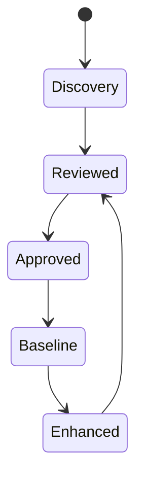

---

# Metadata Summary

The L2-E03 Faculty Workforce Workflows document defines the architecture, ownership boundaries, workflows, business rules, integrations, and governance model for managing academic workforce capability and capacity within SutraERP.

The document establishes Faculty Workforce as the authoritative academic workforce capability domain while preserving clear boundaries with HR, Position & Assignment, Curriculum, Scheduling, and other enterprise domains.

---# 1. Purpose

---

# 1.1 Purpose Statement

The purpose of the **L2-E03 Faculty Workforce bounded context** is to establish the authoritative academic workforce model within SutraERP.

The domain manages the complete academic workforce capability lifecycle by defining:

- Who faculty resources are within the academic ecosystem
- What academic activities faculty members are capable of performing
- How much academic capacity faculty members possess
- When faculty members are available for institutional participation
- How faculty workforce participation evolves over time

The Faculty Workforce domain enables reliable academic workforce decisions while maintaining strict separation from HR, organizational authority, curriculum ownership, and scheduling execution domains.

---

# 1.2 Business Purpose

Academic institutions require accurate and governed faculty workforce information to support:

- Academic planning
- Faculty utilization
- Teaching readiness evaluation
- Workload balancing
- Research participation
- Institutional governance
- Compliance reporting
- Academic resource optimization

The Faculty Workforce domain addresses the business problem of fragmented faculty information by providing a unified academic workforce capability model.

---

# 1.3 Problem Statement

In traditional academic ERP environments, faculty information is often distributed across multiple disconnected systems:

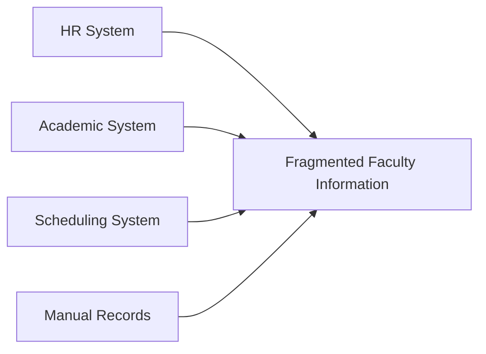

This fragmentation creates:

- Duplicate faculty records
- Inconsistent capability information
- Incorrect teaching eligibility decisions
- Poor workload visibility
- Limited capacity planning
- Manual reconciliation effort
- Weak historical traceability

---

# 1.4 Domain Mission

The mission of Faculty Workforce is:

> To provide a governed, auditable, and extensible academic workforce capability model that enables institutions to understand faculty capability, capacity, availability, and participation readiness.

---

# 1.5 Architectural Purpose

The Faculty Workforce bounded context SHALL provide a stable domain boundary for academic workforce decisions.

It SHALL act as the authoritative source for:

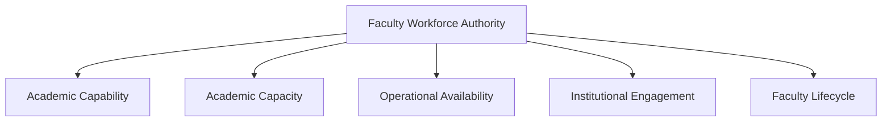

---

# 1.6 Core Objectives

The Faculty Workforce domain SHALL achieve the following objectives.

---

## 1.6.1 Establish Faculty Workforce Authority

Provide a canonical representation of faculty participation within SutraERP.

The domain SHALL maintain:

- Faculty workforce profiles
- Faculty engagement records
- Academic participation status
- Workforce lifecycle states

---

## 1.6.2 Enable Capability-Based Academic Decisions

The domain SHALL enable institutions to determine:

- Which faculty members can perform specific academic activities
- Which qualifications support capability decisions
- Which eligibility approvals are valid
- Which expertise areas are available

Capability decisions SHALL consider:

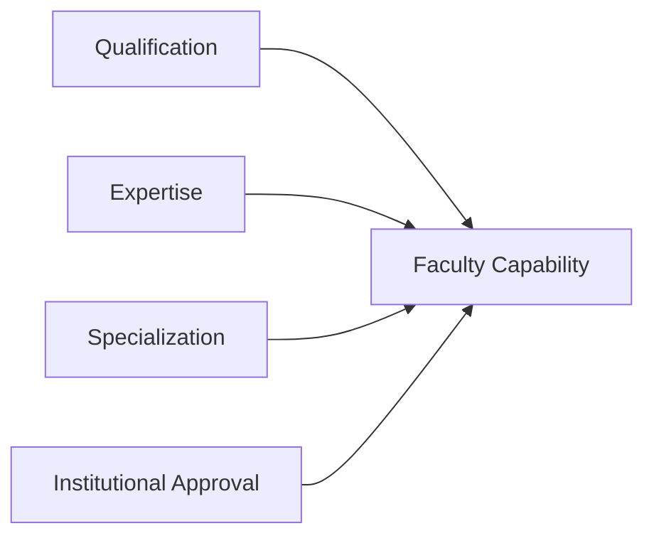

---

## 1.6.3 Enable Workforce Capacity Planning

The domain SHALL provide visibility into:

- Faculty workload
- Faculty availability
- Remaining academic capacity
- Utilization levels

Capacity SHALL be derived from:

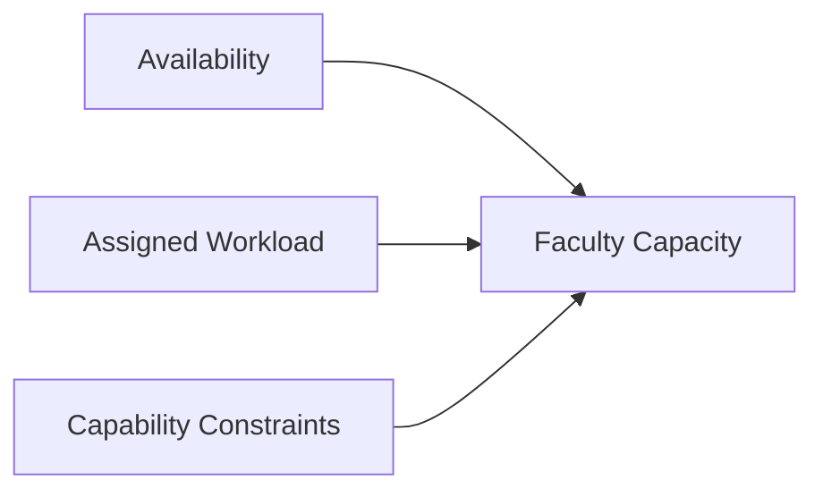

---

## 1.6.4 Support Governed Faculty Lifecycle Management

The domain SHALL support:

- Faculty workforce creation
- Verification
- Activation
- Suspension
- Reactivation
- Archival

Lifecycle transitions SHALL be:

- Auditable
- Policy controlled
- Historically preserved

---

# 1.7 Scope Intent

The Faculty Workforce domain exists to answer:

| Business Question | Domain Responsibility |
|---|---|
| Who is this faculty resource? | Faculty Workforce Profile |
| What can this faculty member do? | Capability Model |
| Can this faculty member teach this subject? | Teaching Eligibility |
| How much academic capacity exists? | Workload & Capacity Model |
| When can this faculty member participate? | Availability Model |
| How has participation changed historically? | Lifecycle Management |

---

# 1.8 Non-Goals

The Faculty Workforce domain SHALL NOT attempt to replace or duplicate:

| Non-Goal | Reason |
|---|---|
| HR employee management | Employment ownership belongs to HR |
| Payroll processing | Financial ownership belongs to Finance |
| Organizational hierarchy management | Owned by Position & Assignment |
| Curriculum design | Owned by Curriculum domain |
| Timetable generation | Owned by Scheduling domain |
| Personal calendar management | Owned by Calendar systems |
| Course allocation execution | Owned by Academic Operations/Scheduling |

---

# 1.9 Success Criteria

The Faculty Workforce domain is considered successful when SutraERP can:

## Provide Reliable Faculty Information

Faculty workforce information is:

- Accurate
- Governed
- Auditable
- Consistent

---

## Support Academic Planning

Institutions can determine:

- Available faculty resources
- Capability fit
- Workload distribution
- Capacity constraints

---

## Enable Domain Collaboration

Other SutraERP domains can consume:

- Faculty capability
- Faculty availability
- Faculty capacity
- Faculty lifecycle events

through defined contracts.

---

# 1.10 Purpose Summary

The Faculty Workforce bounded context establishes the academic workforce foundation of SutraERP.

Its purpose is not to manage employees broadly, but to manage faculty members as academic resources by providing authoritative information about:

- Capability
- Capacity
- Availability
- Engagement
- Institutional participation readiness

while preserving clear ownership boundaries across the enterprise architecture.

---

# 2. Scope

---

# 2.1 Scope Statement

The scope of the **L2-E03 Faculty Workforce bounded context** is to manage the academic workforce capability, capacity, availability, and participation lifecycle of faculty resources within SutraERP.

The domain establishes the authoritative model for:

- Faculty workforce representation
- Faculty engagement lifecycle
- Academic capability management
- Qualification association
- Teaching eligibility
- Research capability
- Academic workload
- Faculty availability
- Workforce capacity resolution

The domain SHALL enable institutional decisions regarding faculty participation while maintaining clear boundaries with external enterprise domains.

---

# 2.2 Functional Scope

The Faculty Workforce domain SHALL include the following functional areas:

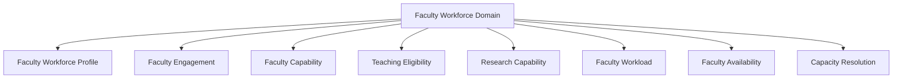

---

# 2.3 In-Scope Capabilities

---

## 2.3.1 Faculty Workforce Profile Management

E03 SHALL manage the academic workforce representation of faculty members.

Includes:

- Faculty workforce profile creation
- Faculty workforce status
- Faculty category
- Academic rank reference
- Faculty participation context
- Faculty lifecycle tracking

The domain SHALL maintain the academic workforce identity reference without replacing employee identity ownership.

---

## 2.3.2 Faculty Engagement Management

E03 SHALL manage faculty participation relationships with the institution.

Includes:

- Engagement creation
- Engagement approval
- Engagement activation
- Engagement extension
- Engagement completion
- Engagement archival

Example lifecycle:

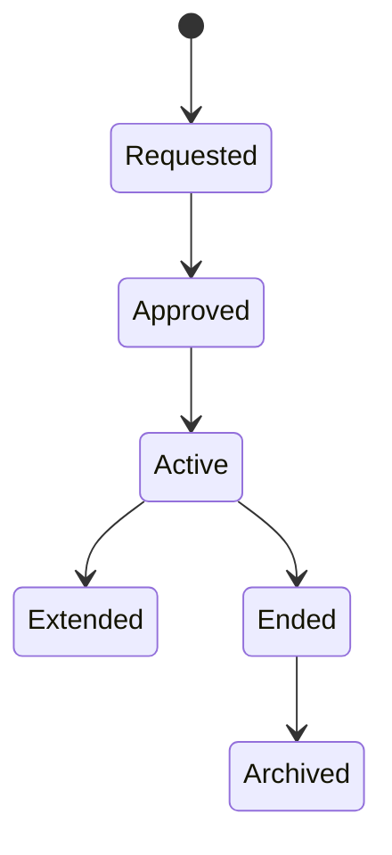

---

## 2.3.3 Faculty Capability Management

E03 SHALL manage the academic capabilities associated with faculty resources.

Includes:

- Expertise
- Specialization
- Qualification association
- Teaching capability
- Research capability
- Competency recognition

Capability SHALL be represented through a combination of:


---

## 2.3.4 Qualification Association Management

E03 SHALL manage the relationship between faculty members and academic qualifications.

Includes:

- Degree association
- Certification association
- Academic relevance
- Qualification impact on capability

E03 SHALL maintain qualification relevance.

E03 SHALL NOT become the credential storage or verification authority.

---

## 2.3.5 Teaching Eligibility Management

E03 SHALL manage approved teaching eligibility decisions.

Includes:

- Eligibility rules
- Capability matching
- Academic approval
- Eligibility status
- Eligibility history

The domain SHALL answer:

> "Is this faculty member approved to perform this academic teaching activity?"

---

## 2.3.6 Research Capability Management

E03 SHALL manage research-related faculty capability.

Includes:

- Research expertise
- Research domains
- Research participation capability
- Research capability classification

Research capability SHALL remain separate from teaching capability.

---

## 2.3.7 Faculty Workload Management

E03 SHALL manage academic workload planning and capacity.

Includes:

- Workload planning
- Workload review
- Workload approval
- Workload allocation
- Workload consumption tracking
- Workload history

Workload categories include:

```text
- Teaching
- Research
- Administration
- Committee Responsibilities
- Mentoring
- Student Supervision
```

---

## 2.3.8 Faculty Availability Management

E03 SHALL manage institutional availability information.

Includes:

- Teaching availability
- Research availability
- Administrative availability
- Committee availability
- Mentoring availability
- Availability restrictions

Availability SHALL represent institutional participation capacity.

---

## 2.3.9 Faculty Capacity Resolution

E03 SHALL provide faculty capacity intelligence.

Capacity SHALL be derived from:

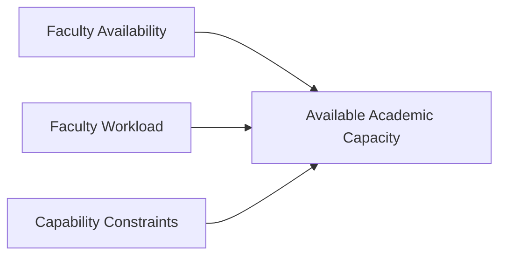

---

# 2.4 Data Scope

The Faculty Workforce domain owns the following data:

| Data Category | Ownership |
|---|---|
| Faculty Workforce Profile | E03 |
| Faculty Engagement | E03 |
| Faculty Capability | E03 |
| Teaching Eligibility | E03 |
| Research Capability | E03 |
| Faculty Workload | E03 |
| Faculty Availability | E03 |
| Faculty Capacity View | E03 |

---

# 2.5 Workflow Scope

E03 SHALL own workflows related to:

| Workflow Area | Ownership |
|---|---|
| Faculty Creation | E03 |
| Faculty Verification | E03 |
| Faculty Activation | E03 |
| Capability Updates | E03 |
| Qualification Association | E03 |
| Teaching Eligibility Approval | E03 |
| Availability Management | E03 |
| Workload Planning | E03 |
| Workload Approval | E03 |
| Suspension | E03 |
| Reactivation | E03 |
| Archival | E03 |

---

# 2.6 Explicitly Out of Scope

The following capabilities SHALL NOT belong to E03.

---

## 2.6.1 Employee Identity Management

Owned by:

```text
HR / Identity Domain
```

Includes:

- Employee master record
- Personal identity information
- Employment number generation
- Employee lifecycle

---

## 2.6.2 Employment Administration

Owned by:

```text
HR Domain
```

Includes:

- Employment contracts
- Benefits
- Compensation
- Payroll status
- Employment compliance

---

## 2.6.3 Organizational Structure

Owned by:

```text
E02 — Position & Assignment
```

Includes:

- Positions
- Reporting relationships
- Authority hierarchy
- Organizational responsibility

---

## 2.6.4 Curriculum Ownership

Owned by:

```text
Curriculum Domain
```

Includes:

- Course definition
- Subject structure
- Academic requirements
- Curriculum rules

---

## 2.6.5 Timetable Execution

Owned by:

```text
Timetable Domain
```

Includes:

- Scheduling
- Time-slot assignment
- Room assignment
- Class execution

---

## 2.6.6 Course Teaching Allocation

Owned by:

```text
Academic Operations / Scheduling Domain
```

Includes:

- Faculty-course assignment
- Section allocation
- Teaching schedule ownership

E03 only provides:

- Eligibility
- Availability
- Capacity

---

# 2.7 Scope Boundary Model

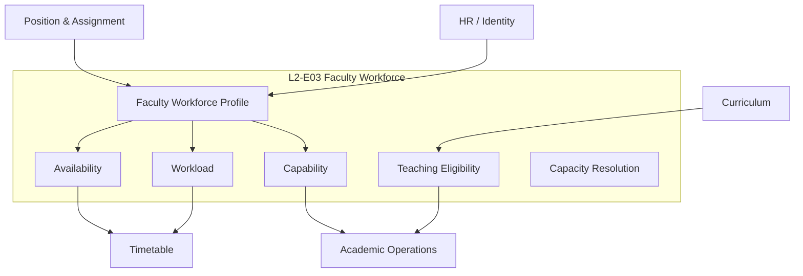

---

# 2.8 Scope Principles

## Principle 1 — Academic Workforce Ownership

E03 owns faculty as an academic resource, not as a general employee record.

---

## Principle 2 — Capability Before Allocation

E03 determines:

> "Who can perform the activity?"

Other domains determine:

> "When and where the activity occurs."

---

## Principle 3 — Capacity Without Scheduling Ownership

E03 provides capacity information without executing timetable decisions.

---

## Principle 4 — Domain Separation

Every business capability SHALL have a single authoritative owner.

---

# 2.9 Scope Summary

The Faculty Workforce domain covers:

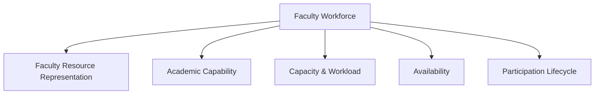

The domain intentionally excludes:

- HR administration
- Organizational authority
- Curriculum ownership
- Scheduling execution
- Financial processing

This scope ensures E03 remains a focused academic workforce capability domain within SutraERP.

---

# 3. Upstream Dependencies

---

# 3.1 Purpose

This section defines the external domains, systems, and services that provide required information, events, or capabilities to the **L2-E03 Faculty Workforce bounded context**.

Upstream dependencies represent sources of authoritative information that E03 consumes but does not own.

The dependency principle is:

> E03 may consume external facts required for academic workforce decisions, but SHALL maintain ownership only over faculty workforce capability, capacity, availability, and participation decisions.

---

# 3.2 Upstream Dependency Model

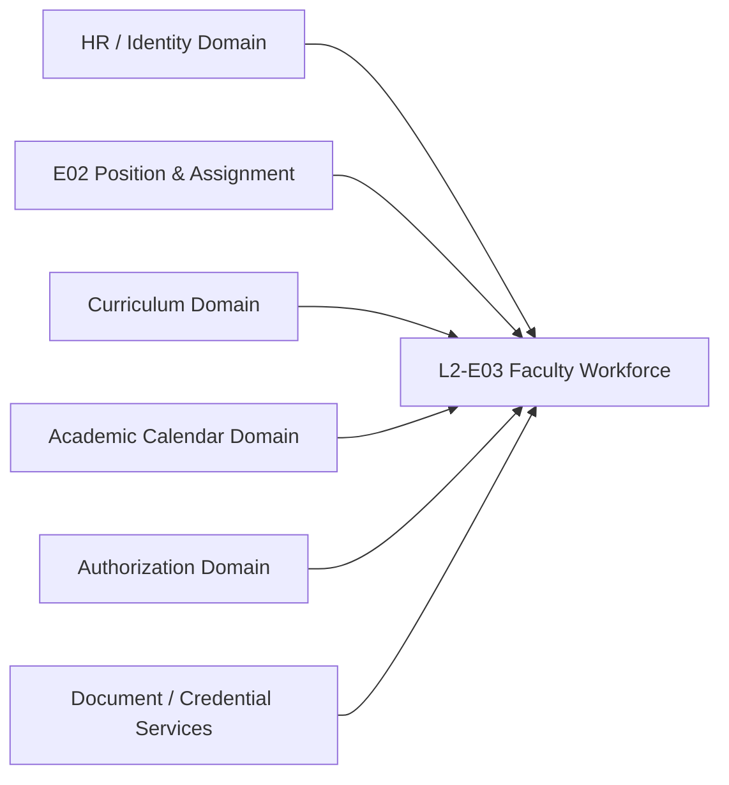

---

# 3.3 Dependency Summary

| Upstream Domain | Dependency Type | Purpose |
|---|---|---|
| HR / Identity Domain | Data + Events | Employee identity and employment lifecycle information |
| E02 Position & Assignment | Data + Events | Organizational placement and authority context |
| Curriculum Domain | Data + Service Contract | Academic capability requirements |
| Academic Calendar Domain | Data + Events | Academic period context |
| Authorization Domain | Service Contract | Access control decisions |
| Document / Credential Services | Service Integration | Qualification verification support |

---

# 3.4 HR / Identity Domain Dependency

## Purpose

E03 requires HR-managed identity and employment information to associate faculty workforce profiles with institutional employees.

---

## Consumed Information

E03 consumes:

| Information | Purpose |
|---|---|
| Employee Identifier | Faculty workforce reference |
| Personal Identity Reference | Faculty identification |
| Employment Status | Participation eligibility |
| Employment Lifecycle Events | Faculty lifecycle synchronization |

---

## Consumed Events

```text
EmployeeCreated

EmploymentActivated

EmploymentSuspended

EmploymentEnded

EmployeeUpdated
```

---

## Ownership Boundary

HR owns:

- Employee master identity
- Employment relationship
- Contract information
- Payroll-related status

E03 owns:

- Academic workforce profile
- Capability
- Academic participation readiness

---

# 3.5 E02 Position & Assignment Dependency

## Purpose

E03 requires organizational context from E02 to understand faculty placement relationships.

---

## Consumed Information

| Information | Purpose |
|---|---|
| Position Reference | Organizational association |
| Department Reference | Academic grouping |
| Organizational Unit Reference | Institutional context |
| Assignment Events | Participation context |

---

## Consumed Events

```text
PositionAssigned

PositionChanged

AssignmentUpdated

AssignmentEnded
```

---

## Ownership Boundary

E02 owns:

- Positions
- Reporting hierarchy
- Authority
- Organizational responsibility

E03 owns:

- Faculty capability
- Faculty capacity
- Faculty availability

---

# 3.6 Curriculum Domain Dependency

## Purpose

E03 requires curriculum-defined capability requirements to determine faculty eligibility.

---

## Consumed Information

| Information | Purpose |
|---|---|
| Course Capability Requirements | Eligibility matching |
| Subject Expertise Requirements | Capability validation |
| Academic Qualification Requirements | Qualification alignment |

---

## Consumed Events

```text
CourseCapabilityRequirementUpdated

SubjectRequirementChanged

CurriculumVersionPublished
```

---

## Dependency Flow

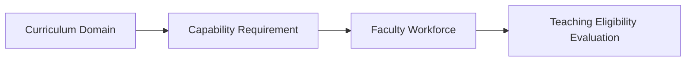

---

# 3.7 Academic Calendar Dependency

## Purpose

Faculty workforce decisions depend on academic time periods.

---

## Consumed Information

| Information | Purpose |
|---|---|
| Academic Year | Workforce planning period |
| Semester | Workload period |
| Term Dates | Availability effectiveness |
| Academic Cycles | Planning boundaries |

---

## Consumed Events

```text
AcademicYearCreated

SemesterPublished

AcademicPeriodChanged
```

---

# 3.8 Document / Credential Services Dependency

## Purpose

E03 may require external support for qualification verification.

---

## Consumed Capabilities

| Capability | Purpose |
|---|---|
| Document Validation | Qualification verification |
| Credential Status | Qualification trust level |
| Verification Result | Capability confidence |

---

## Ownership Boundary

Document services own:

- Document storage
- Verification mechanisms
- External credential checks

E03 owns:

- Qualification association
- Capability impact
- Eligibility decisions

---

# 3.9 Authorization Domain Dependency

## Purpose

E03 relies on platform authorization services for identity and permission management.

---

## Consumed Services

```text
ValidateUserIdentity

CheckPermission

ResolveRole

EvaluateAccessPolicy
```

---

## Ownership Boundary

Authorization domain owns:

- User authentication
- Permission framework
- Role management

E03 owns:

- Domain-level approval rules
- Business authorization constraints

---

# 3.10 Dependency Direction Rules

Dependencies SHALL follow:

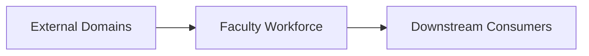

The following dependency patterns are prohibited:

```text
E03 owns HR Employee Records

E03 owns Organizational Hierarchy

E03 owns Curriculum Requirements

E03 owns Timetable Execution

E03 owns Payroll Information
```

---

# 3.11 Upstream Dependency Risks

| Dependency | Risk | Mitigation |
|---|---|---|
| HR Availability | Delayed employee updates | Event-driven synchronization |
| Curriculum Changes | Eligibility mismatch | Versioned capability requirements |
| Position Changes | Outdated organizational context | Event consumption |
| Credential Verification | External service failure | Verification status workflow |
| Calendar Changes | Incorrect planning period | Effective-dated models |

---

# 3.12 Dependency Resilience Principles

E03 SHALL:

- Avoid direct ownership of upstream data
- Store references instead of duplicates where possible
- Maintain historical snapshots when required
- Use events for lifecycle changes
- Handle unavailable upstream services gracefully
- Preserve domain consistency independently

---

# 3.13 Upstream Dependency Summary

The Faculty Workforce domain depends on external domains for contextual information required to make academic workforce decisions.

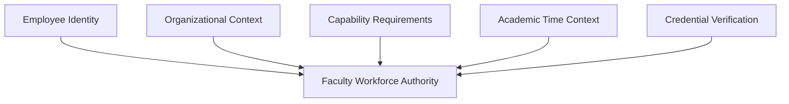

E03 remains the authoritative owner of:

- Faculty capability
- Faculty capacity
- Faculty availability
- Faculty workforce lifecycle
- Academic participation readiness

---

# 4. Downstream Dependencies

---

# 4.1 Purpose

This section defines the external domains, systems, and services that consume information, decisions, events, or capabilities provided by the **L2-E03 Faculty Workforce bounded context**.

Downstream dependencies represent consumers that rely on E03 as the authoritative source for:

- Faculty workforce capability
- Faculty availability
- Faculty workload
- Faculty capacity
- Faculty lifecycle state
- Academic participation readiness

The dependency principle is:

> E03 provides authoritative academic workforce information, while downstream domains remain responsible for their own business decisions and execution workflows.

---

# 4.2 Downstream Dependency Model

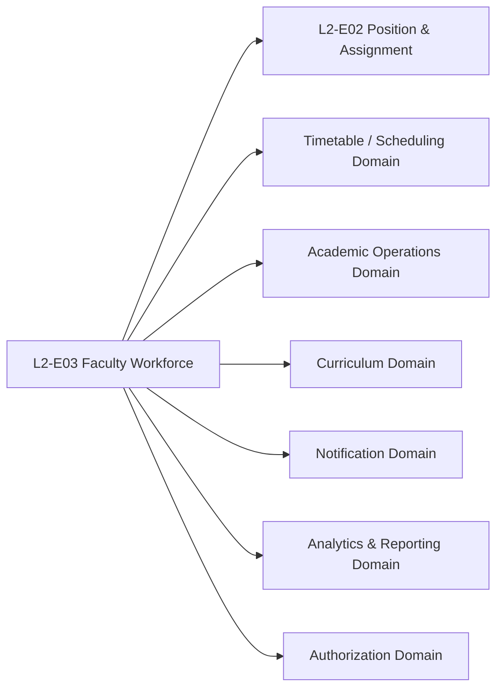

---

# 4.3 Downstream Dependency Summary

| Downstream Domain | Dependency Type | Purpose |
|---|---|---|
| Timetable / Scheduling Domain | Query + Events | Faculty availability and capacity consumption |
| Academic Operations Domain | Query + Events | Faculty participation decisions |
| E02 Position & Assignment | Query + Events | Faculty organizational context |
| Curriculum Domain | Query + Events | Capability matching |
| Notification Domain | Events | Faculty lifecycle notifications |
| Analytics & Reporting Domain | Data Access + Events | Workforce intelligence |
| Authorization Domain | Service Contract | Domain permission evaluation |

---

# 4.4 Timetable / Scheduling Domain Dependency

## Purpose

The Timetable domain consumes faculty workforce information to make scheduling decisions.

E03 provides:

- Faculty availability
- Faculty capacity
- Teaching eligibility
- Workload constraints

---

## Consumed Queries

```text
GetFacultyAvailability

GetFacultyCapacity

CheckTeachingEligibility

GetFacultyCapability
```

---

## Consumed Events

```text
FacultyAvailabilityChanged

FacultyEligibilityChanged

FacultyWorkloadChanged

FacultyDeactivated
```

---

## Ownership Boundary

Timetable owns:

- Time-slot assignment
- Room allocation
- Schedule generation
- Class execution

E03 owns:

- Faculty readiness
- Capability
- Availability
- Capacity

---

## Interaction Model

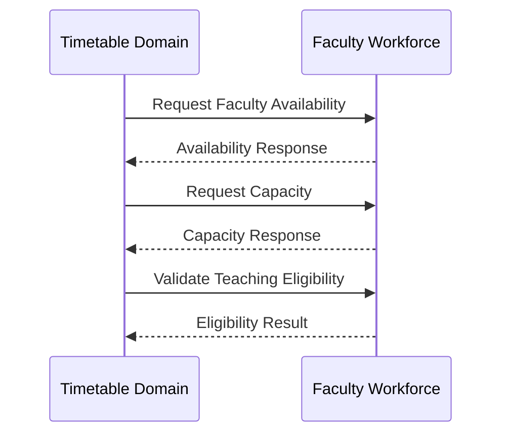

---

# 4.5 Academic Operations Domain Dependency

## Purpose

Academic Operations consumes E03 information to execute academic activities involving faculty resources.

---

## Consumed Information

| Information | Purpose |
|---|---|
| Faculty Capability | Resource suitability |
| Faculty Eligibility | Academic compliance |
| Faculty Capacity | Allocation feasibility |
| Faculty Status | Participation readiness |

---

## Consumed Events

```text
FacultyActivated

FacultySuspended

FacultyCapabilityUpdated

FacultyAvailabilityChanged
```

---

## Ownership Boundary

Academic Operations owns:

- Academic execution
- Operational assignments
- Academic delivery workflows

E03 owns:

- Faculty workforce decisions

---

# 4.6 Curriculum Domain Dependency

## Purpose

Curriculum consumes faculty capability information for academic requirement validation.

---

## Consumed Information

| Information | Purpose |
|---|---|
| Faculty Expertise | Capability matching |
| Teaching Eligibility | Qualification alignment |
| Specialization | Academic suitability |

---

## Interaction Model

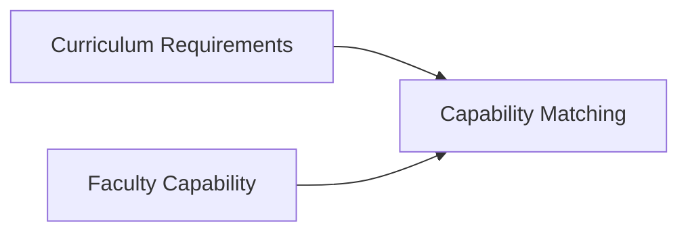

---

# 4.7 E02 Position & Assignment Dependency

## Purpose

E02 consumes faculty workforce information to associate faculty resources with organizational structures.

---

## Consumed Information

| Information | Purpose |
|---|---|
| Faculty Profile Reference | Position relationship |
| Faculty Status | Assignment eligibility |
| Faculty Engagement | Organizational participation |

---

## Ownership Boundary

E02 owns:

- Position
- Authority
- Reporting relationship
- Organizational responsibility

E03 owns:

- Faculty capability
- Workforce capacity
- Availability

---

# 4.8 Notification Domain Dependency

## Purpose

The Notification domain consumes E03 events to deliver institutional communication.

---

## Published Events Consumed

```text
FacultyCreated

FacultyActivated

FacultySuspended

FacultyCapabilityUpdated

FacultyAvailabilityChanged

FacultyWorkloadChanged

FacultyDeactivated
```

---

## Ownership Boundary

Notification owns:

- Message delivery
- Channels
- Templates
- Delivery tracking

E03 owns:

- Business event generation

---

# 4.9 Analytics & Reporting Dependency

## Purpose

Analytics consumes faculty workforce information for institutional insights.

---

## Consumed Information

Examples:

```text
Faculty Capacity Trends

Workload Distribution

Capability Coverage

Availability Analysis

Faculty Lifecycle History
```

---

## Ownership Boundary

Analytics owns:

- Reporting models
- Dashboards
- Data visualization

E03 owns:

- Operational workforce truth

---

# 4.10 Authorization Domain Dependency

## Purpose

E03 provides domain context while consuming platform authorization services.

---

## Interaction

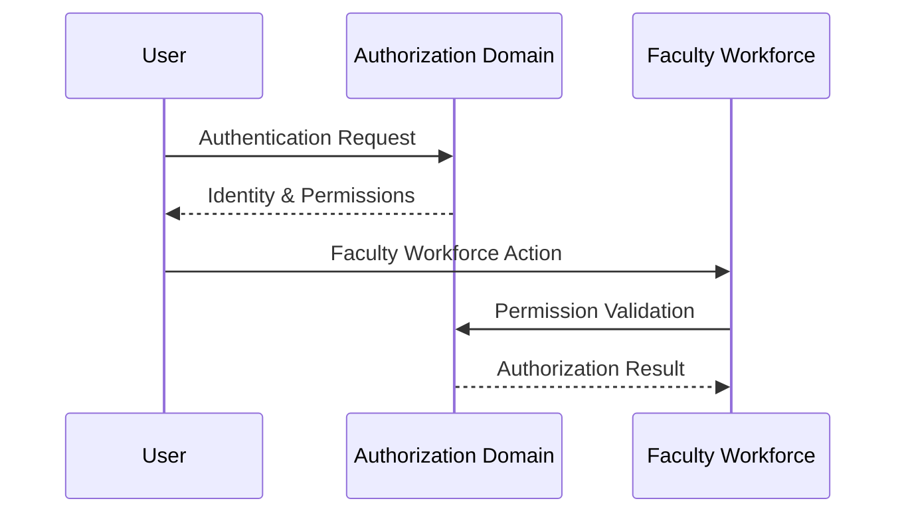

---

# 4.11 Published Domain Events

E03 SHALL publish events for downstream consumers.

```text
FacultyCreated

FacultyActivated

FacultyCapabilityUpdated

FacultyEligibilityChanged

FacultyAvailabilityChanged

FacultyWorkloadChanged

FacultySuspended

FacultyDeactivated
```

---

# 4.12 Downstream Dependency Rules

The following rules SHALL apply:

| Rule | Description |
|---|---|
| E03 owns workforce decisions | Consumers cannot modify E03-owned state directly |
| Consumers use contracts | Direct database access is prohibited |
| Events communicate changes | Lifecycle changes propagate asynchronously |
| Queries provide current state | Read access uses defined contracts |
| Consumer execution remains external | E03 does not execute consumer workflows |

---

# 4.13 Prohibited Dependency Patterns

The following patterns are prohibited:

```text
Timetable modifies Faculty Availability directly

Academic Operations modifies Faculty Capability directly

Notification updates Faculty Lifecycle

Analytics becomes source of workforce truth

E02 modifies Faculty Eligibility
```

---

# 4.14 Dependency Direction Model

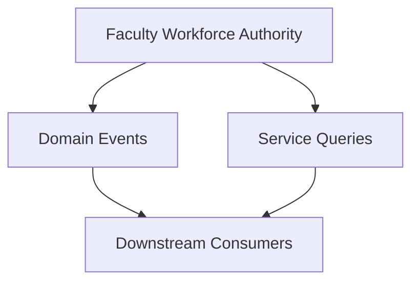

---

# 4.15 Downstream Dependency Summary

The Faculty Workforce domain acts as a provider of academic workforce intelligence.

It enables other SutraERP domains to make decisions using:

```mermaid
flowchart TD

E03["Faculty Workforce"]

E03 --> Capability["Capability Information"]

E03 --> Capacity["Capacity Information"]

E03 --> Availability["Availability Information"]

E03 --> Lifecycle["Lifecycle Information"]

Capability --> Consumers["Enterprise Consumers"]

Capacity --> Consumers

Availability --> Consumers

Lifecycle --> Consumers
```

E03 SHALL remain the authoritative owner of academic workforce capability and capacity while downstream domains remain responsible for their own execution responsibilities.

---

# 5. Domain Ownership Boundaries

---

# 5.1 Purpose

This section defines the authoritative ownership boundaries of the **L2-E03 Faculty Workforce bounded context**.

The objective is to prevent:

- Duplicate ownership
- Cross-domain responsibility conflicts
- Data inconsistency
- Workflow duplication
- Architectural boundary erosion

The ownership principle is:

> Every business decision SHALL have one authoritative domain owner.

---

# 5.2 Domain Ownership Statement

The Faculty Workforce domain owns decisions related to:

- Faculty workforce representation
- Faculty academic capability
- Faculty eligibility
- Faculty workload
- Faculty availability
- Faculty academic capacity
- Faculty participation lifecycle

E03 does not own employment, organizational authority, curriculum definition, or academic scheduling execution.

---

# 5.3 Ownership Boundary Model

```mermaid
flowchart TB

subgraph E03["L2-E03 Faculty Workforce"]

Profile["Faculty Workforce Profile"]

Capability["Faculty Capability"]

Eligibility["Teaching Eligibility"]

Workload["Faculty Workload"]

Availability["Faculty Availability"]

Capacity["Faculty Capacity"]

Lifecycle["Faculty Lifecycle"]

end


HR["HR Domain"]

E02["Position & Assignment"]

CUR["Curriculum Domain"]

TIME["Timetable Domain"]

FIN["Finance Domain"]


HR --> Profile

E02 --> Profile

CUR --> Eligibility

Profile --> Capability

Profile --> Workload

Profile --> Availability

Capability --> Capacity

Workload --> Capacity

Availability --> Capacity

TIME --> HR

FIN --> HR
```

---

# 5.4 E03 Owned Capabilities

The following capabilities SHALL be exclusively owned by E03.

---

# 5.4.1 Faculty Workforce Profile Ownership

## E03 Owns

- Faculty workforce representation
- Academic participation identity
- Faculty lifecycle status
- Faculty workforce classification

## E03 Does Not Own

- Employee master identity
- Government identity records
- Payroll identifiers

---

# 5.4.2 Faculty Capability Ownership

## E03 Owns

- Faculty expertise
- Academic specialization
- Capability classification
- Capability assessment
- Capability lifecycle

## E03 Does Not Own

- Curriculum competency definition
- Course design
- External credential issuing authority

---

# 5.4.3 Teaching Eligibility Ownership

## E03 Owns

- Eligibility evaluation
- Eligibility approval workflow
- Teaching authorization status
- Eligibility history

## E03 Does Not Own

- Course requirements
- Timetable allocation
- Student registration rules

---

# 5.4.4 Faculty Workload Ownership

## E03 Owns

- Workload planning
- Workload categories
- Workload approval workflow
- Workload history
- Capacity impact

## E03 Does Not Own

- Payroll hours
- Compensation calculations
- Attendance tracking

---

# 5.4.5 Faculty Availability Ownership

## E03 Owns

- Institutional availability
- Availability patterns
- Availability restrictions
- Availability approval workflow

## E03 Does Not Own

- Personal calendars
- Meeting schedules
- External appointments

---

# 5.4.6 Faculty Capacity Ownership

## E03 Owns

The calculation and interpretation of:

```text
Available Academic Capacity
```

Derived from:

```mermaid
flowchart LR

Availability["Availability"]

Workload["Workload"]

Capability["Capability Constraints"]

Capacity["Faculty Capacity"]

Availability --> Capacity

Workload --> Capacity

Capability --> Capacity
```

## E03 Does Not Own

- Course scheduling decisions
- Room allocation
- Class timetable optimization

---

# 5.5 External Domain Ownership Matrix

| Business Capability | Authoritative Owner |
|---|---|
| Employee Identity | HR Domain |
| Employment Contract | HR Domain |
| Payroll | Finance Domain |
| Organizational Position | E02 Position & Assignment |
| Reporting Hierarchy | E02 Position & Assignment |
| Curriculum Structure | Curriculum Domain |
| Course Definition | Curriculum Domain |
| Timetable Generation | Timetable Domain |
| Student Enrollment | Student Academic Domain |
| Notification Delivery | Notification Domain |

---

# 5.6 Decision Ownership Matrix

| Decision | Owner | Consumer |
|---|---|---|
| Is faculty active? | E03 | Academic Operations |
| Can faculty teach subject? | E03 | Scheduling |
| Does faculty have capacity? | E03 | Planning/Scheduling |
| Where does faculty belong organizationally? | E02 | E03 |
| Is employee legally employed? | HR | E03 |
| What competencies does a course require? | Curriculum | E03 |
| When is class conducted? | Scheduling | Students/Faculty |

---

# 5.7 Data Ownership Boundary

```mermaid
flowchart LR

subgraph E03["Faculty Workforce"]

A["Capability Data"]

B["Workload Data"]

C["Availability Data"]

D["Eligibility Data"]

end


HR["Employment Data"]

E02["Position Data"]

CUR["Curriculum Data"]

TIME["Schedule Data"]


HR --> E03

E02 --> E03

CUR --> E03

E03 --> TIME
```

---

# 5.8 Workflow Ownership Boundary

The following workflows belong to E03:

| Workflow | Owner |
|---|---|
| Faculty Creation | E03 |
| Faculty Activation | E03 |
| Capability Update | E03 |
| Qualification Association | E03 |
| Eligibility Approval | E03 |
| Availability Management | E03 |
| Workload Planning | E03 |
| Faculty Suspension | E03 |
| Faculty Reactivation | E03 |
| Faculty Archival | E03 |

---

# 5.9 Workflow Ownership Exclusions

The following workflows SHALL NOT belong to E03.

| Workflow | Owner |
|---|---|
| Employee Hiring | HR |
| Payroll Processing | Finance |
| Department Creation | Organization Domain |
| Course Creation | Curriculum |
| Timetable Generation | Scheduling |
| Student Assignment | Student Academic Domain |

---

# 5.10 Anti-Corruption Boundary Rules

To prevent domain leakage:

## Rule 1

External domains SHALL not directly modify E03-owned data.

---

## Rule 2

E03 SHALL consume external facts through:

- Events
- APIs
- Service contracts

---

## Rule 3

E03 SHALL expose business decisions, not internal database structures.

---

## Rule 4

Downstream domains SHALL not infer faculty capability independently.

---

# 5.11 Ownership Enforcement Model

```mermaid
sequenceDiagram

participant HR as HR Domain
participant E03 as Faculty Workforce
participant TIME as Timetable Domain


HR->>E03: EmploymentActivated Event

E03->>E03: Create Faculty Participation Context

TIME->>E03: Check Teaching Eligibility

E03-->>TIME: Eligibility Decision

TIME->>E03: Request Capacity

E03-->>TIME: Capacity Response
```

---

# 5.12 Boundary Summary

The Faculty Workforce bounded context is the single authoritative owner for academic workforce capability and capacity decisions.

The domain SHALL own:

```text
Faculty Capability

Faculty Eligibility

Faculty Workload

Faculty Availability

Faculty Capacity

Faculty Participation Lifecycle
```

The domain SHALL not own:

```text
Employment Administration

Organizational Authority

Curriculum Definition

Scheduling Execution

Financial Processing
```

This ownership model preserves SutraERP domain integrity and prevents responsibility duplication across bounded contexts.

---

# 6. Domain Model / Aggregate / Lifecycle

---

# 6.1 Purpose

This section defines the internal domain structure of the **L2-E03 Faculty Workforce bounded context**.

It establishes:

- Core domain entities
- Aggregate boundaries
- Value objects
- Entity relationships
- Lifecycle management
- Consistency boundaries
- State ownership

The design follows Domain-Driven Design principles.

---

# 6.2 Domain Model Overview

The Faculty Workforce domain models faculty members as academic workforce resources rather than only employees.

The core domain model is:

```mermaid
classDiagram

class FacultyWorkforce {
    +FacultyId
    +Status
    +ActivationDate
    +Deactivate()
    +Activate()
}

class FacultyEngagement {
    +EngagementId
    +Type
    +StartDate
    +EndDate
}

class FacultyCapability {
    +CapabilityId
    +ExpertiseArea
    +Level
    +Status
}

class TeachingEligibility {
    +EligibilityId
    +Status
    +ApprovedDate
}

class FacultyWorkload {
    +WorkloadId
    +AllocatedHours
    +ConsumedHours
}

class FacultyAvailability {
    +AvailabilityId
    +AvailabilityPattern
    +EffectivePeriod
}

class Qualification {
    +QualificationId
    +QualificationType
}

class Expertise {
    +ExpertiseId
    +Domain
}


FacultyWorkforce --> FacultyEngagement

FacultyWorkforce --> FacultyCapability

FacultyCapability --> Qualification

FacultyCapability --> Expertise

FacultyWorkforce --> TeachingEligibility

FacultyWorkforce --> FacultyWorkload

FacultyWorkforce --> FacultyAvailability
```

---

# 6.3 Aggregate Design Principles

The Faculty Workforce domain SHALL follow these aggregate principles:

| Principle | Description |
|---|---|
| Single Aggregate Root | Each consistency boundary has one root entity |
| Explicit Ownership | Aggregates own their internal state |
| Controlled Mutation | State changes happen through commands |
| Event Publication | Significant changes emit domain events |
| Historical Preservation | Important lifecycle changes remain traceable |

---

# 6.4 Aggregate Overview

The Faculty Workforce aggregate is the primary lifecycle aggregate of the Faculty Workforce bounded context.

Faculty Capability, Faculty Workload, Faculty Availability, and Teaching Eligibility are business components associated with a Faculty Workforce and SHALL always maintain a mandatory reference to an existing Faculty Workforce.

Where operational independence is required (for example, long-running approval workflows, independent concurrency control, or separate persistence optimization), these components MAY be implemented as separate aggregates while preserving the Faculty Workforce as the authoritative lifecycle owner.

No dependent aggregate SHALL exist without an associated Faculty Workforce.
---

# 6.5 Faculty Workforce Aggregate

## Aggregate Root

```text
FacultyWorkforce
```

---

## Responsibility

The Faculty Workforce aggregate manages the existence and lifecycle of an academic workforce member.

---

## Owned Entities

```text
FacultyWorkforce

 ├── FacultyEngagement

 ├── FacultyStatus

 └── WorkforceClassification
```

---

## Value Objects

```text
FacultyId

FacultyCategory

AcademicRankReference

EngagementType

LifecycleStatus
```

---

## Aggregate Rules

The aggregate SHALL ensure:

- Faculty cannot become active without required approvals
- Faculty lifecycle transitions are controlled
- Historical states are preserved
- Invalid lifecycle transitions are rejected

---

# 6.6 Faculty Capability Aggregate

## Aggregate Root

```text
FacultyCapability
```

---

## Responsibility

Manages what academic activities a faculty member can perform.

---

## Owned Entities

```text
FacultyCapability

 ├── Expertise

 ├── Specialization

 ├── QualificationAssociation

 └── CapabilityAssessment
```

---

## Value Objects

```text
CapabilityLevel

ExpertiseArea

QualificationType

AssessmentStatus
```

---

## Capability Model

```mermaid
flowchart TD

Faculty["Faculty Workforce"]

Capability["Faculty Capability"]

Qualification["Qualification"]

Expertise["Expertise"]

Specialization["Specialization"]

Assessment["Capability Assessment"]


Faculty --> Capability

Capability --> Qualification

Capability --> Expertise

Capability --> Specialization

Capability --> Assessment
```

---

# 6.7 Teaching Eligibility Aggregate

## Aggregate Root

```text
TeachingEligibility
```

---

## Responsibility

Determines whether faculty members are approved to perform teaching activities.

---

## Inputs

```text
Faculty Capability

Qualification

Curriculum Requirements

Institution Policies
```

---

## Output

```text
Teaching Eligibility Decision
```

---

## Lifecycle

```mermaid
stateDiagram-v2

[*] --> Requested

Requested --> UnderReview

UnderReview --> Approved

UnderReview --> Rejected

Approved --> Suspended

Suspended --> Approved

Approved --> Expired

Expired --> Renewed
```

---

# 6.8 Faculty Workload Aggregate

## Aggregate Root

```text
FacultyWorkload
```

---

## Responsibility

Manages academic responsibility allocation and capacity consumption.

---

## Owned Data

```text
Teaching Load

Research Load

Administrative Load

Mentoring Load

Committee Load
```

---

## Capacity Relationship

```mermaid
flowchart LR

TotalCapacity["Faculty Capacity"]

Workload["Allocated Workload"]

Remaining["Remaining Capacity"]


TotalCapacity --> Remaining

Workload --> Remaining
```

---

## Rules

The aggregate SHALL ensure:

- Workload cannot exceed defined limits without approval
- Historical workload changes are preserved
- Workload changes are auditable

---

# 6.9 Faculty Availability Aggregate

## Aggregate Root

```text
FacultyAvailability
```

---

## Responsibility

Manages institutional participation availability.

---

## Owned Data

```text
Availability Pattern

Effective Dates

Restrictions

Availability Type
```

---

## Availability Model

```mermaid
flowchart TD

Faculty["Faculty"]

Availability["Availability"]

Teaching["Teaching Availability"]

Research["Research Availability"]

Admin["Administrative Availability"]


Faculty --> Availability

Availability --> Teaching

Availability --> Research

Availability --> Admin
```

---

# 6.10 Aggregate Relationship Model

```mermaid
flowchart TB

FW["Faculty Workforce Aggregate"]

CAP["Faculty Capability Aggregate"]

ELG["Teaching Eligibility Aggregate"]

WL["Faculty Workload Aggregate"]

AVL["Faculty Availability Aggregate"]


FW --> CAP

FW --> ELG

FW --> WL

FW --> AVL
```

---

# 6.11 Lifecycle Model

The overall Faculty Workforce lifecycle is:

```mermaid
stateDiagram-v2

[*] --> Draft

Draft --> PendingVerification

PendingVerification --> Active

PendingVerification --> VerificationFailed

VerificationFailed --> PendingVerification

Active --> Suspended

Suspended --> Active

Active --> Inactive

Inactive --> Archived

Archived --> [*]
```

---

# 6.12 Lifecycle State Definitions

| State               | Description                                                         |
| ------------------- | ------------------------------------------------------------------- |
| Draft               | Faculty Workforce record created but not submitted for verification |
| PendingVerification | Awaiting institutional validation                                   |
| VerificationFailed  | Verification unsuccessful; correction required                      |
| Active              | Eligible for academic participation                                 |
| Suspended           | Temporarily restricted from participation                           |
| Inactive            | Participation ended but retained operationally                      |
| Archived            | Historical immutable record                                         |

---

# 6.13 Aggregate Consistency Boundaries

The domain SHALL enforce:

```mermaid
flowchart LR

Command["Domain Command"]

Aggregate["Aggregate Root"]

Validation["Business Rules"]

Event["Domain Event"]


Command --> Aggregate

Aggregate --> Validation

Validation --> Event
```

---

# 6.14 Domain Model Constraints

The following constraints apply:

## Constraint 1

Faculty capability cannot exist without a faculty workforce reference.

---

## Constraint 2

Teaching eligibility cannot be approved without capability validation.

---

## Constraint 3

Workload cannot be allocated beyond capacity without approval.

---

## Constraint 4

Availability changes must maintain effective dates.

---

## Constraint 5

Lifecycle transitions must follow approved state paths.

---

# 6.15 Domain Model Summary

The Faculty Workforce domain is structured around:

```mermaid
flowchart TD

E03["Faculty Workforce"]

E03 --> Identity["Faculty Workforce Identity"]

E03 --> Capability["Capability"]

E03 --> Eligibility["Eligibility"]

E03 --> Workload["Workload"]

E03 --> Availability["Availability"]

E03 --> Lifecycle["Lifecycle"]
```

The aggregate design ensures:

- Clear ownership
- Controlled state changes
- Domain consistency
- Auditability
- Event-driven integration readiness

---
# 7. Domain Workflows

---

# 7.1 Purpose

This section defines the business workflows owned by the **L2-E03 Faculty Workforce bounded context**.

The workflows represent controlled business processes responsible for managing:

- Faculty workforce lifecycle
- Faculty capability evolution
- Teaching eligibility decisions
- Workload management
- Availability management
- Faculty participation state changes

Each workflow defines:

- Trigger conditions
- Business ownership
- Decision points
- State transitions
- Outcomes
- Domain events

---

# 7.2 Workflow Ownership Principle

The Faculty Workforce domain owns workflows where the primary business decision is:

> "Is this faculty resource capable, available, and eligible to participate in institutional academic activities?"

E03 does not own execution workflows such as:

- Timetable generation
- Course scheduling
- Payroll processing
- Employment hiring

---

# 7.3 Workflow Catalog

| Workflow ID | Workflow Name | Purpose |
|---|---|---|
| WF-E03-001 | Faculty Workforce Creation | Establish faculty workforce record |
| WF-E03-002 | Faculty Verification & Activation | Validate and activate faculty participation |
| WF-E03-003 | Faculty Capability Management | Maintain academic capability |
| WF-E03-004 | Qualification Association | Associate qualifications with faculty |
| WF-E03-005 | Teaching Eligibility Approval | Approve teaching readiness |
| WF-E03-006 | Faculty Availability Management | Manage institutional availability |
| WF-E03-007 | Faculty Workload Planning | Manage workload and capacity |
| WF-E03-008 | Faculty Suspension | Temporarily restrict participation |
| WF-E03-009 | Faculty Reactivation | Restore participation |
| WF-E03-010 | Faculty Archival | Preserve historical workforce records |

---

# 7.4 Workflow Landscape

```mermaid
flowchart TD

Creation["Faculty Workforce Creation"]

Verification["Verification & Activation"]

Capability["Capability Management"]

Qualification["Qualification Association"]

Eligibility["Teaching Eligibility"]

Availability["Availability Management"]

Workload["Workload Planning"]

Suspension["Suspension"]

Reactivation["Reactivation"]

Archive["Archival"]


Creation --> Verification

Verification --> Capability

Capability --> Qualification

Capability --> Eligibility

Eligibility --> Availability

Availability --> Workload

Workload --> Suspension

Suspension --> Reactivation

Reactivation --> Archive
```

---

# 7.5 WF-E03-001 Faculty Workforce Creation

## Purpose

Creates the academic workforce representation of a faculty member.

---

## Trigger

A department or authorized academic authority submits a faculty workforce creation request.

---

## Workflow

```mermaid
flowchart TD

Start["Creation Request"]

Validate["Validate Required Information"]

Check["Check Existing Faculty Reference"]

Approval["Approval"]

Create["Create Faculty Workforce Profile"]

Event["Publish FacultyCreated Event"]


Start --> Validate

Validate --> Check

Check --> Approval

Approval --> Create

Create --> Event
```

---

## Outcome

Successful creation results in:

- Faculty workforce profile created
- Initial lifecycle state assigned
- Audit record generated
- FacultyCreated event published

---

# 7.6 WF-E03-002 Faculty Verification & Activation

## Purpose

Validates faculty readiness before participation.

---

## Workflow

```mermaid
flowchart TD

Request["Activation Request"]

Verification["Verify Information"]

CapabilityCheck["Check Capability Requirements"]

Approval["Academic Approval"]

Activate["Activate Faculty"]

Event["FacultyActivated Event"]


Request --> Verification

Verification --> CapabilityCheck

CapabilityCheck --> Approval

Approval --> Activate

Activate --> Event
```

---

## Business Decision

The workflow determines:

> Is this faculty resource ready for institutional academic participation?

---

# 7.7 WF-E03-003 Faculty Capability Management

## Purpose

Maintains faculty academic capability information.

---

## Trigger Events

- New expertise added
- Specialization changed
- Qualification updated
- Capability reassessment requested

---

## Workflow

```mermaid
flowchart TD

Request["Capability Update Request"]

Capture["Capture Capability Change"]

Review["Capability Review"]

Approve["Approve Capability"]

Update["Update Capability State"]

Event["FacultyCapabilityUpdated"]


Request --> Capture

Capture --> Review

Review --> Approve

Approve --> Update

Update --> Event
```

---

# 7.8 WF-E03-004 Qualification Association

## Purpose

Associates academic qualifications with faculty capability.

---

## Workflow

```mermaid
flowchart TD

QualificationRequest["Qualification Added"]

Verification["Credential Verification"]

Association["Associate Qualification"]

Assessment["Assess Capability Impact"]

Update["Update Faculty Capability"]


QualificationRequest --> Verification

Verification --> Association

Association --> Assessment

Assessment --> Update
```

---

# 7.9 WF-E03-005 Teaching Eligibility Approval

## Purpose

Determines whether faculty members are approved to teach specific academic activities.

---

## Workflow

```mermaid
flowchart TD

Request["Eligibility Request"]

Capability["Evaluate Capability"]

Requirement["Compare Academic Requirements"]

Review["Academic Review"]

Decision{"Eligibility Decision"}

Approve["Approve Eligibility"]

Reject["Reject Eligibility"]


Request --> Capability

Capability --> Requirement

Requirement --> Review

Review --> Decision

Decision --> Approve

Decision --> Reject
```

---

# 7.10 WF-E03-006 Faculty Availability Management

## Purpose

Maintains institutional availability information.

---

## Workflow

```mermaid
flowchart TD

Update["Availability Update Request"]

Capture["Capture Availability"]

Validate["Validate Constraints"]

Review["Department Review"]

Activate["Availability Active"]

Event["FacultyAvailabilityChanged"]


Update --> Capture

Capture --> Validate

Validate --> Review

Review --> Activate

Activate --> Event
```

---

# 7.11 WF-E03-007 Faculty Workload Planning

## Purpose

Manages faculty workload allocation and capacity visibility.

---

## Workflow

```mermaid
flowchart TD

Plan["Workload Plan Creation"]

Calculate["Calculate Workload"]

Check{"Within Capacity?"}

Approve["Approve Plan"]

Override["Request Exception Approval"]

Activate["Workload Active"]


Plan --> Calculate

Calculate --> Check

Check --> Approve

Check --> Override

Override --> Approve

Approve --> Activate
```

---

# 7.12 WF-E03-008 Faculty Suspension

## Purpose

Temporarily restrict faculty participation.

---

## Workflow

```mermaid
flowchart TD

Request["Suspension Request"]

Review["Review Request"]

Decision{"Approve?"}

Suspend["Suspend Faculty"]

Reject["Reject Request"]


Request --> Review

Review --> Decision

Decision --> Suspend

Decision --> Reject
```

---

# 7.13 WF-E03-009 Faculty Reactivation

## Purpose

Restores faculty participation after suspension.

---

## Workflow

```mermaid
flowchart TD

Request["Reactivation Request"]

Review["Review Conditions"]

Approve["Approve Reactivation"]

Activate["Restore Active State"]

Event["FacultyActivated"]


Request --> Review

Review --> Approve

Approve --> Activate

Activate --> Event
```

---

# 7.14 WF-E03-010 Faculty Archival

## Purpose

Preserves historical faculty workforce records.

---

## Workflow

```mermaid
flowchart TD

Inactive["Faculty Inactive"]

Review["Archive Review"]

Archive["Archive Record"]

Preserve["Preserve History"]


Inactive --> Review

Review --> Archive

Archive --> Preserve
```

---

# 7.15 Workflow Interaction Model

```mermaid
sequenceDiagram

participant User
participant E03 as Faculty Workforce
participant HR
participant Curriculum
participant Scheduling


User->>E03: Submit Faculty Request

HR-->>E03: Employment Information

Curriculum-->>E03: Capability Requirements

E03->>E03: Evaluate Capability

E03-->>Scheduling: Provide Eligibility & Capacity

Scheduling->>E03: Request Availability
```

---

# 7.16 Workflow Governance Principles

All E03 workflows SHALL follow:

| Principle | Description |
|---|---|
| Controlled State Change | Business states change through workflows |
| Approval Governance | Significant decisions require approval |
| Auditability | Every decision is traceable |
| Event Publication | Important changes produce domain events |
| Historical Preservation | Previous states remain recoverable |

---

# 7.17 Domain Workflow Summary

The Faculty Workforce workflow model provides controlled management of:

```mermaid
flowchart TD

E03["Faculty Workforce"]

E03 --> Creation["Creation"]

E03 --> Capability["Capability"]

E03 --> Eligibility["Eligibility"]

E03 --> Availability["Availability"]

E03 --> Workload["Workload"]

E03 --> Lifecycle["Lifecycle"]
```

These workflows establish E03 as the authoritative academic workforce capability and capacity management domain within SutraERP.

---

# 8. Workflow Specifications

------------------------------------------------------------------------

# 8.1 Workflow Specification Overview

The Faculty Workforce workflow specifications define the detailed
execution model for workflows owned by the L2-E03 Faculty Workforce
bounded context.

These workflows define how faculty workforce capabilities, lifecycle
states, availability, workload, and eligibility decisions are created,
modified, approved, and governed.

The workflow specifications ensure:

-   Controlled business state transitions
-   Aggregate consistency
-   Explicit ownership
-   Policy-driven execution
-   Auditability
-   Event-driven integration

The workflows defined in this section represent Faculty Workforce domain
behaviour only.

They do not define:

-   Employee hiring workflows
-   Employment contract workflows
-   Payroll workflows
-   Organizational assignment workflows
-   Timetable generation workflows
-   Course scheduling workflows

Those responsibilities remain with their respective bounded contexts.

------------------------------------------------------------------------

# 8.2 Workflow Execution Model

``` mermaid
flowchart TD

Trigger["Business Trigger"]

Command["Workflow Command"]

Validation["Business Validation"]

Decision["Business Decision"]

Transition["Aggregate State Transition"]

Audit["Audit Recording"]

Event["Domain Event Publication"]

Consumer["Downstream Consumption"]

Trigger --> Command

Command --> Validation

Validation --> Decision

Decision --> Transition

Transition --> Audit

Audit --> Event

Event --> Consumer
```

------------------------------------------------------------------------

# 8.3 Workflow Specification Structure

Every Faculty Workforce workflow specification SHALL define:

  Attribute            Description
  -------------------- --------------------------------------
  Workflow ID          Unique workflow identifier
  Workflow Name        Business workflow name
  Purpose              Reason workflow exists
  Owner                Responsible bounded context
  Aggregate            Primary aggregate involved
  Trigger              Workflow initiation condition
  Preconditions        Conditions required before execution
  Actors               Users or systems involved
  Workflow Steps       Ordered execution flow
  Decision Points      Business decisions
  State Transitions    Lifecycle changes
  Outputs              Resulting business outcomes
  Domain Events        Events generated
  Exceptions           Failure handling
  Audit Requirements   Traceability requirements

------------------------------------------------------------------------

# 8.4 Workflow Ownership Rules

Faculty Workforce workflows SHALL follow these ownership rules:

  -----------------------------------------------------------------------
  Rule                                Description
  ----------------------------------- -----------------------------------
  Single Ownership                    Every workflow has one
                                      authoritative owner

  Aggregate Protection                State changes occur through
                                      aggregate operations

  External Boundaries                 External domains cannot directly
                                      modify E03 state

  Event Communication                 Significant changes publish domain
                                      events

  Audit Preservation                  All lifecycle changes are traceable
  -----------------------------------------------------------------------

------------------------------------------------------------------------

# 8.5 WF-E03-001 --- Faculty Workforce Creation Workflow

## Purpose

The Faculty Workforce Creation Workflow creates a faculty workforce
representation within SutraERP.

The workflow establishes the academic workforce entity while maintaining
separation from employee identity ownership.

## Workflow Owner

  Attribute   Value
  ----------- -----------------------------
  Domain      E03 Faculty Workforce
  Aggregate   Faculty Workforce Aggregate

## Trigger

A request is initiated to create a new faculty workforce profile.

## Preconditions

-   Person identity reference exists.
-   Institution context exists.
-   Requesting actor is authorized.
-   Duplicate faculty profile check is completed.
-   Required faculty information is available.

## Workflow Steps

``` mermaid
flowchart TD

Start["Faculty Creation Request"]

Identity["Validate Identity Reference"]

Duplicate["Check Existing Faculty Profile"]

Information["Validate Required Information"]

Create["Create Faculty Workforce Aggregate"]

Initialize["Initialize Lifecycle State"]

Audit["Create Audit Record"]

Event["Publish FacultyWorkforceCreated Event"]

Start --> Identity
Identity --> Duplicate
Duplicate --> Information
Information --> Create
Create --> Initialize
Initialize --> Audit
Audit --> Event
```

## Initial State

``` text
Draft
```

## Final State

``` text
Pending Verification
```

## Domain Events

``` text
FacultyWorkforceCreated
```

# 8.6 WF-E03-002 --- Faculty Verification and Activation Workflow

## Purpose

The Faculty Verification and Activation Workflow validates faculty
workforce readiness and activates faculty participation.

Activation indicates that the faculty workforce profile is approved for
institutional academic participation.

------------------------------------------------------------------------

## Workflow Owner

  Attribute   Value
  ----------- -----------------------------
  Domain      E03 Faculty Workforce
  Aggregate   Faculty Workforce Aggregate

------------------------------------------------------------------------

## Trigger

Verification request submitted for a faculty workforce profile.

------------------------------------------------------------------------

## Preconditions

Required conditions:

-   Faculty workforce profile exists.
-   Required information is complete.
-   Verification rules are available.
-   Approval authority exists.

------------------------------------------------------------------------

## Workflow Steps

``` mermaid
flowchart TD

Request["Verification Request"]

Validate["Validate Faculty Information"]

Capability["Validate Capability Information"]

Policy["Evaluate Institutional Policy"]

Decision{"Approval Decision"}

Activate["Activate Faculty Workforce"]

Reject["Reject Verification"]

Audit["Record Decision"]

Event["Publish Domain Event"]


Request --> Validate

Validate --> Capability

Capability --> Policy

Policy --> Decision

Decision --> Activate

Decision --> Reject

Activate --> Audit

Reject --> Audit

Audit --> Event
```

------------------------------------------------------------------------

## Decision Outcomes

### Approved

``` text
Pending Verification

↓

Active
```

------------------------------------------------------------------------

### Rejected

``` text
Pending Verification

↓

Verification Failed
```

------------------------------------------------------------------------

## Outputs

The workflow produces:

-   Updated faculty lifecycle state
-   Verification history
-   Approval record
-   Audit record

------------------------------------------------------------------------

## Domain Events

Published:

``` text
FacultyWorkforceActivated

FacultyVerificationRejected
```

------------------------------------------------------------------------

# 8.7 WF-E03-003 --- Faculty Capability Management Workflow

## Purpose

The Faculty Capability Management Workflow manages changes to faculty
academic capability.

Faculty capability includes:

-   Expertise
-   Specialization
-   Academic skills
-   Research capability
-   Teaching capability

------------------------------------------------------------------------

## Workflow Owner

  Attribute   Value
  ----------- ------------------------------
  Domain      E03 Faculty Workforce
  Aggregate   Faculty Capability Aggregate

------------------------------------------------------------------------

## Trigger

A capability update request is submitted.

Examples:

-   New expertise added
-   Qualification updated
-   Specialization changed
-   Capability reassessment requested

------------------------------------------------------------------------

## Preconditions

-   Faculty workforce profile exists.
-   Capability update is authorized.
-   Supporting information is available.
-   Validation rules are configured.

------------------------------------------------------------------------

## Workflow Steps

``` mermaid
flowchart TD

Request["Capability Update Request"]

Capture["Capture Capability Change"]

Validate["Validate Capability Information"]

Review["Capability Review"]

Update["Update Capability Aggregate"]

History["Create Capability History"]

Event["Publish Capability Updated Event"]


Request --> Capture

Capture --> Validate

Validate --> Review

Review --> Update

Update --> History

History --> Event
```

------------------------------------------------------------------------

## Outputs

The workflow updates:

-   Faculty capability profile
-   Capability history
-   Effective dated capability records

------------------------------------------------------------------------

## Domain Events

Published:

``` text
FacultyCapabilityUpdated
```

------------------------------------------------------------------------

## Exceptions

  Exception                     Handling
  ----------------------------- ---------------------------
  Invalid capability data       Reject update
  Unsupported capability type   Require review
  Missing evidence              Mark pending verification

------------------------------------------------------------------------

# 8.8 WF-E03-004 --- Qualification Association Workflow

## Purpose

The Qualification Association Workflow associates academic
qualifications with faculty workforce profiles.

The workflow maintains qualification relevance without owning external
credential systems.

------------------------------------------------------------------------

## Workflow Owner

  Attribute   Value
  ----------- ------------------------------
  Domain      E03 Faculty Workforce
  Aggregate   Faculty Capability Aggregate

------------------------------------------------------------------------

## Trigger

Qualification association request submitted.

------------------------------------------------------------------------

## Preconditions

-   Faculty workforce profile exists.
-   Qualification information is available.
-   Verification process is available.

------------------------------------------------------------------------

## Workflow Steps

``` mermaid
flowchart TD

Submit["Qualification Submitted"]

Verify["Verify Qualification"]

Associate["Associate Qualification"]

Assess["Assess Capability Impact"]

Update["Update Faculty Capability"]


Submit --> Verify

Verify --> Associate

Associate --> Assess

Assess --> Update
```

------------------------------------------------------------------------

## Outputs

The workflow produces:

-   Qualification association
-   Verification status
-   Capability impact assessment

------------------------------------------------------------------------

## Domain Events

Published:

``` text
FacultyQualificationAssociated

FacultyQualificationVerified
```

# 8.9 WF-E03-005 --- Teaching Eligibility Approval Workflow

## Purpose

The Teaching Eligibility Approval Workflow determines whether a faculty
member is approved to perform specific teaching activities.

The workflow evaluates:

-   Faculty capability
-   Qualification relevance
-   Academic requirements
-   Institutional policies
-   Approval authority

------------------------------------------------------------------------

## Workflow Owner

  Attribute   Value
  ----------- --------------------------------
  Domain      E03 Faculty Workforce
  Aggregate   Teaching Eligibility Aggregate

------------------------------------------------------------------------

## Trigger

A teaching eligibility evaluation request is submitted.

------------------------------------------------------------------------

## Preconditions

The following conditions SHALL be satisfied:

-   Faculty workforce profile exists.
-   Faculty capability information is available.
-   Qualification information is available.
-   Academic requirements are available.
-   Approval authority exists.

------------------------------------------------------------------------

## Workflow Inputs

  Input                       Purpose
  --------------------------- --------------------------------
  Faculty Capability          Determine academic capability
  Qualification Association   Validate academic background
  Academic Requirement        Determine eligibility criteria
  Institutional Policy        Apply governance rules

------------------------------------------------------------------------

## Workflow Steps

``` mermaid
flowchart TD

Request["Eligibility Request"]

Capability["Evaluate Faculty Capability"]

Qualification["Validate Qualification"]

Requirement["Compare Academic Requirements"]

Review["Academic Review"]

Decision{"Eligibility Decision"}

Approve["Approve Eligibility"]

Reject["Reject Eligibility"]

Audit["Record Decision"]

Event["Publish Eligibility Event"]


Request --> Capability

Capability --> Qualification

Qualification --> Requirement

Requirement --> Review

Review --> Decision

Decision --> Approve

Decision --> Reject

Approve --> Audit

Reject --> Audit

Audit --> Event
```

------------------------------------------------------------------------

## Decision Outcomes

### Approved

``` text
Requested

↓

Approved
```

------------------------------------------------------------------------

### Rejected

``` text
Requested

↓

Rejected
```

------------------------------------------------------------------------

## Outputs

The workflow creates:

-   Teaching eligibility status
-   Approval history
-   Eligibility validity period
-   Audit record

------------------------------------------------------------------------

## Domain Events

Published:

``` text
FacultyEligibilityApproved

FacultyEligibilityRejected
```

------------------------------------------------------------------------

# 8.10 WF-E03-006 --- Faculty Availability Management Workflow

## Purpose

The Faculty Availability Management Workflow manages institutional
availability information for faculty resources.

Availability represents when a faculty member can participate in
institutional academic activities.

------------------------------------------------------------------------

## Workflow Owner

  Attribute   Value
  ----------- --------------------------------
  Domain      E03 Faculty Workforce
  Aggregate   Faculty Availability Aggregate

------------------------------------------------------------------------

## Trigger

An availability creation or update request is submitted.

------------------------------------------------------------------------

## Preconditions

Required:

-   Faculty workforce profile exists.
-   Availability period is valid.
-   Requesting actor has permission.
-   Availability rules are configured.

------------------------------------------------------------------------

## Workflow Steps

``` mermaid
flowchart TD

Request["Availability Update Request"]

Capture["Capture Availability Information"]

Validate["Validate Availability Rules"]

Conflict{"Conflict Exists?"}

Review["Review Availability"]

Activate["Activate Availability"]

Reject["Reject Update"]

Event["Publish Availability Changed Event"]


Request --> Capture

Capture --> Validate

Validate --> Conflict

Conflict --> Review

Conflict --> Reject

Review --> Activate

Activate --> Event
```

------------------------------------------------------------------------

## Availability Types

Supported availability categories:

  -----------------------------------------------------------------------
  Type                                Description
  ----------------------------------- -----------------------------------
  Teaching Availability               Availability for academic delivery

  Research Availability               Availability for research
                                      activities

  Administrative Availability         Availability for institutional
                                      responsibilities

  Mentoring Availability              Availability for student support
                                      activities
  -----------------------------------------------------------------------

------------------------------------------------------------------------

## Outputs

The workflow updates:

-   Availability profile
-   Effective availability periods
-   Availability history

------------------------------------------------------------------------

## Domain Events

Published:

``` text
FacultyAvailabilityChanged
```

------------------------------------------------------------------------

## Exceptions

  Exception                  Handling
  -------------------------- ------------------
  Invalid date range         Reject update
  Conflicting availability   Require review
  Unauthorized update        Reject and audit

------------------------------------------------------------------------

# 8.11 WF-E03-007 --- Faculty Workload Planning Workflow

## Purpose

The Faculty Workload Planning Workflow manages academic workload
allocation and faculty capacity visibility.

The workflow ensures workload decisions remain within institutional
policy limits.

------------------------------------------------------------------------

## Workflow Owner

  Attribute   Value
  ----------- ----------------------------
  Domain      E03 Faculty Workforce
  Aggregate   Faculty Workload Aggregate

------------------------------------------------------------------------

## Trigger

A workload planning request is submitted.

------------------------------------------------------------------------

## Preconditions

-   Faculty profile exists.
-   Workload period exists.
-   Capacity rules are available.
-   Requesting actor is authorized.

------------------------------------------------------------------------

## Workflow Steps

``` mermaid
flowchart TD

Request["Workload Plan Request"]

Create["Create Workload Plan"]

Calculate["Calculate Workload Impact"]

Capacity{"Within Capacity?"}

Approve["Approve Workload"]

Exception["Request Exception Approval"]

Activate["Activate Workload"]

Event["Publish Workload Event"]


Request --> Create

Create --> Calculate

Calculate --> Capacity

Capacity --> Approve

Capacity --> Exception

Exception --> Approve

Approve --> Activate

Activate --> Event
```

------------------------------------------------------------------------

## Workload Categories

  Category         Description
  ---------------- ----------------------------------
  Teaching         Academic teaching responsibility
  Research         Research responsibility
  Administration   Institutional duties
  Mentoring        Student guidance responsibility
  Committee        Governance responsibilities

------------------------------------------------------------------------

## Decision Rules

The workflow SHALL evaluate:

-   Maximum workload limits
-   Existing commitments
-   Availability constraints
-   Capability requirements

------------------------------------------------------------------------

## Outputs

The workflow produces:

-   Approved workload plan
-   Capacity update
-   Workload history

------------------------------------------------------------------------

## Domain Events

Published:

``` text
FacultyWorkloadUpdated

FacultyCapacityChanged
```

# 8.12 WF-E03-008 --- Faculty Suspension Workflow

## Purpose

The Faculty Suspension Workflow temporarily restricts faculty workforce
participation while preserving historical records and audit information.

Suspension does not remove faculty workforce identity or historical
capability information.

------------------------------------------------------------------------

## Workflow Owner

  Attribute   Value
  ----------- -----------------------------
  Domain      E03 Faculty Workforce
  Aggregate   Faculty Workforce Aggregate

------------------------------------------------------------------------

## Trigger

A faculty suspension request is submitted.

Examples:

-   Administrative restriction
-   Policy violation
-   Temporary unavailability
-   Institutional decision

------------------------------------------------------------------------

## Preconditions

The following conditions SHALL be satisfied:

-   Faculty workforce profile exists.
-   Suspension reason is provided.
-   Requesting actor has authorization.
-   Suspension policy is applicable.

------------------------------------------------------------------------

## Workflow Steps

``` mermaid
flowchart TD

Request["Suspension Request"]

Validate["Validate Suspension Reason"]

Review["Administrative Review"]

Decision{"Suspension Decision"}

Suspend["Suspend Faculty Workforce"]

Reject["Reject Request"]

Audit["Record Decision"]

Event["Publish Suspension Event"]


Request --> Validate

Validate --> Review

Review --> Decision

Decision --> Suspend

Decision --> Reject

Suspend --> Audit

Reject --> Audit

Audit --> Event
```

------------------------------------------------------------------------

## State Transition

Approved:

``` text
Active

↓

Suspended
```

Rejected:

``` text
Active

↓

Active
```

------------------------------------------------------------------------

## Outputs

The workflow produces:

-   Updated faculty lifecycle state
-   Suspension reason
-   Audit record
-   Effective suspension period

------------------------------------------------------------------------

## Domain Events

Published:

``` text
FacultySuspended
```

------------------------------------------------------------------------

# 8.13 WF-E03-009 --- Faculty Reactivation Workflow

## Purpose

The Faculty Reactivation Workflow restores faculty workforce
participation after suspension conditions are resolved.

------------------------------------------------------------------------

## Workflow Owner

  Attribute   Value
  ----------- -----------------------------
  Domain      E03 Faculty Workforce
  Aggregate   Faculty Workforce Aggregate

------------------------------------------------------------------------

## Trigger

A reactivation request is submitted.

------------------------------------------------------------------------

## Preconditions

Required:

-   Faculty workforce is currently suspended.
-   Suspension reason has been resolved.
-   Reactivation authority exists.
-   Required validations are completed.

------------------------------------------------------------------------

## Workflow Steps

``` mermaid
flowchart TD

Request["Reactivation Request"]

Validate["Validate Reactivation Conditions"]

Review["Review Approval Requirements"]

Decision{"Approve Reactivation?"}

Activate["Restore Active State"]

Reject["Reject Request"]

Audit["Record Decision"]

Event["Publish Reactivation Event"]


Request --> Validate

Validate --> Review

Review --> Decision

Decision --> Activate

Decision --> Reject

Activate --> Audit

Reject --> Audit

Audit --> Event
```

------------------------------------------------------------------------

## State Transition

Approved:

``` text
Suspended

↓

Active
```

------------------------------------------------------------------------

## Outputs

The workflow produces:

-   Updated lifecycle state
-   Reactivation history
-   Audit record

------------------------------------------------------------------------

## Domain Events

Published:

``` text
FacultyReactivated
```

------------------------------------------------------------------------

# 8.14 WF-E03-010 --- Faculty Archival Workflow

## Purpose

The Faculty Archival Workflow preserves historical faculty workforce
records after participation ends.

Archival ensures:

-   Regulatory traceability
-   Historical reporting
-   Institutional memory

------------------------------------------------------------------------

## Workflow Owner

  Attribute   Value
  ----------- -----------------------------
  Domain      E03 Faculty Workforce
  Aggregate   Faculty Workforce Aggregate

------------------------------------------------------------------------

## Trigger

Faculty workforce reaches archival eligibility.

------------------------------------------------------------------------

## Preconditions

-   Faculty workforce is inactive.
-   Retention policy conditions are satisfied.
-   Required approvals are completed.

------------------------------------------------------------------------

## Workflow Steps

``` mermaid
flowchart TD

Inactive["Inactive Faculty Workforce"]

Review["Retention Review"]

Decision{"Archive Eligible?"}

Archive["Archive Faculty Record"]

Hold["Retention Hold"]

Preserve["Preserve Historical Data"]


Inactive --> Review

Review --> Decision

Decision --> Archive

Decision --> Hold

Archive --> Preserve
```

------------------------------------------------------------------------

## State Transition

``` text
Inactive

↓

Archived
```

------------------------------------------------------------------------

## Archive Rules

Archived faculty workforce records:

-   Cannot be modified.
-   Remain searchable.
-   Preserve lifecycle history.
-   Support compliance reporting.

------------------------------------------------------------------------

## Domain Events

Published:

``` text
FacultyWorkforceArchived
```

------------------------------------------------------------------------

# 8.15 Workflow Exception Handling

All Faculty Workforce workflow exceptions SHALL:

-   Be classified.
-   Be recorded.
-   Have ownership assigned.
-   Preserve audit evidence.
-   Support recovery actions.

------------------------------------------------------------------------

## Exception Categories

  Category                Example
  ----------------------- -----------------------------------
  Validation Failure      Missing required information
  Policy Violation        Capability or eligibility failure
  Capacity Conflict       Workload exceeds limits
  Integration Failure     External dependency unavailable
  Authorization Failure   Insufficient permission

------------------------------------------------------------------------

## Exception Resolution Model

``` mermaid
flowchart TD

Exception["Exception Detected"]

Classify["Classify Exception"]

Assign["Assign Ownership"]

Resolve["Execute Resolution"]

Retry["Retry Workflow"]

Close["Close Exception"]


Exception --> Classify

Classify --> Assign

Assign --> Resolve

Resolve --> Retry

Resolve --> Close
```

------------------------------------------------------------------------

# 8.16 Workflow Audit Requirements

Every Faculty Workforce workflow transition SHALL capture:

  Audit Field              Description
  ------------------------ ------------------------
  Workflow Identifier      Executed workflow
  Aggregate Identifier     Affected aggregate
  Actor                    Initiating user/system
  Timestamp                Execution time
  Previous State           State before change
  New State                State after change
  Reason                   Business justification
  Correlation Identifier   Traceability reference

------------------------------------------------------------------------

# 8.17 Workflow Event Publication Rules

Domain events SHALL be published only after successful business state
transitions.

Execution order:

``` mermaid
sequenceDiagram

participant Workflow
participant Aggregate
participant Audit
participant EventBus


Workflow->>Aggregate: Apply State Change

Aggregate->>Audit: Create Audit Record

Audit->>EventBus: Publish Domain Event
```

------------------------------------------------------------------------

## Event Publication Principles

Events SHALL:

-   Represent completed business facts.
-   Be immutable.
-   Maintain version compatibility.
-   Include correlation identifiers.
-   Support downstream processing.

------------------------------------------------------------------------

# 8.18 Faculty Workforce Workflow Event Catalogue

  Event                            Description
  -------------------------------- -----------------------------------
  FacultyWorkforceCreated          Faculty workforce profile created
  FacultyWorkforceActivated        Faculty workforce activated
  FacultyVerificationRejected      Verification rejected
  FacultyCapabilityUpdated         Capability changed
  FacultyQualificationAssociated   Qualification linked
  FacultyEligibilityApproved       Teaching eligibility approved
  FacultyEligibilityRejected       Teaching eligibility rejected
  FacultyAvailabilityChanged       Availability changed
  FacultyWorkloadUpdated           Workload changed
  FacultyCapacityChanged           Capacity changed
  FacultySuspended                 Faculty participation suspended
  FacultyReactivated               Faculty participation restored
  FacultyWorkforceArchived         Faculty record archived

------------------------------------------------------------------------

# 8.19 Workflow Specification Summary

The Faculty Workforce workflow specifications define the controlled
lifecycle management of faculty resources within SutraERP.

The workflows establish governance for:

-   Faculty creation
-   Verification
-   Capability management
-   Qualification association
-   Teaching eligibility
-   Availability management
-   Workload management
-   Suspension
-   Reactivation
-   Archival

These workflows ensure that E03 remains the authoritative domain for
faculty workforce capability, capacity, availability, and participation
lifecycle decisions.

# 9. Business Rules

------------------------------------------------------------------------

# 9.1 Business Rule Overview

Business rules define the mandatory conditions, constraints, and
decision logic governing the Faculty Workforce bounded context.

These rules ensure:

-   Consistent faculty workforce decisions
-   Controlled lifecycle transitions
-   Policy compliance
-   Data integrity
-   Auditability

Business rules are owned by the E03 Faculty Workforce domain.

------------------------------------------------------------------------

# 9.2 Business Rule Classification

  Category             Description
  -------------------- --------------------------------------------
  Lifecycle Rules      Rules controlling faculty workforce states
  Capability Rules     Rules governing faculty capability
  Eligibility Rules    Rules governing teaching eligibility
  Workload Rules       Rules governing faculty workload
  Availability Rules   Rules governing faculty availability
  Approval Rules       Rules governing approvals
  Audit Rules          Rules governing traceability

------------------------------------------------------------------------

# 9.3 Faculty Workforce Lifecycle Rules

## BR-E03-001 --- Faculty Must Exist Before Activation

A faculty workforce profile SHALL exist before activation.

Rule:

``` text
Faculty Workforce Profile Required

AND

Required Validation Completed

THEN

Faculty May Become Active
```

------------------------------------------------------------------------

## BR-E03-002 --- Lifecycle Transitions Must Follow Defined States

Faculty workforce lifecycle transitions SHALL only occur through
approved state paths.

Allowed lifecycle:

``` mermaid
stateDiagram-v2

[*] --> Draft

Draft --> PendingVerification

PendingVerification --> Active

PendingVerification --> VerificationFailed

VerificationFailed --> PendingVerification

Active --> Suspended

Suspended --> Active

Active --> Inactive

Inactive --> Archived

Archived --> [*]
```

# BR-E03-003 — Faculty Lifecycle Consistency Rules

Whenever the Faculty Workforce lifecycle changes, all dependent business components SHALL remain consistent with the Faculty Workforce state.

The following lifecycle invariants SHALL apply:

Faculty Workforce State	Capability	Teaching Eligibility	Availability	Workload
Draft	Not usable	Not allowed	Not available	Not assignable
Pending Verification	Under review	Not allowed	Not available	Not assignable
Verification Failed	Retained for correction	Rejected/Not Active	Not available	Not assignable
Active	Active	Eligible (subject to approval)	Available	Active
Suspended	Retained	Suspended	Unavailable	Frozen
Inactive	Retained (historical)	Expired/Inactive	Unavailable	Closed
Archived	Immutable historical record	Archived	Archived	Archived

Additional rules:

A non-Active Faculty Workforce SHALL NOT participate in academic activities.
Teaching Eligibility SHALL NOT remain operational when the Faculty Workforce is not Active.
Faculty Availability SHALL NOT indicate availability for a non-Active Faculty Workforce.
Workload SHALL NOT accept new allocations unless the Faculty Workforce is Active.
Lifecycle transitions SHALL preserve historical records and auditability.


------------------------------------------------------------------------

# 9.4 Capability Management Rules

## BR-E03-004 --- Capability Requires Faculty Ownership

A capability record SHALL always reference a valid faculty workforce
profile.

------------------------------------------------------------------------

## BR-E03-005 --- Capability Changes Require Validation

Any capability modification SHALL:

-   Validate input data.
-   Preserve previous versions.
-   Record effective dates.
-   Generate audit history.

------------------------------------------------------------------------

## BR-E03-006 --- Capability Cannot Be Inferred Only From Qualification

Faculty capability SHALL consider multiple factors:

``` mermaid
flowchart TD

Qualification["Qualification"]

Expertise["Expertise"]

Experience["Experience"]

Approval["Institutional Approval"]

Capability["Faculty Capability"]


Qualification --> Capability

Expertise --> Capability

Experience --> Capability

Approval --> Capability
```

------------------------------------------------------------------------

# 9.5 Qualification Rules

## BR-E03-007 --- Qualification Association Requires Verification Status

Qualifications SHALL have a verification status.

Allowed states:

``` text
Submitted

Verified

Rejected

Expired
```

------------------------------------------------------------------------

## BR-E03-008 --- Expired Qualifications Cannot Automatically Grant Eligibility

Expired qualifications SHALL trigger eligibility review where
applicable.

------------------------------------------------------------------------

# 9.6 Teaching Eligibility Rules

## BR-E03-009 --- Eligibility Requires Capability Validation

Teaching eligibility SHALL NOT be approved without valid capability
evaluation.

------------------------------------------------------------------------

## BR-E03-010 --- Eligibility Must Respect Academic Requirements

Eligibility evaluation SHALL consider:

-   Required expertise
-   Qualification requirements
-   Institutional policies
-   Approval rules

------------------------------------------------------------------------

## BR-E03-011 --- Eligibility Decisions Must Be Historical

Previous eligibility decisions SHALL remain available for:

-   Compliance
-   Accreditation
-   Audit
-   Reporting

------------------------------------------------------------------------

# 9.7 Workload Rules

## BR-E03-012 --- Workload Cannot Exceed Capacity Without Approval

A workload allocation exceeding configured capacity limits SHALL require
exception approval.

``` mermaid
flowchart TD

Workload["Requested Workload"]

Capacity{"Within Capacity?"}

Approve["Approve"]

Exception["Exception Approval Required"]


Workload --> Capacity

Capacity --> Approve

Capacity --> Exception
```

------------------------------------------------------------------------

## BR-E03-013 --- Workload Changes Require Audit

Every workload modification SHALL record:

-   Previous workload
-   New workload
-   Reason
-   Actor
-   Timestamp

------------------------------------------------------------------------

# 9.8 Availability Rules

## BR-E03-014 --- Availability Requires Effective Dates

Faculty availability SHALL always contain:

-   Start date
-   End date (where applicable)
-   Availability type

------------------------------------------------------------------------

## BR-E03-015 --- Conflicting Availability Requires Resolution

Conflicting availability entries SHALL:

-   Be detected.
-   Be reviewed.
-   Follow institutional conflict rules.

------------------------------------------------------------------------

# 9.9 Approval Rules

## BR-E03-016 --- Approval Authority Must Be Valid

Only authorized actors may approve:

-   Faculty activation
-   Eligibility decisions
-   Workload exceptions
-   Suspension requests

------------------------------------------------------------------------

## BR-E03-014 --- Approval Decisions Require Reason

Approval and rejection decisions SHALL capture:

-   Decision
-   Actor
-   Timestamp
-   Reason

------------------------------------------------------------------------

# 9.10 Data Integrity Rules

## BR-E03-018 --- External Domains Cannot Modify E03-Owned Data

External domains SHALL interact through:

-   APIs
-   Events
-   Service contracts

Direct modification is prohibited.

------------------------------------------------------------------------

## BR-E03-019 --- Historical Data Must Be Preserved

The domain SHALL preserve historical records for:

-   Lifecycle changes
-   Capability changes
-   Eligibility decisions
-   Workload changes
-   Availability changes

------------------------------------------------------------------------

# 9.11 Security and Compliance Rules

## BR-E03-020 --- Sensitive Workforce Information Requires Authorization

Access SHALL be controlled through:

-   Roles
-   Permissions
-   Institutional policies

------------------------------------------------------------------------

## BR-E03-021 --- Business Actions Must Be Auditable

All significant business actions SHALL generate audit records.

------------------------------------------------------------------------

# 9.12 Business Rule Summary

The Faculty Workforce business rules ensure:

``` mermaid
flowchart TD

E03["Faculty Workforce Rules"]

E03 --> Lifecycle["Lifecycle Governance"]

E03 --> Capability["Capability Accuracy"]

E03 --> Eligibility["Eligibility Control"]

E03 --> Workload["Capacity Governance"]

E03 --> Availability["Availability Management"]

E03 --> Audit["Historical Traceability"]
```

These rules establish E03 as the authoritative domain for faculty
workforce capability, capacity, availability, and participation
decisions.


# 10. Domain Events

------------------------------------------------------------------------

# 10.1 Domain Event Overview

Domain events represent significant business facts that have occurred
within the L2-E03 Faculty Workforce bounded context.

A domain event is:

-   Immutable
-   Business meaningful
-   Past tense representation of a completed action
-   Owned by the Faculty Workforce domain
-   Published after successful state transition

Domain events enable:

-   Cross-domain communication
-   Event-driven architecture
-   Audit traceability
-   Workflow integration
-   Historical reconstruction

------------------------------------------------------------------------

# 10.2 Domain Event Principles

Faculty Workforce domain events SHALL follow these principles:

  Principle      Description
  -------------- ---------------------------------------------
  Ownership      E03 owns event meaning and contract
  Immutability   Published events cannot be modified
  Versioning     Event schemas support evolution
  Traceability   Events contain correlation identifiers
  Consistency    Events represent completed business changes
  Independence   Consumers do not control event creation

------------------------------------------------------------------------

# 10.3 Domain Event Lifecycle

``` mermaid
flowchart TD

Action["Business Action"]

Validation["Business Validation"]

StateChange["Aggregate State Change"]

Audit["Audit Creation"]

Event["Domain Event Creation"]

Publish["Event Publication"]

Consume["Consumer Processing"]


Action --> Validation

Validation --> StateChange

StateChange --> Audit

Audit --> Event

Event --> Publish

Publish --> Consume
```

------------------------------------------------------------------------

# 10.4 Faculty Workforce Domain Event Catalogue

  --------------------------------------------------------------------------------
  Event ID                Domain Event                     Description
  ----------------------- -------------------------------- -----------------------
  E03-DE-001              FacultyWorkforceCreated          Faculty workforce
                                                           profile created

  E03-DE-002              FacultyWorkforceActivated        Faculty workforce
                                                           activated

  E03-DE-003              FacultyVerificationRejected      Faculty verification
                                                           rejected

  E03-DE-004              FacultyCapabilityUpdated         Faculty capability
                                                           information changed

  E03-DE-005              FacultyQualificationAssociated   Qualification
                                                           associated with faculty
                                                           profile

  E03-DE-006              FacultyQualificationVerified     Qualification
                                                           verification completed

  E03-DE-007              FacultyEligibilityApproved       Teaching eligibility
                                                           approved

  E03-DE-008              FacultyEligibilityRejected       Teaching eligibility
                                                           rejected

  E03-DE-009              FacultyAvailabilityChanged       Faculty availability
                                                           updated

  E03-DE-010              FacultyWorkloadUpdated           Faculty workload
                                                           updated

  E03-DE-011              FacultyCapacityChanged           Faculty capacity
                                                           changed

  E03-DE-012              FacultySuspended                 Faculty workforce
                                                           suspended

  E03-DE-013              FacultyReactivated               Faculty workforce
                                                           reactivated

  E03-DE-014              FacultyWorkforceArchived         Faculty workforce
                                                           archived
  --------------------------------------------------------------------------------

------------------------------------------------------------------------

# 10.5 Event Specification Template

Every Faculty Workforce domain event SHALL contain:

  Attribute        Description
  ---------------- -----------------------------
  Event ID         Unique event identifier
  Event Name       Business event name
  Event Version    Schema version
  Aggregate ID     Source aggregate identifier
  Occurred At      Event creation timestamp
  Actor            Initiating user/system
  Correlation ID   Workflow trace identifier
  Payload          Business data
  Metadata         Technical event information

------------------------------------------------------------------------

# 10.6 FacultyWorkforceCreated Event

## Purpose

Published when a new faculty workforce profile is successfully created.

------------------------------------------------------------------------

## Trigger

Successful completion of:

    Faculty Workforce Creation Workflow

------------------------------------------------------------------------

## Event Payload

``` json
{
  "eventName": "FacultyWorkforceCreated",
  "aggregateType": "FacultyWorkforce",
  "facultyWorkforceId": "FW-001",
  "institutionId": "INST-001",
  "occurredAt": "timestamp"
}
```

------------------------------------------------------------------------

# 10.7 FacultyWorkforceActivated Event

## Purpose

Published when faculty workforce verification and activation is
completed.

------------------------------------------------------------------------

## Trigger

Transition:

    Pending Verification

    ↓

    Active

------------------------------------------------------------------------

## Consumers

Possible consumers:

-   Academic Delivery
-   Reporting
-   Analytics
-   Authorization Services

------------------------------------------------------------------------

# 10.8 FacultyCapabilityUpdated Event

## Purpose

Published when faculty capability information changes.

------------------------------------------------------------------------

## Trigger

Successful capability update.

------------------------------------------------------------------------

## Business Meaning

The faculty capability profile has changed and downstream systems may
refresh capability-dependent decisions.

------------------------------------------------------------------------

# 10.9 FacultyQualificationVerified Event

## Purpose

Published when faculty qualification verification completes
successfully.

------------------------------------------------------------------------

## Trigger

Transition:

    Submitted

    ↓

    Verified

------------------------------------------------------------------------

## Consumers

Possible consumers:

-   Eligibility evaluation
-   Compliance reporting
-   Accreditation reporting

------------------------------------------------------------------------

# 10.10 FacultyEligibilityApproved Event

## Purpose

Published when teaching eligibility is approved.

------------------------------------------------------------------------

## Trigger

Eligibility workflow approval.

------------------------------------------------------------------------

## Business Meaning

The faculty member has satisfied required eligibility conditions.

------------------------------------------------------------------------

# 10.11 FacultyAvailabilityChanged Event

## Purpose

Published when faculty availability information changes.

------------------------------------------------------------------------

## Trigger

Successful availability update.

------------------------------------------------------------------------

## Payload Information

Typical information:

-   Faculty identifier
-   Availability period
-   Availability type
-   Effective date

------------------------------------------------------------------------

# 10.12 FacultyWorkloadUpdated Event

## Purpose

Published when faculty workload information changes.

------------------------------------------------------------------------

## Trigger

Successful workload planning completion.

------------------------------------------------------------------------

## Business Meaning

Faculty capacity information has changed.

------------------------------------------------------------------------

# 10.13 FacultySuspended Event

## Purpose

Published when faculty participation is suspended.

------------------------------------------------------------------------

## Trigger

Transition:

    Active

    ↓

    Suspended

------------------------------------------------------------------------

# 10.14 FacultyReactivated Event

## Purpose

Published when suspended faculty participation is restored.

------------------------------------------------------------------------

## Trigger

Transition:

    Suspended

    ↓

    Active

------------------------------------------------------------------------

# 10.15 FacultyWorkforceArchived Event

## Purpose

Published when faculty workforce records are archived according to
retention policy.

------------------------------------------------------------------------

## Trigger

Transition:

    Inactive

    ↓

    Archived

------------------------------------------------------------------------

# 10.16 Event Integration Model

``` mermaid
flowchart LR

E03["Faculty Workforce Domain"]

Events["Domain Events"]

Platform["Event Infrastructure"]

Academic["Academic Delivery"]

Reporting["Reporting"]

Analytics["Analytics"]


E03 --> Events

Events --> Platform

Platform --> Academic

Platform --> Reporting

Platform --> Analytics
```

------------------------------------------------------------------------

# 10.17 Event Failure Handling

Domain event failures SHALL follow:

``` mermaid
flowchart TD

Publish["Event Publication"]

Success{"Published Successfully?"}

Complete["Complete"]

Retry["Retry Delivery"]

DeadLetter["Dead Letter Handling"]

Manual["Manual Resolution"]


Publish --> Success

Success --> Complete

Success --> Retry

Retry --> DeadLetter

DeadLetter --> Manual
```

------------------------------------------------------------------------

# 10.18 Event Governance Rules

The following rules SHALL apply:

-   Events SHALL only be published after successful transactions.
-   Events SHALL not expose unauthorized information.
-   Events SHALL maintain backward compatibility.
-   Event contracts SHALL be version controlled.
-   Consumers SHALL not modify event meaning.

------------------------------------------------------------------------

# 10.19 Domain Event Summary

Faculty Workforce domain events provide controlled communication of
business changes related to:

-   Faculty lifecycle
-   Capability
-   Qualifications
-   Eligibility
-   Availability
-   Workload
-   Capacity
-   Suspension
-   Archival

These events establish E03 as the authoritative publisher of faculty
workforce business facts within SutraERP.

# 11. Service Contracts

------------------------------------------------------------------------

# 11.1 Service Contract Overview

Service contracts define the interaction boundaries between the L2-E03
Faculty Workforce bounded context and internal or external consumers.

Service contracts establish:

-   Controlled access to Faculty Workforce capabilities.
-   Clear ownership boundaries.
-   Stable integration interfaces.
-   Domain-safe communication.
-   API and event-based interaction patterns.

Faculty Workforce services SHALL expose capabilities without exposing
internal aggregate implementation details.

------------------------------------------------------------------------

# 11.2 Service Contract Principles

  -----------------------------------------------------------------------
  Principle                           Description
  ----------------------------------- -----------------------------------
  Domain Ownership                    E03 owns Faculty Workforce business
                                      capabilities

  Contract Stability                  Service contracts evolve through
                                      controlled versioning

  Encapsulation                       Internal domain models are not
                                      exposed directly

  Authorization                       Every service operation requires
                                      permission validation

  Auditability                        Business actions are traceable

  Idempotency                         Repeated requests do not create
                                      inconsistent outcomes
  -----------------------------------------------------------------------

------------------------------------------------------------------------

# 11.3 Service Interaction Model

``` mermaid
flowchart LR

Consumer["Consumer Domain"]

API["Faculty Workforce Service Contract"]

Domain["Faculty Workforce Domain"]

Aggregate["Faculty Workforce Aggregates"]

Events["Domain Events"]


Consumer --> API

API --> Domain

Domain --> Aggregate

Domain --> Events

Events --> Consumer
```

------------------------------------------------------------------------

# 11.4 Faculty Workforce Service Catalogue

  -----------------------------------------------------------------------
  Service ID              Service Name            Purpose
  ----------------------- ----------------------- -----------------------
  E03-SVC-001             Faculty Profile Service Manage faculty
                                                  workforce profile
                                                  access

  E03-SVC-002             Faculty Capability      Manage faculty
                          Service                 capabilities

  E03-SVC-003             Faculty Qualification   Manage qualification
                          Service                 associations

  E03-SVC-004             Faculty Eligibility     Evaluate teaching
                          Service                 eligibility

  E03-SVC-005             Faculty Availability    Manage availability
                          Service                 information

  E03-SVC-006             Faculty Workload        Manage workload
                          Service                 information

  E03-SVC-007             Faculty Lifecycle       Manage lifecycle
                          Service                 transitions
  -----------------------------------------------------------------------

------------------------------------------------------------------------

# 11.5 E03-SVC-001 --- Faculty Profile Service

## Purpose

Provides controlled access to faculty workforce profile information.

------------------------------------------------------------------------

## Operations

  Operation              Description
  ---------------------- -----------------------------------
  CreateFacultyProfile   Creates faculty workforce profile
  GetFacultyProfile      Retrieves faculty profile
  UpdateFacultyProfile   Updates permitted information
  GetFacultyStatus       Retrieves lifecycle status

------------------------------------------------------------------------

## Example Request

``` json
{
  "facultyId": "FAC-001",
  "institutionId": "INST-001"
}
```

------------------------------------------------------------------------

## Example Response

``` json
{
  "facultyId": "FAC-001",
  "status": "Active",
  "effectiveDate": "2026-01-01"
}
```

------------------------------------------------------------------------

# 11.6 E03-SVC-002 --- Faculty Capability Service

## Purpose

Provides capability management operations.

------------------------------------------------------------------------

## Operations

  Operation          Description
  ------------------ ----------------------------------
  AddCapability      Adds faculty capability
  UpdateCapability   Updates capability
  GetCapabilities    Retrieves capability information
  VerifyCapability   Validates capability

------------------------------------------------------------------------

## Business Rules

The service SHALL:

-   Validate faculty ownership.
-   Maintain capability history.
-   Preserve effective dates.
-   Generate audit records.

------------------------------------------------------------------------

# 11.7 E03-SVC-003 --- Faculty Qualification Service

## Purpose

Manages faculty qualification associations.

------------------------------------------------------------------------

## Operations

  Operation                Description
  ------------------------ -----------------------------------
  AssociateQualification   Links qualification
  VerifyQualification      Verifies qualification
  GetQualifications        Retrieves qualifications
  RemoveQualification      Removes qualification association

------------------------------------------------------------------------

## Integration Boundary

The service does not own external credential verification systems.

External verification providers are consumed through controlled
integration contracts.

------------------------------------------------------------------------

# 11.8 E03-SVC-004 --- Faculty Eligibility Service

## Purpose

Provides teaching eligibility evaluation capabilities.

------------------------------------------------------------------------

## Operations

  Operation                  Description
  -------------------------- -----------------------
  EvaluateEligibility        Evaluates eligibility
  GetEligibilityStatus       Retrieves eligibility
  RequestEligibilityReview   Initiates review

------------------------------------------------------------------------

## Eligibility Flow

``` mermaid
flowchart TD

Request["Eligibility Request"]

Capability["Capability Validation"]

Qualification["Qualification Validation"]

Policy["Policy Evaluation"]

Decision["Eligibility Decision"]

Response["Eligibility Result"]


Request --> Capability

Capability --> Qualification

Qualification --> Policy

Policy --> Decision

Decision --> Response
```

------------------------------------------------------------------------

# 11.9 E03-SVC-005 --- Faculty Availability Service

## Purpose

Provides faculty availability management capabilities.

------------------------------------------------------------------------

## Operations

  Operation            Description
  -------------------- -----------------------------
  CreateAvailability   Creates availability record
  UpdateAvailability   Updates availability
  GetAvailability      Retrieves availability
  CheckAvailability    Validates availability

------------------------------------------------------------------------

# 11.10 E03-SVC-006 --- Faculty Workload Service

## Purpose

Provides faculty workload and capacity management capabilities.

------------------------------------------------------------------------

## Operations

  Operation            Description
  -------------------- -----------------------
  CreateWorkloadPlan   Creates workload plan
  UpdateWorkloadPlan   Updates workload
  GetWorkload          Retrieves workload
  CheckCapacity        Evaluates capacity

------------------------------------------------------------------------

## Capacity Evaluation

``` mermaid
flowchart TD

Request["Workload Request"]

Calculate["Calculate Impact"]

Capacity{"Capacity Available?"}

Approve["Approve"]

Exception["Exception Workflow"]


Request --> Calculate

Calculate --> Capacity

Capacity --> Approve

Capacity --> Exception
```

------------------------------------------------------------------------

# 11.11 E03-SVC-007 --- Faculty Lifecycle Service

## Purpose

Provides controlled faculty lifecycle transitions.

------------------------------------------------------------------------

## Operations

  Operation           Description
  ------------------- ---------------------
  ActivateFaculty     Activates faculty
  SuspendFaculty      Suspends faculty
  ReactivateFaculty   Reactivates faculty
  ArchiveFaculty      Archives faculty

------------------------------------------------------------------------

# 11.12 Service Authorization Model

Every service operation SHALL validate:

  Validation          Description
  ------------------- -------------------------------
  Identity            Requesting actor identity
  Permission          Operation authorization
  Institution Scope   Allowed institutional context
  Role                Business responsibility
  Policy              Applicable business rules

------------------------------------------------------------------------

# 11.13 Service Failure Handling

``` mermaid
flowchart TD

Request["Service Request"]

Validation{"Validation Passed?"}

Execute["Execute Operation"]

Error["Return Error"]

Audit["Record Failure"]

Response["Service Response"]


Request --> Validation

Validation --> Execute

Validation --> Error

Error --> Audit

Execute --> Response
```

------------------------------------------------------------------------

# 11.14 Service Versioning Rules

Service contracts SHALL:

-   Support version evolution.
-   Avoid breaking existing consumers.
-   Maintain backward compatibility where required.
-   Document contract changes.
-   Follow API governance standards.

------------------------------------------------------------------------

# 11.15 Service Contract Summary

Faculty Workforce service contracts provide controlled access to:

-   Faculty profiles.
-   Faculty capability.
-   Qualification information.
-   Teaching eligibility.
-   Availability.
-   Workload.
-   Lifecycle management.

These contracts preserve E03 ownership while enabling controlled
integration across SutraERP domains.

# 12. State Transition Matrix

------------------------------------------------------------------------

# 12.1 State Transition Overview

The Faculty Workforce state transition model defines the allowed
lifecycle movements within the L2-E03 Faculty Workforce bounded context.

State transitions ensure:

-   Controlled lifecycle progression
-   Business rule enforcement
-   Audit traceability
-   Prevention of invalid state changes
-   Consistent aggregate behaviour

All lifecycle changes SHALL occur through approved workflows.

------------------------------------------------------------------------

# 12.2 Faculty Workforce Lifecycle State Model

``` mermaid
stateDiagram-v2

[*] --> Draft

Draft --> PendingVerification : Submit Verification

PendingVerification --> Active : Verification Approved

PendingVerification --> VerificationFailed : Verification Rejected

VerificationFailed --> PendingVerification : Resubmission

Active --> Suspended : Suspension Approved

Suspended --> Active : Reactivation Approved

Active --> Inactive : Participation Ended

Inactive --> Archived : Retention Completed

Archived --> [*]
```

------------------------------------------------------------------------

# 12.3 Faculty Workforce State Catalogue

  -----------------------------------------------------------------------
  State                   Description             Allowed Actions
  ----------------------- ----------------------- -----------------------
  Draft                   Faculty profile created Update information,
                          but not verified        submit verification

  Pending Verification    Awaiting verification   Review, approve, reject
                          decision                

  Verification Failed     Verification            Correct and resubmit
                          unsuccessful            

  Active                  Faculty workforce       Manage capability,
                          operational             availability, workload

  Suspended               Faculty participation   Review, reactivate
                          temporarily restricted  

  Inactive                Faculty participation   Archive review
                          ended                   

  Archived                Historical record       Read-only access
                          preserved               
  -----------------------------------------------------------------------

------------------------------------------------------------------------

# 12.4 State Transition Matrix

  -----------------------------------------------------------------------------------
  Current State  Action          Next State     Actor                  Validation
                                                                       Required
  -------------- --------------- -------------- ---------------------- --------------
  None           Create Faculty  Draft          Authorized User        Identity
                 Workforce                                             validation

  Draft          Submit          Pending        Faculty Administrator  Completeness
                 Verification    Verification                          validation

  Pending        Approve         Active         Authorized Approver    Eligibility
  Verification   Verification                                          validation

  Pending        Reject          Verification   Authorized Approver    Rejection
  Verification   Verification    Failed                                reason

  Verification   Resubmit        Pending        Faculty Administrator  Correction
  Failed         Verification    Verification                          validation

  Active         Suspend Faculty Suspended      Authorized Approver    Suspension
                                                                       policy

  Suspended      Reactivate      Active         Authorized Approver    Reactivation
                 Faculty                                               validation

  Active         End             Inactive       Authorized Authority   Closure
                 Participation                                         validation

  Inactive       Archive Faculty Archived       System/Administrator   Retention
                                                                       policy
  -----------------------------------------------------------------------------------

------------------------------------------------------------------------

# 12.5 Capability State Transition Model

Faculty capability follows its own lifecycle.

``` mermaid
stateDiagram-v2

[*] --> Draft

Draft --> Submitted : Submit Capability

Submitted --> Verified : Verification Complete

Submitted --> Rejected : Validation Failed

Rejected --> Draft : Correction

Verified --> Expired : Validity Ended

Expired --> Submitted : Renewal
```

------------------------------------------------------------------------

# 12.6 Qualification State Transition Model

``` mermaid
stateDiagram-v2

[*] --> Submitted

Submitted --> Verified : Verification Successful

Submitted --> Rejected : Verification Failed

Verified --> Expired : Validity Expired

Expired --> Submitted : Renewal Submitted
```

------------------------------------------------------------------------

# 12.7 Eligibility State Transition Model

``` mermaid
stateDiagram-v2

[*] --> Requested

Requested --> UnderReview : Evaluation Started

UnderReview --> Approved : Requirements Met

UnderReview --> Rejected : Requirements Failed

Rejected --> Requested : Re-evaluation

Approved --> Expired : Validity Ended
```

------------------------------------------------------------------------

# 12.8 Availability State Transition Model

``` mermaid
stateDiagram-v2

[*] --> Draft

Draft --> Active : Availability Approved

Active --> Modified : Availability Changed

Modified --> Active : Change Approved

Active --> Expired : Validity Ended
```

------------------------------------------------------------------------

# 12.9 Workload State Transition Model

``` mermaid
stateDiagram-v2

[*] --> Draft

Draft --> Calculated : Workload Calculated

Calculated --> PendingApproval : Approval Required

Calculated --> Approved : Within Limits

PendingApproval --> Approved : Exception Approved

PendingApproval --> Rejected : Exception Denied

Approved --> Active : Workload Effective

Active --> Completed : Period Ended
```

------------------------------------------------------------------------

# 12.10 Invalid Transition Rules

The following transitions SHALL be prohibited:

  -----------------------------------------------------------------------
  Invalid Transition                  Reason
  ----------------------------------- -----------------------------------
  Draft → Active                      Verification bypass

  Verification Failed → Active        Approval bypass

  Archived → Active                   Historical integrity violation

  Suspended → Archived                Missing closure process

  Expired Qualification → Eligibility Invalid qualification usage
  Approved                            
  -----------------------------------------------------------------------

------------------------------------------------------------------------

# 12.11 Transition Guard Rules

Every state transition SHALL evaluate:

  Guard                 Description
  --------------------- ---------------------------------
  Authorization Guard   User permission validation
  Business Rule Guard   Domain rule validation
  Data Guard            Required information validation
  Policy Guard          Institutional policy validation
  Audit Guard           Audit record creation

------------------------------------------------------------------------

# 12.12 State Transition Event Mapping

  -----------------------------------------------------------------------
  Transition                          Domain Event
  ----------------------------------- -----------------------------------
  Draft → Pending Verification        FacultyVerificationRequested

  Pending Verification → Active       FacultyWorkforceActivated

  Pending Verification → Verification FacultyVerificationRejected
  Failed                              

  Active → Suspended                  FacultySuspended

  Suspended → Active                  FacultyReactivated

  Active → Inactive                   FacultyParticipationEnded

  Inactive → Archived                 FacultyWorkforceArchived
  -----------------------------------------------------------------------

------------------------------------------------------------------------

# 12.13 State Transition Governance

The Faculty Workforce domain SHALL ensure:

-   No direct state manipulation.
-   All transitions occur through workflows.
-   Every transition generates audit evidence.
-   Every significant transition publishes domain events.
-   Historical states remain reconstructable.

------------------------------------------------------------------------

# 12.14 State Transition Summary

The state transition model provides controlled lifecycle management for:

-   Faculty workforce profiles
-   Faculty capability
-   Qualifications
-   Eligibility
-   Availability
-   Workload

This ensures that Faculty Workforce lifecycle behaviour remains
consistent, auditable, and governed within SutraERP.

# 13. Decision Matrix

------------------------------------------------------------------------

# 13.1 Decision Matrix Overview

The Faculty Workforce Decision Matrix defines the decision logic used
within the L2-E03 Faculty Workforce bounded context.

Decision matrices provide:

-   Consistent business decisions
-   Transparent rule evaluation
-   Reduced ambiguity
-   Auditable decision outcomes
-   Policy-driven execution

Decision logic SHALL remain within the Faculty Workforce domain when the
decision concerns E03-owned capabilities.

------------------------------------------------------------------------

# 13.2 Decision Framework

Faculty Workforce decisions follow the following model:

``` mermaid
flowchart TD

Input["Business Input"]

Rules["Business Rules Evaluation"]

Policy["Institutional Policy Evaluation"]

Decision["Decision Outcome"]

Action["Business Action"]

Audit["Decision Audit"]


Input --> Rules

Rules --> Policy

Policy --> Decision

Decision --> Action

Action --> Audit
```

------------------------------------------------------------------------

# 13.3 Faculty Workforce Activation Decision Matrix

## Purpose

Determines whether a faculty workforce profile can become active.

  -----------------------------------------------------------------------
  Condition                           Result
  ----------------------------------- -----------------------------------
  Faculty profile exists AND required Continue evaluation
  information complete                

  Identity validation failed          Reject activation

  Verification completed AND approval Activate faculty
  granted                             

  Required capability missing         Keep pending

  Policy violation detected           Reject activation
  -----------------------------------------------------------------------

------------------------------------------------------------------------

## Decision Logic

``` text
IF

Faculty Profile Exists

AND

Verification Completed

AND

Approval Granted

THEN

Faculty Status = Active

ELSE

Faculty Status = Pending Verification / Rejected
```

------------------------------------------------------------------------

# 13.4 Faculty Capability Validation Decision Matrix

## Purpose

Determines whether faculty capability information is accepted.

  Condition                         Result
  --------------------------------- ----------------------
  Capability information complete   Accept capability
  Evidence available                Continue validation
  Evidence missing                  Pending verification
  Invalid capability type           Reject
  Duplicate capability exists       Merge or review

------------------------------------------------------------------------

# 13.5 Qualification Verification Decision Matrix

## Purpose

Determines qualification verification outcome.

  Condition                           Decision
  ----------------------------------- ----------------
  Qualification evidence valid        Verified
  Qualification evidence incomplete   Pending
  Qualification invalid               Rejected
  Qualification expired               Expired
  External verification unavailable   Pending review

------------------------------------------------------------------------

## Decision Flow

``` mermaid
flowchart TD

Qualification["Qualification Submitted"]

Evidence{"Evidence Valid?"}

Verify["Verified"]

Pending["Pending Review"]

Reject["Rejected"]


Qualification --> Evidence

Evidence --> Verify

Evidence --> Pending

Evidence --> Reject
```

------------------------------------------------------------------------

# 13.6 Teaching Eligibility Decision Matrix

## Purpose

Determines whether faculty members satisfy teaching eligibility
requirements.

  Decision Factor              Evaluation
  ---------------------------- ------------
  Faculty capability           Required
  Qualification status         Required
  Academic requirement match   Required
  Institutional policy         Required
  Approval authority           Required

------------------------------------------------------------------------

## Eligibility Decision Rules

  Condition                    Outcome
  ---------------------------- --------------------
  All requirements satisfied   Approved
  Capability insufficient      Rejected
  Qualification incomplete     Pending
  Policy exception available   Exception Approval
  Review required              Under Review

------------------------------------------------------------------------

# 13.7 Faculty Availability Decision Matrix

## Purpose

Determines availability acceptance.

  Condition                       Decision
  ------------------------------- --------------
  Availability period valid       Accept
  Date conflict exists            Review
  Duplicate availability exists   Merge/Reject
  Unauthorized change             Reject
  Effective date invalid          Reject

------------------------------------------------------------------------

# 13.8 Faculty Workload Decision Matrix

## Purpose

Determines workload approval.

  Condition                   Decision
  --------------------------- --------------------
  Workload within capacity    Approve
  Workload exceeds capacity   Exception approval
  Faculty unavailable         Reject
  Policy limit exceeded       Review required
  Approval granted            Activate workload

------------------------------------------------------------------------

## Workload Decision Flow

``` mermaid
flowchart TD

Request["Workload Request"]

Calculate["Calculate Workload"]

Capacity{"Capacity Available?"}

Approve["Approve"]

Exception["Exception Approval"]

Reject["Reject"]


Request --> Calculate

Calculate --> Capacity

Capacity --> Approve

Capacity --> Exception

Exception --> Approve

Exception --> Reject
```

------------------------------------------------------------------------

# 13.9 Suspension Decision Matrix

## Purpose

Determines whether faculty workforce suspension is permitted.

  Condition                        Decision
  -------------------------------- ------------------
  Valid suspension reason          Continue
  Approval authority exists        Approve
  Policy violation confirmed       Suspend
  Insufficient justification       Reject
  Emergency restriction required   Immediate review

------------------------------------------------------------------------

# 13.10 Reactivation Decision Matrix

## Purpose

Determines whether suspended faculty workforce can return to active
status.

  Condition                      Decision
  ------------------------------ ------------
  Suspension reason resolved     Continue
  Required approvals completed   Reactivate
  Policy restriction remains     Reject
  Validation incomplete          Pending

------------------------------------------------------------------------

# 13.11 Archival Decision Matrix

## Purpose

Determines whether faculty records are eligible for archival.

  Condition                       Decision
  ------------------------------- ----------------
  Retention period completed      Archive
  Legal hold exists               Do not archive
  Active workflow exists          Delay archival
  Audit requirements incomplete   Delay archival

------------------------------------------------------------------------

# 13.12 Exception Decision Matrix

  Exception Type          Decision
  ----------------------- --------------------
  Validation Failure      Correct and retry
  Authorization Failure   Reject
  Policy Violation        Escalate
  Capacity Conflict       Exception approval
  Integration Failure     Retry/recover

------------------------------------------------------------------------

# 13.13 Decision Audit Requirements

Every business decision SHALL record:

  Attribute       Description
  --------------- -------------------------
  Decision ID     Unique identifier
  Decision Type   Type of decision
  Input Data      Evaluated information
  Rules Applied   Business rules executed
  Outcome         Final decision
  Actor           Decision authority
  Timestamp       Decision time
  Reason          Decision explanation

------------------------------------------------------------------------

# 13.14 Decision Matrix Governance

The Faculty Workforce domain SHALL ensure:

-   Decisions are rule-driven.
-   Decision logic is version controlled.
-   Decisions are explainable.
-   Historical decisions remain available.
-   Policy changes are traceable.

------------------------------------------------------------------------

# 13.15 Decision Matrix Summary

The Faculty Workforce Decision Matrix governs decisions related to:

-   Faculty activation
-   Capability validation
-   Qualification verification
-   Teaching eligibility
-   Availability
-   Workload
-   Suspension
-   Reactivation
-   Archival

This ensures consistent and auditable workforce decisions within
SutraERP.


# 14. Failure Matrix

------------------------------------------------------------------------

# 14.1 Failure Matrix Overview

The Faculty Workforce Failure Matrix defines failure scenarios,
detection mechanisms, handling approaches, and recovery strategies
within the L2-E03 Faculty Workforce bounded context.

The failure model ensures:

-   Predictable error handling
-   Business continuity
-   Data consistency
-   Audit preservation
-   Operational recovery

Failures SHALL be classified into:

-   Validation failures
-   Business rule failures
-   Authorization failures
-   Integration failures
-   Technical failures
-   Data consistency failures

------------------------------------------------------------------------

# 14.2 Failure Handling Model

``` mermaid
flowchart TD

Failure["Failure Detected"]

Classify["Classify Failure"]

Record["Record Failure"]

Recover{"Recovery Possible?"}

Retry["Retry Operation"]

Correct["Correct Data/Input"]

Escalate["Escalate Issue"]

Close["Close Failure"]


Failure --> Classify

Classify --> Record

Record --> Recover

Recover --> Retry

Recover --> Correct

Recover --> Escalate

Retry --> Close

Correct --> Close

Escalate --> Close
```

------------------------------------------------------------------------

# 14.3 Failure Classification Matrix

  -----------------------------------------------------------------------
  Failure Category        Description             Example
  ----------------------- ----------------------- -----------------------
  Validation Failure      Input does not satisfy  Missing qualification
                          requirements            

  Business Rule Failure   Domain rule violation   Workload limit exceeded

  Authorization Failure   User lacks permission   Unauthorized activation

  Integration Failure     External dependency     Event delivery failure
                          unavailable             

  Technical Failure       Infrastructure issue    Service unavailable

  Data Failure            Invalid or inconsistent Duplicate profile
                          data                    
  -----------------------------------------------------------------------

------------------------------------------------------------------------

# 14.4 Faculty Creation Failure Matrix

  -----------------------------------------------------------------------
  Failure Scenario  Detection         Handling          Recovery
  ----------------- ----------------- ----------------- -----------------
  Duplicate faculty Duplicate check   Reject creation   Review existing
  profile                                               record

  Missing identity  Validation        Reject request    Provide valid
  reference                                             identity

  Invalid           Context           Reject request    Correct
  institution       validation                          institution
  context                                               mapping

  Authorization     Permission check  Deny operation    Request access
  failure                                               
  -----------------------------------------------------------------------

------------------------------------------------------------------------

# 14.5 Verification Failure Matrix

  -----------------------------------------------------------------------
  Failure Scenario  Detection         Handling          Recovery
  ----------------- ----------------- ----------------- -----------------
  Missing           Validation rules  Return correction Complete
  verification data                   request           information

  Capability        Capability        Reject            Update capability
  insufficient      evaluation        verification      

  Approval timeout  Workflow          Escalate approval Assign alternate
                    monitoring                          approver

  Invalid approval  Authorization     Reject decision   Correct
  authority         validation                          authorization
  -----------------------------------------------------------------------

------------------------------------------------------------------------

# 14.6 Capability Management Failure Matrix

  -----------------------------------------------------------------------
  Failure Scenario  Detection         Handling          Recovery
  ----------------- ----------------- ----------------- -----------------
  Invalid           Rule validation   Reject update     Provide valid
  capability type                                       capability

  Missing evidence  Evidence          Mark pending      Submit evidence
                    validation                          

  Duplicate         Duplicate         Merge/review      Consolidate
  capability        detection                           records

  Expired           Validity check    Require renewal   Update capability
  capability                                            
  -----------------------------------------------------------------------

------------------------------------------------------------------------

# 14.7 Qualification Failure Matrix

  -----------------------------------------------------------------------
  Failure Scenario  Detection         Handling          Recovery
  ----------------- ----------------- ----------------- -----------------
  Invalid           Verification      Reject            Provide corrected
  qualification     failure           qualification     evidence

  Expired           Date validation   Mark expired      Renewal process
  qualification                                         

  External          Integration       Retry             Restore
  verification      failure           verification      integration
  unavailable                                           

  Missing           Validation        Reject submission Complete data
  qualification                                         
  data                                                  
  -----------------------------------------------------------------------

------------------------------------------------------------------------

# 14.8 Eligibility Failure Matrix

  -----------------------------------------------------------------------
  Failure Scenario  Detection         Handling          Recovery
  ----------------- ----------------- ----------------- -----------------
  Capability        Eligibility       Reject            Improve
  mismatch          evaluation        eligibility       capability

  Qualification     Requirement check Reject decision   Add qualification
  insufficient                                          

  Policy exception  Rule evaluation   Escalate          Obtain approval
  required                                              

  Review incomplete Workflow timeout  Hold decision     Complete review
  -----------------------------------------------------------------------

------------------------------------------------------------------------

# 14.9 Availability Failure Matrix

  -----------------------------------------------------------------------
  Failure Scenario  Detection         Handling          Recovery
  ----------------- ----------------- ----------------- -----------------
  Invalid date      Date validation   Reject update     Correct dates
  range                                                 

  Availability      Conflict          Require review    Resolve conflict
  conflict          detection                           

  Unauthorized      Permission check  Reject update     Obtain
  update                                                authorization

  Duplicate         Duplicate         Merge/reject      Correct records
  availability      detection                           
  -----------------------------------------------------------------------

------------------------------------------------------------------------

# 14.10 Workload Failure Matrix

  -----------------------------------------------------------------------
  Failure Scenario  Detection         Handling          Recovery
  ----------------- ----------------- ----------------- -----------------
  Capacity exceeded Capacity          Exception         Approve exception
                    calculation       workflow          

  Faculty           Availability      Reject workload   Modify allocation
  unavailable       check                               

  Policy limit      Rule engine       Escalate review   Adjust workload
  exceeded                                              

  Calculation       Processing error  Retry             Technical
  failure                                               recovery
  -----------------------------------------------------------------------

------------------------------------------------------------------------

# 14.11 Lifecycle Transition Failure Matrix

  -----------------------------------------------------------------------
  Failure Scenario  Detection         Handling          Recovery
  ----------------- ----------------- ----------------- -----------------
  Invalid           State validation  Reject transition Follow valid path
  transition                                            

  Missing approval  Workflow          Keep pending      Obtain approval
                    validation                          

  Audit failure     Audit service     Block transition  Restore audit
                    check                               service

  Event publication Event monitoring  Retry publishing  Recover event
  failure                                               flow
  -----------------------------------------------------------------------

------------------------------------------------------------------------

# 14.12 Integration Failure Matrix

  -----------------------------------------------------------------------
  Failure Scenario  Detection         Handling          Recovery
  ----------------- ----------------- ----------------- -----------------
  API unavailable   Timeout detection Retry request     Restore service

  Event delivery    Event monitoring  Retry delivery    Process failed
  failure                                               events

  Invalid consumer  Contract          Reject response   Fix contract
  response          validation                          issue

  Dependency outage Health monitoring Temporary         Resume after
                                      fallback          recovery
  -----------------------------------------------------------------------

------------------------------------------------------------------------

# 14.13 Technical Failure Matrix

  -----------------------------------------------------------------------
  Failure Scenario  Detection         Handling          Recovery
  ----------------- ----------------- ----------------- -----------------
  Service           Health checks     Fail gracefully   Restart service
  unavailable                                           

  Database failure  Infrastructure    Stop unsafe       Restore database
                    monitoring        operations        

  Performance       Monitoring        Scale resources   Optimize
  degradation       metrics                             processing

  Unexpected        Application logs  Capture error     Fix defect
  exception                                             
  -----------------------------------------------------------------------

------------------------------------------------------------------------

# 14.14 Failure Audit Requirements

Every failure SHALL record:

  Attribute       Description
  --------------- ---------------------------
  Failure ID      Unique failure identifier
  Failure Type    Classification
  Workflow        Related workflow
  Aggregate ID    Affected entity
  Timestamp       Failure occurrence
  Actor           Initiating user/system
  Error Details   Failure information
  Resolution      Recovery action

------------------------------------------------------------------------

# 14.15 Recovery Principles

Recovery SHALL follow:

``` mermaid
flowchart TD

Detect["Detect Failure"]

Preserve["Preserve Data"]

Analyze["Analyze Cause"]

Recover["Execute Recovery"]

Validate["Validate Recovery"]

Resume["Resume Operation"]


Detect --> Preserve

Preserve --> Analyze

Analyze --> Recover

Recover --> Validate

Validate --> Resume
```

------------------------------------------------------------------------

# 14.16 Failure Matrix Governance

The Faculty Workforce domain SHALL ensure:

-   Failures are observable.
-   Recovery actions are controlled.
-   Business state is protected.
-   Audit evidence is preserved.
-   Repeated failures trigger operational review.

------------------------------------------------------------------------

# 14.17 Failure Matrix Summary

The Failure Matrix provides controlled handling for failures affecting:

-   Faculty lifecycle
-   Capability management
-   Qualification processing
-   Eligibility decisions
-   Availability management
-   Workload planning
-   Integrations
-   Technical operations

This ensures Faculty Workforce workflows remain reliable, recoverable,
and auditable within SutraERP.


# 15. Validation Rules

------------------------------------------------------------------------

# 15.1 Validation Framework Overview

The Faculty Workforce Validation Framework defines the rules and
mechanisms used to ensure data quality, business correctness, and
lifecycle consistency within the L2-E03 Faculty Workforce bounded
context.

Validation ensures:

-   Correct business decisions
-   Valid aggregate state
-   Policy compliance
-   Data integrity
-   Secure operations
-   Reliable integrations

Validation occurs before:

-   Entity creation
-   State transitions
-   Workflow execution
-   Domain event publication
-   External service responses

------------------------------------------------------------------------

# 15.2 Validation Categories

  Category                   Description
  -------------------------- --------------------------------------------
  Structural Validation      Validates data format and completeness
  Referential Validation     Validates relationships with other domains
  Business Validation        Validates domain rules
  Lifecycle Validation       Validates state transitions
  Authorization Validation   Validates access rights
  Temporal Validation        Validates dates and effective periods
  Integration Validation     Validates external interactions

------------------------------------------------------------------------

# 15.3 Validation Execution Model

``` mermaid
flowchart TD

Request["Business Request"]

Structural["Structural Validation"]

Reference["Referential Validation"]

Business["Business Rule Validation"]

Authorization["Authorization Validation"]

Decision{"Validation Passed?"}

Execute["Execute Operation"]

Reject["Reject Request"]

Audit["Record Validation Result"]


Request --> Structural

Structural --> Reference

Reference --> Business

Business --> Authorization

Authorization --> Decision

Decision --> Execute

Decision --> Reject

Execute --> Audit

Reject --> Audit
```

------------------------------------------------------------------------

# 15.4 Faculty Workforce Profile Validation Rules

## VR-E03-001 --- Required Profile Information

A faculty workforce profile SHALL contain:

  Field                   Validation
  ----------------------- ----------------------
  Faculty Identifier      Mandatory and unique
  Institution Reference   Mandatory
  Person Reference        Mandatory
  Lifecycle Status        Mandatory
  Effective Date          Mandatory

------------------------------------------------------------------------

## VR-E03-002 --- Faculty Profile Uniqueness

The system SHALL prevent duplicate faculty workforce profiles for the
same identity context.

Rule:

``` text
IF

Existing Faculty Profile Exists

AND

Same Person Reference

THEN

Reject Creation
```

------------------------------------------------------------------------

# 15.5 Identity Reference Validation

Faculty workforce profiles SHALL validate:

-   Person reference existence.
-   Identity status.
-   Institution association.
-   Access scope.

External identity ownership remains outside E03.

------------------------------------------------------------------------

# 15.6 Capability Validation Rules

## VR-E03-003 --- Capability Data Validation

Capability records SHALL validate:

-   Capability type.
-   Description.
-   Effective period.
-   Verification status.

------------------------------------------------------------------------

## VR-E03-004 --- Capability History Preservation

Capability updates SHALL:

-   Preserve previous versions.
-   Maintain effective dates.
-   Record modification history.

------------------------------------------------------------------------

# 15.7 Qualification Validation Rules

## VR-E03-005 --- Qualification Completeness

Qualification records SHALL validate:

  Attribute             Required
  --------------------- ----------
  Qualification Name    Yes
  Issuing Authority     Yes
  Completion Date       Yes
  Verification Status   Yes

------------------------------------------------------------------------

## VR-E03-006 --- Qualification Status Validation

Allowed qualification states:

``` text
Submitted

Verified

Rejected

Expired
```

Invalid transitions SHALL be rejected.

------------------------------------------------------------------------

# 15.8 Eligibility Validation Rules

## VR-E03-007 --- Teaching Eligibility Validation

Eligibility evaluation SHALL validate:

-   Faculty capability.
-   Qualification requirements.
-   Academic requirements.
-   Institutional policy.

------------------------------------------------------------------------

## VR-E03-008 --- Eligibility Approval Validation

Eligibility approval requires:

-   Authorized approver.
-   Completed evaluation.
-   Valid supporting evidence.

------------------------------------------------------------------------

# 15.9 Availability Validation Rules

## VR-E03-009 --- Availability Period Validation

Availability records SHALL validate:

-   Start date.
-   End date.
-   Availability category.
-   Effective period.

------------------------------------------------------------------------

## VR-E03-010 --- Availability Conflict Validation

The system SHALL detect conflicting availability periods.

Example:

``` text
IF

Two Active Availability Records Overlap

THEN

Trigger Conflict Review
```

------------------------------------------------------------------------

# 15.10 Workload Validation Rules

## VR-E03-011 --- Workload Capacity Validation

Workload allocation SHALL validate:

-   Faculty capacity.
-   Existing workload.
-   Availability.
-   Institutional limits.

------------------------------------------------------------------------

## VR-E03-012 --- Workload Exception Validation

Workload exceeding configured limits SHALL require:

-   Exception reason.
-   Approval authority.
-   Audit record.

------------------------------------------------------------------------

# 15.11 Lifecycle Validation Rules

Every lifecycle transition SHALL validate:

  Validation       Purpose
  ---------------- --------------------------------
  Current State    Ensure valid transition source
  Target State     Ensure allowed destination
  Permission       Validate actor authority
  Business Rules   Apply domain constraints
  Audit            Record transition

------------------------------------------------------------------------

# 15.12 Authorization Validation Rules

Before executing protected operations, validate:

-   User identity.
-   Role permission.
-   Institution scope.
-   Action permission.

------------------------------------------------------------------------

# 15.13 Event Publication Validation

Before publishing domain events:

Validate:

-   State transition completed.
-   Aggregate persisted.
-   Audit created.
-   Event payload complete.
-   Event schema valid.

------------------------------------------------------------------------

# 15.14 Integration Validation Rules

External interactions SHALL validate:

  Validation            Purpose
  --------------------- ----------------------------
  Contract Validation   Ensure compatible schema
  Authentication        Verify consumer identity
  Authorization         Verify consumer permission
  Data Validation       Ensure valid payload

------------------------------------------------------------------------

# 15.15 Validation Failure Response Model

``` mermaid
flowchart TD

Validation["Validation Failure"]

Capture["Capture Failure Details"]

Classify["Classify Error"]

Return["Return Validation Response"]

Audit["Create Audit Record"]

Correct["Correct and Retry"]


Validation --> Capture

Capture --> Classify

Classify --> Return

Return --> Audit

Audit --> Correct
```

------------------------------------------------------------------------

# 15.16 Validation Error Structure

Validation errors SHALL contain:

  Attribute         Description
  ----------------- ----------------------------
  Error Code        Unique validation code
  Error Message     Human-readable explanation
  Field Reference   Invalid field
  Rule Reference    Failed validation rule
  Timestamp         Failure time
  Correlation ID    Request trace

------------------------------------------------------------------------

# 15.17 Validation Governance

The Faculty Workforce domain SHALL ensure:

-   Validation rules are version controlled.
-   Rules are auditable.
-   Validation logic is reusable.
-   Business rules remain explicit.
-   Invalid states cannot be persisted.

------------------------------------------------------------------------

# 15.18 Validation Rules Summary

The Validation Framework governs:

-   Faculty profiles
-   Capability
-   Qualifications
-   Eligibility
-   Availability
-   Workload
-   Lifecycle transitions
-   Service interactions
-   Event publication

This ensures Faculty Workforce operations remain accurate, consistent,
and compliant within SutraERP.


# 16. Authorization Model

------------------------------------------------------------------------

# 16.1 Authorization Model Overview

The Faculty Workforce Authorization Model defines access control,
permission boundaries, and decision enforcement mechanisms for the
L2-E03 Faculty Workforce bounded context.

The authorization model ensures:

-   Secure workforce operations
-   Separation of responsibilities
-   Least privilege access
-   Institutional data protection
-   Auditable business actions

Authorization controls SHALL apply to:

-   Faculty lifecycle operations
-   Capability management
-   Qualification management
-   Eligibility decisions
-   Availability management
-   Workload management
-   Administrative actions

------------------------------------------------------------------------

# 16.2 Authorization Principles

  -----------------------------------------------------------------------
  Principle                           Description
  ----------------------------------- -----------------------------------
  Least Privilege                     Users receive only required
                                      permissions

  Role Separation                     Conflicting responsibilities are
                                      separated

  Scope Control                       Access limited to permitted
                                      institution context

  Policy Driven                       Authorization follows institutional
                                      policies

  Auditability                        Authorization decisions are
                                      recorded

  Explicit Ownership                  E03 owns authorization requirements
                                      for workforce actions
  -----------------------------------------------------------------------

------------------------------------------------------------------------

# 16.3 Authorization Architecture

``` mermaid
flowchart TD

User["User/System Actor"]

Identity["Identity Verification"]

Role["Role Resolution"]

Permission["Permission Evaluation"]

Policy["Authorization Policy"]

Decision{"Access Granted?"}

Execute["Execute Business Action"]

Reject["Reject Request"]

Audit["Record Authorization Decision"]


User --> Identity

Identity --> Role

Role --> Permission

Permission --> Policy

Policy --> Decision

Decision --> Execute

Decision --> Reject

Execute --> Audit

Reject --> Audit
```

------------------------------------------------------------------------

# 16.4 Authorization Actors

  Actor                       Responsibility
  --------------------------- ----------------------------------------
  Faculty Administrator       Manage faculty workforce information
  Workforce Manager           Review workforce operations
  Academic Authority          Approve academic eligibility decisions
  Institution Administrator   Configure institutional policies
  System Integration          Execute authorized system operations
  Auditor                     View historical records

------------------------------------------------------------------------

# 16.5 Permission Model

Permissions follow the pattern:

``` text
DOMAIN_RESOURCE_ACTION_SCOPE
```

Example:

``` text
FACULTY_WORKFORCE_UPDATE_INSTITUTION
```

------------------------------------------------------------------------

# 16.6 Faculty Workforce Permission Catalogue

  Permission               Purpose
  ------------------------ ----------------------------------
  CREATE_FACULTY_PROFILE   Create faculty workforce profile
  VIEW_FACULTY_PROFILE     View faculty information
  UPDATE_FACULTY_PROFILE   Modify permitted information
  VERIFY_FACULTY_PROFILE   Verify faculty information
  ACTIVATE_FACULTY         Activate faculty workforce
  SUSPEND_FACULTY          Suspend faculty participation
  REACTIVATE_FACULTY       Reactivate faculty participation
  ARCHIVE_FACULTY          Archive faculty records

------------------------------------------------------------------------

# 16.7 Capability Authorization

Capability operations require:

  Operation           Required Permission
  ------------------- ---------------------------
  Create Capability   MANAGE_FACULTY_CAPABILITY
  Update Capability   MANAGE_FACULTY_CAPABILITY
  Verify Capability   VERIFY_FACULTY_CAPABILITY
  View Capability     VIEW_FACULTY_CAPABILITY

------------------------------------------------------------------------

# 16.8 Qualification Authorization

Qualification operations require:

  Operation                 Required Permission
  ------------------------- ----------------------
  Associate Qualification   MANAGE_QUALIFICATION
  Verify Qualification      VERIFY_QUALIFICATION
  View Qualification        VIEW_QUALIFICATION
  Remove Qualification      MANAGE_QUALIFICATION

------------------------------------------------------------------------

# 16.9 Eligibility Authorization

Eligibility decisions require elevated permissions.

  Operation             Authorized Actor
  --------------------- -----------------------
  Request Evaluation    Faculty Administrator
  Review Eligibility    Academic Authority
  Approve Eligibility   Authorized Approver
  Reject Eligibility    Authorized Approver

------------------------------------------------------------------------

# 16.10 Workload Authorization

Workload operations require:

  Operation              Permission
  ---------------------- ----------------------------
  Create Workload Plan   MANAGE_WORKLOAD
  Modify Workload        MANAGE_WORKLOAD
  Approve Exception      APPROVE_WORKLOAD_EXCEPTION
  View Workload          VIEW_WORKLOAD

------------------------------------------------------------------------

# 16.11 Scope-Based Authorization

Authorization SHALL consider:

``` mermaid
flowchart TD

Permission["Permission"]

Institution["Institution Scope"]

Department["Department Scope"]

Role["Actor Role"]

Policy["Policy Rules"]

Access["Access Decision"]


Permission --> Access

Institution --> Access

Department --> Access

Role --> Access

Policy --> Access
```

------------------------------------------------------------------------

# 16.12 Authorization Decision Matrix

  Scenario                                      Result
  --------------------------------------------- ------------------
  Valid role + valid permission + valid scope   Allow
  Missing permission                            Deny
  Invalid institution scope                     Deny
  Expired role assignment                       Deny
  Policy restriction                            Escalate or deny
  Audit permission only                         Read-only access

------------------------------------------------------------------------

# 16.13 Authorization Failure Handling

``` mermaid
flowchart TD

Request["Authorization Request"]

Evaluate["Evaluate Permission"]

Decision{"Authorized?"}

Allow["Allow Operation"]

Deny["Reject Operation"]

Audit["Record Decision"]


Request --> Evaluate

Evaluate --> Decision

Decision --> Allow

Decision --> Deny

Allow --> Audit

Deny --> Audit
```

------------------------------------------------------------------------

# 16.14 Administrative Override Rules

Administrative overrides SHALL:

-   Require elevated permission.
-   Require justification.
-   Be time-bound where applicable.
-   Generate audit records.
-   Follow institutional policy.

------------------------------------------------------------------------

# 16.15 Service Authorization Requirements

Every Faculty Workforce service operation SHALL validate:

  Validation   Description
  ------------ ------------------------
  Identity     Actor authentication
  Role         Actor responsibility
  Permission   Operation access
  Scope        Institution boundary
  Policy       Business authorization

------------------------------------------------------------------------

# 16.16 Authorization Audit Requirements

Authorization decisions SHALL record:

  Attribute        Description
  ---------------- ------------------------
  Actor            Requesting user/system
  Permission       Requested permission
  Resource         Target resource
  Decision         Allow/Deny
  Reason           Decision explanation
  Timestamp        Decision time
  Correlation ID   Trace identifier

------------------------------------------------------------------------

# 16.17 Authorization Governance

The Faculty Workforce domain SHALL ensure:

-   Permissions are version controlled.
-   Access rules are reviewed periodically.
-   Privileged actions are monitored.
-   Authorization failures are analysed.
-   Access follows organizational policies.

------------------------------------------------------------------------

# 16.18 Authorization Model Summary

The Faculty Workforce Authorization Model provides controlled access
management for:

-   Faculty lifecycle
-   Capability management
-   Qualification management
-   Eligibility decisions
-   Availability management
-   Workload management

This ensures Faculty Workforce operations remain secure, governed, and
auditable within SutraERP.


# 17. Audit Requirements

------------------------------------------------------------------------

# 17.1 Audit Architecture Overview

The Faculty Workforce Audit Architecture defines the requirements for
capturing, preserving, and analysing business activity within the L2-E03
Faculty Workforce bounded context.

Audit capabilities ensure:

-   Complete operational traceability
-   Regulatory compliance
-   Accountability of business actions
-   Historical reconstruction
-   Security monitoring
-   Operational investigation

Every significant Faculty Workforce business action SHALL generate audit
evidence.

------------------------------------------------------------------------

# 17.2 Audit Principles

  Principle                 Description
  ------------------------- -------------------------------------------------
  Immutable Records         Audit records cannot be modified after creation
  Complete Traceability     Business actions can be reconstructed
  Actor Accountability      Every action identifies responsible actor
  Historical Preservation   Previous states remain available
  Business Context          Audit captures reason and intent
  Security Protection       Audit information is protected

------------------------------------------------------------------------

# 17.3 Audit Event Lifecycle

``` mermaid
flowchart TD

Action["Business Action"]

Validation["Validation"]

StateChange["State Change"]

AuditCreate["Create Audit Record"]

Store["Persist Audit Data"]

Query["Audit Retrieval"]


Action --> Validation

Validation --> StateChange

StateChange --> AuditCreate

AuditCreate --> Store

Store --> Query
```

------------------------------------------------------------------------

# 17.4 Audit Scope

Audit SHALL cover:

  Area                Audit Requirement
  ------------------- --------------------------------------------
  Faculty Lifecycle   Creation, activation, suspension, archival
  Capability          Capability additions and modifications
  Qualification       Qualification association and verification
  Eligibility         Approval and rejection decisions
  Availability        Availability changes
  Workload            Workload decisions and exceptions
  Authorization       Access decisions
  Workflow            Workflow execution history

------------------------------------------------------------------------

# 17.5 Audit Record Structure

Every audit record SHALL contain:

  Attribute        Description
  ---------------- ---------------------------
  Audit ID         Unique audit identifier
  Event Type       Business action performed
  Aggregate ID     Affected domain object
  Actor ID         User/system responsible
  Actor Role       Role during action
  Timestamp        Action execution time
  Previous State   State before change
  New State        State after change
  Reason           Business justification
  Correlation ID   Workflow trace identifier
  Source           Originating system

------------------------------------------------------------------------

# 17.6 Faculty Lifecycle Audit Requirements

The following lifecycle actions SHALL be audited:

  Action                    Audit Required
  ------------------------- ----------------
  Faculty Profile Created   Yes
  Faculty Activated         Yes
  Faculty Suspended         Yes
  Faculty Reactivated       Yes
  Faculty Archived          Yes

------------------------------------------------------------------------

# 17.7 Capability Audit Requirements

Capability changes SHALL capture:

-   Previous capability value.
-   New capability value.
-   Modification reason.
-   Effective date.
-   Actor identity.
-   Verification status.

Example:

``` text
Action:
Capability Updated

Previous:
Data Science Expertise

New:
Advanced Data Science Expertise

Actor:
Faculty Administrator

Reason:
Qualification Completed
```

------------------------------------------------------------------------

# 17.8 Qualification Audit Requirements

Qualification audit SHALL capture:

  Attribute             Description
  --------------------- -------------------------------
  Qualification Added   New qualification association
  Verification Status   Verification outcome
  Reviewer              Verification authority
  Evidence Reference    Supporting evidence
  Decision Reason       Approval/rejection reason

------------------------------------------------------------------------

# 17.9 Eligibility Decision Audit

Eligibility decisions SHALL maintain complete decision history.

Audit SHALL include:

-   Evaluation inputs.
-   Rules evaluated.
-   Decision outcome.
-   Approver identity.
-   Decision timestamp.
-   Exception approvals.

------------------------------------------------------------------------

# 17.10 Workflow Audit Requirements

Every workflow execution SHALL capture:

``` mermaid
sequenceDiagram

participant User
participant Workflow
participant Aggregate
participant Audit


User->>Workflow: Execute Command

Workflow->>Aggregate: Apply Change

Aggregate->>Audit: Create Audit Record

Audit-->>User: Completion Status
```

------------------------------------------------------------------------

# 17.11 Authorization Audit Requirements

Authorization events SHALL record:

  Attribute    Description
  ------------ ----------------------
  Actor        Requesting identity
  Permission   Requested permission
  Resource     Target resource
  Decision     Allowed/Denied
  Reason       Decision explanation
  Timestamp    Decision time

------------------------------------------------------------------------

# 17.12 Audit Retention Requirements

Audit records SHALL:

-   Follow institutional retention policies.
-   Support compliance requirements.
-   Remain searchable.
-   Preserve historical accuracy.
-   Prevent unauthorized modification.

------------------------------------------------------------------------

# 17.13 Audit Access Model

Audit access SHALL follow controlled permissions.

``` mermaid
flowchart TD

User["User"]

Permission["Audit Permission Check"]

Decision{"Authorized?"}

View["View Audit Records"]

Deny["Reject Access"]


User --> Permission

Permission --> Decision

Decision --> View

Decision --> Deny
```

------------------------------------------------------------------------

# 17.14 Audit Failure Handling

Audit failures SHALL be treated as critical operational events.

``` mermaid
flowchart TD

Action["Business Action"]

Audit["Create Audit Record"]

Success{"Audit Successful?"}

Continue["Continue Processing"]

Block["Block Transaction"]

Alert["Generate Operational Alert"]


Action --> Audit

Audit --> Success

Success --> Continue

Success --> Block

Block --> Alert
```

------------------------------------------------------------------------

# 17.15 Audit Governance Rules

The Faculty Workforce domain SHALL ensure:

-   Audit records are immutable.
-   Audit generation occurs automatically.
-   Sensitive information is protected.
-   Audit access is controlled.
-   Audit failures are monitored.
-   Historical records remain available.

------------------------------------------------------------------------

# 17.16 Audit Requirements Summary

The Audit Architecture provides traceability for:

-   Faculty lifecycle changes
-   Capability changes
-   Qualification decisions
-   Eligibility approvals
-   Availability updates
-   Workload decisions
-   Authorization actions
-   Workflow execution

This ensures Faculty Workforce operations remain transparent, compliant,
and accountable within SutraERP.

# 18. Security Considerations

------------------------------------------------------------------------

# 18.1 Security Architecture Overview

The Faculty Workforce Security Architecture defines the security
requirements for protecting faculty workforce data, operations, and
integrations within the L2-E03 Faculty Workforce bounded context.

Security objectives:

-   Protect sensitive workforce information.
-   Prevent unauthorized access.
-   Ensure secure business operations.
-   Maintain confidentiality, integrity, and availability.
-   Support compliance and audit requirements.

------------------------------------------------------------------------

# 18.2 Security Principles

  Principle            Description
  -------------------- --------------------------------------------------
  Defense in Depth     Multiple security controls protect domain assets
  Least Privilege      Users receive minimum required access
  Zero Trust           Every request requires verification
  Data Protection      Sensitive information is protected
  Auditability         Security actions are traceable
  Secure Integration   External communication is controlled

------------------------------------------------------------------------

# 18.3 Security Architecture Model

``` mermaid
flowchart TD

Actor["User / System Actor"]

Identity["Identity Verification"]

Authorization["Authorization Control"]

SecurityPolicy["Security Policy Evaluation"]

Domain["Faculty Workforce Domain"]

Audit["Security Audit"]

Monitoring["Security Monitoring"]


Actor --> Identity

Identity --> Authorization

Authorization --> SecurityPolicy

SecurityPolicy --> Domain

Domain --> Audit

Audit --> Monitoring
```

------------------------------------------------------------------------

# 18.4 Protected Assets

Faculty Workforce SHALL protect:

  Asset                       Security Requirement
  --------------------------- ----------------------------
  Faculty Profile Data        Confidentiality protection
  Qualification Information   Integrity protection
  Capability Records          Controlled modification
  Eligibility Decisions       Decision confidentiality
  Availability Information    Access control
  Workload Information        Authorization control
  Audit Records               Immutable storage

------------------------------------------------------------------------

# 18.5 Data Classification

Faculty Workforce data SHALL follow classification levels.

  -----------------------------------------------------------------------
  Classification          Examples                Protection Level
  ----------------------- ----------------------- -----------------------
  Public                  Non-sensitive metadata  Standard protection

  Internal                General workforce       Controlled access
                          information             

  Confidential            Qualification,          Restricted access
                          eligibility, workload   
                          data                    

  Highly Confidential     Sensitive personal      Strong protection
                          workforce information   
  -----------------------------------------------------------------------

------------------------------------------------------------------------

# 18.6 Authentication Requirements

All Faculty Workforce operations SHALL require authenticated actors.

Authentication SHALL validate:

-   User identity.
-   System identity.
-   Session validity.
-   Credential status.
-   Authentication strength.

------------------------------------------------------------------------

# 18.7 Authorization Security Controls

Authorization SHALL enforce:

``` mermaid
flowchart TD

Request["Access Request"]

Authentication["Authentication"]

Role["Role Validation"]

Permission["Permission Validation"]

Scope["Institution Scope Validation"]

Decision{"Allow Access?"}

Allow["Execute Operation"]

Deny["Reject Request"]


Request --> Authentication

Authentication --> Role

Role --> Permission

Permission --> Scope

Scope --> Decision

Decision --> Allow

Decision --> Deny
```

------------------------------------------------------------------------

# 18.8 Sensitive Data Protection

Sensitive faculty workforce information SHALL:

-   Be encrypted at rest.
-   Be encrypted during transmission.
-   Follow access control policies.
-   Avoid unnecessary exposure.
-   Be masked in unauthorized contexts.

------------------------------------------------------------------------

# 18.9 Data Integrity Protection

The domain SHALL protect integrity through:

-   Validation rules.
-   Controlled state transitions.
-   Audit records.
-   Transaction consistency.
-   Version control.

------------------------------------------------------------------------

# 18.10 API Security Considerations

Faculty Workforce APIs SHALL implement:

  Control            Purpose
  ------------------ -----------------------------
  Authentication     Verify caller identity
  Authorization      Verify operation permission
  Rate Limiting      Prevent abuse
  Input Validation   Prevent invalid data
  Logging            Support investigation
  Version Control    Maintain secure evolution

------------------------------------------------------------------------

# 18.11 Event Security Considerations

Faculty Workforce domain events SHALL ensure:

-   Authorized consumers only.
-   Protected event payloads.
-   Schema validation.
-   Event access control.
-   Audit logging.

------------------------------------------------------------------------

# 18.12 Integration Security

External integrations SHALL validate:

  Security Control        Purpose
  ----------------------- -------------------------------
  Identity Verification   Confirm external system
  Contract Validation     Prevent invalid communication
  Authorization           Control access
  Encryption              Protect data transfer
  Monitoring              Detect abnormal activity

------------------------------------------------------------------------

# 18.13 Privacy Considerations

Faculty Workforce SHALL protect personal and professional information
through:

-   Purpose-based access.
-   Data minimization.
-   Controlled sharing.
-   Retention policies.
-   Privacy-aware reporting.

------------------------------------------------------------------------

# 18.14 Security Failure Handling

``` mermaid
flowchart TD

SecurityEvent["Security Event"]

Detection["Detection"]

Classification["Threat Classification"]

Response["Security Response"]

Investigation["Investigation"]

Resolution["Resolution"]


SecurityEvent --> Detection

Detection --> Classification

Classification --> Response

Response --> Investigation

Investigation --> Resolution
```

------------------------------------------------------------------------

# 18.15 Security Monitoring Requirements

Security monitoring SHALL track:

-   Unauthorized access attempts.
-   Permission failures.
-   Suspicious activity.
-   Data access patterns.
-   Integration anomalies.
-   Privileged operations.

------------------------------------------------------------------------

# 18.16 Security Audit Requirements

Security-related actions SHALL record:

  Attribute        Description
  ---------------- -------------------------------
  Actor            User/system performing action
  Action           Security-relevant operation
  Resource         Protected resource
  Decision         Allowed/Denied
  Timestamp        Event time
  Source           Request origin
  Correlation ID   Trace reference

------------------------------------------------------------------------

# 18.17 Security Governance

The Faculty Workforce domain SHALL ensure:

-   Security policies are enforced.
-   Access reviews are performed.
-   Sensitive data exposure is minimized.
-   Security incidents are traceable.
-   Controls evolve with threats.

------------------------------------------------------------------------

# 18.18 Security Considerations Summary

The Faculty Workforce Security Architecture protects:

-   Faculty identity references.
-   Workforce lifecycle data.
-   Capability information.
-   Qualification records.
-   Eligibility decisions.
-   Availability information.
-   Workload information.
-   Audit records.

These controls ensure Faculty Workforce operations remain secure,
compliant, and trustworthy within SutraERP.

# 19. Performance & Scalability

------------------------------------------------------------------------

# 19.1 Performance and Scalability Overview

The Faculty Workforce Performance and Scalability Architecture defines
the requirements for ensuring reliable operation of the L2-E03 Faculty
Workforce bounded context under varying workloads.

The architecture SHALL support:

-   Large faculty workforce datasets.
-   Multiple institutional contexts.
-   Concurrent workflow execution.
-   High-volume reporting requirements.
-   Integration with downstream domains.
-   Long-term operational growth.

------------------------------------------------------------------------

# 19.2 Performance Principles

  -----------------------------------------------------------------------
  Principle                           Description
  ----------------------------------- -----------------------------------
  Predictable Performance             Operations should meet defined
                                      response expectations

  Horizontal Scalability              Support growth through additional
                                      resources

  Efficient Processing                Avoid unnecessary computation

  Asynchronous Processing             Use events for long-running
                                      operations

  Data Optimization                   Optimize storage and retrieval

  Monitoring Driven                   Performance decisions based on
                                      metrics
  -----------------------------------------------------------------------

------------------------------------------------------------------------

# 19.3 Performance Architecture Model

``` mermaid
flowchart TD

Request["Business Request"]

API["Service Layer"]

Cache["Caching Layer"]

Domain["Faculty Workforce Domain"]

Database["Persistence Layer"]

Event["Event Processing"]

Analytics["Reporting and Analytics"]


Request --> API

API --> Cache

Cache --> Domain

Domain --> Database

Domain --> Event

Event --> Analytics
```

------------------------------------------------------------------------

# 19.4 Scalability Dimensions

Faculty Workforce SHALL support scalability across:

  Dimension            Description
  -------------------- ----------------------------------------
  Data Volume          Increasing faculty records and history
  Transaction Volume   Increasing workflow operations
  User Volume          Increasing concurrent users
  Integration Volume   Increasing external consumers
  Reporting Volume     Increasing analytical queries

------------------------------------------------------------------------

# 19.5 Faculty Profile Performance Requirements

Faculty profile operations SHALL optimize:

-   Profile retrieval.
-   Search operations.
-   Filtering.
-   Institution-level queries.
-   Historical access.

Recommended practices:

-   Indexed lookup fields.
-   Pagination for large results.
-   Cached reference data.
-   Optimized search queries.

------------------------------------------------------------------------

# 19.6 Workflow Performance Requirements

Faculty Workforce workflows SHALL support:

-   Fast validation execution.
-   Controlled state transitions.
-   Asynchronous event publication.
-   Workflow monitoring.

Long-running operations SHOULD be executed asynchronously.

Examples:

-   Bulk faculty updates.
-   Qualification verification.
-   Historical processing.
-   Reporting generation.

------------------------------------------------------------------------

# 19.7 Event Processing Scalability

Domain events SHALL support scalable processing.

``` mermaid
flowchart LR

Domain["Faculty Workforce Domain"]

Publisher["Event Publisher"]

Queue["Event Queue"]

Consumer1["Academic Consumer"]

Consumer2["Reporting Consumer"]

Consumer3["Analytics Consumer"]


Domain --> Publisher

Publisher --> Queue

Queue --> Consumer1

Queue --> Consumer2

Queue --> Consumer3
```

------------------------------------------------------------------------

# 19.8 Data Storage Scalability

The persistence design SHALL support:

-   Growth of faculty records.
-   Historical lifecycle storage.
-   Capability history.
-   Audit history.
-   Reporting requirements.

Strategies:

  Strategy            Purpose
  ------------------- ---------------------------
  Indexing            Improve query performance
  Partitioning        Handle large datasets
  Archival            Reduce active data volume
  Pagination          Manage large result sets
  Read Optimization   Improve reporting access

------------------------------------------------------------------------

# 19.9 Caching Strategy

Caching MAY be applied for:

  Data Type                   Caching Suitability
  --------------------------- ---------------------
  Reference Data              High
  Institution Configuration   High
  Faculty Search Results      Medium
  Lifecycle State             Controlled
  Audit Records               Low

------------------------------------------------------------------------

# 19.10 Bulk Processing Capability

Faculty Workforce SHALL support bulk operations where required.

Examples:

-   Bulk capability updates.
-   Bulk verification processing.
-   Bulk availability updates.
-   Bulk reporting extraction.

Bulk operations SHALL:

-   Execute asynchronously where required.
-   Provide progress tracking.
-   Maintain audit records.
-   Support failure recovery.

------------------------------------------------------------------------

# 19.11 Performance Monitoring

Performance metrics SHALL include:

  Metric                 Purpose
  ---------------------- -----------------------------
  Response Time          User experience measurement
  Throughput             Processing capacity
  Error Rate             Reliability measurement
  Queue Depth            Event processing health
  Database Performance   Storage efficiency
  Resource Usage         Infrastructure monitoring

------------------------------------------------------------------------

# 19.12 Capacity Planning Model

``` mermaid
flowchart TD

Demand["Business Demand Growth"]

Volume["Data Volume Increase"]

Load["Processing Load"]

Capacity["Capacity Evaluation"]

Scale{"Scaling Required?"}

Optimize["Optimize Existing Resources"]

Expand["Increase Resources"]


Demand --> Volume

Volume --> Load

Load --> Capacity

Capacity --> Scale

Scale --> Optimize

Scale --> Expand
```

------------------------------------------------------------------------

# 19.13 Availability Requirements

Faculty Workforce services SHALL support:

-   High availability operations.
-   Graceful failure handling.
-   Recovery procedures.
-   Monitoring and alerting.

Critical operations:

-   Faculty lifecycle changes.
-   Eligibility decisions.
-   Authorization checks.
-   Audit generation.

------------------------------------------------------------------------

# 19.14 Performance Failure Handling

Performance degradation SHALL trigger:

  Condition             Response
  --------------------- ------------------------------
  Slow response         Investigate bottleneck
  Queue backlog         Increase processing capacity
  Database pressure     Optimize queries
  Resource exhaustion   Scale resources
  Repeated failures     Operational review

------------------------------------------------------------------------

# 19.15 Scalability Boundaries

The Faculty Workforce domain SHALL scale independently from:

-   Academic Delivery.
-   Student Lifecycle.
-   Reporting systems.
-   External integrations.

Independent scalability is achieved through:

-   Service boundaries.
-   Event-driven communication.
-   Domain ownership separation.

------------------------------------------------------------------------

# 19.16 Performance Governance

The Faculty Workforce domain SHALL ensure:

-   Performance metrics are monitored.
-   Bottlenecks are Draft.
-   Capacity is planned.
-   Scaling decisions are evidence-based.
-   Performance regressions are reviewed.

------------------------------------------------------------------------

# 19.17 Performance & Scalability Summary

The Performance and Scalability Architecture ensures Faculty Workforce
can support:

-   Growing institutional usage.
-   Large workforce datasets.
-   High workflow volumes.
-   Event-driven integrations.
-   Long-term ERP scalability.

This enables Faculty Workforce capabilities to remain reliable and
responsive as SutraERP expands.


# 20. Extension Points

------------------------------------------------------------------------

# 20.1 Extension Point Overview

The Faculty Workforce Extension Point Architecture defines the areas
where the L2-E03 Faculty Workforce bounded context can be extended
without violating domain ownership, lifecycle integrity, or
architectural boundaries.

Extension points enable:

-   Institutional customization.
-   Future capability growth.
-   Policy evolution.
-   Integration expansion.
-   Domain adaptability.

Extensions SHALL preserve:

-   Faculty Workforce ownership boundaries.
-   Aggregate consistency.
-   Existing service contracts.
-   Audit requirements.
-   Security controls.

------------------------------------------------------------------------

# 20.2 Extension Principles

  Principle                Description
  ------------------------ -------------------------------------------
  Controlled Extension     Extensions must follow defined boundaries
  Backward Compatibility   Existing behaviour should remain stable
  Configuration First      Prefer configuration over customization
  Domain Integrity         Extensions cannot bypass business rules
  Version Control          Extensions must be governed
  Auditability             Extension behaviour must remain traceable

------------------------------------------------------------------------

# 20.3 Extension Architecture Model

``` mermaid
flowchart TD

Core["Faculty Workforce Core Domain"]

Config["Configuration Layer"]

Rules["Business Rule Extensions"]

Services["Service Extensions"]

Events["Event Extensions"]

Integration["External Integrations"]


Config --> Core

Rules --> Core

Services --> Core

Events --> Core

Core --> Integration
```

------------------------------------------------------------------------

# 20.4 Institutional Configuration Extensions

Institutions MAY configure:

  Area                Examples
  ------------------- -------------------------------
  Faculty Lifecycle   Custom approval states
  Eligibility         Institution-specific criteria
  Workload            Capacity policies
  Availability        Availability categories
  Qualification       Verification requirements
  Approval            Approval hierarchy

Configuration SHALL NOT change core domain ownership.

------------------------------------------------------------------------

# 20.5 Business Rule Extension Points

Faculty Workforce SHALL support configurable business rules.

Examples:

-   Eligibility criteria.
-   Workload thresholds.
-   Capability evaluation.
-   Approval requirements.
-   Qualification policies.

Rules SHALL:

-   Be version controlled.
-   Be auditable.
-   Have effective dates.
-   Support rollback.

------------------------------------------------------------------------

# 20.6 Workflow Extension Points

Workflows MAY support extension through:

-   Additional approval steps.
-   Institution-specific validation.
-   Custom notifications.
-   Additional decision points.

Example:

``` mermaid
flowchart TD

Standard["Standard Workflow"]

Extension{"Custom Rule Required?"}

Custom["Execute Extension"]

Continue["Continue Standard Flow"]


Standard --> Extension

Extension --> Custom

Extension --> Continue

Custom --> Continue
```

------------------------------------------------------------------------

# 20.7 Service Extension Points

Faculty Workforce services MAY be extended through:

-   Additional APIs.
-   New query capabilities.
-   Additional service operations.
-   Integration adapters.

Extensions SHALL NOT expose internal aggregate state directly.

------------------------------------------------------------------------

# 20.8 Event Extension Points

The event model SHALL support:

-   Additional domain events.
-   Event metadata enrichment.
-   Consumer-specific subscriptions.

Extensions SHALL maintain:

-   Event compatibility.
-   Schema versioning.
-   Security controls.

------------------------------------------------------------------------

# 20.9 Integration Extension Points

Faculty Workforce MAY integrate with:

  Integration Area                 Purpose
  -------------------------------- ------------------------------------
  HR Systems                       Employee workforce synchronization
  Identity Systems                 User identity management
  Credential Systems               Qualification verification
  Analytics Systems                Workforce insights
  External Accreditation Systems   Compliance support

------------------------------------------------------------------------

# 20.10 Reporting Extension Points

Reporting extensions MAY include:

-   Institutional workforce dashboards.
-   Faculty capability reports.
-   Eligibility reports.
-   Workload analytics.
-   Compliance reports.

Reporting extensions SHALL consume approved data access mechanisms.

------------------------------------------------------------------------

# 20.11 Custom Metadata Extension

Faculty Workforce supports controlled metadata extension.

Examples:

-   Institution-specific attributes.
-   Additional classification fields.
-   Custom workforce tags.

Metadata extensions SHALL:

-   Avoid changing core aggregates.
-   Support validation.
-   Support auditing.

------------------------------------------------------------------------

# 20.12 Extension Governance Model

``` mermaid
flowchart TD

Request["Extension Request"]

Review["Architecture Review"]

Approval{"Approved?"}

Implement["Implement Extension"]

Validate["Validate Compatibility"]

Release["Release Extension"]


Request --> Review

Review --> Approval

Approval --> Implement

Approval --> Release

Implement --> Validate

Validate --> Release
```

------------------------------------------------------------------------

# 20.13 Extension Restrictions

Extensions SHALL NOT:

-   Bypass authorization.
-   Modify another domain's ownership data.
-   Directly manipulate aggregates.
-   Avoid audit requirements.
-   Create duplicate capabilities owned elsewhere.

------------------------------------------------------------------------

# 20.14 Future Extension Opportunities

Potential future extensions:

  Extension                          Purpose
  ---------------------------------- ------------------------------------------
  AI Capability Matching             Intelligent faculty capability discovery
  Predictive Workload Planning       Capacity forecasting
  Faculty Performance Insights       Workforce analytics
  Automated Eligibility Evaluation   Rule automation
  External Credential Integration    Automated verification

------------------------------------------------------------------------

# 20.15 Extension Security Requirements

All extensions SHALL:

-   Follow authorization rules.
-   Protect sensitive workforce information.
-   Generate audit records.
-   Follow security architecture.
-   Maintain compliance requirements.

------------------------------------------------------------------------

# 20.16 Extension Point Summary

The Faculty Workforce Extension Architecture enables:

-   Institutional customization.
-   Policy evolution.
-   Workflow enhancement.
-   Integration growth.
-   Future innovation.

Extensions allow SutraERP to evolve while maintaining strong domain
boundaries and architectural consistency.

# 21. Architecture Visual Models

------------------------------------------------------------------------

# 21.1 Architecture Visual Model Overview

The Faculty Workforce Architecture Visual Models provide graphical
representations of the L2-E03 Faculty Workforce bounded context.

These models describe:

-   Domain boundaries.
-   Aggregate relationships.
-   Workflow interactions.
-   Service communication.
-   Event-driven integration.
-   Lifecycle management.

All diagrams use Mermaid notation to maintain repository consistency.

------------------------------------------------------------------------

# 21.2 Faculty Workforce Domain Context Diagram

``` mermaid
flowchart LR

Faculty["Faculty Workforce Domain"]

Identity["Identity Domain"]

HR["HR / Employment Domain"]

Academic["Academic Delivery Domain"]

Student["Student Domain"]

Reporting["Reporting & Analytics"]

Notification["Notification Service"]

Identity --> Faculty

HR --> Faculty

Faculty --> Academic

Faculty --> Reporting

Faculty --> Notification

Student --> Academic
```

------------------------------------------------------------------------

# 21.3 Bounded Context Relationship Model

``` mermaid
flowchart TD

E03["L2-E03 Faculty Workforce"]

E01["Faculty Identity / Person"]

E02["Academic Organization"]

Academic["Academic Delivery"]

Workflow["Workflow Engine"]

Audit["Audit Platform"]

Events["Event Infrastructure"]


E01 --> E03

E02 --> E03

E03 --> Academic

E03 --> Workflow

E03 --> Audit

E03 --> Events
```

------------------------------------------------------------------------

# 21.4 Faculty Workforce Aggregate Model

``` mermaid
classDiagram

class FacultyWorkforceAggregate {
    FacultyWorkforceId
    LifecycleStatus
    InstitutionId
    PersonReference
}

class FacultyCapability {
    CapabilityId
    CapabilityType
    VerificationStatus
}

class Qualification {
    QualificationId
    QualificationStatus
}

class Availability {
    AvailabilityPeriod
    AvailabilityType
}

class Workload {
    WorkloadPeriod
    CapacityValue
}

FacultyWorkforceAggregate --> FacultyCapability

FacultyWorkforceAggregate --> Qualification

FacultyWorkforceAggregate --> Availability

FacultyWorkforceAggregate --> Workload
```

------------------------------------------------------------------------

# 21.5 Faculty Workforce Lifecycle Model

``` mermaid
stateDiagram-v2

[*] --> Draft

Draft --> PendingVerification

PendingVerification --> Active

PendingVerification --> VerificationFailed

VerificationFailed --> PendingVerification

Active --> Suspended

Suspended --> Active

Active --> Inactive

Inactive --> Archived

Archived --> [*]
```

------------------------------------------------------------------------

# 21.6 Faculty Workflow Execution Model

``` mermaid
sequenceDiagram

participant User
participant Workflow
participant Aggregate
participant Audit
participant EventBus
participant Consumer


User->>Workflow: Submit Command

Workflow->>Aggregate: Validate and Execute

Aggregate->>Audit: Create Audit Record

Aggregate->>EventBus: Publish Domain Event

EventBus->>Consumer: Notify Consumers
```

------------------------------------------------------------------------

# 21.7 Service Architecture Model

``` mermaid
flowchart TD

Consumer["Consumer Applications"]

API["Faculty Workforce APIs"]

Service["Faculty Workforce Services"]

Domain["Domain Layer"]

Aggregate["Aggregates"]

Database["Persistence"]

Events["Domain Events"]


Consumer --> API

API --> Service

Service --> Domain

Domain --> Aggregate

Aggregate --> Database

Domain --> Events
```

------------------------------------------------------------------------

# 21.8 Event Driven Architecture Model

``` mermaid
flowchart LR

Domain["Faculty Workforce Domain"]

Events["Domain Events"]

Bus["Event Bus"]

Academic["Academic Delivery"]

Analytics["Analytics"]

Reporting["Reporting"]

Compliance["Compliance Systems"]


Domain --> Events

Events --> Bus

Bus --> Academic

Bus --> Analytics

Bus --> Reporting

Bus --> Compliance
```

------------------------------------------------------------------------

# 21.9 Authorization Architecture Model

``` mermaid
flowchart TD

Actor["User/System"]

Authentication["Authentication"]

Role["Role Evaluation"]

Permission["Permission Check"]

Policy["Policy Evaluation"]

Decision{"Authorized?"}

Operation["Execute Operation"]


Actor --> Authentication

Authentication --> Role

Role --> Permission

Permission --> Policy

Policy --> Decision

Decision --> Operation
```

------------------------------------------------------------------------

# 21.10 Audit Architecture Model

``` mermaid
flowchart LR

Action["Business Action"]

Workflow["Workflow Execution"]

Audit["Audit Record"]

Storage["Audit Repository"]

Query["Audit Reporting"]


Action --> Workflow

Workflow --> Audit

Audit --> Storage

Storage --> Query
```

------------------------------------------------------------------------

# 21.11 Performance Scaling Model

``` mermaid
flowchart TD

Load["Increasing Demand"]

Service["Faculty Workforce Service"]

Scale["Scaling Strategy"]

Horizontal["Horizontal Scaling"]

Optimization["Optimization"]

Monitoring["Performance Monitoring"]


Load --> Service

Service --> Scale

Scale --> Horizontal

Scale --> Optimization

Horizontal --> Monitoring

Optimization --> Monitoring
```

------------------------------------------------------------------------

# 21.12 Security Architecture Model

``` mermaid
flowchart TD

Request["Request"]

Identity["Identity Verification"]

Authorization["Authorization"]

SecurityPolicy["Security Policies"]

Domain["Faculty Workforce Operations"]

Audit["Security Audit"]


Request --> Identity

Identity --> Authorization

Authorization --> SecurityPolicy

SecurityPolicy --> Domain

Domain --> Audit
```

------------------------------------------------------------------------

# 21.13 Extension Architecture Model

``` mermaid
flowchart TD

Core["Faculty Workforce Core"]

Configuration["Configuration Extensions"]

Rules["Rule Extensions"]

Services["Service Extensions"]

Integration["Integration Extensions"]


Configuration --> Core

Rules --> Core

Services --> Core

Core --> Integration
```

------------------------------------------------------------------------

# 21.14 Complete Faculty Workforce Architecture View

``` mermaid
flowchart TB

User["Users and Systems"]

Security["Security Layer"]

Services["Service Layer"]

Domain["Faculty Workforce Domain"]

Aggregates["Domain Aggregates"]

Events["Domain Events"]

Audit["Audit Infrastructure"]

External["External Domains"]


User --> Security

Security --> Services

Services --> Domain

Domain --> Aggregates

Domain --> Events

Domain --> Audit

Events --> External
```

------------------------------------------------------------------------

# 21.15 Architecture Visual Model Summary

The visual models represent the complete Faculty Workforce architecture:

-   Domain boundaries.
-   Aggregate design.
-   Lifecycle management.
-   Workflow execution.
-   Service contracts.
-   Event communication.
-   Security controls.
-   Audit mechanisms.
-   Scalability considerations.

These diagrams provide architectural understanding and support future
development, review, and governance of the L2-E03 Faculty Workforce
bounded context.


# 22. Architecture Decision Records (ADR)

------------------------------------------------------------------------

# 22.1 ADR Overview

Architecture Decision Records document the significant architectural
decisions made for the L2-E03 Faculty Workforce bounded context.

ADRs capture:

-   Context behind decisions.
-   Alternatives considered.
-   Chosen approach.
-   Consequences.
-   Future implications.

The purpose of ADRs is to preserve architectural reasoning and prevent
repeated decision debates.

------------------------------------------------------------------------

# 22.2 ADR Principles

  -----------------------------------------------------------------------
  Principle                           Description
  ----------------------------------- -----------------------------------
  Explicit Decisions                  Important choices are documented

  Context Preservation                Reasoning is recorded

  Trade-off Visibility                Benefits and risks are clear

  Evolution Support                   Decisions can be revisited

  Governance Alignment                Decisions follow SutraERP
                                      architecture standards
  -----------------------------------------------------------------------

------------------------------------------------------------------------

# 22.3 ADR Structure

Each ADR SHALL contain:

  Section           Description
  ----------------- --------------------------------
  ADR ID            Unique identifier
  Title             Decision name
  Status            Proposed, Accepted, Deprecated
  Context           Problem statement
  Decision          Selected approach
  Alternatives      Options considered
  Consequences      Impact analysis
  Related Domains   Affected bounded contexts

------------------------------------------------------------------------

# ADR-E03-001 --- Faculty Workforce as Separate Bounded Context

## Status

Accepted

------------------------------------------------------------------------

## Context

Faculty workforce management requires independent ownership of:

-   Faculty capability.
-   Faculty eligibility.
-   Faculty availability.
-   Faculty workload.
-   Faculty lifecycle.

These capabilities are different from:

-   Employee identity.
-   Payroll.
-   Recruitment.
-   Employment contracts.

------------------------------------------------------------------------

## Decision

Faculty Workforce SHALL exist as an independent bounded context.

E03 owns faculty workforce business decisions and lifecycle management.

------------------------------------------------------------------------

## Alternatives Considered

  Alternative                            Decision
  -------------------------------------- ----------
  Combine with HR domain                 Rejected
  Combine with Academic Delivery         Rejected
  Independent Faculty Workforce domain   Accepted

------------------------------------------------------------------------

## Consequences

Positive:

-   Clear ownership boundaries.
-   Better domain consistency.
-   Independent evolution.

Negative:

-   Requires integration contracts.
-   Requires event communication.

------------------------------------------------------------------------

# ADR-E03-002 --- Aggregate-Based Faculty Lifecycle Management

## Status

Accepted

------------------------------------------------------------------------

## Context

Faculty lifecycle operations require controlled state transitions.

Direct modification creates risk of:

-   Invalid states.
-   Missing audits.
-   Inconsistent workflows.

------------------------------------------------------------------------

## Decision

Faculty lifecycle changes SHALL occur through aggregate-controlled
operations.

------------------------------------------------------------------------

## Alternatives Considered

  Alternative                        Decision
  ---------------------------------- ----------
  Direct database updates            Rejected
  Service-only state changes         Rejected
  Aggregate-controlled transitions   Accepted

------------------------------------------------------------------------

## Consequences

Positive:

-   Lifecycle integrity.
-   Strong business rule enforcement.
-   Audit consistency.

Negative:

-   Additional domain complexity.

------------------------------------------------------------------------

# ADR-E03-003 --- Event-Driven Communication

## Status

Accepted

------------------------------------------------------------------------

## Context

Multiple SutraERP domains require faculty workforce information.

Examples:

-   Academic Delivery.
-   Reporting.
-   Analytics.
-   Compliance.

Direct dependencies create coupling.

------------------------------------------------------------------------

## Decision

Faculty Workforce SHALL communicate significant business changes through
domain events.

------------------------------------------------------------------------

## Alternatives Considered

  Alternative                   Decision
  ----------------------------- ----------
  Direct database sharing       Rejected
  Synchronous dependency only   Rejected
  Event-driven communication    Accepted

------------------------------------------------------------------------

## Consequences

Positive:

-   Reduced coupling.
-   Better scalability.
-   Independent consumers.

Negative:

-   Requires event governance.
-   Requires version management.

------------------------------------------------------------------------

# ADR-E03-004 --- Configuration Over Customization

## Status

Accepted

------------------------------------------------------------------------

## Context

Different institutions require different workforce policies.

Examples:

-   Eligibility requirements.
-   Approval workflows.
-   Workload limits.

------------------------------------------------------------------------

## Decision

Institutional differences SHALL primarily be managed through
configuration.

------------------------------------------------------------------------

## Alternatives Considered

  Alternative                         Decision
  ----------------------------------- ----------
  Separate codebase per institution   Rejected
  Hardcoded business variations       Rejected
  Configurable policies               Accepted

------------------------------------------------------------------------

## Consequences

Positive:

-   Multi-tenant flexibility.
-   Lower maintenance.
-   Faster adaptation.

Negative:

-   Requires configuration governance.

------------------------------------------------------------------------

# ADR-E03-005 --- Audit-First Business Operations

## Status

Accepted

------------------------------------------------------------------------

## Context

Faculty workforce decisions require traceability for:

-   Compliance.
-   Accreditation.
-   Institutional governance.

------------------------------------------------------------------------

## Decision

All significant business actions SHALL generate audit records.

------------------------------------------------------------------------

## Alternatives Considered

  Alternative              Decision
  ------------------------ ----------
  Optional logging         Rejected
  Technical logs only      Rejected
  Business audit records   Accepted

------------------------------------------------------------------------

## Consequences

Positive:

-   Complete traceability.
-   Better compliance support.

Negative:

-   Additional storage requirements.

------------------------------------------------------------------------

# ADR-E03-006 --- Service Contract Based Integration

## Status

Accepted

------------------------------------------------------------------------

## Context

External domains require access to Faculty Workforce capabilities
without accessing internal implementation details.

------------------------------------------------------------------------

## Decision

Integration SHALL occur through service contracts and domain events.

------------------------------------------------------------------------

## Alternatives Considered

  Alternative               Decision
  ------------------------- ----------
  Shared database           Rejected
  Direct aggregate access   Rejected
  Service contracts         Accepted

------------------------------------------------------------------------

## Consequences

Positive:

-   Strong encapsulation.
-   Stable integration boundaries.

Negative:

-   Requires contract management.

------------------------------------------------------------------------

# ADR-E03-007 --- Independent Scalability Model

## Status

Accepted

------------------------------------------------------------------------

## Context

Faculty workforce usage may grow independently from other ERP
capabilities.

------------------------------------------------------------------------

## Decision

Faculty Workforce SHALL support independent scaling through:

-   Service boundaries.
-   Event-driven processing.
-   Optimized persistence.

------------------------------------------------------------------------

## Alternatives Considered

  Alternative               Decision
  ------------------------- ----------
  Monolithic scaling        Rejected
  Shared processing model   Rejected
  Independent scalability   Accepted

------------------------------------------------------------------------

## Consequences

Positive:

-   Better performance.
-   Operational flexibility.

Negative:

-   Increased infrastructure considerations.

------------------------------------------------------------------------

# ADR-E03-008 --- Security and Authorization as Domain Requirements

## Status

Accepted

------------------------------------------------------------------------

## Context

Faculty workforce information contains sensitive operational and
personal data.

------------------------------------------------------------------------

## Decision

Security and authorization SHALL be treated as core domain requirements.

------------------------------------------------------------------------

## Alternatives Considered

  Alternative                               Decision
  ----------------------------------------- ----------
  Security as infrastructure-only concern   Rejected
  Embedded authorization model              Accepted

------------------------------------------------------------------------

## Consequences

Positive:

-   Better protection.
-   Clear access governance.

Negative:

-   Additional design complexity.

------------------------------------------------------------------------

# 22.4 ADR Governance Model

``` mermaid
flowchart TD

Proposal["Architecture Decision Proposal"]

Review["Architecture Review"]

Decision{"Approved?"}

Record["Create ADR"]

Implement["Implement Decision"]

ReviewAgain["Future Review"]


Proposal --> Review

Review --> Decision

Decision --> Record

Record --> Implement

Implement --> ReviewAgain
```

------------------------------------------------------------------------

# 22.5 ADR Review Requirements

ADRs SHALL be reviewed when:

-   Domain boundaries change.
-   New integration patterns are introduced.
-   Security requirements evolve.
-   Scalability requirements change.
-   Business ownership changes.

------------------------------------------------------------------------

# 22.6 ADR Summary

The Faculty Workforce ADR catalogue establishes the architectural
foundation for:

-   Domain separation.
-   Aggregate ownership.
-   Event-driven communication.
-   Configuration-driven flexibility.
-   Audit-first operations.
-   Secure integrations.
-   Independent scalability.

These decisions provide a stable architectural foundation for the
evolution of L2-E03 Faculty Workforce within SutraERP.

# 23. Glossary

------------------------------------------------------------------------

# 23.1 Glossary Overview

This glossary defines the key business, domain, and architectural terms
used within the L2-E03 Faculty Workforce bounded context.

The purpose of this glossary is to maintain a shared understanding
between:

-   Business stakeholders.
-   Domain experts.
-   Architects.
-   Developers.
-   Integration teams.
-   Operations teams.

------------------------------------------------------------------------

# 23.2 Faculty Workforce Domain Terms

  -----------------------------------------------------------------------
  Term                                Definition
  ----------------------------------- -----------------------------------
  Faculty Workforce                   Domain representation of
                                      individuals participating in
                                      academic workforce activities
                                      within an institution

  Faculty Member                      Individual represented within
                                      Faculty Workforce who performs
                                      academic responsibilities

  Faculty Workforce Profile           Domain record representing faculty
                                      participation context

  Faculty Lifecycle                   Controlled progression of faculty
                                      workforce states from creation to
                                      archival

  Faculty Capability                  Skills, expertise, knowledge, and
                                      academic abilities associated with
                                      faculty

  Faculty Qualification               Academic or professional
                                      qualification associated with
                                      faculty

  Faculty Availability                Time and capacity information
                                      indicating when faculty can
                                      participate in activities

  Faculty Workload                    Allocation of responsibilities
                                      assigned to faculty
  -----------------------------------------------------------------------

------------------------------------------------------------------------

# 23.3 Lifecycle Terms

  -----------------------------------------------------------------------
  Term                                Definition
  ----------------------------------- -----------------------------------
  Draft                               Initial state where faculty
                                      workforce information is being
                                      created

  Pending Verification                State where submitted faculty
                                      information awaits validation

  Active                              State where faculty workforce is
                                      approved for participation

  Verification Failed                 State where verification did not
                                      satisfy requirements

  Suspended                           Temporary restriction of faculty
                                      participation

  Inactive                            State where faculty participation
                                      has ended

  Archived                            Historical state where records are
                                      preserved for reference
  -----------------------------------------------------------------------

------------------------------------------------------------------------

# 23.4 Capability Terms

  -----------------------------------------------------------------------
  Term                                Definition
  ----------------------------------- -----------------------------------
  Capability                          Demonstrated ability or expertise
                                      relevant to academic
                                      responsibilities

  Capability Type                     Classification of capability such
                                      as teaching, research, or
                                      specialization

  Capability Verification             Process of validating faculty
                                      capability information

  Capability History                  Historical record of capability
                                      changes

  Expertise                           Specialized knowledge area
                                      possessed by faculty
  -----------------------------------------------------------------------

------------------------------------------------------------------------

# 23.5 Qualification Terms

  -----------------------------------------------------------------------
  Term                                Definition
  ----------------------------------- -----------------------------------
  Qualification                       Academic or professional credential
                                      associated with faculty

  Qualification Association           Relationship between faculty and
                                      qualification record

  Qualification Verification          Process of validating qualification
                                      authenticity

  Verification Status                 Current verification condition of
                                      qualification

  Issuing Authority                   Organization responsible for
                                      providing qualification
  -----------------------------------------------------------------------

------------------------------------------------------------------------

# 23.6 Eligibility Terms

  -----------------------------------------------------------------------
  Term                                Definition
  ----------------------------------- -----------------------------------
  Teaching Eligibility                Determination that faculty
                                      satisfies requirements to perform
                                      teaching activities

  Eligibility Evaluation              Process of assessing faculty
                                      suitability

  Eligibility Decision                Final outcome of eligibility
                                      evaluation

  Eligibility Period                  Valid duration of approved
                                      eligibility

  Approval Authority                  Authorized actor responsible for
                                      eligibility decisions
  -----------------------------------------------------------------------

------------------------------------------------------------------------

# 23.7 Availability Terms

  -----------------------------------------------------------------------
  Term                                Definition
  ----------------------------------- -----------------------------------
  Availability Record                 Representation of faculty
                                      availability information

  Availability Period                 Effective time range during which
                                      availability applies

  Availability Type                   Category of availability such as
                                      teaching, research, or
                                      administration

  Availability Conflict               Overlapping or incompatible
                                      availability conditions
  -----------------------------------------------------------------------

------------------------------------------------------------------------

# 23.8 Workload Terms

  -----------------------------------------------------------------------
  Term                                Definition
  ----------------------------------- -----------------------------------
  Faculty Workload                    Total assigned responsibilities for
                                      a faculty member

  Workload Plan                       Planned allocation of faculty
                                      responsibilities

  Capacity                            Maximum sustainable workload a
                                      faculty member can handle

  Workload Exception                  Approved deviation from standard
                                      workload limits

  Workload Period                     Time interval for workload
                                      calculation
  -----------------------------------------------------------------------

------------------------------------------------------------------------

# 23.9 Domain Driven Design Terms

  -----------------------------------------------------------------------
  Term                                Definition
  ----------------------------------- -----------------------------------
  Bounded Context                     Explicit boundary where a domain
                                      model has specific meaning and
                                      ownership

  Aggregate                           Consistency boundary controlling
                                      related domain objects

  Entity                              Object with identity that persists
                                      through lifecycle changes

  Value Object                        Immutable object defined by
                                      attributes rather than identity

  Domain Event                        Business fact representing
                                      something that has happened

  Command                             Request to perform a business
                                      action

  Query                               Request to retrieve information

  Repository                          Abstraction for aggregate
                                      persistence

  Domain Service                      Stateless service containing domain
                                      logic that does not belong to an
                                      entity
  -----------------------------------------------------------------------

------------------------------------------------------------------------

# 23.10 Architecture Terms

  -----------------------------------------------------------------------
  Term                                Definition
  ----------------------------------- -----------------------------------
  Service Contract                    Defined interface through which
                                      capabilities are exposed

  API                                 Technical interface for system
                                      communication

  Event Bus                           Infrastructure enabling event
                                      communication

  Integration Boundary                Controlled point of communication
                                      between domains

  Extension Point                     Supported mechanism for future
                                      enhancement

  Architecture Decision Record        Document capturing important
                                      architectural choices
  -----------------------------------------------------------------------

------------------------------------------------------------------------

# 23.11 Governance Terms

  Term               Definition
  ------------------ ------------------------------------------------
  Audit Record       Immutable record of business activity
  Business Rule      Explicit rule governing domain behaviour
  Validation Rule    Rule ensuring data and process correctness
  Authorization      Permission decision controlling access
  Security Policy    Rules protecting information and operations
  Retention Policy   Rules defining preservation period for records

------------------------------------------------------------------------

# 23.12 Actor Terms

  -----------------------------------------------------------------------
  Term                                Definition
  ----------------------------------- -----------------------------------
  Faculty Administrator               User responsible for faculty
                                      workforce administration

  Workforce Manager                   User responsible for workforce
                                      governance activities

  Academic Authority                  Authorized person responsible for
                                      academic decisions

  Auditor                             User responsible for compliance
                                      review

  System Consumer                     External system consuming Faculty
                                      Workforce services or events
  -----------------------------------------------------------------------

------------------------------------------------------------------------

# 23.13 Event Terms

  Term              Definition
  ----------------- -------------------------------------------------------
  Domain Event      Immutable business occurrence published by the domain
  Event Publisher   Component responsible for publishing events
  Event Consumer    System or service processing events
  Event Version     Version identifier for event schema evolution
  Event Payload     Business information contained within an event

------------------------------------------------------------------------

# 23.14 Summary

The Faculty Workforce glossary establishes a common vocabulary for:

-   Faculty lifecycle management.
-   Capability governance.
-   Qualification management.
-   Eligibility decisions.
-   Availability management.
-   Workload planning.
-   Domain architecture.
-   Integration and governance.

This glossary ensures consistent understanding of L2-E03 Faculty
Workforce concepts throughout SutraERP.


# 24. Domain Summary

------------------------------------------------------------------------

# 24.1 Domain Summary Overview

The L2-E03 Faculty Workforce bounded context defines the enterprise
capability responsible for managing faculty workforce participation
within SutraERP.

The domain provides the authoritative model for:

-   Faculty workforce lifecycle.
-   Faculty capability management.
-   Qualification association.
-   Teaching eligibility.
-   Availability management.
-   Workload governance.
-   Workforce participation decisions.

Faculty Workforce exists as an independent domain to maintain clear
separation from:

-   Employee identity management.
-   Recruitment.
-   Employment contracts.
-   Payroll.
-   Academic delivery execution.

------------------------------------------------------------------------

# 24.2 Domain Purpose

The purpose of Faculty Workforce is to provide a governed representation
of academic workforce capability and readiness.

The domain enables institutions to:

-   Maintain faculty workforce records.
-   Evaluate faculty capabilities.
-   Manage academic eligibility.
-   Plan workforce capacity.
-   Support academic operations.
-   Maintain compliance history.

------------------------------------------------------------------------

# 24.3 Domain Responsibilities

Faculty Workforce owns:

  Capability                  Ownership
  --------------------------- --------------
  Faculty Workforce Profile   Owned by E03
  Faculty Lifecycle           Owned by E03
  Faculty Capability          Owned by E03
  Qualification Association   Owned by E03
  Teaching Eligibility        Owned by E03
  Faculty Availability        Owned by E03
  Faculty Workload            Owned by E03
  Workforce Audit History     Owned by E03

------------------------------------------------------------------------

# 24.4 Domain Boundary Summary

``` mermaid
flowchart TD

E03["Faculty Workforce Domain"]

Own["Owned Capabilities"]

External["External Dependencies"]

E03 --> Own

Identity["Identity Domain"]

HR["HR Domain"]

Academic["Academic Delivery Domain"]

Reporting["Reporting Domain"]


Identity --> External

HR --> External

Academic --> External

Reporting --> External

E03 --> External
```

------------------------------------------------------------------------

# 24.5 Domain Model Summary

The core Faculty Workforce model consists of:

``` mermaid
classDiagram

class FacultyWorkforce {
    FacultyId
    LifecycleState
    InstitutionReference
}

class Capability {
    CapabilityType
    VerificationStatus
}

class Qualification {
    QualificationType
    Status
}

class Eligibility {
    EligibilityStatus
    ValidityPeriod
}

class Availability {
    AvailabilityPeriod
}

class Workload {
    WorkloadPeriod
    Capacity
}


FacultyWorkforce --> Capability

FacultyWorkforce --> Qualification

FacultyWorkforce --> Eligibility

FacultyWorkforce --> Availability

FacultyWorkforce --> Workload
```

------------------------------------------------------------------------

# 24.6 Lifecycle Summary

Faculty Workforce follows a controlled lifecycle:

``` mermaid
stateDiagram-v2

[*] --> Draft

Draft --> PendingVerification

PendingVerification --> Active

PendingVerification --> VerificationFailed

VerificationFailed --> PendingVerification

Active --> Suspended

Suspended --> Active

Active --> Inactive

Inactive --> Archived

Archived --> [*]
```

------------------------------------------------------------------------

# 24.7 Workflow Summary

The domain supports workflows for:

  Workflow Area              Purpose
  -------------------------- -------------------------------------
  Faculty Creation           Establish faculty workforce profile
  Verification               Validate faculty readiness
  Capability Management      Maintain expertise information
  Qualification Management   Manage academic credentials
  Eligibility Evaluation     Determine teaching readiness
  Availability Management    Maintain availability information
  Workload Planning          Manage faculty capacity
  Suspension                 Restrict participation
  Reactivation               Restore participation
  Archival                   Preserve historical records

------------------------------------------------------------------------

# 24.8 Integration Summary

Faculty Workforce integrates through:

-   Service contracts.
-   Domain events.
-   Controlled APIs.
-   Event-driven communication.

Major consumers include:

  Consumer                Purpose
  ----------------------- -----------------------------------
  Academic Delivery       Faculty participation information
  Reporting               Workforce analytics
  Compliance              Regulatory reporting
  Analytics               Workforce insights
  Notification Services   Business communication

------------------------------------------------------------------------

# 24.9 Architecture Summary

The Faculty Workforce architecture follows:

-   Domain Driven Design principles.
-   Aggregate-based consistency.
-   Event-driven communication.
-   Configuration-driven flexibility.
-   Service-oriented integration.
-   Security-first access control.
-   Audit-first operations.

------------------------------------------------------------------------

# 24.10 Business Value Summary

Faculty Workforce enables institutions to:

-   Understand workforce capability.
-   Improve academic resource planning.
-   Ensure qualified teaching assignments.
-   Maintain workforce compliance.
-   Support institutional scalability.

------------------------------------------------------------------------

# 24.11 Final Domain Position

The L2-E03 Faculty Workforce bounded context is the authoritative source
for faculty workforce capability, readiness, availability, and
participation lifecycle decisions.

It provides a stable foundation for SutraERP academic workforce
management while preserving clear ownership boundaries with surrounding
domains.

------------------------------------------------------------------------

# 24.12 Domain Completion Status

  Area                         Status
  ---------------------------- ----------
  Domain Definition            Complete
  Scope Boundaries             Complete
  Aggregate Design             Complete
  Workflows                    Complete
  Business Rules               Complete
  Domain Events                Complete
  Service Contracts            Complete
  State Management             Complete
  Decision Framework           Complete
  Security Architecture        Complete
  Audit Architecture           Complete
  Extension Model              Complete
  Architecture Documentation   Complete

------------------------------------------------------------------------

# 24.13 Domain Summary Conclusion

Faculty Workforce is a core enterprise capability within SutraERP
responsible for transforming faculty information into governed workforce
intelligence.

The domain ensures:

-   Accurate faculty representation.
-   Controlled workforce lifecycle.
-   Reliable academic eligibility.
-   Transparent decisions.
-   Secure operations.
-   Future extensibility.

The completed architecture provides a production-grade foundation for
institutional faculty workforce management.

# 25. Document Completion & Governance

------------------------------------------------------------------------

# 25.1 Document Governance Overview

This document defines the complete architectural specification for the
L2-E03 Faculty Workforce bounded context within SutraERP.

Document governance ensures:

-   Architectural consistency.
-   Controlled evolution.
-   Traceability of decisions.
-   Repository compliance.
-   Long-term maintainability.

------------------------------------------------------------------------

# 25.2 Document Metadata

  Attribute            Value
  -------------------- ------------------------------------
  Document Name        L2-E03 Faculty Workforce Workflows
  Domain               Faculty Workforce
  Layer                Level 2 Domain Architecture
  Architecture Style   Domain Driven Design
  Status               Architecture Specification
  Owner                SutraERP Architecture Team
  Version Control      Required
  Review Cycle         Periodic Architecture Review

------------------------------------------------------------------------

# 25.3 Completion Checklist

  Area                            Completion Status
  ------------------------------- -------------------
  Domain Overview                 Complete
  Scope and Boundaries            Complete
  Upstream Dependencies           Complete
  Downstream Dependencies         Complete
  Ownership Boundaries            Complete
  Domain Model                    Complete
  Aggregate Design                Complete
  Lifecycle Model                 Complete
  Workflow Specifications         Complete
  Business Rules                  Complete
  Domain Events                   Complete
  Service Contracts               Complete
  State Transition Matrix         Complete
  Decision Matrix                 Complete
  Failure Matrix                  Complete
  Validation Framework            Complete
  Authorization Model             Complete
  Audit Requirements              Complete
  Security Architecture           Complete
  Performance Architecture        Complete
  Extension Points                Complete
  Architecture Visual Models      Complete
  Architecture Decision Records   Complete
  Glossary                        Complete
  Domain Summary                  Complete

------------------------------------------------------------------------

# 25.4 Document Ownership

The Faculty Workforce architecture document SHALL be owned and
maintained by:

-   SutraERP Architecture Team.
-   Faculty Workforce Domain Owners.
-   Engineering Teams responsible for implementation.

Ownership responsibilities include:

-   Maintaining architectural accuracy.
-   Reviewing domain changes.
-   Updating decisions.
-   Ensuring repository consistency.

------------------------------------------------------------------------

# 25.5 Document Change Management

All document changes SHALL follow controlled governance.

``` mermaid
flowchart TD

Change["Change Request"]

Review["Architecture Review"]

Decision{"Approved?"}

Update["Update Document"]

Version["Create New Version"]

Publish["Publish Updated Artifact"]


Change --> Review

Review --> Decision

Decision --> Update

Update --> Version

Version --> Publish
```

------------------------------------------------------------------------

# 25.6 Versioning Rules

Document versions SHALL track:

  Change Type                     Version Impact
  ------------------------------- ----------------------
  Minor clarification             Minor version update
  New workflow                    Minor version update
  Domain boundary change          Major version update
  Aggregate redesign              Major version update
  Architectural decision change   ADR update required

------------------------------------------------------------------------

# 25.7 Architecture Review Requirements

The document SHALL be reviewed when:

-   Domain ownership changes.
-   New integrations are introduced.
-   Business workflows change.
-   Security requirements evolve.
-   Performance requirements change.
-   New institutional requirements emerge.

------------------------------------------------------------------------

# 25.8 Repository Compliance Requirements

The document SHALL maintain:

-   Correct file naming.
-   Consistent section structure.
-   Mermaid diagram compatibility.
-   Cross-domain reference consistency.
-   Alignment with SutraERP architecture standards.

------------------------------------------------------------------------

# 25.9 Implementation Governance

Implementation SHALL ensure:

-   Domain model matches architecture.
-   Workflows follow specifications.
-   Business rules are enforced.
-   Events follow contracts.
-   Authorization follows security requirements.
-   Audit requirements are implemented.

------------------------------------------------------------------------

# 25.10 Documentation Quality Standards

Future updates SHALL maintain:

-   Clear business language.
-   Explicit ownership.
-   Avoidance of ambiguous responsibilities.
-   Consistent terminology.
-   Updated diagrams.
-   Traceable decisions.

------------------------------------------------------------------------

# 25.11 Final Governance Model

``` mermaid
flowchart TD

Architecture["Architecture Governance"]

Domain["Faculty Workforce Domain"]

Implementation["Implementation Teams"]

Review["Periodic Review"]

Evolution["Controlled Evolution"]


Architecture --> Domain

Domain --> Implementation

Implementation --> Review

Review --> Evolution

Evolution --> Architecture
```

------------------------------------------------------------------------

# 25.12 Document Certification

This document is considered complete when:

-   All architectural sections are documented.
-   Domain boundaries are approved.
-   Workflows are defined.
-   Business rules are captured.
-   Integration contracts are documented.
-   Security and audit requirements are defined.
-   Governance requirements are established.

------------------------------------------------------------------------

# 25.13 Document Completion Statement

The L2-E03 Faculty Workforce Workflows architecture specification
provides a complete enterprise-grade definition of faculty workforce
management within SutraERP.

The document establishes:

-   Clear domain ownership.
-   Controlled lifecycle management.
-   Reliable workflow execution.
-   Strong business governance.
-   Secure operations.
-   Future extensibility.

This artifact serves as the authoritative architectural reference for
the Faculty Workforce bounded context.

# 26. Appendices

------------------------------------------------------------------------

# 26.1 Appendix Overview

This appendix contains supporting architectural references for the
L2-E03 Faculty Workforce bounded context.

The appendices provide:

-   Reference catalogues.
-   Supporting matrices.
-   Additional architecture models.
-   Domain reference information.
-   Implementation guidance.

These appendices complement the main architecture specification and do
not replace the defined domain rules, workflows, or ownership
boundaries.

------------------------------------------------------------------------

# Appendix A --- Faculty Workforce Aggregate Reference

## A.1 Aggregate Overview

The Faculty Workforce Aggregate represents the primary consistency
boundary for faculty workforce lifecycle management.

``` mermaid
classDiagram

class FacultyWorkforceAggregate {
    FacultyWorkforceId
    PersonReference
    InstitutionReference
    LifecycleStatus
    EffectiveDate
}

class FacultyCapability {
    CapabilityId
    CapabilityType
    VerificationStatus
}

class Qualification {
    QualificationId
    VerificationStatus
}

class Eligibility {
    EligibilityId
    EligibilityStatus
}

class Availability {
    AvailabilityId
    AvailabilityPeriod
}

class Workload {
    WorkloadId
    WorkloadPeriod
}


FacultyWorkforceAggregate --> FacultyCapability

FacultyWorkforceAggregate --> Qualification

FacultyWorkforceAggregate --> Eligibility

FacultyWorkforceAggregate --> Availability

FacultyWorkforceAggregate --> Workload
```

------------------------------------------------------------------------

# Appendix B --- Domain Event Reference

  Event                            Purpose
  -------------------------------- --------------------------------------
  FacultyWorkforceCreated          Faculty workforce profile creation
  FacultyWorkforceActivated        Faculty activation completed
  FacultyVerificationRejected      Verification failure recorded
  FacultyCapabilityUpdated         Capability information changed
  FacultyQualificationAssociated   Qualification linked
  FacultyQualificationVerified     Qualification verification completed
  FacultyEligibilityApproved       Eligibility approved
  FacultyEligibilityRejected       Eligibility rejected
  FacultyAvailabilityChanged       Availability updated
  FacultyWorkloadUpdated           Workload updated
  FacultyCapacityChanged           Capacity changed
  FacultySuspended                 Faculty participation suspended
  FacultyReactivated               Faculty participation restored
  FacultyWorkforceArchived         Faculty record archived

------------------------------------------------------------------------

# Appendix C --- Workflow Reference Catalogue

  Workflow ID   Workflow Name
  ------------- -------------------------------------
  WF-E03-001    Faculty Workforce Creation
  WF-E03-002    Faculty Verification and Activation
  WF-E03-003    Faculty Capability Management
  WF-E03-004    Qualification Association
  WF-E03-005    Teaching Eligibility Approval
  WF-E03-006    Faculty Availability Management
  WF-E03-007    Faculty Workload Planning
  WF-E03-008    Faculty Suspension
  WF-E03-009    Faculty Reactivation
  WF-E03-010    Faculty Archival

------------------------------------------------------------------------

# Appendix D --- Business Rule Reference

  Rule ID      Rule Area
  ------------ -------------------------------------
  BR-E03-001   Faculty existence before activation
  BR-E03-002   Valid lifecycle transitions
  BR-E03-003   Capability ownership
  BR-E03-004   Capability validation
  BR-E03-005   Capability evaluation
  BR-E03-006   Qualification verification
  BR-E03-007   Qualification expiry handling
  BR-E03-008   Eligibility validation
  BR-E03-009   Academic requirement compliance
  BR-E03-010   Historical decision preservation
  BR-E03-011   Workload capacity control
  BR-E03-012   Workload audit
  BR-E03-013   Availability effective dates
  BR-E03-014   Availability conflict handling
  BR-E03-015   Approval authority validation
  BR-E03-016   Decision reason requirement
  BR-E03-017   Domain ownership protection
  BR-E03-018   Historical data preservation
  BR-E03-019   Sensitive information protection
  BR-E03-020   Business action auditing

------------------------------------------------------------------------

# Appendix E --- State Reference

## Faculty Workforce States

``` mermaid
stateDiagram-v2

[*] --> Draft

Draft --> PendingVerification

PendingVerification --> Active

PendingVerification --> VerificationFailed

VerificationFailed --> PendingVerification

Active --> Suspended

Suspended --> Active

Active --> Inactive

Inactive --> Archived

Archived --> [*]
```

------------------------------------------------------------------------

# Appendix F --- Service Contract Reference

  Service                         Responsibility
  ------------------------------- ----------------------------------
  Faculty Profile Service         Faculty workforce profile access
  Faculty Capability Service      Capability management
  Faculty Qualification Service   Qualification management
  Faculty Eligibility Service     Eligibility evaluation
  Faculty Availability Service    Availability management
  Faculty Workload Service        Workload management
  Faculty Lifecycle Service       Lifecycle transitions

------------------------------------------------------------------------

# Appendix G --- Integration Reference

``` mermaid
flowchart LR

E03["Faculty Workforce"]

Identity["Identity Services"]

HR["HR Systems"]

Academic["Academic Delivery"]

Reporting["Reporting"]

Analytics["Analytics"]

Notification["Notification"]


Identity --> E03

HR --> E03

E03 --> Academic

E03 --> Reporting

E03 --> Analytics

E03 --> Notification
```

------------------------------------------------------------------------

# Appendix H --- Repository Standards Checklist

  Requirement                 Status
  --------------------------- ----------
  Markdown Compatible         Complete
  Mermaid Diagrams Included   Complete
  Domain Ownership Defined    Complete
  Workflow Documentation      Complete
  Business Rules Documented   Complete
  Events Documented           Complete
  Security Defined            Complete
  Audit Defined               Complete
  ADRs Included               Complete
  Governance Defined          Complete

------------------------------------------------------------------------

# Appendix I --- Implementation Guidance

Implementation teams SHALL ensure:

-   Domain models match approved architecture.
-   Workflows follow defined specifications.
-   State transitions remain controlled.
-   Events follow documented contracts.
-   Security rules are enforced.
-   Audit requirements are implemented.

------------------------------------------------------------------------

# Appendix J --- Final Architecture Reference

The L2-E03 Faculty Workforce bounded context establishes the
authoritative architecture for faculty workforce management in SutraERP.

The completed specification defines:

-   Domain boundaries.
-   Aggregates.
-   Workflows.
-   Business rules.
-   Events.
-   Services.
-   Security.
-   Audit.
-   Scalability.
-   Extension mechanisms.
-   Governance.

This appendix completes the L2-E03 Faculty Workforce Workflows
architecture specification.
