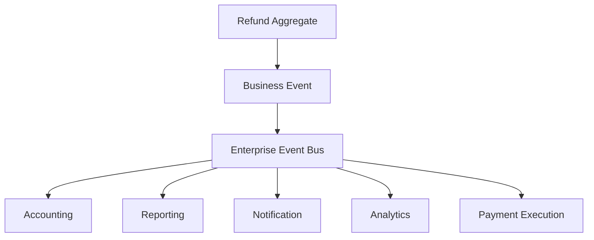

# L2-F03 — Refund Management

---

## Canonical Section Crosswalk

> Added 2026-08-04 under integrity finding INT-018. `governance/constitution/Volume_3_Architecture_Framework.md` section 18 requires every L2 document to define eleven sections. This document uses its own numbered-section convention; the table below maps the required sections to where they actually live. No content was moved.

| Required section (Volume 3 §18) | Location in this document |
|---|---|
| Purpose | §1.1 Purpose |
| Scope | §1.3 Scope; §20.2 Audit Scope; §21.2 Configuration Scope |
| Actors | — not present — |
| Entities | §4 Canonical Aggregate; §4.2 Aggregate Ownership; §7.3 Primary Aggregate |
| Business Rules | Rules / Invariants |
| Workflow | Workflows |
| State Machine | §14 Refund State Architecture; §14.3 Canonical States; §14.4 State Transition Architecture |
| Contracts | §24 Multi-Domain Contracts |
| Events | §16 Refund Event Architecture; §16.3 Event Architecture; §16.4 Canonical Lifecycle Events |
| Dependencies | §17.4 Upstream Domains |
| Locked Decisions | — not present — |

> **Gap:** 2 required section(s) have no counterpart in this document: Actors, Locked Decisions. Recorded, not authored.

---

# Document Metadata

| Attribute | Value |
|-----------|-------|
| Document ID | L2-F03 |
| Document Name | Refund Management |
| Architecture Level | Level 2 – Domain Architecture |
| Domain | Finance |
| Status | Draft |
| Version | 1.0.0 |
| Owner | Finance Domain |
| Document Owner | Finance — Refunds |
| Depends On | L2-F00 Finance Domain Foundation, L2-F01 Student Charge & Fee Management, L2-F02 Payment Management |
| Consumed By | L2-F05 Accounting, L2-F09 Financial Reporting, L2-F12 Analytics |

---

# 1. Document Overview

## 1.1 Purpose

The Refund Management Domain defines the canonical architecture responsible for representing, governing, validating, authorizing, and publishing monetary amounts returned by the institution after previously accepted financial settlements.

The domain establishes the enterprise representation of refunds while remaining independent of payment reception, accounting execution, banking implementation, and operational workflows.

Refunds represent outbound financial obligations initiated by the institution.

They never create or modify Payments.

---

## 1.2 Architectural Objectives

The Refund Management Domain is designed to achieve the following objectives.

- Establish Refund as the canonical outbound monetary aggregate.
- Standardize institutional refund architecture.
- Preserve financial traceability.
- Separate inbound settlement from outbound refund.
- Support deterministic refund processing.
- Maintain accounting readiness.
- Preserve auditability.
- Maintain bounded-context ownership.

---

## 1.3 Scope

The Refund Management Domain governs:

- Refunds
- Refund Sources
- Refund Reasons
- Refund Authorization Participation
- Refund Validation
- Refund References
- Refund Lifecycle
- Refund State
- Refund Events
- Refund Configuration

The domain does not govern:

- Student Charges
- Payment Reception
- Payment Allocation
- Bank Reconciliation
- Accounting Posting
- Financial Reporting

These capabilities belong to their respective domains.

---

# 2. Domain Vision

The Refund Management Domain provides the canonical enterprise representation of every monetary amount returned by the institution after financial settlement.

Every refund shall be represented by one canonical Refund aggregate regardless of origin, business context, funding source, or payment mechanism.

The domain preserves financial integrity, traceability, auditability, and enterprise consistency while remaining independent of operational execution.

---

# 3. Domain Responsibilities

The Refund Management Domain is responsible for:

- Representing Refunds.
- Managing Refund lifecycle.
- Maintaining refund traceability.
- Publishing Refund events.
- Providing accounting-ready refund information.
- Preserving refund history.
- Maintaining refund configuration.

The domain does not:

- Receive Payments.
- Create Student Charges.
- Execute Accounting.
- Perform Bank Reconciliation.
- Produce Financial Reports.

---

# 4. Canonical Aggregate

## 4.1 Refund

Refund is the canonical aggregate representing institutional return of monetary value after a previously accepted financial settlement.

Illustrative examples include:

- Admission Fee Refund
- Tuition Fee Refund
- Hostel Fee Refund
- Examination Fee Refund
- Transport Fee Refund
- Deposit Refund
- Scholarship Recovery Refund
- Duplicate Payment Refund
- Excess Payment Refund
- Miscellaneous Refund

All outbound monetary returns shall extend this aggregate.

---

## 4.2 Aggregate Ownership

The Refund Aggregate is exclusively owned by the Refund Management Domain.

External domains may reference Refunds but shall never create or modify canonical Refund aggregates.

---

# 5. Domain Architecture

```text
Refund Initiation

        │

        ▼

Refund Source

        │

        ▼

Refund Validation

        │

        ▼

Refund Authorization Participation

        │

        ▼

Refund Aggregate

        │

        ▼

Refund Publication

        │

        ▼

Domain Events
```

Each architectural layer owns a distinct responsibility while preserving bounded-context independence.

---

# 6. Architectural Principles

## Canonical Refund Principle

Every outbound monetary return shall be represented by one Refund aggregate.

Alternative refund aggregates are prohibited.

---

## Separation Principle

Payments represent inbound settlement.

Refunds represent outbound monetary return.

These responsibilities remain architecturally independent.

---

## Deterministic Processing Principle

Equivalent refund contexts shall always produce identical architectural outcomes.

---

## Event-Driven Principle

Meaningful refund milestones shall be communicated through canonical domain events.

---

## Accounting Readiness Principle

Every published Refund shall contain sufficient financial context for downstream accounting.

---

## Complete Traceability Principle

Every Refund shall preserve complete financial lineage from initiation through archival.

---
# 7. Refund Domain Model

## 7.1 Purpose

The Refund Domain Model defines the canonical architectural aggregates responsible for representing, governing, validating, tracking, and publishing institutional refunds within the SutraERP Finance Domain.

The model establishes strict ownership boundaries while ensuring every outbound monetary return is represented consistently across the enterprise.

The Refund Domain Model is independent of implementation, banking infrastructure, accounting execution, user interfaces, APIs, persistence models, and operational workflows.

---

## 7.2 Domain Composition

```mermaid
graph TD
    Refund["Refund Aggregate (Root)"]
    RefundSource["Refund Source"]
    RefundReason["Refund Reason"]
    RefundReference["Refund Reference"]
    RefundDeduction["Refund Deduction"]
    RefundValidation["Refund Validation"]
    ApprovalParticipation["Approval Participation"]
    RefundPublication["Refund Publication"]
    RefundLifecycle["Refund Lifecycle"]
    RefundState["Refund State"]
    RefundEvents["Refund Events"]

    Refund --> RefundSource
    Refund --> RefundReason
    Refund --> RefundReference
    Refund --> RefundDeduction
    Refund --> RefundValidation
    Refund --> ApprovalParticipation
    Refund --> RefundPublication
    Refund --> RefundLifecycle
    Refund --> RefundState
    Refund --> RefundEvents
```



Each aggregate owns one architectural responsibility.

---

## 7.3 Primary Aggregate

### Refund

Refund represents the canonical outbound monetary return issued by the institution.

Refund is the root aggregate of the Refund Domain.

The Refund Aggregate MUST preserve exact financial integrity by structurally supporting:
- **Gross Refund Amount**: The total approved value to be returned.
- **Refund Deductions**: Statutory or administrative fees withheld from the gross amount.
- **Net Refund Amount**: The actual monetary value to be transmitted to the student (Gross - Deductions).

Illustrative examples include:

- Admission Fee Refund
- Tuition Fee Refund
- Hostel Refund
- Examination Refund
- Library Deposit Refund
- Transport Refund
- Security Deposit Refund
- Duplicate Payment Refund
- Excess Payment Refund
- Scholarship Recovery Refund

No downstream Finance domain shall redefine this aggregate.

---

## 7.4 Supporting Aggregates

### Refund Deduction

Represents a statutory (e.g., UGC mandate) or administrative (e.g., processing fee) reduction applied against the Gross Refund Amount before the Net Refund Amount is settled.

---

### Refund Source

Represents the financial origin from which refundable value is derived.

Illustrative examples include:

- Student Payment
- Deposit
- Scholarship
- Institutional Credit
- Government Funding
- Sponsor Funding

Refund Source establishes financial lineage.

It does not determine refund eligibility.

---

### Refund Reason

Represents the canonical business justification associated with a Refund.

Illustrative examples include:

- Admission Cancellation
- Duplicate Payment
- Excess Collection
- Course Withdrawal
- Hostel Vacation
- Examination Cancellation
- Deposit Closure
- Administrative Correction

Refund Reasons classify refunds.

They do not determine approval decisions.

---

### Refund Reference

Represents canonical identifiers associated with a Refund.

Illustrative examples include:

- Institutional Refund Reference
- Original Payment Reference
- Bank Reference
- External Transaction Reference
- Settlement Reference

Refund References provide enterprise traceability.

---

### Refund Validation

Represents architectural verification ensuring that a Refund satisfies enterprise integrity requirements before publication.

---

### Approval Participation

Represents the Refund Domain's participation in enterprise approval architecture.

The Refund Domain does not own approval infrastructure.

---

### Refund Lifecycle

Represents the canonical business progression of a Refund.

---

### Refund State

Represents the operational condition of a Refund.

---

### Refund Event

Represents significant business events published by the Refund Domain.

---

## 7.5 Aggregate Ownership

| Aggregate | Canonical Owner |
|------------|-----------------|
| Refund | Refund Domain |
| Refund Source | Refund Domain |
| Refund Reason | Refund Domain |
| Refund Reference | Refund Domain |
| Refund Validation | Refund Domain |
| Refund Lifecycle | Refund Domain |
| Refund State | Refund Domain |
| Refund Event | Refund Domain |

Enterprise Approval remains owned by the Enterprise Governance capability.

---

## 7.6 Aggregate Relationships

```text
Refund Source
        │
        ▼
      Refund
        │
        ├────────────► Refund Reason
        │
        ├────────────► Refund Reference
        │
        ├────────────► Refund Validation
        │
        ├────────────► Approval Participation
        │
        ├────────────► Refund Lifecycle
        │
        ├────────────► Refund State
        │
        └────────────► Refund Events
```

Ownership remains exclusive to the Refund Domain.

---

## 7.7 Aggregate Constraints

1. Refund is the root aggregate.

2. Every Refund shall have exactly one Refund Source.

3. Every Refund shall have at least one Refund Reason.

4. Every Refund shall possess one canonical institutional reference.

5. Approval participation shall never transfer ownership of the Refund aggregate.

6. External domains shall not modify Refunds directly.

7. Historical Refunds shall remain immutable.

8. Future refund capabilities shall extend this aggregate rather than replacing it.

---

# 8. Refund Source Architecture

## 8.1 Purpose

The Refund Source Architecture defines the canonical financial origin from which refundable monetary value is derived.

Every Refund shall preserve complete lineage to its originating financial context.

Refund Source identifies **where refundable value originated**.

It does not determine whether a refund is permitted.

---

## 8.2 Architectural Objectives

The Refund Source Architecture exists to:

- Preserve financial lineage.
- Support multiple refund origins.
- Enable enterprise traceability.
- Maintain deterministic source resolution.
- Support accounting readiness.
- Maintain auditability.

---

## 8.3 Architectural Position

```text
Original Financial Context

        │

        ▼

Refund Source

        │

        ▼

Refund Validation

        │

        ▼

Refund Aggregate
```

---

## 8.4 Canonical Refund Sources

Illustrative Refund Sources include:

- Student Payment
- Security Deposit
- Hostel Deposit
- Examination Deposit
- Library Deposit
- Scholarship Settlement
- Sponsor Funding
- Institutional Credit
- Government Funding

Future financial sources extend this architecture.

---

## 8.5 Source Resolution

Refund Source Resolution follows the canonical sequence below.

```text
Original Financial Context

        │

        ▼

Financial Lineage Resolution

        │

        ▼

Refund Source

        │

        ▼

Refund Aggregate
```

Source Resolution preserves immutable financial lineage.

---

## 8.6 Architectural Principles

### Financial Lineage Principle

Every Refund shall preserve complete linkage to its originating financial source.

---

### Independence Principle

Refund Sources remain independent of approval, accounting, reconciliation, and banking implementation.

---

### Traceability Principle

Every Refund shall preserve complete source traceability.

---

## 8.7 Architectural Constraints

1. Every Refund shall possess one canonical Refund Source.

2. Historical Refund Sources shall remain immutable.

3. Refund Source shall preserve complete financial lineage.

4. Refund Source ownership remains within the Refund Domain.

5. Refund Source architecture shall remain extensible.

---
# 9. Refund Reason Architecture

## 9.1 Purpose

The Refund Reason Architecture defines the canonical classification framework that identifies the business justification for every Refund within the SutraERP Finance Domain.

A Refund Reason explains **why** a refund exists.

It does not determine financial eligibility, approval decisions, accounting treatment, or payment execution.

---

## 9.2 Architectural Objectives

The Refund Reason Architecture exists to:

- Standardize refund classification.
- Establish canonical refund categorization.
- Enable enterprise-wide reporting.
- Preserve business traceability.
- Support configuration-driven extensibility.
- Maintain audit readiness.

---

## 9.3 Architectural Position

```text
Business Event

        │

        ▼

Refund Reason

        │

        ▼

Refund Validation

        │

        ▼

Refund Aggregate
```

Refund Reasons classify business intent.

They do not own refund processing.

---

## 9.4 Canonical Refund Reasons

Illustrative Refund Reasons include:

- Admission Cancellation
- Duplicate Payment
- Excess Payment
- Course Withdrawal
- Programme Discontinuation
- Examination Cancellation
- Hostel Vacation
- Transport Discontinuation
- Deposit Closure
- Administrative Correction
- Scholarship Adjustment
- Institutional Decision

Future reasons shall extend this architecture.

---

## 9.5 Reason Classification Architecture

```text
Refund

      │

      ▼

Refund Category

      │

      ▼

Refund Reason

      │

      ▼

Refund Instance
```

The classification hierarchy provides enterprise consistency while remaining extensible.

---

## 9.6 Architectural Principles

### Canonical Classification Principle

Every Refund shall reference one canonical Refund Reason.

---

### Extensibility Principle

Future institutional refund scenarios shall extend this architecture without replacing canonical concepts.

---

### Independence Principle

Refund Reasons remain independent of approval, accounting, banking, and payment execution.

---

### Traceability Principle

Every Refund shall permanently preserve its business justification.

---

## 9.7 Architectural Constraints

1. Every Refund shall have one canonical Refund Reason.

2. Historical Refund Reasons shall remain immutable.

3. Refund Reasons shall be configuration-aware.

4. Refund Reasons shall remain enterprise reusable.

5. Refund Reason ownership remains within the Refund Domain.

---

# 10. Approval Participation Architecture

## 10.1 Purpose

The Approval Participation Architecture defines how the Refund Domain participates in the enterprise approval capability while preserving clear bounded-context ownership.

The Refund Domain owns Refunds.

The Enterprise Governance capability owns approval workflows.

---

## 10.2 Architectural Objectives

The Approval Participation Architecture exists to:

- Participate in enterprise approval.
- Preserve bounded-context ownership.
- Support governance requirements.
- Enable controlled financial authorization.
- Maintain auditability.
- Preserve architectural separation of concerns.

---

## 10.3 Architectural Position

```text
Refund Validation

        │

        ▼

Approval Participation

        │

        ▼

Refund Publication

        │

        ▼

Enterprise Events
```

The Refund Domain consumes approval outcomes.

It does not implement approval workflows.

---

## 10.4 Participation Characteristics

Approval Participation provides:

- Approval Context
- Approval Status
- Governance Traceability
- Decision Participation
- Enterprise Compliance

Approval Participation does not own:

- Approval Workflow
- Approval Routing
- Approval Rules
- Approval Hierarchy

These belong to the Enterprise Governance Domain.

---

## 10.5 Architectural Principles

### Ownership Principle

Enterprise approval remains externally owned.

---

### Separation Principle

Refund architecture remains independent of approval implementation.

---

### Governance Principle

Approval participation preserves institutional governance.

---

### Traceability Principle

Approval outcomes shall remain traceable.

---

## 10.6 Architectural Constraints

1. Refunds participate in enterprise approval.

2. Approval ownership remains external.

3. Approval outcomes shall be immutable.

4. Approval participation shall remain auditable.

5. Refund ownership shall never transfer.

---

# 11. Refund Validation Architecture

## 11.1 Purpose

The Refund Validation Architecture defines the canonical verification framework ensuring that every Refund satisfies enterprise financial integrity before publication.

Validation protects financial correctness.

It does not perform approval, accounting, or payment execution.

---

## 11.2 Architectural Objectives

The Refund Validation Architecture exists to:

- Preserve financial integrity.
- Validate canonical Refund structure.
- Ensure deterministic validation.
- Support enterprise consistency.
- Maintain audit readiness.
- Enable downstream confidence.

---

## 11.3 Validation Architecture

```text
Refund Request

        │

        ▼

Structural Validation

        │

        ▼

Financial Validation

        │

        ▼

Reference Validation

        │

        ▼

Publication Readiness

        │

        ▼

Refund Aggregate
```

Validation completes before publication.

---

## 11.4 Validation Layers

### Structural Validation

Verifies aggregate completeness.

---

### Financial Validation

Verifies financial consistency. The validation engine MUST enforce that `Net Refund Amount == Gross Refund Amount - Total Deductions`, and that `Total Deductions <= Gross Refund Amount`.

---

### Source Validation

Verifies Refund Source integrity.

---

### Reason Validation

Verifies canonical Refund Reason.

---

### Reference Validation

Verifies Refund References.

---

### Publication Validation

Confirms enterprise publication readiness.

---

## 11.5 Architectural Principles

### Deterministic Principle

Equivalent contexts shall produce identical validation outcomes.

---

### Layer Independence Principle

Validation layers remain independently composable.

---

### Integrity Principle

Validation protects enterprise financial integrity.

---

### Auditability Principle

Validation outcomes shall remain permanently reconstructable.

---

## 11.6 Architectural Constraints

1. Every Refund shall undergo validation.

2. Validation shall complete before publication.

3. Validation shall remain independent of accounting.

4. Validation shall remain independent of banking execution.

5. Validation shall remain fully auditable.

---

# 12. Refund Reference Architecture

## 12.1 Purpose

The Refund Reference Architecture defines the canonical identifiers associated with every Refund throughout its lifecycle.

References enable enterprise-wide identification, auditability, reconciliation, and financial traceability.

---

## 12.2 Architectural Objectives

The Refund Reference Architecture exists to:

- Provide unique Refund identification.
- Preserve enterprise traceability.
- Enable downstream integration.
- Maintain immutable financial references.
- Support audit reconstruction.

---

## 12.3 Architectural Position

```text
Refund Validation

        │

        ▼

Reference Generation

        │

        ▼

Refund Aggregate

        │

        ▼

Enterprise Integration
```

References accompany the Refund throughout its lifecycle.

---

## 12.4 Canonical Reference Categories

Illustrative references include:

- Institutional Refund Reference
- Original Payment Reference
- Student Charge Reference
- Bank Transaction Reference
- External Settlement Reference
- Accounting Correlation Reference

Future enterprise identifiers extend this architecture.

---

## 12.5 Reference Principles

### Uniqueness Principle

Every Refund shall possess one canonical institutional reference.

---

### Immutability Principle

Published references shall never change.

---

### Traceability Principle

References preserve complete financial lineage.

---

### Independence Principle

Reference management remains independent of accounting, banking, and payment execution.

---

## 12.6 Architectural Constraints

1. Every Refund shall possess one institutional reference.

2. Historical references shall remain immutable.

3. External references shall complement institutional references.

4. Reference ownership remains within the Refund Domain.

5. References shall remain permanently auditable.

---
# 13. Refund Lifecycle Architecture

## 13.1 Purpose

The Refund Lifecycle Architecture defines the canonical business progression of a Refund from its initial creation through its final archival within the SutraERP Finance Domain.

The lifecycle represents permanent business milestones in the existence of a Refund.

It does not represent operational processing or approval workflow.

---

## 13.2 Architectural Objectives

The Refund Lifecycle Architecture exists to:

- Standardize refund progression.
- Establish predictable business milestones.
- Preserve historical integrity.
- Enable enterprise governance.
- Support downstream synchronization.
- Maintain auditability.

---

## 13.3 Canonical Lifecycle

```text
Refund Initiated

        │

        ▼

Validated

        │

        ▼

Approved

        │

        ▼

Published

        │

        ▼

Executed

        │

        ▼

Completed

        │

        ▼

Archived
```

Each lifecycle stage represents a permanent business milestone.

---

## 13.4 Lifecycle Stages

### Refund Initiated

The Refund aggregate has been established within the Refund Domain.

---

### Validated

The Refund has successfully completed enterprise validation.

---

### Approved

The enterprise approval capability has produced a positive approval outcome.

The Refund Domain consumes this outcome.

---

### Published

The Refund becomes available to downstream enterprise domains.

---

### Executed

The outbound monetary settlement has been completed by the appropriate payment execution capability.

Execution is externally performed.

The Refund Domain records the resulting business milestone.

---

### Completed

The Refund has completed its business responsibilities.

---

### Archived

The Refund has completed its active lifecycle and enters historical retention.

---

## 13.5 Architectural Principles

### Sequential Progression Principle

Lifecycle progression shall move forward only.

---

### Historical Integrity Principle

Completed lifecycle milestones shall remain immutable.

---

### Business Milestone Principle

Lifecycle stages represent permanent business progression.

---

### Traceability Principle

Every lifecycle transition shall remain permanently reconstructable.

---

## 13.6 Architectural Constraints

1. Lifecycle progression shall remain deterministic.

2. Historical lifecycle stages shall never change.

3. A Refund shall possess one active lifecycle stage.

4. Lifecycle shall remain independent of operational state.

5. Lifecycle ownership remains within the Refund Domain.

---

# 14. Refund State Architecture

## 14.1 Purpose

The Refund State Architecture defines the current operational condition of a Refund during its lifecycle.

Operational state provides enterprise visibility while remaining distinct from lifecycle progression.

---

## 14.2 Architectural Objectives

The Refund State Architecture exists to:

- Represent operational condition.
- Enable enterprise visibility.
- Preserve processing integrity.
- Support deterministic transitions.
- Maintain enterprise consistency.
- Enable downstream consumption.

---

## 14.3 Canonical States

The Refund Domain recognizes the following canonical operational states.

- Draft
- Pending Validation
- Validated
- Pending Approval
- Approved
- Published
- Pending Execution
- Executed
- Execution Failed
- Stale Cheque
- Completed
- Suspended
- Cancelled
- Archived

Only one operational state may exist at any time.

---

## 14.4 State Transition Architecture

```text
Draft

   │

   ▼

Pending Validation

   │

   ▼

Validated

   │

   ▼

Pending Approval

   │

   ▼

Approved

   │

   ▼

Published

   │

   ▼

Pending Execution

   ┌───────┐
   ▼       ▼

Executed   Execution Failed

   │

   ├────────► Stale Cheque

   │

   ▼

Completed

   │

   ▼

Archived
```

Exceptional operational states such as **Suspended** and **Cancelled** may occur where permitted by enterprise governance.

---

## 14.5 Architectural Principles

### Single Active State Principle

A Refund shall possess exactly one active operational state.

---

### Deterministic Transition Principle

Equivalent business conditions shall produce identical state transitions.

---

### Visibility Principle

Operational states provide enterprise visibility.

---

### Traceability Principle

Every state transition shall remain permanently auditable.

---

## 14.6 Architectural Constraints

1. Refunds shall possess exactly one active operational state.

2. Historical operational states shall remain immutable.

3. Operational state shall remain independent of lifecycle progression.

4. State transitions shall remain deterministic.

5. State ownership remains within the Refund Domain.

---

# 15. Refund Publication Architecture

## 15.1 Purpose

The Refund Publication Architecture defines the canonical framework through which validated and approved Refunds become available for enterprise-wide consumption.

Publication represents the official enterprise recognition of a Refund.

Publication does not perform refund execution.

---

## 15.2 Architectural Objectives

The Refund Publication Architecture exists to:

- Standardize Refund publication.
- Enable enterprise integration.
- Preserve aggregate ownership.
- Support downstream accounting.
- Maintain financial traceability.
- Enable event-driven synchronization.

---

## 15.3 Architectural Position

```text
Refund Validation

        │

        ▼

Approval Participation

        │

        ▼

Publication Readiness

        │

        ▼

Refund Publication

        │

        ▼

Enterprise Consumers
```

Publication establishes enterprise visibility.

Execution remains outside the Refund Domain.

---

## 15.4 Publication Characteristics

A published Refund possesses the following characteristics.

- Enterprise Visible
- Immutable
- Accounting Ready
- Traceable
- Auditable
- Event Publishable
- Configuration Governed

Publication represents the authoritative version of a Refund.

---

## 15.5 Architectural Principles

### Readiness Principle

Only validated and approved Refunds may be published.

---

### Single Publication Principle

A Refund shall have one canonical publication.

---

### Ownership Principle

Publication shall never transfer aggregate ownership.

---

### Traceability Principle

Publication history shall remain permanently available.

---

## 15.6 Architectural Constraints

1. Publication shall occur after validation.

2. Publication shall preserve immutability.

3. Publication shall remain auditable.

4. Publication shall preserve aggregate ownership.

5. Publication shall remain deterministic.

---

# 16. Refund Event Architecture

## 16.1 Purpose

The Refund Event Architecture defines the canonical business events published by the Refund Domain to synchronize downstream enterprise domains while preserving bounded-context ownership.

Events communicate completed business facts.

They do not transfer ownership of Refund aggregates.

---

## 16.2 Architectural Objectives

The Refund Event Architecture exists to:

- Publish significant refund milestones.
- Enable event-driven integration.
- Preserve aggregate ownership.
- Maintain enterprise synchronization.
- Support downstream financial domains.
- Preserve complete financial traceability.

---

## 16.3 Event Architecture



The Refund Domain publishes events but does not own downstream processing.

---

## 16.4 Canonical Lifecycle Events

Illustrative lifecycle events include:

- RefundInitiated
- RefundValidated
- RefundApproved
- RefundPublished
- RefundExecutionStarted
- RefundExecutionFailed
- RefundExecuted
- RefundChequeDishonourRecorded
- RefundCompleted
- RefundSuspended
- RefundCancelled
- RefundArchived

---

## 16.5 Integration Events

Illustrative enterprise integration events include:

- RefundAccountingReadinessConfirmed
- RefundPaymentExecutionRequested
- RefundFinancialPositionUpdated
- RefundLifecycleStateChanged

---

## 16.6 Architectural Principles

### Canonical Event Principle

Events represent immutable business facts.

---

### Ownership Principle

Events shall never transfer aggregate ownership.

---

### Immutability Principle

Published events shall remain immutable.

---

### Loose Coupling Principle

Consumers remain independent of Refund internals.

---

## 16.7 Architectural Constraints

1. Events shall represent completed business facts.

2. Published events shall remain immutable.

3. Events shall preserve aggregate ownership.

4. Downstream domains shall consume Refund events without modifying Refund aggregates.

5. Event history shall remain permanently auditable.

---
# 17. Integration Architecture

## 17.1 Purpose

The Integration Architecture defines how the Refund Management Domain collaborates with upstream and downstream enterprise domains while preserving bounded-context ownership and maintaining financial consistency.

The Refund Domain owns Refund aggregates.

External domains consume refund information through canonical contracts and domain events.

---

## 17.2 Architectural Objectives

The Integration Architecture exists to:

- Enable enterprise interoperability.
- Preserve bounded-context ownership.
- Support event-driven communication.
- Prevent ownership leakage.
- Maintain financial consistency.
- Support future extensibility.

---

## 17.3 Integration Architecture

```text
Student Charge
Payment
Academic
Admissions
Scholarship

        │

        ▼

Refund Domain

        │

 ┌──────┼───────────────┐
 ▼      ▼               ▼

Accounting
Reporting
Analytics
Notification
Bank Reconciliation
```

The Refund Domain remains the authoritative owner of Refund aggregates.

---

## 17.4 Upstream Domains

The Refund Domain receives business context from:

- Student Charge Management
- Payment Management
- Admissions
- Academic
- Examination
- Hostel
- Transport
- Library
- Scholarship

Upstream domains provide business context only.

They shall never create Refund aggregates.

---

## 17.5 Downstream Domains

The Refund Domain publishes refund information to:

- Accounting
- Reporting
- Analytics
- Notification
- Bank Reconciliation

Downstream domains consume Refund events while preserving Refund ownership.

---

## 17.6 Architectural Principles

### Ownership Principle

Refund ownership remains exclusive to the Refund Domain.

---

### Loose Coupling Principle

Enterprise collaboration shall occur through canonical contracts and events.

---

### Event-Driven Principle

Meaningful refund milestones shall be published as immutable business events.

---

### Traceability Principle

Every integration shall preserve complete financial lineage.

---

## 17.7 Architectural Constraints

1. External domains shall not modify Refunds.

2. Integration shall preserve bounded-context ownership.

3. Integration shall remain event-driven.

4. Financial integrity shall be preserved.

5. Integration shall remain fully auditable.

---

# 18. Accounting Participation Architecture

## 18.1 Purpose

The Accounting Participation Architecture defines how Refunds participate in downstream accounting while preserving clear ownership boundaries.

The Refund Domain provides accounting-ready refund information.

It does not create journals, ledgers, or accounting entries.

---

## 18.2 Architectural Objectives

The Accounting Participation Architecture exists to:

- Provide accounting-ready Refund information.
- Preserve separation of concerns.
- Enable deterministic accounting participation.
- Maintain financial traceability.
- Support enterprise governance.

---

## 18.3 Architectural Position

```text
Refund

      │

      ▼

Accounting Context

      │

      ▼

Accounting Domain

      │

      ▼

General Ledger
```

Accounting owns all accounting artifacts.

The Refund Domain owns Refunds only.

---

## 18.4 Architectural Principles

### Separation Principle

Refund Management remains independent of accounting execution.

---

### Accounting Readiness Principle

Every published Refund shall contain sufficient financial context for downstream accounting.

---

### Ownership Principle

Accounting artifacts remain exclusively owned by the Accounting Domain.

---

### Traceability Principle

Refund-to-accounting lineage shall remain permanently reconstructable.

---

## 18.5 Architectural Constraints

1. Refund Management shall not create accounting entries.

2. Refund Management shall not maintain ledgers.

3. Accounting consumes Refund information through canonical contracts.

4. Accounting ownership remains independent.

5. Financial lineage shall remain auditable.

---

# 19. Security Participation Architecture

## 19.1 Purpose

The Security Participation Architecture defines how the Refund Domain participates in enterprise security while protecting the integrity, authenticity, confidentiality, and traceability of outbound financial transactions.

---

## 19.2 Architectural Objectives

The Security Participation Architecture exists to:

- Protect Refund integrity.
- Preserve confidentiality.
- Support enterprise authorization.
- Enable secure integrations.
- Maintain regulatory compliance.
- Preserve non-repudiation.

---

## 19.3 Security Architecture

```text
Identity

   │

   ▼

Authentication

   │

   ▼

Authorization

   │

   ▼

Refund Domain

   │

   ▼

Audit Logging
```

The Refund Domain consumes enterprise security capabilities.

---

## 19.4 Security Principles

- Least Privilege
- Integrity Preservation
- Confidentiality
- Non-Repudiation
- Separation of Security Infrastructure

---

## 19.5 Architectural Constraints

1. Authentication remains externally owned.

2. Authorization remains externally governed.

3. Refund integrity shall be preserved.

4. Security participation shall remain auditable.

5. Published Refunds shall remain immutable.

---

# 20. Audit Participation Architecture

## 20.1 Purpose

The Audit Participation Architecture defines how the Refund Domain preserves complete historical traceability of every Refund and its architectural progression.

---

## 20.2 Audit Scope

Audit participation includes:

- Refund Creation
- Validation
- Approval Participation
- Publication
- Lifecycle Progression
- State Changes
- Configuration Participation
- Integration Events

---

## 20.3 Architectural Principles

- Historical Integrity
- Financial Traceability
- Accountability
- Regulatory Compliance

---

## 20.4 Architectural Constraints

1. Historical Refunds shall never be overwritten.

2. Audit information shall remain immutable.

3. Audit ownership remains within the Refund Domain.

4. Audit infrastructure remains external.

5. Refund lineage shall remain permanently reconstructable.

---

# 21. Configuration Architecture

## 21.1 Purpose

The Configuration Architecture defines the configurable elements governing Refund Management while preserving the stability of the canonical architecture.

---

## 21.2 Configuration Scope

Illustrative configurable elements include:

- Refund Reasons
- Refund Sources
- Validation Policies
- Publication Policies
- Lifecycle Policies
- State Transition Policies
- Event Publication Policies

Configuration influences behavior without altering aggregate ownership.

---

## 21.3 Configuration Principles

- Configuration First
- Architectural Stability
- Reusability
- Governance

---

## 21.4 Architectural Constraints

1. Configuration shall never redefine aggregates.

2. Configuration shall preserve ownership.

3. Configuration changes shall remain auditable.

4. Configuration shall remain version controlled.

5. Configuration shall remain enterprise reusable.

---

# 22. Exception Architecture

## 22.1 Purpose

The Exception Architecture defines the canonical handling of exceptional conditions affecting Refunds while preserving enterprise consistency and financial integrity.

---

## 22.2 Exception Categories

- Validation Exceptions
- Approval Exceptions
- Reference Exceptions
- Publication Exceptions
- Integration Exceptions
- Configuration Exceptions
- Security Exceptions

---

## 22.3 Architectural Principles

- Containment
- Recoverability
- Integrity Preservation
- Traceability

---

## 22.4 Architectural Constraints

1. Exceptions shall remain auditable.

2. Exceptions shall preserve aggregate consistency.

3. Exceptions shall never transfer ownership.

4. Recovery shall preserve financial integrity.

5. Exception history shall remain immutable.

---

# 23. Domain Constraints

## Aggregate Constraints

- Refund is the canonical outbound monetary aggregate.
- External domains shall not modify Refunds.
- Aggregate ownership remains exclusive.

---

## Lifecycle Constraints

- Lifecycle progresses forward only.
- Completed lifecycle stages are immutable.

---

## State Constraints

- A Refund shall have exactly one active operational state.
- Historical states remain immutable.

---

## Integration Constraints

- Integration preserves bounded-context ownership.
- Events remain immutable.

---

## Security Constraints

- Financial integrity shall be protected.
- Authorization remains externally governed.

---

## Audit Constraints

- Historical Refund lineage shall remain permanently reconstructable.

---

# 24. Multi-Domain Contracts

## Upstream Domains

- Student Charge Management
- Payment Management
- Admissions
- Academic
- Examination
- Hostel
- Transport
- Library
- Scholarship

---

## Downstream Domains

- Accounting
- Reporting
- Analytics
- Notification
- Bank Reconciliation

---

## Enterprise Principles

- Canonical Aggregates
- Bounded Context Ownership
- Event-Driven Communication
- Loose Coupling
- Financial Integrity
- Deterministic Processing
- Configuration-Driven Architecture

---

# 25. Architecture Validation Checklist

| Validation Item | Status |
|-----------------|--------|
| Canonical Aggregate Defined | ✓ |
| Domain Responsibilities Defined | ✓ |
| Aggregate Ownership Defined | ✓ |
| Domain Model Complete | ✓ |
| Refund Source Architecture | ✓ |
| Refund Reason Architecture | ✓ |
| Approval Participation Architecture | ✓ |
| Validation Architecture | ✓ |
| Reference Architecture | ✓ |
| Lifecycle Architecture | ✓ |
| State Architecture | ✓ |
| Publication Architecture | ✓ |
| Event Architecture | ✓ |
| Integration Architecture | ✓ |
| Accounting Participation | ✓ |
| Security Participation | ✓ |
| Audit Participation | ✓ |
| Configuration Architecture | ✓ |
| Exception Architecture | ✓ |
| Domain Constraints | ✓ |
| Multi-Domain Contracts | ✓ |
| Repository Standards | ✓ |

---

# 26. Merge Readiness Checklist

| Repository Requirement | Status |
|------------------------|--------|
| Follows L2 Repository Template | ✓ |
| DDD Aggregate Ownership Preserved | ✓ |
| No UI Definitions | ✓ |
| No API Definitions | ✓ |
| No Database Design | ✓ |
| No Business Workflows | ✓ |
| No Business Rules (L4) | ✓ |
| Event-Driven Architecture Preserved | ✓ |
| Configuration-Driven Architecture | ✓ |
| Bounded Context Preserved | ✓ |
| Multi-Domain Dependencies Defined | ✓ |
| Ready for L3 Decomposition | ✓ |
| Ready for Repository Merge | ✓ |

---

## Workflows

This document intentionally does not define operational business workflows; per the Merge Readiness Checklist (Section 26, "No Business Workflows"), workflow step definitions belong to L3/L4 architecture. The nearest architectural equivalent is the domain-level process flow in Section 5 (Domain Architecture): Refund Initiation → Refund Source → Refund Validation → Refund Authorization Participation → Refund Aggregate → Refund Publication → Domain Events. Related architectural-position flows appear per sub-capability in Sections 8.3, 9.3, 10.3, 11.3, 12.3, 15.3, and 19.3. Approval workflow execution itself is explicitly owned externally by the Enterprise Governance capability (Section 10).

---

## Rules / Invariants

Not expressed under a single "Rules" or "Invariants" heading; instead this document encodes rules as "Architectural Constraints" and "Architectural Principles" distributed per section (Section 6 Architectural Principles; Section 7.7 Aggregate Constraints; Sections 8.7, 9.7, 10.6, 11.6, 12.6, 13.6, 14.6, 15.6, 16.7, 17.7, 18.5, 19.5, 20.4, 21.4, and 22.4; consolidated in Section 23 Domain Constraints). Key invariants include: Refund is the sole canonical outbound monetary aggregate (Sections 4.1, 23); Net Refund Amount = Gross Refund Amount − Total Deductions, with Total Deductions ≤ Gross Refund Amount (Section 11.4 Financial Validation); a Refund holds exactly one active operational state at a time (Sections 14.5, 23); lifecycle progression and published records are immutable and move forward only (Sections 13.5, 15.5). Per the Merge Readiness Checklist (Section 26), detailed L4 business rules are explicitly out of scope for this L2 document.

---

# End of Document
