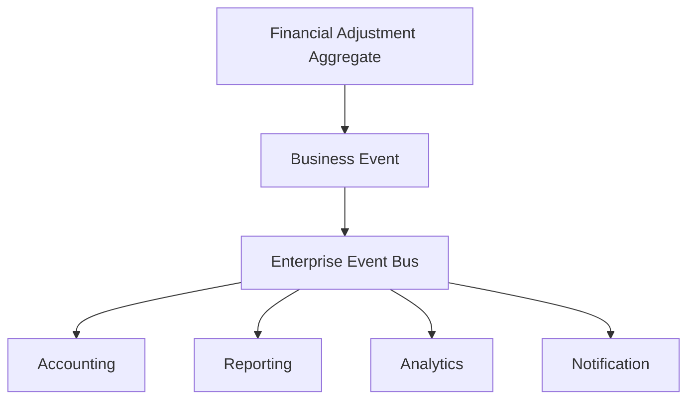

# L2-F04 — Financial Adjustment Management

---

## Canonical Section Crosswalk

> Added 2026-08-04 under integrity finding INT-018. `governance/constitution/Volume_3_Architecture_Framework.md` section 18 requires every L2 document to define eleven sections. This document uses its own numbered-section convention; the table below maps the required sections to where they actually live. No content was moved.

| Required section (Volume 3 §18) | Location in this document |
|---|---|
| Purpose | §1.1 Purpose |
| Scope | §1.3 Scope; §21.3 Audit Scope; §22.3 Configuration Scope |
| Actors | — not present — |
| Entities | §4 Canonical Aggregate; §4.2 Aggregate Ownership; §7.3 Primary Aggregate |
| Business Rules | Rules / Invariants |
| Workflow | Workflows |
| State Machine | §15 Financial Adjustment State Architecture; §15.3 Canonical Operational States; §15.4 State Transition Architecture |
| Contracts | §25 Multi-Domain Contracts |
| Events | §17 Financial Adjustment Event Architecture; §17.3 Event Architecture; §17.4 Canonical Lifecycle Events |
| Dependencies | §18.4 Upstream Domains |
| Locked Decisions | — not present — |

> **Gap:** 2 required section(s) have no counterpart in this document: Actors, Locked Decisions. Recorded, not authored.

---

# Document Metadata

| Attribute | Value |
|-----------|-------|
| Document ID | L2-F04 |
| Document Name | Financial Adjustment Management |
| Architecture Level | Level 2 – Domain Architecture |
| Domain | Finance |
| Status | Locked |
| Version | 1.0.0 |
| Document Owner | Finance — Financial Adjustments |
| Depends On | L2-F00 Finance Foundation, L2-F01 Student Charge & Fee Management, L2-F02 Payment Management, L2-F03 Refund Management |
| Consumed By | L2-F05 Accounting, L2-F09 Reporting, L2-F12 Analytics |

---

# 1. Document Overview

## 1.1 Purpose

The Financial Adjustment Management Domain defines the canonical enterprise architecture responsible for representing, governing, validating, publishing, and maintaining adjustments that modify an existing financial position without creating new financial obligations, receiving payments, or issuing refunds.

Financial Adjustments preserve financial integrity while ensuring every modification to an institutional financial position is represented consistently across the enterprise.

The domain remains independent of accounting execution, payment processing, refund execution, banking implementation, user interfaces, APIs, persistence, and operational workflows.

---

## 1.2 Architectural Objectives

The Financial Adjustment Domain is designed to achieve the following objectives.

- Establish Financial Adjustment as the canonical adjustment aggregate.
- Standardize financial modification architecture.
- Preserve financial traceability.
- Separate adjustments from Charges, Payments, and Refunds.
- Support deterministic financial modifications.
- Maintain accounting readiness.
- Preserve enterprise auditability.
- Maintain strict bounded-context ownership.

---

## 1.3 Scope

The Financial Adjustment Domain governs:

- Financial Adjustments
- Adjustment Sources
- Adjustment Categories
- Adjustment Reasons
- Adjustment Validation
- Approval Participation
- Adjustment References
- Adjustment Lifecycle
- Adjustment State
- Adjustment Events
- Configuration

The domain does not govern:

- Student Charges
- Payments
- Refunds
- Accounting Journals
- General Ledger
- Bank Reconciliation
- Financial Reporting

These capabilities belong to their respective domains.

---

# 2. Domain Vision

The Financial Adjustment Domain provides the canonical enterprise representation of every approved modification to an institutional financial position.

Every adjustment shall be represented through one canonical Financial Adjustment aggregate regardless of business context, funding source, institution type, or academic structure.

The domain preserves consistency, financial integrity, auditability, traceability, and enterprise interoperability while maintaining strict ownership boundaries.

---

# 3. Domain Responsibilities

The Financial Adjustment Domain is responsible for:

- Representing Financial Adjustments.
- Managing adjustment lifecycle.
- Maintaining adjustment traceability.
- Publishing adjustment events.
- Supporting accounting participation.
- Preserving financial history.
- Maintaining adjustment configuration.

The domain does not:

- Create Student Charges.
- Receive Payments.
- Issue Refunds.
- Execute Accounting.
- Maintain General Ledger.
- Perform Bank Reconciliation.
- Produce Financial Reports.

---

# 4. Canonical Aggregate

## 4.1 Financial Adjustment

Financial Adjustment is the canonical aggregate representing an approved modification to an existing institutional financial position.

Illustrative examples include:

- Fee Waiver
- Financial Concession
- Administrative Credit
- Administrative Debit
- Balance Correction
- Write-Off
- Financial Reclassification
- Penalty Reversal
- Late Fee Removal
- Scholarship Financial Adjustment
- Institutional Financial Correction

Future financial modifications shall extend this aggregate rather than introducing independent adjustment entities.

---

## 4.2 Aggregate Ownership

The Financial Adjustment Aggregate is exclusively owned by the Financial Adjustment Domain.

External domains may reference Financial Adjustments but shall never create or modify canonical Financial Adjustment aggregates.

---

# 5. Domain Architecture

```text
Business Context

        │

        ▼

Adjustment Source

        │

        ▼

Adjustment Classification

        │

        ▼

Adjustment Validation

        │

        ▼

Approval Participation

        │

        ▼

Financial Adjustment Aggregate

        │

        ▼

Adjustment Publication

        │

        ▼

Enterprise Events
```

Each architectural layer owns one distinct responsibility while preserving bounded-context independence.

---

# 6. Architectural Principles

## Canonical Adjustment Principle

Every modification to an existing financial position shall be represented by one Financial Adjustment aggregate.

Alternative adjustment aggregates are prohibited.

---

## Separation Principle

Student Charges create obligations.

Payments settle obligations.

Refunds return monetary value.

Financial Adjustments modify financial positions.

Each responsibility remains architecturally independent.

---

## Deterministic Processing Principle

Equivalent financial contexts shall produce identical adjustment outcomes.

---

## Event-Driven Principle

Significant adjustment milestones shall be communicated through immutable canonical domain events.

---

## Accounting Readiness Principle

Every published Financial Adjustment shall provide sufficient financial context for downstream accounting.

---

## Complete Traceability Principle

Every Financial Adjustment shall preserve complete financial lineage from initiation through archival.

---
# 7. Financial Adjustment Domain Model

## 7.1 Purpose

The Financial Adjustment Domain Model defines the canonical structural composition of the Financial Adjustment Domain and the relationships between its primary aggregate and supporting architectural components.

The model establishes enterprise-wide consistency while preserving bounded-context ownership.

---

## 7.2 Domain Composition

The Financial Adjustment Domain consists of the following architectural components.

- Financial Adjustment
- Adjustment Source
- Adjustment Category
- Adjustment Reason
- Adjustment Validation
- Approval Participation
- Adjustment Reference
- Adjustment Lifecycle
- Adjustment State
- Adjustment Events

The Financial Adjustment Aggregate is the canonical center of the domain.

---

## 7.3 Primary Aggregate

### Financial Adjustment

The Financial Adjustment aggregate represents an approved modification to an existing institutional financial position.

Every adjustment instance references supporting architectural components but remains the sole canonical aggregate.

---

## 7.4 Supporting Components

### Adjustment Source

Identifies the originating business context responsible for the adjustment.

---

### Adjustment Category

Classifies the adjustment into enterprise-standard financial categories.

---

### Adjustment Reason

Captures the business justification for the adjustment.

---

### Adjustment Validation

Ensures architectural and financial integrity.

---

### Approval Participation

Represents participation in the enterprise approval capability.

Approval ownership remains external.

---

### Adjustment Reference

Provides immutable institutional and external identifiers.

---

### Lifecycle

Represents permanent business progression.

---

### State

Represents current operational condition.

---

### Events

Publish immutable business facts for enterprise synchronization.

---

## 7.5 Aggregate Relationships

```text
Adjustment Source
        │
        ▼

Adjustment Category
        │
        ▼

Adjustment Reason
        │
        ▼

Financial Adjustment
        │
 ┌──────┼───────────┐
 ▼      ▼           ▼

Validation
Lifecycle
State

        │
        ▼

Events
```

All supporting components exist to enrich the canonical Financial Adjustment aggregate.

---

## 7.6 Aggregate Ownership

| Component | Owner |
|-----------|-------|
| Financial Adjustment | Financial Adjustment Domain |
| Adjustment Source | Financial Adjustment Domain |
| Adjustment Category | Financial Adjustment Domain |
| Adjustment Reason | Financial Adjustment Domain |
| Validation | Financial Adjustment Domain |
| Reference | Financial Adjustment Domain |
| Lifecycle | Financial Adjustment Domain |
| State | Financial Adjustment Domain |
| Events | Financial Adjustment Domain |
| Approval | Enterprise Governance |

---

## 7.7 Aggregate Constraints

1. Every Financial Adjustment shall belong to one canonical aggregate.

2. Supporting components shall not exist independently.

3. Aggregate ownership shall remain exclusive.

4. Historical adjustments shall remain immutable.

5. External domains shall reference but never modify Financial Adjustments.

---

# 8. Adjustment Source Architecture

## 8.1 Purpose

The Adjustment Source Architecture defines the canonical business origins from which Financial Adjustments arise.

The source identifies **where** an adjustment originated.

It does not describe **why** the adjustment exists.

---

## 8.2 Architectural Objectives

The Adjustment Source Architecture exists to:

- Standardize business origins.
- Preserve financial lineage.
- Enable enterprise traceability.
- Support multi-domain integration.
- Maintain deterministic source resolution.

---

## 8.3 Architectural Position

```text
Business Event

      │

      ▼

Adjustment Source

      │

      ▼

Financial Adjustment
```

The source establishes business origin before adjustment creation.

---

## 8.4 Canonical Sources

Illustrative sources include:

- Admissions
- Academic
- Examination
- Hostel
- Transport
- Library
- Scholarship
- Student Finance
- Institutional Administration
- Regulatory Compliance
- Migration Activities
- Financial Reconciliation

Additional sources may extend this architecture.

---

## 8.5 Architectural Principles

### Source Independence Principle

Adjustment Sources remain independent of adjustment categories.

---

### Canonical Source Principle

Every Financial Adjustment shall possess one canonical source.

---

### Traceability Principle

Business origin shall remain permanently reconstructable.

---

## 8.6 Architectural Constraints

1. Every Financial Adjustment shall reference one Adjustment Source.

2. Sources shall remain immutable after publication.

3. Sources shall remain enterprise reusable.

4. Source ownership remains within the Financial Adjustment Domain.

5. Historical lineage shall remain auditable.

---

# 9. Adjustment Category Architecture

## 9.1 Purpose

The Adjustment Category Architecture defines the canonical enterprise classification of Financial Adjustments.

Categories identify the financial nature of an adjustment.

They do not describe business justification.

---

## 9.2 Architectural Objectives

The Adjustment Category Architecture exists to:

- Standardize adjustment classification.
- Preserve enterprise consistency.
- Enable reporting.
- Support analytics.
- Maintain extensibility.

---

## 9.3 Architectural Position

```text
Adjustment Source

        │

        ▼

Adjustment Category

        │

        ▼

Financial Adjustment
```

Categories classify financial intent.

---

## 9.4 Canonical Categories

Illustrative categories include:

- Fee Waiver
- Concession
- Administrative Credit
- Administrative Debit
- Balance Correction
- Write-Off
- Financial Reclassification
- Penalty Adjustment
- Scholarship Adjustment
- Migration Adjustment
- Regulatory Adjustment
- Institutional Correction

Future categories extend this architecture.

---

## 9.5 Classification Architecture

```text
Financial Adjustment

        │

        ▼

Adjustment Category

        │

        ▼

Category Instance
```

Categories remain enterprise-standard and configuration-aware.

---

## 9.6 Architectural Principles

### Canonical Classification Principle

Every Financial Adjustment shall belong to one canonical category.

---

### Extensibility Principle

Future adjustment categories shall extend rather than replace canonical categories.

---

### Independence Principle

Categories remain independent of accounting implementation.

---

### Traceability Principle

Category lineage shall remain permanently available.

---

## 9.7 Architectural Constraints

1. Every Financial Adjustment shall possess one Adjustment Category.

2. Categories shall remain immutable after publication.

3. Categories shall remain enterprise reusable.

4. Categories shall be configuration-aware.

5. Category ownership remains within the Financial Adjustment Domain.

---

# 10. Adjustment Reason Architecture

## 10.1 Purpose

The Adjustment Reason Architecture defines the canonical business justification associated with every Financial Adjustment.

The reason explains **why** the adjustment exists.

It does not classify the adjustment.

---

## 10.2 Architectural Objectives

The Adjustment Reason Architecture exists to:

- Capture business justification.
- Preserve auditability.
- Maintain financial traceability.
- Support governance.
- Enable enterprise reporting.

---

## 10.3 Architectural Position

```text
Adjustment Category

        │

        ▼

Adjustment Reason

        │

        ▼

Financial Adjustment
```

Reasons provide business justification.

---

## 10.4 Illustrative Reasons

Examples include:

- Administrative Error
- Student Appeal
- Policy Revision
- Regulatory Compliance
- Scholarship Revision
- Duplicate Assessment
- System Migration
- Financial Reconciliation
- Institutional Decision
- Court Order

Future reasons extend this architecture.

---

## 10.5 Architectural Principles

### Justification Principle

Every Financial Adjustment shall possess one canonical business reason.

---

### Independence Principle

Business reasons remain independent of accounting and approval implementation.

---

### Traceability Principle

Business justification shall remain permanently reconstructable.

---

## 10.6 Architectural Constraints

1. Every Financial Adjustment shall reference one Adjustment Reason.

2. Published reasons shall remain immutable.

3. Reasons shall remain configuration-aware.

4. Reasons shall remain enterprise reusable.

5. Reason ownership remains within the Financial Adjustment Domain.

---
# 11. Approval Participation Architecture

## 11.1 Purpose

The Approval Participation Architecture defines how the Financial Adjustment Domain participates in the enterprise approval capability while preserving strict bounded-context ownership.

The Financial Adjustment Domain owns Financial Adjustments.

The Enterprise Governance Domain owns approval policies, approval workflows, approval hierarchies, and approval execution.

---

## 11.2 Architectural Objectives

The Approval Participation Architecture exists to:

- Participate in enterprise approval.
- Preserve bounded-context ownership.
- Support institutional governance.
- Enable controlled financial modifications.
- Maintain complete auditability.
- Preserve architectural separation of concerns.

---

## 11.3 Architectural Position

```text
Adjustment Validation

        │

        ▼

Approval Participation

        │

        ▼

Adjustment Publication

        │

        ▼

Enterprise Integration
```

Approval outcomes are consumed by the Financial Adjustment Domain.

Approval execution remains external.

---

## 11.4 Participation Characteristics

Approval Participation provides:

- Approval Context
- Approval Outcome
- Approval Traceability
- Governance Participation
- Enterprise Compliance

Approval Participation does not own:

- Approval Workflow
- Approval Matrix
- Approval Routing
- Approval Hierarchy
- Approval Rules

These remain external enterprise capabilities.

---

## 11.5 Architectural Principles

### Ownership Principle

Approval remains externally governed.

---

### Separation Principle

Financial Adjustment architecture remains independent of approval implementation.

---

### Governance Principle

Approval participation preserves institutional governance.

---

### Traceability Principle

Approval outcomes remain permanently reconstructable.

---

## 11.6 Architectural Constraints

1. Financial Adjustments participate in enterprise approval.

2. Approval ownership remains external.

3. Approval outcomes shall remain immutable.

4. Approval participation shall remain auditable.

5. Financial Adjustment ownership shall never transfer.

---

# 12. Adjustment Validation Architecture

## 12.1 Purpose

The Adjustment Validation Architecture defines the canonical verification framework ensuring every Financial Adjustment satisfies enterprise integrity before publication.

Validation confirms architectural consistency.

Validation does not perform approval, accounting, or financial execution.

---

## 12.2 Architectural Objectives

The Adjustment Validation Architecture exists to:

- Preserve financial integrity.
- Validate canonical adjustment structure.
- Ensure deterministic validation.
- Maintain enterprise consistency.
- Support downstream confidence.
- Preserve audit readiness.

---

## 12.3 Validation Architecture

```text
Adjustment Request

        │

        ▼

Structural Validation

        │

        ▼

Financial Validation

        │

        ▼

Reference Validation

        │

        ▼

Publication Readiness

        │

        ▼

Financial Adjustment
```

Validation completes before publication.

---

## 12.4 Validation Layers

### Structural Validation

Verifies aggregate completeness.

---

### Financial Validation

Verifies financial consistency.

---

### Source Validation

Verifies Adjustment Source integrity.

---

### Category Validation

Verifies canonical Adjustment Category.

---

### Reason Validation

Verifies Adjustment Reason integrity.

---

### Publication Validation

Confirms enterprise publication readiness.

---

## 12.5 Architectural Principles

### Deterministic Principle

Equivalent adjustment contexts shall produce identical validation outcomes.

---

### Layer Independence Principle

Validation layers remain independently composable.

---

### Integrity Principle

Validation preserves enterprise financial integrity.

---

### Auditability Principle

Validation outcomes shall remain permanently reconstructable.

---

## 12.6 Architectural Constraints

1. Every Financial Adjustment shall undergo validation.

2. Validation shall complete before publication.

3. Validation shall remain independent of accounting.

4. Validation shall remain independent of approval implementation.

5. Validation shall remain fully auditable.

---

# 13. Adjustment Reference Architecture

## 13.1 Purpose

The Adjustment Reference Architecture defines the canonical identifiers associated with every Financial Adjustment throughout its lifecycle.

References enable enterprise identification, integration, auditability, and financial traceability.

---

## 13.2 Architectural Objectives

The Adjustment Reference Architecture exists to:

- Provide unique adjustment identification.
- Preserve enterprise traceability.
- Support downstream integration.
- Maintain immutable financial references.
- Enable audit reconstruction.

---

## 13.3 Architectural Position

```text
Adjustment Validation

        │

        ▼

Reference Generation

        │

        ▼

Financial Adjustment

        │

        ▼

Enterprise Integration
```

References accompany the Financial Adjustment throughout its lifecycle.

---

## 13.4 Canonical Reference Categories

Illustrative references include:

- Institutional Adjustment Reference
- Original Charge Reference
- Original Payment Reference
- Original Refund Reference
- Financial Position Reference
- External Correlation Reference
- Accounting Correlation Reference

Future enterprise identifiers extend this architecture.

---

## 13.5 Architectural Principles

### Uniqueness Principle

Every Financial Adjustment shall possess one canonical institutional reference.

---

### Immutability Principle

Published references shall never change.

---

### Traceability Principle

References preserve complete financial lineage.

---

### Independence Principle

Reference management remains independent of accounting implementation.

---

## 13.6 Architectural Constraints

1. Every Financial Adjustment shall possess one institutional reference.

2. Historical references shall remain immutable.

3. External references complement institutional references.

4. Reference ownership remains within the Financial Adjustment Domain.

5. References shall remain permanently auditable.

---

# 14. Financial Adjustment Lifecycle Architecture

## 14.1 Purpose

The Financial Adjustment Lifecycle Architecture defines the permanent business progression of a Financial Adjustment from initiation through archival.

Lifecycle represents business milestones rather than operational processing.

---

## 14.2 Architectural Objectives

The Lifecycle Architecture exists to:

- Standardize adjustment progression.
- Establish predictable business milestones.
- Preserve historical integrity.
- Support enterprise governance.
- Maintain auditability.
- Enable downstream synchronization.

---

## 14.3 Canonical Lifecycle

```text
Adjustment Initiated

        │

        ▼

Validated

        │

        ▼

Approved

        │

        ▼

Published

        │

        ▼

Applied

        │

        ▼

Completed

        │

        ▼

Archived
```

Each lifecycle stage represents a permanent business milestone.

---

## 14.4 Lifecycle Stages

### Adjustment Initiated

The Financial Adjustment aggregate has been established.

---

### Validated

Enterprise validation has completed successfully.

---

### Approved

Enterprise approval capability has produced a positive approval outcome.

---

### Published

The Financial Adjustment becomes available for enterprise consumption.

---

### Applied

The approved financial modification has become part of the institutional financial position.

The Financial Adjustment Domain records this milestone but does not execute downstream accounting changes.

---

### Completed

Business responsibilities have concluded.

---

### Archived

The Financial Adjustment enters permanent historical retention.

---

## 14.5 Architectural Principles

### Sequential Progression Principle

Lifecycle progression moves forward only.

---

### Historical Integrity Principle

Completed lifecycle milestones remain immutable.

---

### Business Milestone Principle

Lifecycle stages represent permanent business progression.

---

### Traceability Principle

Lifecycle transitions remain permanently reconstructable.

---

## 14.6 Architectural Constraints

1. Lifecycle progression shall remain deterministic.

2. Historical lifecycle stages shall remain immutable.

3. Financial Adjustments possess one active lifecycle stage.

4. Lifecycle remains independent of operational state.

5. Lifecycle ownership remains within the Financial Adjustment Domain.

---

# 15. Financial Adjustment State Architecture

## 15.1 Purpose

The Financial Adjustment State Architecture defines the current operational condition of a Financial Adjustment during its lifecycle.

Operational state provides enterprise visibility while remaining independent of lifecycle progression.

---

## 15.2 Architectural Objectives

The State Architecture exists to:

- Represent operational condition.
- Enable enterprise visibility.
- Preserve processing integrity.
- Support deterministic transitions.
- Maintain enterprise consistency.
- Enable downstream consumption.

---

## 15.3 Canonical Operational States

The Financial Adjustment Domain recognizes the following operational states.

- Draft
- Pending Validation
- Validated
- Pending Approval
- Approved
- Published
- Pending Application
- Applied
- Completed
- Suspended
- Cancelled
- Archived

Only one operational state may exist at any point in time.

---

## 15.4 State Transition Architecture

```text
Draft

   │

   ▼

Pending Validation

   │

   ▼

Validated

   │

   ▼

Pending Approval

   │

   ▼

Approved

   │

   ▼

Published

   │

   ▼

Pending Application

   │

   ▼

Applied

   │

   ▼

Completed

   │

   ▼

Archived
```

Exceptional states such as **Suspended** and **Cancelled** may occur according to enterprise governance.

---

## 15.5 Architectural Principles

### Single Active State Principle

A Financial Adjustment shall possess exactly one active operational state.

---

### Deterministic Transition Principle

Equivalent business conditions shall produce identical state transitions.

---

### Visibility Principle

Operational state provides enterprise-wide visibility.

---

### Traceability Principle

Every state transition remains permanently auditable.

---

## 15.6 Architectural Constraints

1. Financial Adjustments shall possess exactly one active operational state.

2. Historical operational states remain immutable.

3. Operational state remains independent of lifecycle progression.

4. State transitions remain deterministic.

5. State ownership remains within the Financial Adjustment Domain.

---
# 16. Financial Adjustment Publication Architecture

## 16.1 Purpose

The Financial Adjustment Publication Architecture defines the canonical framework through which validated and approved Financial Adjustments become available for enterprise-wide consumption.

Publication represents the official enterprise recognition of a Financial Adjustment.

Publication does not execute accounting transactions or modify downstream financial systems.

---

## 16.2 Architectural Objectives

The Financial Adjustment Publication Architecture exists to:

- Standardize adjustment publication.
- Enable enterprise-wide visibility.
- Preserve aggregate ownership.
- Support downstream accounting participation.
- Maintain financial traceability.
- Enable event-driven synchronization.

---

## 16.3 Architectural Position

```text
Adjustment Validation

        │

        ▼

Approval Participation

        │

        ▼

Publication Readiness

        │

        ▼

Financial Adjustment Publication

        │

        ▼

Enterprise Consumers
```

Publication establishes enterprise visibility while preserving bounded-context ownership.

---

## 16.4 Publication Characteristics

A published Financial Adjustment possesses the following characteristics.

- Enterprise Visible
- Immutable
- Accounting Ready
- Traceable
- Auditable
- Event Publishable
- Configuration Governed

Publication represents the authoritative enterprise representation of the Financial Adjustment.

---

## 16.5 Architectural Principles

### Readiness Principle

Only validated and approved Financial Adjustments may be published.

---

### Single Publication Principle

A Financial Adjustment shall possess one canonical publication.

---

### Ownership Principle

Publication shall never transfer aggregate ownership.

---

### Traceability Principle

Publication history shall remain permanently reconstructable.

---

## 16.6 Architectural Constraints

1. Publication shall occur after validation.

2. Publication shall preserve immutability.

3. Publication shall remain auditable.

4. Publication shall preserve aggregate ownership.

5. Publication shall remain deterministic.

---

# 17. Financial Adjustment Event Architecture

## 17.1 Purpose

The Financial Adjustment Event Architecture defines the immutable business events published by the Financial Adjustment Domain for enterprise synchronization.

Events communicate completed business facts.

Events never transfer aggregate ownership.

---

## 17.2 Architectural Objectives

The Event Architecture exists to:

- Publish adjustment milestones.
- Enable event-driven integration.
- Preserve aggregate ownership.
- Synchronize enterprise domains.
- Support accounting participation.
- Preserve complete financial traceability.

---

## 17.3 Event Architecture



Events communicate completed business facts.

---

## 17.4 Canonical Lifecycle Events

Illustrative lifecycle events include:

- AdjustmentInitiated
- AdjustmentValidated
- AdjustmentApproved
- AdjustmentPublicationCompleted
- AdjustmentApplicationCompleted
- AdjustmentCompleted
- AdjustmentSuspended
- AdjustmentCancelled
- AdjustmentArchived

---

## 17.5 Integration Events

Illustrative enterprise events include:

- AdjustmentFinancialPositionUpdated
- AdjustmentAccountingReadinessConfirmed
- AdjustmentLifecycleStateChanged
- AdjustmentStateTransitioned

---

## 17.6 Architectural Principles

### Canonical Event Principle

Events represent immutable business facts.

---

### Ownership Principle

Events shall never transfer aggregate ownership.

---

### Immutability Principle

Published events remain immutable.

---

### Loose Coupling Principle

Consumers remain independent of Financial Adjustment internals.

---

## 17.7 Architectural Constraints

1. Events represent completed business facts.

2. Published events remain immutable.

3. Events preserve aggregate ownership.

4. Consumers shall not modify Financial Adjustments.

5. Event history remains permanently auditable.

---

# 18. Integration Architecture

## 18.1 Purpose

The Integration Architecture defines how the Financial Adjustment Domain collaborates with enterprise domains while preserving bounded-context ownership.

---

## 18.2 Architectural Objectives

The Integration Architecture exists to:

- Enable enterprise interoperability.
- Preserve aggregate ownership.
- Support event-driven communication.
- Maintain financial consistency.
- Enable downstream synchronization.
- Support future extensibility.

---

## 18.3 Integration Architecture

```text
Charges
Payments
Refunds
Scholarships
Admissions
Academic

        │

        ▼

Financial Adjustment Domain

        │

 ┌──────┼──────────────┬────────────┬─────────────┐
 ▼      ▼              ▼            ▼

Accounting
Reporting
Analytics
Notification
Bank Reconciliation
```

The Financial Adjustment Domain remains the authoritative owner of Financial Adjustments.

---

## 18.4 Upstream Domains

Business context may originate from:

- Student Charge Management
- Payment Management
- Refund Management
- Scholarship Management
- Admissions
- Academic
- Examination
- Hostel
- Transport
- Library
- Compliance

These domains provide context only.

---

## 18.5 Downstream Domains

Published Financial Adjustments may be consumed by:

- Accounting
- Reporting
- Analytics
- Notification
- Bank Reconciliation

Downstream domains consume but never modify Financial Adjustments.

---

## 18.6 Architectural Principles

### Ownership Principle

Financial Adjustment ownership remains exclusive.

---

### Loose Coupling Principle

Integration occurs through canonical contracts and domain events.

---

### Event-Driven Principle

Business milestones are communicated using immutable events.

---

### Traceability Principle

Every integration preserves financial lineage.

---

## 18.7 Architectural Constraints

1. External domains shall not modify Financial Adjustments.

2. Integration shall preserve ownership boundaries.

3. Integration shall remain event-driven.

4. Financial consistency shall be preserved.

5. Integration shall remain auditable.

---

# 19. Accounting Participation Architecture

## 19.1 Purpose

The Accounting Participation Architecture defines how Financial Adjustments participate in enterprise accounting while preserving bounded-context ownership.

The Financial Adjustment Domain provides accounting-ready business information.

The Accounting Domain owns journals, ledgers, postings, and financial statements.

---

## 19.2 Architectural Objectives

The Accounting Participation Architecture exists to:

- Support accounting participation.
- Preserve separation of concerns.
- Enable accounting readiness.
- Maintain financial traceability.
- Preserve deterministic downstream processing.

---

## 19.3 Architectural Position

```text
Financial Adjustment

        │

        ▼

Accounting Context

        │

        ▼

Accounting Domain

        │

        ▼

General Ledger
```

Financial Adjustment provides accounting context only.

---

## 19.4 Architectural Principles

### Separation Principle

Financial Adjustments remain independent of accounting implementation.

---

### Accounting Readiness Principle

Published Financial Adjustments contain sufficient accounting context.

---

### Ownership Principle

Accounting artifacts remain owned by the Accounting Domain.

---

### Traceability Principle

Financial lineage remains permanently reconstructable.

---

## 19.5 Architectural Constraints

1. Financial Adjustment shall not create journals.

2. Financial Adjustment shall not maintain ledgers.

3. Accounting consumes adjustment information.

4. Accounting ownership remains external.

5. Financial lineage remains auditable.

---

# 20. Security Participation Architecture

## 20.1 Purpose

The Security Participation Architecture defines how the Financial Adjustment Domain participates in enterprise security while protecting financial integrity.

---

## 20.2 Security Architecture

```text
Identity

     │

     ▼

Authentication

     │

     ▼

Authorization

     │

     ▼

Financial Adjustment

     │

     ▼

Audit Logging
```

Enterprise security capabilities remain externally governed.

---

## 20.3 Security Principles

- Least Privilege
- Confidentiality
- Integrity
- Non-Repudiation
- Separation of Security Responsibilities

---

## 20.4 Architectural Constraints

1. Authentication remains external.

2. Authorization remains external.

3. Financial integrity shall be preserved.

4. Security participation shall remain auditable.

5. Published Financial Adjustments remain immutable.

---
# 21. Audit Participation Architecture

## 21.1 Purpose

The Audit Participation Architecture defines how the Financial Adjustment Domain preserves complete historical traceability of every Financial Adjustment throughout its lifecycle.

Audit participation ensures that every significant architectural milestone remains permanently reconstructable while preserving financial integrity and enterprise governance.

---

## 21.2 Architectural Objectives

The Audit Participation Architecture exists to:

- Preserve complete financial history.
- Maintain immutable audit evidence.
- Enable enterprise accountability.
- Support regulatory compliance.
- Preserve financial lineage.
- Enable historical reconstruction.

---

## 21.3 Audit Scope

The Financial Adjustment Domain participates in auditing of:

- Adjustment Creation
- Source Assignment
- Category Assignment
- Reason Assignment
- Validation
- Approval Participation
- Publication
- Lifecycle Progression
- State Changes
- Reference Assignment
- Configuration Participation
- Event Publication

The Audit capability records business facts but does not modify Financial Adjustments.

---

## 21.4 Architectural Position

```text
Financial Adjustment

        │

        ▼

Business Activity

        │

        ▼

Audit Participation

        │

        ▼

Enterprise Audit Repository
```

Audit participation remains independent of operational processing.

---

## 21.5 Architectural Principles

### Historical Integrity Principle

Audit information shall represent immutable historical facts.

---

### Traceability Principle

Every Financial Adjustment shall preserve complete financial lineage.

---

### Accountability Principle

Every architectural milestone shall be historically reconstructable.

---

### Separation Principle

Audit participation shall remain independent of operational execution.

---

## 21.6 Architectural Constraints

1. Historical audit records shall never be modified.

2. Audit participation shall remain immutable.

3. Audit ownership remains external.

4. Financial lineage shall remain permanently reconstructable.

5. Audit participation shall remain enterprise compliant.

---

# 22. Configuration Architecture

## 22.1 Purpose

The Configuration Architecture defines the configurable architectural elements governing Financial Adjustments while preserving stability of the canonical domain model.

Configuration influences behavior without altering architectural ownership.

---

## 22.2 Architectural Objectives

The Configuration Architecture exists to:

- Enable institutional flexibility.
- Preserve architectural consistency.
- Support enterprise governance.
- Maintain deterministic behavior.
- Enable extensibility.
- Preserve configuration auditability.

---

## 22.3 Configuration Scope

Illustrative configurable elements include:

- Adjustment Categories
- Adjustment Reasons
- Adjustment Sources
- Validation Policies
- Publication Policies
- Lifecycle Policies
- State Transition Policies
- Event Publication Policies

Configuration shall never redefine the Financial Adjustment aggregate.

---

## 22.4 Configuration Architecture

```text
Configuration

      │

      ▼

Validation

      │

      ▼

Financial Adjustment

      │

      ▼

Publication
```

Configuration governs architectural behavior while preserving canonical ownership.

---

## 22.5 Architectural Principles

### Configuration First Principle

Institution-specific behavior shall be achieved through configuration rather than architectural customization.

---

### Stability Principle

Configuration shall not alter aggregate ownership.

---

### Reusability Principle

Configuration shall remain reusable across institutions.

---

### Governance Principle

Configuration changes shall remain governed and auditable.

---

## 22.6 Architectural Constraints

1. Configuration shall never redefine aggregates.

2. Configuration shall preserve ownership.

3. Configuration shall remain version controlled.

4. Configuration changes shall remain auditable.

5. Configuration shall remain enterprise reusable.

---

# 23. Exception Architecture

## 23.1 Purpose

The Exception Architecture defines the canonical handling of exceptional conditions affecting Financial Adjustments while preserving consistency, financial integrity, and bounded-context ownership.

---

## 23.2 Architectural Objectives

The Exception Architecture exists to:

- Preserve aggregate consistency.
- Enable controlled recovery.
- Maintain financial integrity.
- Support enterprise resilience.
- Preserve auditability.

---

## 23.3 Exception Categories

Illustrative exception categories include:

- Validation Exceptions
- Approval Exceptions
- Reference Exceptions
- Publication Exceptions
- Configuration Exceptions
- Integration Exceptions
- Security Exceptions
- Financial Consistency Exceptions

Exception categories remain extensible.

---

## 23.4 Architectural Principles

### Containment Principle

Exceptions shall remain contained within architectural boundaries.

---

### Recoverability Principle

Recoverable exceptions shall preserve aggregate consistency.

---

### Integrity Principle

Exceptions shall never compromise financial integrity.

---

### Traceability Principle

Exception history shall remain permanently reconstructable.

---

## 23.5 Architectural Constraints

1. Exceptions shall remain auditable.

2. Exceptions shall preserve aggregate ownership.

3. Exception recovery shall preserve financial consistency.

4. Exception history shall remain immutable.

5. Exceptions shall remain enterprise governed.

---

# 24. Domain Constraints

## Aggregate Constraints

- Financial Adjustment is the only canonical adjustment aggregate.
- Supporting components shall not exist independently.
- Aggregate ownership remains exclusive.

---

## Late Fee Constraints

- **Late Fee Generation Ban:** Financial Adjustments shall *never* be used to generate or apply Late Fees. Late Fees must be generated as canonical Child Charges within the Student Charge domain (L2-F01) to preserve tax and statutory immutability.
- Financial Adjustments may only be used to *waive* or *remove* Late Fees via an Administrative Credit.

---

## Lifecycle Constraints

- Lifecycle progresses forward only.
- Completed lifecycle stages remain immutable.

---

## State Constraints

- One active operational state per Financial Adjustment.
- Historical states remain immutable.

---

## Integration Constraints

- Integration preserves bounded-context ownership.
- Events remain immutable.

---

## Security Constraints

- Authentication and Authorization remain external.
- Financial integrity shall always be preserved.

---

## Audit Constraints

- Historical lineage shall remain permanently reconstructable.

---

# 25. Multi-Domain Contracts

## Upstream Domains

The Financial Adjustment Domain receives business context from:

- Student Charge Management
- Payment Management
- Refund Management
- Scholarship Management
- Admissions
- Academic
- Examination
- Hostel
- Transport
- Library
- Compliance

---

## Downstream Domains

Published Financial Adjustments may be consumed by:

- Accounting
- Reporting
- Analytics
- Notification

---

## Enterprise Architectural Principles

- Canonical Aggregates
- Bounded Context Ownership
- Event-Driven Communication
- Loose Coupling
- Deterministic Processing
- Configuration-Driven Architecture
- Financial Traceability

---

## Workflows

This document does not define named business workflows as a distinct section. The end-to-end adjustment flow is instead expressed through the Domain Architecture diagram in Section 5 (Business Context → Adjustment Source → Adjustment Classification → Adjustment Validation → Approval Participation → Financial Adjustment Aggregate → Adjustment Publication → Enterprise Events) and the per-component "Architectural Position" diagrams in Sections 8–16 (Source, Category, Reason, Approval Participation, Validation, Reference, Lifecycle, State, Publication).

Taken together with the Lifecycle stages in Section 14.3 and the Validation layers in Section 12.4, these describe the procedural progression of a Financial Adjustment from initiation through archival.

---

# 26. Architecture Validation Checklist

| Validation Item | Status |
|-----------------|--------|
| Canonical Aggregate Defined | ✓ |
| Domain Responsibilities Defined | ✓ |
| Aggregate Ownership Defined | ✓ |
| Domain Model Complete | ✓ |
| Adjustment Source Architecture | ✓ |
| Adjustment Category Architecture | ✓ |
| Adjustment Reason Architecture | ✓ |
| Approval Participation Defined | ✓ |
| Validation Architecture Complete | ✓ |
| Reference Architecture Complete | ✓ |
| Lifecycle Architecture Complete | ✓ |
| State Architecture Complete | ✓ |
| Publication Architecture Complete | ✓ |
| Event Architecture Complete | ✓ |
| Integration Architecture Complete | ✓ |
| Accounting Participation Complete | ✓ |
| Security Participation Complete | ✓ |
| Audit Participation Complete | ✓ |
| Configuration Architecture Complete | ✓ |
| Exception Architecture Complete | ✓ |
| Domain Constraints Defined | ✓ |
| Multi-Domain Contracts Defined | ✓ |
| Repository Standards Satisfied | ✓ |

---

# 27. Merge Readiness Checklist

| Repository Requirement | Status |
|------------------------|--------|
| Follows Standard L2 Template | ✓ |
| Canonical Aggregate Defined | ✓ |
| Bounded Context Preserved | ✓ |
| No UI Definitions | ✓ |
| No API Definitions | ✓ |
| No Database Design | ✓ |
| No Service Implementation | ✓ |
| No Business Rule Implementation | ✓ |
| Event-Driven Architecture Preserved | ✓ |
| Configuration-Driven Architecture | ✓ |
| Multi-Domain Dependencies Defined | ✓ |
| Ready for Level-3 Decomposition | ✓ |
| Ready for Repository Merge | ✓ |

---

## Rules / Invariants

Rules are not consolidated under a single "Rules" heading but are expressed as "Architectural Principles" and "Architectural Constraints" distributed per section: Section 6 (Architectural Principles), the per-component principles/constraints in Sections 8–23, and Section 24 (Domain Constraints), which enumerates the mandatory constraints governing adjustment sourcing, categorization, approval participation, validation, lifecycle, and state behaviour.

---

# End of L2-F04 — Financial Adjustment Management
