# L2-F05 — Accounting & General Ledger Management

---

## Canonical Section Crosswalk

> Added 2026-08-04 under integrity finding INT-018. `governance/constitution/Volume_3_Architecture_Framework.md` section 18 requires every L2 document to define eleven sections. This document uses its own numbered-section convention; the table below maps the required sections to where they actually live. No content was moved.

| Required section (Volume 3 §18) | Location in this document |
|---|---|
| Purpose | §25.1 Aggregate Purpose; Purpose |
| Scope | §40.2 Audit Scope; Scope; Out of Scope |
| Actors | §39.4 Role-Based Authorization |
| Entities | §23 Aggregate Ownership Rules; §24 Aggregate Lifecycles; §25 Accounting Ledger Aggregate |
| Business Rules | §36 Business Rules; §36.11 Business Rule Classification |
| Workflow | §35 Business Workflows; §35.1 Standard Journal Posting Workflow; §35.2 Manual Journal Workflow |
| State Machine | §25.5 Aggregate State |
| Contracts | §38.5 Integration Contracts |
| Events | §37 Domain Events; §37.1 Event Publishing Principles; §37.2 Journal Events |
| Dependencies | External Dependencies |
| Locked Decisions | — not present — |

> **Gap:** 1 required section(s) have no counterpart in this document: Locked Decisions. Recorded, not authored.

---

# Document Information

| Attribute | Value |
|-----------|-------|
| Document ID | L2-F05 |
| Domain | Finance |
| Module | Accounting & General Ledger Management |
| Architecture Level | Level 2 |
| Document Type | Canonical Domain Workflow Specification |
| Owner | Finance Architecture Team |
| Document Owner | Finance — Accounting & General Ledger |
| Status | Draft |
| Version | 1.0 |
| Depends On | L2-F00 — Finance Foundation |
| Integrates With | L2-F01, L2-F02, L2-F03, L2-F04 |
| Followed By | L2-F06 — Budget & Cost Center Management |
| Canonical Aggregate | Accounting Ledger |
| Secondary Aggregates | Journal Entry, Ledger Account, Chart of Accounts, Accounting Period, Posting Batch |
| Last Updated | TBD |

---

# Purpose

This document defines the canonical architecture, lifecycle, ownership rules, workflows, business rules, state transitions, domain services, integration contracts, and governance model for the Accounting & General Ledger domain within SutraERP.

The Accounting & General Ledger domain serves as the authoritative financial recording engine of the Finance domain. It converts validated operational financial events into standardized accounting records while maintaining complete financial integrity, auditability, traceability, and compliance with double-entry accounting principles.

This specification establishes Accounting as the canonical owner of financial books, journal postings, ledger balances, accounting periods, and financial statements while ensuring that operational domains remain independent of accounting implementation.

---

# Architectural Position

Within the SutraERP Finance Architecture, the Accounting & General Ledger domain represents the core financial recording capability.

Unlike operational finance domains such as:

- Student Charge Management
- Payment Management
- Refund Management
- Financial Adjustment Management

which create business transactions, the Accounting domain records the accounting consequences of those transactions.

Accounting does not initiate operational activities.

Instead, it receives validated financial events from upstream Finance domains and transforms them into balanced accounting entries according to configured accounting rules.

This domain is the System of Record for:

- Double-entry accounting
- Journal Entries
- General Ledger
- Ledger Balances
- Trial Balance
- Accounting Periods
- Fiscal Year Controls
- Financial Posting History
- Financial Books
- Accounting Audit Trail

Every financial event that impacts institutional finances must ultimately be represented within this domain.

---
# Scope

This document covers the complete architecture for institutional accounting and general ledger management within SutraERP.

The domain is responsible for the creation, validation, posting, maintenance, reconciliation, and reporting of accounting records generated from financial activities across the ERP.

The scope of this document includes:

- Chart of Accounts (CoA)
- Account Hierarchy Management
- Ledger Account Management
- General Ledger
- Journal Entry Management
- Journal Voucher Management
- Posting Engine
- Double Entry Accounting
- Accounting Rules
- Posting Rules
- Accounting Batches
- Fiscal Year Management
- Accounting Period Management
- Opening Balance Management
- Closing Balance Management
- Trial Balance Generation
- Ledger Balance Management
- Day Book Management
- General Journal
- Sub-Ledger Integration
- Accounting Reversal
- Recurring Journal Processing
- Inter-Module Financial Posting
- Accounting Validation
- Financial Balancing
- Accounting Adjustments
- Accounting Audit Trail
- Financial Posting History
- Accounting Events
- Accounting Reporting Read Models
- Financial Integrity Controls
- Accounting Governance

The Accounting & General Ledger domain serves as the canonical financial recording system for every financial transaction occurring within the SutraERP platform.

---

# Out of Scope

The following capabilities are intentionally excluded from this domain and remain the responsibility of their respective canonical domains.

| Capability | Canonical Owner |
|------------|-----------------|
| Student Charge Generation | L2-F01 |
| Fee Structure Management | L2-F01 |
| Student Payment Collection | L2-F02 |
| Refund Processing | L2-F03 |
| Financial Adjustments | L2-F04 |
| Budget Planning | L2-F06 |
| Cost Center Budget Allocation | L2-F06 |
| Procurement Workflow | Section J — J01 Procurement Planning & Sourcing |
| Purchase Orders | Section J — J04 Purchase Order Management |
| Vendor Management | Section J — J02 Vendor & Supplier Management |
| GST Configuration | L2-F00 Tax Compliance Service |
| TDS Configuration | L2-F00 Tax Compliance Service |
| Banking Operations | L2-F09 |
| Cash Management | L2-F09 |
| Fixed Asset Lifecycle | L2-F10 |
| Depreciation Calculation | L2-F10 |
| Financial Reporting | L2-F11 |
| Financial Analytics | L2-F12 |
| Audit Case Management | L2-F13 |

These domains publish financial events that Accounting consumes for ledger posting.

The Accounting domain never owns operational business workflows.

---

# Canonical Ownership

The Accounting & General Ledger domain is the exclusive owner of the following canonical aggregates.

## Primary Aggregate

- Accounting Ledger

## Secondary Aggregates

- Chart of Accounts
- Ledger Account
- Journal Entry
- Journal Voucher
- Posting Batch
- Accounting Period
- Fiscal Year
- Trial Balance Snapshot
- Opening Balance
- Closing Balance

The domain also owns:

- Accounting Rules
- Posting Rules
- Double Entry Validation
- Ledger Balancing
- Accounting Reversal
- Journal Number Generation
- Ledger Posting History
- Accounting Audit Records

No downstream Finance domain may directly create, modify, or delete these aggregates.

Operational domains publish validated financial events.

Accounting alone determines how those events are translated into accounting entries.

---

# Architectural Principles

The Accounting & General Ledger domain inherits all architectural principles defined in:

- L2-F00 — Finance Foundation
- L2-A01 — Platform & Tenant Foundation
- Architecture Workflow Context Baseline
- Dependency Map
- Architecture Index

In addition, this domain introduces the following accounting-specific principles.

---

## Principle 1 — Accounting is the Financial System of Record

The Accounting domain is the single authoritative source for all institutional accounting records.

Every financial transaction affecting institutional books shall ultimately be represented within the General Ledger.

---

## Principle 2 — Operational Independence

Accounting shall never initiate operational business transactions.

Operational domains own business activities.

Accounting records only their financial consequences.

---

## Principle 3 — Double Entry Integrity

Every accounting transaction shall satisfy the principles of double-entry accounting.

Every debit shall have one or more corresponding credits.

Total debits shall always equal total credits.

Unbalanced postings are prohibited.

---

## Principle 4 — Immutable Financial History

Once successfully posted, accounting entries shall become immutable.

Corrections shall occur only through approved reversal or adjustment workflows.

Direct modification of posted journal entries is prohibited.

---

## Principle 5 — Period Integrity

Every accounting transaction shall belong to exactly one accounting period.

Closed accounting periods shall reject new postings unless explicitly reopened through approved governance workflows.

---

## Principle 6 — Financial Traceability

Every accounting entry shall maintain complete traceability back to its originating operational transaction.

Every posted journal shall be fully auditable from source transaction to financial statement.

---

## Principle 7 — Canonical Ledger Ownership

Only this domain owns:

- Ledger Accounts
- Journal Entries
- General Ledger Balances
- Trial Balance

Other Finance domains reference these records but never modify them.

---

## Principle 8 — Deterministic Posting

Given the same financial event and accounting rules, the Posting Engine shall always produce the same accounting outcome.

Accounting behaviour shall never depend upon manual interpretation after validation.

---

## Principle 9 — Audit by Design

Every accounting operation shall generate a permanent audit trail.

Audit information shall include:

- User
- Timestamp
- Source Module
- Source Transaction
- Posting Batch
- Journal Reference
- Approval Information
- Reversal History

Audit records are immutable.

---

## Principle 10 — Financial Integrity Before Performance

The correctness of accounting records shall always take precedence over processing speed.

No optimization shall compromise accounting accuracy, balancing, or auditability.

Financial integrity is the highest architectural priority of this domain.

---
# Domain Vision

The Accounting & General Ledger domain serves as the authoritative financial recording engine of SutraERP, ensuring that every financially relevant business event generated across the platform is transformed into accurate, balanced, auditable, and compliant accounting records.

The vision of this domain is to establish a unified accounting framework that supports educational institutions of every scale while maintaining strict financial integrity, regulatory compliance, transparency, and complete auditability.

The domain is designed to function as the enterprise financial backbone, integrating seamlessly with operational finance domains without assuming ownership of their business processes.

Rather than managing operational financial activities, the Accounting domain provides a standardized accounting layer that records, validates, organizes, and preserves the financial impact of institutional operations throughout the lifecycle of the institution.

The architecture shall support centralized accounting while remaining flexible enough to accommodate multi-campus, multi-entity, and future multi-country deployments without requiring changes to the core accounting model.

---

# Domain Objectives

The primary objectives of the Accounting & General Ledger domain are:

## Financial Integrity

Maintain a complete and accurate financial record of all accounting transactions occurring within the institution.

---

## Double Entry Compliance

Ensure that every accounting transaction adheres to the principles of double-entry bookkeeping.

No journal entry may violate accounting balance rules.

---

## Canonical Financial Record

Serve as the single authoritative repository for:

- Journal Entries
- General Ledger
- Ledger Balances
- Trial Balance
- Accounting Period Records
- Financial Posting History

---

## Financial Traceability

Provide complete traceability between operational business transactions and accounting records.

Every accounting entry shall be traceable to its originating source transaction.

---

## Posting Automation

Automate accounting postings generated from upstream Finance domains while ensuring deterministic and repeatable accounting outcomes.

---

## Financial Transparency

Provide complete visibility into the financial effects of institutional operations through standardized accounting records and reporting models.

---

## Audit Readiness

Maintain immutable accounting records together with complete posting history, approval history, reversal history, and audit metadata.

The system shall support internal audits, statutory audits, and regulatory inspections without requiring reconstruction of financial history.

---

## Fiscal Governance

Enforce accounting period controls, fiscal year boundaries, posting restrictions, and financial governance policies throughout the accounting lifecycle.

---

## Standardization

Provide standardized accounting behavior across every institution operating on the SutraERP platform while allowing institution-specific accounting configurations where permitted.

---

## Scalability

Support accounting operations for:

- Single Institution
- Multi-Campus Institutions
- Educational Groups
- Universities
- Trusts
- Autonomous Colleges
- Future Multi-Entity Deployments

without requiring architectural modifications.

---

# Core Responsibilities

The Accounting & General Ledger domain is responsible for the following capabilities.

## Chart of Accounts Management

- Maintain the institutional Chart of Accounts.
- Organize account hierarchies.
- Manage account classifications.
- Maintain account activation status.
- Preserve account integrity.

---

## Ledger Account Management

Manage all financial ledger accounts including:

- Assets
- Liabilities
- Income
- Expenses
- Equity
- Control Accounts
- Clearing Accounts
- Suspense Accounts

---

## Journal Management

Manage the lifecycle of:

- Journal Entries
- Journal Vouchers
- Journal Approval
- Journal Validation
- Journal Posting
- Journal Reversal

---

## General Ledger Management

Maintain the institution's General Ledger by:

- Recording accounting entries
- Maintaining running balances
- Preserving posting history
- Supporting reconciliation
- Maintaining financial consistency

---

## Posting Engine

Receive validated accounting events from operational Finance domains and generate corresponding accounting entries according to configured accounting rules.

---

## Accounting Rule Enforcement

Validate:

- Debit/Credit Equality
- Posting Eligibility
- Fiscal Period Status
- Account Status
- Ledger Availability
- Posting Permissions

before any accounting entry is committed.

---

## Fiscal Period Management

Manage:

- Fiscal Years
- Accounting Periods
- Opening Periods
- Closing Periods
- Reopened Periods
- Posting Restrictions

---

## Trial Balance Generation

Generate balanced Trial Balances representing the financial position of the institution at any accounting period.

---

## Ledger Reconciliation

Support reconciliation between:

- Operational Transactions
- Journal Entries
- Ledger Accounts
- Trial Balance
- Financial Statements

---

## Financial Audit Support

Maintain complete accounting history for:

- Internal Audit
- External Audit
- Government Inspection
- Statutory Compliance
- Financial Verification

---

## Financial Event Processing

Consume accounting events from:

- Student Charges
- Payments
- Refunds
- Financial Adjustments
- Procurement Finance
- Treasury
- Asset Management

and convert them into accounting records.

---

# Non-Responsibilities

The Accounting & General Ledger domain intentionally does not perform the following functions.

## Student Billing

Student billing, fee calculation, concessions, scholarships, and charge generation are owned by L2-F01.

---

## Payment Collection

Payment collection, gateway processing, receipt issuance, and settlement processing are owned by L2-F02.

---

## Refund Execution

Refund initiation, approval, payment execution, and beneficiary management are owned by L2-F03.

---

## Financial Adjustment Operations

Waivers, write-offs, concessions, penalties, and operational adjustments are owned by L2-F04.

---

## Budget Planning

Budget preparation, allocation, monitoring, and utilization are owned by L2-F06.

---

## Procurement Operations

Purchase requisitions, purchase orders, vendor procurement workflows, and goods receipt are owned by Section J (J01 through J05). Section J completes procurement activities and provides approved procurement information to Finance for financial consequence processing. Vendor invoice processing as a Finance consequence is owned by L2-F08.

---

## Tax Administration

GST, TDS, statutory tax configuration, tax filing, and tax compliance are owned by the L2-F00 Tax Compliance Service.

---

## Treasury Operations

Bank account management, fund transfers, cash flow management, and treasury controls are owned by L2-F09.

---

## Asset Lifecycle

Asset registration, capitalization, depreciation, transfer, and disposal are owned by L2-F10.

---

## Financial Reporting

Preparation of financial statements, management reports, dashboards, statutory reports, and executive reporting are owned by L2-F11.

---

## Financial Analytics

Business intelligence, forecasting, KPIs, predictive analytics, and decision-support reporting are owned by L2-F12.

---

## Audit Management

Audit planning, audit findings, compliance observations, corrective actions, and audit case management are owned by L2-F13.

---

The Accounting & General Ledger domain records the financial consequences of these domains but does not own their operational workflows.

---
# Domain Model

The Accounting & General Ledger domain is modeled using Domain-Driven Design (DDD) principles. The domain consists of a collection of aggregates that together maintain the institution's financial books while enforcing accounting integrity, transactional consistency, and auditability.

Each aggregate owns a well-defined business responsibility and collaborates with other aggregates exclusively through published domain events and controlled domain services.

The domain is centered around the **Accounting Ledger Aggregate**, which serves as the authoritative financial recording entity.

---

# Bounded Context

The Accounting & General Ledger domain forms an independent bounded context within the Finance domain.

Its responsibility begins only after a financial event has been validated by an operational finance domain.

The Accounting bounded context never owns:

- Student Charges
- Payments
- Refund Processing
- Financial Adjustments
- Procurement
- Tax Computation
- Treasury Operations

Instead, it consumes accounting-relevant business events and converts them into standardized accounting records.

---

## Upstream Domains

The Accounting domain receives financial events from:

- L2-F01 — Student Charge Management
- L2-F02 — Payment Management
- L2-F03 — Refund Management
- L2-F04 — Financial Adjustment Management
- L2-F14 — Procurement Finance Consumption
- L2-F09 — Treasury
- L2-F10 — Asset Management

---

## Downstream Domains

Accounting provides financial data to:

- L2-F06 — Budget & Cost Center Management
- L2-F11 — Financial Reporting
- L2-F12 — Financial Analytics
- L2-F13 — Financial Audit & Compliance

---

## External Dependencies

The Accounting domain references but does not own:

- Institution
- Academic Session
- Department
- Campus
- Cost Center
- Vendor
- Student
- Employee
- Bank Account

These remain under their respective bounded contexts.

---

# Canonical Aggregates

The Accounting & General Ledger domain consists of the following aggregates.

## Primary Aggregate

### Accounting Ledger

The Accounting Ledger is the central aggregate responsible for maintaining the institution's official books of accounts.

It governs:

- Financial postings
- Ledger balances
- Posting integrity
- Financial consistency
- Accounting history

All accounting transactions ultimately affect this aggregate.

---

## Supporting Aggregates

### Chart of Accounts

Maintains the complete hierarchy of financial accounts available for posting.

Responsibilities include:

- Account hierarchy
- Account classification
- Parent-child relationships
- Account activation
- Account validation

---

### Ledger Account

Represents an individual financial account within the General Ledger.

Examples include:

- Cash
- Bank
- Student Receivables
- Tuition Revenue
- Scholarship Expense
- Accounts Payable
- Fixed Assets

Each Ledger Account maintains its own posting history and running balances.

---

### Journal Entry

Represents a balanced accounting transaction consisting of one or more debit and credit lines.

Responsibilities include:

- Debit/Credit balancing
- Journal numbering
- Posting status
- Source transaction linkage
- Audit metadata

---

### Journal Voucher

Represents the business document authorizing one or more Journal Entries.

It supports:

- Approval workflows
- Supporting documents
- Manual journals
- Adjustment journals
- Reversal journals

---

### Posting Batch

Groups multiple Journal Entries processed together.

Supports:

- Batch posting
- Batch validation
- Batch rollback
- Batch reconciliation

---

### Accounting Period

Represents a controlled accounting interval.

Responsibilities include:

- Opening
- Closing
- Reopening
- Posting permissions
- Fiscal governance

---

### Fiscal Year

Represents the institution's accounting year.

Responsibilities include:

- Year opening
- Year closing
- Carry-forward
- Opening balances
- Year-end processing

---

### Trial Balance Snapshot

Represents a point-in-time financial summary of all ledger balances.

Used for:

- Financial verification
- Reporting
- Period closing
- Audit validation

---

# Aggregate Relationships

The aggregates collaborate through well-defined ownership boundaries.

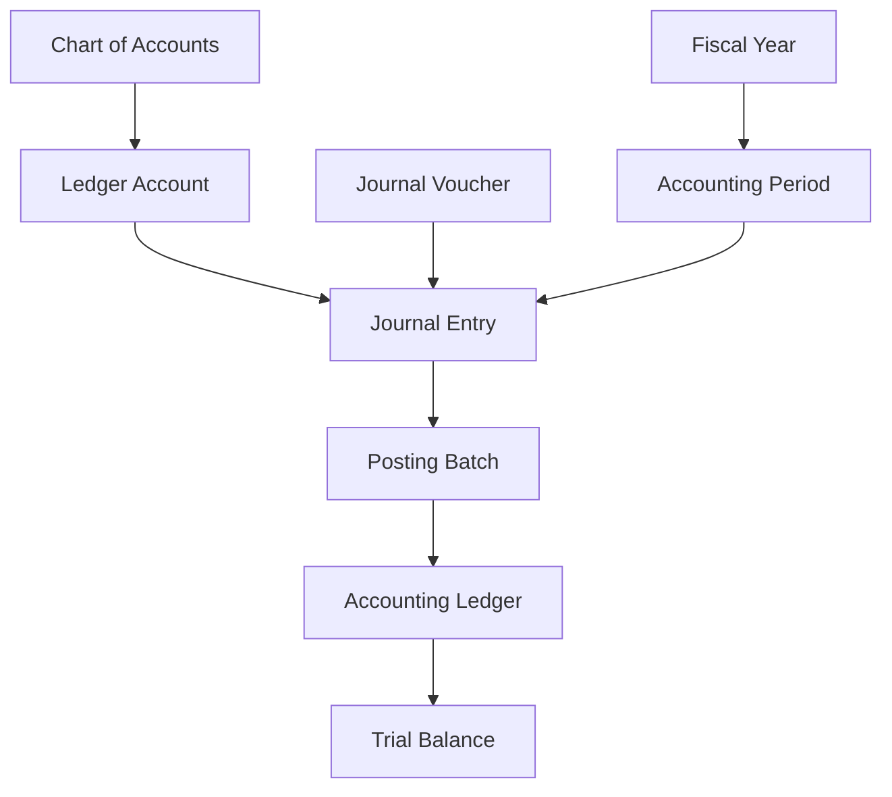

The Accounting Ledger remains the authoritative aggregate responsible for maintaining financial consistency across all subordinate aggregates.

# 20. Domain Model

The Accounting & General Ledger domain is modeled using Domain-Driven Design (DDD) principles to ensure financial integrity, transactional consistency, auditability, and clear ownership of accounting responsibilities.

The domain is centered around the **Accounting Ledger Aggregate**, which serves as the authoritative financial record for the institution.

Supporting aggregates collaborate to manage journals, ledger accounts, accounting periods, fiscal years, and financial balances while preserving strict accounting controls.

---

## 20.1 Architectural Objectives

The Accounting Domain exists to:

- Maintain the institution's official books of accounts.
- Preserve complete financial integrity.
- Enforce double-entry accounting.
- Maintain immutable financial history.
- Provide a canonical financial record.
- Support statutory compliance.
- Enable accurate financial reporting.
- Support financial reconciliation.
- Preserve complete auditability.
- Provide scalable accounting architecture.

---

## 20.2 Domain Characteristics

The Accounting Domain is:

- Ledger-Centric
- Event-Driven
- Financially Consistent
- Double Entry Compliant
- Highly Auditable
- Period Controlled
- Immutable After Posting
- Reconciliation Friendly
- Enterprise Scalable

---

## 20.3 Accounting Philosophy

The Accounting domain follows the principle that operational domains perform business activities while Accounting records their financial consequences.

Business operations shall never directly manipulate accounting books.

Instead, operational domains publish validated accounting events which are transformed into accounting records through controlled posting mechanisms.

This separation preserves loose coupling while maintaining financial consistency across the platform.

---

## 20.4 Accounting Lifecycle

Every accounting transaction progresses through a controlled lifecycle.


Each stage performs independent validation before allowing progression to the next stage.

---

## 20.5 Domain Boundaries

The Accounting domain owns:

- General Ledger
- Journal Entries
- Journal Vouchers
- Ledger Accounts
- Chart of Accounts
- Posting Engine
- Accounting Periods
- Fiscal Years
- Trial Balance
- Posting History

The Accounting domain references:

- Student
- Employee
- Vendor
- Institution
- Department
- Campus
- Cost Center
- Academic Session

The Accounting domain does not own operational financial transactions.

---

## 20.6 Domain Success Indicators

The Accounting architecture is considered successful when:

- Every business transaction produces traceable accounting records.
- Every Journal Entry remains balanced.
- Ledger balances remain internally consistent.
- Trial Balance always balances.
- Closed accounting periods remain protected.
- Audit history remains complete.
- Financial reports are reproducible.
- Historical records remain immutable.
- Financial reconciliation can be completed without manual reconstruction.

---

# 21. Bounded Context

The Accounting & General Ledger domain represents an independent bounded context within the Finance Architecture.

Its primary responsibility is to translate validated financial events into standardized accounting records while preserving financial integrity.

The domain neither owns nor executes operational business workflows.

Instead, it serves as the financial recording engine for the entire ERP.

---

## 21.1 Upstream Domains

Accounting receives accounting events from:

- L2-F01 — Student Charge Management
- L2-F02 — Payment Management
- L2-F03 — Refund Management
- L2-F04 — Financial Adjustment Management
- L2-F14 — Procurement Finance Consumption
- L2-F09 — Treasury Management
- L2-F10 — Asset Management

These domains remain responsible for business execution.

---

## 21.2 Downstream Domains

Accounting provides financial information to:

- L2-F06 — Budget Management
- L2-F11 — Financial Reporting
- L2-F12 — Financial Analytics
- L2-F13 — Financial Audit & Compliance

These domains consume accounting information but never modify accounting records.

---

## 21.3 External References

The Accounting domain references master data from multiple enterprise domains including:

- Institution
- Campus
- Department
- Cost Center
- Student
- Employee
- Vendor
- Bank
- Academic Session

These references are read-only within the Accounting context.

---

## 21.4 Context Responsibilities

Within its bounded context, Accounting is responsible for:

- Financial Recording
- Journal Processing
- Ledger Maintenance
- Posting Validation
- Period Management
- Trial Balance Generation
- Financial Reconciliation
- Accounting Audit Trail

No external domain may bypass these responsibilities.

---

## 21.5 Context Isolation Rules

To preserve architectural integrity:

- Operational domains shall never update ledger balances.
- Journal Entries shall only be created within the Accounting domain.
- Ledger Accounts shall never be modified by external modules.
- Trial Balance shall always originate from the General Ledger.
- Accounting Period status shall be controlled exclusively by Accounting.

These rules preserve bounded context independence while enabling seamless integration across the Finance Architecture.

---# 22. Canonical Aggregates

The Accounting & General Ledger domain is composed of a set of canonical aggregates that collectively maintain the financial books of the institution.

Each aggregate owns a clearly defined business responsibility and enforces its own business invariants while collaborating with other aggregates through controlled domain interactions.

No aggregate may directly violate the ownership boundaries of another aggregate.

---

## 22.1 Aggregate Overview

The Accounting domain consists of the following canonical aggregates.

| Aggregate | Purpose |
|-----------|---------|
| Accounting Ledger | Maintains the institution's official financial books and ledger balances. |
| Chart of Accounts | Maintains the hierarchical structure of all accounting accounts. |
| Ledger Account | Represents an individual accounting account used for financial postings. |
| Journal Entry | Represents a balanced accounting transaction. |
| Journal Voucher | Represents the business document authorizing journal entries. |
| Posting Batch | Groups multiple journal postings into a controlled execution batch. |
| Accounting Period | Controls accounting activity within a defined reporting period. |
| Fiscal Year | Represents the institutional accounting year. |
| Trial Balance Snapshot | Represents a point-in-time summary of ledger balances. |

---

## 22.2 Primary Aggregate

### Accounting Ledger

The Accounting Ledger is the primary aggregate of this domain.

It serves as the authoritative financial record for the institution and maintains the cumulative financial impact of all posted accounting transactions.

The Accounting Ledger is responsible for:

- Maintaining ledger balances.
- Recording posted accounting transactions.
- Preserving financial integrity.
- Supporting reconciliation.
- Supporting financial reporting.
- Maintaining historical financial records.

Every successful posting ultimately updates the Accounting Ledger.

---

## 22.3 Supporting Aggregates

### Chart of Accounts

The Chart of Accounts defines the complete accounting structure available for financial postings.

It maintains:

- Account hierarchy.
- Account categories.
- Parent-child relationships.
- Posting eligibility.
- Account activation status.
- Financial classification.

---

### Ledger Account

Each Ledger Account represents an individual accounting account within the General Ledger.

Examples include:

- Cash
- Bank
- Student Receivables
- Tuition Revenue
- Hostel Revenue
- Examination Revenue
- Scholarship Expense
- Salary Expense
- Accounts Payable
- Fixed Assets

Each Ledger Account maintains its own posting history and running balance.

---

### Journal Entry

A Journal Entry represents a balanced accounting transaction consisting of debit and credit lines.

Each Journal Entry is responsible for:

- Debit validation.
- Credit validation.
- Journal balancing.
- Posting status.
- Source transaction reference.
- Audit metadata.

A Journal Entry cannot exist in an unbalanced state.

---

### Journal Voucher

A Journal Voucher represents the business authorization for one or more Journal Entries.

Journal Vouchers support:

- Manual Journals.
- Adjustment Journals.
- Opening Balance Journals.
- Closing Journals.
- Reversal Journals.

Journal Vouchers provide governance without directly maintaining ledger balances.

---

### Posting Batch

Posting Batch groups multiple Journal Entries for controlled posting.

Responsibilities include:

- Batch validation.
- Batch posting.
- Batch rollback.
- Batch reconciliation.
- Posting status tracking.

---

### Accounting Period

The Accounting Period aggregate governs accounting activity within a defined financial period.

Responsibilities include:

- Period opening.
- Period closing.
- Period locking.
- Reopening control.
- Posting authorization.

---

### Fiscal Year

The Fiscal Year aggregate defines the institutional accounting year.

Responsibilities include:

- Fiscal year creation.
- Fiscal year activation.
- Year-end closing.
- Carry-forward processing.
- Opening balance generation.

---

### Trial Balance Snapshot

The Trial Balance Snapshot represents a summarized view of all ledger balances at a specific point in time.

It supports:

- Financial verification.
- Reporting.
- Audit.
- Period closing.
- Reconciliation.

It is a derived aggregate and does not accept direct business transactions.

---

## 22.4 Aggregate Hierarchy

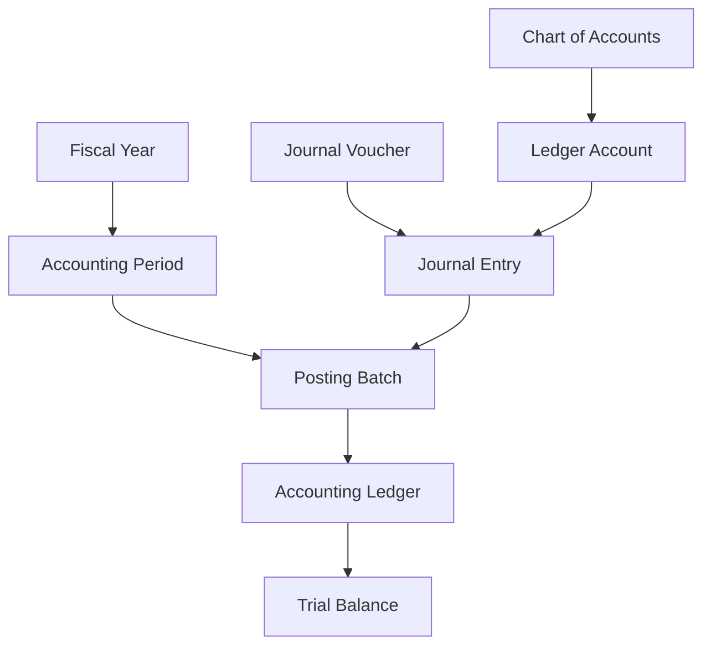

The Accounting Ledger acts as the central financial aggregate while all supporting aggregates contribute to maintaining financial integrity.

---

## 22.5 Aggregate Collaboration Principles

The Accounting aggregates collaborate according to the following principles:

- Every Journal Entry references valid Ledger Accounts.
- Every Ledger Account belongs to exactly one Chart of Accounts.
- Every Journal Entry belongs to one Posting Batch.
- Every Posting Batch belongs to one Accounting Period.
- Every Accounting Period belongs to one Fiscal Year.
- Every successful Posting Batch updates the Accounting Ledger.
- Trial Balance is generated exclusively from the Accounting Ledger.
- No aggregate may directly modify another aggregate's internal state outside defined domain services.

These collaboration rules preserve aggregate independence while ensuring complete financial consistency across the Accounting domain.

---
# 23. Aggregate Ownership Rules

The Accounting & General Ledger domain enforces strict aggregate ownership to maintain financial integrity, consistency, and auditability.

Each aggregate owns its own lifecycle, business rules, and state transitions.

No aggregate may directly modify the internal state of another aggregate.

All interactions occur through controlled domain services or domain events.

---

## 23.1 Ownership Matrix

| Aggregate | Owns | Does Not Own |
|-----------|-------|--------------|
| Accounting Ledger | Ledger balances, financial books, posting history | Journal creation, account hierarchy |
| Chart of Accounts | Account hierarchy, classifications, account structure | Ledger balances, journal entries |
| Ledger Account | Individual account information and balances | Journal approval, fiscal periods |
| Journal Entry | Debit/Credit lines, posting state, accounting references | Ledger balances, account hierarchy |
| Journal Voucher | Journal authorization and supporting documentation | Ledger balances, trial balance |
| Posting Batch | Batch execution and posting status | Ledger accounts, journal validation |
| Accounting Period | Period status and posting permissions | Fiscal year configuration |
| Fiscal Year | Financial year lifecycle | Individual journal entries |
| Trial Balance Snapshot | Point-in-time balance summary | Transaction processing |

---

## 23.2 Accounting Ledger Ownership Rules

The Accounting Ledger exclusively owns:

- General Ledger balances.
- Running account balances.
- Financial posting history.
- Historical ledger records.
- Posted accounting data.
- Financial reconciliation records.

The Accounting Ledger shall never own:

- Journal approval workflows.
- Chart of Account definitions.
- Operational business transactions.
- Payment processing.
- Student charges.
- Refund workflows.

---

## 23.3 Chart of Accounts Ownership Rules

The Chart of Accounts exclusively owns:

- Account hierarchy.
- Parent-child relationships.
- Account numbering.
- Account classification.
- Account activation.
- Posting eligibility.

The Chart of Accounts shall never maintain:

- Ledger balances.
- Journal Entries.
- Trial Balance.
- Accounting periods.

---

## 23.4 Ledger Account Ownership Rules

Each Ledger Account exclusively owns:

- Account metadata.
- Running balance.
- Posting eligibility.
- Account status.
- Financial classification.
- Transaction references.

Ledger Accounts shall never:

- Create Journal Entries.
- Close Accounting Periods.
- Generate Trial Balance.
- Modify Fiscal Years.

---

## 23.5 Journal Entry Ownership Rules

Journal Entries exclusively own:

- Debit lines.
- Credit lines.
- Journal numbering.
- Posting status.
- Source transaction references.
- Posting timestamps.

Journal Entries shall never:

- Modify Ledger balances directly.
- Create Ledger Accounts.
- Open Accounting Periods.
- Alter Chart of Accounts.

Ledger updates occur only after successful posting.

---

## 23.6 Journal Voucher Ownership Rules

Journal Vouchers exclusively own:

- Business authorization.
- Supporting documents.
- Approval lifecycle.
- Voucher numbering.
- Approval history.

Journal Vouchers do not own:

- Ledger balances.
- Trial Balance.
- Fiscal Periods.
- Chart of Accounts.

---

## 23.7 Posting Batch Ownership Rules

Posting Batch exclusively owns:

- Batch execution.
- Batch sequencing.
- Batch validation.
- Batch completion status.
- Batch reconciliation status.

Posting Batch shall never:

- Create accounting rules.
- Modify account hierarchy.
- Change fiscal configuration.

---

## 23.8 Accounting Period Ownership Rules

Accounting Period exclusively owns:

- Period lifecycle.
- Posting permissions.
- Period opening.
- Period closure.
- Period locking.
- Reopening status.

Accounting Period shall never own:

- Journal Entries.
- Ledger balances.
- Trial Balance.
- Fiscal configuration.

---

## 23.9 Fiscal Year Ownership Rules

Fiscal Year exclusively owns:

- Fiscal calendar.
- Year activation.
- Year closure.
- Opening balance generation.
- Carry-forward authorization.

Fiscal Year shall never directly modify:

- Journal Entries.
- Ledger Accounts.
- Posting Batches.

---

## 23.10 Trial Balance Ownership Rules

Trial Balance Snapshot exclusively owns:

- Point-in-time balance representation.
- Financial verification snapshot.
- Reporting snapshot.
- Reconciliation snapshot.

Trial Balance is a derived aggregate.

It never performs:

- Financial posting.
- Journal processing.
- Ledger modification.

---

## 23.11 Aggregate Interaction Rules

The Accounting aggregates collaborate according to the following architectural rules.

- Journal Entries shall reference only active Ledger Accounts.
- Ledger Accounts shall belong to a valid Chart of Accounts.
- Posting Batches shall contain only validated Journal Entries.
- Accounting Periods shall accept postings only while open.
- Fiscal Years shall contain one or more Accounting Periods.
- Trial Balance shall always be generated from posted Ledger balances.
- Ledger balances shall only change through successful journal posting.
- Reversal Journals shall preserve historical accounting records.
- Aggregate ownership boundaries shall never be bypassed.

---

## 23.12 Aggregate Integrity Constraints

The following constraints shall always hold true.

- Every Journal Entry must remain balanced.
- Every Journal Entry belongs to one Posting Batch.
- Every Posting Batch belongs to one Accounting Period.
- Every Accounting Period belongs to one Fiscal Year.
- Every Ledger Account belongs to one Chart of Accounts.
- Every posted transaction updates the Accounting Ledger.
- No aggregate may directly manipulate another aggregate's internal state.
- Every aggregate maintains its own lifecycle independently.

These ownership rules preserve financial consistency, domain isolation, and long-term maintainability of the Accounting architecture.

---
# 24. Aggregate Lifecycles

Each aggregate within the Accounting & General Ledger domain follows a well-defined lifecycle.

Lifecycle management ensures that accounting records remain consistent, auditable, and compliant throughout their existence.

Every aggregate progresses through controlled state transitions governed by business rules and accounting policies.

---

# 24.1 Accounting Ledger Lifecycle

The Accounting Ledger represents the permanent financial books of the institution.

Unlike operational aggregates, the Accounting Ledger is continuously active throughout the institution's lifecycle.

Typical lifecycle stages include:

- Initialized
- Active
- Period Updated
- Fiscal Year Closed
- Archived (Historical Snapshot)

The Accounting Ledger itself is never deleted.

Historical financial records must always remain available.

---

## 24.2 Chart of Accounts Lifecycle

The Chart of Accounts evolves throughout the institution while preserving historical accounting integrity.

Typical lifecycle:

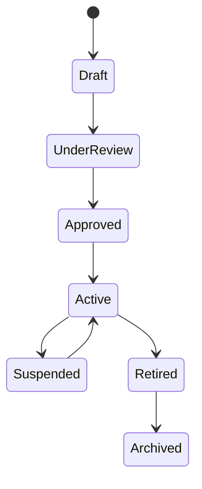

Lifecycle rules:

- Only approved accounts become active.
- Retired accounts cannot receive new postings.
- Historical transactions remain unaffected.
- Archived accounts remain available for audit purposes.

---

## 24.3 Ledger Account Lifecycle

Each Ledger Account progresses independently.

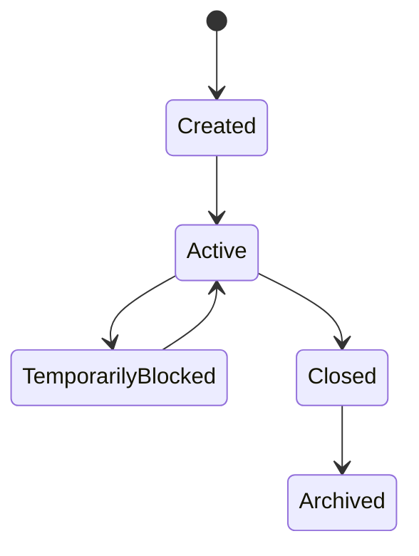

Lifecycle characteristics:

- Active accounts accept postings.
- Blocked accounts reject new postings.
- Closed accounts preserve historical balances.
- Archived accounts remain read-only.

---

## 24.4 Journal Entry Lifecycle

Journal Entries undergo strict validation before affecting the General Ledger.

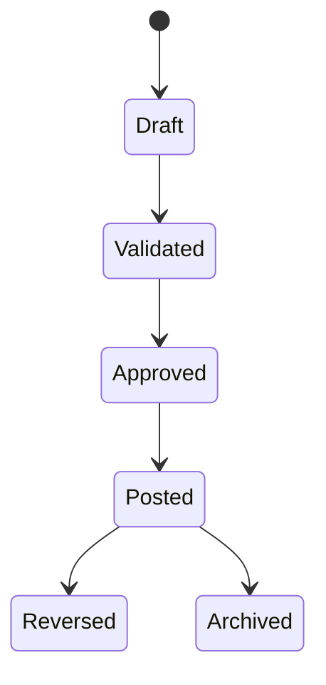

Lifecycle rules:

- Draft journals may be edited.
- Validation ensures accounting correctness.
- Only approved journals may be posted.
- Posted journals become immutable.
- Corrections occur through reversal journals.

---

## 24.5 Journal Voucher Lifecycle

Journal Vouchers manage authorization rather than financial posting.

Typical lifecycle:

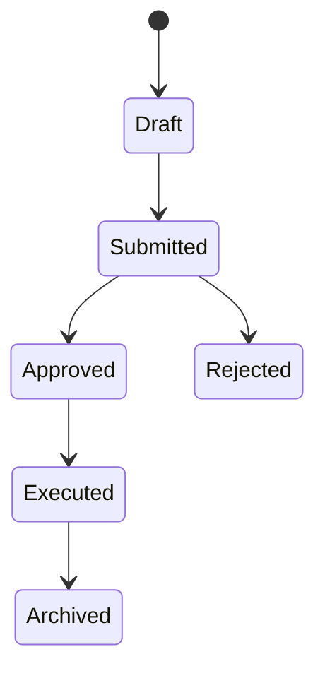

Voucher execution may generate one or more Journal Entries.

---

## 24.6 Posting Batch Lifecycle

Posting Batches coordinate multiple accounting postings.

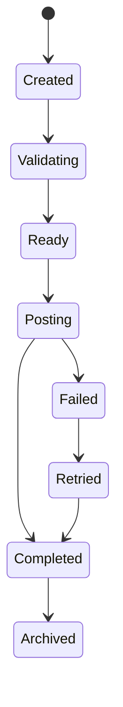

Batch processing improves operational efficiency while preserving transactional integrity.

---

## 24.7 Accounting Period Lifecycle

Accounting Periods control when accounting activities may occur.

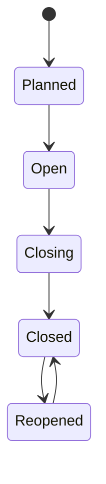

Lifecycle rules:

- Only Open periods accept postings.
- Closed periods reject new accounting transactions.
- Reopening requires authorized governance approval.

---

## 24.8 Fiscal Year Lifecycle

The Fiscal Year controls institutional accounting across multiple accounting periods.

Typical lifecycle:

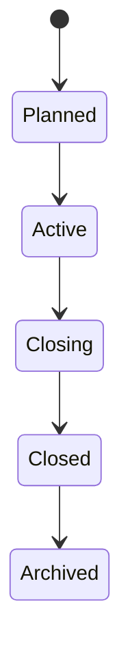

Year-end processing includes:

- Closing balances.
- Carry-forward balances.
- Opening balances.
- Financial statement preparation.

---

## 24.9 Trial Balance Snapshot Lifecycle

Trial Balance Snapshots are generated whenever required.

Typical lifecycle:

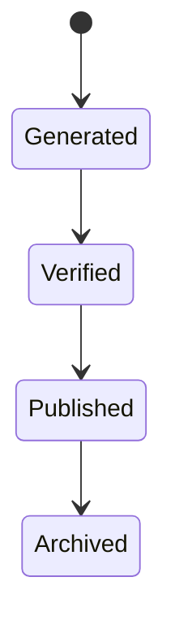

Snapshots are read-only representations of ledger balances and never participate in transaction processing.

---

## 24.10 Lifecycle Governance Principles

All Accounting aggregate lifecycles adhere to the following governance principles:

- Every lifecycle transition shall be explicitly defined.
- Unauthorized state transitions are prohibited.
- Posted financial records remain immutable.
- Historical records are never physically deleted.
- Reversals preserve financial history rather than replacing it.
- Every transition generates an audit event.
- Lifecycle transitions respect accounting period controls.
- Aggregate integrity shall never be compromised during state transitions.

These lifecycle principles ensure consistent accounting behavior across the entire Finance architecture.

---
# 25. Accounting Ledger Aggregate

The **Accounting Ledger Aggregate** is the canonical aggregate of the Accounting & General Ledger domain.

It represents the institution's official financial books and serves as the authoritative source of all posted financial information.

Every validated accounting transaction ultimately updates the Accounting Ledger, making it the financial system of record for the entire ERP.

The Accounting Ledger maintains financial integrity by ensuring that all postings comply with accounting principles, period controls, and double-entry rules.

---

## 25.1 Aggregate Purpose

The Accounting Ledger Aggregate exists to:

- Maintain the institution's official books of accounts.
- Record all posted financial transactions.
- Maintain running balances for every ledger account.
- Preserve complete financial history.
- Support financial reconciliation.
- Generate accounting balances.
- Enable financial reporting.
- Support statutory compliance.
- Preserve auditability.
- Ensure financial consistency.

---

## 25.2 Aggregate Responsibilities

The Accounting Ledger is responsible for:

- Maintaining General Ledger balances.
- Recording posted Journal Entries.
- Updating Ledger Account balances.
- Preserving historical postings.
- Maintaining posting chronology.
- Supporting Trial Balance generation.
- Supporting financial statements.
- Maintaining financial integrity.
- Supporting audit investigations.
- Maintaining accounting traceability.

---

## 25.3 Aggregate Boundaries

### Owns

- Posted Ledger Transactions
- Ledger Balances
- Financial Posting History
- Account Balances
- Posting References
- Financial Audit References
- Balance Calculations

### References

- Journal Entry
- Ledger Account
- Accounting Period
- Fiscal Year
- Institution
- Cost Center
- Department
- Currency

### Does Not Own

- Journal Creation
- Voucher Approval
- Chart of Accounts Structure
- Payment Processing
- Student Charges
- Refund Processing
- Budget Management

---

## 25.4 Aggregate Invariants

The Accounting Ledger shall always satisfy the following invariants.

- Total Debit equals Total Credit for every posted Journal Entry.
- Posted transactions are immutable.
- Ledger balances are mathematically consistent.
- Every posting belongs to an Accounting Period.
- Every posting belongs to a Fiscal Year.
- Every posting references a valid Ledger Account.
- Ledger balances are updated only through approved posting operations.
- Historical balances are never overwritten.
- Financial chronology is preserved.
- Audit references remain permanent.

Violation of any invariant shall prevent transaction posting.

---

## 25.5 Aggregate State

The Accounting Ledger maintains the following business state.

### Financial State

- Current Balances
- Historical Balances
- Opening Balances
- Closing Balances
- Running Totals

### Operational State

- Posting Sequence
- Posting Status
- Accounting Period
- Fiscal Year
- Currency Context

### Governance State

- Audit Metadata
- Posting References
- Source Transaction References
- Reconciliation Status

---

## 25.6 Aggregate Lifecycle

The Accounting Ledger operates continuously throughout the institution's existence.

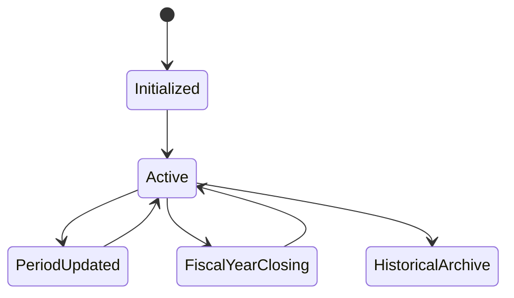

Unlike operational aggregates, the Accounting Ledger is never deleted or recreated.

Historical financial continuity shall always be preserved.

---

## 25.7 Aggregate Commands

The Accounting Ledger accepts only controlled business commands.

Examples include:

- Post Journal
- Reverse Journal
- Update Ledger Balance
- Close Accounting Period
- Generate Opening Balance
- Carry Forward Balance
- Lock Accounting Period
- Unlock Accounting Period
- Generate Trial Balance
- Recalculate Ledger Balance

Every command shall execute through authorized domain services.

---

## 25.8 Aggregate Events

The Accounting Ledger publishes domain events whenever its state changes.

Typical events include:

- LedgerUpdated
- JournalPosted
- JournalReversed
- LedgerBalanceChanged
- AccountingPeriodClosed
- AccountingPeriodReopened
- FiscalYearClosed
- OpeningBalanceGenerated
- ClosingBalanceGenerated
- TrialBalanceGenerated

These events enable downstream domains while preserving aggregate isolation.

---

## 25.9 Aggregate Relationships

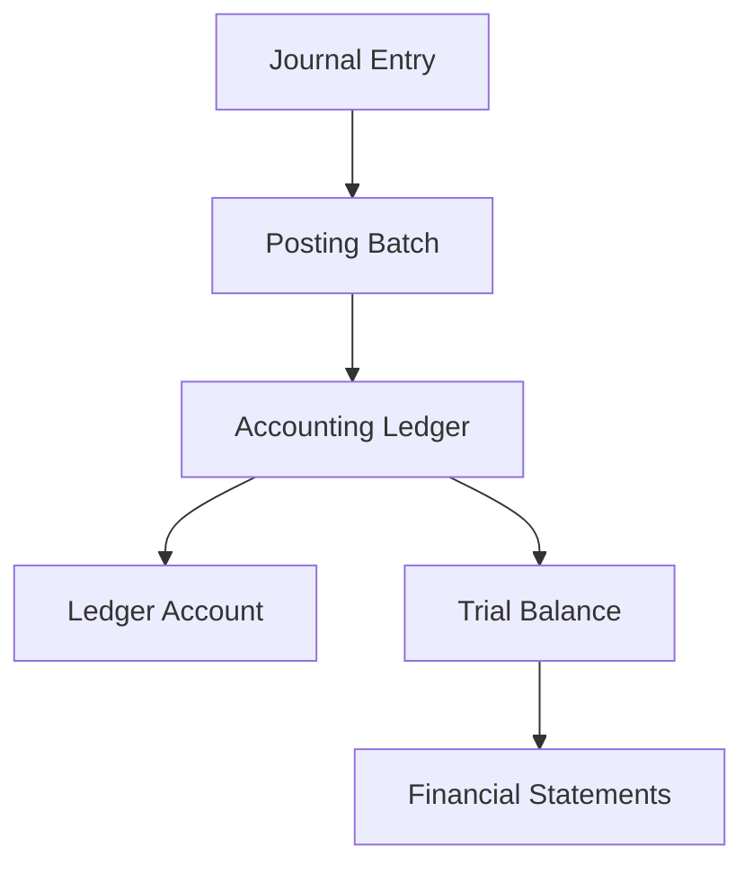

The Accounting Ledger serves as the authoritative source from which all downstream financial summaries and reports are derived.

---

## 25.10 Aggregate Integrity Rules

The following integrity rules shall always be enforced.

- Only posted Journal Entries may update the Ledger.
- Ledger balances shall never be modified manually.
- Every posting shall maintain double-entry balance.
- Ledger updates shall occur atomically.
- Partial posting is prohibited.
- Failed postings shall perform complete rollback.
- Ledger balances shall remain reproducible from Journal history.
- Historical postings shall never be edited.
- Reversal shall create compensating Journal Entries instead of modifying history.
- Every Ledger update shall generate an audit record.

These integrity rules ensure that the Accounting Ledger remains the trusted financial system of record throughout the institution's lifecycle.

---
# 26. Chart of Accounts Aggregate

The **Chart of Accounts (CoA) Aggregate** defines the complete accounting structure used throughout the institution.

It provides the standardized classification framework for recording financial transactions and ensures that every accounting entry is posted to a valid and authorized ledger account.

The Chart of Accounts establishes consistency, comparability, and governance across all financial records.

---

## 26.1 Aggregate Purpose

The Chart of Accounts Aggregate exists to:

- Define the institutional accounting structure.
- Standardize financial classifications.
- Organize ledger accounts hierarchically.
- Support statutory accounting requirements.
- Enable financial reporting.
- Prevent inconsistent account creation.
- Maintain accounting governance.
- Support future organizational growth.
- Ensure reporting consistency.
- Preserve historical account structure.

---

## 26.2 Aggregate Responsibilities

The Chart of Accounts is responsible for:

- Maintaining account hierarchy.
- Defining account categories.
- Managing account numbering.
- Maintaining parent-child relationships.
- Defining posting permissions.
- Managing account activation.
- Maintaining financial classifications.
- Supporting reporting structures.
- Preserving account history.
- Governing account lifecycle.

---

## 26.3 Aggregate Boundaries

### Owns

- Account Structure
- Account Hierarchy
- Account Codes
- Account Categories
- Parent Accounts
- Child Accounts
- Posting Eligibility
- Account Status

### References

- Institution
- Fiscal Year
- Currency Standards
- Financial Policies

### Does Not Own

- Ledger Balances
- Journal Entries
- Trial Balance
- Posting History
- Financial Reports
- Budget Allocation

---

## 26.4 Aggregate Invariants

The Chart of Accounts shall always satisfy the following invariants.

- Every account code shall be unique.
- Every account belongs to exactly one category.
- Parent-child hierarchy shall remain acyclic.
- Posting accounts cannot contain child accounts.
- Summary accounts cannot receive direct postings.
- Retired accounts preserve historical references.
- Account classification shall remain valid.
- Duplicate account numbers are prohibited.
- Account hierarchy shall remain internally consistent.
- Historical account codes shall never be reused.

Violation of these invariants shall prevent structural modifications.

---

## 26.5 Aggregate State

The Chart of Accounts maintains the following business state.

### Structural State

- Account Code
- Account Name
- Parent Account
- Child Accounts
- Account Level
- Display Sequence

### Classification State

- Asset
- Liability
- Equity
- Revenue
- Expense

### Operational State

- Posting Allowed
- Active Status
- Effective Date
- Retirement Date

### Governance State

- Approval Metadata
- Audit References
- Version History

---

## 26.6 Aggregate Lifecycle


Lifecycle Rules:

- Draft accounts are editable.
- Approved accounts become available for operational use.
- Suspended accounts reject new postings.
- Retired accounts preserve historical references.
- Archived accounts remain read-only.

---

## 26.7 Aggregate Commands

The Chart of Accounts accepts controlled commands including:

- Create Account
- Update Account
- Approve Account
- Activate Account
- Suspend Account
- Retire Account
- Archive Account
- Assign Parent Account
- Change Reporting Group
- Validate Account Structure

All commands require governance validation before execution.

---

## 26.8 Aggregate Events

Typical domain events include:

- AccountCreated
- AccountUpdated
- AccountApproved
- AccountActivated
- AccountSuspended
- AccountRetired
- AccountArchived
- AccountHierarchyChanged
- PostingPermissionChanged
- AccountClassificationChanged

These events notify downstream financial components while preserving aggregate isolation.

---

## 26.9 Aggregate Relationships

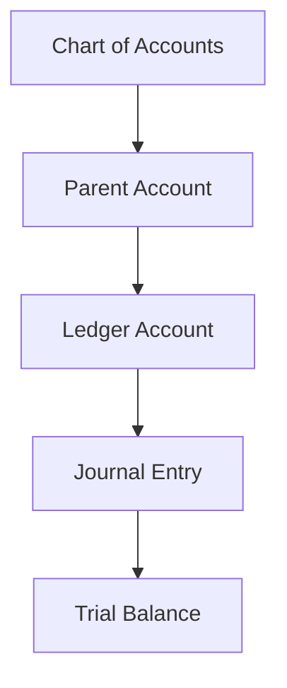

The Chart of Accounts provides the structural foundation for all Ledger Accounts and accounting transactions.

---

## 26.10 Aggregate Integrity Rules

The following integrity rules shall always be enforced.

- Every Ledger Account shall belong to the Chart of Accounts.
- Posting shall be permitted only to posting accounts.
- Summary accounts shall never receive direct Journal Entries.
- Parent-child relationships shall remain valid.
- Circular hierarchy is prohibited.
- Account codes shall remain unique.
- Historical account references shall never be broken.
- Structural changes shall preserve reporting consistency.
- Retired accounts shall remain available for historical reporting.
- Every structural modification shall generate an audit record.

These integrity rules ensure that the Chart of Accounts remains a stable and reliable accounting foundation for the entire Finance Architecture.

---
# 27. Ledger Account Aggregate

The **Ledger Account Aggregate** represents an individual accounting account within the General Ledger.

Each Ledger Account records the cumulative financial impact of posted transactions belonging to a specific accounting classification.

Every Journal Entry posts its debit and credit amounts against one or more Ledger Accounts.

Ledger Accounts collectively form the financial backbone of the institution.

---

## 27.1 Aggregate Purpose

The Ledger Account Aggregate exists to:

- Maintain individual account balances.
- Record account-level financial activity.
- Support double-entry accounting.
- Enable account reconciliation.
- Maintain historical posting records.
- Support Trial Balance generation.
- Support Financial Statements.
- Preserve accounting integrity.
- Enable financial analysis.
- Maintain complete auditability.

---

## 27.2 Aggregate Responsibilities

The Ledger Account is responsible for:

- Maintaining running balances.
- Recording debit postings.
- Recording credit postings.
- Tracking account activity.
- Maintaining posting history.
- Supporting reconciliation.
- Maintaining account status.
- Supporting financial reporting.
- Supporting account inquiries.
- Preserving historical balances.

---

## 27.3 Aggregate Boundaries

### Owns

- Account Balance
- Debit Total
- Credit Total
- Posting History
- Running Balance
- Account Status
- Posting Eligibility
- Reconciliation Status

### References

- Chart of Accounts
- Journal Entry
- Accounting Period
- Fiscal Year
- Currency
- Institution

### Does Not Own

- Journal Approval
- Trial Balance
- Financial Statements
- Chart Structure
- Budget Allocation
- Payment Processing

---

## 27.4 Aggregate Invariants

The Ledger Account shall always satisfy the following invariants.

- Every Ledger Account belongs to one Chart of Accounts.
- Every posting references a valid Journal Entry.
- Running balances remain mathematically consistent.
- Historical postings remain immutable.
- Closed accounts reject new postings.
- Suspended accounts reject new postings.
- Balance calculations remain reproducible.
- Posting chronology shall be preserved.
- Every posting belongs to an Accounting Period.
- Audit history remains complete.

Violation of these invariants shall prevent posting.

---

## 27.5 Aggregate State

The Ledger Account maintains the following business state.

### Master State

- Account Code
- Account Name
- Account Type
- Parent Account
- Account Category
- Currency

### Financial State

- Opening Balance
- Current Balance
- Debit Total
- Credit Total
- Closing Balance

### Operational State

- Active Status
- Posting Allowed
- Reconciliation Status
- Effective Date

### Governance State

- Audit Metadata
- Approval References
- Version History

---

## 27.6 Aggregate Lifecycle

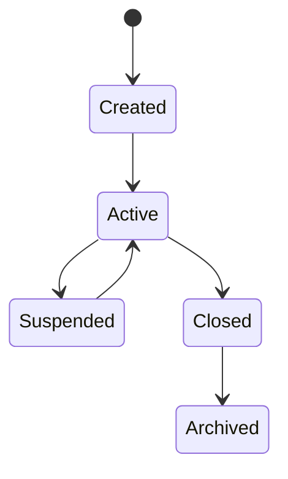

Lifecycle Rules:

- Active accounts accept postings.
- Suspended accounts reject new postings.
- Closed accounts preserve historical balances.
- Archived accounts remain permanently read-only.

---

## 27.7 Aggregate Commands

The Ledger Account accepts the following business commands:

- Activate Account
- Suspend Account
- Close Account
- Reopen Account
- Update Balance
- Reconcile Account
- Lock Account
- Unlock Account
- Generate Account Statement
- Validate Account Balance

All commands execute through authorized accounting services.

---

## 27.8 Aggregate Events

Typical domain events include:

- LedgerAccountCreated
- LedgerAccountActivated
- LedgerAccountSuspended
- LedgerAccountClosed
- LedgerBalanceUpdated
- AccountReconciled
- PostingApplied
- PostingReversed
- AccountLocked
- AccountUnlocked

These events enable downstream reporting and auditing while maintaining aggregate independence.

---

## 27.9 Aggregate Relationships

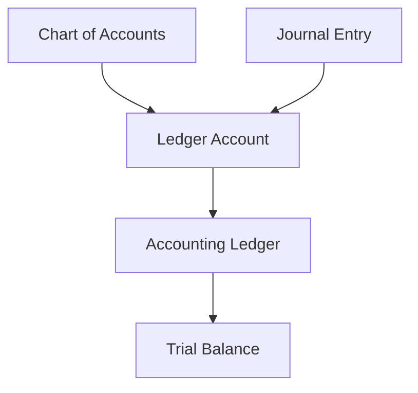

Each Ledger Account acts as the operational accounting unit between Journal Entries and the Accounting Ledger.

---

## 27.10 Aggregate Integrity Rules

The following integrity rules shall always be enforced.

- Ledger balances shall only change through posted Journal Entries.
- Manual balance modification is prohibited.
- Every posting shall maintain complete audit history.
- Historical postings shall never be edited.
- Balance calculations shall remain deterministic.
- Closed accounts shall reject postings.
- Suspended accounts shall reject postings.
- Every Ledger Account shall maintain complete posting chronology.
- Every balance update shall generate an audit record.
- Reconciliation shall never alter posted accounting history.

These integrity rules ensure that every Ledger Account remains accurate, auditable, and financially consistent throughout its lifecycle.

---
# 28. Journal Entry Aggregate

The **Journal Entry Aggregate** represents the fundamental accounting transaction within the Accounting & General Ledger domain.

Every financial event that impacts the institution's books is ultimately represented as one or more Journal Entries.

A Journal Entry records the balanced debit and credit postings required to preserve the integrity of the General Ledger.

It serves as the atomic financial transaction of the accounting system.

---

## 28.1 Aggregate Purpose

The Journal Entry Aggregate exists to:

- Record accounting transactions.
- Enforce double-entry accounting.
- Maintain balanced financial postings.
- Preserve transaction chronology.
- Support financial traceability.
- Enable ledger updates.
- Support statutory accounting.
- Maintain auditability.
- Support financial reconciliation.
- Preserve immutable accounting history.

---

## 28.2 Aggregate Responsibilities

The Journal Entry is responsible for:

- Maintaining debit lines.
- Maintaining credit lines.
- Validating accounting balance.
- Maintaining posting status.
- Recording source references.
- Recording posting timestamps.
- Supporting reversal processing.
- Supporting audit investigation.
- Maintaining transaction history.
- Preserving financial integrity.

---

## 28.3 Aggregate Boundaries

### Owns

- Journal Number
- Debit Entries
- Credit Entries
- Posting Status
- Source Transaction Reference
- Journal Date
- Posting Date
- Narration
- Supporting References

### References

- Ledger Account
- Journal Voucher
- Accounting Period
- Fiscal Year
- Institution
- Currency

### Does Not Own

- Ledger Balances
- Trial Balance
- Financial Statements
- Chart of Accounts
- Budget Information
- Payment Processing

---

## 28.4 Aggregate Invariants

The Journal Entry shall always satisfy the following invariants.

- Total Debit shall equal Total Credit.
- Every posting line references a valid Ledger Account.
- Journal Numbers shall be unique.
- Posted Journal Entries are immutable.
- Every Journal Entry belongs to one Accounting Period.
- Every Journal Entry belongs to one Fiscal Year.
- Every Journal Entry contains at least one debit and one credit line.
- Historical Journal Entries shall never be modified.
- Reversals shall create compensating Journal Entries.
- Complete audit history shall always be maintained.

Violation of any invariant shall prevent posting.

---

## 28.5 Aggregate State

The Journal Entry maintains the following business state.

### Transaction State

- Journal Number
- Journal Date
- Posting Date
- Narration
- Source Reference

### Financial State

- Debit Amount
- Credit Amount
- Currency
- Exchange Rate

### Operational State

- Draft
- Validated
- Approved
- Posted
- Reversed

### Governance State

- Approval Metadata
- Audit References
- Version Information

---

## 28.6 Aggregate Lifecycle


Lifecycle Rules:

- Draft Journal Entries may be edited.
- Validated Journal Entries pass accounting validation.
- Approved Journal Entries become eligible for posting.
- Posted Journal Entries become immutable.
- Corrections occur through reversal journals.

---

## 28.7 Aggregate Commands

The Journal Entry accepts the following business commands:

- Create Journal
- Validate Journal
- Approve Journal
- Post Journal
- Reverse Journal
- Archive Journal
- Reject Journal
- Cancel Draft
- Verify Balance
- Attach Supporting Documents

All commands execute through authorized accounting services.

---

## 28.8 Aggregate Events

Typical domain events include:

- JournalCreated
- JournalValidated
- JournalApproved
- JournalPosted
- JournalRejected
- JournalReversed
- JournalArchived
- JournalCancelled
- JournalBalanced
- JournalAuditRecorded

---

## 28.9 Aggregate Relationships

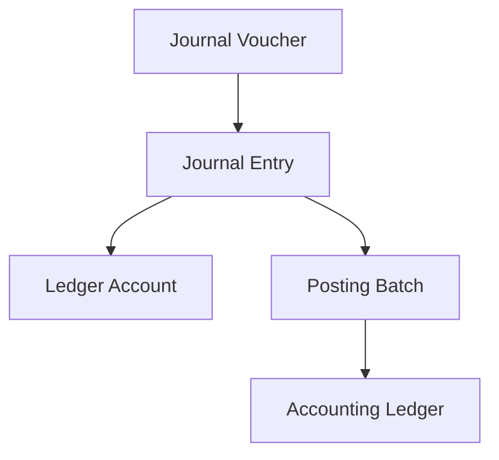

---

## 28.10 Aggregate Integrity Rules

The following integrity rules shall always be enforced.

- Every Journal Entry shall remain balanced.
- Partial posting is prohibited.
- Journal Numbers shall remain unique.
- Posted Journal Entries shall never be edited.
- Ledger updates shall occur only after successful posting.
- Every Journal Entry shall maintain complete audit history.
- Reversal processing shall preserve historical records.
- Every posting shall generate corresponding Ledger updates.
- Every Journal Entry shall remain traceable to its originating business transaction.
- Every state transition shall generate an audit event.

These integrity rules ensure that Journal Entries remain accurate, auditable, and fully compliant with enterprise accounting principles.

---
# 29. Journal Voucher Aggregate

The **Journal Voucher Aggregate** represents the business authorization for one or more Journal Entries within the Accounting & General Ledger domain.

A Journal Voucher captures the business justification, supporting documentation, approval workflow, and authorization required before financial transactions are posted to the General Ledger.

It acts as the governance layer between business events and accounting records.

---

## 29.1 Aggregate Purpose

The Journal Voucher Aggregate exists to:

- Authorize accounting transactions.
- Capture business justification.
- Maintain approval workflow.
- Support manual accounting adjustments.
- Record supporting documentation.
- Enable controlled financial corrections.
- Support audit investigations.
- Preserve financial governance.
- Ensure authorization before posting.
- Maintain regulatory compliance.

---

## 29.2 Aggregate Responsibilities

The Journal Voucher is responsible for:

- Maintaining voucher information.
- Managing approval lifecycle.
- Recording supporting documents.
- Maintaining approval history.
- Managing voucher status.
- Recording business justification.
- Supporting manual journals.
- Supporting adjustment journals.
- Supporting opening balance journals.
- Supporting closing journals.

---

## 29.3 Aggregate Boundaries

### Owns

- Voucher Number
- Voucher Type
- Voucher Date
- Business Justification
- Approval Status
- Supporting Documents
- Approval History
- Voucher Narration
- Reference Numbers

### References

- Journal Entry
- Accounting Period
- Fiscal Year
- Institution
- Employee
- Department

### Does Not Own

- Ledger Balances
- Journal Posting
- Trial Balance
- Financial Statements
- Chart of Accounts
- Ledger Accounts

---

## 29.4 Aggregate Invariants

The Journal Voucher shall always satisfy the following invariants.

- Voucher Number shall be unique.
- Every Voucher shall have a business purpose.
- Every Voucher shall maintain approval history.
- Approved Vouchers become eligible for Journal creation.
- Rejected Vouchers cannot generate Journal Entries.
- Executed Vouchers become read-only.
- Supporting documents remain permanently associated.
- Every Voucher belongs to one Accounting Period.
- Every Voucher belongs to one Fiscal Year.
- Complete audit history shall always be maintained.

Violation of any invariant shall prevent voucher execution.

---

## 29.5 Aggregate State

The Journal Voucher maintains the following business state.

### Voucher State

- Voucher Number
- Voucher Type
- Voucher Date
- Narration
- Business Reason

### Approval State

- Draft
- Submitted
- Under Review
- Approved
- Rejected
- Executed

### Reference State

- Source Transaction
- Supporting Documents
- Approval References
- Accounting References

### Governance State

- Audit Metadata
- Approval History
- Version Information

---

## 29.6 Aggregate Lifecycle

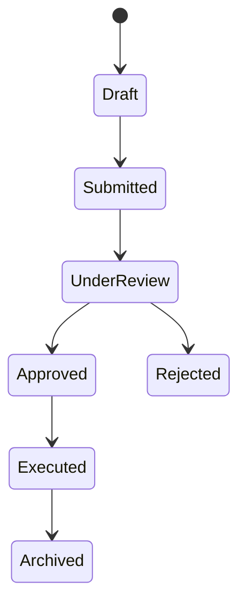

Lifecycle Rules:

- Draft Vouchers may be edited.
- Submitted Vouchers await review.
- Approved Vouchers may generate Journal Entries.
- Executed Vouchers become immutable.
- Rejected Vouchers require resubmission.
- Archived Vouchers remain available for audit purposes.

---

## 29.7 Aggregate Commands

The Journal Voucher accepts the following business commands:

- Create Voucher
- Submit Voucher
- Review Voucher
- Approve Voucher
- Reject Voucher
- Execute Voucher
- Cancel Voucher
- Archive Voucher
- Attach Supporting Document
- Validate Voucher

All commands execute through authorized accounting workflows.

---

## 29.8 Aggregate Events

Typical domain events include:

- VoucherCreated
- VoucherSubmitted
- VoucherReviewed
- VoucherApproved
- VoucherRejected
- VoucherExecuted
- VoucherCancelled
- VoucherArchived
- SupportingDocumentAttached
- VoucherAuditRecorded

These events enable downstream accounting processes while maintaining aggregate isolation.

---

## 29.9 Aggregate Relationships

```mermaid
flowchart TD

BV[Business Event]

JV[Journal Voucher]

JE[Journal Entry]

PB[Posting Batch]

AL[Accounting Ledger]

BV --> JV

JV --> JE

JE --> PB

PB --> AL
```

The Journal Voucher authorizes Journal Entry creation but never performs accounting posting itself.

---

## 29.10 Aggregate Integrity Rules

The following integrity rules shall always be enforced.

- Every Voucher shall maintain a unique identifier.
- Approved Vouchers alone may generate Journal Entries.
- Executed Vouchers shall never be modified.
- Supporting documents shall remain permanently linked.
- Approval history shall never be deleted.
- Every Voucher shall be traceable to a business event.
- Voucher execution shall generate corresponding Journal Entries.
- Unauthorized approval is prohibited.
- Every state transition shall generate an audit record.
- Historical Voucher information shall remain immutable.

These integrity rules ensure that Journal Vouchers provide a controlled, auditable, and governed authorization mechanism for financial transactions within the Accounting architecture.

---
# 30. Posting Batch Aggregate

The Posting Batch Aggregate coordinates the controlled execution of multiple Journal Entries as a single accounting posting operation.

Unlike Journal Entry, which represents an individual accounting transaction, Posting Batch governs execution, monitoring, rollback, and completion of grouped postings.

---

## Purpose

- Coordinate bulk posting operations.
- Maintain posting consistency.
- Ensure atomic batch execution.
- Support scheduled accounting jobs.
- Enable recovery from posting failures.

---

## Responsibilities

- Group Journal Entries for execution.
- Validate batch readiness.
- Execute posting in sequence.
- Monitor posting progress.
- Record batch outcomes.
- Support complete rollback on failure.

---

## Aggregate Invariants

- A Batch shall contain one or more Journal Entries.
- Only approved Journals may be included.
- A Batch executes atomically.
- Partial completion is prohibited.
- Completed Batches are immutable.

---

## Lifecycle

```mermaid
stateDiagram-v2

[*] --> Created
Created --> Validated
Validated --> Processing
Processing --> Completed
Processing --> Failed
Failed --> Retried
Retried --> Completed
Completed --> Archived
```

---

## Domain Events

- PostingBatchCreated
- PostingBatchValidated
- PostingBatchStarted
- PostingBatchCompleted
- PostingBatchFailed
- PostingBatchRetried

---

## Governance

- Posting order shall be deterministic.
- Rollback shall restore financial consistency.
- Every execution shall be auditable.

---

# 31. Accounting Period Aggregate

The Accounting Period Aggregate governs the temporal boundaries within which accounting transactions may be recorded.

---

## Purpose

- Control accounting timelines.
- Prevent posting into invalid periods.
- Support controlled financial closing.
- Preserve historical accounting integrity.

---

## Responsibilities

- Open Accounting Periods.
- Close Accounting Periods.
- Lock completed periods.
- Validate posting eligibility.
- Support controlled reopening.

---

## Aggregate Invariants

- Only one status exists at a time.
- Closed periods reject postings.
- Locked periods reject modifications.
- Reopening requires authorization.
- Periods belong to one Fiscal Year.

---

## Lifecycle

```mermaid
stateDiagram-v2

[*] --> Planned
Planned --> Open
Open --> Closing
Closing --> Closed
Closed --> Locked
Locked --> Archived
Closed --> Reopened
Reopened --> Open
```

---

## Domain Events

- AccountingPeriodOpened
- AccountingPeriodClosingStarted
- AccountingPeriodClosed
- AccountingPeriodLocked
- AccountingPeriodReopened

---

## Governance

- Posting requires an Open period.
- Closing validates pending Journals.
- Locked periods remain immutable.

---

# 32. Fiscal Year Aggregate

The Fiscal Year Aggregate represents the highest accounting time boundary and governs year-end financial processing.

---

## Purpose

- Manage annual accounting cycles.
- Coordinate year-end closing.
- Generate opening balances.
- Preserve historical fiscal records.

---

## Responsibilities

- Open Fiscal Years.
- Coordinate year-end activities.
- Close Fiscal Years.
- Carry balances forward.
- Initialize the next Fiscal Year.

---

## Aggregate Invariants

- Only one active Fiscal Year per Ledger.
- Closed Fiscal Years are immutable.
- Opening balances derive from prior closing balances.
- Year closing requires all Accounting Periods to be closed.

---

## Lifecycle

```mermaid
stateDiagram-v2

[*] --> Planned
Planned --> Open
Open --> Closing
Closing --> Closed
Closed --> Archived
```

---

## Domain Events

- FiscalYearOpened
- FiscalYearClosingStarted
- FiscalYearClosed
- OpeningBalancesGenerated

---

## Governance

- Fiscal closure requires executive approval.
- Historical Fiscal Years remain read-only.
- Closing produces opening balances for the next Fiscal Year.

---

# 33. Trial Balance Snapshot Aggregate

The Trial Balance Snapshot Aggregate captures the verified balance of every Ledger Account at a specific point in time.

Unlike the General Ledger, which is transactional, the Trial Balance Snapshot is a derived financial state used for reporting, reconciliation, and period closing.

---

## Purpose

- Verify Ledger balance integrity.
- Support financial reporting.
- Enable reconciliation.
- Preserve historical reporting states.

---

## Responsibilities

- Calculate account balances.
- Validate debit-credit equality.
- Store reporting snapshots.
- Support period-end reporting.
- Enable historical comparison.

---

## Aggregate Invariants

- Generated only from posted Ledger transactions.
- Debit total equals Credit total.
- Snapshots are immutable.
- Historical snapshots are never recalculated.

---

## Lifecycle

```mermaid
stateDiagram-v2

[*] --> Generating
Generating --> Verified
Verified --> Published
Published --> Archived
```

---

## Domain Events

- TrialBalanceGenerated
- TrialBalanceVerified
- TrialBalancePublished

---

## Governance

- Snapshots are read-only.
- Generation occurs after posting completion.
- Published snapshots support financial reporting and audit.

# 34. Domain Services

Domain Services encapsulate accounting logic that spans multiple aggregates while preserving aggregate boundaries.

No aggregate shall directly manipulate another aggregate. Cross-aggregate operations shall always execute through Domain Services.

---

## 34.1 Accounting Posting Service

The Accounting Posting Service is responsible for converting validated Journal Entries into permanent ledger postings.

### Responsibilities

- Validate Journal Entries.
- Verify Accounting Period status.
- Verify Ledger Account status.
- Execute double-entry posting.
- Update General Ledger.
- Update Ledger Account balances.
- Publish posting events.
- Generate audit records.

### Inputs

- Approved Journal Entry
- Accounting Period
- Ledger Accounts

### Outputs

- Posted Journal
- Updated Ledger
- Posting Audit
- Domain Events

---

## 34.2 Journal Validation Service

Responsible for validating accounting correctness before posting.

### Validation Rules

- Debit equals Credit.
- Valid Ledger Accounts.
- Active Accounting Period.
- Active Fiscal Year.
- Posting permissions.
- Currency validation.
- Duplicate Journal detection.
- Mandatory references.

A Journal failing validation shall never enter the posting pipeline.

---

## 34.3 Ledger Update Service

Responsible for maintaining Ledger balances.

### Responsibilities

- Update Debit balances.
- Update Credit balances.
- Maintain Running Balance.
- Maintain Account History.
- Preserve Posting Order.
- Record Audit Trail.

Ledger updates execute atomically.

---

## 34.4 Reversal Service

Responsible for reversing previously posted accounting transactions.

Reversal never modifies historical Journal Entries.

Instead it creates compensating Journal Entries.

Supported reversals include:

- Full Reversal
- Partial Reversal
- Correction Entry
- Accrual Reversal
- Closing Reversal

---

## 34.5 Trial Balance Service

Responsible for generating Trial Balance directly from the General Ledger.

Functions include:

- Balance Calculation
- Debit/Credit Verification
- Account Consolidation
- Financial Validation
- Reporting Snapshot Generation

No external module shall generate Trial Balance independently.

---

## 34.6 Fiscal Closing Service

Responsible for accounting period and year-end processing.

Major functions include:

- Period Validation
- Pending Journal Detection
- Balance Verification
- Closing Entries
- Carry Forward
- Opening Balance Creation
- Fiscal Locking

---

## 34.7 Reconciliation Service

Responsible for verifying financial consistency.

Supported reconciliations include:

- Ledger Reconciliation
- Bank Reconciliation
- Control Account Reconciliation
- Journal Verification
- Trial Balance Verification
- Opening vs Closing Balance Verification

Any reconciliation discrepancy shall generate an exception requiring investigation.

---

## 34.8 Domain Service Interaction

```mermaid
flowchart LR

JE[Journal Entry]
--> VS[Journal Validation]

VS
--> PS[Posting Service]

PS
--> LUS[Ledger Update]

LUS
--> GL[General Ledger]

GL
--> TBS[Trial Balance Service]

GL
--> RS[Reconciliation Service]

GL
--> FCS[Fiscal Closing Service]
```

---

## 34.9 Architectural Principles

The Domain Services shall adhere to the following principles:

- Aggregate boundaries shall not be violated.
- Business logic shall not be duplicated across aggregates.
- Every financial operation shall be auditable.
- Services shall execute atomically where financial consistency is required.
- Failed operations shall perform complete rollback.
- Domain events shall be published only after successful transaction completion.
- Financial history shall remain immutable.
- Every service shall preserve double-entry accounting integrity.

---
# 35. Business Workflows

The Accounting & General Ledger domain orchestrates financial recording through a series of standardized business workflows.

Each workflow preserves financial integrity, enforces accounting policies, and guarantees complete auditability.

---

# 35.1 Standard Journal Posting Workflow

This workflow records routine accounting transactions originating from operational domains.

```mermaid
flowchart LR

A[Business Event]
--> B[Journal Created]

B
--> C[Journal Validation]

C
--> D[Approval]

D
--> E[Posting Engine]

E
--> F[Ledger Update]

F
--> G[Trial Balance Updated]

G
--> H[Audit Recorded]
```

### Workflow Rules

- Journal must be balanced.
- Ledger Accounts must be active.
- Accounting Period must be open.
- Fiscal Year must be active.
- Posting executes atomically.
- Audit records are mandatory.

---

# 35.2 Manual Journal Workflow

Manual Journals are created for exceptional accounting situations.

Examples include:

- Year-end adjustments
- Audit adjustments
- Correction entries
- Opening balances
- Closing entries

```mermaid
flowchart LR

Create
--> Validate

Validate
--> Approve

Approve
--> Post

Post
--> Ledger

Ledger
--> Audit
```

Only authorized finance personnel may create Manual Journals.

---

# 35.3 Automatic Journal Workflow

Operational modules automatically generate accounting entries.

Typical sources include:

- Student Charges
- Fee Payments
- Refunds
- Procurement
- Payroll
- Asset Transactions
- Bank Transactions
- Tax Transactions

```mermaid
flowchart LR

Operational Module

-->

Accounting Event

-->

Posting Rules

-->

Journal Creation

-->

Validation

-->

Posting
```

Operational modules never post directly to the General Ledger.

---

# 35.4 Journal Reversal Workflow

Incorrect postings are corrected using reversal transactions.

```mermaid
flowchart LR

Posted Journal

-->

Reverse Request

-->

Authorization

-->

Reversal Journal

-->

Ledger Update

-->

Audit
```

Rules:

- Original Journal remains unchanged.
- Reversal maintains accounting history.
- Complete audit trace is preserved.

---

# 35.5 Batch Posting Workflow

High-volume accounting transactions may be processed in batches.

Typical scenarios:

- Daily fee collections
- Payroll posting
- Scholarship posting
- Bank settlement
- Interest calculation

```mermaid
flowchart LR

Journal Queue

-->

Batch Validation

-->

Batch Posting

-->

Ledger Update

-->

Completion Report
```

Failed batches perform complete rollback.

---

# 35.6 Accounting Period Closing Workflow

Period Closing ensures accounting completeness before financial reporting.

```mermaid
flowchart LR

Pending Journal Check

-->

Validation

-->

Trial Balance Verification

-->

Approval

-->

Close Period

-->

Lock Posting
```

Closing checks include:

- Pending Journals
- Unbalanced Entries
- Reconciliation Status
- Audit Exceptions

---

# 35.7 Fiscal Year Closing Workflow

Year-end processing finalizes institutional accounting.

```mermaid
flowchart LR

Verify Periods

-->

Close Final Period

-->

Generate Closing Entries

-->

Carry Forward Balances

-->

Generate Opening Balances

-->

Lock Fiscal Year
```

Year Closing is irreversible after governance approval.

---

# 35.8 Trial Balance Generation Workflow

Trial Balance is generated directly from the General Ledger.

```mermaid
flowchart LR

General Ledger

-->

Balance Calculation

-->

Debit Credit Verification

-->

Trial Balance

-->

Financial Reporting
```

Trial Balance shall never be manually maintained.

---

# 35.9 Ledger Reconciliation Workflow

Ledger reconciliation verifies financial correctness.

Typical reconciliation includes:

- General Ledger
- Bank Ledger
- Control Accounts
- Suspense Accounts
- Receivables
- Payables

```mermaid
flowchart LR

Ledger Data

-->

Comparison

-->

Difference Detection

-->

Investigation

-->

Resolution

-->

Audit Closure
```

---

# 35.10 Workflow Governance Principles

All Accounting workflows shall comply with the following principles.

- Every workflow shall be deterministic.
- Every financial transaction shall be traceable.
- Financial integrity takes precedence over performance.
- All workflows shall preserve double-entry accounting.
- Failed workflows shall rollback completely.
- Historical accounting records shall never be modified.
- Workflow execution shall generate audit events.
- Workflow authorization shall follow segregation-of-duty principles.
- Closed accounting periods shall reject transactional workflows.
- Every completed workflow shall produce an immutable financial record.

---
# 36. Business Rules

The Accounting & General Ledger domain is governed by a comprehensive set of business rules that preserve financial integrity, statutory compliance, consistency, and auditability.

These rules are mandatory and apply across all accounting operations.

---

# 36.1 Journal Rules

### BR-001

Every Journal Entry shall maintain double-entry accounting.

### BR-002

Total Debit shall always equal Total Credit.

### BR-003

Every Journal Entry shall contain at least one Debit line.

### BR-004

Every Journal Entry shall contain at least one Credit line.

### BR-005

Journal Numbers shall be unique.

### BR-006

Every Journal Entry shall reference a valid business transaction.

### BR-007

Posted Journal Entries shall become immutable.

### BR-008

Journal Entries shall never be physically deleted.

### BR-009

Journal reversal shall create compensating Journal Entries.

### BR-010

Every Journal Entry shall generate an audit record.

---

# 36.2 Ledger Rules

### BR-011

Ledger balances shall only be updated through successful Journal posting.

### BR-012

Manual modification of Ledger balances is prohibited.

### BR-013

Every Ledger Account shall belong to an approved Chart of Accounts.

### BR-014

Closed Ledger Accounts shall reject postings.

### BR-015

Suspended Ledger Accounts shall reject postings.

### BR-016

Running balances shall remain mathematically consistent.

### BR-017

Historical Ledger balances shall never be overwritten.

### BR-018

Ledger updates shall execute atomically.

### BR-019

Failed Ledger updates shall rollback completely.

### BR-020

Ledger history shall remain permanently auditable.

---

# 36.3 Chart of Accounts Rules

### BR-021

Every Account Code shall be unique.

### BR-022

Posting Accounts shall not contain child accounts.

### BR-023

Summary Accounts shall never receive direct postings.

### BR-024

Circular account hierarchy is prohibited.

### BR-025

Retired accounts shall preserve historical references.

### BR-026

Inactive accounts shall reject postings.

### BR-027

Account classifications shall remain valid.

### BR-028

Historical Account Codes shall never be reused.

---

# 36.4 Accounting Period Rules

### BR-029

Posting shall be permitted only within an Open Accounting Period.

### BR-030

Closed Accounting Periods shall reject postings.

### BR-031

Locked Accounting Periods shall reject modifications.

### BR-032

Period reopening requires authorized approval.

### BR-033

All pending Journals shall be resolved before closing.

### BR-034

Trial Balance shall be verified before closure.

### BR-035

Period closing shall generate audit records.

---

# 36.5 Fiscal Year Rules

### BR-036

Only one Fiscal Year may remain active.

### BR-037

Fiscal Year closing requires all Accounting Periods to be closed.

### BR-038

Carry-forward balances shall be system generated.

### BR-039

Opening balances shall be generated automatically.

### BR-040

Closed Fiscal Years shall become read-only.

---

# 36.6 Posting Rules

### BR-041

Only Approved Journal Entries may be posted.

### BR-042

Posting requires successful validation.

### BR-043

Posting shall update all affected Ledger Accounts.

### BR-044

Posting shall update the General Ledger.

### BR-045

Posting shall preserve transaction chronology.

### BR-046

Posting failures shall perform complete rollback.

### BR-047

Posting shall publish domain events.

### BR-048

Posting shall generate audit logs.

---

# 36.7 Reversal Rules

### BR-049

Historical transactions shall never be edited.

### BR-050

Corrections shall occur through reversal Journals.

### BR-051

Every reversal shall reference the original Journal.

### BR-052

Reversal shall preserve complete financial history.

### BR-053

Partial reversals require financial authorization.

---

# 36.8 Security Rules

### BR-054

Accounting operations shall require authenticated users.

### BR-055

Posting authority shall follow role-based access control.

### BR-056

Maker and Checker shall be different users where applicable.

### BR-057

Administrative overrides shall be fully audited.

### BR-058

Financial permissions shall follow the principle of least privilege.

---

# 36.9 Audit Rules

### BR-059

Every financial operation shall generate an audit event.

### BR-060

Audit history shall never be deleted.

### BR-061

Every Journal shall remain traceable.

### BR-062

Every Ledger update shall remain traceable.

### BR-063

Every approval decision shall be recorded.

### BR-064

Historical accounting records shall remain immutable.

---

# 36.10 General Governance Rules

### BR-065

Financial integrity shall take precedence over performance.

### BR-066

Aggregate ownership boundaries shall never be bypassed.

### BR-067

Business rules shall execute before persistence.

### BR-068

Financial operations shall remain deterministic.

### BR-069

Every workflow shall produce reproducible accounting results.

### BR-070

The Accounting Ledger shall remain the single source of truth for institutional financial records.

---

## 36.11 Business Rule Classification

| Category | Rule Range |
|-----------|------------|
| Journal Management | BR-001 – BR-010 |
| Ledger Management | BR-011 – BR-020 |
| Chart of Accounts | BR-021 – BR-028 |
| Accounting Period | BR-029 – BR-035 |
| Fiscal Year | BR-036 – BR-040 |
| Posting Engine | BR-041 – BR-048 |
| Reversal Processing | BR-049 – BR-053 |
| Security & Authorization | BR-054 – BR-058 |
| Audit & Traceability | BR-059 – BR-064 |
| Governance | BR-065 – BR-070 |

---

## 36.12 Rule Governance Principles

The business rules defined in this section are mandatory across all accounting workflows.

No operational module, integration, automation, or administrative process shall bypass these rules.

Any violation shall result in transaction rejection, audit logging, and exception handling in accordance with the enterprise governance policies.

---
# 37. Domain Events

The Accounting & General Ledger domain publishes domain events whenever a significant business state transition occurs.

These events enable loose coupling between bounded contexts while ensuring that the Accounting domain remains the authoritative source of financial records.

Domain events are immutable representations of completed business activities.

---

# 37.1 Event Publishing Principles

The Accounting domain follows the following event publishing principles:

- Events are published only after successful transaction completion.
- Events are immutable.
- Events represent facts, not commands.
- Events shall never modify historical accounting records.
- Every published event shall be auditable.
- Events shall include sufficient business context for downstream consumers.
- Failed transactions shall not publish business events.

---

# 37.2 Journal Events

The following events are published during the Journal lifecycle.

| Event | Description |
|--------|-------------|
| JournalCreated | A new Journal Entry has been created. |
| JournalValidated | Accounting validation completed successfully. |
| JournalApproved | Journal has been approved for posting. |
| JournalRejected | Journal approval failed. |
| JournalPosted | Journal successfully posted to the General Ledger. |
| JournalReversed | Journal reversed through a compensating entry. |
| JournalArchived | Journal moved to historical archive. |

---

# 37.3 Ledger Events

The following events represent Ledger changes.

| Event | Description |
|--------|-------------|
| LedgerUpdated | Ledger balances successfully updated. |
| LedgerBalanceChanged | One or more account balances changed. |
| LedgerReconciled | Ledger reconciliation completed. |
| LedgerLocked | Ledger locked for period closing. |
| LedgerUnlocked | Ledger reopened after authorization. |

---

# 37.4 Chart of Accounts Events

| Event | Description |
|--------|-------------|
| AccountCreated | New Ledger Account created. |
| AccountActivated | Ledger Account activated. |
| AccountSuspended | Posting temporarily suspended. |
| AccountRetired | Account retired from operational use. |
| AccountHierarchyChanged | Account structure modified. |

---

# 37.5 Accounting Period Events

| Event | Description |
|--------|-------------|
| AccountingPeriodOpened | Period available for postings. |
| AccountingPeriodClosingStarted | Period closing initiated. |
| AccountingPeriodClosed | Period successfully closed. |
| AccountingPeriodReopened | Closed period reopened after approval. |
| AccountingPeriodLocked | Posting permanently disabled for the period. |

---

# 37.6 Fiscal Year Events

| Event | Description |
|--------|-------------|
| FiscalYearOpened | Fiscal Year activated. |
| FiscalYearClosingStarted | Year-end processing initiated. |
| FiscalYearClosed | Fiscal Year successfully closed. |
| OpeningBalancesGenerated | Opening balances created for the new Fiscal Year. |
| CarryForwardCompleted | Closing balances carried forward successfully. |

---

# 37.7 Trial Balance Events

| Event | Description |
|--------|-------------|
| TrialBalanceGenerated | Trial Balance successfully generated. |
| TrialBalanceVerified | Debit and Credit totals verified. |
| TrialBalancePublished | Trial Balance made available for reporting. |

---

# 37.8 Event Consumers

Accounting events may be consumed by the following domains.

| Consumer Domain | Typical Events Consumed |
|-----------------|-------------------------|
| Budget Management | LedgerUpdated, FiscalYearClosed |
| Procurement Finance | JournalPosted |
| Treasury Management | LedgerUpdated |
| Financial Reporting | TrialBalanceGenerated, AccountingPeriodClosed |
| Financial Analytics | LedgerUpdated, JournalPosted |
| Audit & Compliance | All Accounting Events |
| Notification Services | AccountingPeriodClosed, FiscalYearClosed |

Consumers shall treat Accounting events as read-only business facts.

---

# 37.9 Event Flow

```mermaid
flowchart LR

A[Business Transaction]

-->

B[Journal Created]

-->

C[Journal Posted]

-->

D[Ledger Updated]

-->

E[Domain Event Published]

-->

F[Reporting]

E --> G[Analytics]

E --> H[Audit]

E --> I[Treasury]

E --> J[Budget]
```

---

# 37.10 Event Governance Rules

The following governance rules apply to all Accounting domain events.

- Events shall only represent completed business activities.
- Events shall never expose internal aggregate state unnecessarily.
- Events shall preserve financial traceability.
- Events shall remain immutable after publication.
- Event ordering shall follow transaction chronology.
- Duplicate event publication is prohibited.
- Event publication shall occur only after successful transaction commit.
- Every published event shall include audit metadata.
- Historical events shall remain permanently available for audit and replay.
- Downstream domains shall never modify Accounting event data.

These principles ensure reliable, auditable, and loosely coupled communication between the Accounting domain and the rest of the SutraERP platform.

---
# 38. Integration Architecture

The Accounting & General Ledger domain serves as the canonical financial recording engine for the SutraERP platform.

It integrates with operational domains through well-defined business events and standardized accounting interfaces while maintaining strict bounded-context isolation.

Operational domains execute business processes, whereas the Accounting domain records their financial consequences.

---

# 38.1 Integration Principles

All integrations with the Accounting domain shall comply with the following principles.

- Accounting is the single source of truth for financial records.
- Operational domains shall never modify Ledger data directly.
- Financial integration shall be event-driven wherever feasible.
- Accounting services shall validate all incoming financial requests.
- Multi-domain communication shall preserve loose coupling.
- Financial consistency shall take precedence over integration performance.
- Every integration shall generate complete audit trails.

---

# 38.2 Upstream Integrations

The following domains generate accounting events consumed by the Accounting domain.

| Domain | Integration Purpose |
|---------|---------------------|
| L2-F01 Student Charge Management | Revenue recognition and receivable creation |
| L2-F02 Payment Management | Cash receipt and settlement postings |
| L2-F03 Refund Management | Refund accounting entries |
| L2-F04 Financial Adjustments | Adjustment journals |
| L2-F14 Procurement Finance Consumption | Expense and payable recognition |
| L2-F00 Tax Compliance Service | GST, TDS, statutory accounting |
| L2-F09 Treasury | Bank and cash accounting |
| L2-F10 Asset Management | Asset capitalization and depreciation |

The upstream domains remain owners of their operational transactions.

---

# 38.3 Downstream Integrations

The Accounting domain provides financial information to the following domains.

| Domain | Information Consumed |
|---------|----------------------|
| L2-F06 Budget Management | Actual expenditure and revenue |
| L2-F11 Financial Reporting | General Ledger and Trial Balance |
| L2-F12 Financial Analytics | Financial KPIs and analytical datasets |
| L2-F13 Audit & Compliance | Audit trails and financial history |

Downstream domains consume accounting information but never update Accounting aggregates.

---

# 38.4 Multi-Domain Integration Flow

```mermaid
flowchart LR

SC[Student Charges]

PM[Payments]

RF[Refunds]

ADJ[Adjustments]

PR[Procurement]

TR[Treasury]

TX[Tax Compliance Service]

FA[Assets]

SC --> AC

PM --> AC

RF --> AC

ADJ --> AC

PR --> AC

TR --> AC

TX --> AC

FA --> AC

AC[Accounting & General Ledger]

AC --> RP[Financial Reporting]

AC --> AN[Financial Analytics]

AC --> AU[Audit & Compliance]

AC --> BD[Budget Management]
```

---

# 38.5 Integration Contracts

Every financial integration shall satisfy the following requirements.

### Mandatory Information

- Source Domain
- Business Transaction Identifier
- Accounting Reference
- Transaction Date
- Accounting Period
- Fiscal Year
- Currency
- Institution
- Financial Amount
- Audit Metadata

Requests missing mandatory information shall be rejected.

---

# 38.6 Integration Validation

Before accepting an accounting request, the Accounting domain validates:

- Source transaction existence.
- Accounting Period status.
- Fiscal Year status.
- Ledger Account validity.
- Posting permissions.
- Duplicate posting detection.
- Currency consistency.
- Business rule compliance.

Validation failures prevent Journal creation.

---

# 38.7 Synchronization Principles

Accounting integrations shall maintain the following synchronization principles.

- Financial posting shall be atomic.
- Duplicate postings are prohibited.
- Event ordering shall be preserved.
- Retry operations shall be idempotent.
- Rollback shall preserve financial consistency.
- Event replay shall never duplicate Ledger balances.
- Historical integrations shall remain traceable.

---

# 38.8 Integration Failure Handling

When an integration failure occurs:

- The posting request shall be rejected.
- Ledger balances shall remain unchanged.
- Partial updates are prohibited.
- Audit events shall be recorded.
- Operational domains shall receive failure notifications.
- Failed requests may be retried after correction.
- Financial integrity shall always be preserved.

---

# 38.9 Integration Governance Rules

The following governance rules apply to all integrations.

- Accounting remains the canonical financial recording domain.
- External domains shall never modify Ledger balances.
- All integrations shall preserve aggregate ownership.
- Integration contracts shall remain version controlled.
- Financial messages shall remain immutable.
- Integration authorization shall be enforced.
- Every integration shall remain completely auditable.

These principles ensure secure, reliable, and scalable financial integration across the SutraERP platform.

---

# 39. Security & Authorization Architecture

The Accounting & General Ledger domain manages the institution's official financial records and therefore requires the highest level of security, authorization, and governance within the Finance Architecture.

Every financial operation shall be authenticated, authorized, auditable, and traceable.

---

# 39.1 Security Objectives

The Accounting security architecture exists to:

- Protect financial records.
- Prevent unauthorized postings.
- Enforce financial governance.
- Maintain segregation of duties.
- Protect accounting periods.
- Preserve auditability.
- Ensure regulatory compliance.
- Prevent fraud.

---

# 39.2 Security Principles

The Accounting domain follows these security principles.

- Least Privilege Access.
- Role-Based Authorization (RBAC).
- Segregation of Duties.
- Maker-Checker Approval.
- Immutable Financial History.
- Complete Audit Logging.
- Explicit Authorization.
- Default Deny.

---

# 39.3 Functional Permissions

The following permissions govern accounting operations.

| Permission | Description |
|------------|-------------|
| Create Journal | Create draft journal entries |
| Modify Draft Journal | Edit journals before approval |
| Approve Journal | Approve journals for posting |
| Reject Journal | Reject journal requests |
| Post Journal | Execute ledger posting |
| Reverse Journal | Reverse posted journals |
| Manage Chart of Accounts | Create and modify account structure |
| Close Accounting Period | Close financial periods |
| Reopen Accounting Period | Reopen closed periods |
| Close Fiscal Year | Execute year-end closing |
| View Financial Reports | Access financial statements |
| Perform Reconciliation | Execute reconciliation activities |

---

# 39.4 Role-Based Authorization

Typical accounting roles include:

| Role | Responsibilities |
|------|------------------|
| Accountant | Journal preparation and reconciliation |
| Senior Accountant | Journal approval and supervision |
| Finance Manager | Period management and financial control |
| Chief Financial Officer | Fiscal governance and year-end approval |
| Internal Auditor | Read-only audit access |
| System Administrator | Technical administration without financial posting authority |

Role definitions may be customized by each institution.

---

# 39.5 Segregation of Duties

To reduce operational and fraud risks:

- Journal Creator shall not approve the same Journal.
- Journal Approver shall not execute unauthorized reversals.
- Period Closure shall require independent authorization.
- Fiscal Year Closure shall require executive approval.
- Audit users shall not modify accounting records.
- System administrators shall not perform financial postings solely through technical privileges.

---

# 39.6 Accounting Period Protection

Additional controls apply to Accounting Periods.

- Closed periods reject postings.
- Locked periods reject modifications.
- Reopening requires explicit approval.
- Year-end closure supersedes period controls.
- Historical financial periods remain protected.

---

# 39.7 Financial Data Protection

The Accounting domain protects:

- General Ledger.
- Journal Entries.
- Ledger Balances.
- Chart of Accounts.
- Trial Balance.
- Fiscal Configuration.
- Financial Statements.
- Audit History.

Unauthorized modification of these records is prohibited.

---

# 39.8 Security Audit Requirements

Every security-sensitive operation shall record:

- User Identity.
- Timestamp.
- Institution.
- Source Device or Session.
- Business Operation.
- Previous State.
- New State.
- Approval Reference.

Audit records shall remain immutable.

---

# 39.9 Security Governance Rules

The following governance rules are mandatory.

- Authentication is required for every financial operation.
- Authorization shall precede execution.
- Financial permissions shall be role-driven.
- Security violations shall generate audit events.
- Unauthorized operations shall be rejected.
- Financial history shall remain immutable.
- Administrative overrides shall require audit justification.
- All security policies shall comply with enterprise governance standards.

These principles ensure that financial information remains secure, compliant, and fully traceable throughout its lifecycle.

---
# 40. Audit & Compliance Architecture

The Accounting & General Ledger domain is designed to provide complete financial transparency, traceability, and regulatory compliance.

Every accounting transaction shall be fully auditable from its originating business event to its final financial reporting impact.

The audit architecture ensures that financial records remain trustworthy throughout the lifecycle of the institution.

---

# 40.1 Audit Objectives

The Audit Architecture exists to:

- Preserve financial traceability.
- Maintain immutable accounting history.
- Support statutory compliance.
- Enable forensic investigation.
- Record complete financial lineage.
- Support internal and external audits.
- Detect unauthorized financial activity.
- Preserve historical accountability.

---

# 40.2 Audit Scope

The following activities shall be audited.

### Master Data

- Chart of Accounts
- Ledger Accounts
- Fiscal Year
- Accounting Period
- Financial Configuration

### Transactions

- Journal Creation
- Journal Validation
- Journal Approval
- Journal Posting
- Journal Reversal
- Batch Posting
- Closing Entries

### Administration

- Period Opening
- Period Closing
- Fiscal Year Closing
- Permission Changes
- Configuration Changes

---

# 40.3 Audit Information

Every audit record shall contain:

- Audit Identifier
- Institution
- Business Transaction Reference
- Journal Number
- User Identity
- User Role
- Timestamp
- Business Action
- Previous State
- New State
- Source System
- Reason for Change

This information enables complete reconstruction of financial history.

---

# 40.4 Financial Traceability

Every financial transaction shall remain traceable across its complete lifecycle.

```mermaid
flowchart LR

Business Event

-->

Journal Entry

-->

Posting Batch

-->

General Ledger

-->

Trial Balance

-->

Financial Statements

-->

Audit Record
```

No step in the financial lifecycle shall be untraceable.

---

# 40.5 Compliance Principles

The Accounting domain shall support compliance with institutional and statutory accounting requirements.

Compliance objectives include:

- Accurate financial records.
- Immutable accounting history.
- Period control.
- Double-entry accounting.
- Financial consistency.
- Complete approval history.
- Segregation of duties.
- Financial reconciliation.

---

# 40.6 Audit Retention

Audit records shall remain available according to institutional retention policies.

The audit architecture shall support:

- Historical investigation.
- Regulatory inspection.
- Financial dispute resolution.
- Compliance verification.
- Internal audit.
- External audit.

Historical audit records shall never be modified.

---

# 40.7 Audit Governance Rules

The following governance rules are mandatory.

- Every financial operation shall generate an audit record.
- Audit records shall be immutable.
- Audit history shall never be deleted.
- Every Journal shall remain traceable.
- Every Ledger update shall remain traceable.
- Every approval decision shall be recorded.
- Every configuration change shall be auditable.
- Audit retrieval shall not impact transactional integrity.

These principles ensure complete financial accountability across the Accounting domain.

---
# 41. Reporting & Read Models

The Accounting & General Ledger domain provides standardized read models for financial reporting, reconciliation, analytics, and compliance.

These read models are derived exclusively from the canonical Accounting Ledger and related accounting aggregates.

No external domain shall maintain an independent financial record outside the Accounting domain.

---

# 41.1 Reporting Objectives

The Reporting Architecture exists to:

- Provide consistent financial information.
- Support operational decision-making.
- Enable statutory reporting.
- Support financial reconciliation.
- Provide analytical datasets.
- Maintain reporting consistency.
- Ensure audit readiness.
- Preserve financial traceability.

---

# 41.2 Reporting Principles

All accounting reports shall follow these principles.

- Derived from the General Ledger.
- Read-only.
- Point-in-time reproducible.
- Consistent across all consumers.
- Period-aware.
- Institution-aware.
- Fully auditable.
- Financially reconciled.

---

# 41.3 Canonical Read Models

The Accounting domain publishes the following canonical read models.

| Read Model | Purpose |
|------------|---------|
| General Ledger | Complete ledger transaction history |
| Account Statement | Detailed activity of an individual Ledger Account |
| Journal Register | Chronological Journal listing |
| Trial Balance | Account balance verification |
| Day Book | Daily accounting transactions |
| Account Balance Summary | Current balances by account |
| Period Closing Summary | Accounting period status |
| Fiscal Year Summary | Annual accounting overview |
| Reconciliation Summary | Reconciliation status |
| Posting Batch Summary | Batch processing information |

---

# 41.4 Reporting Categories

### Operational Reports

- Journal Register
- Daily Posting Register
- Pending Journal Report
- Batch Posting Report
- Reversal Register

---

### Financial Reports

- General Ledger
- Trial Balance
- Account Statement
- Balance Summary
- Closing Balance Report
- Opening Balance Report

---

### Governance Reports

- Period Closing Report
- Fiscal Year Closing Report
- Audit Activity Report
- Approval Register
- Posting Exception Report

---

### Reconciliation Reports

- Ledger Reconciliation
- Control Account Reconciliation
- Bank Reconciliation Status
- Suspense Account Report

---

# 41.5 Read Model Relationships

```mermaid
flowchart LR

GL[General Ledger]

-->

TB[Trial Balance]

-->

FS[Financial Statements]

GL --> AS[Account Statement]

GL --> JR[Journal Register]

GL --> DB[Day Book]

GL --> REC[Reconciliation Reports]

GL --> KPI[Financial Analytics]
```

All reporting views originate from the General Ledger.

---

# 41.6 Reporting Consumers

The following domains consume Accounting read models.

| Consumer | Information Consumed |
|-----------|----------------------|
| Financial Reporting | Financial statements |
| Financial Analytics | KPIs and trends |
| Budget Management | Actual financial figures |
| Audit & Compliance | Financial history |
| Treasury | Cash and bank balances |
| Institutional Administration | Financial summaries |

Consumers shall not modify Accounting read models.

---

# 41.7 Reporting Governance Rules

The following rules govern Accounting reporting.

- Reports shall be generated only from posted accounting records.
- Draft Journals shall not appear in financial reports.
- Closed periods shall produce immutable reports.
- Every report shall remain reproducible.
- Historical reports shall preserve original financial values.
- Reporting calculations shall remain deterministic.
- Report generation shall not modify transactional data.
- Every published report shall remain traceable to the underlying Ledger entries.

These principles ensure that all financial reporting remains accurate, consistent, and fully aligned with the canonical Accounting records.

---

# 42. Error & Exception Architecture

The Accounting & General Ledger domain shall prevent financial inconsistencies by detecting, isolating, and resolving exceptions before they affect the General Ledger.

No exception shall compromise financial integrity, auditability, or accounting consistency.

---

## 42.1 Architectural Objectives

The Exception Architecture exists to:

- Preserve financial integrity.
- Prevent inconsistent Ledger balances.
- Detect accounting anomalies.
- Support controlled recovery.
- Maintain complete auditability.
- Protect accounting periods.
- Prevent duplicate postings.
- Enable operational resilience.

---

## 42.2 Exception Categories

| Category | Examples |
|-----------|----------|
| Validation Exceptions | Invalid Ledger Account, Missing References |
| Business Rule Exceptions | Unbalanced Journal, Closed Period |
| Authorization Exceptions | Unauthorized Posting, Approval Failure |
| Processing Exceptions | Batch Failure, Posting Failure |
| Integration Exceptions | Duplicate Event, Missing Source Transaction |
| Infrastructure Exceptions | Database Failure, Network Failure |

---

## 42.3 Exception Handling Workflow

```mermaid
flowchart LR

A[Accounting Request]

-->

B{Validation}

B -->|Failed| C[Reject Transaction]

B -->|Passed| D[Posting Engine]

D -->|Success| E[Ledger Updated]

D -->|Failure| F[Rollback]

F --> G[Audit Exception]

G --> H[Notify Operations]
```

---

## 42.4 Recovery Principles

- Financial consistency takes precedence over availability.
- Partial posting is prohibited.
- Failed transactions perform complete rollback.
- Exceptions generate audit records.
- Recovery shall preserve transaction ordering.
- Historical financial records remain unchanged.

---

## 42.5 Governance Rules

- Every exception shall be classified.
- Every failed posting shall be auditable.
- Duplicate recovery is prohibited.
- Financial data shall never become inconsistent.
- Exception resolution shall remain traceable.

---

# 43. Performance & Scalability

The Accounting domain shall support enterprise-scale financial processing while preserving transactional consistency.

Performance optimization shall never compromise accounting correctness.

---

## 43.1 Architectural Objectives

- Support large institutions.
- Support multi-campus operations.
- Enable high-volume posting.
- Minimize posting latency.
- Preserve deterministic execution.
- Scale horizontally where appropriate.
- Support future institutional growth.

---

## 43.2 Scalability Characteristics

The architecture supports scaling across:

- Institutions
- Campuses
- Academic Sessions
- Departments
- Cost Centers
- Fiscal Years
- Concurrent Finance Users
- High-volume Journal Processing

---

## 43.3 Optimization Strategies

- Batch Posting
- Incremental Ledger Updates
- Read Model Optimization
- Event-driven Integration
- Background Reconciliation
- Cached Financial Summaries
- Asynchronous Reporting

---

## 43.4 Performance Principles

- Ledger posting remains transactional.
- Read operations shall not affect posting performance.
- Reports utilize optimized read models.
- Batch processing reduces operational overhead.
- Financial consistency always takes precedence over speed.

---

## 43.5 Scalability Governance

- Performance optimization shall never bypass business rules.
- Horizontal scaling shall preserve consistency.
- Distributed processing shall remain deterministic.
- Scalability shall preserve complete auditability.

---

# 44. Architectural Constraints

The following constraints are mandatory for the Accounting & General Ledger domain.

These constraints preserve financial correctness and long-term maintainability.

---

## 44.1 Financial Constraints

- Double-entry accounting is mandatory.
- General Ledger is the financial system of record.
- Journal Entries become immutable after posting.
- Ledger balances shall never be manually modified.
- Financial history shall never be deleted.

---

## 44.2 Domain Constraints

- Aggregate ownership shall never be violated.
- Operational domains shall never modify accounting records.
- Trial Balance derives exclusively from the General Ledger.
- Accounting shall remain an independent bounded context.

---

## 44.3 Technical Constraints

- All postings shall execute atomically.
- Rollback shall restore financial consistency.
- Event publication follows successful transaction commit.
- Duplicate postings are prohibited.
- Idempotent processing shall be supported.

---

## 44.4 Governance Constraints

- Every operation requires authorization.
- Every operation generates audit history.
- Closed Accounting Periods reject postings.
- Closed Fiscal Years remain read-only.
- Segregation of duties shall be enforced.

---

# 45. Key Performance Indicators (KPIs)

The following KPIs measure the effectiveness, stability, and operational health of the Accounting domain.

---

## 45.1 Financial Integrity KPIs

| KPI | Objective |
|------|-----------|
| Balanced Journal Rate | 100% |
| Ledger Consistency | 100% |
| Trial Balance Accuracy | 100% |
| Duplicate Posting Rate | 0% |
| Posting Rollback Success | 100% |

---

## 45.2 Operational KPIs

| KPI | Objective |
|------|-----------|
| Journal Processing Time | Within institutional SLA |
| Batch Posting Success Rate | >99.9% |
| Period Closing Success | 100% |
| Fiscal Closing Success | 100% |
| Reconciliation Completion | 100% |

---

## 45.3 Audit KPIs

| KPI | Objective |
|------|-----------|
| Audit Completeness | 100% |
| Traceability Coverage | 100% |
| Immutable Record Compliance | 100% |
| Approval Compliance | 100% |

---

## 45.4 Monitoring Principles

The Accounting domain shall continuously monitor:

- Posting throughput.
- Failed Journals.
- Ledger consistency.
- Pending approvals.
- Batch failures.
- Reconciliation status.
- Period Closing readiness.
- Fiscal Year health.

Monitoring shall be proactive and support operational governance.

---

# 46. Architecture Diagram Appendix

This appendix consolidates the principal architectural views of the Accounting & General Ledger domain.

---

## 46.1 Domain Context

```mermaid
flowchart LR

Operational Domains

-->

Accounting & General Ledger

-->

Reporting

Accounting & General Ledger --> Analytics

Accounting & General Ledger --> Audit
```

---

## 46.2 Aggregate Relationships

```mermaid
flowchart TD

Chart of Accounts

-->

Ledger Account

Journal Voucher

-->

Journal Entry

Journal Entry

-->

Posting Batch

Posting Batch

-->

Accounting Ledger

Accounting Ledger

-->

Trial Balance
```

---

## 46.3 Journal Posting Workflow

```mermaid
flowchart LR

Business Event

-->

Journal

-->

Validation

-->

Approval

-->

Posting

-->

Ledger

-->

Trial Balance
```

---

## 46.4 Accounting Lifecycle

```mermaid
flowchart LR

Business Transaction

-->

Accounting Event

-->

Journal Entry

-->

Ledger Update

-->

Financial Reporting

-->

Audit
```

---

## 46.5 Fiscal Closing Workflow

```mermaid
flowchart LR

Open Periods

-->

Validation

-->

Closing Entries

-->

Carry Forward

-->

Opening Balances

-->

Fiscal Year Closed
```

---

## 46.6 Domain Event Flow

```mermaid
flowchart LR

Journal Posted

-->

Ledger Updated

-->

Domain Events

Domain Events --> Reporting

Domain Events --> Analytics

Domain Events --> Budget

Domain Events --> Audit
```

---

## 46.7 Integration Architecture

```mermaid
flowchart LR

Charges

--> Accounting

Payments --> Accounting

Refunds --> Accounting

Procurement --> Accounting

Treasury --> Accounting

Assets --> Accounting

Accounting --> Reporting

Accounting --> Analytics

Accounting --> Audit
```

---

## 46.8 Security Architecture

```mermaid
flowchart LR

User

-->

Authentication

-->

Authorization

-->

Accounting Service

-->

Audit Log
```

---

## 46.9 Audit Traceability

```mermaid
flowchart LR

Business Event

-->

Journal

-->

Ledger

-->

Trial Balance

-->

Financial Statement

-->

Audit Trail
```

---

## 46.10 Architecture Summary

The Accounting & General Ledger domain serves as the canonical financial recording engine of the SutraERP Finance Architecture.

Its architecture is founded upon:

- Domain-Driven Design (DDD)
- Canonical Aggregate Ownership
- Double-Entry Accounting
- Event-Driven Integration
- Immutable Financial Records
- Comprehensive Auditability
- Financial Governance
- Enterprise Scalability

The architecture ensures that every financial transaction is accurately recorded, completely traceable, fully auditable, and consistently integrated across all Finance domains, establishing a reliable financial system of record for institutions operating on the SutraERP platform.

---
# 47. Architecture Summary & Conclusion

The **Accounting & General Ledger** domain is the canonical financial recording engine of the SutraERP Finance Architecture.

It provides the authoritative mechanism for recording, validating, governing, and preserving all institutional financial transactions.

Unlike operational finance domains that initiate business activities, the Accounting domain records their financial consequences and maintains the institution's official books of accounts.

---

## 47.1 Architectural Outcomes

The architecture achieves the following enterprise objectives.

- Establishes a single source of truth for financial records.
- Enforces double-entry accounting across all financial transactions.
- Preserves immutable financial history.
- Supports complete auditability and traceability.
- Enables standardized financial reporting.
- Maintains clear aggregate ownership boundaries.
- Supports scalable multi-institution deployments.
- Enables event-driven integration across Finance domains.
- Preserves financial consistency throughout the ERP.

---

## 47.2 Key Architectural Characteristics

The Accounting & General Ledger domain is designed around the following characteristics.

- Domain-Driven Design (DDD)
- Canonical Aggregate Ownership
- Event-Driven Architecture
- Transactional Consistency
- Immutable Financial Records
- Enterprise Auditability
- High Scalability
- Governance by Design
- Separation of Operational and Financial Concerns

---

## 47.3 Relationship with Other Finance Domains

The Accounting domain receives validated financial events from operational Finance domains, records them as canonical accounting transactions, and provides trusted financial information to reporting, analytics, budgeting, and audit domains.

```mermaid
flowchart LR

F01[Student Charges]

F02[Payments]

F03[Refunds]

F04[Financial Adjustments]

F07[Procurement]

F00TC[Tax Compliance Service]

F09[Treasury]

F10[Assets]

ACC[Accounting & General Ledger]

REP[Financial Reporting]

ANA[Financial Analytics]

AUD[Audit & Compliance]

BUD[Budget Management]

F01 --> ACC
F02 --> ACC
F03 --> ACC
F04 --> ACC
F07 --> ACC
F08 --> ACC
F09 --> ACC
F10 --> ACC

ACC --> REP
ACC --> ANA
ACC --> AUD
ACC --> BUD
```

---

## 47.4 Enterprise Architecture Compliance

This document aligns with the SutraERP enterprise architecture standards.

The architecture complies with:

- Baseline Enterprise Architecture
- Locked Level-1 Finance Architecture
- Domain-Driven Design principles
- Canonical Aggregate ownership model
- Event-Driven Integration model
- Enterprise Governance principles
- Finance Domain dependency model

---

## 47.5 Implementation Guidance

The architectural principles defined in this document shall guide all future implementation activities.

Implementation teams shall ensure that:

- Business logic respects aggregate boundaries.
- Financial operations preserve transactional consistency.
- General Ledger remains the single source of truth.
- Accounting workflows remain deterministic.
- All integrations comply with published domain contracts.
- Security, audit, and governance requirements are enforced uniformly.
- Financial reporting is derived exclusively from canonical accounting records.

No implementation decision shall violate the architectural constraints established in this specification.

---

## 47.6 Future Extensibility

The architecture has been designed to support future enhancements without fundamental redesign.

Potential future extensions include:

- Multi-book Accounting
- Multi-GAAP / IFRS Compliance
- Multi-Currency Revaluation
- Inter-Company Accounting
- Consolidated Financial Statements
- Advanced Cost Accounting
- Activity-Based Costing (ABC)
- AI-Assisted Financial Anomaly Detection
- Predictive Financial Forecasting
- Regulatory Compliance Extensions

These capabilities can be introduced while preserving the existing aggregate model and integration contracts.

---

## 47.7 Final Statement

The **L2-F05 — Accounting & General Ledger Management** architecture establishes the canonical financial foundation of the SutraERP platform.

By combining strong domain boundaries, immutable accounting records, enterprise governance, comprehensive auditability, and event-driven integration, this architecture ensures that every financial transaction is accurately recorded, fully traceable, operationally scalable, and compliant with institutional and regulatory requirements.

This document serves as the definitive Level-2 architectural specification for the Accounting & General Ledger domain and shall be the reference for all subsequent design, implementation, integration, testing, and governance activities within the SutraERP Finance Architecture.

---

---

# 48. L3 Event Catalog Explicit Mapping

While the General Ledger consumes generic "Canonical Financial Facts," the exhaustive 1-to-1 event mapping (connecting the 40+ specific operational events from F01-F14 directly to GL Journal Entry handlers) is formally maintained and governed in the **Enterprise Event Catalog (L3)** to ensure multi-domain integration integrity and eliminate ambiguity for downstream implementation.
