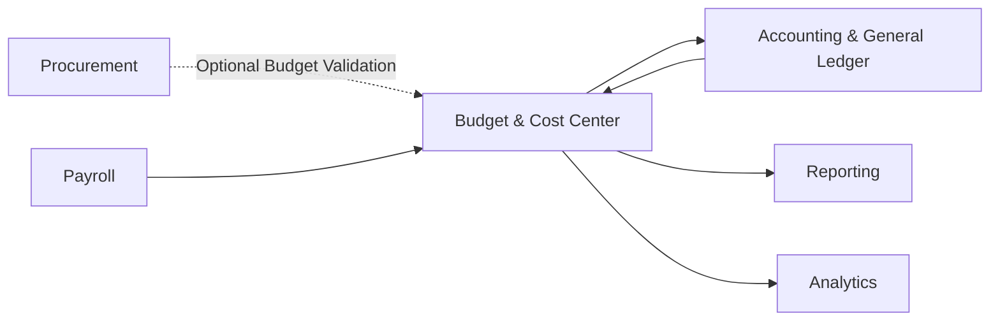
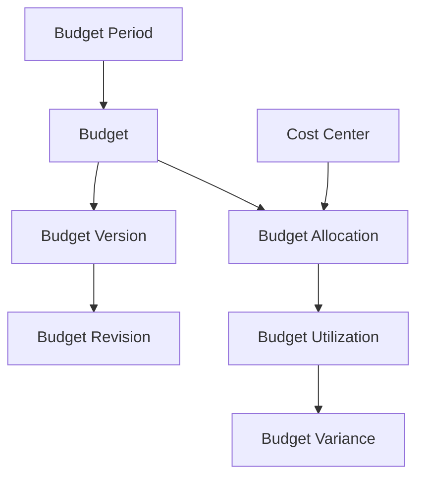
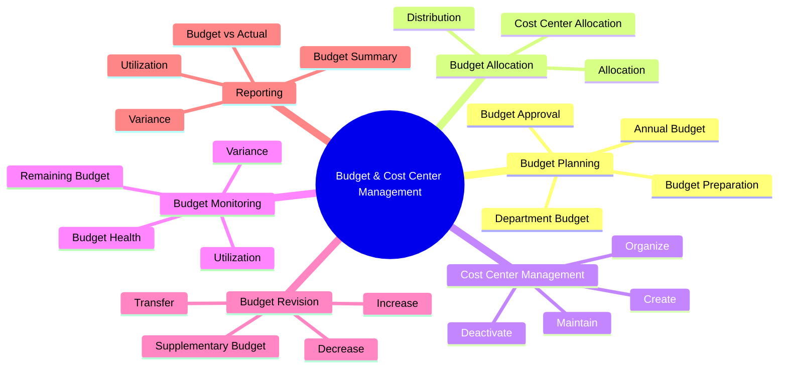
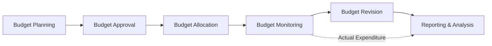
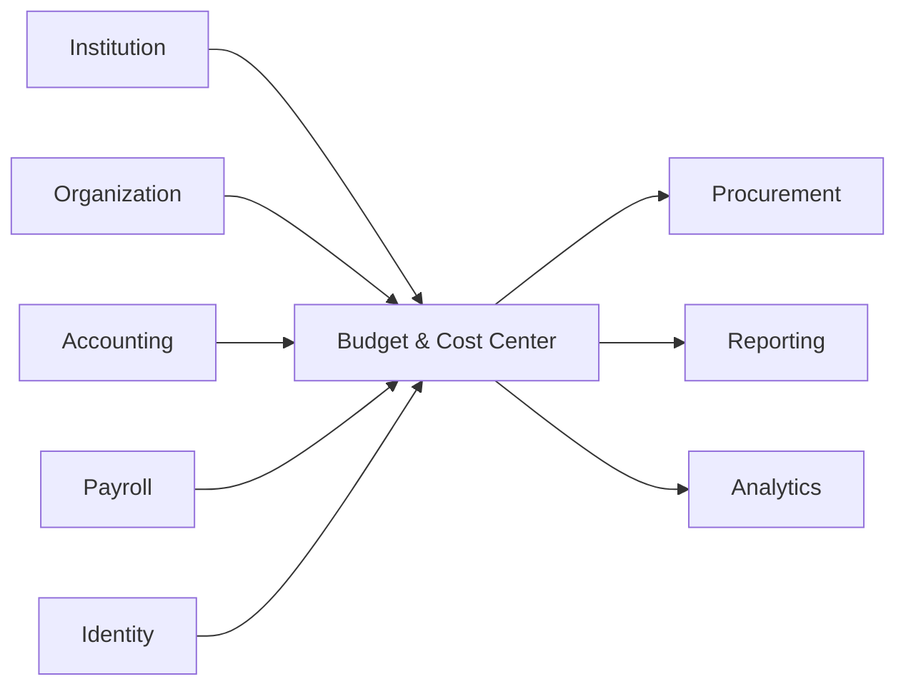
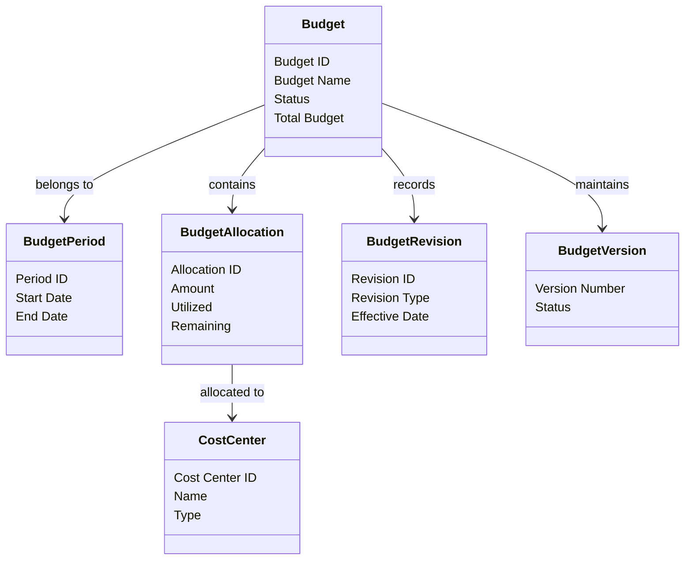
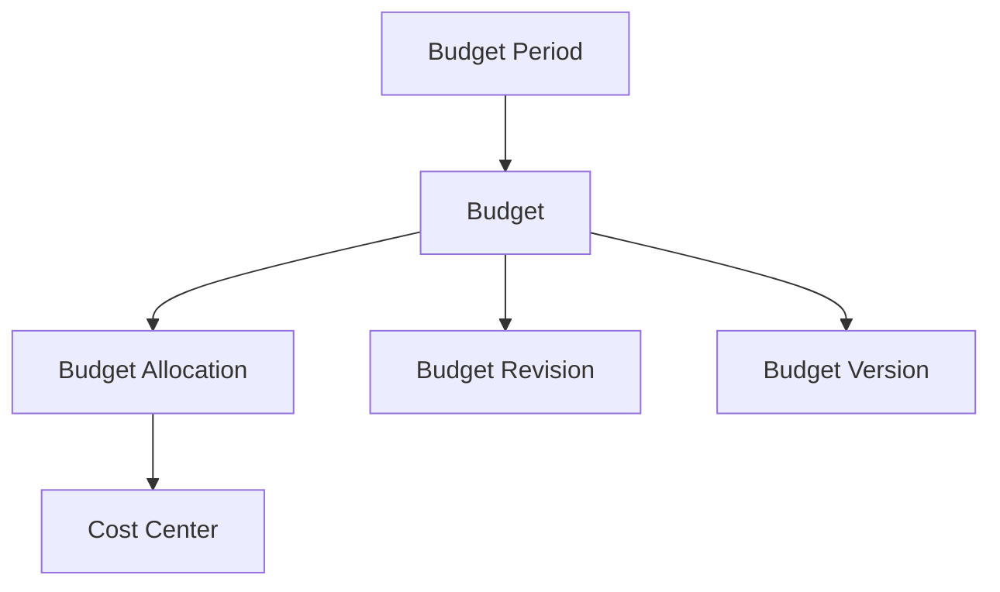
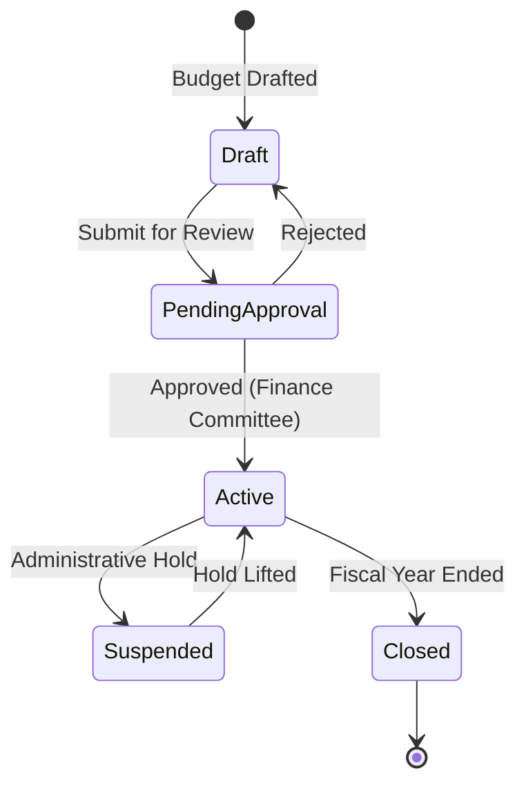

# L2-F06 — Budget & Cost Center Management

**Section:** F — Finance  
**Status:** Draft  
**Document Owner:** Chetan

---

# 1. Introduction

The Budget & Cost Center Management domain provides the financial planning and budget administration capabilities of the SutraERP Finance Architecture.

Unlike the Accounting & General Ledger domain, which records completed financial transactions, the Budget domain focuses on planning, allocating, monitoring, and reviewing the expected utilization of institutional financial resources.

This domain enables institutions to prepare annual and periodic budgets, allocate funds across departments and administrative units, monitor budget utilization, perform revisions, and compare planned expenditure against actual financial performance.

The architecture supports budgeting practices commonly adopted by Indian colleges, universities, educational trusts, and autonomous institutions while remaining extensible for future enterprise budgeting capabilities.

Budget data represents planned financial allocations and shall never replace the canonical accounting records maintained by the Accounting & General Ledger domain.

---

## Architectural Position

Within the Finance Architecture:

- Accounting records actual financial transactions.
- Budget defines planned financial allocations.
- Reporting compares planned versus actual performance.
- Procurement and Payroll may optionally reference Budget for availability checks.

The Budget domain therefore serves as the institutional financial planning layer rather than the official accounting system.

---

## Primary Objectives

The Budget & Cost Center Management domain is designed to:

- Support annual institutional budgeting.
- Enable department-wise financial planning.
- Manage Cost Centers.
- Allocate budgets across organizational units.
- Monitor budget utilization.
- Support controlled budget revisions.
- Produce budget performance reports.
- Enable budget versus actual analysis.

---

## Architectural Principles

The architecture follows these principles:

- Budget is a planning domain.
- Accounting remains the financial system of record.
- Budget allocations are organizationally structured.
- Budget revisions remain fully traceable.
- Budget monitoring is continuous.
- Budget history is preserved.
- Organizational ownership is clearly defined.
- Reporting remains consistent across institutions.

This document defines the canonical Level-2 architecture for Budget & Cost Center Management within the SutraERP Finance Domain.
# 2. Purpose

The purpose of the Budget & Cost Center Management domain is to establish a standardized framework for planning, allocating, managing, and monitoring institutional financial budgets.

This domain enables institutions to organize financial resources before expenditure occurs, ensuring that departments, campuses, administrative units, and projects operate within approved financial allocations.

The Budget domain is intended to improve financial planning, support management decision-making, and provide visibility into budget utilization throughout the financial year.

It does not perform accounting, journal posting, or financial reconciliation. Those responsibilities belong exclusively to the Accounting & General Ledger domain.

---

## Business Objectives

The domain supports the following objectives:

- Annual financial planning.
- Departmental budgeting.
- Cost Center management.
- Budget allocation.
- Budget utilization monitoring.
- Budget revision management.
- Budget variance analysis.
- Financial planning transparency.

---

## Enterprise Objectives

Within the overall ERP architecture, this domain aims to:

- Standardize budgeting practices.
- Improve financial governance.
- Increase budget visibility.
- Support informed decision-making.
- Reduce uncontrolled expenditure.
- Enable better financial forecasting.
- Provide consistent reporting.

---

## Scope

The Budget & Cost Center Management domain includes:

- Budget creation.
- Budget approval.
- Budget allocation.
- Cost Center management.
- Budget revisions.
- Budget monitoring.
- Budget reporting.
- Budget closure.

The following capabilities are outside the scope of this domain:

- Accounting transactions.
- Journal Entries.
- General Ledger maintenance.
- Tax calculations.
- Treasury operations.
- Financial reconciliation.

These capabilities are managed by their respective Finance domains.
# 3. Scope

The Budget & Cost Center Management domain governs the planning, allocation, monitoring, and revision of institutional budgets across organizational units within SutraERP.

It provides a structured mechanism for defining financial plans before expenditure occurs and enables institutions to compare planned allocations with actual financial performance.

This domain serves as the institutional budgeting framework and supports financial planning activities throughout the budget lifecycle.

---

## 3.1 In Scope

The following capabilities are within the scope of this domain.

### Budget Management

- Annual Budget Preparation
- Budget Creation
- Budget Approval
- Budget Activation
- Budget Revision
- Budget Closure

---

### Budget Allocation

- Institution Budget Allocation
- Department Budget Allocation
- Cost Center Allocation
- Administrative Unit Allocation
- Budget Distribution
- Allocation Adjustments

---

### Cost Center Management

- Cost Center Creation
- Cost Center Classification
- Cost Center Hierarchy
- Cost Center Activation
- Cost Center Deactivation

---

### Budget Monitoring

- Budget Utilization
- Remaining Budget
- Budget Variance
- Budget Status Monitoring
- Budget Performance Analysis

---

### Budget Reporting

- Budget Summary
- Department Budget Reports
- Cost Center Reports
- Budget vs Actual Reports
- Budget Utilization Reports
- Variance Reports

---

## 3.2 Out of Scope

The following capabilities belong to other Finance domains.

### Accounting & General Ledger (F05)

- Journal Entries
- Ledger Posting
- Trial Balance
- Financial Statements
- Fiscal Closing
- Accounting Period Management

---

### Procurement (F07)

- Purchase Requests
- Purchase Orders
- Vendor Procurement
- Inventory Procurement

---

### Treasury (F09)

- Cash Management
- Bank Management
- Payments
- Receipts
- Cash Flow

---

### Tax Compliance (L2-F00)

- GST Management
- Tax Calculation
- Tax Filing
- Tax Reporting

---

### Payroll

- Salary Processing
- Payroll Accounting
- Employee Benefits

---

## 3.3 Primary Business Entities

The Budget domain manages the following primary entities.

- Budget
- Budget Allocation
- Budget Version
- Budget Revision
- Budget Period
- Cost Center

---

## 3.4 Business Responsibilities

The domain is responsible for:

- Planning institutional budgets.
- Organizing budgets by Cost Center.
- Allocating financial resources.
- Supporting controlled budget revisions.
- Monitoring utilization.
- Producing management reports.
- Providing budget visibility across the institution.

---

## 3.5 Domain Boundaries

The Budget domain plans financial allocations but does not authorize or execute financial transactions.

Actual financial expenditure is recorded by the Accounting & General Ledger domain.

Budget utilization is calculated by comparing planned allocations against actual accounting data.

This separation preserves clear architectural boundaries between financial planning and financial accounting.

---

## 3.6 Architectural Principles

The scope of this domain is governed by the following principles.

- Budget represents planned financial allocations.
- Accounting represents actual financial transactions.
- Every Budget belongs to a Budget Period.
- Every Budget Allocation belongs to a Cost Center.
- Budget history shall remain traceable.
- Budget revisions shall preserve historical versions.
- Cost Centers provide organizational ownership.
- Reporting shall compare planned and actual financial performance.
# 4. Goals & Design Objectives

The Budget & Cost Center Management domain is designed to provide a structured, transparent, and manageable approach to institutional budgeting while remaining simple enough for adoption across a wide range of Indian higher education institutions.

The architecture emphasizes financial planning, organizational accountability, and budget visibility without introducing unnecessary operational complexity.

---

## 4.1 Business Goals

The primary business goals of this domain are:

- Enable systematic annual budget planning.
- Support department-wise budget preparation.
- Organize institutional budgets using Cost Centers.
- Improve financial planning across organizational units.
- Monitor budget utilization throughout the financial year.
- Support controlled budget revisions.
- Provide management with budget visibility.
- Improve financial decision-making.

---

## 4.2 Architectural Goals

The architecture has been designed to:

- Clearly separate Budget Planning from Financial Accounting.
- Maintain well-defined aggregate ownership.
- Support scalable organizational structures.
- Enable future functional expansion without redesign.
- Preserve complete budget history.
- Simplify implementation for educational institutions.
- Support consistent reporting across institutions.

---

## 4.3 Operational Goals

The domain should enable institutions to:

- Prepare budgets before the start of a financial year.
- Allocate budgets to departments and Cost Centers.
- Review utilization periodically.
- Revise budgets when approved.
- Compare planned budgets with actual expenditure.
- Close budgets after completion of the budget period.

---

## 4.4 Governance Goals

Financial planning shall remain governed through:

- Defined approval workflows.
- Organizational ownership.
- Controlled revisions.
- Complete audit history.
- Version-controlled budgets.
- Transparent reporting.

---

## 4.5 Reporting Goals

The Budget domain shall provide information required for:

- Budget Summary Reports.
- Department Budget Reports.
- Cost Center Budget Reports.
- Budget Utilization Reports.
- Budget vs Actual Reports.
- Budget Variance Analysis.

These reports support management review but do not replace statutory financial reports generated by the Accounting domain.

---

## 4.6 Design Principles

The Budget & Cost Center Management architecture follows these guiding principles.

### Planning Before Spending

Budgets define planned financial allocations before expenditure occurs.

---

### Organizational Ownership

Every Budget Allocation shall belong to a clearly identified organizational unit or Cost Center.

---

### Simplicity

The architecture supports the budgeting practices commonly followed by colleges and universities without introducing unnecessary enterprise budgeting complexity.

---

### Traceability

Every Budget, Allocation, Approval, and Revision shall remain traceable throughout its lifecycle.

---

### Extensibility

The architecture shall support future enhancements such as grant budgeting, project budgeting, and advanced financial controls without requiring structural redesign.

---

### Separation of Concerns

Budget planning and financial accounting remain independent domains.

Budget decisions influence planning.

Accounting records financial reality.

---

## 4.7 Success Criteria

The architecture shall be considered successful when it enables institutions to:

- Prepare annual budgets efficiently.
- Allocate budgets transparently.
- Monitor budget utilization continuously.
- Perform controlled budget revisions.
- Produce reliable management reports.
- Compare planned budgets against actual expenditure.
- Maintain complete historical budget records.
- Scale across institutions, campuses, and departments while remaining easy to understand and operate.
# 5. Domain Overview

The Budget & Cost Center Management domain provides the institutional framework for financial planning, budget allocation, utilization monitoring, and budget performance analysis within the SutraERP Finance Architecture.

It enables institutions to prepare annual budgets, distribute financial resources across organizational units, monitor utilization throughout the financial year, and evaluate financial performance by comparing planned budgets against actual expenditure.

Unlike the Accounting & General Ledger domain, which records completed financial transactions, the Budget domain manages financial plans and allocations before expenditure occurs.

This separation ensures that financial planning and financial accounting remain independent while working together to provide effective financial governance.

---

# 5.1 Domain Purpose

The primary purpose of this domain is to provide a structured mechanism for planning and managing institutional financial resources.

The domain enables institutions to:

- Prepare annual budgets.
- Allocate budgets across departments and Cost Centers.
- Monitor financial utilization.
- Revise budgets when necessary.
- Evaluate budget performance.
- Support financial planning and decision-making.

---

# 5.2 Business Capabilities

The Budget & Cost Center Management domain provides the following core business capabilities.

## Budget Planning

Supports preparation of institutional budgets for a defined Budget Period.

Activities include:

- Annual Budget Preparation
- Department Budget Preparation
- Budget Drafting
- Budget Review
- Budget Approval

---

## Budget Allocation

Supports distribution of approved budgets across organizational units.

Allocations may be created for:

- Departments
- Administrative Offices
- Campuses
- Libraries
- Hostels
- Transport Units
- Other Cost Centers

---

## Cost Center Management

Provides organizational structures for budget ownership.

Each Cost Center represents an operational unit responsible for managing its allocated budget.

Examples include:

- Computer Science Department
- Library
- Examination Cell
- Central Administration
- Boys Hostel
- Girls Hostel
- Transport Department

---

## Budget Monitoring

Provides continuous visibility into budget utilization.

Monitoring includes:

- Allocated Budget
- Utilized Budget
- Remaining Budget
- Budget Variance
- Utilization Percentage

---

## Budget Revision

Supports controlled modification of approved budgets.

Typical revision scenarios include:

- Additional Budget Allocation
- Budget Reduction
- Budget Reallocation
- Supplementary Budget

All revisions preserve historical records.

---

## Budget Reporting

Supports management reporting through standardized budget reports.

Examples include:

- Budget Summary
- Department Budget Report
- Cost Center Budget Report
- Budget Utilization Report
- Budget vs Actual Report
- Budget Variance Report

---

# 5.3 Domain Characteristics

The Budget domain exhibits the following characteristics.

| Characteristic | Description |
|---------------|-------------|
| Domain Type | Financial Planning |
| Primary Function | Budget Planning & Allocation |
| Financial Impact | Indirect |
| Source of Financial Truth | Accounting & General Ledger |
| Ownership | Finance Department |
| Planning Horizon | Budget Period |
| Reporting Frequency | Periodic |

---

# 5.4 Domain Relationships

The Budget domain collaborates with multiple Finance domains while maintaining clear ownership boundaries.



### Relationship Summary

| Domain | Relationship |
|---------|--------------|
| Accounting | Provides actual expenditure for Budget vs Actual analysis |
| Procurement | May optionally validate available budget before procurement |
| Payroll | Provides salary expenditure for utilization reporting |
| Reporting | Consumes budget information for management reports |
| Analytics | Consumes budget data for dashboards and KPIs |

---

# 5.5 Domain Responsibilities

The Budget & Cost Center Management domain is responsible for:

- Preparing institutional budgets.
- Managing Budget Periods.
- Organizing Cost Centers.
- Allocating budgets.
- Tracking utilization.
- Supporting budget revisions.
- Producing budget reports.
- Providing budget performance information.

The domain is **not** responsible for:

- Recording accounting transactions.
- Posting Journal Entries.
- Maintaining the General Ledger.
- Processing payments.
- Managing taxes.
- Performing bank reconciliation.

---

# 5.6 Budget Planning Cycle

The Budget domain follows a recurring planning cycle.


The completion of one Budget Period provides valuable input for planning the next cycle.

---

# 5.7 Architectural Principles

The Budget & Cost Center Management domain follows these architectural principles.

- Budget represents planned financial allocations.
- Accounting represents actual financial transactions.
- Every Budget belongs to a Budget Period.
- Every Budget Allocation belongs to a Cost Center.
- Budget revisions preserve historical versions.
- Budget monitoring relies on actual expenditure from Accounting.
- Organizational ownership remains clearly defined.
- Reporting compares planned budgets with actual financial performance.
- The architecture remains simple, scalable, and suitable for educational institutions of varying sizes.

These principles establish the Budget domain as the financial planning layer of the SutraERP Finance Architecture while preserving clear separation from financial accounting and operational transaction processing.

---
# 6. Core Concepts

The Budget & Cost Center Management domain is built upon a set of core business concepts that define how institutional financial planning is organized, managed, and monitored.

These concepts establish a common business vocabulary for finance teams, administrators, auditors, and system components, ensuring consistent interpretation across the SutraERP platform.

---

# 6.1 Budget

A Budget represents an approved financial plan for a specific Budget Period.

It defines the planned allocation of financial resources for an institution, campus, department, or other organizational unit.

A Budget serves as the highest-level planning document within the domain and acts as the parent for one or more Budget Allocations.

### Characteristics

- Prepared before expenditure occurs.
- Covers a defined Budget Period.
- May contain multiple Budget Allocations.
- Requires approval before becoming active.
- Can undergo controlled revisions.
- Remains historically preserved after closure.

---

# 6.2 Budget Period

A Budget Period defines the time span for which a Budget remains valid.

Typically, educational institutions prepare budgets on an annual basis aligned with the financial year, although shorter planning periods may also be supported where required.

### Examples

- FY 2027–2028
- Academic Year 2027–2028
- Quarterly Budget
- Special Project Budget

A Budget cannot exist without an associated Budget Period.

---

# 6.3 Cost Center

A Cost Center represents an organizational unit responsible for managing a portion of the institution's budget.

Cost Centers provide financial ownership and accountability but do not maintain independent accounting records.

Typical Cost Centers include academic departments, administrative offices, student support units, hostels, libraries, laboratories, and service departments.

### Examples

- Department of Computer Science
- Central Library
- Examination Cell
- Transport Department
- Hostel Administration
- Sports Department

Each Budget Allocation belongs to one Cost Center.

---

# 6.4 Budget Allocation

A Budget Allocation represents the portion of a Budget assigned to a specific Cost Center.

Allocations enable decentralized financial planning while maintaining centralized budget governance.

Each allocation specifies:

- Allocated Amount
- Cost Center
- Budget Period
- Allocation Status
- Utilization Information

Budget Allocations collectively constitute the approved institutional Budget.

---

# 6.5 Budget Utilization

Budget Utilization represents the amount of the allocated budget that has been consumed through actual financial expenditure.

Utilization is not entered manually.

Instead, it is calculated using financial transaction data received from the Accounting & General Ledger domain.

Typical utilization indicators include:

- Allocated Amount
- Utilized Amount
- Remaining Budget
- Utilization Percentage

---

# 6.6 Budget Variance

Budget Variance measures the difference between planned budget allocations and actual expenditure.

Variance analysis assists management in evaluating financial performance and identifying areas requiring corrective action.

Variance may indicate:

- Under-utilization
- Over-utilization
- Planned Savings
- Unexpected Expenditure

Budget Variance is primarily a reporting and decision-support concept.

---

# 6.7 Budget Revision

A Budget Revision represents an approved modification to an existing Budget.

Revisions allow institutions to respond to operational changes while maintaining a complete historical record.

Common revision scenarios include:

- Additional Funding
- Budget Reduction
- Budget Reallocation
- Supplementary Budget
- Emergency Allocation

Every revision is traceable and linked to the original Budget.

---

# 6.8 Budget Version

A Budget Version represents a snapshot of a Budget at a particular stage in its lifecycle.

Versioning preserves planning history and supports governance without overwriting previously approved financial plans.

Typical versions include:

- Draft
- Reviewed
- Approved
- Revised

Only one version may be active at any point in time.

---

# 6.9 Budget Status

A Budget progresses through a defined lifecycle represented by its current status.

Typical statuses include:

- Draft
- Under Review
- Approved
- Active
- Revised
- Closed
- Archived

Status changes occur only through approved business workflows.

---

# 6.10 Financial Ownership

Financial Ownership defines the organizational responsibility for managing a Budget or Budget Allocation.

Ownership establishes accountability for:

- Budget Preparation
- Budget Monitoring
- Budget Utilization
- Budget Revision
- Financial Reporting

Ownership is assigned to organizational entities such as departments, campuses, or administrative units rather than individual users.

---

# 6.11 Budget Hierarchy

Budget information is organized hierarchically to reflect the institutional structure.

A typical hierarchy is:

```text
Institution
    ├── Campus
    │     ├── Faculty
    │     │      ├── Department
    │     │      │      ├── Cost Center
    │     │      │      └── Cost Center
    │     │      └── Department
    │     └── Administrative Units
    └── Shared Services
```

This hierarchy enables consolidated budgeting at higher organizational levels while allowing decentralized allocation and monitoring at operational levels.

---

# 6.12 Concept Relationships

The following diagram illustrates the relationships among the core concepts within the Budget & Cost Center Management domain.



---

# 6.13 Guiding Principles

The core concepts of this domain are governed by the following principles:

- Every Budget belongs to one Budget Period.
- Every Budget Allocation belongs to one Cost Center.
- Budget Utilization is derived from Accounting transactions.
- Budget Variance is calculated from planned versus actual values.
- Budget Revisions preserve historical integrity.
- Budget Versions ensure traceability.
- Financial Ownership is organizational rather than individual.
- Budget structures shall align with the institution's organizational hierarchy.

These concepts provide the canonical business vocabulary for all subsequent aggregates, workflows, business rules, integrations, and reports within the Budget & Cost Center Management domain.
# 7. Business Capability Architecture

The Budget & Cost Center Management domain provides a set of business capabilities that enable institutions to effectively plan, allocate, monitor, and control financial resources throughout a Budget Period.

These capabilities collectively support institutional financial planning while maintaining clear separation from financial accounting and transaction processing.

Each capability represents a logical business function and is implemented through one or more workflows, aggregates, and domain services.

---

# 7.1 Capability Map



---

# 7.2 Budget Planning

## Purpose

Budget Planning enables institutions to prepare financial plans before the beginning of a Budget Period.

The planning process identifies expected income, anticipated expenditure, and allocation priorities for different organizational units.

### Responsibilities

- Create Budget
- Prepare Department Budgets
- Consolidate Budget Proposals
- Review Budget Estimates
- Submit for Approval

### Primary Outputs

- Draft Budget
- Budget Proposal
- Planned Allocations

---

# 7.3 Budget Allocation

## Purpose

Budget Allocation distributes approved financial resources across organizational units.

Allocations define how much funding is available for each Cost Center during the Budget Period.

### Responsibilities

- Allocate Funds
- Modify Allocations
- Distribute Institutional Budget
- Track Allocation Ownership

### Primary Outputs

- Budget Allocation
- Cost Center Allocation
- Allocation Summary

---

# 7.4 Cost Center Management

## Purpose

Cost Center Management organizes financial responsibility within the institution.

Each Cost Center represents an operational unit responsible for managing its assigned budget.

### Responsibilities

- Create Cost Centers
- Maintain Cost Center Information
- Define Organizational Hierarchy
- Activate or Deactivate Cost Centers

### Primary Outputs

- Cost Center Registry
- Organizational Budget Structure

---

# 7.5 Budget Monitoring

## Purpose

Budget Monitoring provides continuous visibility into budget utilization and remaining available funds.

Monitoring is based on actual expenditure received from the Accounting & General Ledger domain.

### Responsibilities

- Monitor Utilization
- Calculate Remaining Budget
- Calculate Utilization Percentage
- Detect Budget Variance

### Primary Outputs

- Budget Status
- Utilization Summary
- Budget Health Indicators

---

# 7.6 Budget Revision

## Purpose

Budget Revision enables controlled modification of approved budgets when institutional priorities or financial conditions change.

Revisions preserve historical records and maintain governance over financial planning.

### Responsibilities

- Increase Budget
- Reduce Budget
- Reallocate Budget
- Record Revision History

### Primary Outputs

- Revised Budget
- Revision History
- Updated Allocations

---

# 7.7 Reporting & Analysis

## Purpose

Reporting provides management with visibility into institutional budget performance.

Reports compare planned allocations with actual expenditure to support informed decision-making.

### Responsibilities

- Budget Summary
- Budget vs Actual
- Department Budget Reports
- Cost Center Reports
- Budget Variance Reports

### Primary Outputs

- Management Reports
- Financial Dashboards
- Budget Analytics

---

# 7.8 Capability Relationships

The following diagram illustrates how the major capabilities interact throughout the budget lifecycle.



---

# 7.9 Capability Ownership

| Business Capability | Primary Owner | Supporting Domains |
|--------------------|---------------|--------------------|
| Budget Planning | Finance Department | Institution Management |
| Budget Allocation | Finance Department | Organization Management |
| Cost Center Management | Finance Administration | Organization Management |
| Budget Monitoring | Finance Department | Accounting & General Ledger |
| Budget Revision | Finance Department | Approval Workflow |
| Reporting & Analysis | Finance & Management | Reporting & Analytics |

---

# 7.10 Guiding Principles

The Business Capability Architecture follows these principles:

- Every capability delivers measurable business value.
- Capabilities remain independently manageable.
- Financial planning remains separate from financial accounting.
- Cost Centers provide organizational accountability.
- Budget monitoring relies on actual accounting data.
- Reporting supports decision-making without modifying budget data.
- Capabilities are designed for scalability across institutions of different sizes.

These business capabilities collectively define the functional responsibilities of the Budget & Cost Center Management domain and provide the foundation for the domain model, aggregates, workflows, and integrations described in subsequent sections.
# 8. Domain Boundaries & Bounded Context

The Budget & Cost Center Management domain is a bounded context within the SutraERP Finance Architecture responsible for institutional financial planning, budget allocation, cost center management, and budget performance monitoring.

It owns all business concepts related to planned financial allocations and organizational budgeting while delegating accounting, payments, procurement, and statutory financial processing to their respective domains.

The domain establishes clear architectural boundaries to ensure separation of concerns, maintain data ownership, and prevent duplication of financial responsibilities.

---

# 8.1 Bounded Context Overview

The Budget bounded context encapsulates all business logic associated with financial planning.

It owns:

- Budget Planning
- Budget Allocation
- Cost Center Management
- Budget Revisions
- Budget Monitoring
- Budget Performance Analysis

The bounded context does **not** own:

- Financial Accounting
- Journal Posting
- Payment Processing
- Bank Transactions
- Tax Calculation
- Procurement Processing

These responsibilities belong to other bounded contexts within the Finance Architecture.

---

# 8.2 Domain Ownership

The Budget domain is the authoritative source for the following business entities.

| Business Entity | Ownership |
|-----------------|-----------|
| Budget | Budget Domain |
| Budget Allocation | Budget Domain |
| Cost Center | Budget Domain |
| Budget Period | Budget Domain |
| Budget Revision | Budget Domain |
| Budget Version | Budget Domain |

No other domain may directly modify these entities.

All updates shall occur through Budget domain workflows.

---

# 8.3 Upstream Domains

The following domains provide information consumed by the Budget domain.

| Upstream Domain | Information Provided |
|-----------------|----------------------|
| Institution Management | Institution Structure |
| Organization Management | Departments, Organizational Units |
| Academic Structure | Faculties, Schools, Academic Units |
| Accounting & General Ledger | Actual Financial Expenditure |
| Payroll | Salary Expenditure |
| User & Identity | Users, Roles, Permissions |

The Budget domain consumes this information but does not own it.

---

# 8.4 Downstream Domains

The Budget domain publishes information that may be consumed by other domains.

| Downstream Domain | Information Consumed |
|-------------------|----------------------|
| Procurement | Budget Availability (Optional) |
| Reporting | Budget Reports |
| Analytics | Budget Metrics |
| Executive Dashboard | Budget KPIs |
| Management Information System | Budget Performance |

These domains consume budget information in a read-only manner.

---

# 8.5 Context Relationships



---

# 8.6 Data Ownership Principles

The Budget domain follows strict ownership rules.

### Budget Data

Owned exclusively by the Budget domain.

Includes:

- Budgets
- Budget Allocations
- Budget Versions
- Budget Revisions

---

### Organizational Data

Owned by Organization Management.

Examples:

- Departments
- Campuses
- Administrative Units
- Faculties

The Budget domain references these entities but never maintains independent copies.

---

### Financial Transactions

Owned exclusively by the Accounting & General Ledger domain.

Examples:

- Journal Entries
- Ledger Accounts
- Trial Balance
- Financial Statements
- Actual Expenditure

The Budget domain consumes summarized expenditure information for monitoring and reporting purposes.

---

### User Information

Owned by the Identity & Access Management domain.

The Budget domain references user identities for approvals, ownership, and audit trails but does not manage user records.

---

# 8.7 Integration Boundaries

The Budget domain exchanges information with external domains using well-defined interfaces.

### Incoming Information

- Organizational Structure
- Cost Center References
- Actual Expenditure
- Payroll Expenditure
- User Information

---

### Outgoing Information

- Budget Allocations
- Budget Availability
- Budget Utilization
- Budget Variance
- Budget Reports
- Budget KPIs

The Budget domain shall not expose internal aggregate structures directly.

Only published domain views and events may be shared across bounded contexts.

---

# 8.8 Boundary Rules

The following architectural rules govern interactions with this bounded context.

- Budgets shall only be created within the Budget domain.
- Budget Allocations shall only be modified through Budget workflows.
- Actual expenditure shall originate exclusively from Accounting.
- Cost Centers shall remain organizational planning entities.
- External domains shall consume Budget information without directly updating Budget aggregates.
- All integrations shall respect domain ownership and data consistency.

---

# 8.9 Architectural Principles

The Budget bounded context is governed by the following principles.

- Single ownership for every business entity.
- Clear separation between planning and accounting.
- Reference rather than duplicate organizational data.
- Consume actual expenditure from Accounting.
- Publish standardized budget information for reporting.
- Maintain loose coupling with adjacent domains.
- Support future expansion without violating existing boundaries.

These principles ensure that the Budget & Cost Center Management domain remains a cohesive, independently governed bounded context within the overall SutraERP Finance Architecture.
# 9. Canonical Domain Model

The Canonical Domain Model defines the primary business entities, their relationships, ownership boundaries, and lifecycle dependencies within the Budget & Cost Center Management domain.

It provides the conceptual blueprint for all subsequent aggregate specifications, workflows, domain services, and integrations.

The model is intentionally simple, reflecting the planning-oriented nature of the Budget domain while remaining scalable for institutions of varying sizes.

---

# 9.1 Domain Model Overview

The Budget & Cost Center Management domain consists of six primary business entities.

| Entity | Purpose |
|---------|---------|
| Budget | Represents the overall financial plan for a Budget Period |
| Budget Allocation | Allocates portions of a Budget to Cost Centers |
| Cost Center | Represents an organizational unit responsible for budget utilization |
| Budget Period | Defines the planning timeframe |
| Budget Revision | Records approved changes to an existing Budget |
| Budget Version | Preserves historical versions of a Budget |

Together, these entities provide the complete planning framework for institutional budgeting.

---

# 9.2 Canonical Domain Relationships



---

# 9.3 Aggregate Relationships

The Budget aggregate serves as the primary aggregate within the domain.

It coordinates the planning lifecycle and maintains relationships with all supporting entities.

Relationship hierarchy:

```text
Budget
│
├── Budget Period
│
├── Budget Allocation(s)
│       │
│       └── Cost Center
│
├── Budget Revision(s)
│
└── Budget Version(s)
```

Budget Allocation cannot exist independently of a Budget.

Budget Revision always references an existing Budget.

Budget Versions preserve historical planning states.

---

# 9.4 Lifecycle Dependencies

The lifecycle of each entity depends upon the successful completion of preceding business activities.


Budget Period establishes the planning window.

Budget creation follows.

Allocations are then distributed.

Monitoring continues throughout the active period.

Approved revisions adjust the plan where necessary.

Finally, the Budget is closed at the end of the planning cycle.

---

# 9.5 Ownership Model

| Entity | Aggregate Owner |
|---------|-----------------|
| Budget | Budget |
| Budget Allocation | Budget |
| Budget Period | Budget |
| Budget Revision | Budget |
| Budget Version | Budget |
| Cost Center | Cost Center |

The Budget aggregate is responsible for maintaining consistency across all planning activities.

Cost Center remains an independent aggregate because it has its own lifecycle and organizational identity.

---

# 9.6 Dependency Rules

The following dependency rules govern the domain model.

- A Budget must belong to exactly one Budget Period.
- A Budget may contain multiple Budget Allocations.
- Every Budget Allocation belongs to one Cost Center.
- A Budget may have multiple Revisions.
- A Budget may preserve multiple historical Versions.
- Cost Centers may participate in multiple Budgets across different Budget Periods.
- Historical Budgets remain immutable after closure.

---

# 9.7 Domain Model Principles

The Canonical Domain Model follows these architectural principles.

### Single Aggregate Ownership

Every business entity has a clearly defined owning aggregate.

---

### Controlled Relationships

Entities interact only through well-defined aggregate boundaries.

---

### Historical Preservation

Budgets, revisions, and versions preserve complete planning history.

---

### Organizational Accountability

Budget Allocations are always assigned to a Cost Center, ensuring clear financial ownership.

---

### Separation of Planning and Accounting

The domain models planned financial allocations only.

Actual financial transactions remain the responsibility of the Accounting & General Ledger domain.

---

# 9.8 Architectural Summary

The Canonical Domain Model establishes the structural foundation of the Budget & Cost Center Management domain.

It defines the entities, relationships, ownership boundaries, and lifecycle dependencies that will be elaborated through aggregate specifications, business workflows, domain services, and integration patterns in the subsequent sections.

This model serves as the authoritative conceptual representation of budgeting within the SutraERP Finance Architecture.
# 10. Aggregate Architecture

The Budget & Cost Center Management domain follows the Domain-Driven Design (DDD) Aggregate pattern to ensure consistency, maintainability, and clear ownership of business data.

Each aggregate represents a transactional consistency boundary and encapsulates the business rules governing its lifecycle.

Aggregates collaborate through well-defined relationships while preserving their individual responsibilities and autonomy.

---

# 10.1 Aggregate Design Principles

The aggregates within this domain are designed according to the following principles.

## Single Responsibility

Each aggregate represents one distinct business concept.

No aggregate shall own responsibilities belonging to another aggregate.

---

## Transactional Consistency

All modifications to business data shall occur through the owning aggregate.

The aggregate root is responsible for enforcing all business rules within its boundary.

---

## Encapsulation

Internal state shall only be modified through defined business operations.

External domains shall never directly manipulate aggregate internals.

---

## Identity

Each aggregate possesses a unique business identity that remains stable throughout its lifecycle.

Business identity shall never change after creation.

---

## Historical Integrity

Historical information shall never be overwritten.

Changes shall be recorded through revisions, version history, or audit records.

---

## Organizational Ownership

Each aggregate shall have a clearly identifiable organizational owner.

Ownership defines accountability but does not necessarily imply operational control.

---

# 10.2 Aggregate Boundaries

The Budget domain consists of the following aggregate boundaries.

| Aggregate | Responsibility |
|------------|----------------|
| Budget | Owns the overall financial plan and budget lifecycle |
| Budget Allocation | Manages allocation of funds to Cost Centers |
| Cost Center | Represents organizational ownership of budgets |
| Budget Period | Defines planning duration and validity |
| Budget Revision | Records approved modifications |
| Budget Version | Preserves historical planning states |

Each aggregate owns its internal consistency and lifecycle.

No aggregate may directly update another aggregate's internal state.

---

# 10.3 Aggregate Root Selection

The aggregate roots are selected based on business ownership and lifecycle independence.

| Aggregate Root | Reason |
|----------------|--------|
| Budget | Central planning entity |
| Cost Center | Independent organizational entity |
| Budget Period | Independent planning cycle |

Supporting entities such as Budget Allocation, Budget Revision, and Budget Version operate under the governance of the Budget aggregate.

---

# 10.4 Aggregate Collaboration

Aggregates collaborate through business references rather than direct ownership.



This model minimizes coupling while preserving referential integrity.

---

# 10.5 Aggregate Lifecycle Principles

Each aggregate progresses through a defined business lifecycle.

Typical lifecycle stages include:

- Created
- Active
- Modified
- Closed
- Archived

Lifecycle transitions occur only through approved business workflows.

---

# 10.6 Consistency Rules

The following consistency rules apply across all aggregates.

- Aggregate identities are immutable.
- Business invariants shall always be enforced.
- Cross-aggregate updates shall occur through application services or domain events.
- Historical records shall remain immutable.
- Referential integrity shall be maintained.
- Organizational ownership shall remain valid throughout the lifecycle.

---

# 10.7 Aggregate Communication

Aggregates exchange information using business events rather than direct data modification.

Examples include:

- BudgetApproved
- BudgetAllocationCreated
- BudgetRevised
- CostCenterActivated
- BudgetClosed

This event-driven approach supports loose coupling and future extensibility.

---

# 10.8 Aggregate Governance

Every aggregate within the Budget domain shall:

- Have a clearly defined business purpose.
- Own its business invariants.
- Protect internal consistency.
- Expose only approved business operations.
- Participate in audit logging.
- Support historical traceability.
- Respect domain ownership boundaries.

---

# 10.9 Architectural Constraints

The following constraints apply to all aggregates.

- Aggregates shall remain focused and cohesive.
- Aggregate boundaries shall not overlap.
- Planning data shall never replace accounting records.
- Organizational references shall be resolved through master domains.
- Aggregate designs shall support future scalability without increasing unnecessary complexity.

---

# 10.10 Architectural Summary

The Aggregate Architecture establishes the structural rules governing all aggregates within the Budget & Cost Center Management domain.

These rules ensure that every aggregate maintains clear ownership, protects business consistency, supports organizational accountability, and integrates cleanly with the broader SutraERP Finance Architecture.

# 11. Budget Canonical Aggregate

The Budget Aggregate is the root entity governing the financial plan for a specific institutional period.

## 11.1 Budget Properties

| Property | Description | Invariant Rules |
|----------|-------------|-----------------|
| BudgetID | Canonical unique identifier. | Must be globally unique. |
| AcademicYear | The financial/academic period. | Must reference a valid Fiscal Year. |
| BudgetType | Classification (Revenue, Capital, Grant). | Immutable once approved. |
| TotalAmount | Total approved expenditure envelope. | Must equal sum of Allocations. |
| Status | Current lifecycle state. | Governed by State Machine. |

## 11.2 Budget Types (Indian Context)

- **Revenue Budget:** Recurring operational expenditures (salaries, maintenance).
- **Capital Budget:** Long-term asset creation (buildings, equipment).
- **Grant Budget:** Restricted funds (UGC, AICTE, DST) with strict utilization constraints.

---

# 12. Budget Allocation Aggregate

The Budget Allocation Aggregate distributes the TotalAmount from the root Budget into specific Cost Centers.

## 12.1 Allocation Properties

| Property | Description | Invariant Rules |
|----------|-------------|-----------------|
| AllocationID | Canonical unique identifier. | Must be globally unique. |
| BudgetID | Reference to parent Budget. | Must exist. |
| CostCenterID | Target department or project. | Must be active. |
| AllocatedAmount | Initial distributed funds. | Cannot exceed parent bounds. |
| UtilizedAmount | Funds consumed by actuals. | Cannot exceed AllocatedAmount (unless Virement approved). |

## 12.2 Virement (Re-appropriation)

Virement is the canonical process of transferring allocated funds between different Cost Centers or Budget Heads within the same Academic Year.
All Virement operations MUST:
- Be explicitly requested and approved via Maker-Checker workflow.
- Never alter the overall `TotalAmount` of the parent Budget.

---

# 13. State Transition Architecture

The Budget Aggregate follows a strict lifecycle governed by organizational approval hierarchies.



---

# 14. Event Architecture

The Budget domain communicates state changes to the enterprise via canonical events.

## 14.1 Lifecycle Events
- `BudgetCreated`
- `BudgetApproved`
- `BudgetAllocationCreated`
- `BudgetVirementApproved`
- `BudgetSuspended`
- `BudgetClosed`

## 14.2 Integration Events
- `CostCenterFunded`
- `BudgetUtilizationThresholdReached`

---

# 15. Integration Architecture

## 15.1 Upstream Integrations
- **HR & Payroll (External):** Provides projected salary estimates for Revenue Budgets.
- **Academic Planning (External):** Provides projected student enrollment for fee revenue forecasting.

## 15.2 Downstream Integrations
- **L2-F05 (Accounting):** Subscribes to `BudgetApproved` to establish budgetary control ledgers.
- **Procurement (External):** Subscribes to `BudgetAllocationCreated` to validate purchase requisition limits against `UtilizedAmount`.

---

# 16. Security & Audit Architecture

## 16.1 Maker-Checker Enforcement
All structural changes to an `Active` budget (including Virement and Revision) require strict Maker-Checker authorization. The user initiating the change (Maker) cannot be the user approving the change (Checker).

## 16.2 Audit Traceability
Every modification to `AllocatedAmount` or `UtilizedAmount` must generate an immutable audit log entry detailing:
- The authoritative user ID.
- The timestamp.
- The business justification (e.g., Board of Management Resolution number).

---

# 17. Domain Constraints

## 17.1 Allocation Bounds
`SUM(BudgetAllocation.AllocatedAmount)` MUST EXACTLY EQUAL `Budget.TotalAmount`. Unallocated reserves must be assigned to a canonical "Central Reserve" Cost Center.

## 17.2 Utilization Bounds
`BudgetAllocation.UtilizedAmount` MUST NEVER EXCEED `BudgetAllocation.AllocatedAmount` + `Approved Virement Transfers`. Hard stops must be enforced on downstream Procurement and Expense modules if utilization reaches 100%.

## 17.3 Statutory Grant Ring-Fencing
Grant Budgets (e.g., UGC Grants) MUST NOT be subjected to Virement into General Revenue or Capital pools. They are strictly ring-fenced to their designated Cost Centers.

---

## Workflows

Workflow-level detail is expressed through the Business Capability Architecture (Section 7), which walks through the sequential Responsibilities for Budget Planning, Budget Allocation, Cost Center Management, Budget Monitoring, Budget Revision, and Reporting & Analysis (Sections 7.2-7.7). The recurring Budget Planning Cycle (Section 5.6: Planning -> Preparation -> Approval -> Allocation -> Monitoring -> Revision -> Closure -> Performance Review) and the Virement re-appropriation process (Section 12.2) further describe how budget activities proceed operationally, culminating in the formal transitions captured by the State Transition Architecture (Section 13).
