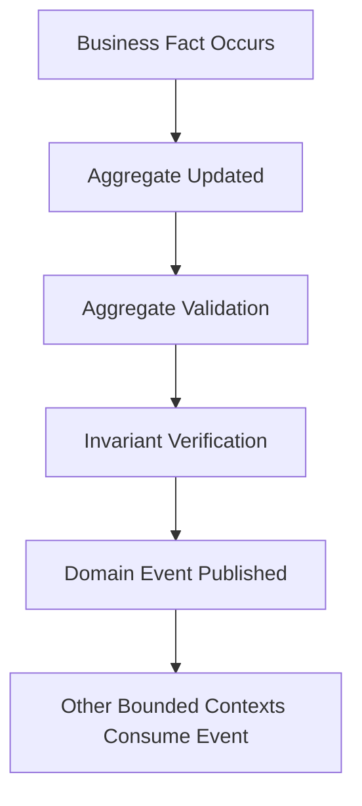

# L2-F07 — Accounts Receivable Management

| Attribute | Value |
|-----------|-------|
| **Document ID** | L2-F07 |
| **Document Name** | Accounts Receivable Management |
| **Architecture Level** | Level 2 |
| **Domain** | Finance |
| **Bounded Context** | Accounts Receivable |
| **Document Type** | Domain Architecture |
| **Version** | 1.0.0 |
| **Status** | Draft |
| **Owner** | Finance Architecture Board |
| **Document Owner** | Finance — Accounts Receivable |
| **Depends On** | L2-F00, L2-F01, L2-F02, L2-F03, L2-F04, L2-F05, L2-F06 |
| **Consumed By** | L3 Finance Workflows, L4 Finance Business Rules, L5 Technical Architecture |

---

## Canonical Section Crosswalk

> Added 2026-08-04 under integrity finding INT-018. `governance/constitution/Volume_3_Architecture_Framework.md` section 18 requires every L2 document to define eleven sections. This document uses its own numbered-section convention; the table below maps the required sections to where they actually live. No content was moved.

| Required section (Volume 3 §18) | Location in this document |
|---|---|
| Purpose | §1 Purpose; §1.1 Purpose Statement; §15.1 Validation Purpose |
| Scope | §2 Scope; §2.1 In Scope; §2.2 Out of Scope |
| Actors | — not present — |
| Entities | §7.3 Entities |
| Business Rules | §14 Domain Constraints & Invariants; §6.6 Aggregate Invariant Responsibility; §14.1 Architectural Invariants |
| Workflow | Workflows |
| State Machine | States |
| Contracts | §12 Integration Contracts; §12.3 Upstream Integration Contracts; §12.4 Downstream Integration Contracts |
| Events | §11 Domain Events; §10.11 Domain Event Publication; §11.1 Event Philosophy |
| Dependencies | §5.1 Upstream Domains; §12.3 Upstream Integration Contracts |
| Locked Decisions | — not present — |

> **Gap:** 2 required section(s) have no counterpart in this document: Actors, Locked Decisions. Recorded, not authored.

---

# Table of Contents

1. Purpose
2. Scope
3. Architectural Vision
4. Bounded Context
5. Responsibilities
6. Architectural Boundaries
7. Canonical Aggregate Root
8. Domain-Driven Design Classification
9. Aggregate Structure
10. Aggregate Relationships
11. Business Capabilities
12. Domain Events
13. Integration Contracts
14. Configuration Architecture
15. Domain Constraints & Invariants
16. Architecture Validation Checklist
17. Merge Readiness Checklist

---

# 1. Purpose

## 1.1 Purpose Statement

The **Accounts Receivable Management** bounded context governs the canonical architectural model for financial receivables within the SutraERP Finance Domain.

Its primary responsibility is to represent, monitor, and govern all outstanding financial obligations owed to the institution after financial obligations have been established by upstream Finance bounded contexts.

Accounts Receivable Management provides the authoritative architectural representation of institutional receivables while maintaining clear ownership boundaries between financial obligation creation, payment settlement, accounting, budgeting, and treasury operations.

This bounded context serves as the enterprise source of truth for receivable management and ensures that every outstanding financial obligation can be consistently tracked, monitored, reported, and resolved throughout its lifecycle.

---

## 1.2 Architectural Objectives

The Accounts Receivable bounded context is designed to achieve the following architectural objectives.

### OBJ-AR-01

Provide a canonical representation of institutional receivables.

---

### OBJ-AR-02

Maintain complete visibility into outstanding financial obligations.

---

### OBJ-AR-03

Support accurate aging of receivables.

---

### OBJ-AR-04

Enable institutional revenue tracking.

---

### OBJ-AR-05

Provide architectural support for collection management.

---

### OBJ-AR-06

Maintain complete financial traceability.

---

### OBJ-AR-07

Integrate consistently with Accounting, Payment, Refund, and Financial Adjustment bounded contexts.

---

### OBJ-AR-08

Support institution-independent receivable modeling through configuration-driven behavior.

---

### OBJ-AR-09

Provide consistent architectural foundations for downstream reporting and analytics.

---

### OBJ-AR-10

Maintain architectural separation between financial obligation ownership and financial receivable ownership.

---

# 2. Scope

## 2.1 In Scope

The Accounts Receivable bounded context governs the architecture of:

- Receivable records
- Outstanding obligations
- Receivable balances
- Receivable aging
- Collection tracking
- Collection status
- Receivable categorization
- Receivable allocation references
- Receivable adjustments
- Receivable settlement references
- Receivable financial visibility
- Receivable reporting participation
- Multi-domain receivable references

---

## 2.2 Out of Scope

The following architectural responsibilities belong to other Finance bounded contexts.

| Responsibility | Owning Bounded Context |
|---------------|------------------------|
| Student Charge Creation | L2-F01 |
| Payment Processing | L2-F02 |
| Refund Processing | L2-F03 |
| Financial Adjustments | L2-F04 |
| Accounting Entries | L2-F05 |
| Budget Management | L2-F06 |
| Vendor Payments | Accounts Payable |
| Treasury Operations | Treasury & Banking |

Accounts Receivable never creates financial obligations.

Accounts Receivable governs the institutional representation of receivable obligations after those obligations have been established by their authoritative owning domains.

---

# 3. Architectural Vision

## 3.1 Vision Statement

Accounts Receivable Management shall provide a canonical, auditable, extensible, and institution-independent architecture for representing all financial receivables owed to an educational institution.

The architecture shall ensure that receivables remain financially accurate, fully traceable, and consistently governed throughout their architectural lifecycle while remaining independent of operational collection procedures, institutional policies, and implementation technologies.

---

## 3.2 Architectural Philosophy

The Accounts Receivable bounded context follows five fundamental architectural principles.

### Canonical Ownership

Receivables have exactly one architectural owner.

---

### Financial Traceability

Every receivable shall be traceable to one or more originating financial obligations.

---

### Separation of Concerns

Receivable management shall remain independent of:

- Charge generation
- Payment execution
- Accounting posting
- Treasury settlement
- Institutional collection workflows

---

### Configuration-Driven Behavior

Institution-specific collection strategies shall be implemented through configuration rather than architectural customization.

---

### Event-Driven Consistency

Receivable state shall evolve only through canonical Finance events published by authoritative Finance bounded contexts.

---

# 4. Bounded Context

## 4.1 Domain Definition

Accounts Receivable represents the Finance bounded context responsible for governing institutional financial assets arising from outstanding monetary obligations owed by external parties.

The bounded context maintains the architectural representation of receivable balances without assuming ownership of the originating financial obligations or settlement mechanisms.

---

## 4.2 Primary Responsibilities

The bounded context is responsible for:

- Maintaining receivable identity.
- Maintaining receivable balances.
- Maintaining outstanding amount visibility.
- Maintaining aging information.
- Maintaining collection status.
- Maintaining settlement references.
- Maintaining receivable classifications.
- Maintaining receivable traceability.
- Publishing receivable events.
- Providing receivable information to downstream Finance domains.

---

## 4.3 Architectural Responsibilities

Accounts Receivable owns:

- Receivable Aggregate
- Receivable Identity
- Receivable Status
- Receivable Balance
- Aging Profile
- Collection Profile
- Receivable Classification
- Settlement References

---

## 4.4 Responsibilities Explicitly Excluded

Accounts Receivable shall not:

- Create student charges.
- Accept payments.
- Process refunds.
- Post accounting entries.
- Create budgets.
- Perform bank settlements.
- Execute payment reconciliation.
- Calculate institutional fee structures.
- Implement collection workflows.
- Manage communication with debtors.
- Define institutional financial policies.

These responsibilities remain within their respective bounded contexts.

---

# 5. Architectural Boundaries

## 5.1 Upstream Domains

The Accounts Receivable bounded context receives authoritative business facts from:

| Upstream Context | Information Consumed |
|-----------------|----------------------|
| Student Charge Management | Financial obligations |
| Payment Management | Settlement references |
| Refund Management | Refund adjustments |
| Financial Adjustment Management | Receivable modifications |
| Accounting & Ledger Management | Accounting references |

---

## 5.2 Downstream Domains

Accounts Receivable provides information to:

| Downstream Context | Information Provided |
|-------------------|----------------------|
| Financial Reporting | Receivable metrics |
| Treasury | Collection visibility |
| Finance Analytics | Receivable statistics |
| Dashboards | Receivable balances |
| Audit | Financial traceability |

---

## 5.3 Architectural Boundary Principles

The Accounts Receivable bounded context shall never directly modify another Finance aggregate.

Multi-domain consistency shall be achieved exclusively through:

- Canonical domain events
- Published financial facts
- Immutable references
- Enterprise integration contracts

Direct aggregate sharing between bounded contexts is prohibited.
# 6. Canonical Aggregate Root

## 6.1 Aggregate Root

The canonical Aggregate Root of the Accounts Receivable bounded context is the **Receivable**.

The Receivable Aggregate represents the authoritative architectural boundary responsible for managing all information associated with an outstanding monetary obligation owed to the institution.

Every receivable within the Finance Domain shall be represented by exactly one Receivable Aggregate.

No other bounded context may create, modify, or directly manage the internal consistency of a Receivable Aggregate.

---

## 6.2 Aggregate Mission

The Receivable Aggregate exists to provide a complete, consistent, and auditable representation of institutional receivables throughout their architectural lifecycle.

The aggregate is responsible for maintaining the consistency of all receivable information while enforcing architectural invariants and protecting transactional integrity.

---

## 6.3 Aggregate Responsibilities

The Receivable Aggregate is responsible for governing:

- Receivable identity
- Receivable classification
- Receivable balance
- Collection status
- Aging information
- Settlement references
- Financial traceability
- Aggregate consistency
- Domain event publication

---

## 6.4 Aggregate Ownership

The Receivable Aggregate owns every architectural concept whose lifecycle is inseparable from the receivable itself.

Ownership includes:

- Receivable Balance
- Aging Profile
- Collection Profile
- Receivable Status
- Settlement Reference Collection
- Receivable Classification
- Receivable Metadata

Ownership does not extend beyond the aggregate boundary.

---

## 6.5 Aggregate Lifecycle Principle

The lifecycle of a Receivable Aggregate begins when an authoritative upstream Finance bounded context establishes a financial obligation that results in an institutional receivable.

The lifecycle concludes only when the receivable has been fully resolved according to Finance architectural principles.

Resolution may occur through settlement, adjustment, cancellation by an authoritative source, or another constitutionally permitted financial outcome.

---

## 6.6 Aggregate Invariant Responsibility

The Aggregate Root is solely responsible for preserving all architectural invariants.

Internal entities shall never violate aggregate consistency.

External bounded contexts shall never bypass aggregate invariants.

---
# 6.7 Aggregate Instantiation Rules

## Aggregate Creation Philosophy

The Accounts Receivable bounded context does not independently create financial obligations.

Receivable Aggregates are instantiated only after an authoritative upstream Finance bounded context establishes a valid financial obligation.

The Receivable Aggregate represents the canonical enterprise view of an existing financial obligation.

It shall never originate that obligation.

---

## Aggregate Creation Sources

Receivable creation may be triggered only by authoritative Finance events originating from bounded contexts that own financial obligations.

Illustrative examples include:

- Student Charge Published
- Debit Note Issued
- Vendor Recovery Established
- Institutional Receivable Registered
- Sponsor Receivable Created

The originating bounded context remains the canonical owner of the financial obligation.

Accounts Receivable owns only its receivable representation.

---

## Aggregate Creation Constraints

The following constraints are mandatory.

- Direct Receivable creation by users is prohibited.
- Direct Receivable creation through APIs is prohibited.
- Receivable creation without an originating financial obligation is prohibited.
- Every Receivable shall reference exactly one originating Financial Obligation.
- Aggregate creation shall preserve complete financial traceability.

# 7. Domain-Driven Design Classification

## 7.1 Classification Overview

The Accounts Receivable bounded context follows the Domain-Driven Design modeling standards established by the Finance Architecture Constitution.

Every architectural component belongs to exactly one DDD classification.

Mixed classifications are prohibited.

---

## 7.2 Aggregate Root

| Aggregate Root |
|----------------|
| Receivable |

The Aggregate Root defines the transactional consistency boundary for the bounded context.

---

## 7.3 Entities

The following entities exist within the Receivable Aggregate.

| Entity | Responsibility |
|---------|----------------|
| Receivable Balance | Represents the current receivable balance. |
| Aging Profile | Represents aging information associated with the receivable. |
| Collection Profile | Represents collection-related information. |
| Settlement Reference | Maintains references to settlement activities. |
| Receivable Classification | Represents receivable categorization. |
| Receivable Status Record | Maintains aggregate status information. |

Entities exist only within the Aggregate boundary.

They cannot exist independently.

---

## 7.4 Value Objects

The following Value Objects provide immutable descriptive information.

| Value Object | Purpose |
|--------------|---------|
| Monetary Amount | Represents financial values. |
| Currency | Represents monetary currency. |
| Aging Bucket | Represents receivable aging category. |
| Receivable Identifier | Immutable aggregate identifier. |
| Due Date | Represents contractual due information. |
| Collection Priority | Represents collection priority classification. |
| Financial Reference | Immutable multi-domain reference. |

Value Objects are immutable.

Any modification results in replacement rather than mutation.

---

## 7.5 Domain Services

The bounded context defines the following Domain Services.

| Domain Service | Responsibility |
|----------------|----------------|
| Receivable Aging Service | Calculates aging representation. |
| Receivable Classification Service | Determines receivable classifications. |
| Receivable Visibility Service | Produces enterprise visibility information. |
| Receivable Validation Service | Validates aggregate consistency. |
| Receivable Reporting Service | Provides reporting projections. |

Domain Services contain business behavior that does not naturally belong to any single Entity or Aggregate.

---

## 7.6 Domain Policies

The following policies influence Receivable behavior.

| Policy | Responsibility |
|---------|----------------|
| Aging Policy | Determines aging bucket assignment. |
| Collection Policy | Defines collection categorization. |
| Settlement Policy | Defines settlement interpretation. |
| Adjustment Policy | Governs adjustment participation. |
| Reporting Policy | Defines reporting participation. |

Policies influence decision-making without owning data.

---

## 7.7 Reference Data

Reference Data provides configurable information shared across institutions.

Examples include:

- Receivable Categories
- Collection Categories
- Aging Bucket Definitions
- Priority Levels
- Collection Types
- Financial Classification Codes

Reference Data is configuration rather than transactional data.

---

## 7.8 Domain Events

The Accounts Receivable bounded context publishes architectural facts through Domain Events.

Typical events include:

- ReceivableCreated
- ReceivableUpdated
- ReceivableAdjusted
- ReceivableSettled
- ReceivableClosed
- ReceivableReopened
- ReceivableWrittenOff

Events represent completed business facts.

Events never represent commands or user actions.

---

# 8. Aggregate Structure

## 8.1 Aggregate Composition

The Receivable Aggregate consists of the following architectural components.

```text
Receivable
│
├── Receivable Balance
├── Aging Profile
├── Collection Profile
├── Receivable Classification
├── Settlement References
├── Status Record
└── Metadata
```

Each component contributes to maintaining aggregate consistency.

No component may exist independently of the Aggregate Root.

---

## 8.2 Aggregate Boundary

```text
+----------------------------------------------------+
|                Receivable Aggregate                |
|                                                    |
|  +----------------------------------------------+  |
|  | Receivable Aggregate Root                    |  |
|  +----------------------------------------------+  |
|                                                    |
|      Receivable Balance                          |
|      Aging Profile                                |
|      Collection Profile                           |
|      Settlement References                        |
|      Classification                               |
|      Metadata                                     |
|                                                    |
+----------------------------------------------------+
```

The Aggregate Root controls every modification occurring within the boundary.

External bounded contexts interact only with the Aggregate Root.

---

## 8.3 Aggregate Consistency

The Receivable Aggregate guarantees:

- Consistent financial identity.
- Consistent receivable balance.
- Consistent aging information.
- Consistent settlement references.
- Consistent status representation.
- Consistent financial traceability.

Partial aggregate updates are prohibited.

Every modification shall preserve aggregate invariants.

---

## 8.4 Aggregate Identity

Each Receivable Aggregate possesses a globally unique architectural identity.

The identity:

- Never changes.
- Never transfers ownership.
- Never depends on institutional numbering.
- Never embeds business semantics.

Aggregate identity exists solely for architectural consistency.

---

## 8.5 Aggregate Ownership Rules

Only the Receivable Aggregate may:

- Change receivable balance.
- Update collection profile.
- Update aging profile.
- Modify settlement references.
- Change receivable status.
- Publish Receivable domain events.

Other bounded contexts communicate desired changes through domain events rather than direct modification.
# 9. Aggregate Relationships

## 9.1 Relationship Philosophy

The Accounts Receivable bounded context participates in the Finance Domain through well-defined aggregate relationships that preserve bounded context autonomy while ensuring enterprise-wide financial consistency.

Relationships shall communicate business facts rather than expose internal aggregate structures.

The Receivable Aggregate shall never directly manipulate aggregates owned by other bounded contexts.

---

## 9.2 Relationship Classification

Aggregate relationships are classified according to the Finance Architecture Constitution.

| Relationship Type | Meaning |
|-------------------|---------|
| Owns | Architectural ownership within the Aggregate boundary. |
| References | Immutable reference to another Aggregate. |
| Consumes Event | Reacts to published Domain Events. |
| Publishes Event | Announces completed business facts. |
| Depends On | Architectural dependency without ownership. |

---

## 9.3 Aggregate Relationship Overview

```text
                         Student Charge
                                │
                                │
                 Charge Established Event
                                │
                                ▼
+------------------------------------------------------+
|          Accounts Receivable Aggregate               |
|                                                      |
|                  Receivable                          |
|                                                      |
+------------------------------------------------------+
          ▲              ▲                 ▲
          │              │                 │
          │              │                 │
   Payment Events   Adjustment Events   Refund Events
          │              │                 │
          │              │                 │
          ▼              ▼                 ▼
      Accounting      Reporting      Treasury
```

The Accounts Receivable bounded context maintains architectural independence while participating in the Finance ecosystem through published business facts.

---

## 9.4 Relationship with Student Charge Management

### Relationship Type

Consumes Domain Events

### Architectural Purpose

Student Charge Management owns the creation of institutional financial obligations.

Accounts Receivable does not create charges.

Instead, it creates and maintains receivable representations after receiving authoritative financial obligation events.

### Information Consumed

- Charge Identity
- Charge Amount
- Due Information
- Charge Classification
- Charge References

### Information Not Consumed

- Charge calculation logic
- Fee generation rules
- Fee policies
- Student fee configuration

These remain entirely within Student Charge Management.

---

## 9.5 Relationship with Payment Management

### Relationship Type

Consumes Domain Events

### Architectural Purpose

Payment Management owns monetary settlement.

Accounts Receivable owns outstanding obligation visibility.

Payment events update receivable settlement representation without transferring ownership of payment information.

### Information Consumed

- Payment Allocation Reference
- Settlement Amount
- Allocation Result
- Settlement Timestamp
- Settlement Reference

Payment aggregates remain fully owned by Payment Management.

---

## 9.6 Relationship with Refund Management

### Relationship Type

Consumes Domain Events

Refund Management publishes completed refund facts.

Accounts Receivable updates receivable representation based on those facts.

Refund ownership never crosses bounded context boundaries.

---

## 9.7 Relationship with Financial Adjustment Management

### Relationship Type

Consumes Domain Events

Financial adjustments may influence:

- Outstanding Amount
- Collection Status
- Receivable Classification
- Settlement Interpretation

Adjustment ownership remains within Financial Adjustment Management.

---

## 9.8 Relationship with Accounting & Ledger Management

### Relationship Type

Reference

Accounting remains the authoritative owner of accounting records.

Accounts Receivable references accounting information solely for financial traceability.

Accounting entries are never owned by the Receivable Aggregate.

---

## 9.9 Relationship with Budget & Cost Center Management

### Relationship Type

Reference

Budget information may provide contextual financial classification.

Budget ownership remains completely outside the Accounts Receivable bounded context.

Receivables never modify Budget aggregates.

---

## 9.10 Relationship with Accounts Payable

### Relationship Type

Architectural Association

Accounts Receivable and Accounts Payable represent complementary financial assets and liabilities.

Neither bounded context owns or modifies the other.

Both participate independently within the Finance Domain.

---

## 9.11 Relationship with Treasury & Banking

### Relationship Type

Consumes Information

Treasury manages institutional cash and banking operations.

Accounts Receivable represents outstanding financial assets.

Cash movement belongs exclusively to Treasury.

---

## 9.12 Relationship with Financial Reporting

### Relationship Type

Provides Read Information

Financial Reporting consumes receivable information to generate institutional reports.

Reporting never modifies Receivable aggregates.

---

# 10. Business Capabilities

## 10.1 Capability Overview

The Accounts Receivable bounded context provides a cohesive set of business capabilities centered around institutional receivable management.

Each capability supports the canonical responsibility of maintaining accurate, auditable, and traceable receivable information.

---

## 10.2 Capability Catalog

| Capability ID | Business Capability |
|---------------|--------------------|
| AR-CAP-01 | Receivable Registration |
| AR-CAP-02 | Receivable Balance Management |
| AR-CAP-03 | Receivable Classification |
| AR-CAP-04 | Aging Management |
| AR-CAP-05 | Collection Visibility |
| AR-CAP-06 | Settlement Tracking |
| AR-CAP-07 | Receivable Adjustment Participation |
| AR-CAP-08 | Financial Traceability |
| AR-CAP-09 | Receivable Reporting Participation |
| AR-CAP-10 | Domain Event Publication |

---

## 10.3 Receivable Registration

### Purpose

Establish the architectural representation of a receivable following the creation of a valid financial obligation.

### Responsibilities

- Create Receivable Aggregate.
- Establish Aggregate Identity.
- Initialize Receivable Balance.
- Initialize Aging Profile.
- Initialize Collection Profile.
- Publish ReceivableCreated event.

---

## 10.4 Receivable Balance Management

Maintains the authoritative representation of outstanding receivable value.

Responsibilities include:

- Outstanding amount representation.
- Remaining obligation representation.
- Settlement visibility.
- Aggregate consistency.

Balance calculations remain governed by upstream financial events.

---

## 10.5 Receivable Classification

Provides enterprise classification of receivables.

Examples include:

- Student Receivable
- Sponsor Receivable
- Government Receivable
- Scholarship Receivable
- Institutional Receivable

Specific classifications remain configuration-driven.

---

## 10.6 Aging Management

Provides architectural representation of receivable aging.

Typical aging dimensions may include:

- Current
- Short Outstanding
- Medium Outstanding
- Long Outstanding
- Critical Outstanding

Exact aging bucket definitions remain configurable.

---

## 10.7 Collection Visibility

Maintains architectural visibility into collection state.

Examples include:

- Active Collection
- Under Review
- Collection Suspended
- Collection Escalated
- Collection Completed

Collection procedures themselves remain outside the scope of this bounded context.

---

## 10.8 Settlement Tracking

Maintains references to settlement activities affecting the receivable.

The Receivable Aggregate does not own payment execution.

Instead, it maintains architectural traceability to completed settlement activities.

---

## 10.9 Financial Traceability

Every Receivable Aggregate shall support complete financial lineage.

Traceability shall include references to:

- Originating Financial Obligation
- Settlement References
- Adjustment References
- Refund References
- Accounting References

Traceability shall never depend upon implementation technology.

---

## 10.10 Reporting Participation

Accounts Receivable participates in institutional reporting by exposing canonical receivable information to downstream reporting bounded contexts.

The Receivable Aggregate never generates reports directly.

---

## 10.11 Domain Event Publication

Accounts Receivable publishes completed business facts reflecting meaningful aggregate state transitions.

Published events shall comply with the Finance Architecture Constitution and remain immutable after publication.
# 11. Domain Events

## 11.1 Event Philosophy

The Accounts Receivable bounded context communicates with the enterprise exclusively through canonical Domain Events.

Domain Events represent immutable business facts that have already occurred.

They do not represent:

- User requests
- Commands
- Processing instructions
- Workflow activities
- API operations

Every published event shall represent a completed and architecturally valid state transition of the Receivable Aggregate.

---

## 11.2 Event Design Principles

Accounts Receivable Domain Events shall comply with the following principles.

### Immutable

Published events shall never be modified.

---

### Historical

Events represent facts that have already occurred.

---

### Business Meaningful

Events shall communicate business significance rather than technical implementation details.

---

### Technology Independent

Event definitions shall remain independent of messaging infrastructure, transport protocols, and implementation technologies.

---

### Versioned

Published events shall support controlled version evolution without breaking downstream bounded contexts.

---

## 11.3 Published Domain Events

| Event | Description |
|---------|-------------|
| ReceivableCreated | A new receivable has been established. |
| ReceivableUpdated | Receivable information has changed. |
| ReceivableAdjusted | Receivable value has been modified following an approved adjustment. |
| ReceivableSettlementRecorded | Settlement information has been incorporated into the Receivable Aggregate. |
| ReceivableFullySettled | Outstanding obligation has been completely satisfied. |
| ReceivableWrittenOff | Receivable has been written off according to Finance policies. |
| ReceivableReopened | Previously resolved receivable has been reactivated through an authoritative Finance event. |
| ReceivableClosed | Receivable lifecycle has reached a terminal state. |

---

## 11.4 Event Publication Rules

The Receivable Aggregate shall publish events only after:

- Aggregate validation succeeds.
- Aggregate invariants remain satisfied.
- Aggregate consistency is preserved.
- Financial integrity is maintained.

Events shall never be published during partially completed aggregate updates.

---

## 11.5 Event Consumption

The Accounts Receivable bounded context consumes authoritative business events published by upstream Finance bounded contexts.

Typical consumed events include:

| Source Context | Example Events |
|----------------|----------------|
| Student Charge Management | ChargeEstablished, ChargeRevised |
| Payment Management | PaymentAllocated, PaymentReversed |
| Refund Management | RefundCompleted |
| Financial Adjustment Management | FinancialAdjustmentApproved |
| Accounting & Ledger Management | AccountingPosted |

Consumed events represent completed business facts.

They do not transfer ownership between bounded contexts.

---

## 11.6 Event Lifecycle



The publication of a Domain Event always occurs after successful aggregate consistency has been established.

---

# 12. Integration Contracts

## 12.1 Integration Philosophy

Accounts Receivable integrates with the Finance ecosystem through well-defined architectural contracts.

Integration contracts establish communication boundaries without exposing internal aggregate implementation.

---

## 12.2 Architectural Principles

Integration shall satisfy the following principles.

### Loose Coupling

Bounded contexts remain architecturally independent.

---

### Explicit Contracts

Every integration shall be defined through explicit contracts.

---

### No Shared Ownership

No bounded context may directly manipulate another bounded context's Aggregate.

---

### Event First

Whenever possible, business communication shall occur through Domain Events.

---

### Immutable References

Multi-domain references shall be immutable once established.

---

## 12.3 Upstream Integration Contracts

| Source Context | Contract Purpose |
|----------------|------------------|
| Student Charge Management | Receivable creation trigger |
| Payment Management | Settlement participation |
| Refund Management | Refund participation |
| Financial Adjustment Management | Adjustment participation |
| Accounting & Ledger Management | Accounting traceability |

---

## 12.4 Downstream Integration Contracts

| Consumer | Purpose |
|-----------|---------|
| Financial Reporting | Receivable analytics |
| Treasury | Collection visibility |
| Dashboards | Financial monitoring |
| Audit | Financial traceability |
| Enterprise Analytics | Institutional insights |

---

## 12.5 Integration Constraints

The following architectural constraints apply.

- No synchronous ownership transfer.
- No direct database integration.
- No aggregate sharing.
- No internal entity exposure.
- No implementation-specific dependencies.
- No workflow orchestration responsibilities.

---

## 12.6 Multi-Domain Consistency

Enterprise consistency shall be achieved through eventual consistency driven by canonical Domain Events.

The Accounts Receivable bounded context shall never require transactional consistency across multiple bounded contexts.

---

# 13. Configuration Architecture

## 13.1 Configuration Philosophy

Institution-specific variation shall be achieved through configuration rather than architectural customization.

Configuration influences business behavior without changing architectural responsibilities.

---

## 13.2 Configurable Concepts

Examples of configurable concepts include:

- Aging bucket definitions
- Collection priorities
- Collection categories
- Receivable classifications
- Reporting classifications
- Reminder intervals
- Collection escalation levels
- Outstanding tolerance thresholds

The architectural model remains unchanged regardless of institutional configuration.

---

## 13.3 Non-Configurable Concepts

The following concepts are constitutional and shall never be configurable.

- Aggregate ownership
- Aggregate boundaries
- Domain responsibilities
- Event philosophy
- Integration principles
- DDD classifications
- Repository architecture
- Multi-domain ownership

---

## 13.4 Configuration Ownership

Configuration values are owned by institutional administration.

Architectural ownership remains within the Accounts Receivable bounded context.

Configuration shall never redefine architectural responsibilities.

---

# 14. Domain Constraints & Invariants

## 14.1 Architectural Invariants

The Receivable Aggregate shall always preserve the following invariants.

### INV-AR-01

Every Receivable Aggregate possesses exactly one immutable Aggregate Identity.

---

### INV-AR-02

Receivable Balance shall always represent the authoritative receivable amount maintained by the Aggregate.

---

### INV-AR-03

Every receivable shall reference an originating financial obligation.

---

### INV-AR-04

Receivable Aggregates shall never exist without financial traceability.

---

### INV-AR-05

Settlement references shall never invalidate aggregate consistency.

---

### INV-AR-06

Every published Domain Event shall correspond to a completed Aggregate state transition.

---

### INV-AR-07

Aggregate ownership shall never cross bounded context boundaries.

---

### INV-AR-08

External bounded contexts shall never directly modify Receivable entities.

---

### INV-AR-09

Aggregate consistency shall always be preserved before Domain Event publication.

---

### INV-AR-10

Receivable Aggregates shall remain technology independent.

---

## 14.2 Architectural Constraints

The Accounts Receivable bounded context shall not:

- Execute payment processing.
- Perform accounting postings.
- Generate financial obligations.
- Define fee structures.
- Apply Late Fees or Penalties.
- Execute refund processing.
- Perform treasury settlement.
- Manage business workflows.
- Implement institutional policies.

These concerns belong to their respective bounded contexts.
# 15. Architecture Validation Checklist

## 15.1 Validation Purpose

The Architecture Validation Checklist provides a standardized mechanism for evaluating whether the Accounts Receivable bounded context complies with the Finance Architecture Constitution and the Domain-Driven Design principles established by L2-F00.

This checklist shall be completed before architectural approval, repository merge, or downstream implementation activities.

---

## 15.2 Domain Validation

| Validation Item | Status |
|-----------------|--------|
| Domain Vision clearly defined | ☒ |
| Bounded Context explicitly identified | ☒ |
| Responsibilities completely documented | ☒ |
| Architectural boundaries clearly established | ☒ |
| Scope defined without ambiguity | ☒ |
| Ownership responsibilities explicitly assigned | ☒ |

---

## 15.3 Aggregate Validation

| Validation Item | Status |
|-----------------|--------|
| Single Aggregate Root defined | ☒ |
| Aggregate boundary clearly identified | ☒ |
| Aggregate responsibilities documented | ☒ |
| Aggregate ownership complete | ☒ |
| Aggregate invariants documented | ☒ |
| Aggregate consistency preserved | ☒ |
| Aggregate identity immutable | ☒ |

---

## 15.4 Domain-Driven Design Validation

| Validation Item | Status |
|-----------------|--------|
| Aggregate Root identified | ☒ |
| Entities correctly classified | ☒ |
| Value Objects correctly classified | ☒ |
| Domain Services identified | ☒ |
| Domain Policies identified | ☒ |
| Reference Data identified | ☒ |
| Domain Events identified | ☒ |

No architectural component shall belong to multiple DDD classifications.

---

## 15.5 Architectural Boundary Validation

| Validation Item | Status |
|-----------------|--------|
| Upstream bounded contexts identified | ☒ |
| Downstream bounded contexts identified | ☒ |
| Multi-domain ownership respected | ☒ |
| Shared aggregate ownership avoided | ☒ |
| Direct aggregate modification prohibited | ☒ |

---

## 15.6 Event Validation

| Validation Item | Status |
|-----------------|--------|
| Published events represent completed business facts | ☒ |
| Event names follow constitutional conventions | ☒ |
| Events are immutable | ☒ |
| Event publication occurs after aggregate validation | ☒ |
| Event ownership clearly defined | ☒ |

---

## 15.7 Integration Validation

| Validation Item | Status |
|-----------------|--------|
| Integration contracts documented | ☒ |
| Multi-domain dependencies minimized | ☒ |
| No implementation coupling introduced | ☒ |
| Event-driven communication maintained | ☒ |
| Reference integrity preserved | ☒ |

---

## 15.8 Configuration Validation

| Validation Item | Status |
|-----------------|--------|
| Institution-specific behavior is configurable | ☒ |
| Architecture remains configuration-independent | ☒ |
| No business policy embedded in architecture | ☒ |
| Canonical ownership preserved | ☒ |

---

## 15.9 Repository Validation

| Validation Item | Status |
|-----------------|--------|
| Document follows repository template | ☒ |
| Section numbering complete | ☒ |
| Naming standards followed | ☒ |
| Diagram standards followed | ☒ |
| Terminology consistent with L2-F00 | ☒ |
| Markdown formatting compliant | ☒ |

---

# 16. Merge Readiness Checklist

## 16.1 Constitutional Compliance

The Accounts Receivable bounded context shall satisfy all constitutional requirements defined by the Finance Architecture Constitution (L2-F00).

| Requirement | Status |
|-------------|--------|
| Constitutional principles followed | ☒ |
| Repository standards followed | ☒ |
| DDD standards followed | ☒ |
| Aggregate standards followed | ☒ |
| Event standards followed | ☒ |
| Integration standards followed | ☒ |

---

## 16.2 Architectural Completeness

Prior to repository merge, the following shall be verified.

| Requirement | Status |
|-------------|--------|
| Purpose complete | ☒ |
| Scope complete | ☒ |
| Vision complete | ☒ |
| Bounded Context complete | ☒ |
| Aggregate definition complete | ☒ |
| DDD classification complete | ☒ |
| Relationships complete | ☒ |
| Business capabilities complete | ☒ |
| Domain events complete | ☒ |
| Integration contracts complete | ☒ |
| Configuration architecture complete | ☒ |
| Invariants complete | ☒ |
| Validation checklist complete | ☒ |

---

## 16.3 Cross-Repository Consistency

This document shall be reviewed for consistency with the following Finance architecture documents.

| Document | Validation |
|----------|------------|
| L2-F00 — Finance Architecture Constitution | ☒ |
| L2-F01 — Student Charge & Fee Management | ☒ |
| L2-F02 — Payment Management | ☒ |
| L2-F03 — Refund Management | ☒ |
| L2-F04 — Financial Adjustment Management | ☒ |
| L2-F05 — Accounting & Ledger Management | ☒ |
| L2-F06 — Budget & Cost Center Management | ☒ |
| L2-F08 — Accounts Payable Management | ☒ |
| L2-F09 — Financial Period & Closing Management | ☒ |
| L2-F10 — Treasury & Banking Management | ☒ |
| L2-F11 — Scholarship & Financial Aid Management | ☒ |
| L2-F12 — Financial Reporting & Analytics | ☒ |
| L2-F13 — Finance Integration & Enterprise Contracts | ☒ |

---

## 16.4 Architecture Quality Gates

The Accounts Receivable bounded context shall not be approved until the following quality gates have been satisfied.

### Quality Gate 1 — Architectural Completeness

All mandatory architectural sections have been completed.

Status: ☒

---

### Quality Gate 2 — DDD Compliance

The bounded context fully complies with the Domain-Driven Design Constitution established in L2-F00.

Status: ☒

---

### Quality Gate 3 — Finance Consistency

The bounded context integrates consistently with every Finance bounded context while maintaining architectural independence.

Status: ☒

---

### Quality Gate 4 — Repository Compliance

The document conforms to repository structure, documentation standards, naming conventions, and Markdown formatting standards.

Status: ☒

---

### Quality Gate 5 — Enterprise Readiness

The architecture is suitable to serve as the canonical source for:

- Level 3 Business Workflows
- Level 4 Business Rules
- Level 5 Technical Architecture
- Enterprise Solution Design
- Implementation Planning

Status: ☒

---

# 17. Conclusion

The **Accounts Receivable Management** bounded context establishes the canonical architectural representation of institutional receivables within the SutraERP Finance Domain.

It provides a clear ownership boundary for receivable management while preserving separation of concerns between financial obligation creation, payment settlement, accounting, budgeting, treasury, and reporting.

Through strict adherence to the Finance Architecture Constitution, this bounded context ensures:

- Canonical ownership of receivable information.
- Consistent Domain-Driven Design modeling.
- Event-driven enterprise integration.
- Financial traceability.
- Architectural scalability.
- Technology independence.
- Repository-wide consistency.

This document serves as the authoritative Level-2 architectural specification for Accounts Receivable Management and provides the foundation for all downstream workflow, business rule, and implementation artifacts within the SutraERP Finance Architecture repository.

---

## Workflows

This document does not define a dedicated procedural workflow section; workflow orchestration is explicitly excluded from this bounded context's scope (Section 4.4 "Responsibilities Explicitly Excluded" — "Implement collection workflows"; Section 12.5 "Integration Constraints" — "No workflow orchestration responsibilities").

The closest architectural analog is the Business Capabilities catalog in Section 10 (10.2–10.11), which enumerates the discrete capabilities through which the Receivable Aggregate participates in the enterprise: Receivable Registration, Receivable Balance Management, Receivable Classification, Aging Management, Collection Visibility, Settlement Tracking, Financial Traceability, Reporting Participation, and Domain Event Publication.

Detailed step-by-step workflow definitions are the responsibility of Level 3 Finance Workflows, as referenced in the document header ("Consumed By").

---

## States

A dedicated state-machine section is not separately defined in this document, but receivable state concepts are addressed across several sections: Receivable Status and the Receivable Status Record entity (Sections 6.3, 6.4, 7.3), and the Aggregate Lifecycle Principle (Section 6.5), which describes the lifecycle beginning at obligation establishment and concluding through settlement, adjustment, cancellation, or another constitutionally permitted outcome.

Collection Visibility (Section 10.7) lists example collection states — Active Collection, Under Review, Collection Suspended, Collection Escalated, Collection Completed — and Aging Management (Section 10.6) lists example aging states — Current, Short Outstanding, Medium Outstanding, Long Outstanding, Critical Outstanding. The Published Domain Events (Section 11.3) further imply resulting aggregate states, including Created, Settled, Written Off, Reopened, and Closed.

