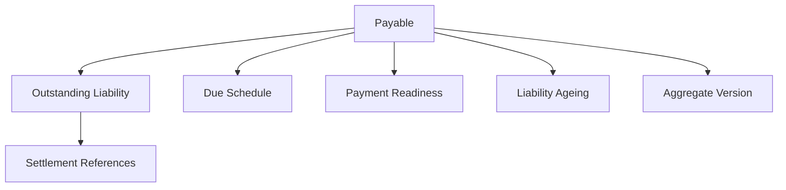
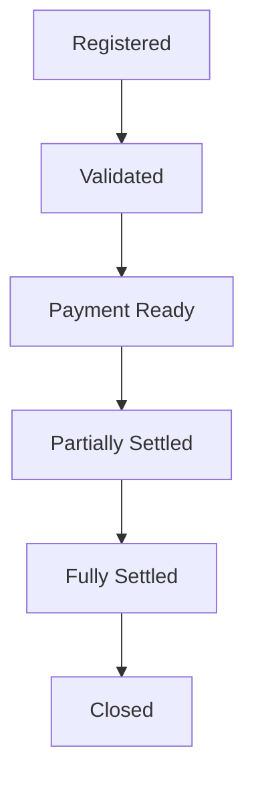
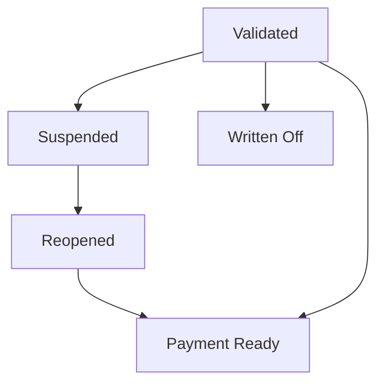
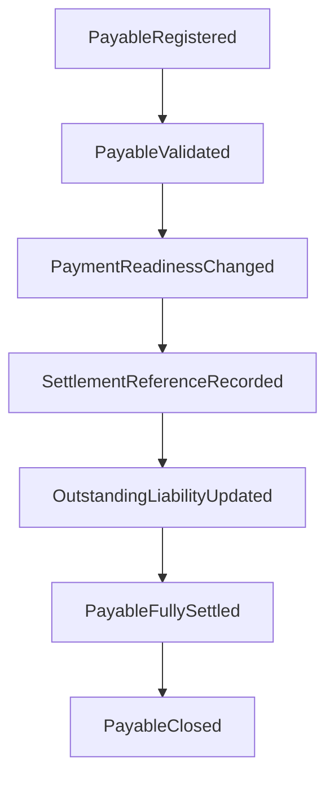
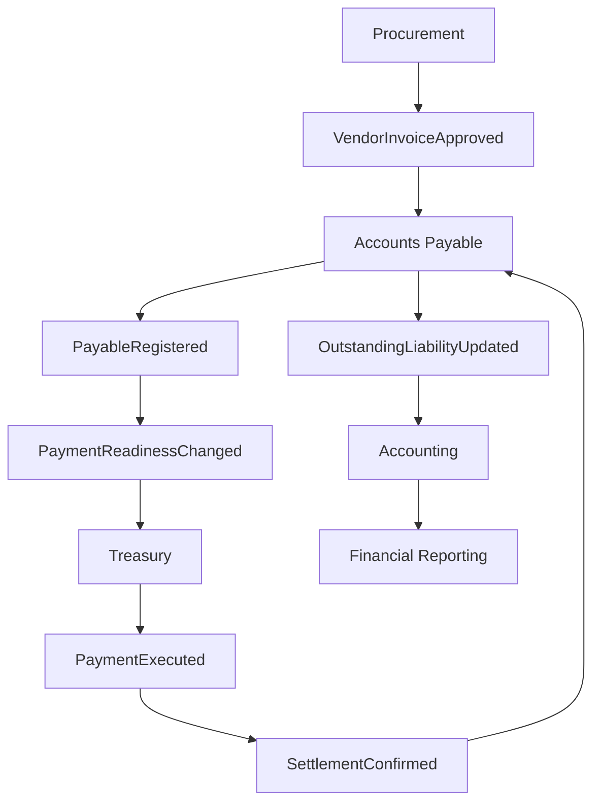
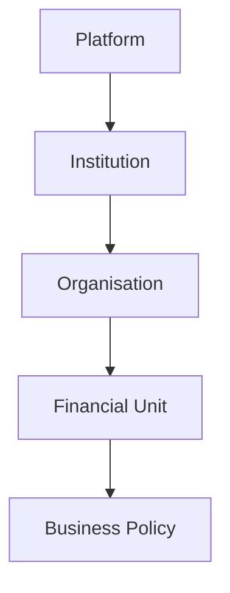
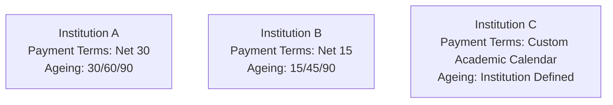

# L2-F08 — Accounts Payable Management

| Metadata | Value |
|----------|-------|
| Architecture Level | Level 2 — Domain Architecture |
| Domain | Finance |
| Document Code | L2-F08 |
| Status | Draft |
| Version | 1.0 |
| Canonical Owner | Finance Architecture |
| Document Owner | Chetan |
| Last Updated | TBD |

---

## Canonical Section Crosswalk

> Added 2026-08-04 under integrity finding INT-018. `governance/constitution/Volume_3_Architecture_Framework.md` section 18 requires every L2 document to define eleven sections. This document uses its own numbered-section convention; the table below maps the required sections to where they actually live. No content was moved.

| Required section (Volume 3 §18) | Location in this document |
|---|---|
| Purpose | Purpose; Architectural Purpose |
| Scope | Scope |
| Actors | — not present — |
| Entities | Internal Entities |
| Business Rules | §16 Domain Constraints & Business Invariants; Aggregate Invariants; Identity Invariants |
| Workflow | Workflows |
| State Machine | Aggregate State Model |
| Contracts | §14 Integration Contracts; Contract Management Integration; Contract Domain Owns |
| Events | §13 Domain Event Architecture; Event-Driven Collaboration; Domain Event Philosophy |
| Dependencies | Dependency Classification |
| Locked Decisions | — not present — |

> **Gap:** 2 required section(s) have no counterpart in this document: Actors, Locked Decisions. Recorded, not authored.

---

# Dependency Classification

## Depends On

- L2-A01 — Platform & Tenant Foundation
- L2-A02 — Person & Identity Workflows
- L2-A03 — Authentication Architecture
- L2-A04 — Authorization & Policy Workflows
- L2-B01 — Institution Lifecycle
- L2-B02 — Organisation Workflows
- L2-F00 — Finance Domain Model & Foundation

## Consumed By

- L2-F05 — Accounting & General Ledger
- L2-F09 — Financial Period & Closing
- L2-F10 — Treasury & Banking
- L2-F12 — Financial Reporting
- Procurement
- Audit
- Vendor Self-Service
- Executive Dashboards

---

# Architectural Classification

Domain Type

Enterprise Core Domain

Architectural Style

- Domain Driven Design
- Event Driven Architecture
- Canonical Data Ownership
- Configuration Driven Behaviour
- Technology Independent
- Aggregate Centric
- Eventual Consistency
- CQRS Compatible

---

# Purpose

Accounts Payable is the canonical enterprise domain responsible for representing, governing, and tracking every financial obligation owed by an institution to external or internal parties.

The domain provides a single authoritative representation of institutional liabilities while maintaining strict ownership boundaries between Finance, Procurement, Treasury, Human Resources, Accounting, Budgeting, and external financial systems.

This document establishes the complete architectural specification for Accounts Payable within SutraERP.

No downstream architecture may redefine ownership, lifecycle, aggregate responsibilities, or business rules established herein.

---

# Scope

The Accounts Payable domain owns the complete lifecycle of institutional payable obligations after a financial obligation has been formally established.

Responsibilities include:

- Payable registration
- Outstanding liability management
- Liability status
- Due date management
- Liability ageing
- Settlement references
- Payment readiness
- Liability classification
- Payable state transitions
- Domain event publication
- Aggregate consistency
- Financial traceability

The domain explicitly does not own:

- Vendor onboarding
- Supplier master data
- Procurement workflows
- Purchase requisitions
- Purchase orders
- Goods receipt
- Contract management
- Employee management
- Payroll
- Treasury operations
- Bank communication
- Cash management
- Accounting journals
- Ledger posting
- Budget approval
- Financial reporting

These responsibilities remain within their respective bounded contexts.

Accounts Payable collaborates exclusively through published contracts and immutable domain events.

---

# Architectural Vision

The Accounts Payable domain shall provide a single, authoritative, and technology-independent representation of every financial liability incurred by an institution.

The architecture is designed around the following principles.

## Canonical Ownership

The Accounts Payable bounded context owns the canonical representation of institutional liabilities.

No other bounded context shall duplicate ownership of payable state.

---

## Financial Traceability

Every payable shall maintain complete traceability from its originating financial obligation through settlement and eventual closure.

Financial history shall remain immutable.

Corrections shall occur through compensating business events rather than destructive updates.

---

## Event-Driven Collaboration

Accounts Payable collaborates with neighbouring domains exclusively through published business events.

The bounded context shall never perform direct modifications within external aggregates.

All multi-domain consistency shall be achieved through asynchronous collaboration.

---

## Aggregate Integrity

Every payable shall exist inside exactly one Aggregate Root.

Aggregate boundaries define transactional consistency.

Business invariants shall always be validated before domain events are published.

---

## Configuration Driven Behaviour

Institution-specific behaviour shall be determined through configuration rather than application logic.

Examples include:

- payment terms
- liability classifications
- approval thresholds
- ageing policies
- write-off rules
- statutory payment categories
- reminder schedules
- settlement tolerances

Configuration extends behaviour without changing domain ownership.

---

## Technology Independence

This document intentionally excludes:

- programming languages
- database technologies
- APIs
- REST endpoints
- GraphQL
- messaging platforms
- ORM mappings
- infrastructure choices
- deployment models

These concerns belong to lower architectural levels.

---

# Architectural Goals

The Accounts Payable architecture shall achieve the following objectives.

## Goal 1 — Canonical Liability Management

Provide one authoritative representation of every payable obligation.

---

## Goal 2 — Enterprise Consistency

Maintain consistent financial state across Procurement, Treasury, Accounting, Budgeting, Reporting, and Audit without violating ownership boundaries.

---

## Goal 3 — Financial Integrity

Ensure every payable remains financially consistent throughout its lifecycle.

Outstanding liability shall never violate aggregate invariants.

---

## Goal 4 — Complete Auditability

Every state transition shall be traceable through immutable business events.

Historical information shall never be destroyed.

---

## Goal 5 — Scalability

Support institutions ranging from single-campus organizations to multi-institution educational groups without architectural changes.

---

## Goal 6 — Extensibility

Support future payable categories without requiring structural redesign.

Future payable sources may include:

- AI services
- cloud subscriptions
- government integrations
- digital marketplaces
- external learning providers
- research grants
- partner institutions

The aggregate model shall remain stable regardless of future liability sources.

---

# Bounded Context

The Accounts Payable bounded context encapsulates all business capabilities required to manage institutional liabilities after they become recognized financial obligations.

The bounded context governs:

- payable identity
- liability state
- outstanding balance
- due schedules
- liability ageing
- payment eligibility
- settlement references
- payable lifecycle
- aggregate consistency
- domain event publication

The bounded context explicitly excludes:

- liability creation decisions
- procurement approvals
- purchasing workflows
- contract negotiation
- payment execution
- accounting postings
- treasury decisions
- budget allocation
- vendor governance

These activities remain owned by their respective bounded contexts.

Accounts Payable represents liabilities.

It does not originate them.

---

# Architectural Boundaries

The Accounts Payable bounded context owns the following concepts.

## Canonical Ownership

- Payable Aggregate
- Outstanding Liability
- Liability Status
- Due Schedule
- Liability Ageing
- Settlement References
- Aggregate Version
- Payment Readiness State
- Domain Events

---

## External References

The Accounts Payable aggregate references—but never owns—the following enterprise concepts.

- Vendor
- Supplier
- Employee
- Procurement Document
- Financial Obligation
- Treasury Payment
- Accounting Entry
- Budget Allocation
- Cost Centre
- Financial Period
- Institution
- Organisation
- Currency
- Tax Classification

Reference ownership always remains inside the originating bounded context.

---

## Ownership Principles

The following architectural rules are mandatory.

Accounts Payable shall never create Vendors.

Accounts Payable shall never modify Procurement documents.

Accounts Payable shall never execute Payments.

Accounts Payable shall never post Ledger Entries.

Accounts Payable shall never manage Bank Accounts.

Accounts Payable shall never allocate Budgets.

Accounts Payable shall never calculate Payroll.

Accounts Payable exists solely to manage the lifecycle and integrity of institutional liabilities.

---

# Architectural Principles

The architecture follows these immutable principles.

1. Every payable belongs to exactly one Aggregate Root.

2. Every payable references exactly one originating Financial Obligation.

3. Aggregate consistency always precedes event publication.

4. Multi-domain communication occurs only through published contracts.

5. Business history is immutable.

6. Configuration extends behaviour without changing ownership.

7. Internal aggregate structure shall never be exposed outside the bounded context.

8. Read models never own business state.

9. External integrations shall pass through Anti-Corruption Layers whenever semantic translation is required.

10. Financial integrity always takes precedence over operational convenience.

---

# 6. Canonical Aggregate Root

## Aggregate Philosophy

The Accounts Payable bounded context is centred around a single canonical Aggregate Root:

# Payable

The Payable Aggregate represents the authoritative enterprise representation of a financial obligation owed by the institution after that obligation has been formally recognised.

The Aggregate governs the complete payable lifecycle while maintaining aggregate consistency, financial traceability, and bounded context isolation.

Every institutional liability shall be represented by exactly one Payable Aggregate.

No payable may exist outside the consistency boundary established by its Aggregate Root.

---

## Aggregate Responsibilities

The Payable Aggregate owns responsibility for:

- Payable Identity
- Outstanding Liability
- Liability Status
- Due Schedule
- Payment Readiness
- Liability Ageing
- Settlement References
- Aggregate Version
- Business Rule Validation
- Domain Event Publication

The Aggregate does not own:

- Vendor lifecycle
- Procurement lifecycle
- Purchase Orders
- Goods Receipts
- Treasury Payments
- Bank Transactions
- Ledger Entries
- Budget Allocations
- Employee Records

These concepts remain canonical within their respective bounded contexts.

---

## Canonical Ownership

The Payable Aggregate is the sole canonical owner of institutional payable state.

No external bounded context may directly modify:

- Outstanding Liability
- Due Schedule
- Liability Status
- Payment Readiness
- Liability Ageing
- Settlement References

External domains influence payable state exclusively through published business events.

---

## Aggregate Consistency Boundary

The Aggregate defines the transactional consistency boundary for institutional liabilities.

Every modification shall preserve aggregate invariants before state transitions become observable outside the bounded context.

Consistency validation shall precede:

- Domain Event publication
- Integration Event publication
- Read Model updates
- Reporting projection updates

Partial Aggregate updates are prohibited.

---

# 7. Aggregate Instantiation Rules

## Creation Philosophy

Accounts Payable does not originate financial liabilities.

The Aggregate is instantiated only after an authoritative upstream Finance bounded context establishes a valid financial obligation.

Examples include:

- Approved Vendor Invoice
- Approved Employee Reimbursement
- Approved Statutory Liability
- Approved Utility Obligation
- Approved Service Invoice
- Approved Scholarship Disbursement Obligation
- Approved Contractual Payment

The originating bounded context remains the canonical owner of the underlying business obligation.

Accounts Payable owns only the payable representation.

---

## Aggregate Creation Constraints

The following rules are mandatory.

A Payable Aggregate:

- shall reference exactly one originating Financial Obligation.
- shall possess exactly one immutable Aggregate Identifier.
- shall belong to exactly one Institution.
- shall belong to exactly one Financial Context.
- shall begin in a valid lifecycle state.
- shall satisfy all Aggregate invariants before persistence.

Creation without an originating Financial Obligation is prohibited.

---

## Aggregate Identity

Every Aggregate owns an immutable identifier.

Identity never changes during the Aggregate lifecycle.

Business attributes may evolve.

Aggregate identity shall not.

Aggregate identity exists independently of:

- Vendor Numbers
- Invoice Numbers
- Procurement Numbers
- Treasury References
- Accounting References

These values remain external references.

---

## Aggregate Lifecycle

Illustrative lifecycle:

Financial Obligation Established

↓

Payable Registered

↓

Validated

↓

Payment Eligible

↓

Partially Settled

↓

Fully Settled

↓

Closed

Exceptional transitions may include:

- Suspended
- Disputed
- Written Off
- Reopened
- Cancelled

Institution-specific lifecycle behaviour remains configuration driven.

---

# 8. Domain-Driven Design Classification

## Aggregate Root

- Payable

---

## Internal Entities

Entities possess identity within the Aggregate.

### Outstanding Liability

Represents the remaining financial obligation still owed.

Maintains:

- Remaining Amount
- Liability Currency
- Outstanding State
- Liability Classification

---

### Due Schedule

Represents when obligations become payable.

Maintains:

- Due Date
- Payment Terms
- Grace Period
- Escalation Eligibility

---

### Liability Ageing

Represents elapsed liability duration.

Maintains:

- Ageing Bucket
- Days Outstanding
- Escalation Status
- Collection Classification (where applicable)

Ageing exists for liability monitoring rather than collection activities.

---

### Payment Allocation Reference

Represents immutable references to settlement activities produced by Treasury.

The Entity does not own settlement execution.

---

## Value Objects

Value Objects are immutable.

Modification produces replacement rather than mutation.

Illustrative Value Objects include:

- Payable Identifier
- Financial Obligation Reference
- Vendor Reference
- Institution Reference
- Money
- Currency
- Due Date
- Payment Terms
- Settlement Reference
- Ageing Bucket
- Correlation Identifier
- Business Classification
- Liability Category
- External Reference

---

## Domain Services

Domain Services coordinate business behaviour spanning multiple Aggregate components without assuming ownership.

Illustrative services include:

### Payable Registration Service

Coordinates Aggregate instantiation.

---

### Liability Validation Service

Validates financial consistency.

---

### Payment Eligibility Service

Determines readiness for Treasury execution.

---

### Due Date Evaluation Service

Evaluates payable maturity.

---

### Liability Ageing Service

Calculates liability ageing classifications.

---

### Settlement Coordination Service

Coordinates settlement references produced by Treasury.

---

### Write-Off Evaluation Service

Determines whether institutional write-off policies are satisfied.

---

## Domain Policies

Policies define institutional business decisions.

Illustrative policies include:

- Payment Eligibility Policy
- Due Date Policy
- Liability Ageing Policy
- Write-Off Policy
- Suspension Policy
- Reopening Policy
- Settlement Tolerance Policy
- Liability Classification Policy

Policies remain configuration driven.

Business rules shall never be hardcoded.

---

# 9. Aggregate Structure

## Aggregate Composition



---

## Aggregate Ownership Rules

The Aggregate owns:

- Outstanding Liability
- Due Schedule
- Liability Ageing
- Payment Readiness
- Settlement References
- Aggregate Version

The Aggregate references:

- Vendor
- Procurement Documents
- Treasury Payment
- Accounting Entry
- Budget Allocation
- Financial Period
- Institution

Referenced objects remain externally owned.

---

## Aggregate Consistency Rules

Before any state transition:

- Outstanding Liability shall remain financially valid.
- Due Schedule shall remain internally consistent.
- Settlement References shall preserve traceability.
- Aggregate Version shall advance.
- Business invariants shall succeed.
- Domain Policies shall approve the transition.

Only then may Domain Events be published.

---

# 10. Aggregate Relationships

## Upstream Relationships

Accounts Payable consumes authoritative business events from:

- Procurement
- Human Resources
- Finance Foundation
- Scholarship Management
- Contract Management
- Utility Management

These domains establish financial obligations.

Accounts Payable never instructs upstream domains.

---

## Downstream Relationships

Accounts Payable publishes business events consumed by:

- Treasury
- Accounting
- Financial Reporting
- Audit
- Executive Dashboards
- Notification Services

Downstream systems react to payable state.

They never modify Aggregate state directly.

---

## Relationship Principles

The following architectural rules are mandatory.

- Ownership never crosses bounded contexts.
- Relationships are reference-based.
- External identity is immutable.
- Aggregate consistency is local.
- Multi-domain consistency is eventual.
- Integration occurs only through published contracts.
- Internal Aggregate structures remain private.
# 11. Business Capabilities

## Business Capability Philosophy

The Accounts Payable bounded context is responsible for governing institutional liabilities after a financial obligation has been recognized by an authoritative upstream bounded context.

Business capabilities describe what the bounded context is responsible for owning.

Capabilities do not describe implementation, user interfaces, workflows, or technical services.

Each capability shall preserve aggregate integrity, financial traceability, and canonical ownership.

---

## Capability Landscape

The Accounts Payable domain owns the following core capabilities.

- Payable Registration
- Liability Validation
- Outstanding Liability Management
- Due Schedule Management
- Payment Readiness Evaluation
- Liability Ageing
- Settlement Reference Management
- Payable Suspension
- Payable Reopening
- Liability Closure
- Payable Write-Off
- Domain Event Publication
- Aggregate Consistency Enforcement

Each capability owns a clearly defined business responsibility.

No capability shall overlap another bounded context.

---

## Capability 1 — Payable Registration

## Purpose

Payable Registration establishes the initial canonical representation of a financial liability after an authoritative financial obligation has been created.

Registration represents the architectural beginning of the Accounts Payable lifecycle.

Registration does not create the underlying liability.

---

## Responsibilities

The capability shall:

- instantiate the Payable Aggregate.
- establish Aggregate Identity.
- initialise Aggregate Version.
- associate the originating Financial Obligation.
- establish the initial lifecycle state.
- initialise Outstanding Liability.
- initialise Due Schedule.
- initialise Payment Readiness.
- initialise Liability Ageing.

---

## Architectural Rules

Registration shall only occur through authoritative financial events.

Manual payable creation is prohibited.

Creation without a valid Financial Obligation is prohibited.

Duplicate payable registration is prohibited.

Aggregate consistency shall be verified before persistence.

---

## Capability 2 — Liability Validation

## Purpose

Liability Validation ensures every payable satisfies enterprise financial integrity before entering operational use.

Validation protects downstream Finance domains from inconsistent liabilities.

---

## Responsibilities

Validation includes:

- obligation verification
- vendor reference validation
- financial amount validation
- institution validation
- organisation validation
- payable classification validation
- lifecycle validation
- aggregate invariant validation

Validation failures prevent Aggregate persistence.

---

## Architectural Constraints

Validation shall never modify upstream domains.

Validation shall never create financial obligations.

Validation produces business decisions rather than financial transactions.

---

## Capability 3 — Outstanding Liability Management

## Purpose

Outstanding Liability Management maintains the canonical representation of the remaining unpaid liability.

Outstanding Liability exists independently of Treasury execution.

Treasury influences liability through published settlement events.

---

## Responsibilities

The capability owns:

- remaining payable amount
- payable currency
- outstanding status
- settlement progress
- liability completion

Outstanding Liability represents business state.

It does not execute financial settlement.

---

## Liability Adjustments

Outstanding Liability may evolve because of:

- payment allocation
- financial adjustment
- credit note
- debit note
- liability correction
- approved write-off

Every modification shall preserve financial consistency.

---

## Capability 4 — Due Schedule Management

## Purpose

Due Schedule Management governs when institutional liabilities become payable.

Due Schedule supports financial planning rather than payment execution.

---

## Responsibilities

The capability manages:

- Due Date
- Payment Terms
- Grace Period
- Installment Schedule
- Escalation Eligibility
- Maturity Classification

Institution-specific payment strategies remain configuration driven.

---

## Architectural Rules

Due Schedule shall always exist.

Every payable possesses exactly one active Due Schedule.

Historical schedules remain immutable.

Schedule modifications produce historical traceability.

---

## Capability 5 — Payment Readiness Evaluation

## Purpose

Payment Readiness determines whether a payable satisfies institutional conditions required before Treasury may execute settlement.

Payment Readiness does not authorize payment.

Authorization remains outside this bounded context.

---

## Responsibilities

Payment Readiness evaluates:

- liability completeness
- mandatory approvals
- dispute status
- suspension status
- due schedule validity
- payable lifecycle
- institution policy compliance

---

## Possible Outcomes

Illustrative readiness states include:

- Ready
- Pending
- Blocked
- Suspended
- Awaiting Validation
- Awaiting Documentation

Readiness states are institution configurable.

---

## Architectural Rules

Payment Readiness shall never initiate Treasury execution.

Treasury consumes readiness.

Accounts Payable owns readiness.

---

## Capability 6 — Liability Ageing

## Purpose

Liability Ageing classifies institutional liabilities according to elapsed time.

Ageing supports:

- financial planning
- treasury prioritisation
- executive reporting
- audit
- compliance

Ageing does not determine payment execution.

---

## Responsibilities

Ageing maintains:

- ageing bucket
- elapsed days
- maturity category
- overdue classification
- escalation eligibility

---

## Ageing Strategy

Illustrative buckets:

- Current
- 1–30 Days
- 31–60 Days
- 61–90 Days
- Over 90 Days

Institutions may define alternative strategies.

Ageing logic remains configuration driven.

---

## Capability 7 — Settlement Reference Management

## Purpose

Settlement References preserve immutable relationships between Payable Aggregates and external settlement activities.

Settlement execution remains outside Accounts Payable.

---

## Responsibilities

Settlement References maintain:

- Settlement Identifier
- Settlement Type
- Settlement Date
- Treasury Reference
- Correlation Identifier

Settlement References preserve traceability.

They never execute settlement.

---

## Architectural Rules

Settlement References are immutable.

Settlement References cannot exist independently.

Modification produces replacement rather than mutation.

Historical traceability shall always be preserved.

---

## Capability 8 — Payable Suspension

## Purpose

Suspension temporarily prevents further payable progression while preserving financial integrity.

Suspension is reversible.

It does not destroy business history.

---

## Illustrative Suspension Reasons

- legal dispute
- vendor dispute
- compliance investigation
- documentation pending
- audit hold
- management hold
- institution policy

Reasons remain configurable.

---

## Suspension Effects

Suspension may prevent:

- payment readiness
- settlement progression
- payable closure

Suspension shall never delete financial history.

---

## Capability 9 — Payable Reopening

## Purpose

Reopening restores an appropriately closed payable to an operational state following legitimate business events.

Reopening is exceptional.

---

## Illustrative Reasons

- settlement reversal
- payment rejection
- accounting correction
- legal decision
- audit correction
- approved business adjustment

---

## Architectural Rules

Reopening shall preserve complete historical traceability.

The original Aggregate Identity shall remain unchanged.

Reopening produces immutable business events.

---

## Capability 10 — Liability Closure

## Purpose

Liability Closure represents completion of the payable lifecycle.

Closure indicates no further operational liability remains.

---

## Closure Conditions

Illustrative conditions include:

- fully settled
- approved write-off
- lawful cancellation
- statutory completion

Closure criteria remain configuration driven.

---

## Architectural Rules

Closed Aggregates remain historically available.

Closure never deletes Aggregate history.

Closed Aggregates may participate in reporting and audit.

---

## Capability 11 — Payable Write-Off

## Purpose

Write-Off represents an authorised business decision that a remaining liability shall no longer continue through the normal settlement lifecycle.

Write-Off does not erase historical liability.

---

## Responsibilities

The capability manages:

- write-off state
- write-off reason
- write-off classification
- write-off approval reference
- historical traceability

---

## Architectural Constraints

Write-Off shall satisfy institutional policy.

Write-Off shall publish immutable Domain Events.

Write-Off shall preserve Aggregate consistency.

Write-Off never destroys financial history.

---

## Capability 12 — Aggregate Consistency Enforcement

## Purpose

Aggregate Consistency Enforcement ensures every modification preserves business invariants before becoming observable outside the bounded context.

---

## Responsibilities

The capability validates:

- Aggregate Identity
- Outstanding Liability
- Due Schedule
- Payment Readiness
- Settlement References
- Aggregate Version
- Lifecycle State
- Domain Policies

Consistency validation precedes every state transition.

---

## Architectural Rule

If consistency validation fails:

- Aggregate persistence shall fail.
- Domain Events shall not be published.
- Integration Events shall not be published.
- Read Models shall not be updated.

Financial correctness always takes precedence over operational continuity.

---

## Capability Relationships

The following simplified capability relationship illustrates business ownership.

```mermaid
graph TD
    FinancialObligation["Financial Obligation"] --> PayableRegistration["Payable Registration"]
    PayableRegistration --> LiabilityValidation["Liability Validation"]
    LiabilityValidation --> OutstandingLiability["Outstanding Liability"]
    OutstandingLiability --> DueSchedule["Due Schedule"]
```mermaid
graph TD
    FinancialObligation["Financial Obligation"] --> PayableRegistration["Payable Registration"]
    PayableRegistration --> LiabilityValidation["Liability Validation"]
    LiabilityValidation --> OutstandingLiability["Outstanding Liability"]
    OutstandingLiability --> DueSchedule["Due Schedule"]
    OutstandingLiability --> PaymentReadiness["Payment Readiness"]
    OutstandingLiability --> Ageing["Ageing"]
    DueSchedule --> SettlementReferences["Settlement References"]
    PaymentReadiness --> SettlementReferences
    Ageing --> SettlementReferences
    SettlementReferences --> LiabilityClosure["Liability Closure"]
    LiabilityClosure --> HistoricalTraceability["Historical Traceability"]
```
- evaluate domain policies
- publish domain events
- advance aggregate version

---

## Aggregate Responsibilities

The Payable Aggregate is responsible for maintaining the complete operational representation of a financial liability.

Responsibilities include:

- Aggregate Identity
- Outstanding Liability
- Due Schedule
- Payment Readiness
- Liability Ageing
- Settlement References
- Lifecycle State
- Aggregate Version
- Business Rule Enforcement
- Domain Event Publication

The Aggregate explicitly does not own:

- Vendor Management
- Procurement Decisions
- Treasury Operations
- Bank Transactions
- Ledger Entries
- Budget Allocations
- Payroll
- External Contracts

These remain externally owned and are referenced through immutable identifiers.

---

## Aggregate Consistency Boundary

The Aggregate defines the highest level of transactional consistency within the Accounts Payable bounded context.

Every state transition shall preserve:

- financial correctness
- lifecycle correctness
- policy compliance
- traceability
- aggregate invariants

Consistency validation shall complete successfully before:

- persistence
- read model updates
- domain event publication
- integration event publication

Partial state transitions are prohibited.

---

## Aggregate Responsibilities Matrix

| Capability | Aggregate Responsibility |
|------------|--------------------------|
| Registration | Own |
| Outstanding Liability | Own |
| Due Schedule | Own |
| Payment Readiness | Own |
| Liability Ageing | Own |
| Settlement References | Own |
| Aggregate Version | Own |
| Lifecycle State | Own |
| Vendor | Reference |
| Treasury Payment | Reference |
| Procurement Document | Reference |
| Accounting Entry | Reference |
| Budget Allocation | Reference |
| Institution | Reference |
| Financial Period | Reference |

Ownership never crosses bounded context boundaries.

---

## Aggregate State Model

Illustrative lifecycle progression:



Exceptional transitions:




External collaboration occurs through immutable events.


- originating obligation exists
- financial integrity validated
- aggregate invariants satisfied

---

Validated → Payment Ready

Requires:

- policy validation completed
- suspension absent
- mandatory references available

---

Payment Ready → Partially Settled

Requires:

- Treasury settlement reference received

---

Partially Settled → Fully Settled

Requires:

- Outstanding Liability equals zero

---

Fully Settled → Closed

Requires:

- institutional closure policy satisfied

---

Closed → Reopened

Requires:

- approved reopening decision
- institutional policy satisfied

---

Validated → Written Off

Requires:

- write-off approval completed
- write-off policy satisfied

Invalid transitions shall be rejected.

---

## Aggregate Invariants

Aggregate invariants shall remain true throughout the Aggregate lifecycle.

Violation of any invariant invalidates the entire business operation.

---

## Identity Invariants

Aggregate Identity is immutable.

Aggregate Identity shall always remain globally unique.

Duplicate Aggregate Identity is prohibited.

---

## Financial Invariants

Outstanding Liability shall remain financially valid.

Outstanding Liability shall never become inconsistent with settlement history.

Outstanding Liability shall never violate institutional financial rules.

Negative balances are prohibited unless explicitly supported through institutional configuration.

---

## Ownership Invariants

Every Aggregate references exactly one originating Financial Obligation.

Every Aggregate belongs to exactly one Institution.

Every Aggregate belongs to exactly one Financial Context.

Ownership never transfers between Aggregates.

---

## Settlement Invariants

Settlement References remain immutable.

Settlement history is append-only.

Historical settlement references shall never be deleted.

---

## Lifecycle Invariants

Closed Aggregates remain immutable except through approved reopening.

Suspended Aggregates cannot become Payment Ready.

Written-Off Aggregates cannot progress through settlement.

Aggregate lifecycle shall never become cyclic except where explicitly supported through reopening policies.

---

## Traceability Invariants

Every business decision shall preserve:

- originating obligation
- business correlation
- settlement traceability
- audit history

Business history shall remain immutable.

---

## Aggregate Commands

## Command Philosophy

Commands represent business intent.

Commands request state modification.

Commands do not guarantee successful execution.

Every command shall undergo:

- invariant validation
- policy evaluation
- consistency verification

Only successful commands modify Aggregate state.

---

## Register Payable

Purpose

Instantiate a new Aggregate.

Preconditions

- authoritative obligation exists
- Aggregate does not already exist

Postconditions

- Aggregate created
- Version initialised
- Domain Events published

---

## Validate Payable

Purpose

Confirm business consistency.

Postconditions

- lifecycle progresses to Validated

---

## Update Due Schedule

Purpose

Modify payable timing.

Preconditions

- policy approval
- Aggregate active

Historical schedules remain preserved.

---

## Evaluate Payment Readiness

Purpose

Determine operational readiness.

The command modifies readiness state only.

No payment execution occurs.

---

## Record Settlement Reference

Purpose

Associate immutable Treasury settlement information.

Settlement execution remains external.

---

## Suspend Payable

Purpose

Temporarily halt payable progression.

Suspension preserves Aggregate history.

---

## Reopen Payable

Purpose

Return an approved payable to operational processing.

Historical traceability remains intact.

---

## Write Off Payable

Purpose

Terminate operational liability through institutional approval.

Historical liability remains permanently available.

---

## Close Payable

Purpose

Complete Aggregate lifecycle.

Closure represents operational completion.

Closure does not remove historical information.

---

## Aggregate Versioning

Every successful business modification advances Aggregate Version.

Version advancement occurs after successful persistence.

Failed commands do not advance Version.

Version values possess no business meaning.

They exist solely to preserve optimistic concurrency.

---

## Optimistic Concurrency

Concurrent Aggregate modification shall be protected through optimistic concurrency.

Illustrative behaviour:

User A

↓

Version 12

↓

Successful Update

↓

Version 13

Meanwhile

User B

↓

Version 12

↓

Update Attempt

↓

Rejected

↓

Aggregate Reload Required

The architecture intentionally avoids implementation technology.

Only the behavioural requirement is defined.

---

## Aggregate Failure Behaviour

If Aggregate validation fails:

- persistence shall fail
- Aggregate Version shall remain unchanged
- Domain Events shall not be published
- Integration Events shall not be published
- Read Models shall not be updated

Business correctness always takes precedence over system availability.

---

## Aggregate Recovery Principles

Recovery shall occur through new business decisions.

Recovery shall never:

- mutate history
- delete events
- overwrite business facts
- bypass Aggregate invariants

Illustrative recovery mechanisms include:

- compensating commands
- reopening
- settlement reversal
- approved write-off
- business correction

All recovery operations preserve historical traceability.

---

## Aggregate Publication Rules

The Aggregate publishes Domain Events only after:

- invariants succeed
- persistence succeeds
- version advancement succeeds

Domain Events represent immutable business facts.

Published events shall never be modified after publication.

Consumers shall treat every published event as historically permanent.

---

## Aggregate Encapsulation Rules

The Aggregate shall never expose:

- internal entity implementation
- persistence structures
- validation mechanisms
- business rule implementation
- internal version management

Consumers interact exclusively through:

- Commands
- Queries
- Published Events
- Integration Contracts

Internal implementation remains private to the bounded context.

---

## Aggregate Architectural Guarantees

The Payable Aggregate guarantees:

- canonical ownership
- transactional consistency
- deterministic behaviour
- immutable history
- complete financial traceability
- policy-driven state transitions
- bounded context isolation
- optimistic concurrency protection
- event-driven collaboration
- enterprise scalability

These guarantees remain valid regardless of implementation technology, deployment model, database platform, messaging infrastructure, or organisational scale.
# 13. Domain Event Architecture

## Domain Event Philosophy

Domain Events represent immutable business facts that have successfully occurred within the Accounts Payable bounded context.

A Domain Event describes something that has already happened.

It does not represent:

- user intent
- commands
- requests
- API calls
- workflow steps
- implementation details

Domain Events are historical records of completed business decisions.

Once published, a Domain Event becomes part of the permanent business history of the enterprise.

---

## Architectural Objectives

The Domain Event Architecture exists to achieve the following objectives.

## Business Traceability

Every significant business decision shall produce a corresponding immutable Domain Event.

---

## Event-Driven Collaboration

Neighbouring bounded contexts shall collaborate by consuming published events rather than directly modifying Aggregate state.

---

## Loose Coupling

No consumer shall require knowledge of the internal Aggregate implementation.

Consumers react only to published business facts.

---

## Eventual Consistency

Multi-domain consistency shall be achieved through asynchronous event-driven collaboration.

Strong consistency shall remain local to the Payable Aggregate.

---

## Historical Permanence

Published Domain Events shall never be modified, deleted, or overwritten.

Corrections shall occur through new business events.

---

## Domain Event Characteristics

Every Domain Event shall satisfy the following characteristics.

- Immutable
- Business Meaningful
- Time Ordered
- Aggregate Scoped
- Historically Permanent
- Technology Independent
- Self-Describing
- Traceable

Events shall describe completed business facts.

They shall never describe future intentions.

---

## Event Taxonomy

The Accounts Payable domain publishes four categories of Domain Events.

## Lifecycle Events

Describe changes to the operational lifecycle of the Payable Aggregate.

Examples include:

- registration
- validation
- suspension
- reopening
- closure

---

## Financial Events

Describe changes affecting institutional financial liability.

Examples include:

- liability adjustments
- settlement progression
- write-off
- balance completion

---

## Operational Events

Describe operational state transitions affecting downstream collaboration.

Examples include:

- payment readiness
- due schedule updates
- ageing classification changes

---

## Governance Events

Describe events affecting compliance, policy, and audit.

Examples include:

- policy violation
- approval completion
- exceptional recovery
- compliance hold

---

## Domain Event Catalogue

The following Domain Events are owned and published by the Accounts Payable bounded context.

---

## PayableRegistered

### Purpose

Represents successful Aggregate creation.

### Published When

A new Payable Aggregate has been successfully instantiated.

### Business Meaning

A new institutional liability is now represented inside Accounts Payable.

---

## PayableValidated

### Purpose

Represents successful financial validation.

### Published When

Aggregate validation completes successfully.

### Business Meaning

The payable satisfies institutional financial integrity requirements.

---

## DueScheduleUpdated

### Purpose

Represents modification of the active Due Schedule.

### Published When

A valid Due Schedule replacement has been accepted.

### Business Meaning

Institutional payment timing has changed.

---

## PaymentReadinessChanged

### Purpose

Represents a change in operational payment readiness.

### Published When

Payment readiness transitions to a different state.

### Business Meaning

Treasury may need to re-evaluate settlement planning.

---

## LiabilityAgeingUpdated

### Purpose

Represents a meaningful ageing classification change.

### Published When

The payable enters a different ageing bucket.

### Business Meaning

Operational liability maturity has changed.

---

## SettlementReferenceRecorded

### Purpose

Represents successful association of Treasury settlement information.

### Published When

Settlement references become permanently associated with the Aggregate.

### Business Meaning

Settlement traceability has been extended.

Settlement execution remains externally owned.

---

## OutstandingLiabilityUpdated

### Purpose

Represents a change in remaining institutional liability.

### Published When

Outstanding Liability changes because of authoritative financial events.

### Business Meaning

The remaining financial obligation has changed.

---

## PayableSuspended

### Purpose

Represents temporary operational suspension.

### Published When

Institutional policy requires suspension.

### Business Meaning

Further payable progression has temporarily stopped.

---

## PayableReopened

### Purpose

Represents restoration of a previously closed operational payable.

### Published When

Institutional reopening policy succeeds.

### Business Meaning

Operational lifecycle resumes.

---

## PayableWrittenOff

### Purpose

Represents approved liability termination through institutional write-off.

### Published When

Write-off completes successfully.

### Business Meaning

Operational settlement will no longer continue.

Historical liability remains preserved.

---

## PayableFullySettled

### Purpose

Represents completion of financial settlement.

### Published When

Outstanding Liability reaches zero.

### Business Meaning

No remaining payable obligation exists.

---

## PayableClosed

### Purpose

Represents operational completion of the Aggregate lifecycle.

### Published When

Closure policy succeeds.

### Business Meaning

The payable lifecycle has completed.

---

## Event Publication Rules

Domain Events shall be published only after all mandatory business conditions succeed.

Publication requires:

- Aggregate invariants satisfied
- Domain Policies satisfied
- Aggregate persistence completed
- Aggregate Version advanced
- Transaction successfully completed

Failure of any prerequisite shall prevent event publication.

---

## Event Ordering

Events originating from a single Aggregate shall preserve causal ordering.

Illustrative example:



Consumers may rely upon ordering only within the originating Aggregate.

Ordering across Aggregates is intentionally undefined.

---

## Event Idempotency

Consumers shall process Domain Events safely under repeated delivery.

Repeated processing of an identical event shall not produce inconsistent business state.

Idempotency requirements belong to consuming bounded contexts.

The Accounts Payable architecture guarantees event immutability.

---

## Event Versioning

Business meaning shall remain stable throughout an event version.

Breaking semantic changes require publication of a new event version.

Existing published events remain historically valid.

Event versioning shall preserve backward compatibility wherever practical.


- audit
- reporting
- investigation
- operational monitoring

Correlation identifiers do not establish ownership.

Ownership always remains bounded by Aggregate boundaries.

---

## Event Publication Guarantees

The Accounts Payable bounded context guarantees:

- events represent completed business facts
- events remain immutable
- events preserve Aggregate ordering
- events maintain financial traceability
- events never expose Aggregate internals

Publication does not guarantee successful downstream processing.

Consumers remain independently responsible for business behaviour.

---

## Integration Event Mapping

Some Domain Events may produce Integration Events intended for neighbouring bounded contexts.

Illustrative mappings include:

| Domain Event | Possible Integration Consumers |
|--------------|--------------------------------|
| PayableRegistered | Accounting, Treasury |
| PayableValidated | Treasury |
| PaymentReadinessChanged | Treasury |
| DueScheduleUpdated | Treasury, Reporting |
| OutstandingLiabilityUpdated | General Ledger, Reporting |
| PayableSuspended | Treasury, Audit |
| PayableWrittenOff | General Ledger, Audit |
| PayableFullySettled | Accounting, Reporting |
| PayableClosed | Reporting, Audit |

Domain Events remain canonical.

Integration Events represent published contracts derived from Domain Events.

The mapping between the two is an implementation concern and may evolve independently.

---

## Event Sourcing Compatibility

The Accounts Payable architecture is compatible with Event Sourcing.

However, Event Sourcing is not required.

Whether state is reconstructed from events or persisted directly is an implementation decision belonging to lower architectural levels.

Regardless of implementation strategy:

- Aggregate invariants remain unchanged.
- Domain ownership remains unchanged.
- Event semantics remain unchanged.
- Published business facts remain immutable.

---

## Event Retention Principles

Domain Events represent permanent business history.

Historical events shall not be deleted because:

- liabilities are settled
- aggregates are closed
- reporting periods end
- financial years close

Institutional archival policies may relocate historical events.

Relocation shall not alter event meaning.

---

## Audit and Observability

Domain Events provide the primary business audit trail for the Accounts Payable bounded context.

Every significant Aggregate transition shall be observable through immutable events.

Operational monitoring may consume these events for:

- dashboards
- compliance
- audit
- reporting
- enterprise monitoring
- business analytics

Observability consumers remain read-only.

They shall never influence Aggregate behaviour.

---

## Architectural Guarantees

The Domain Event Architecture guarantees:

- immutable business history
- deterministic event semantics
- event-driven collaboration
- bounded context isolation
- enterprise traceability
- eventual consistency
- technology independence
- audit readiness
- replay compatibility
- future extensibility

These guarantees remain valid regardless of messaging technology, event broker, deployment architecture, or implementation framework.
# 14. Integration Contracts

## Integration Philosophy

The Accounts Payable bounded context does not operate in isolation.

Institutional liabilities originate, evolve, and conclude through collaboration with multiple enterprise domains.

This collaboration shall occur exclusively through published Integration Contracts.

Integration Contracts define the semantic boundary between bounded contexts.

They do not expose:

- Aggregate internals
- Entity implementations
- Persistence models
- Internal business rules
- Technology choices

Integration Contracts expose only stable business capabilities.

---

## Architectural Objectives

Integration Contracts exist to achieve the following objectives.

## Loose Coupling

Neighbouring bounded contexts remain independently evolvable.

No domain shall require knowledge of another domain's internal implementation.

---

## Canonical Ownership

Every business concept has exactly one canonical owner.

Integration Contracts preserve ownership boundaries.

No contract transfers ownership.

---

## Event-Driven Collaboration

Business collaboration occurs through:

- Published Domain Events
- Published Integration Events
- Immutable Business References

Direct Aggregate modification across bounded contexts is prohibited.

---

## Technology Independence

Contracts define business semantics only.

Contracts intentionally exclude:

- REST
- GraphQL
- Message Brokers
- Database Replication
- RPC
- Service Discovery
- Implementation Frameworks

These belong to lower architectural layers.

---

## Integration Principles

The following principles govern every integration.

1. Ownership never crosses bounded contexts.

2. Integration never bypasses Aggregate boundaries.

3. Integration communicates business facts.

4. Integration never exposes Aggregate internals.

5. References remain immutable.

6. Multi-domain consistency is eventual.

7. Canonical ownership always prevails.

---

## Upstream Integrations

Upstream bounded contexts establish financial obligations.

Accounts Payable consumes their published business facts.

Accounts Payable never instructs upstream systems.

---

## Procurement Integration

## Purpose

Procurement establishes vendor-related financial obligations.

Accounts Payable represents those obligations after they become payable liabilities.

---

## Procurement Owns

- Purchase Requisition
- Purchase Order
- Goods Receipt
- Vendor Selection
- Procurement Approval
- Contract Procurement

---

## Accounts Payable Owns

- Payable Representation
- Outstanding Liability
- Due Schedule
- Payment Readiness
- Liability Ageing

---

## Consumed Business Events

Illustrative events include:

- VendorInvoiceApproved
- ProcurementCompleted
- GoodsReceiptAccepted
- ContractPaymentEstablished

Accounts Payable consumes these events to establish or update Payable Aggregates.

---

## Architectural Rules

Accounts Payable shall never:

- create Purchase Orders
- approve Procurement
- modify Procurement documents
- select Vendors

Procurement shall never:

- modify Payable Aggregates
- update Outstanding Liability
- control Payment Readiness

---

## Vendor Management Integration

## Purpose

Vendor Management owns supplier identity.

Accounts Payable references vendors.

Vendor information remains externally owned.

---

## Vendor Management Owns

- Vendor Identity
- Vendor Classification
- Vendor Status
- Vendor Contact Information
- Vendor Compliance

---

## Accounts Payable Owns

- Vendor References
- Liability Relationship

Vendor identity shall never be duplicated.

---

## Human Resources Integration

## Purpose

Human Resources establishes employee-related financial obligations.

Illustrative examples include:

- reimbursement
- travel claim
- relocation expense
- incentive payment
- institutional allowance

Accounts Payable represents these obligations after approval.

---

## Human Resources Owns

- Employee
- Employment
- Payroll
- Claims
- Reimbursement Approval

---

## Accounts Payable Owns

- Employee Payable
- Outstanding Liability
- Due Schedule

Employee ownership never transfers.

---

## Scholarship Integration

## Purpose

Scholarship Management may establish approved institutional payment obligations.

Accounts Payable governs settlement readiness after obligation recognition.

---

## Scholarship Domain Owns

- Scholarship Decision
- Award
- Eligibility
- Beneficiary
- Approval

---

## Accounts Payable Owns

- Scholarship Payable
- Outstanding Liability
- Payment Readiness

---

## Contract Management Integration

## Purpose

Contract Management establishes contractual payment obligations.

Accounts Payable manages payable representation.

---

## Contract Domain Owns

- Contract
- Milestone
- Obligation
- Approval

---

## Accounts Payable Owns

- Contract Payable
- Liability Tracking

---

## Downstream Integrations

Downstream domains consume Accounts Payable events.

They never modify Aggregate state.

---

## Treasury Integration

## Purpose

Treasury executes financial settlement.

Treasury does not own liabilities.

Accounts Payable owns liabilities.

---

## Treasury Owns

- Payment Execution
- Bank Communication
- Cash Position
- Payment Batch
- Bank Reconciliation

---

## Accounts Payable Owns

- Payment Readiness
- Outstanding Liability
- Settlement References
- Liability State

---

## Published Events

Illustrative events include:

- PaymentReadinessChanged
- PayableFullySettled
- OutstandingLiabilityUpdated

---

## Consumed Events

Illustrative Treasury events include:

- PaymentExecuted
- PaymentRejected
- PaymentReversed
- SettlementConfirmed

These events influence Aggregate state through valid business commands.

---

## Architectural Constraints

Accounts Payable shall never:

- initiate bank transfers
- communicate with banks
- allocate cash
- reconcile bank statements

Treasury shall never:

- modify Aggregate internals
- alter Due Schedule
- modify Outstanding Liability directly

---

## General Ledger Integration

## Purpose

Accounting maintains the enterprise financial record.

Accounts Payable maintains business liabilities.

---

## Accounting Owns

- Journal Entries
- Ledger Accounts
- Financial Posting
- Accounting Adjustments

---

## Accounts Payable Owns

- Business Liability
- Operational State
- Payment Readiness

---

## Published Events

Illustrative events include:

- PayableRegistered
- OutstandingLiabilityUpdated
- PayableWrittenOff
- PayableFullySettled

Accounting derives ledger behaviour from published business facts.

---

## Architectural Rules

Accounts Payable shall never create Journal Entries.

Accounting shall never modify Payable Aggregates.

---

## Budget Management Integration

## Purpose

Budget Management governs financial allocation.

Accounts Payable governs liability representation.

---

## Budget Owns

- Budget
- Allocation
- Reservation
- Availability
- Cost Planning

---

## Accounts Payable References

- Budget Allocation
- Cost Centre

Budget ownership remains external.

---

## Financial Reporting Integration

## Purpose

Financial Reporting produces analytical views.

Reporting owns no operational state.

---

## Reporting Consumes

- PayableRegistered
- LiabilityAgeingUpdated
- OutstandingLiabilityUpdated
- PayableClosed
- PayableWrittenOff

---

## Reporting Produces

Illustrative projections include:

- Outstanding Liability Report
- Vendor Liability Summary
- Department Liability Analysis
- Institution Payable Dashboard
- Ageing Analysis
- Executive Finance Dashboard

Reporting remains read-only.

---

## Audit Integration

## Purpose

Audit verifies institutional compliance.

Audit never modifies business state.

---

## Audit Consumes

All published Domain Events.

Illustrative uses include:

- compliance verification
- historical reconstruction
- financial investigation
- operational traceability

Audit owns no operational workflow.

---

## Notification Integration

## Purpose

Notification Services inform stakeholders.

Notifications never influence business state.

---

Illustrative notifications include:

- payable approaching due date
- payment ready
- payable suspended
- write-off approved

Notification delivery remains implementation specific.

---

## External ERP Integration

## Purpose

Institutions may integrate external financial platforms.

Accounts Payable remains the canonical owner within SutraERP.

---

## Integration Rules

External systems shall never directly modify Aggregate state.

Business collaboration occurs only through:

- published contracts
- immutable events
- Anti-Corruption Layers

Semantic translation remains external to the Aggregate.

---

## Government Integration

Illustrative integrations include:

- tax authorities
- statutory agencies
- compliance systems

Government systems remain external.

Accounts Payable consumes or publishes only approved business contracts.

---

## Banking Integration

Banking remains exclusively owned by Treasury.

Accounts Payable possesses no banking behaviour.

Accounts Payable references settlement outcomes only.

---

## Multi-Domain Consistency

Strong consistency exists only within the Aggregate.

Multi-domain consistency is eventually achieved through business events.

Illustrative flow:



Each bounded context owns only its own business concepts.

---

## Integration Security Principles

Every Integration Contract shall preserve:

- ownership isolation
- business traceability
- immutable references
- bounded context independence

Integration Contracts shall never expose:

- Aggregate internals
- repository structure
- persistence models
- internal validation rules

---

## Anti-Corruption Layer

## Architectural Purpose

External domains frequently possess business models that differ from the canonical Accounts Payable model.

Direct semantic coupling introduces architectural instability.

Anti-Corruption Layers protect the Payable Aggregate from external model leakage.

---

## Responsibilities

Anti-Corruption Layers shall:

- translate terminology
- normalize business concepts
- validate external references


- payment terms
- approval hierarchy
- statutory compliance
- ageing strategy
- liability classification
- write-off limits

The architecture shall support these differences without requiring structural redesign.

---

## Canonical Stability

Configuration shall never alter:

- Aggregate boundaries
- Canonical ownership
- Business responsibilities
- Domain Events
- Integration Contracts

These remain architecturally fixed.

---

## Future Extensibility

New institutional policies shall be introduced through configuration rather than source code modification.

The architecture shall remain stable as business requirements evolve.

---

## Configuration Hierarchy

Institutional behaviour follows the enterprise configuration hierarchy.



Higher-level configuration establishes enterprise defaults.

Lower levels may override only explicitly permitted settings.

Configuration inheritance shall remain deterministic.

---

## Configuration Categories

The Accounts Payable domain supports the following configuration categories.

- Liability Configuration
- Payment Configuration
- Due Schedule Configuration
- Ageing Configuration
- Settlement Configuration
- Write-Off Configuration
- Classification Configuration
- Compliance Configuration
- Notification Configuration
- Integration Configuration
- Reporting Configuration

Each category governs a distinct aspect of payable behaviour.

---

## Liability Configuration

## Purpose

Controls how institutional liabilities are represented and classified.

Illustrative configurable elements include:

- liability categories
- liability priorities
- payable numbering strategy
- payable types
- operational classifications

Configuration shall never modify Aggregate structure.

---

## Architectural Rules

Liability configuration:

- extends classification
- does not change ownership
- does not redefine lifecycle
- does not redefine Aggregate boundaries

---

## Payment Configuration

## Purpose

Controls institutional payment preparation behaviour.

Illustrative configurable elements include:

- payment terms
- grace periods
- payment priorities
- payment scheduling preferences
- payment grouping strategy

Payment execution remains owned by Treasury.

Accounts Payable configures readiness only.

---

## Due Schedule Configuration

## Purpose


Controls institutional interpretation of payable ageing.

Illustrative configuration includes:

- ageing buckets
- overdue thresholds
- escalation timing
- reporting classifications

Illustrative bucket strategy:

Current

↓

1–30 Days

↓

31–60 Days

↓

61–90 Days

↓

90+ Days

Institutions may define alternative structures.

---

## Payment Readiness Configuration

## Purpose

Defines institutional readiness requirements.

Illustrative configuration includes:

- mandatory approvals
- required documentation
- policy validation
- compliance verification
- vendor verification

Payment Readiness remains owned by Accounts Payable.

Treasury consumes readiness.

---

## Settlement Configuration

## Purpose

Controls institutional settlement interpretation.

Illustrative configuration includes:

- settlement tolerance
- partial settlement policy
- settlement sequencing
- settlement matching rules

Settlement execution remains outside this bounded context.

---

## Write-Off Configuration

## Purpose

Controls institutional write-off behaviour.

Illustrative configuration includes:

- approval hierarchy
- monetary thresholds
- liability categories
- mandatory documentation
- audit requirements

Write-Off remains a business decision.

Configuration determines institutional policy.

---

## Suspension Configuration

## Purpose

Controls institutional suspension behaviour.

Illustrative configuration includes:

- suspension reasons
- suspension authority
- automatic suspension conditions
- suspension review period

Suspension preserves Aggregate history.

---

## Reopening Configuration

## Purpose

Defines institutional reopening behaviour.

Illustrative configuration includes:

- reopening authority
- allowable lifecycle states
- documentation requirements
- approval requirements

Reopening shall always preserve historical traceability.

---

## Liability Classification Configuration

## Purpose

Allows institutions to classify liabilities according to local business needs.

Illustrative classifications include:

- operational
- statutory
- contractual
- payroll related
- scholarship
- utility
- capital expenditure

Classification extends reporting.

Classification does not affect Aggregate ownership.

---

## Compliance Configuration

## Purpose

Supports institution-specific compliance obligations.

Illustrative configuration includes:

- statutory validation
- audit controls
- mandatory references
- document retention
- financial controls

Compliance behaviour remains policy driven.

---

## Notification Configuration

## Purpose

Controls business notifications generated from payable events.

Illustrative notifications include:

- payable registered
- payment ready
- approaching due date
- overdue payable
- payable suspended
- payable written off
- payable closed

Notification configuration never changes business behaviour.

Notifications remain consumers of Domain Events.

---

## Reporting Configuration

## Purpose

Allows institutions to customise reporting projections.

Illustrative configuration includes:

- executive dashboards
- ageing reports
- departmental summaries
- vendor summaries
- statutory reports

Reporting remains read-only.

Business ownership remains unchanged.

---

## Integration Configuration

## Purpose

Supports institution-specific external integrations.

Illustrative configuration includes:

- ERP integrations
- banking integrations
- government systems
- procurement systems
- notification channels

Configuration determines integration behaviour.

Configuration never changes Aggregate semantics.

---

## Multi-Institution Configuration

The architecture supports independent configuration for multiple institutions.

Illustrative example:



Each institution maintains independent behaviour while sharing identical architecture.

---

## Configuration Inheritance Rules

Configuration inheritance shall follow these principles.

Platform defaults establish baseline behaviour.

Institutions inherit platform configuration.

Organisations inherit institution configuration.

Financial Units inherit organisation configuration.

Local overrides are permitted only where explicitly supported.

Inheritance shall always remain deterministic.

---

## Configuration Validation

Every configuration change shall satisfy architectural validation.

Configuration shall never:

- violate Aggregate invariants
- redefine ownership
- change lifecycle semantics
- invalidate Domain Events
- bypass Domain Policies
- weaken financial integrity

Invalid configuration shall be rejected.

---

## Configuration Governance

Configuration represents institutional business policy.

Configuration changes shall preserve:

- auditability
- traceability
- historical consistency
- deterministic behaviour

Configuration history should remain historically available.

Configuration replacement shall not destroy previous business context.

---

## Configuration Architectural Guarantees

The Configuration Architecture guarantees:

- institution independence
- enterprise scalability
- canonical ownership preservation
- deterministic inheritance
- policy-driven behaviour
- technology independence
- future extensibility
- audit readiness
- bounded context stability

Configuration extends institutional behaviour while preserving the architectural integrity of the Accounts Payable bounded context.
# 16. Domain Constraints & Business Invariants

## Constraint Philosophy

The Accounts Payable bounded context exists to preserve institutional financial integrity.

Every business operation shall satisfy the architectural constraints defined in this section.

Constraints are mandatory.

Configuration may extend behaviour but shall never violate these constraints.

---

## Constraint Categories

The Accounts Payable domain enforces the following categories of constraints.

- Aggregate Constraints
- Ownership Constraints
- Financial Constraints
- Lifecycle Constraints
- Settlement Constraints


---

## Aggregate Version

Every successful Aggregate modification shall advance Aggregate Version.

Failed operations shall not advance Version.

Version conflicts shall reject the attempted modification.

---

## Aggregate Consistency

Aggregate consistency shall always be validated before:

- persistence
- Domain Event publication
- Integration Event publication
- Read Model updates

Partial consistency is prohibited.

---

## Ownership Constraints

Canonical ownership is immutable.

Accounts Payable owns:

- Payable Aggregate
- Outstanding Liability
- Due Schedule
- Payment Readiness
- Liability Ageing
- Settlement References
- Lifecycle State

Accounts Payable references:

- Vendor
- Procurement
- Treasury
- Accounting
- Budget
- Institution
- Organisation
- Financial Period

Referenced objects remain externally owned.

Ownership transfer is prohibited.

---

## Financial Constraints

Outstanding Liability shall always remain financially correct.

The following constraints are mandatory.

Outstanding Liability shall:

- never become undefined
- never become inconsistent
- never violate settlement history
- never violate institutional financial policy

Financial correctness always takes precedence over operational continuity.

---

## Currency Integrity

Every monetary value shall possess an associated Currency.

Mixed-currency arithmetic is prohibited unless supported by an external Finance domain.

Currency conversion is outside Accounts Payable ownership.

---

## Amount Integrity

Institutional policy determines allowable monetary precision.

Accounts Payable shall preserve financial precision.

Loss of financial precision is prohibited.

---

## Statutory Taxation Withholding Integration

Accounts Payable MUST NOT internally calculate, generate, or dictate statutory withholdings such as Tax Deducted at Source (TDS) or Goods and Services Tax (GST).

The calculation of all statutory vendor withholdings is the exclusive domain of upstream Procurement and the L2-F00 Tax Compliance Service. Accounts Payable strictly records the finalized net liability validated during integration.

---

## Due Schedule Constraints

Every Aggregate shall possess exactly one active Due Schedule.

Historical schedules shall remain immutable.

Schedule replacement shall preserve historical traceability.

Schedule deletion is prohibited.

---

## Payment Readiness Constraints

Payment Readiness shall always represent current operational state.

Payment Readiness shall never:

- execute payment
- authorize Treasury
- allocate cash
- perform settlement

Readiness represents business eligibility only.

---

## Liability Ageing Constraints

Ageing shall be derived from authoritative business dates.

Manual Ageing modification is prohibited.

Ageing classification shall remain deterministic.

Institution-specific bucket definitions remain configuration driven.

---

## Settlement Constraints

Settlement execution remains externally owned.

Accounts Payable owns settlement references only.

Settlement References shall:

- remain immutable
- preserve traceability
- maintain correlation
- remain historically available

Settlement deletion is prohibited.

---

## Lifecycle Constraints

Every Aggregate shall occupy exactly one valid lifecycle state.

Illustrative valid states include:

- Registered
- Validated
- Payment Ready
- Partially Settled
- Fully Settled
- Suspended
- Written Off
- Closed

Invalid lifecycle combinations are prohibited.

---

## Closure Constraints

Closed Aggregates:

- remain historically available
- remain queryable
- remain reportable
- remain auditable

Closure shall never destroy business history.

---

## Suspension Constraints

Suspended Aggregates:

- cannot become Payment Ready
- cannot progress through settlement
- remain historically available

Suspension is reversible.

Deletion is prohibited.

---

## Reopening Constraints

Reopening shall preserve:

- Aggregate Identity
- Version History
- Settlement History
- Event History
- Business Traceability

Reopening shall never overwrite historical facts.

---

## Traceability Constraints

Every payable shall remain traceable throughout its lifecycle.

Mandatory traceability includes:

- originating obligation
- institution
- organisation
- vendor
- settlement
- financial period
- correlation identifier

Broken traceability is prohibited.

---

## Historical Integrity Constraints

Business history is immutable.

Historical records shall never be:

- deleted
- overwritten
- reused
- reassigned

Corrections occur through new business facts.

---

## Configuration Constraints

Configuration shall never redefine:

- Aggregate ownership
- lifecycle semantics
- Domain Events
- Integration Contracts
- Repository responsibilities
- Aggregate boundaries

Configuration extends behaviour only.

---

## Domain Event Constraints

Every Domain Event shall:

- represent completed business facts
- remain immutable
- preserve ordering
- preserve traceability
- remain historically available

Domain Events shall never represent user intentions.

---

## Integration Constraints

Integration shall never:

- bypass Aggregate boundaries
- modify Aggregate internals
- expose implementation details
- violate ownership

Integration shall preserve canonical ownership.

---

## Repository Constraints

Repositories shall never:

- bypass Aggregate validation
- violate invariants
- expose internal entities
- coordinate external workflows

Repositories exist solely for Aggregate persistence.

---

## Multi-Tenant Constraints

Every Payable Aggregate belongs to exactly one Institution.

Cross-Institution Aggregate ownership is prohibited.

Institutional isolation shall always be preserved.

Cross-tenant data leakage is prohibited.

---

## Security Constraints

Business authorization shall be enforced before Aggregate modification.

Authorization policies remain externally owned.

Accounts Payable consumes authorization outcomes.

Authorization logic shall not become embedded inside Aggregate behaviour.

---

## Audit Constraints

Every significant business decision shall be historically reconstructable.

Audit shall remain possible even after:

- settlement
- closure
- reopening
- write-off
- archival

Audit history shall remain immutable.

---

## Performance Constraints

Performance optimizations shall never compromise:

- Aggregate consistency
- Domain ownership
- Business correctness
- Financial traceability

Correctness takes precedence over performance.

---

## Failure Constraints

Business failures shall never leave the Aggregate in a partially valid state.

Failed operations shall:

- rollback Aggregate modification
- prevent event publication
- preserve Version
- preserve historical correctness

---

## Architectural Invariants

The following invariants shall always remain true.

1. Every Payable belongs to exactly one Aggregate.

2. Every Payable references exactly one originating Financial Obligation.

3. Aggregate Identity is immutable.

4. Aggregate ownership never crosses bounded contexts.

5. Outstanding Liability remains financially consistent.

6. Business history is immutable.

7. Settlement References remain immutable.

8. Aggregate consistency precedes event publication.

9. Configuration never changes ownership.

10. Integration never bypasses Aggregate boundaries.

Violation of any invariant invalidates the business operation.

---

# 17. Architecture Validation Checklist

The Accounts Payable architecture shall satisfy all of the following requirements before architectural approval.

## Domain Architecture

- [x] Aggregate Root correctly identified.
- [x] Canonical ownership established.
- [x] Bounded Context defined.
- [x] Responsibilities isolated.
- [x] Aggregate boundaries validated.

---

## Domain-Driven Design

- [x] Aggregate invariants complete.
- [x] Entities correctly identified.
- [x] Value Objects immutable.
- [x] Domain Services stateless.
- [x] Domain Policies configuration driven.
- [x] Repository contracts defined.

---

## Event Architecture

- [x] Domain Events represent completed business facts.
- [x] Events remain immutable.
- [x] Event ordering preserved.
- [x] Event publication occurs after successful persistence.
- [x] Event ownership validated.

---

## Integration

- [x] Ownership preserved.
- [x] Integration Contracts defined.
- [x] Anti-Corruption Layers established.
- [x] No direct Aggregate modification.
- [x] Event-driven collaboration maintained.

---

## Configuration

- [x] Behaviour configurable.
- [x] Ownership fixed.
- [x] Lifecycle preserved.
- [x] Policy extensible.
- [x] Configuration deterministic.

---

## Financial Integrity

- [x] Outstanding Liability consistent.
- [x] Traceability complete.
- [x] Settlement references immutable.
- [x] Financial correctness preserved.

---

## Repository Quality

- [x] Technology independent.
- [x] Implementation agnostic.
- [x] Enterprise scalable.
- [x] Repository consistent.
- [x] Future extensible.

---

## Architecture Approval Criteria

The document shall be considered architecturally complete only when every checklist item passes.

Partial compliance is insufficient.

---

# 18. Merge Readiness Checklist

The Accounts Payable architecture is ready for repository merge only if all of the following conditions are satisfied.

## Repository Structure

- [x] Document numbering complete.
- [x] Section ordering correct.
- [x] Cross references validated.
- [x] Terminology consistent.
- [x] Markdown structure complete.

---

## Architectural Consistency

- [x] Matches Finance architecture.
- [x] Matches Platform architecture.
- [x] Matches DDD standards.
- [x] Matches repository conventions.

---

## Domain Consistency

- [x] Canonical ownership validated.
- [x] Aggregate consistency validated.
- [x] Domain Events validated.
- [x] Integration Contracts validated.
- [x] Repository Contracts validated.

---

## Future Readiness

- [x] Multi-Institution ready.
- [x] Multi-Tenant ready.
- [x] Event Driven ready.
- [x] CQRS compatible.
- [x] Event Sourcing compatible.
- [x] Cloud deployment compatible.
- [x] On-Premise deployment compatible.
- [x] Hybrid deployment compatible.

---

## Governance

- [x] Business ownership explicit.
- [x] No overlapping responsibilities.
- [x] Configuration driven.
- [x] Technology independent.
- [x] Enterprise scalable.

---

## Merge Recommendation

When every validation criterion has been satisfied, this document may be designated:

**Repository Status**

✅ Architecture Locked

Future modifications shall occur only through controlled architectural governance.

---

# 19. Conclusion

The Accounts Payable bounded context establishes the canonical enterprise architecture for representing and governing institutional financial liabilities within SutraERP.

The architecture deliberately separates liability representation from procurement, treasury, accounting, budgeting, and vendor management, ensuring that each bounded context owns a single, well-defined set of business responsibilities.

The Payable Aggregate serves as the sole transactional consistency boundary for institutional liabilities.

Through immutable Domain Events, strict Aggregate invariants, configuration-driven behaviour, and event-driven collaboration, the architecture enables enterprise-scale financial operations while preserving financial integrity, auditability, and bounded context isolation.

The principles established in this document are intended to remain stable regardless of implementation technology, deployment model, organizational scale, or future functional expansion.

This document is the authoritative Level 2 specification for the Accounts Payable bounded context.

No downstream architecture shall redefine:

- Aggregate ownership
- Business responsibilities
- Domain boundaries
- Integration semantics
- Event semantics
- Canonical financial liability representation

Future architectural evolution shall extend this model while preserving the invariants, ownership principles, and domain boundaries defined herein.

---

## Architecture Lock Declaration

Upon successful completion of architectural review and repository governance approval, this document shall be designated as the canonical Level 2 architecture for the Accounts Payable bounded context.

All subsequent Level 3 (Component), Level 4 (Service), and implementation-level designs shall conform to the architectural principles, ownership model, and integration contracts established by this document.

Architectural deviations shall require formal governance review and explicit approval before adoption.

**Document Status:** Draft

---

## Workflows

This document does not define a dedicated section titled "Workflows"; domain workflows are instead expressed through Section 11 (Business Capabilities), which enumerates the operational processes governing a payable across its lifecycle — Payable Registration, Liability Validation, Outstanding Liability Management, Due Schedule Management, Payment Readiness Evaluation, Liability Ageing, Settlement Reference Management, Payable Suspension, Payable Reopening, Liability Closure, Payable Write-Off, and Aggregate Consistency Enforcement (Capabilities 1–12).

These capability-driven processes are operationalised through the "Aggregate Commands" (Register Payable, Validate Payable, Update Due Schedule, Evaluate Payment Readiness, Record Settlement Reference, Suspend Payable, Reopen Payable, Write Off Payable, Close Payable), each governed by explicit preconditions and postconditions that together constitute the domain's workflow steps.

