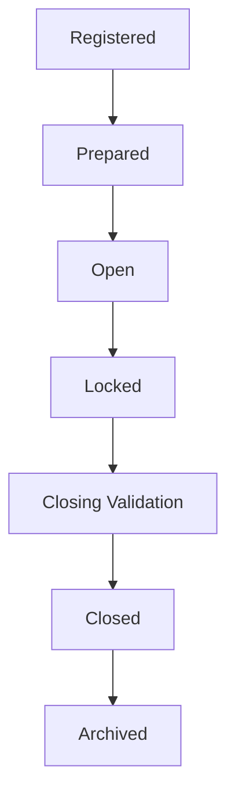
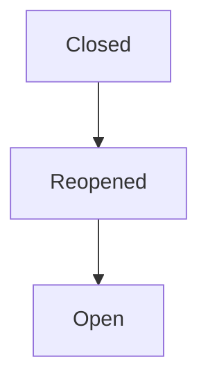
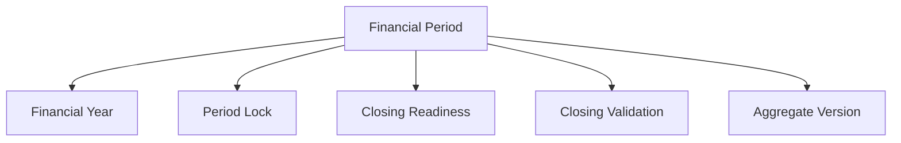
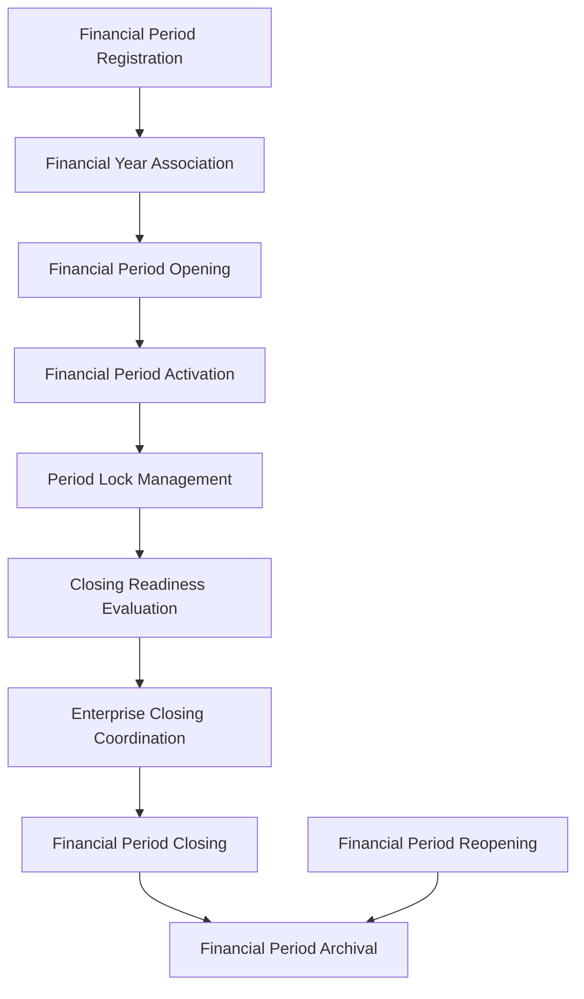
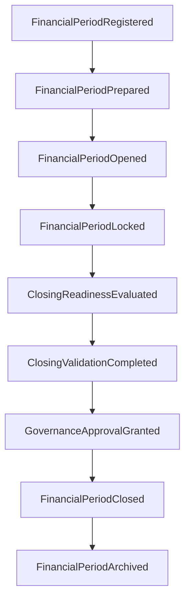
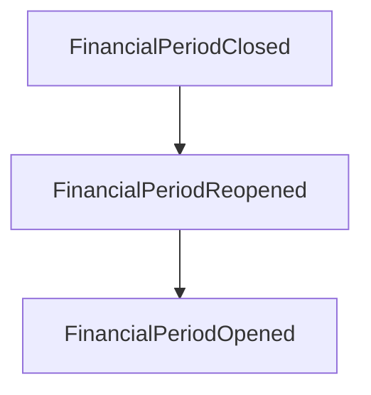
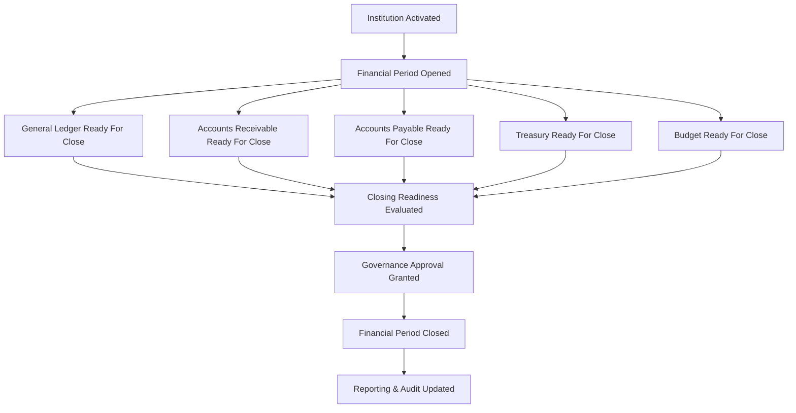
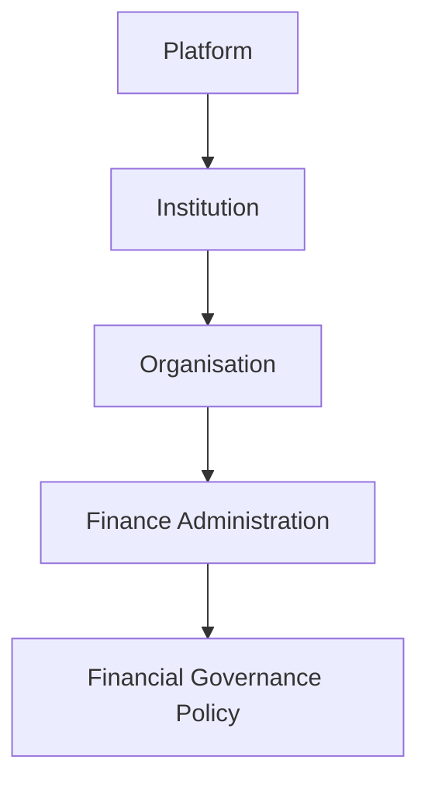

# L2-F09 — Financial Period & Closing

| Metadata | Value |
|----------|-------|
| Architecture Level | Level 2 — Domain Architecture |
| Domain | Finance |
| Document Code | L2-F09 |
| Status | Trust Certification Ready |
| Version | 1.0 |
| Canonical Owner | Finance Architecture |
| Document Owner | Finance — Period & Closing |
| Last Updated | TBD |

---

## Canonical Section Crosswalk

> Added 2026-08-04 under integrity finding INT-018. `governance/constitution/Volume_3_Architecture_Framework.md` section 18 requires every L2 document to define eleven sections. This document uses its own numbered-section convention; the table below maps the required sections to where they actually live. No content was moved.

| Required section (Volume 3 §18) | Location in this document |
|---|---|
| Purpose | §3 Purpose; Architectural Purpose |
| Scope | §4 Scope |
| Actors | — not present — |
| Entities | Internal Entities; Internal Entity Specifications; Entity Validation |
| Business Rules | Business Rules |
| Workflow | Workflows |
| State Machine | Lifecycle State |
| Contracts | §18 Integration Contracts; Repository Contracts |
| Events | §17 Domain Event Architecture; Event-Driven Collaboration; Domain Event Publication Rules |
| Dependencies | §1 Dependency Classification |
| Locked Decisions | — not present — |

> **Gap:** 2 required section(s) have no counterpart in this document: Actors, Locked Decisions. Recorded, not authored.

---

# 1. Dependency Classification

## Depends On

- L2-A01 — Platform & Tenant Foundation
- L2-A02 — Person & Identity Workflows
- L2-A03 — Authentication Architecture
- L2-A04 — Authorization & Policy Workflows
- L2-B01 — Institution Lifecycle
- L2-B02 — Organisation Workflows
- L2-F00 — Finance Domain Model & Foundation
- L2-F05 — Accounting & General Ledger
- L2-F07 — Accounts Receivable
- L2-F08 — Accounts Payable

## Consumed By

- Treasury & Banking
- Financial Reporting
- Budget Management
- Audit
- Compliance
- Executive Analytics

---

# 2. Architectural Classification

Domain Type

Enterprise Governance Domain

Architectural Style

- Domain Driven Design
- Event Driven Architecture
- Canonical Data Ownership
- Configuration Driven Behaviour
- Technology Independent
- Aggregate Centric
- Eventual Consistency
- CQRS Compatible

---

# 3. Purpose

The Financial Period & Closing domain defines the canonical enterprise architecture for governing the lifecycle of financial periods across the institution.

It owns the creation, activation, suspension, locking, closing, reopening, and archival of Financial Periods while coordinating enterprise-wide financial consistency through published business events.

The domain provides a single authoritative representation of Financial Period state.

No downstream architecture shall redefine the ownership, lifecycle, or governance responsibilities established by this document.

---

# 4. Scope

The Financial Period & Closing domain owns:

- Financial Period
- Financial Year
- Period Lifecycle
- Period Status
- Period Locking
- Period Closing
- Period Reopening
- Closing Validation
- Closing Readiness
- Period Configuration
- Period Domain Events

The domain explicitly does not own:

- Journal Entries
- Accounts Receivable
- Accounts Payable
- Treasury Operations
- Budget Allocations
- Financial Reporting
- Tax Calculation
- Bank Reconciliation

These remain owned by their respective bounded contexts.

Financial Period & Closing governs when those domains may perform financial operations.

---

# 5. Architectural Vision

The Financial Period & Closing domain establishes a single authoritative governance model for institutional accounting periods.

The architecture is designed around the following principles.

## Canonical Governance

Financial Period & Closing is the canonical owner of Financial Period state.

No other bounded context may independently define or modify period lifecycle.

---

## Enterprise Coordination

The domain coordinates financial readiness across Finance bounded contexts without assuming ownership of their business data.

Each participating bounded context retains ownership of its own Aggregates.

Financial Period & Closing governs only the lifecycle of accounting periods.

---

## Immutable Financial History

Once a Financial Period has been successfully closed, historical financial activity shall remain protected.

Corrections shall occur through governed reopening processes or compensating business transactions rather than destructive modification.

---

## Event-Driven Collaboration

Neighbouring Finance domains collaborate with Financial Period & Closing exclusively through immutable Domain Events and Integration Contracts.

Direct modification of external Aggregates is prohibited.

---

## Technology Independence

This architecture intentionally excludes:

- database technologies
- APIs
- messaging platforms
- programming languages
- workflow engines
- deployment models

These belong to lower architectural levels.

---

# 6. Architectural Goals

The Financial Period & Closing architecture shall achieve the following objectives.

## Goal 1 — Canonical Financial Period Management

Provide one authoritative representation of every Financial Period throughout its lifecycle.

---

## Goal 2 — Enterprise Financial Governance

Ensure that financial operations occur only within valid accounting periods.

---

## Goal 3 — Controlled Period Closing

Provide deterministic governance for period locking, validation, closing, and reopening while preserving financial integrity.

---

## Goal 4 — Auditability

Every Financial Period transition shall be represented by immutable business events supporting complete audit reconstruction.

---

## Goal 5 — Scalability

Support multiple Institutions, Organisations, Fiscal Calendars, and Financial Years without architectural redesign.

---

# 7. Bounded Context

The Financial Period & Closing bounded context encapsulates all business capabilities required to govern the lifecycle of accounting periods.

The bounded context owns:

- Financial Period identity
- Financial Year identity
- Period lifecycle
- Closing readiness
- Lock state
- Close state
- Reopen state
- Governance events

The bounded context explicitly excludes:

- accounting transactions
- payment execution
- receivable processing
- payable processing
- budgeting
- reporting

Financial Period & Closing governs accounting periods.

It does not own financial transactions.

---

# 8. Architectural Boundaries

The Financial Period & Closing bounded context owns:

## Canonical Ownership

- Financial Period Aggregate
- Financial Year
- Period Lifecycle
- Period Status
- Closing Readiness
- Lock State
- Aggregate Version
- Domain Events

## External References

The Aggregate references—but never owns—the following enterprise concepts.

- General Ledger
- Accounts Receivable
- Accounts Payable
- Treasury
- Budget
- Institution
- Organisation
- Fiscal Calendar
- Financial Policies

Reference ownership always remains within the originating bounded context.

---

## Ownership Principles

The following architectural rules are mandatory.

Financial Period & Closing shall never:

- create Journal Entries
- settle Payments
- create Receivables
- create Payables
- modify Ledger balances
- generate Financial Reports

Its sole responsibility is governing the lifecycle of Financial Periods and coordinating enterprise-wide financial readiness through published business events.
# 9. Canonical Aggregate Root

## Aggregate Philosophy

The Financial Period & Closing bounded context is centred around a single canonical Aggregate Root.

## Financial Period

The Financial Period Aggregate represents the authoritative enterprise representation of an accounting period throughout its operational lifecycle.

The Aggregate governs the complete lifecycle of a financial period while preserving financial governance, institutional consistency, auditability, and enterprise traceability.

Every accounting period shall be represented by exactly one Financial Period Aggregate.

No Financial Period may exist outside its Aggregate consistency boundary.

---

## Aggregate Responsibilities

The Financial Period Aggregate owns responsibility for:

- Financial Period Identity
- Financial Year Association
- Period Status
- Period Lifecycle
- Lock State
- Closing Readiness
- Closing Status
- Reopening Status
- Validation Results
- Aggregate Version
- Domain Event Publication

The Aggregate explicitly does not own:

- Journal Entries
- Receivables
- Payables
- Treasury Operations
- Budget Allocations
- Financial Reports
- Tax Calculations
- Bank Transactions

These concepts remain canonical within their respective bounded contexts.

---

## Canonical Ownership

The Financial Period Aggregate is the sole canonical owner of accounting period state.

No neighbouring bounded context may directly modify:

- Period Status
- Lock Status
- Closing Status
- Reopening Status
- Validation State
- Aggregate Version

Multi-domain collaboration shall occur exclusively through immutable business events.

---

## Aggregate Consistency Boundary

The Aggregate defines the transactional consistency boundary for accounting period governance.

Every modification shall preserve:

- lifecycle consistency
- governance consistency
- institutional policy compliance
- auditability
- business invariants

Consistency validation shall complete successfully before:

- persistence
- Domain Event publication
- Integration Event publication
- reporting projection updates

Partial Aggregate updates are prohibited.

---

# 10. Aggregate Instantiation Rules

## Creation Philosophy

Financial Period Aggregates are created through governed financial calendar initialization.

Creation shall occur only after:

- Institution establishment
- Fiscal Calendar definition
- Financial Year establishment
- Financial governance approval

Financial Period creation is an administrative governance activity.

It is not a financial transaction.

---

## Aggregate Creation Constraints

Every Financial Period Aggregate shall:

- possess one immutable Aggregate Identifier.
- belong to exactly one Institution.
- belong to exactly one Financial Year.
- represent exactly one accounting period.
- begin in the Registered lifecycle state.
- satisfy Aggregate invariants before persistence.

Creation outside an established Financial Year is prohibited.

---

## Aggregate Identity

Aggregate Identity is immutable.

Identity remains independent of:

- Calendar Names
- Financial Year Labels
- Fiscal Codes
- Reporting Identifiers

Business attributes may evolve.

Aggregate Identity shall not.

---

## Financial Year Association

Every Financial Period belongs to exactly one Financial Year.

A Financial Year may contain multiple Financial Periods.

Illustrative examples include:

- Monthly periods
- Quarterly periods
- Semester-based fiscal periods
- Custom institutional calendars

The number and duration of periods remain institution configurable.

---

## Aggregate Lifecycle

Illustrative lifecycle:

Exceptional transitions include:

Institution-specific lifecycle extensions remain configuration driven.

---

# 11. Domain-Driven Design Classification

## Aggregate Root

- Financial Period

---

## Internal Entities

### Financial Year

Represents the fiscal grouping that contains Financial Periods.

Maintains:

- Fiscal Year Identifier
- Fiscal Calendar
- Start Date
- End Date
- Fiscal Classification

The Financial Year is owned by the Aggregate.

---

### Closing Validation

Represents the outcome of enterprise closing validation.

Maintains:

- Validation Result
- Validation Timestamp
- Validation Summary
- Blocking Conditions

---

### Period Lock State

Represents operational restrictions applied to the Financial Period.

Maintains:

- Lock Status
- Lock Reason
- Lock Timestamp
- Lock Authority

---

### Closing Readiness

Represents enterprise readiness to close the Financial Period.

Maintains:

- Readiness Status
- Outstanding Issues
- Validation Summary
- Governance State

---

## Value Objects

Illustrative Value Objects include:

- Financial Period Identifier
- Financial Year Identifier
- Fiscal Calendar Reference
- Institution Reference
- Organisation Reference
- Period Date Range
- Period Classification
- Correlation Identifier
- Closing Reason
- Reopening Reason
- Lock Reason
- Money (where applicable)
- Version Identifier

Value Objects remain immutable.

Replacement produces new instances.

---

## Domain Services

Illustrative Domain Services include:

### Period Registration Service

Coordinates Aggregate creation.

---

### Closing Validation Service

Evaluates enterprise closing readiness.

---

### Period Lock Service

Coordinates period locking decisions.

---

### Period Reopening Service

Coordinates approved reopening.

---

### Fiscal Calendar Service

Coordinates institutional fiscal calendar behaviour.

---

### Governance Validation Service

Ensures enterprise governance requirements are satisfied before lifecycle progression.

---

## Domain Policies

Illustrative policies include:

- Period Opening Policy
- Period Lock Policy
- Period Closing Policy
- Period Reopening Policy
- Closing Validation Policy
- Fiscal Calendar Policy
- Governance Approval Policy
- Financial Integrity Policy

Policies remain institution configurable.

Business rules shall never be hardcoded.

---

# 12. Aggregate Structure

## Aggregate Composition

The Financial Period Aggregate is the only consistency boundary.

Internal components cannot exist independently.

No child Entity may be persisted outside the Aggregate.

---

## Aggregate Ownership Rules

The Aggregate owns:

- Financial Year
- Lock State
- Closing Readiness
- Closing Validation
- Aggregate Version

The Aggregate references:

- General Ledger
- Accounts Receivable
- Accounts Payable
- Treasury
- Budget
- Institution
- Organisation
- Fiscal Policies

Ownership remains within the originating bounded contexts.

---

## Aggregate Consistency Rules

Before every lifecycle transition:

- Financial Period shall remain valid.
- Financial Year association shall remain valid.
- Lock State shall remain consistent.
- Closing Validation shall succeed where required.
- Aggregate Version shall advance.
- Business invariants shall succeed.
- Domain Policies shall approve the transition.

Only then may Domain Events be published.

---

# 13. Aggregate Relationships

## Upstream Relationships

The Financial Period Aggregate consumes authoritative business events from:

- Institution Management
- Fiscal Calendar Management
- Governance Administration

These domains establish enterprise governance context.

---

## Downstream Relationships

The Aggregate publishes business events consumed by:

- General Ledger
- Accounts Receivable
- Accounts Payable
- Treasury
- Budget Management
- Financial Reporting
- Audit

These domains react to Financial Period state.

They never modify Aggregate state directly.

---

## Relationship Principles

The following architectural rules are mandatory.

- Ownership never crosses bounded contexts.
- Relationships are reference-based.
- Aggregate consistency is local.
- Multi-domain consistency is eventual.
- Financial Period state is canonical.
- Internal Aggregate structures remain private.
- Governance decisions are published as immutable Domain Events.
# 14. Business Capabilities

## Capability Philosophy

The Financial Period & Closing bounded context provides the enterprise capabilities required to govern the lifecycle of institutional accounting periods.

Capabilities represent business responsibilities.

They do not expose implementation details.

They do not assume ownership of neighbouring Finance domains.

Every capability preserves canonical ownership, Aggregate consistency, and enterprise governance.

---

## Capability Classification

The bounded context provides the following business capabilities.

- Financial Period Registration
- Financial Year Association
- Financial Period Opening
- Financial Period Activation
- Period Lock Management
- Closing Readiness Evaluation
- Enterprise Closing Coordination
- Financial Period Closing
- Financial Period Reopening
- Financial Period Archival
- Fiscal Calendar Governance
- Period Status Management
- Closing Validation
- Governance Policy Enforcement
- Period Query Support

---

## Financial Period Registration

## Purpose

Creates a new Financial Period Aggregate.

Registration establishes the canonical identity of an accounting period.

Registration does not activate the period.

---

## Responsibilities

The capability shall:

- create Aggregate identity
- associate Financial Year
- establish lifecycle
- initialize governance state
- initialize lock state
- initialize closing readiness

---

## Business Outcome

A Financial Period Aggregate becomes available for governance.

---

## Financial Year Association

## Purpose

Associates each Financial Period with its governing Financial Year.

A Financial Period belongs to exactly one Financial Year.

A Financial Year may contain multiple Financial Periods.

---

## Responsibilities

Maintain:

- fiscal relationship
- reporting hierarchy
- institutional calendar consistency

Association remains immutable after creation unless governed administrative correction is approved.

---

## Financial Period Opening

## Purpose

Transitions a prepared Financial Period into operational availability.

Only an Open Financial Period may accept financial activity from participating Finance domains.

---

## Responsibilities

The capability shall:

- validate lifecycle
- verify institutional policy
- verify predecessor period requirements
- publish opening events

---

## Business Rules

A Financial Period cannot be opened if:

- prerequisite governance fails
- predecessor dependencies remain incomplete
- institutional policy prohibits opening

---

## Financial Period Activation

## Purpose

Activates the Financial Period for enterprise financial processing.

Activation communicates governance state.

It does not create financial transactions.

---

## Responsibilities

- establish operational status
- notify participating domains
- publish activation events

---

## Period Lock Management

## Purpose

Controls temporary operational restrictions applied to a Financial Period.

Locking protects financial integrity while preserving the possibility of future reopening.

---

## Responsibilities

The capability manages:

- lock initiation
- lock release
- lock reason
- lock authority
- lock history

---

## Lock Behaviour

While locked:

Participating Finance domains shall reject creation of new financial activity within the affected period according to their own business policies.

Existing historical information remains accessible.

---

## Closing Readiness Evaluation

## Purpose

Determines whether the enterprise satisfies every prerequisite required for Financial Period closure.

Readiness is an evaluation.

It is not the closing operation.

---

## Responsibilities

Evaluate published readiness information received from participating bounded contexts.

Illustrative readiness sources include:

- General Ledger
- Accounts Receivable
- Accounts Payable
- Treasury
- Budget Management

Readiness represents enterprise governance status.

---

## Readiness Outcomes

Illustrative outcomes include:

- Ready
- Blocked
- Pending
- Requires Review

Institution-specific classifications remain configuration driven.

---

## Enterprise Closing Coordination

## Purpose

Coordinates enterprise period closing without assuming ownership of neighbouring domains.

This capability represents governance coordination rather than workflow execution.

---

## Responsibilities

Coordinate readiness from participating domains.

Evaluate enterprise-wide closing eligibility.

Publish governance decisions.

Maintain closing traceability.

---

## Architectural Rules

The capability shall never:

- close General Ledger
- close Accounts Payable
- close Accounts Receivable
- close Treasury
- modify Budget
- execute Accounting operations

Neighbouring domains remain independently responsible for their own closing behaviour.

---

## Financial Period Closing

## Purpose

Transitions the Financial Period into the Closed lifecycle state.

Closure establishes immutable historical governance.

---

## Responsibilities

The capability shall:

- validate readiness
- verify governance approval
- preserve historical integrity
- transition lifecycle
- publish closure events

---

## Business Outcome

Following successful closure:

- new financial activity is prohibited
- historical information remains queryable
- audit reconstruction remains available

---

## Financial Period Reopening

## Purpose

Restores a previously closed Financial Period under governed institutional approval.

Reopening exists to support exceptional business correction.

It is not part of normal operational processing.

---

## Responsibilities

The capability manages:

- reopening request
- governance approval
- lifecycle transition
- historical preservation
- event publication

---

## Business Rules

Reopening shall preserve:

- Aggregate Identity
- historical events
- audit history
- version history
- financial traceability

Historical business facts remain immutable.

---

## Financial Period Archival

## Purpose

Preserves completed Financial Periods for long-term institutional history.

Archival represents operational lifecycle completion.

Archival does not destroy information.

---

## Responsibilities

Maintain:

- historical accessibility
- reporting support
- audit reconstruction
- institutional retention

Archived Financial Periods remain historically available.

---

## Fiscal Calendar Governance

## Purpose

Maintains governance over institutional fiscal calendars.

Supports diverse institutional calendar models.

Illustrative examples include:

- monthly accounting
- quarterly accounting
- semester accounting
- custom fiscal structures

Calendar behaviour remains configuration driven.

---

## Period Status Management

## Purpose

Maintains the authoritative operational state of every Financial Period.

Illustrative lifecycle states include:

- Registered
- Prepared
- Open
- Locked
- Closing Validation
- Closed
- Reopened
- Archived

Only one active lifecycle state shall exist at any time.

---

## Closing Validation

## Purpose

Evaluates enterprise governance requirements before allowing closure.

Validation protects financial integrity.

---

## Validation Categories

Illustrative validation categories include:

- governance validation
- institutional policy validation
- dependency validation
- readiness validation
- lifecycle validation

Every mandatory validation shall succeed before closure.

---

## Governance Policy Enforcement

## Purpose

Applies institution-specific financial governance policies throughout the lifecycle.

Illustrative policies include:

- opening approval
- locking authority
- closing authority
- reopening approval
- fiscal calendar rules

Policies remain externally configurable.

Aggregate ownership remains unchanged.

---

## Period Query Support

## Purpose

Provides authoritative read access to Financial Period governance information.

Illustrative queries include:

- current financial period
- active financial year
- closed periods
- locked periods
- reopening history
- closing readiness
- governance history

Query models remain read-only.

Business ownership remains within the Aggregate.

---

## Capability Relationship Overview

Every capability preserves Aggregate consistency.

No capability bypasses Aggregate boundaries.

No capability assumes ownership of neighbouring Finance domains.

All enterprise collaboration occurs through published business facts and immutable Domain Events.
# 15. Domain Model

## Domain Model Philosophy

The Financial Period & Closing domain model defines the canonical business representation for governing institutional accounting periods.

The model encapsulates:

- enterprise governance
- lifecycle management
- financial period integrity
- auditability
- institutional policy enforcement

The domain model intentionally excludes implementation concerns.

---

## Aggregate Root Specification

## Financial Period Aggregate

The Financial Period Aggregate is the sole Aggregate Root of this bounded context.

It represents the complete governance boundary for a single accounting period.

The Aggregate owns:

- Aggregate Identity
- Financial Year Association
- Period Lifecycle
- Lock State
- Closing Readiness
- Closing Validation
- Aggregate Version
- Domain Event Publication

The Aggregate guarantees transactional consistency for all owned entities.

---

## Aggregate Responsibilities

The Aggregate shall:

- maintain financial period identity
- govern lifecycle transitions
- enforce business invariants
- preserve financial integrity
- coordinate enterprise closing readiness
- maintain auditability
- publish immutable business events

The Aggregate shall never:

- execute accounting transactions
- perform payment processing
- create journal entries
- reconcile bank accounts
- generate financial reports

---

## Internal Entity Specifications

## Financial Year

### Purpose

Represents the fiscal grouping that contains one or more Financial Periods.

Financial Year provides organizational context.

It is not an independent consistency boundary.

---

### Responsibilities

Maintain:

- Fiscal Year Identifier
- Fiscal Calendar
- Fiscal Classification
- Start Date
- End Date

Financial Year ownership remains internal to the Aggregate.

---

## Period Lock State

### Purpose

Represents operational restrictions applied to the Financial Period.

Lock State protects financial integrity during governance operations.

---

### Responsibilities

Maintain:

- Lock Status
- Lock Authority
- Lock Timestamp
- Lock Reason
- Lock History

Lock State does not perform authorization.

Authorization remains externally governed.

---

## Closing Readiness

### Purpose

Represents the enterprise evaluation of period closing eligibility.

Closing Readiness is computed from published business facts.

It is not externally editable.

---

### Responsibilities

Maintain:

- Readiness Status
- Outstanding Dependencies
- Blocking Conditions
- Evaluation Timestamp
- Readiness Summary

Closing Readiness owns no external financial information.

---

### Ownership Rules

Neighbouring domains publish readiness facts.

The Aggregate evaluates readiness.

Only the Aggregate owns readiness state.

---

## Closing Validation

### Purpose

Represents validation outcomes required before Financial Period closure.

Validation protects enterprise financial integrity.

---

### Responsibilities

Maintain:

- Validation Identifier
- Validation Result
- Validation Timestamp
- Validation Summary
- Blocking Violations

Validation results remain historically available.

---

## Lifecycle State

### Purpose

Represents the current operational state of the Financial Period.

Only one lifecycle state shall exist at any time.

---

### Illustrative States

- Registered
- Prepared
- Open
- Locked
- Closing Validation
- Closed
- Reopened
- Archived

Lifecycle progression shall satisfy Aggregate invariants.

---

## Value Object Specifications

## Financial Period Identifier

Uniquely identifies a Financial Period Aggregate.

Characteristics:

- immutable
- globally unique
- business independent

---

## Financial Year Identifier

Identifies the associated Financial Year.

Characteristics:

- immutable
- institution scoped
- audit stable

---

## Period Date Range

Represents the operational duration of the accounting period.

Characteristics:

- immutable
- validated
- deterministic

Contains:

- Start Date
- End Date

---

## Fiscal Calendar Reference

References the governing Fiscal Calendar.

Ownership remains external.

The Aggregate stores only an immutable reference.

---

## Institution Reference

Represents the owning Institution.

Characteristics:

- immutable
- externally owned
- globally traceable

---

## Organisation Reference

Represents the governing Organisation.

Organisation ownership remains external.

---

## Period Classification

Represents institutional classification of accounting periods.

Illustrative classifications include:

- Monthly
- Quarterly
- Semester
- Annual
- Custom

Institution-specific classifications remain configuration driven.

---

## Lock Reason

Represents the business reason for applying a lock.

Illustrative examples include:

- Month-End Processing
- Audit Review
- Compliance Investigation
- Governance Approval

Reasons remain immutable.

---

## Closing Reason

Represents the business justification for Financial Period closure.

Characteristics:

- immutable
- auditable
- historically preserved

---

## Reopening Reason

Represents the approved justification for reopening a closed period.

Historical preservation is mandatory.

---

## Correlation Identifier

Supports enterprise-wide event traceability.

Used to correlate:

- commands
- events
- audit records
- integration messages

Correlation Identifiers remain immutable.

---

## Aggregate Version

Represents optimistic concurrency for Aggregate modification.

Version advancement occurs only after successful Aggregate persistence.

---

## Domain Service Specifications

## Financial Period Registration Service

### Responsibilities

Coordinates creation of new Financial Period Aggregates.

The service:

- validates creation prerequisites
- initializes Aggregate state
- establishes Financial Year association

The service owns no business state.

---

## Period Opening Service

### Responsibilities

Coordinates governed transition into the Open lifecycle state.

Validates:

- predecessor completion
- institutional policy
- Aggregate invariants

---

## Closing Readiness Evaluation Service

### Responsibilities

Evaluates enterprise readiness using published business facts.

Illustrative readiness inputs include:

- General Ledger readiness
- Accounts Receivable readiness
- Accounts Payable readiness
- Treasury readiness
- Budget readiness

The service computes readiness.

It never modifies neighbouring domains.

---

## Period Closing Service

### Responsibilities

Coordinates successful Aggregate transition into Closed state.

Responsibilities include:

- readiness verification
- policy verification
- lifecycle validation
- Domain Event publication

---

## Period Reopening Service

### Responsibilities

Coordinates approved reopening of Financial Periods.

Preserves:

- Aggregate Identity
- Event History
- Version History
- Audit History

Historical business facts remain immutable.

---

## Governance Validation Service

### Responsibilities

Evaluates institutional governance policies before lifecycle transitions.

Illustrative validation includes:

- opening approval
- locking approval
- closing approval
- reopening approval

Governance policies remain externally configurable.

---

## Domain Policy Specifications

## Period Opening Policy

Determines eligibility for opening a Financial Period.

Illustrative evaluation includes:

- predecessor completion
- fiscal calendar validation
- governance approval

---

## Period Lock Policy

Determines when operational locking is permitted.

Policy may consider:

- institutional governance
- audit activities
- compliance requirements

---

## Closing Readiness Policy

Determines enterprise readiness requirements.

Institution-specific requirements remain configuration driven.

Neighbouring domains remain independently responsible for satisfying readiness.

---

## Financial Period Closing Policy

Determines when closure is permitted.

Closure requires:

- successful validation
- readiness approval
- governance approval

---

## Period Reopening Policy

Defines exceptional reopening requirements.

Illustrative considerations include:

- governance approval
- audit justification
- institutional authorization

Reopening shall remain exceptional.

---

## Fiscal Calendar Policy

Defines institutional fiscal structures.

Illustrative models include:

- monthly
- quarterly
- semester
- custom

The Aggregate remains independent of calendar implementation.

---

## Governance Approval Policy

Represents institutional governance requirements for lifecycle transitions.

Approval mechanisms remain external.

The Aggregate consumes only governance outcomes.

---

## Repository Contracts

## Repository Philosophy

Repositories persist Aggregate state.

Repositories do not execute business workflows.

Repositories do not coordinate neighbouring bounded contexts.

---

## Financial Period Repository

Responsibilities include:

- save Aggregate
- retrieve Aggregate
- retrieve by Financial Period Identifier
- retrieve active Financial Period
- retrieve by Financial Year
- retrieve historical Financial Periods

Repositories expose Aggregate boundaries only.

---

## Read Model Repository

Supports read-only projections.

Illustrative projections include:

- Active Financial Period
- Closed Period History
- Lock History
- Reopening History
- Closing Readiness Dashboard

Read Models never modify Aggregate state.

---

## Repository Constraints

Repositories shall never:

- violate Aggregate invariants
- bypass lifecycle validation
- publish business events
- coordinate enterprise workflows
- expose internal entities

Repositories exist solely to persist Aggregate state.

---

## Persistence Principles

Persistence remains:

- technology independent
- implementation independent
- transactional within the Aggregate
- version aware
- audit compatible

---

## CQRS Compatibility

Command Models preserve Aggregate consistency.

Read Models optimize enterprise reporting.

The two models remain independently evolvable.

---

## Anti-Corruption Boundary

Neighbouring domains shall never access Aggregate internals.

All collaboration shall occur through:

- immutable references
- Domain Events
- Integration Contracts

Repository access across bounded contexts is prohibited.
# 16. Aggregate Specification

## Aggregate Philosophy

The Financial Period Aggregate represents the authoritative consistency boundary for governing institutional accounting periods.

Every lifecycle transition shall occur entirely within the Aggregate.

Neighbouring bounded contexts participate through immutable business events.

They never directly modify Aggregate state.

---

## Aggregate Responsibilities

The Aggregate is responsible for:

- maintaining Financial Period identity
- governing lifecycle progression
- enforcing business invariants
- protecting financial governance
- evaluating enterprise readiness
- preserving audit history
- publishing immutable Domain Events

The Aggregate does not own financial transactions.

It owns only the governance of accounting periods.

---

## Aggregate Consistency Boundary

The Financial Period Aggregate guarantees transactional consistency for:

- Financial Year Association
- Lifecycle State
- Lock State
- Closing Readiness
- Closing Validation
- Aggregate Version

No child entity may be modified independently.

Every state transition occurs through Aggregate behaviour.

---

## Aggregate Responsibility Matrix

| Business Responsibility | Aggregate Ownership |
|--------------------------|---------------------|
| Financial Period Identity | ✓ |
| Financial Year Association | ✓ |
| Period Lifecycle | ✓ |
| Lock State | ✓ |
| Closing Readiness | ✓ |
| Closing Validation | ✓ |
| Aggregate Version | ✓ |
| Journal Entries | ✗ |
| Accounts Payable | ✗ |
| Accounts Receivable | ✗ |
| Treasury | ✗ |
| Budget | ✗ |
| Financial Reporting | ✗ |

---

## Aggregate State Model

Illustrative lifecycle progression:

Exceptional lifecycle:

Every transition shall satisfy Aggregate invariants.

---

## Aggregate Behaviour

The Aggregate exposes business behaviour through governed commands.

Illustrative behaviours include:

- Register Financial Period
- Prepare Financial Period
- Open Financial Period
- Lock Financial Period
- Evaluate Closing Readiness
- Validate Closing
- Close Financial Period
- Reopen Financial Period
- Archive Financial Period

Every behaviour validates:

- lifecycle
- invariants
- institutional policy
- Aggregate consistency

---

## Aggregate State Transition Rules

## Registered → Prepared

Requirements:

- Financial Year established
- Period Date Range valid
- Aggregate successfully created

---

## Prepared → Open

Requirements:

- predecessor dependencies satisfied
- governance approval obtained
- institutional policy satisfied

---

## Open → Locked

Requirements:

- lock authority verified
- lifecycle valid
- policy permits locking

---

## Locked → Closing Validation

Requirements:

- lock state active
- closing requested
- validation initiated

---

## Closing Validation → Closed

Requirements:

- enterprise readiness achieved
- validation successful
- governance approval granted

---

## Closed → Archived

Requirements:

- retention policy satisfied
- archival approval obtained

Historical accessibility remains preserved.

---

## Closed → Reopened

Requirements:

- reopening approved
- institutional policy satisfied
- exceptional governance completed

Historical business facts remain immutable.

---

## Aggregate Invariants

The following invariants shall always remain true.

---

## Identity Invariants

The Aggregate:

- possesses exactly one Aggregate Identifier
- belongs to exactly one Institution
- belongs to exactly one Financial Year
- represents exactly one accounting period

Identity never changes.

---

## Lifecycle Invariants

Only one lifecycle state may exist simultaneously.

Illegal state combinations are prohibited.

Lifecycle transitions shall remain deterministic.

---

## Governance Invariants

Closure shall never occur unless:

- readiness succeeds
- validation succeeds
- governance approval succeeds

Bypassing governance is prohibited.

---

## Lock Invariants

While Locked:

- lifecycle remains stable
- governance continues
- financial history remains accessible

Lock removal shall occur only through governed behaviour.

---

## Closing Readiness Invariants

Closing Readiness:

- belongs exclusively to the Aggregate
- derives from published business facts
- cannot be externally modified
- shall accurately represent evaluation results

Neighbouring domains own readiness facts.

The Aggregate owns readiness conclusions.

---

## Historical Invariants

Historical information shall remain:

- immutable
- queryable
- auditable
- reconstructable

Destructive modification is prohibited.

---

## Traceability Invariants

Every Aggregate shall preserve references to:

- Institution
- Organisation
- Financial Year
- Fiscal Calendar
- Correlation Identifier

Broken traceability is prohibited.

---

## Aggregate Commands

The Aggregate accepts only validated business commands.

Commands express business intent.

They do not represent implementation mechanisms.

---

## Register Financial Period

Purpose:

Creates a new Financial Period Aggregate.

Illustrative outcomes:

- Aggregate initialized
- lifecycle established
- Domain Event published

---

## Prepare Financial Period

Purpose:

Transitions Registered → Prepared.

Preparation verifies administrative readiness.

---

## Open Financial Period

Purpose:

Transitions Prepared → Open.

Makes the accounting period operational.

---

## Lock Financial Period

Purpose:

Applies governed operational restrictions.

Locking protects financial integrity.

---

## Evaluate Closing Readiness

Purpose:

Evaluates enterprise readiness using published readiness facts.

Evaluation produces an internal readiness conclusion.

Neighbouring bounded contexts remain unaffected.

---

## Validate Closing

Purpose:

Performs governance validation before closure.

Validation protects enterprise financial correctness.

---

## Close Financial Period

Purpose:

Transitions the Aggregate into the Closed state.

Closure establishes immutable historical governance.

---

## Reopen Financial Period

Purpose:

Restores operational availability following approved governance.

Historical records remain unchanged.

---

## Archive Financial Period

Purpose:

Completes the operational lifecycle.

Archival preserves historical accessibility.

---

## Aggregate Versioning

Every successful Aggregate modification advances Aggregate Version.

Failed modifications do not.

Aggregate Version supports optimistic concurrency.

---

## Optimistic Concurrency

Concurrent modification attempts shall detect Version conflicts.

Conflicting modifications shall fail safely.

Aggregate consistency always takes precedence over throughput.

---

## Failure Behaviour

If any invariant fails:

- Aggregate state remains unchanged
- Version remains unchanged
- persistence is cancelled
- Domain Events are not published

No partial lifecycle transition shall occur.

---

## Recovery Principles

Recovery occurs through new business operations.

Recovery shall never:

- overwrite history
- modify published events
- invalidate audit trails

Business corrections produce new facts.

Historical facts remain immutable.

---

## Domain Event Publication Rules

Domain Events shall be published only after:

- Aggregate persistence succeeds
- Aggregate Version advances
- all invariants succeed
- lifecycle transition completes

Events shall never be published from partially successful operations.

---

## Encapsulation Rules

Internal entities remain private to the Aggregate.

Neighbouring bounded contexts shall never access:

- Closing Readiness
- Closing Validation
- Lock State
- Aggregate Version

Interaction occurs exclusively through:

- Commands
- Domain Events
- Integration Contracts

---

## Architectural Guarantees

The Financial Period Aggregate guarantees:

- canonical ownership
- deterministic lifecycle progression
- enterprise governance
- financial integrity
- immutable audit history
- bounded context isolation
- optimistic concurrency
- event-driven collaboration
- technology independence

These guarantees remain valid regardless of deployment model, implementation framework, enterprise size, or institutional fiscal structure.
# 17. Domain Event Architecture

## Domain Event Philosophy

Domain Events represent immutable business facts that have already occurred within the Financial Period Aggregate.

Every published event represents a completed business outcome.

Events never represent:

- user requests
- workflow instructions
- implementation commands
- process orchestration

Events communicate enterprise governance.

---

## Architectural Objectives

The Domain Event Architecture exists to achieve the following objectives.

## Enterprise Governance

Communicate authoritative Financial Period lifecycle changes across the enterprise.

---

## Loose Coupling

Enable neighbouring bounded contexts to react independently without creating direct dependencies.

---

## Immutable Audit Trail

Every significant lifecycle transition shall produce a permanent business fact.

Events shall remain immutable.

---

## Event-Driven Collaboration

Neighbouring Finance domains collaborate through published business facts rather than imperative calls.

---

## Technology Independence

The event model is independent of:

- message brokers
- event buses
- APIs
- serialization formats
- infrastructure

Only business semantics are defined.

---

## Domain Event Characteristics

Every Domain Event shall be:

- immutable
- timestamped
- versioned
- historically preserved
- correlated
- uniquely identifiable
- business meaningful

Events shall never expose Aggregate internals.

---

## Event Taxonomy

The Financial Period Aggregate publishes four categories of Domain Events.

## Lifecycle Events

Represent lifecycle progression.

Illustrative events include:

- FinancialPeriodRegistered
- FinancialPeriodPrepared
- FinancialPeriodOpened
- FinancialPeriodLocked
- FinancialPeriodClosed
- FinancialPeriodReopened
- FinancialPeriodArchived

---

## Governance Events

Represent governance outcomes.

Illustrative events include:

- ClosingReadinessEvaluated
- ClosingValidationCompleted
- GovernanceApprovalGranted
- GovernanceApprovalRejected

---

## Operational Events

Represent operational state changes.

Illustrative events include:

- LockStateChanged
- PeriodStatusChanged
- ValidationStateChanged

---

## Administrative Events

Represent administrative modifications.

Illustrative events include:

- FiscalCalendarAssociated
- FinancialYearAssigned
- PeriodConfigurationUpdated

---

## Domain Event Catalogue

## FinancialPeriodRegistered

### Business Meaning

A new Financial Period Aggregate has been successfully created.

---

### Published After

- Aggregate persistence
- Aggregate initialization
- successful invariant validation

---

### Consumed By

Illustrative consumers include:

- Audit
- Reporting
- Administration

---

## FinancialPeriodPrepared

### Business Meaning

The Financial Period has completed administrative preparation.

The period is eligible for governance evaluation.

---

## FinancialPeriodOpened

### Business Meaning

The Financial Period has become operational.

Participating Finance domains may begin accepting financial activity according to their own business rules.

---

### Illustrative Consumers

- General Ledger
- Accounts Receivable
- Accounts Payable
- Treasury
- Budget

Each domain determines its own operational response.

---

## FinancialPeriodLocked

### Business Meaning

Operational restrictions have been applied.

The Aggregate remains active.

Financial history remains accessible.

---

### Business Purpose

Protect financial integrity during governance activities.

---

## ClosingReadinessEvaluated

### Business Meaning

Enterprise readiness has been evaluated using published readiness facts.

The event communicates the Aggregate's readiness conclusion.

Neighbouring domains remain unchanged.

---

## ClosingValidationCompleted

### Business Meaning

Required closing validation has completed.

Illustrative outcomes include:

- Successful
- Failed
- Requires Review

Outcome classifications remain institution configurable.

---

## GovernanceApprovalGranted

### Business Meaning

Required governance approval has been obtained.

Approval mechanisms remain externally owned.

The Aggregate records only the business outcome.

---

## GovernanceApprovalRejected

### Business Meaning

Required governance approval has been denied.

The Aggregate remains in its existing lifecycle state.

---

## FinancialPeriodClosed

### Business Meaning

The Financial Period has entered the Closed lifecycle state.

The period becomes historically governed.

New financial activity within the period shall be restricted according to neighbouring bounded context policies.

---

### Illustrative Consumers

- General Ledger
- Accounts Payable
- Accounts Receivable
- Treasury
- Budget
- Reporting
- Audit

Each bounded context independently applies its own closure behaviour.

---

## FinancialPeriodReopened

### Business Meaning

A previously closed Financial Period has been restored following approved governance.

Historical business facts remain unchanged.

---

## FinancialPeriodArchived

### Business Meaning

The Financial Period has completed its operational lifecycle.

The Aggregate becomes historically retained.

---

## LockStateChanged

### Business Meaning

Operational lock status has changed.

The event communicates governance state only.

---

## PeriodStatusChanged

### Business Meaning

The authoritative lifecycle state has changed.

The event provides a stable enterprise representation of period status.

---

## ValidationStateChanged

### Business Meaning

Closing validation state has changed.

Validation ownership remains internal to the Aggregate.

---

## FiscalCalendarAssociated

### Business Meaning

The Aggregate has been associated with a governing Fiscal Calendar.

The Fiscal Calendar remains externally owned.

---

## FinancialYearAssigned

### Business Meaning

The Aggregate has been associated with a Financial Year.

The event communicates organizational context.

---

## PeriodConfigurationUpdated

### Business Meaning

Institutional configuration affecting Financial Period governance has changed.

Configuration changes shall not alter Aggregate ownership.

---

## Event Publication Rules

Domain Events shall be published only after:

- successful Aggregate persistence
- successful invariant validation
- successful lifecycle transition
- Aggregate Version advancement

Publication from partially completed operations is prohibited.

---

## Event Ordering

Events shall preserve business chronology.

Illustrative ordering:

Exceptional ordering:

Business chronology shall always remain deterministic.

---

## Event Idempotency

Repeated delivery of the same Domain Event shall not alter business meaning.

Consumers shall treat duplicate events as representing the same historical fact.

---

## Event Versioning

Every Domain Event shall include a business version.

Versioning enables:

- schema evolution
- backward compatibility
- long-term interoperability

Historical versions remain immutable.

---

## Event Identity

Every Domain Event possesses a unique Event Identifier.

Event Identity remains independent of:

- Aggregate Identifier
- Correlation Identifier
- Message Identifier

Identity shall never change.

---

## Event Correlation

Every Domain Event shall include an immutable Correlation Identifier.

Correlation enables reconstruction of:

- business decisions
- lifecycle transitions
- governance approvals
- enterprise workflows

Correlation spans bounded contexts while preserving ownership.

---

## Event Publication Guarantees

The Financial Period Aggregate guarantees that published Domain Events:

- represent completed business facts
- preserve ordering
- remain immutable
- remain historically available
- are published at most once per successful business transition
- never expose Aggregate internals

---

## Integration Event Mapping

| Domain Event | Illustrative Enterprise Consumers |
|--------------|-----------------------------------|
| FinancialPeriodRegistered | Audit, Administration |
| FinancialPeriodPrepared | Governance Services |
| FinancialPeriodOpened | GL, AR, AP, Treasury, Budget |
| FinancialPeriodLocked | GL, AR, AP, Treasury |
| ClosingReadinessEvaluated | Governance Dashboard |
| ClosingValidationCompleted | Audit, Governance |
| GovernanceApprovalGranted | Governance Dashboard |
| GovernanceApprovalRejected | Governance Dashboard |
| FinancialPeriodClosed | GL, AR, AP, Treasury, Reporting, Audit |
| FinancialPeriodReopened | GL, AR, AP, Treasury |
| FinancialPeriodArchived | Reporting, Audit |
| PeriodStatusChanged | Reporting |
| LockStateChanged | Audit |
| ValidationStateChanged | Governance Dashboard |

This mapping is illustrative.

Neighbouring bounded contexts determine their own reactions.

---

## Event Sourcing Compatibility

Although the Aggregate is not defined as Event Sourced, the published Domain Events are compatible with future Event Sourcing adoption.

The event catalogue preserves:

- business chronology
- immutable history
- deterministic replay
- audit reconstruction

---

## Event Retention Principles

Published Domain Events shall remain historically available according to institutional retention policies.

Retention shall preserve:

- financial governance
- auditability
- traceability
- compliance

Deletion of historical business events is prohibited unless explicitly permitted by applicable legal or regulatory requirements and institutional governance.

---

## Audit and Observability

Every Domain Event contributes to enterprise observability.

Events support:

- audit reconstruction
- governance verification
- operational monitoring
- compliance analysis
- historical reporting

Observability remains passive.

Events never alter business behaviour.

---

## Architectural Guarantees

The Domain Event Architecture guarantees:

- immutable business facts
- deterministic ordering
- canonical governance ownership
- enterprise traceability
- audit readiness
- event-driven collaboration
- bounded context isolation
- technology independence
- future Event Sourcing compatibility

These guarantees remain valid regardless of implementation technology, deployment architecture, enterprise scale, or fiscal calendar model.
# 18. Integration Contracts

## Integration Philosophy

The Financial Period & Closing bounded context collaborates with neighbouring enterprise domains exclusively through well-defined Integration Contracts.

Integration Contracts communicate business semantics.

They never expose:

- Aggregate internals
- persistence models
- implementation details
- infrastructure technologies
- internal validation logic

Every contract preserves bounded context independence.

---

## Architectural Objectives

Integration Contracts exist to achieve the following objectives.

## Enterprise Coordination

Coordinate Financial Period governance across Finance domains while preserving domain autonomy.

---

## Canonical Ownership

Each business concept has exactly one canonical owner.

Integration Contracts shall never transfer ownership.

---

## Event-Driven Collaboration

Neighbouring bounded contexts collaborate through immutable business facts.

No synchronous business workflow shall cross Aggregate boundaries.

---

## Technology Independence

Integration Contracts define business meaning only.

They intentionally exclude:

- REST APIs
- GraphQL
- RPC
- Database replication
- Messaging technology
- Service frameworks

These belong to lower architectural layers.

---

## Integration Principles

Every Integration Contract shall satisfy the following principles.

1. Ownership remains local.

2. Aggregate boundaries are never bypassed.

3. Business semantics remain stable.

4. Multi-domain consistency is eventual.

5. References remain immutable.

6. Published facts are historically preserved.

7. Contracts evolve independently of implementation technology.

---

## Upstream Integrations

Upstream domains establish enterprise governance context.

Financial Period & Closing consumes those authoritative business facts.

---

## Institution Management Integration

## Purpose

Institution Management establishes the institutional boundary within which Financial Periods exist.

---

## Institution Management Owns

- Institution Identity
- Institution Lifecycle
- Institutional Status
- Institutional Configuration

---

## Financial Period & Closing Owns

- Financial Period
- Financial Year Association
- Period Lifecycle

Institution ownership never transfers.

---

## Consumed Business Events

Illustrative events include:

- InstitutionCreated
- InstitutionActivated
- InstitutionSuspended

These events influence Aggregate behaviour through valid business commands.

---

## Organisation Integration

## Purpose

Organisation Management establishes organisational context for Financial Period governance.

---

## Organisation Owns

- Organisation Identity
- Organisation Hierarchy
- Organisation Status

---

## Financial Period & Closing References

- Organisation Reference

Organisation ownership remains external.

---

## Fiscal Calendar Integration

## Purpose

Fiscal Calendar establishes the institutional accounting calendar.

Financial Period & Closing governs operational lifecycle.

---

## Fiscal Calendar Owns

- Calendar Definition
- Fiscal Structure
- Calendar Configuration
- Fiscal Rules

---

## Financial Period & Closing Owns

- Financial Period Lifecycle
- Period Status
- Closing Governance

Calendar ownership remains external.

---

## Authorization & Policy Integration

## Purpose

Authorization determines whether governance actions may proceed.

Financial Period & Closing consumes authorization outcomes only.

---

## Authorization Owns

- User Authorization
- Policy Evaluation
- Governance Approval
- Access Decisions

---

## Financial Period & Closing Owns

- Business Lifecycle
- Period Governance

Authorization logic shall never reside inside the Aggregate.

---

## Downstream Integrations

Neighbouring Finance domains consume Financial Period governance events.

They determine their own business responses.

---

## General Ledger Integration

## Purpose

General Ledger records accounting transactions.

Financial Period & Closing governs accounting period lifecycle.

---

## General Ledger Owns

- Journal Entries
- Ledger Balances
- Posting Rules
- Accounting State

---

## Financial Period & Closing Owns

- Financial Period Status
- Lock State
- Closing State

---

## Published Events

Illustrative events include:

- FinancialPeriodOpened
- FinancialPeriodLocked
- FinancialPeriodClosed
- FinancialPeriodReopened

General Ledger independently determines operational behaviour.

---

## Consumed Readiness Facts

Illustrative readiness events include:

- GeneralLedgerReadyForClose
- GeneralLedgerCloseBlocked

General Ledger owns readiness determination.

Financial Period & Closing owns readiness evaluation.

---

## Accounts Receivable Integration

## Purpose

Accounts Receivable governs institutional receivables.

Financial Period & Closing governs accounting periods.

---

## Accounts Receivable Owns

- Receivable Aggregates
- Outstanding Receivables
- Settlement Status
- Customer Obligations

---

## Published Governance Events Consumed

- FinancialPeriodOpened
- FinancialPeriodClosed
- FinancialPeriodReopened

---

## Consumed Readiness Facts

Illustrative examples include:

- AccountsReceivableReadyForClose
- AccountsReceivableCloseBlocked

Ownership remains with Accounts Receivable.

---

## Accounts Payable Integration

## Purpose

Accounts Payable governs institutional liabilities.

Financial Period & Closing governs accounting periods.

---

## Accounts Payable Owns

- Payable Aggregates
- Outstanding Liabilities
- Due Schedules
- Payment Readiness

---

## Published Governance Events Consumed

- FinancialPeriodOpened
- FinancialPeriodLocked
- FinancialPeriodClosed

---

## Consumed Readiness Facts

Illustrative examples include:

- AccountsPayableReadyForClose
- AccountsPayableCloseBlocked

Accounts Payable determines readiness.

Financial Period & Closing evaluates enterprise readiness.

---

## Treasury Integration

## Purpose

Treasury governs payment execution and banking operations.

Financial Period & Closing governs accounting period lifecycle.

---

## Treasury Owns

- Payment Execution
- Bank Settlement
- Cash Position
- Reconciliation

---

## Published Governance Events Consumed

- FinancialPeriodOpened
- FinancialPeriodClosed
- FinancialPeriodReopened

---

## Consumed Readiness Facts

Illustrative examples include:

- TreasuryReadyForClose
- TreasuryCloseBlocked

Treasury determines operational readiness.

---

## Budget Management Integration

## Purpose

Budget Management governs institutional budgets.

Financial Period & Closing governs accounting period lifecycle.

---

## Budget Owns

- Budget Allocation
- Budget Reservations
- Cost Centres
- Budget Controls

---

## Consumed Readiness Facts

Illustrative examples include:

- BudgetReadyForClose
- BudgetCloseBlocked

Budget ownership remains independent.

---

## Financial Reporting Integration

## Purpose

Financial Reporting consumes Financial Period governance information.

Reporting remains read-only.

---

## Reporting Consumes

- FinancialPeriodOpened
- FinancialPeriodClosed
- FinancialPeriodArchived
- PeriodStatusChanged

Reporting owns no operational state.

---

## Audit Integration

## Purpose

Audit consumes immutable governance events.

Audit never modifies Financial Period state.

---

## Audit Consumes

All published Domain Events.

Illustrative responsibilities include:

- compliance verification
- governance reconstruction
- operational auditing
- historical investigation

---

## Notification Integration

## Purpose

Notification services inform stakeholders of Financial Period governance events.

Notifications remain passive consumers.

---

Illustrative notifications include:

- period opened
- period locked
- closing approved
- period closed
- period reopened

Notification delivery mechanisms remain implementation specific.

---

## External ERP Integration

## Purpose

Institutions may integrate external accounting platforms.

Financial Period & Closing remains the canonical owner of Financial Period governance within SutraERP.

---

## Integration Rules

External platforms shall never modify Aggregate state directly.

Interaction occurs only through:

- Integration Contracts
- immutable business events
- Anti-Corruption Layers

Semantic translation occurs outside the Aggregate.

---

## Government & Regulatory Integration

Illustrative integrations include:

- statutory compliance systems
- government reporting portals
- regulatory audit platforms

These systems remain external.

Financial Period & Closing exchanges only approved business information.

---

## Multi-Domain Consistency

Strong consistency exists only within the Financial Period Aggregate.

Enterprise-wide Financial Period governance is achieved through eventual consistency.

Illustrative governance flow:

Each bounded context owns only its own business concepts.

---

## Integration Security Principles

Every Integration Contract shall preserve:

- ownership isolation
- immutable references
- business traceability
- bounded context independence

Integration Contracts shall never expose:

- Aggregate internals
- internal entities
- persistence structures
- repository contracts

---

## Anti-Corruption Layer

## Architectural Purpose

Neighbouring enterprise systems frequently use different accounting terminology and financial governance models.

Direct semantic coupling introduces long-term architectural instability.

Anti-Corruption Layers protect the Financial Period Aggregate from external model leakage.

---

## Responsibilities

The Anti-Corruption Layer shall:

- translate external terminology
- normalize financial concepts
- validate external references
- preserve canonical ownership
- isolate semantic evolution

Translation shall never alter Aggregate behaviour.

---

## Integration Guarantees

The Financial Period & Closing bounded context guarantees:

- canonical governance ownership
- immutable Integration Contracts
- event-driven collaboration
- technology independence
- enterprise scalability
- financial traceability
- audit readiness
- bounded context isolation
- eventual consistency across Finance domains

These guarantees remain valid regardless of enterprise size, deployment architecture, integration technology, or institutional fiscal model.
# 19. Configuration Architecture

## Configuration Philosophy

The Financial Period & Closing bounded context supports institution-specific financial governance through configuration.

Configuration extends business behaviour.

Configuration never changes:

- Aggregate ownership
- lifecycle semantics
- business invariants
- Domain Events
- Integration Contracts
- bounded context responsibilities

The architecture remains stable while institutional policies remain configurable.

---

## Architectural Objectives

The Configuration Architecture exists to achieve the following objectives.

## Institutional Flexibility

Support diverse institutional accounting practices without requiring architectural redesign.

Illustrative differences include:

- fiscal calendars
- accounting periods
- governance approvals
- closing schedules
- reopening policies
- retention periods

---

## Canonical Stability

Configuration shall preserve:

- Aggregate boundaries
- ownership model
- lifecycle integrity
- auditability
- financial governance

---

## Future Extensibility

New governance policies shall be introduced through configuration rather than architectural modification.

---

## Configuration Hierarchy

Financial governance follows the enterprise configuration hierarchy.

Higher levels establish defaults.

Lower levels may override only explicitly permitted configuration.

Inheritance shall remain deterministic.

---

## Configuration Categories

The Financial Period & Closing domain supports the following configuration categories.

- Fiscal Calendar Configuration
- Financial Year Configuration
- Financial Period Configuration
- Opening Configuration
- Lock Configuration
- Closing Configuration
- Reopening Configuration
- Governance Configuration
- Validation Configuration
- Retention Configuration
- Notification Configuration
- Reporting Configuration
- Integration Configuration

Each category governs a distinct aspect of Financial Period behaviour.

---

## Fiscal Calendar Configuration

## Purpose

Defines the institutional accounting calendar.

Illustrative configuration includes:

- fiscal year start
- fiscal year end
- accounting cycle
- calendar structure
- calendar naming

The Fiscal Calendar remains externally owned.

Financial Period & Closing references the configured calendar.

---

## Financial Year Configuration

## Purpose

Defines how Financial Years are organized.

Illustrative configuration includes:

- numbering conventions
- fiscal identifiers
- reporting labels
- administrative classifications

Configuration shall not affect Aggregate identity.

---

## Financial Period Configuration

## Purpose

Defines the operational structure of Financial Periods.

Illustrative configuration includes:

- monthly periods
- quarterly periods
- semester periods
- annual periods
- custom institutional periods

The Aggregate model remains unchanged.

---

## Opening Configuration

## Purpose

Controls institutional opening behaviour.

Illustrative configuration includes:

- opening approval requirements
- predecessor completion requirements
- opening schedule
- automatic activation eligibility

Opening semantics remain architecturally fixed.

---

## Lock Configuration

## Purpose

Defines institutional lock policies.

Illustrative configuration includes:

- lock authority
- lock conditions
- temporary lock duration
- emergency lock procedures

Lock ownership remains within the Aggregate.

---

## Closing Configuration

## Purpose

Defines institutional closing policies.

Illustrative configuration includes:

- mandatory approvals
- closing schedule
- governance workflow
- prerequisite validations
- closing deadlines

Configuration influences policy.

It does not redefine the closing lifecycle.

---

## Reopening Configuration

## Purpose

Defines exceptional reopening behaviour.

Illustrative configuration includes:

- reopening authority
- approval hierarchy
- allowable reopening window
- mandatory justification
- documentation requirements

Reopening remains an exceptional governance activity.

---

## Governance Configuration

## Purpose

Defines institutional governance requirements.

Illustrative configuration includes:

- approval hierarchy
- delegated authority
- escalation rules
- governance committees
- financial administration responsibilities

Governance decisions remain external.

The Aggregate records governance outcomes.

---

## Validation Configuration

## Purpose

Defines the validation rules applied before lifecycle transitions.

Illustrative configuration includes:

- mandatory readiness checks
- dependency validation
- compliance verification
- policy evaluation
- administrative review

Validation behaviour remains deterministic.

---

## Retention Configuration

## Purpose

Defines institutional retention requirements.

Illustrative configuration includes:

- archival timing
- retention duration
- historical accessibility
- legal preservation requirements

Historical integrity shall always be preserved.

---

## Notification Configuration

## Purpose

Defines business notifications generated from Financial Period events.

Illustrative notifications include:

- period opened
- period locked
- readiness completed
- governance approved
- period closed
- period reopened
- archival completed

Notifications remain consumers of Domain Events.

Notification failure shall never affect Aggregate consistency.

---

## Reporting Configuration

## Purpose

Supports institution-specific governance reporting.

Illustrative reporting includes:

- active accounting periods
- closed periods
- reopening history
- governance audit reports
- readiness dashboards
- fiscal calendar summaries

Reporting remains read-only.

---

## Integration Configuration

## Purpose

Supports integration with external enterprise systems.

Illustrative integrations include:

- ERP platforms
- accounting systems
- audit platforms
- compliance systems
- notification infrastructure

Configuration determines integration behaviour.

Configuration never changes business ownership.

---

## Multi-Institution Configuration

Each Institution maintains independent financial governance configuration.

Illustrative example:

All institutions share the same architecture while maintaining independent governance policies.

---

## Configuration Inheritance Rules

Configuration inheritance shall satisfy the following principles.

Platform configuration establishes enterprise defaults.

Institution configuration inherits platform defaults.

Organisation configuration inherits institution policies.

Finance Administration configuration inherits organisation policies.

Financial Governance Policies inherit finance administration configuration.

Overrides are permitted only where explicitly supported.

Inheritance shall always remain deterministic.

---

## Configuration Validation

Every configuration change shall satisfy architectural validation.

Configuration shall never:

- redefine Aggregate ownership
- remove lifecycle states
- bypass closing validation
- bypass governance approval
- modify Domain Event semantics
- violate Aggregate invariants
- alter Integration Contracts

Invalid configuration shall be rejected.

---

## Configuration Governance

Configuration represents institutional financial policy.

Configuration changes shall preserve:

- auditability
- traceability
- historical consistency
- deterministic behaviour
- enterprise governance

Historical configuration versions should remain available for governance reconstruction.

---

## Configuration Architectural Guarantees

The Configuration Architecture guarantees:

- institution independence
- canonical ownership preservation
- deterministic inheritance
- configuration-driven governance
- technology independence
- enterprise scalability
- audit readiness
- bounded context stability
- future extensibility

Configuration enables institutional flexibility while preserving the architectural integrity of the Financial Period & Closing bounded context.
# 20. Domain Constraints & Business Invariants

## Constraint Philosophy

The Financial Period & Closing bounded context exists to preserve the integrity of institutional financial governance.

Every business operation shall satisfy the architectural constraints defined within this section.

These constraints are mandatory.

Institutional configuration may extend business behaviour but shall never violate architectural invariants.

---

## Constraint Categories

The Financial Period & Closing domain enforces the following categories of constraints.

- Aggregate Constraints
- Ownership Constraints
- Governance Constraints
- Lifecycle Constraints
- Validation Constraints
- Readiness Constraints
- Financial Integrity Constraints
- Configuration Constraints
- Integration Constraints
- Event Constraints
- Repository Constraints
- Audit Constraints

Every lifecycle transition shall satisfy all applicable constraints.

---

## Aggregate Constraints

## Aggregate Identity

Every Financial Period Aggregate shall possess exactly one immutable Aggregate Identifier.

Aggregate Identity shall:

- never change
- never be reused
- remain globally unique
- survive reopening
- survive archival

Business identifiers shall never replace Aggregate Identity.

---

## Aggregate Boundary

Every Financial Period shall belong to exactly one Aggregate.

No Financial Period shall exist outside its Aggregate consistency boundary.

Aggregate ownership shall never span multiple Aggregates.

---

## Aggregate Version

Every successful Aggregate modification shall increment Aggregate Version.

Failed business operations shall not modify Aggregate Version.

Optimistic concurrency conflicts shall reject the attempted operation.

---

## Aggregate Consistency

Aggregate consistency shall be verified before:

- persistence
- Domain Event publication
- Integration Event publication
- read model updates

Partial Aggregate persistence is prohibited.

---

## Ownership Constraints

Canonical ownership shall remain immutable.

Financial Period & Closing owns:

- Financial Period
- Financial Year Association
- Period Lifecycle
- Lock State
- Closing Readiness
- Closing Validation
- Aggregate Version

Financial Period & Closing references:

- Institution
- Organisation
- Fiscal Calendar
- General Ledger
- Accounts Receivable
- Accounts Payable
- Treasury
- Budget
- Financial Policies

Referenced concepts remain externally owned.

Ownership transfer is prohibited.

---

## Governance Constraints

Governance decisions shall always originate through approved institutional governance.

The Aggregate records governance outcomes.

The Aggregate shall never determine governance authority.

Approval mechanisms remain external.

---

## Governance Integrity

Every governance decision shall preserve:

- institutional policy
- auditability
- traceability
- deterministic behaviour

Governance history shall remain immutable.

---

## Lifecycle Constraints

Every Financial Period shall occupy exactly one valid lifecycle state.

Illustrative valid states include:

- Registered
- Prepared
- Open
- Locked
- Closing Validation
- Closed
- Reopened
- Archived

Simultaneous lifecycle states are prohibited.

---

## Lifecycle Progression

Lifecycle transitions shall occur only through valid Aggregate behaviour.

Direct lifecycle manipulation is prohibited.

Skipped mandatory lifecycle transitions are prohibited.

---

## Lock Constraints

A Locked Financial Period shall preserve:

- historical accessibility
- Aggregate consistency
- governance continuity

Locking shall never destroy business information.

Lock removal requires governed Aggregate behaviour.

---

## Closing Constraints

A Financial Period shall not transition to Closed unless:

- Aggregate invariants succeed
- Closing Validation succeeds
- Closing Readiness succeeds
- Governance Approval succeeds

Any failed prerequisite shall prevent closure.

---

## Closed Period Constraints

Closed Financial Periods shall:

- remain queryable
- remain reportable
- remain auditable
- remain historically reconstructable

Closure shall never destroy historical business facts.

---

## Reopening Constraints

Reopening shall preserve:

- Aggregate Identity
- Version History
- Domain Event History
- Governance History
- Audit History

Historical facts remain immutable.

Reopening creates new business facts.

It does not alter historical facts.

---

## Closing Readiness Constraints

Closing Readiness belongs exclusively to the Aggregate.

Neighbouring bounded contexts publish readiness facts.

Neighbouring bounded contexts shall never:

- modify Closing Readiness
- override readiness evaluation
- bypass readiness policies

Only the Aggregate determines enterprise readiness.

---

## Validation Constraints

Closing Validation shall:

- remain deterministic
- remain repeatable
- preserve auditability
- execute before closure

Validation failure shall prevent lifecycle progression.

---

## Financial Integrity Constraints

Financial Period governance shall preserve enterprise financial integrity.

The Aggregate shall never:

- create accounting transactions
- modify ledger balances
- reconcile payments
- execute settlements

These responsibilities remain externally owned.

---

## Historical Integrity Constraints

Business history shall remain immutable.

Historical information shall never be:

- deleted
- reassigned
- overwritten
- repurposed

Corrections occur through new governed business facts.

---

## Traceability Constraints

Every Financial Period shall remain traceable throughout its lifecycle.

Mandatory traceability includes:

- Institution
- Organisation
- Financial Year
- Fiscal Calendar
- Correlation Identifier
- Governance Decisions

Broken traceability is prohibited.

---

## Configuration Constraints

Configuration shall never redefine:

- Aggregate ownership
- lifecycle semantics
- Domain Events
- Integration Contracts
- Aggregate boundaries
- business invariants

Configuration extends behaviour only.

---

## Integration Constraints

Integration shall never:

- bypass Aggregate boundaries
- modify Aggregate internals
- expose child entities
- violate canonical ownership

All integration shall preserve bounded context isolation.

---

## Domain Event Constraints

Every Domain Event shall:

- represent completed business facts
- remain immutable
- preserve ordering
- preserve correlation
- remain historically available

Domain Events shall never represent intentions or workflow commands.

---

## Repository Constraints

Repositories shall never:

- bypass Aggregate behaviour
- violate invariants
- coordinate external domains
- publish Domain Events
- expose internal entities

Repositories exist solely for Aggregate persistence.

---

## Multi-Institution Constraints

Every Financial Period belongs to exactly one Institution.

Cross-Institution governance is prohibited.

Cross-tenant Aggregate ownership is prohibited.

Tenant isolation shall always be preserved.

---

## Security Constraints

Authorization shall be evaluated before Aggregate modification.

Authorization decisions remain externally owned.

The Aggregate consumes only authorization outcomes.

Business authorization logic shall never become embedded within Aggregate behaviour.

---

## Audit Constraints

Every lifecycle transition shall remain historically reconstructable.

Audit shall remain possible following:

- locking
- closure
- reopening
- archival

Audit history shall remain immutable.

---

## Performance Constraints

Performance optimization shall never compromise:

- Aggregate consistency
- governance correctness
- financial integrity
- auditability
- traceability

Correctness always takes precedence over performance.

---

## Failure Constraints

Business failures shall never leave the Aggregate in a partially valid state.

Failed operations shall:

- rollback Aggregate modifications
- prevent Domain Event publication
- preserve Aggregate Version
- preserve historical correctness

Partial lifecycle progression is prohibited.

---

## Architectural Invariants

The following invariants shall always remain true.

1. Every Financial Period belongs to exactly one Aggregate.

2. Every Financial Period belongs to exactly one Financial Year.

3. Aggregate Identity is immutable.

4. Aggregate ownership never crosses bounded contexts.

5. Only one lifecycle state may exist at any time.

6. Closing Readiness belongs exclusively to the Aggregate.

7. Governance Approval precedes closure.

8. Closing Validation precedes closure.

9. Business history is immutable.

10. Domain Events are immutable.

11. Configuration never changes ownership.

12. Integration never bypasses Aggregate boundaries.

13. Aggregate consistency precedes Domain Event publication.

14. Reopening never modifies historical business facts.

15. Historical auditability is permanently preserved.

Violation of any architectural invariant invalidates the business operation.
# 21. Architecture Validation Checklist

The Financial Period & Closing architecture shall satisfy every validation criterion defined in this section before being approved as the canonical Level 2 architecture.

Failure of any mandatory validation item shall prevent Architecture Lock.

---

## Domain Architecture Validation

The following architectural characteristics shall be validated.

## Aggregate Design

- Aggregate Root correctly identified.
- Aggregate boundary correctly defined.
- Aggregate responsibilities isolated.
- Aggregate consistency boundary preserved.
- Aggregate ownership explicitly documented.

---

## Domain Ownership

The bounded context shall be the canonical owner of:

- Financial Period
- Financial Year Association
- Period Lifecycle
- Lock State
- Closing Readiness
- Closing Validation

Ownership overlap shall not exist.

---

## Bounded Context Validation

The bounded context shall:

- expose clear boundaries
- prevent responsibility leakage
- preserve domain autonomy
- maintain canonical ownership

Neighbouring domains shall remain independent.

---

## Domain-Driven Design Validation

The domain model shall satisfy all DDD principles.

---

## Aggregate Validation

- Aggregate invariants complete.
- Aggregate behaviour encapsulated.
- Aggregate consistency preserved.
- Aggregate lifecycle deterministic.

---

## Entity Validation

Internal entities shall:

- belong exclusively to the Aggregate
- possess local identity
- remain inaccessible outside the Aggregate

---

## Value Object Validation

Every Value Object shall:

- remain immutable
- possess business meaning
- support deterministic replacement

---

## Domain Service Validation

Every Domain Service shall:

- remain stateless
- coordinate business behaviour
- own no persistent business state

---

## Domain Policy Validation

Policies shall:

- remain institution configurable
- remain technology independent
- preserve business invariants

---

## Lifecycle Validation

The lifecycle shall satisfy the following.

- Every transition explicitly defined.
- Invalid transitions prohibited.
- Lifecycle deterministic.
- Exceptional transitions governed.
- Historical integrity preserved.

---

## Governance Validation

Governance shall satisfy the following.

- Governance decisions externally owned.
- Aggregate records governance outcomes only.
- Governance approval mandatory where required.
- Governance history immutable.

---

## Closing Validation

Financial Period closure shall satisfy the following.

- Closing Readiness evaluated.
- Closing Validation completed.
- Governance Approval granted.
- Aggregate invariants preserved.
- Domain Events published after persistence.

Closure shall never bypass governance.

---

## Domain Event Validation

The Domain Event model shall satisfy the following.

- Events represent completed business facts.
- Events remain immutable.
- Events preserve ordering.
- Events preserve traceability.
- Events preserve historical integrity.

Commands shall never be published as events.

---

## Integration Validation

Integration architecture shall satisfy the following.

- Canonical ownership preserved.
- Integration Contracts documented.
- Anti-Corruption Layer defined.
- Aggregate boundaries preserved.
- Event-driven collaboration maintained.

Direct Aggregate modification across bounded contexts shall be prohibited.

---

## Repository Validation

Repositories shall satisfy the following.

- Aggregate persistence only.
- No business orchestration.
- No external coordination.
- No Aggregate invariant bypass.
- Technology independence maintained.

---

## Configuration Validation

Configuration shall satisfy the following.

- Behaviour configurable.
- Ownership fixed.
- Lifecycle preserved.
- Domain Events unchanged.
- Aggregate boundaries preserved.

Configuration shall never weaken governance.

---

## Audit Validation

Audit capabilities shall satisfy the following.

- Complete lifecycle reconstruction possible.
- Governance history preserved.
- Event history immutable.
- Business traceability complete.

---

## Financial Governance Validation

The architecture shall preserve:

- financial integrity
- governance correctness
- institutional policy compliance
- bounded context autonomy

---

## Technology Independence Validation

The architecture shall remain independent of:

- databases
- APIs
- frameworks
- cloud platforms
- deployment models
- messaging technologies

Implementation technology shall not influence business architecture.

---

## Architecture Approval Criteria

The document shall be considered architecturally complete only when every validation criterion has been successfully satisfied.

Partial compliance is insufficient.

---

# 22. Merge Readiness Checklist

The Financial Period & Closing architecture shall be considered ready for repository merge only after satisfying every checklist item.

---

## Repository Readiness

- Section numbering complete.
- Document structure complete.
- Markdown formatting validated.
- Cross references verified.
- Terminology consistent.

---

## Architectural Readiness

- Aggregate responsibilities complete.
- Domain ownership explicit.
- Bounded context isolated.
- Lifecycle complete.
- Integration Contracts complete.
- Repository Contracts complete.
- Domain Events complete.
- Aggregate invariants complete.

---

## Enterprise Readiness

The architecture shall support:

- Multi-Institution deployment
- Multi-Tenant deployment
- Distributed enterprise operation
- Event-Driven Architecture
- CQRS
- Event Sourcing compatibility
- Horizontal scalability
- Hybrid deployment
- Cloud deployment
- On-Premise deployment

No architectural redesign shall be required.

---

## Governance Readiness

The architecture shall preserve:

- canonical ownership
- financial governance
- auditability
- deterministic lifecycle
- immutable business history

---

## Future Evolution Readiness

The architecture shall support future extension while preserving:

- Aggregate boundaries
- Domain ownership
- Integration semantics
- Event semantics
- Business invariants

Future evolution shall extend the architecture rather than replace it.

---

## Merge Recommendation

When every validation criterion has successfully passed, this document may be designated:

**Repository Status**

✅ Architecture Locked

Subsequent modifications shall occur only through controlled architectural governance.

---

# 23. Conclusion

The Financial Period & Closing bounded context establishes the canonical enterprise architecture for governing the lifecycle of institutional accounting periods within SutraERP.

The architecture deliberately separates financial governance from financial operations, ensuring that General Ledger, Accounts Receivable, Accounts Payable, Treasury, Budget Management, and Financial Reporting remain autonomous bounded contexts while participating in enterprise-wide accounting period governance.

The Financial Period Aggregate serves as the sole transactional consistency boundary for accounting period lifecycle management.

Through immutable Domain Events, strict Aggregate invariants, configuration-driven governance, and event-driven collaboration, the architecture enables enterprise-scale financial governance while preserving auditability, traceability, bounded context isolation, and financial integrity.

The architectural principles established by this document remain valid regardless of:

- implementation technology
- deployment architecture
- institutional scale
- fiscal calendar structure
- organisational complexity

This document is the authoritative Level 2 specification for the Financial Period & Closing bounded context.

No downstream architecture shall redefine:

- Aggregate ownership
- Financial Period lifecycle
- governance semantics
- Domain Event semantics
- Integration Contracts
- business invariants

Future architectural evolution shall extend this model while preserving the ownership principles, consistency boundaries, and governance model established herein.

---

## Architecture Lock Declaration

Upon successful completion of architectural review and repository governance approval, this document shall be designated as the canonical Level 2 architecture for the Financial Period & Closing bounded context.

All subsequent Level 3 (Component), Level 4 (Service), implementation, and integration architectures shall conform to the principles, ownership model, Aggregate boundaries, Domain Events, and Integration Contracts established by this document.

Architectural deviations shall require formal governance review and explicit approval prior to adoption.

---

## Workflows

This document does not define a standalone "Workflows" section; its operational processes are documented as Business Capabilities in Section 14 (Financial Period Registration, Financial Year Association, Opening, Activation, Lock Management, Closing Readiness Evaluation, Enterprise Closing Coordination, Closing, Reopening, Fiscal Calendar Governance, Period Status Management, Closing Validation, Governance Policy Enforcement, and Period Query Support), each specified with a Purpose, Responsibilities, and (where applicable) Business Rules and Business Outcome.

The ordered flow between these capabilities is illustrated by the Capability Relationship Overview diagram (Section 14) and by the Aggregate Lifecycle diagrams (Section 10 and Section 16).

---

## Document Status

| Property | Value |
|----------|-------|
| Document | L2-F09 — Financial Period & Closing |
| Architecture Level | Level 2 |
| Domain | Finance |
| Status | Trust Certification Ready |
| Canonical Owner | Finance Architecture |
| Merge Readiness | Ready for Governance Validation |
| Downstream Dependency | L3 Component Architecture, L4 Service Architecture, Implementation Architecture |

