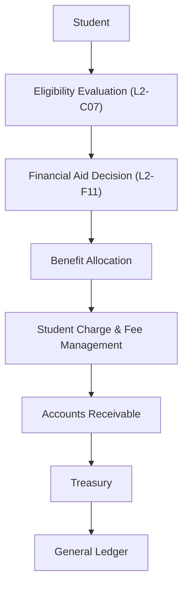
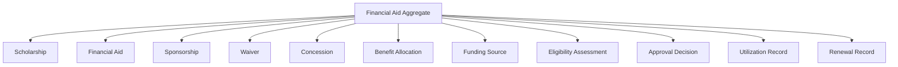
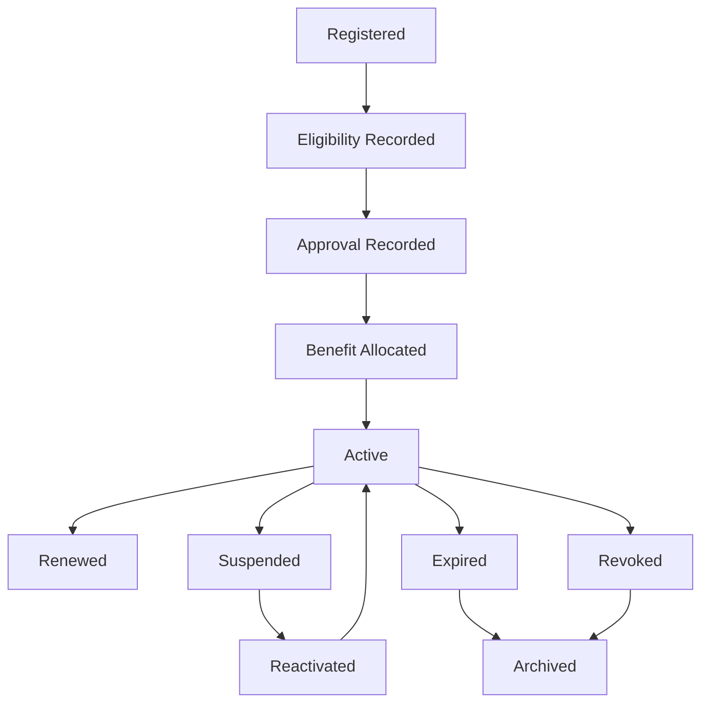
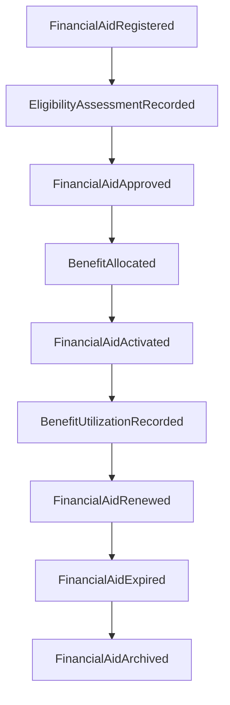
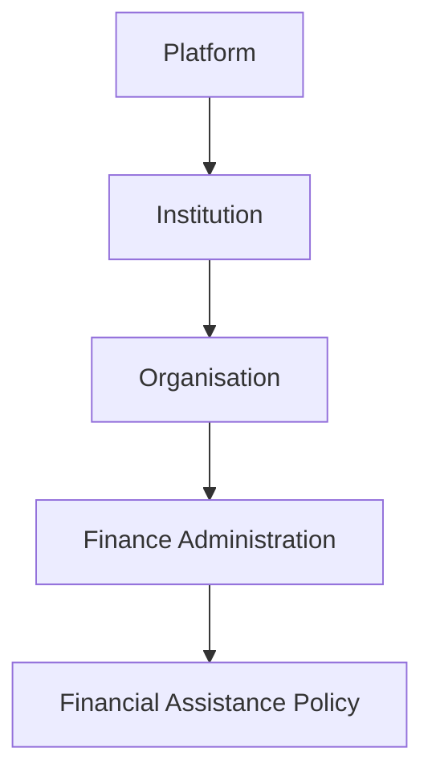

# L2-F11 — Scholarship & Financial Aid

| Metadata | Value |
|----------|-------|
| Architecture Level | Level 2 — Domain Architecture |
| Domain | Finance |
| Document Code | L2-F11 |
| Status | Trust Certification Ready |
| Version | 1.0 |
| Canonical Owner | Finance Architecture |
| Document Owner | Finance — Financial Aid |
| Last Updated | TBD |

---

## Canonical Section Crosswalk

> Added 2026-08-04 under integrity finding INT-018. `governance/constitution/Volume_3_Architecture_Framework.md` section 18 requires every L2 document to define eleven sections. This document uses its own numbered-section convention; the table below maps the required sections to where they actually live. No content was moved.

| Required section (Volume 3 §18) | Location in this document |
|---|---|
| Purpose | §3 Purpose |
| Scope | §4 Scope |
| Actors | — not present — |
| Entities | Internal Entities; Entities; Entity Validation |
| Business Rules | §17 Domain Constraints & Business Invariants; Aggregate Invariants; Identity Invariants |
| Workflow | Workflows |
| State Machine | Aggregate State Transition Rules |
| Contracts | §15 Integration Contracts; Repository Contract |
| Events | Event-Driven Financial Assistance; Domain Event Publication Rules; Domain Event Philosophy |
| Dependencies | §1 Dependency Classification |
| Locked Decisions | Approval Decision |

> **Gap:** 1 required section(s) have no counterpart in this document: Actors. Recorded, not authored.

---

# 1. Dependency Classification

## Depends On

- L2-A01 — Platform & Tenant Foundation
- L2-A02 — Person & Identity Workflows
- L2-A03 — Authentication Architecture
- L2-A04 — Authorization & Policy Workflows
- L2-B01 — Institution Lifecycle
- L2-B02 — Organisation Workflows
- L2-B04 — Curriculum Framework Workflows
- L2-C01 — Admissions Workflows
- L2-C02 — Student Lifecycle & Activation Workflows
- L2-F00 — Finance Domain Model & Foundation
- L2-F01 — Student Charge & Fee Management
- L2-F07 — Accounts Receivable

---

## Consumed By

- Student Charge & Fee Management
- Accounts Receivable
- Financial Reporting
- Audit
- Executive Dashboards

---

# 2. Architectural Classification

## Domain Type

Enterprise Financial Assistance Governance Domain

---

## Architectural Style

- Domain Driven Design
- Event Driven Architecture
- Aggregate-Centric Design
- Canonical Ownership
- Configuration Driven Behaviour
- CQRS Compatible
- Eventual Consistency
- Technology Independent

---

# 3. Purpose

The Scholarship & Financial Aid bounded context establishes the canonical enterprise architecture for governing institutional financial assistance provided to students.

The domain governs approval, allocation, renewal, suspension, revocation, and utilization of financial assistance.

Eligibility is **not** determined here. `L2-C07 --- Scholarship Eligibility Workflows` is the authoritative owner of scholarship eligibility policy evaluation and eligibility records; this domain consumes the published eligibility outcome as an input to its financial decisions.

It is the authoritative owner of student financial assistance **financial** decisions.

---

# 4. Scope

The bounded context owns:

- Financial Aid
- Scholarship
- Sponsorship
- Fee Waiver
- Fee Concession
- Benefit Allocation
- Benefit Approval
- Eligibility Outcome Reference (consumed from `L2-C07`)
- Funding Source
- Benefit Utilization
- Benefit Renewal

The bounded context explicitly does not own:

- Scholarship eligibility policy evaluation (`L2-C07`)
- Scholarship eligibility records and eligibility decisions (`L2-C07`)
- Student
- Admission
- Academic Performance
- Fee Structures
- Student Charges
- Accounts Receivable
- Treasury
- General Ledger
- Budget Allocation

These concepts remain owned by their respective bounded contexts.

---

# 5. Architectural Vision

Scholarship & Financial Aid shall become the enterprise authority for institutional financial assistance.

The architecture intentionally separates:

Student Eligibility

from

Financial Assistance Decision

from

Student Charges

from

Receivable Creation

from

Cash Collection

This separation preserves clean business ownership and enterprise scalability.

---

## Canonical Assistance Ownership

Scholarship & Financial Aid owns the institutional decision regarding student financial assistance.

Neighbouring bounded contexts consume this decision.

They shall never determine financial assistance independently.

---

## Event-Driven Financial Assistance

Every approved financial assistance decision is communicated through immutable Domain Events.

Neighbouring domains independently determine how those facts affect their own business processes.

---

## Technology Independence

The architecture intentionally excludes:

- databases
- APIs
- payment gateways
- accounting platforms
- deployment technology
- messaging platforms

Only business architecture is defined.

---

# 6. Architectural Goals

## Goal 1 — Canonical Financial Assistance Ownership

Provide one authoritative representation of institutional financial assistance.

---

## Goal 2 — Deterministic Eligibility Consumption

Ensure every assistance decision is traceable to a governed eligibility outcome published by `L2-C07`. This domain does not re-evaluate eligibility policy.

---

## Goal 3 — Transparent Benefit Allocation

Provide traceable allocation of scholarships, waivers, concessions, and sponsorships.

---

## Goal 4 — Lifecycle Governance

Govern the complete lifecycle of financial assistance from application through expiration or revocation.

---

## Goal 5 — Enterprise Traceability

Ensure every financial assistance decision remains historically reconstructable.

---

## Goal 6 — Scalability

Support:

- multiple institutions
- multiple campuses
- multiple funding sources
- multiple scholarship schemes
- government aid
- private sponsorship
- institutional concessions

without architectural redesign.

---

# 7. Bounded Context

Scholarship & Financial Aid encapsulates all business capabilities required to govern institutional financial assistance.

The bounded context owns:

- Financial Aid
- Scholarship
- Sponsorship
- Benefit Allocation
- Eligibility Outcome Reference
- Approval
- Utilization
- Renewal
- Revocation
- Domain Events

The bounded context excludes:

- fee generation
- receivable creation
- payment collection
- accounting
- treasury
- budgeting

Scholarship & Financial Aid governs assistance.

It does not govern financial obligations.

---

# 8. Architectural Boundaries

## Canonical Ownership

Scholarship & Financial Aid owns:

- Financial Aid Aggregate
- Benefit Allocation
- Eligibility Outcome Reference (consumed from `L2-C07`)
- Funding Source Assignment
- Benefit Lifecycle
- Benefit Utilization
- Aggregate Version

---

## External References

The bounded context references—but never owns—

- Student
- Admission
- Academic Programme
- Academic Performance
- Fee Structure
- Student Charges
- Accounts Receivable
- Institution
- Organisation

Ownership remains with originating bounded contexts.

---

# 9. Ownership Principles

The following architectural rules are mandatory.

Scholarship & Financial Aid shall never:

- create student charges
- create receivables
- collect payments
- execute treasury operations
- create journal entries
- manage budgets

Its responsibility ends after publishing the authoritative financial assistance decision.

---

# 10. Core Architectural Principle

The enterprise financial assistance lifecycle is intentionally divided into independent bounded contexts.

Illustrative example:

Each bounded context owns exactly one business responsibility.

Scholarship & Financial Aid owns only institutional financial assistance governance.
# 11. Canonical Aggregate Architecture

## Aggregate Philosophy

The Scholarship & Financial Aid bounded context is implemented around a single Aggregate Root.

The Aggregate represents the complete lifecycle of institutional financial assistance granted to a student.

Every business operation that changes the state of financial assistance shall occur through this Aggregate.

No neighbouring bounded context may directly modify its internal state.

---

## Aggregate Root

## Financial Aid Aggregate

The Financial Aid Aggregate is the sole transactional consistency boundary of the bounded context.

It governs:

- the referenced eligibility outcome
- assistance approval
- scholarship lifecycle
- sponsorship lifecycle
- waiver lifecycle
- concession lifecycle
- benefit allocation
- utilization
- renewal
- suspension
- revocation

The Aggregate publishes immutable Domain Events after successful state transitions.

---

## Aggregate Responsibilities

The Financial Aid Aggregate is responsible for:

- registering financial assistance
- referencing eligibility outcomes published by `L2-C07`
- recording approval decisions
- allocating financial benefits
- managing funding sources
- governing utilization
- governing renewals
- governing suspensions
- governing revocations
- preserving historical assistance records

The Aggregate shall never:

- generate student charges
- create receivables
- collect payments
- post accounting entries
- execute treasury operations

---

## Internal Entities

The Aggregate contains the following Entities.

## Scholarship

Represents an institutional scholarship awarded to a student.

Illustrative examples include:

- Merit Scholarship
- Sports Scholarship
- Academic Excellence Scholarship
- Government Scholarship

---

## Financial Aid

Represents institutionally approved financial assistance.

Illustrative examples include:

- Need-Based Aid
- Emergency Aid
- Institutional Assistance

---

## Sponsorship

Represents third-party or institutional sponsorship supporting a student's education.

Illustrative examples include:

- Corporate Sponsor
- NGO Sponsor
- Alumni Sponsor
- Government Sponsor

---

## Waiver

Represents an approved exemption from part or all of an institutional fee.

Illustrative examples include:

- Tuition Waiver
- Hostel Waiver
- Transport Waiver

---

## Concession

Represents an approved reduction applied according to institutional policy.

Illustrative examples include:

- Staff Child Concession
- Sibling Concession
- Alumni Concession

---

## Benefit Allocation

Represents the allocation of approved assistance against eligible institutional charges.

Allocation governs business intent only.

It does not generate financial obligations.

---

## Funding Source

Represents the origin of approved financial assistance.

Illustrative sources include:

- Institution
- Government
- Trust
- CSR Program
- Donor
- Endowment
- External Sponsor

---

## Eligibility Assessment Reference

Represents the eligibility outcome published by `L2-C07` that supports a financial assistance decision.

This domain references the eligibility assessment; it does not own or re-derive it. The authoritative assessment remains in the Student Scholarship Eligibility Record owned by `L2-C07`.

---

## Approval Decision

Represents the governed approval authorizing financial assistance.

Authorization policies remain externally owned.

The approval outcome becomes part of Aggregate history.

---

## Utilization Record

Represents the consumption of approved financial assistance over its lifecycle.

Utilization preserves historical accountability.

---

## Renewal Record

Represents renewal history for recurring financial assistance.

Renewals create new business facts.

Historical renewal records remain immutable.

---

## Value Objects

The Aggregate uses immutable Value Objects.

## Financial Aid Identifier

Unique Aggregate business identifier.

---

## Institution Reference

Reference to the owning Institution.

---

## Organisation Reference

Reference to the owning Organisation.

---

## Student Reference

Reference to the beneficiary student.

Ownership remains external.

---

## Academic Session Reference

Reference identifying the academic session associated with the assistance.

---

## Programme Reference

Reference identifying the academic programme associated with eligibility.

---

## Benefit Type

Immutable classification describing assistance type.

Illustrative values include:

- Scholarship
- Financial Aid
- Sponsorship
- Waiver
- Concession

---

## Benefit Amount

Represents the approved financial value.

---

## Currency

Represents the monetary currency.

---

## Eligibility Result

Represents the evaluated eligibility outcome.

---

## Approval Status

Represents the approved business state.

Illustrative values include:

- Pending
- Approved
- Rejected
- Suspended
- Revoked
- Expired

---

## Effective Period

Represents the validity period of approved assistance.

---

## Correlation Identifier

Supports end-to-end business traceability.

---

## Aggregate Version

Supports optimistic concurrency.

---

## Domain Services

The bounded context exposes the following Domain Services.

## Eligibility Evaluation Service

Coordinates institutional eligibility assessment.

---

## Benefit Allocation Service

Coordinates benefit allocation.

---

## Renewal Management Service

Coordinates recurring assistance renewals.

---

## Utilization Governance Service

Coordinates utilization monitoring.

---

## Sponsorship Coordination Service

Coordinates sponsor participation.

---

## Funding Source Management Service

Coordinates funding source governance.

---

## Financial Assistance Governance Service

Coordinates business policies governing assistance lifecycle transitions.

---

## Domain Policies

Institution-specific behaviour is expressed through policies.

Illustrative policies include:

- Eligibility Policy
- Scholarship Policy
- Financial Aid Policy
- Sponsorship Policy
- Waiver Policy
- Concession Policy
- Renewal Policy
- Utilization Policy
- Funding Source Policy
- Expiration Policy
- Revocation Policy

Policies influence behaviour without changing Aggregate semantics.

---

## Aggregate Relationships

The Financial Aid Aggregate collaborates with neighbouring bounded contexts through references and events.

References include:

- Student
- Admission
- Academic Programme
- Academic Performance
- Institution
- Organisation

The Aggregate publishes completed financial assistance facts.

Neighbouring bounded contexts independently determine how those facts influence their own business processes.

---

## Repository Contract

The repository persists only complete Aggregate state.

The repository shall never:

- execute business rules
- evaluate eligibility
- coordinate approvals
- allocate benefits
- publish Domain Events

Its responsibility is limited to Aggregate persistence and retrieval.

---

## CQRS Compatibility

The Aggregate is optimized for command processing.

Independent read models may expose:

- Student Assistance Summary
- Active Scholarships
- Active Sponsorships
- Funding Source Utilization
- Renewal Status
- Benefit Allocation History
- Eligibility History

Read models remain projections.

They never become the system of record.

---

## Anti-Corruption Boundary

The bounded context consumes external business facts through Anti-Corruption Layers.

Illustrative upstream concepts include:

- Student Status
- Admission Status
- Academic Performance
- Fee Structure
- Institutional Policies

External concepts are translated into canonical Financial Aid concepts before entering the Aggregate.

The Aggregate never depends directly upon neighbouring domain models.

---

## Aggregate Architectural Guarantees

The Canonical Aggregate Architecture guarantees:

- single Aggregate ownership
- deterministic transactional consistency
- immutable business history
- complete financial assistance lifecycle governance
- event-driven collaboration
- bounded context isolation
- technology independence
- enterprise scalability

The Financial Aid Aggregate is the sole authoritative transactional boundary for institutional student financial assistance within the Scholarship & Financial Aid bounded context.
# 12. Business Capability Architecture

## Business Capability Philosophy

The Scholarship & Financial Aid bounded context owns every capability required to govern institutional student financial assistance.

A Business Capability represents a stable business responsibility.

Capabilities remain independent of:

- user interfaces
- workflows
- implementation technology
- organizational structure
- deployment architecture

Capabilities express what the bounded context owns—not how the capability is implemented.

---

## Business Capability Categories

The bounded context is composed of the following capability groups.

- Financial Assistance Administration
- Eligibility Management
- Scholarship Management
- Financial Aid Management
- Sponsorship Management
- Waiver Management
- Concession Management
- Benefit Allocation Management
- Funding Source Management
- Approval Governance
- Renewal Management
- Utilization Management
- Suspension & Revocation Management
- Monitoring & Analytics
- Query & Reporting Support

Each capability has clearly defined ownership boundaries.

---

## Financial Assistance Administration

## Purpose

Provides governance for institutional financial assistance programmes.

### Responsibilities

- register financial assistance programmes
- maintain programme definitions
- activate assistance programmes
- suspend assistance programmes
- retire assistance programmes
- maintain programme lifecycle

### Does Not Own

- student eligibility
- fee generation
- receivable creation

---

## Eligibility Management

## Purpose

Evaluates institutional eligibility for financial assistance.

### Responsibilities

- evaluate eligibility
- maintain eligibility outcomes
- record assessment history
- support policy-driven eligibility

### Consumes

- student information
- admission status
- academic information
- institutional policies

### Does Not Own

- academic evaluation
- admission decisions
- student records

---

## Scholarship Management

## Purpose

Governs scholarship lifecycle.

### Responsibilities

- scholarship registration
- scholarship approval
- scholarship renewal
- scholarship suspension
- scholarship revocation
- scholarship history

Illustrative scholarship types include:

- Merit
- Sports
- Academic Excellence
- Government

---

## Financial Aid Management

## Purpose

Govern institution-approved financial assistance.

### Responsibilities

- aid registration
- aid approval
- aid allocation
- aid renewal
- aid monitoring

Illustrative assistance includes:

- Need-Based Aid
- Emergency Aid
- Institutional Aid

---

## Sponsorship Management

## Purpose

Govern sponsor-supported financial assistance.

### Responsibilities

- sponsor registration
- sponsorship lifecycle
- sponsor allocation
- sponsor monitoring
- sponsorship renewal

Illustrative sponsors include:

- Government
- Corporate
- Trust
- Alumni
- NGO

---

## Waiver Management

## Purpose

Govern approved fee waivers.

### Responsibilities

- waiver registration
- waiver approval
- waiver lifecycle
- waiver utilization
- waiver history

Illustrative waivers include:

- Tuition
- Hostel
- Transport
- Examination

---

## Concession Management

## Purpose

Govern approved fee concessions.

### Responsibilities

- concession registration
- concession approval
- concession lifecycle
- concession utilization

Illustrative concessions include:

- Staff Child
- Sibling
- Alumni
- Institutional

---

## Benefit Allocation Management

## Purpose

Allocate approved financial assistance for institutional use.

### Responsibilities

- allocate approved assistance
- maintain allocation history
- govern allocation lifecycle
- preserve allocation traceability

### Does Not Own

- student charges
- invoices
- receivables

Allocation represents business intent.

Financial obligations remain externally owned.

---

## Funding Source Management

## Purpose

Govern financial assistance funding.

### Responsibilities

- register funding sources
- maintain funding source lifecycle
- assign funding sources
- monitor funding utilization

Illustrative funding sources include:

- Institution
- Government
- Trust
- Sponsor
- CSR Programme
- Endowment

---

## Approval Governance

## Purpose

Govern approved financial assistance outcomes.

### Responsibilities

- record approval outcomes
- preserve approval history
- maintain approval traceability

### Does Not Own

- authorization rules
- policy evaluation

Authorization remains externally governed.

---

## Renewal Management

## Purpose

Govern recurring financial assistance.

### Responsibilities

- renewal evaluation
- renewal approval
- renewal lifecycle
- renewal history

Renewals create new business facts.

Historical renewals remain immutable.

---

## Utilization Management

## Purpose

Govern utilization of approved assistance.

### Responsibilities

- utilization recording
- utilization monitoring
- utilization history
- utilization reporting

Utilization does not modify historical approvals.

---

## Suspension & Revocation Management

## Purpose

Govern suspension and revocation of approved assistance.

### Responsibilities

- suspend assistance
- revoke assistance
- preserve historical traceability
- record business justification

Historical approvals remain immutable.

Suspension creates new business facts.

---

## Monitoring & Analytics

## Purpose

Provide operational visibility into financial assistance.

Illustrative monitoring includes:

- active scholarships
- active sponsorships
- utilization rates
- renewal rates
- funding source utilization
- programme effectiveness

Monitoring remains read-only.

---

## Query & Reporting Support

## Purpose

Provide enterprise query capability.

Illustrative queries include:

- student assistance summary
- scholarship history
- sponsorship history
- utilization summary
- funding source summary
- active programme summary

Query models remain projections.

They never become authoritative business state.

---

## Capability Collaboration

Business capabilities collaborate through the Financial Aid Aggregate.

Capabilities shall never directly manipulate neighbouring bounded contexts.

Multi-domain collaboration occurs exclusively through:

- Domain Events
- Integration Events
- Canonical References

---

## Capability Ownership Matrix

| Capability | Owned by Scholarship & Financial Aid |
|------------|--------------------------------------|
| Eligibility Evaluation | ✓ |
| Scholarship Lifecycle | ✓ |
| Financial Aid Lifecycle | ✓ |
| Sponsorship Lifecycle | ✓ |
| Waiver Lifecycle | ✓ |
| Concession Lifecycle | ✓ |
| Benefit Allocation | ✓ |
| Funding Source Management | ✓ |
| Renewal Management | ✓ |
| Utilization Management | ✓ |
| Suspension & Revocation | ✓ |
| Assistance Monitoring | ✓ |
| Assistance Queries | ✓ |

The following remain externally owned.

| Capability | Canonical Owner |
|------------|-----------------|
| Student Management | Student Lifecycle |
| Admission Decisions | Admissions |
| Academic Performance | Academic Domain |
| Fee Structure | Student Charge & Fee Management |
| Student Charges | Student Charge & Fee Management |
| Accounts Receivable | Accounts Receivable |
| Payment Collection | Treasury |
| Accounting Entries | General Ledger |
| Budget Allocation | Budget Management |

---

## Architectural Guarantees

The Business Capability Architecture guarantees:

- complete ownership of institutional student financial assistance
- explicit capability boundaries
- canonical business ownership
- bounded context isolation
- technology independence
- enterprise scalability
- event-driven collaboration
- deterministic business responsibility allocation

Business Capabilities define the complete responsibility of the Scholarship & Financial Aid bounded context without overlapping neighbouring enterprise domains.
# 13. Domain Model

## Domain Model Philosophy

The Scholarship & Financial Aid bounded context models institutional financial assistance as a single, cohesive business domain.

The domain model establishes:

- canonical business ownership
- Aggregate consistency boundaries
- Entity relationships
- immutable Value Objects
- Domain Services
- Domain Policies

The model is independent of implementation technology.

---

## Aggregate Root

## Financial Aid Aggregate

The Financial Aid Aggregate is the sole Aggregate Root within the bounded context.

It governs the complete lifecycle of institutional student financial assistance.

Every state transition shall occur through this Aggregate.

Neighbouring bounded contexts shall interact only through published business facts.

---

## Aggregate Composition

The Financial Aid Aggregate consists of the following internal Entities.

All Entities belong exclusively to the Aggregate.

---

## Entities

## Scholarship

Represents a scholarship awarded by the Institution.

### Responsibilities

- maintain scholarship lifecycle
- preserve scholarship identity
- record scholarship history
- support scholarship renewal
- support suspension and revocation

Scholarship shall never create financial obligations.

---

## Financial Aid

Represents institution-approved financial assistance.

### Responsibilities

- maintain assistance lifecycle
- preserve assistance history
- coordinate approved assistance
- support institutional aid programmes

Financial Aid remains an internal business concept.

---

## Sponsorship

Represents sponsored financial assistance.

### Responsibilities

- maintain sponsorship lifecycle
- associate approved funding source
- preserve sponsor history
- support sponsorship renewal

Sponsor ownership remains external.

Only sponsorship participation is owned.

---

## Waiver

Represents an approved fee waiver.

### Responsibilities

- preserve waiver history
- govern waiver lifecycle
- maintain waiver validity

Waivers express approved business intent.

Fee application remains externally owned.

---

## Concession

Represents an approved fee concession.

### Responsibilities

- preserve concession lifecycle
- maintain concession history
- support institutional concession policies

Concession calculations remain downstream responsibilities.

---

## Benefit Allocation

Represents allocation of approved assistance.

### Responsibilities

- preserve allocation identity
- record allocation history
- associate approved assistance
- maintain allocation lifecycle

Benefit Allocation shall never:

- create invoices
- calculate receivables
- modify student charges

It records the institutional allocation decision only.

---

## Funding Source

Represents the source financing approved assistance.

Illustrative funding sources include:

- Institution
- Government
- Corporate Sponsor
- Trust
- Alumni
- Endowment
- External Agency

Funding Source governs origin.

It does not govern accounting.

---

## Eligibility Assessment

Represents the evaluated eligibility outcome.

Responsibilities include:

- preserving eligibility history
- recording evaluation results
- maintaining assessment traceability

Eligibility inputs remain externally owned.

---

## Approval Decision

Represents the approved institutional decision.

Responsibilities include:

- preserving approval history
- recording approval outcome
- supporting audit reconstruction

Authorization evaluation remains external.

---

## Utilization Record

Represents utilization of approved assistance.

Responsibilities include:

- preserving utilization history
- recording assistance consumption
- maintaining utilization traceability

Historical utilization remains immutable.

---

## Renewal Record

Represents recurring assistance renewal.

Responsibilities include:

- preserving renewal history
- recording renewal outcome
- maintaining renewal lifecycle

Renewals create new business facts.

Historical renewals remain immutable.

---

## Value Objects

The Aggregate uses immutable Value Objects.

---

## Financial Aid Identifier

Unique identifier for the Aggregate.

Immutable throughout the Aggregate lifecycle.

---

## Student Reference

Reference to the beneficiary student.

Ownership remains external.

---

## Institution Reference

Reference to the owning Institution.

---

## Organisation Reference

Reference to the owning Organisation.

---

## Academic Session Reference

Reference identifying the academic session.

---

## Programme Reference

Reference identifying the academic programme.

---

## Benefit Type

Immutable classification of approved assistance.

Illustrative values include:

- Scholarship
- Financial Aid
- Sponsorship
- Waiver
- Concession

---

## Benefit Amount

Represents approved monetary assistance.

Represents business value only.

Accounting remains external.

---

## Currency

Represents approved monetary currency.

---

## Funding Source Reference

Reference identifying the approved funding source.

---

## Effective Period

Represents the validity period of approved assistance.

---

## Eligibility Outcome

Represents the evaluated eligibility result.

Illustrative values include:

- Eligible
- Not Eligible
- Conditionally Eligible

---

## Approval Status

Represents approved lifecycle status.

Illustrative values include:

- Draft
- Pending
- Approved
- Suspended
- Revoked
- Expired

---

## Correlation Identifier

Supports enterprise traceability.

---

## Aggregate Version

Supports optimistic concurrency.

---

## Domain Services

Domain Services coordinate behaviour spanning multiple Entities.

---

## Eligibility Evaluation Service

Coordinates institutional eligibility evaluation.

---

## Assistance Allocation Service

Coordinates benefit allocation.

---

## Sponsorship Coordination Service

Coordinates sponsorship participation.

---

## Funding Source Governance Service

Coordinates funding source governance.

---

## Renewal Governance Service

Coordinates recurring assistance renewal.

---

## Utilization Governance Service

Coordinates utilization management.

---

## Financial Assistance Governance Service

Coordinates lifecycle transitions requiring multiple Entities.

---

## Domain Policies

Institution-specific behaviour is governed through policies.

Illustrative policies include:

- Eligibility Policy
- Scholarship Policy
- Financial Aid Policy
- Sponsorship Policy
- Waiver Policy
- Concession Policy
- Funding Source Policy
- Allocation Policy
- Renewal Policy
- Utilization Policy
- Suspension Policy
- Revocation Policy
- Expiration Policy

Policies influence behaviour without changing Aggregate ownership.

---

## Repository Contract

Repositories persist Aggregate state only.

Repositories shall never:

- evaluate eligibility
- perform approvals
- allocate benefits
- execute business policies
- publish Domain Events
- coordinate neighbouring bounded contexts

Repository responsibility is limited to persistence and retrieval.

---

## CQRS Compatibility

The command model governs Aggregate behaviour.

Illustrative read models include:

- Student Financial Assistance Summary
- Active Scholarships
- Active Financial Aid
- Active Sponsorships
- Benefit Allocation Summary
- Funding Source Summary
- Eligibility History
- Renewal History
- Utilization Summary

Read models are projections.

They shall never become authoritative business state.

---

## Anti-Corruption Boundary

External concepts shall be translated before entering the Aggregate.

Illustrative external concepts include:

- Student
- Admission
- Academic Performance
- Programme
- Fee Structure
- Institutional Policy

Translation occurs through Anti-Corruption Layers.

The Aggregate remains independent of neighbouring domain models.

---

## Aggregate Relationships

The Financial Aid Aggregate collaborates with neighbouring bounded contexts through references and immutable business events.

It shall never expose internal Entities directly.

Neighbouring bounded contexts consume published business facts while preserving their own autonomy.

---

## Domain Model Guarantees

The Domain Model guarantees:

- single Aggregate ownership
- deterministic Aggregate consistency
- immutable business history
- bounded context isolation
- canonical business ownership
- technology independence
- enterprise scalability
- event-driven collaboration

The Financial Aid Aggregate is the authoritative business model governing institutional student financial assistance within the Scholarship & Financial Aid bounded context.
# 14. Financial Aid Aggregate Specification

## Aggregate Philosophy

The Financial Aid Aggregate is the single transactional consistency boundary responsible for governing the complete lifecycle of institutional student financial assistance.

Every modification to financial assistance shall occur through Aggregate behaviour.

No neighbouring bounded context shall directly modify Aggregate state.

The Aggregate preserves:

- business consistency
- lifecycle integrity
- historical traceability
- auditability
- canonical ownership

---

## Aggregate Responsibilities

The Financial Aid Aggregate is responsible for:

- registering financial assistance
- recording eligibility outcomes
- recording approval outcomes
- allocating approved assistance
- governing funding source association
- governing utilization
- governing renewal
- governing suspension
- governing revocation
- preserving immutable business history

The Aggregate shall never:

- calculate eligibility rules
- evaluate authorization policies
- generate student charges
- create receivables
- collect payments
- post accounting entries

---

## Aggregate Consistency Boundary

The Aggregate guarantees transactional consistency for:

- Scholarship
- Financial Aid
- Sponsorship
- Waiver
- Concession
- Benefit Allocation
- Funding Source
- Eligibility Assessment
- Approval Decision
- Utilization Record
- Renewal Record

State changes affecting these Entities shall succeed or fail atomically.

No partial Aggregate updates are permitted.

---

## Aggregate Lifecycle

The Financial Aid Aggregate progresses through the following lifecycle.

Historical lifecycle states remain permanently reconstructable.

---

## Aggregate Behaviour

The Aggregate supports the following business behaviour.

- register financial assistance
- record eligibility assessment
- record approval outcome
- allocate approved benefit
- associate funding source
- activate assistance
- record utilization
- renew assistance
- suspend assistance
- reactivate assistance
- revoke assistance
- expire assistance
- archive assistance

Each behaviour preserves Aggregate invariants.

---

## Aggregate State Transition Rules

The Aggregate enforces the following transitions.

| Current State | Permitted Transition |
|--------------|----------------------|
| Registered | Eligibility Recorded |
| Eligibility Recorded | Approval Recorded |
| Approval Recorded | Benefit Allocated |
| Benefit Allocated | Active |
| Active | Renewed |
| Active | Suspended |
| Active | Expired |
| Suspended | Reactivated |
| Reactivated | Active |
| Active | Revoked |
| Expired | Archived |
| Revoked | Archived |

Transitions outside this lifecycle shall be rejected.

---

## Aggregate Invariants

The following invariants shall always remain true.

## Identity Invariants

- Aggregate Identifier is immutable.
- Aggregate belongs to exactly one Institution.
- Aggregate belongs to exactly one Organisation.
- Aggregate references exactly one beneficiary student.

---

## Eligibility Invariants

- Eligibility Assessment must exist before approval is recorded.
- Eligibility history is immutable.
- New assessments create new business facts.

---

## Approval Invariants

- Approval Decision must exist before benefit allocation.
- Approval history is immutable.
- Rejected assistance cannot become Active.

---

## Allocation Invariants

- Benefit Allocation requires an approved assistance decision.
- Allocation history is immutable.
- Allocation shall not generate financial obligations.

---

## Funding Source Invariants

- Every allocated benefit references one valid Funding Source.
- Funding Source history is immutable.
- Funding Source ownership remains external.

---

## Utilization Invariants

- Utilization shall reference an active assistance record.
- Utilization history is immutable.
- Utilization shall never modify approval history.

---

## Renewal Invariants

- Renewal requires an active assistance record.
- Renewal creates a new Renewal Record.
- Previous renewals remain immutable.

---

## Suspension & Revocation Invariants

- Suspended assistance preserves historical approvals.
- Revoked assistance preserves historical allocations.
- Revocation creates a new business fact.
- Historical records are never deleted.

---

## Governance Invariants

- Authorization outcomes are externally determined.
- Eligibility outcomes are externally evaluated.
- Aggregate consumes authoritative outcomes only.

---

## Historical Invariants

Historical information shall never be:

- deleted
- overwritten
- reassigned
- repurposed

Corrections occur through new business facts.

---

## Aggregate Commands

The Aggregate accepts the following commands.

## Registration Commands

- RegisterFinancialAid
- RegisterScholarship
- RegisterSponsorship
- RegisterWaiver
- RegisterConcession

---

## Eligibility Commands

- RecordEligibilityAssessment

---

## Approval Commands

- RecordApprovalDecision

---

## Allocation Commands

- AllocateBenefit
- AssociateFundingSource

---

## Lifecycle Commands

- ActivateFinancialAid
- RenewFinancialAid
- SuspendFinancialAid
- ReactivateFinancialAid
- RevokeFinancialAid
- ExpireFinancialAid
- ArchiveFinancialAid

---

## Utilization Commands

- RecordBenefitUtilization

---

## Administrative Commands

- UpdateFinancialAidConfiguration
- UpdateFinancialAidMetadata

Administrative commands shall not alter historical business facts.

---

## Aggregate Versioning

Every successful Aggregate modification increments Aggregate Version.

Failed commands shall not modify Aggregate Version.

Version conflicts shall reject the attempted command.

---

## Optimistic Concurrency

Concurrent modification shall be governed through optimistic concurrency.

Only one successful state transition may modify a specific Aggregate Version.

Conflicting modifications shall fail without altering Aggregate state.

---

## Failure Behaviour

Business rule violations shall reject the entire command.

Examples include:

- allocation before approval
- approval before eligibility
- renewal of inactive assistance
- utilization without active assistance
- duplicate Aggregate identity

No partial state transitions shall occur.

---

## Recovery Behaviour

Following recoverable failures:

- Aggregate consistency shall be preserved.
- Historical records shall remain intact.
- Failed commands may be safely retried where idempotent.
- Recovery shall never bypass Aggregate invariants.

---

## Domain Event Publication Rules

Domain Events shall be published only after:

- successful Aggregate persistence
- successful invariant validation
- successful version increment

Failed commands shall never publish Domain Events.

---

## Aggregate Encapsulation

External bounded contexts shall never:

- modify internal Entities
- bypass Aggregate commands
- alter Aggregate Version
- manipulate Aggregate lifecycle directly

Interaction occurs exclusively through commands and published business facts.

---

## Aggregate Guarantees

The Financial Aid Aggregate guarantees:

- deterministic lifecycle governance
- single transactional consistency boundary
- immutable business history
- complete assistance traceability
- canonical ownership
- event-driven collaboration
- bounded context isolation
- technology independence
- enterprise scalability

The Aggregate is the sole authoritative consistency boundary governing institutional student financial assistance within the S# 15. Domain Event Architecture

## Domain Event Philosophy

The Scholarship & Financial Aid bounded context communicates business state changes through immutable Domain Events.

Each Domain Event represents a completed business fact.

Domain Events shall never represent:

- user actions
- requests
- intentions
- partially completed operations
- implementation details

Published events become part of the permanent enterprise business history.

---

## Architectural Objectives

The Domain Event Architecture exists to achieve the following objectives.

## Business Fact Publication

Publish completed financial assistance facts.

---

## Enterprise Collaboration

Enable neighbouring bounded contexts to react independently.

---

## Auditability

Preserve immutable historical business events.

---

## Event-Driven Integration

Support eventual consistency without coupling bounded contexts.

---

## Technology Independence

Remain independent of messaging platforms, brokers, and transport mechanisms.

---

## Event Categories

The Scholarship & Financial Aid bounded context publishes events in the following categories.

- Lifecycle Events
- Eligibility Events
- Approval Events
- Allocation Events
- Funding Events
- Utilization Events
- Renewal Events
- Suspension Events
- Revocation Events
- Governance Events
- Administrative Events

Each event category represents completed business facts.

---

## Lifecycle Events

These events describe Aggregate lifecycle transitions.

### FinancialAidRegistered

Published after successful Aggregate registration.

---

### FinancialAidActivated

Published when approved financial assistance becomes active.

---

### FinancialAidSuspended

Published after successful suspension.

---

### FinancialAidReactivated

Published after successful reactivation.

---

### FinancialAidExpired

Published after successful expiration.

---

### FinancialAidArchived

Published after archival completion.

---

## Eligibility Events

### EligibilityAssessmentRecorded

Published after eligibility assessment has been recorded within the Aggregate.

Eligibility evaluation remains externally owned.

Only the authoritative outcome is published.

---

### EligibilityUpdated

Published when a revised eligibility assessment replaces a previous business decision.

Historical assessments remain immutable.

---

## Approval Events

### FinancialAidApproved

Published after an approved assistance decision has been successfully recorded.

---

### FinancialAidRejected

Published after a rejected assistance decision has been recorded.

---

### ApprovalDecisionRecorded

Published after approval history has been successfully persisted.

---

## Allocation Events

### BenefitAllocated

Published after approved assistance has been allocated.

Neighbouring domains consume this event to perform their own business responsibilities.

Benefit allocation does not create financial obligations.

---

### BenefitAllocationUpdated

Published after an allocation is legitimately modified.

Historical allocation versions remain reconstructable.

---

## Funding Events

### FundingSourceAssigned

Published after a funding source has been associated.

---

### FundingSourceChanged

Published after funding source reassignment.

Historical funding history remains preserved.

---

## Utilization Events

### BenefitUtilizationRecorded

Published after utilization has been successfully recorded.

---

### BenefitUtilizationUpdated

Published after valid utilization adjustment.

Historical utilization remains reconstructable.

---

## Renewal Events

### FinancialAidRenewed

Published after successful renewal.

Renewal creates a new business fact.

---

### RenewalRejected

Published after renewal rejection.

Historical renewals remain immutable.

---

## Suspension & Revocation Events

### FinancialAidRevoked

Published after successful revocation.

---

### FinancialAidRestrictionApplied

Published after institutional restriction prevents assistance usage.

---

### FinancialAidRestrictionReleased

Published after restriction removal.

---

## Governance Events

### FinancialAidPolicyUpdated

Published after institution-approved policy changes.

Policy updates affect future behaviour only.

Historical business facts remain unchanged.

---

### FinancialAidConfigurationUpdated

Published after supported configuration changes.

Configuration shall never redefine Aggregate ownership.

---

## Administrative Events

### FinancialAidMetadataUpdated

Published after administrative metadata changes.

Metadata updates shall never modify historical business facts.

---

## Event Publication Rules

Every Domain Event shall satisfy the following rules.

Events shall:

- represent completed business facts
- be immutable
- preserve Aggregate identity
- preserve ordering
- preserve traceability
- preserve historical correctness

Events shall never represent future intentions.

---

## Event Ordering

Events originating from the same Aggregate shall preserve publication order.

Illustrative ordering:

Ordering shall remain deterministic.

---

## Event Identity

Every Domain Event shall contain:

- Event Identifier
- Aggregate Identifier
- Aggregate Version
- Correlation Identifier
- Institution Reference
- Organisation Reference
- Event Timestamp

Event identity shall be globally unique.

---

## Event Versioning

Domain Events are immutable.

Business evolution shall introduce new event versions.

Previously published events shall never be modified.

---

## Correlation & Traceability

Every Domain Event shall support end-to-end business traceability.

Illustrative references include:

- Student Reference
- Institution Reference
- Organisation Reference
- Academic Session Reference
- Correlation Identifier

Traceability shall remain complete throughout the Aggregate lifecycle.

---

## Idempotency

Repeated delivery of identical Domain Events shall not alter business meaning.

Consumers shall safely process duplicate event deliveries.

---

## Publication Guarantees

Domain Events shall be published only after:

- successful Aggregate persistence
- invariant validation
- Aggregate Version increment

Failed commands shall never publish events.

---

## Integration Mapping

Illustrative downstream consumers include:

| Published Event | Typical Consumers |
|-----------------|------------------|
| FinancialAidApproved | Student Charge & Fee Management |
| BenefitAllocated | Student Charge & Fee Management |
| FinancialAidRevoked | Student Charge & Fee Management, Reporting |
| FinancialAidSuspended | Reporting, Audit |
| FinancialAidRenewed | Student Charge & Fee Management |
| BenefitUtilizationRecorded | Reporting, Analytics |
| FundingSourceAssigned | Reporting |
| FinancialAidExpired | Reporting, Audit |

Consumers remain responsible for their own business behaviour.

---

## Event Sourcing Compatibility

The event model is compatible with Event Sourcing.

Aggregate state may be reconstructed from ordered Domain Events.

Event Sourcing remains an implementation decision.

It is not an architectural requirement.

---

## Event Retention

Published Domain Events constitute permanent enterprise business history.

Events shall remain:

- immutable
- auditable
- historically reconstructable
- permanently traceable

Retention policies govern storage, not business meaning.

---

## Event Audit Guarantees

The Domain Event Architecture guarantees:

- complete lifecycle reconstruction
- immutable business history
- deterministic event ordering
- canonical business facts
- enterprise traceability
- bounded context isolation
- technology independence
- audit readiness

---

## Domain Event Architectural Guarantees

The Scholarship & Financial Aid bounded context guarantees that every published Domain Event represents an authoritative, completed financial assistance business fact.

Neighbouring bounded contexts shall consume these facts independently while preserving their own ownership boundaries.

No published Domain Event shall redefine business ownership, violate Aggregate consistency, or expose internal implementation details.cholarship & Financial Aid bounded context.
# 15. Integration Contracts

## Integration Philosophy

The Scholarship & Financial Aid bounded context collaborates with neighbouring bounded contexts exclusively through published business facts and consumed authoritative business events.

The bounded context shall never:

- orchestrate enterprise workflows
- directly modify neighbouring Aggregates
- bypass canonical ownership
- expose internal Aggregate state

Integration preserves bounded context autonomy through event-driven collaboration.

---

## Integration Objectives

The Integration Architecture exists to achieve the following objectives.

## Canonical Ownership

Preserve ownership boundaries across the enterprise.

---

## Event-Driven Collaboration

Enable independent business processing through immutable business events.

---

## Eventual Consistency

Allow neighbouring bounded contexts to converge independently.

---

## Technology Independence

Remain independent of APIs, messaging platforms, databases and deployment technologies.

---

## Upstream Integrations

The Scholarship & Financial Aid bounded context consumes authoritative business facts from neighbouring bounded contexts.

---

## Institution Lifecycle

### Consumed Business Facts

- InstitutionRegistered
- InstitutionActivated
- InstitutionSuspended
- InstitutionArchived

Purpose:

Associate financial assistance with valid Institutions.

Institution ownership remains external.

---

## Organisation Management

### Consumed Business Facts

- OrganisationCreated
- OrganisationActivated
- OrganisationUpdated

Purpose:

Associate financial assistance with organisational ownership.

---

## Student Lifecycle

### Consumed Business Facts

- StudentRegistered
- StudentActivated
- StudentStatusChanged
- QualificationAwarded
- StudentWithdrawn

Purpose:

Determine student eligibility context.

Student ownership remains external.

---

## Admission Management

### Consumed Business Facts

- AdmissionGranted
- AdmissionCancelled
- AdmissionDeferred

Purpose:

Provide admission outcomes supporting assistance eligibility.

Admission decisions remain externally owned.

---

## Scholarship Eligibility (L2-C07)

### Consumed Business Facts

- EligibilityGranted
- EligibilityConditionallyGranted
- EligibilityRejected

Purpose:

Supply the authoritative eligibility outcome that gates a financial assistance
decision. `L2-C07` owns the eligibility policy, its evaluation and the resulting
Student Scholarship Eligibility Record. This domain consumes the outcome and shall
never re-evaluate eligibility policy or write to the eligibility record.

Eligibility ownership remains external.

---

## Academic Domain

### Consumed Business Facts

- ExaminationResultPublished
- AcademicStandingUpdated
- ProgrammeAssigned
- AcademicSessionStarted

Purpose:

Provide academic facts supporting scholarship eligibility.

Academic evaluation remains externally owned.

---

## Authorization & Policy

### Consumed Business Facts

- ApprovalGranted
- ApprovalRejected
- PolicyUpdated

Purpose:

Consume authoritative governance outcomes.

Authorization logic remains external.

---

## Student Charge & Fee Management

### Consumed Business Facts

- FeeStructurePublished
- FeeStructureUpdated
- ChargeScheduleDefined

Purpose:

Provide charging context for benefit allocation.

Fee ownership remains external.

---

## Budget Management

### Consumed Business Facts

- BudgetAllocated
- BudgetAdjusted
- BudgetExhausted

Purpose:

Provide funding governance context where institutional policies require budget-controlled financial assistance.

Budget ownership remains external.

---

## Downstream Integrations

Neighbouring bounded contexts consume financial assistance business facts.

The Scholarship & Financial Aid bounded context never dictates downstream behaviour.

---

## Student Charge & Fee Management

### Published Business Facts

- FinancialAidApproved
- BenefitAllocated
- FinancialAidRevoked
- FinancialAidExpired
- FinancialAidRenewed

Purpose:

Enable the Fee Management bounded context to determine how approved assistance influences student charges.

Fee generation remains externally owned.

---

## Accounts Receivable

### Published Business Facts

- BenefitAllocated
- FinancialAidRevoked
- FinancialAidExpired

Purpose:

Provide receivable context after Fee Management has applied institutional charging rules.

Accounts Receivable independently governs receivable creation.

---

## Financial Reporting

### Published Business Facts

- FinancialAidApproved
- BenefitAllocated
- FundingSourceAssigned
- BenefitUtilizationRecorded
- FinancialAidExpired

Purpose:

Support institutional financial reporting.

Reporting remains read-only.

---

## Audit

### Published Business Facts

- EligibilityAssessmentRecorded
- ApprovalDecisionRecorded
- FinancialAidApproved
- FinancialAidRevoked
- FinancialAidSuspended
- FinancialAidArchived

Purpose:

Support enterprise audit reconstruction.

Audit owns audit analysis.

---

## Executive Dashboards

### Published Business Facts

- FinancialAidApproved
- BenefitAllocated
- BenefitUtilizationRecorded
- FundingSourceAssigned
- FinancialAidRenewed

Purpose:

Support executive visibility.

Dashboards remain projections.

---

## Notification

### Published Business Facts

- FinancialAidApproved
- FinancialAidRejected
- FinancialAidRenewed
- FinancialAidExpired
- FinancialAidRevoked

Purpose:

Enable institutional notifications.

Notification failure shall never affect Aggregate consistency.

---

## External Integrations

Illustrative external consumers include:

- Government Scholarship Portals
- Corporate Sponsorship Platforms
- Trust Management Systems
- Donor Management Platforms

External integration occurs through Anti-Corruption Layers.

External systems never become canonical owners.

---

## Integration Responsibility Matrix

| Business Responsibility | Canonical Owner |
|-------------------------|-----------------|
| Student Identity | Student Lifecycle |
| Admission Decision | Admission Management |
| Academic Performance | Academic Domain |
| Institutional Policy | Authorization & Policy |
| Fee Structure | Student Charge & Fee Management |
| Student Charges | Student Charge & Fee Management |
| Financial Assistance | Scholarship & Financial Aid |
| Accounts Receivable | Accounts Receivable |
| Cash Collection | Treasury & Banking |
| Financial Accounting | General Ledger |
| Budget Governance | Budget Management |

Ownership overlap is prohibited.

---

## Eventual Consistency

Multi-domain consistency is achieved through immutable published business facts.

Neighbouring bounded contexts independently determine:

- when to react
- how to react
- whether reaction is required

The Scholarship & Financial Aid bounded context shall never coordinate downstream processing.

---

## Anti-Corruption Layer

External concepts shall be translated into canonical Financial Aid concepts before entering the Aggregate.

Illustrative translations include:

- Student
- Admission
- Academic Standing
- Approval Outcome
- Fee Structure
- Budget Allocation

Internal business concepts remain protected from external models.

---

## Integration Security Principles

The Scholarship & Financial Aid bounded context consumes only authenticated and authorized business facts.

Authentication and authorization remain externally governed.

Security concerns shall never alter Aggregate behaviour.

---

## Integration Failure Principles

Neighbouring bounded context failures shall not compromise Aggregate consistency.

Failures shall never:

- invalidate completed financial assistance decisions
- corrupt Aggregate state
- violate Aggregate invariants
- modify historical business facts

Recovery shall occur through subsequent business events.

---

## Integration Guarantees

The Integration Architecture guarantees:

- canonical ownership preservation
- bounded context autonomy
- event-driven collaboration
- immutable business facts
- eventual consistency
- enterprise scalability
- technology independence
- auditability
- deterministic business integration

The Scholarship & Financial Aid bounded context integrates with the enterprise by publishing authoritative financial assistance facts while preserving the autonomy and ownership of every neighbouring bounded context.
# 16. Configuration Architecture

## Configuration Philosophy

The Scholarship & Financial Aid bounded context supports diverse institutional financial assistance policies through configuration.

Configuration enables institutional flexibility without altering:

- Aggregate ownership
- bounded context boundaries
- lifecycle semantics
- Domain Event semantics
- Integration Contracts
- Aggregate invariants
- canonical business ownership

Configuration parameterizes behaviour.

It shall never redefine architecture.

---

## Architectural Objectives

The Configuration Architecture exists to achieve the following objectives.

## Institutional Flexibility

Support diverse institutional financial assistance models.

Illustrative examples include:

- government scholarships
- institutional scholarships
- trust-sponsored aid
- donor-funded programmes
- staff concessions
- merit-based awards
- need-based assistance

---

## Canonical Stability

Preserve:

- Aggregate ownership
- lifecycle integrity
- business invariants
- event semantics
- auditability

---

## Future Extensibility

New financial assistance programmes shall be introduced through configuration rather than architectural redesign.

---

## Configuration Hierarchy

Configuration follows the enterprise hierarchy.

Higher levels establish defaults.

Lower levels override only explicitly supported settings.

Inheritance shall remain deterministic.

---

## Configuration Categories

The bounded context supports the following configuration categories.

- Programme Configuration
- Scholarship Configuration
- Financial Aid Configuration
- Sponsorship Configuration
- Waiver Configuration
- Concession Configuration
- Eligibility Configuration
- Approval Configuration
- Funding Source Configuration
- Allocation Configuration
- Utilization Configuration
- Renewal Configuration
- Expiration Configuration
- Notification Configuration
- Integration Configuration
- Retention Configuration

Each category governs one distinct aspect of financial assistance.

---

## Programme Configuration

## Purpose

Defines institutional financial assistance programmes.

Illustrative configuration includes:

- programme codes
- programme naming
- activation status
- effective dates
- availability

Configuration shall not affect Aggregate identity.

---

## Scholarship Configuration

## Purpose

Defines scholarship-specific behaviour.

Illustrative configuration includes:

- scholarship categories
- maximum award limits
- renewable status
- academic session applicability
- programme applicability

Scholarship ownership remains unchanged.

---

## Financial Aid Configuration

## Purpose

Defines institutional financial assistance policies.

Illustrative configuration includes:

- aid categories
- assistance limits
- emergency aid policies
- institutional aid rules

Business ownership remains fixed.

---

## Sponsorship Configuration

## Purpose

Defines sponsorship governance.

Illustrative configuration includes:

- sponsor categories
- sponsorship validity
- sponsor eligibility
- funding restrictions

Sponsors remain externally owned entities.

---

## Waiver Configuration

## Purpose

Defines waiver policies.

Illustrative configuration includes:

- waiver categories
- maximum waiver percentage
- applicable fee components
- waiver validity

Configuration governs policy only.

Fee ownership remains external.

---

## Concession Configuration

## Purpose

Defines concession behaviour.

Illustrative configuration includes:

- concession categories
- concession percentages
- eligibility groups
- concession duration

Concession calculations remain downstream responsibilities.

---

## Eligibility Configuration

## Purpose

Defines institutional eligibility parameters.

Illustrative configuration includes:

- minimum academic criteria
- income thresholds
- programme eligibility
- category restrictions
- residency requirements

Eligibility evaluation remains governed by business policies.

Historical outcomes remain immutable.

---

## Approval Configuration

## Purpose

Defines institutional approval requirements.

Illustrative configuration includes:

- approval hierarchy
- approval levels
- delegated authority
- approval validity

Authorization remains externally evaluated.

The Aggregate consumes authoritative approval outcomes.

---

## Funding Source Configuration

## Purpose

Defines funding source governance.

Illustrative configuration includes:

- funding source categories
- allocation priorities
- sponsor limits
- institutional funding rules

Funding ownership remains external.

---

## Allocation Configuration

## Purpose

Defines allocation behaviour.

Illustrative configuration includes:

- allocation priorities
- allocation validity
- allocation sequencing
- allocation restrictions

Allocation records business intent only.

Student charge generation remains external.

---

## Utilization Configuration

## Purpose

Defines utilization governance.

Illustrative configuration includes:

- utilization windows
- utilization limits
- monitoring frequency
- utilization alerts

Utilization history remains immutable.

---

## Renewal Configuration

## Purpose

Defines renewal policies.

Illustrative configuration includes:

- renewal frequency
- renewal eligibility
- renewal deadlines
- renewal validity

Renewals create new business facts.

Historical renewals remain unchanged.

---

## Expiration Configuration

## Purpose

Defines assistance expiration behaviour.

Illustrative configuration includes:

- expiration periods
- academic session expiry
- programme completion expiry
- automatic expiration rules

Expiration does not modify historical approvals.

---

## Notification Configuration

## Purpose

Defines notification behaviour.

Illustrative notifications include:

- approval completed
- rejection recorded
- renewal approved
- assistance expired
- assistance suspended
- assistance revoked

Notification failure shall never affect Aggregate consistency.

---

## Integration Configuration

## Purpose

Defines integration behaviour with neighbouring bounded contexts.

Illustrative integrations include:

- Student Lifecycle
- Admissions
- Academic
- Student Charge & Fee Management
- Accounts Receivable
- Reporting
- Audit

Configuration governs integration behaviour.

It never changes business ownership.

---

## Retention Configuration

## Purpose

Defines institutional retention requirements.

Illustrative configuration includes:

- eligibility history retention
- approval history retention
- allocation history retention
- utilization history retention
- audit retention

Historical business records shall remain immutable.

---

## Multi-Institution Configuration

Each Institution maintains independent financial assistance configuration.

Illustrative example:

Every Institution shares the same architecture while maintaining independent financial assistance policies.

---

## Configuration Inheritance Rules

Configuration inheritance shall satisfy the following principles.

Platform establishes enterprise defaults.

Institution inherits Platform defaults.

Organisation inherits Institution configuration.

Finance Administration inherits Organisation policies.

Financial Assistance Policy inherits Finance Administration configuration.

Overrides are permitted only where explicitly supported.

Inheritance shall remain deterministic.

---

## Configuration Validation

Every configuration change shall satisfy architectural validation.

Configuration shall never:

- redefine Aggregate ownership
- redefine lifecycle states
- alter Domain Event semantics
- alter Integration Contracts
- bypass approval outcomes
- bypass eligibility outcomes
- violate Aggregate invariants

Invalid configuration shall be rejected.

---

## Configuration Governance

Financial assistance configuration represents institutional governance policy.

Configuration changes shall preserve:

- auditability
- traceability
- deterministic behaviour
- historical consistency
- business integrity

Historical configuration versions should remain available for governance reconstruction.

---

## Configuration Architectural Guarantees

The Configuration Architecture guarantees:

- institution independence
- deterministic inheritance
- policy-driven behaviour
- canonical ownership preservation
- immutable business history
- bounded context stability
- technology independence
- enterprise scalability
- future extensibility

Configuration enables institutional flexibility while preserving the architectural integrity of the Scholarship & Financial Aid bounded context.
# 17. Domain Constraints & Business Invariants

## Constraint Philosophy

The Scholarship & Financial Aid bounded context preserves the integrity of institutional financial assistance.

Every Aggregate operation shall satisfy the constraints defined within this section.

These constraints are mandatory.

Institutional configuration may extend business behaviour but shall never violate architectural invariants.

---

## Constraint Categories

The Scholarship & Financial Aid domain enforces the following categories of constraints.

- Aggregate Constraints
- Ownership Constraints
- Eligibility Constraints
- Approval Constraints
- Allocation Constraints
- Funding Constraints
- Lifecycle Constraints
- Governance Constraints
- Configuration Constraints
- Integration Constraints
- Event Constraints
- Repository Constraints
- Audit Constraints

Every business operation shall satisfy all applicable constraints.

---

## Aggregate Constraints

## Aggregate Identity

Every Financial Aid Aggregate shall possess exactly one immutable Aggregate Identifier.

Aggregate Identity shall:

- never change
- never be reused
- remain globally unique
- survive suspension
- survive archival

Business identifiers shall never replace Aggregate Identity.

---

## Aggregate Boundary

Every financial assistance operation shall belong to exactly one Financial Aid Aggregate.

No operation shall exist outside its Aggregate consistency boundary.

Aggregate ownership shall never span multiple Aggregates.

---

## Aggregate Version

Every successful Aggregate modification shall increment Aggregate Version.

Failed operations shall not modify Aggregate Version.

Optimistic concurrency conflicts shall reject the attempted operation.

---

## Aggregate Consistency

Aggregate consistency shall be verified before:

- persistence
- Domain Event publication
- Integration Event publication
- read model updates

Partial Aggregate persistence is prohibited.

---

## Ownership Constraints

Canonical ownership shall remain immutable.

Scholarship & Financial Aid owns:

- Financial Aid Aggregate
- Scholarship
- Financial Aid
- Sponsorship
- Waiver
- Concession
- Benefit Allocation
- Eligibility Assessment
- Approval Decision
- Funding Source Association
- Utilization Record
- Renewal Record

The bounded context references:

- Student
- Institution
- Organisation
- Admission
- Academic Programme
- Academic Performance
- Fee Structure
- Student Charges
- Accounts Receivable

Referenced concepts remain externally owned.

Ownership transfer is prohibited.

---

## Eligibility Constraints

Eligibility Assessment shall:

- preserve complete evaluation history
- remain immutable after recording
- support deterministic reconstruction
- reference authoritative upstream business facts

Eligibility shall never be recalculated by neighbouring bounded contexts using Financial Aid state.

---

## Approval Constraints

Approval Decision shall:

- exist before Benefit Allocation
- remain immutable after recording
- preserve complete approval history
- reference externally governed authorization outcomes

Approval authority remains external.

The Aggregate owns only the approved business decision.

---

## Benefit Allocation Constraints

Every Benefit Allocation shall:

- possess one immutable identity
- reference one approved assistance decision
- preserve allocation history
- maintain business traceability

Benefit Allocation shall never:

- generate student charges
- generate receivables
- create accounting entries
- collect payments

Allocation represents business intent only.

---

## Funding Constraints

Every approved assistance shall reference one valid Funding Source.

Funding Source history shall remain immutable.

Funding ownership remains external.

Funding association is owned by the Aggregate.

---

## Utilization Constraints

Utilization shall:

- reference active financial assistance
- preserve historical utilization
- remain traceable
- remain auditable

Utilization shall never alter:

- eligibility history
- approval history
- allocation history

---

## Renewal Constraints

Renewal shall:

- reference active assistance
- preserve historical renewals
- create new Renewal Records

Historical renewals shall never be modified.

---

## Lifecycle Constraints

Lifecycle transitions shall follow the approved Aggregate lifecycle.

Invalid transitions shall be rejected.

Historical lifecycle transitions remain permanently reconstructable.

---

## Governance Constraints

The Aggregate consumes:

- authorization outcomes
- institutional policies
- eligibility outcomes

The Aggregate shall never:

- evaluate authorization policies
- redefine institutional policy
- override governance decisions

Governance remains externally owned.

---

## Historical Integrity Constraints

Historical Financial Assistance information shall never be:

- deleted
- overwritten
- reassigned
- repurposed

Corrections occur through new business facts.

Historical records remain immutable.

---

## Traceability Constraints

Every Aggregate operation shall remain traceable.

Mandatory traceability includes:

- Institution Reference
- Organisation Reference
- Student Reference
- Academic Session Reference
- Correlation Identifier
- Aggregate Identifier

Broken traceability is prohibited.

---

## Configuration Constraints

Configuration shall never redefine:

- Aggregate ownership
- lifecycle semantics
- Domain Event semantics
- Integration Contracts
- business invariants
- bounded context responsibilities

Configuration extends business behaviour only.

---

## Integration Constraints

Neighbouring bounded contexts shall never:

- modify Aggregate internals
- bypass Aggregate behaviour
- manipulate Aggregate lifecycle
- reinterpret approved assistance decisions

Integration shall preserve canonical ownership.

---

## Domain Event Constraints

Every Domain Event shall:

- represent completed business facts
- remain immutable
- preserve ordering
- preserve Aggregate identity
- preserve business traceability

Events shall never represent:

- business intentions
- UI actions
- workflow states
- implementation behaviour

---

## Repository Constraints

Repositories shall never:

- execute business rules
- evaluate eligibility
- evaluate approvals
- coordinate integrations
- publish Domain Events
- expose internal Entities

Repositories exist solely for Aggregate persistence.

---

## Multi-Institution Constraints

Every Financial Aid Aggregate belongs to exactly one Institution.

Cross-Institution Aggregate ownership is prohibited.

Cross-tenant Aggregate ownership is prohibited.

Tenant isolation shall always be preserved.

---

## Security Constraints

Authentication and authorization remain externally owned.

The Aggregate consumes verified authorization outcomes only.

Business authorization logic shall never become embedded within Aggregate behaviour.

---

## Audit Constraints

Every lifecycle transition shall remain historically reconstructable.

Audit shall remain possible following:

- eligibility recording
- approval recording
- allocation
- utilization
- renewal
- suspension
- revocation
- archival

Audit history shall remain immutable.

---

## Performance Constraints

Performance optimization shall never compromise:

- Aggregate consistency
- approval integrity
- allocation correctness
- auditability
- traceability

Business correctness always takes precedence over performance.

---

## Failure Constraints

Business failures shall never leave the Aggregate in a partially valid state.

Failed operations shall:

- rollback Aggregate modifications
- prevent Domain Event publication
- preserve Aggregate Version
- preserve historical correctness

Partial Aggregate state transitions are prohibited.

---

## Architectural Invariants

The following invariants shall always remain true.

1. Every Financial Aid Aggregate possesses exactly one immutable Aggregate Identifier.

2. Every Aggregate belongs to exactly one Institution.

3. Aggregate Identity is immutable.

4. Aggregate ownership never crosses bounded contexts.

5. Eligibility Assessment precedes Approval Decision.

6. Approval Decision precedes Benefit Allocation.

7. Benefit Allocation never creates financial obligations.

8. Funding Source Association references exactly one valid funding source.

9. Utilization references active financial assistance.

10. Historical financial assistance records are immutable.

11. Domain Events represent completed business facts.

12. Configuration never changes ownership.

13. Integration never bypasses Aggregate boundaries.

14. Aggregate consistency precedes Domain Event publication.

15. Enterprise traceability is permanently preserved.

Violation of any architectural invariant invalidates the business operation.
# 18. Architecture Validation Checklist

The Scholarship & Financial Aid architecture shall satisfy every validation criterion defined in this section before being approved as the canonical Level 2 architecture.

Failure of any mandatory validation item shall prevent Architecture Lock.

---

## Domain Architecture Validation

The following architectural characteristics shall be validated.

## Aggregate Design

- Aggregate Root correctly identified.
- Aggregate boundary correctly defined.
- Aggregate responsibilities isolated.
- Aggregate consistency boundary preserved.
- Aggregate ownership explicitly documented.

---

## Domain Ownership

The bounded context shall be the canonical owner of:

- Financial Aid
- Scholarship
- Sponsorship
- Waiver
- Concession
- Benefit Allocation
- Eligibility Assessment
- Approval Decision
- Funding Source Association
- Utilization Record
- Renewal Record

Ownership overlap shall not exist.

---

## Bounded Context Validation

The bounded context shall:

- expose clear boundaries
- prevent responsibility leakage
- preserve domain autonomy
- maintain canonical ownership

Neighbouring domains shall remain independent.

---

## Domain-Driven Design Validation

The domain model shall satisfy all DDD principles.

---

## Aggregate Validation

- Aggregate invariants complete.
- Aggregate behaviour encapsulated.
- Aggregate consistency preserved.
- Aggregate lifecycle deterministic.

---

## Entity Validation

Internal Entities shall:

- belong exclusively to the Aggregate
- possess local identity
- remain inaccessible outside the Aggregate

---

## Value Object Validation

Every Value Object shall:

- remain immutable
- possess business meaning
- support deterministic replacement

---

## Domain Service Validation

Every Domain Service shall:

- remain stateless
- coordinate business behaviour
- own no persistent business state

---

## Domain Policy Validation

Policies shall:

- remain institution configurable
- remain technology independent
- preserve business invariants

---

## Financial Assistance Validation

The bounded context shall satisfy the following.

- Financial assistance lifecycle correctly governed.
- Scholarship lifecycle complete.
- Sponsorship lifecycle complete.
- Waiver lifecycle complete.
- Concession lifecycle complete.
- Benefit allocation correctly isolated.
- Funding source association preserved.

---

## Eligibility & Approval Validation

Eligibility and approval shall satisfy the following.

- Eligibility Assessment preserved.
- Approval Decision preserved.
- Approval precedes Benefit Allocation.
- Historical decisions remain immutable.
- Authorization ownership remains external.

---

## Domain Event Validation

The Domain Event model shall satisfy the following.

- Events represent completed business facts.
- Events remain immutable.
- Events preserve ordering.
- Events preserve traceability.
- Events preserve historical integrity.

Business intentions shall never be published as Domain Events.

---

## Integration Validation

Integration architecture shall satisfy the following.

- Canonical ownership preserved.
- Integration Contracts documented.
- Anti-Corruption Layer defined.
- Aggregate boundaries preserved.
- Event-driven collaboration maintained.

Direct Aggregate modification across bounded contexts shall be prohibited.

---

## Repository Validation

Repositories shall satisfy the following.

- Aggregate persistence only.
- No business orchestration.
- No external coordination.
- No Aggregate invariant bypass.
- Technology independence maintained.

---

## Configuration Validation

Configuration shall satisfy the following.

- Behaviour configurable.
- Ownership fixed.
- Lifecycle preserved.
- Domain Events unchanged.
- Aggregate boundaries preserved.

Configuration shall never weaken financial assistance governance.

---

## Audit Validation

Audit capabilities shall satisfy the following.

- Complete Aggregate lifecycle reconstruction possible.
- Eligibility history preserved.
- Approval history preserved.
- Allocation history preserved.
- Utilization history preserved.
- Renewal history preserved.

---

## Enterprise Validation

The architecture shall preserve:

- institutional autonomy
- financial assistance governance
- canonical ownership
- business traceability
- auditability

---

## Technology Independence Validation

The architecture shall remain independent of:

- databases
- APIs
- frameworks
- cloud platforms
- deployment models
- messaging technologies

Implementation technology shall not influence business architecture.

---

## Architecture Approval Criteria

The document shall be considered architecturally complete only when every validation criterion has been successfully satisfied.

Partial compliance is insufficient.

---

# 19. Merge Readiness Checklist

The Scholarship & Financial Aid architecture shall be considered ready for repository merge only after satisfying every checklist item.

---

## Repository Readiness

- Section numbering complete.
- Document structure complete.
- Markdown formatting validated.
- Cross references verified.
- Terminology consistent.

---

## Architectural Readiness

- Aggregate responsibilities complete.
- Domain ownership explicit.
- Bounded context isolated.
- Lifecycle complete.
- Integration Contracts complete.
- Repository Contracts complete.
- Domain Events complete.
- Aggregate invariants complete.

---

## Enterprise Readiness

The architecture shall support:

- Multi-Institution deployment
- Multi-Tenant deployment
- Distributed enterprise operation
- Event-Driven Architecture
- CQRS
- Event Sourcing compatibility
- Horizontal scalability
- Hybrid deployment
- Cloud deployment
- On-Premise deployment

No architectural redesign shall be required.

---

## Governance Readiness

The architecture shall preserve:

- canonical ownership
- financial assistance governance
- immutable business history
- auditability
- deterministic lifecycle
- enterprise traceability

---

## Future Evolution Readiness

The architecture shall support future extension while preserving:

- Aggregate boundaries
- Domain ownership
- Domain Event semantics
- Integration Contracts
- Business invariants

Future evolution shall extend the architecture rather than replace it.

---

## Merge Recommendation

When every validation criterion has successfully passed, this document may be designated:

**Repository Status**

✅ Architecture Locked

Subsequent modifications shall occur only through controlled architectural governance.

---

# 20. Conclusion

The Scholarship & Financial Aid bounded context establishes the canonical enterprise architecture for governing institutional student financial assistance within SutraERP.

The architecture deliberately separates eligibility assessment, financial assistance decisions, fee generation, receivable creation, cash collection, and financial accounting into independent bounded contexts with explicit ownership boundaries.

The Financial Aid Aggregate serves as the sole transactional consistency boundary for institutional student financial assistance. It governs eligibility outcomes, approval decisions, scholarships, sponsorships, waivers, concessions, benefit allocation, utilization, renewals, suspensions, revocations, and historical traceability.

Neighbouring bounded contexts consume immutable financial assistance business facts while preserving their own autonomy. Student Charge & Fee Management remains responsible for student charges, Accounts Receivable remains responsible for receivable governance, Treasury & Banking remains responsible for cash management, and General Ledger remains responsible for financial accounting.

Through immutable Domain Events, configuration-driven institutional policies, strict Aggregate invariants, and event-driven collaboration, the architecture provides enterprise-scale governance for student financial assistance while preserving auditability, traceability, bounded context isolation, and business integrity.

The architectural principles established by this document remain valid regardless of:

- implementation technology
- deployment architecture
- institutional size
- funding model
- organisational complexity
- sponsorship model

This document is the authoritative Level 2 specification for the Scholarship & Financial Aid bounded context.

No downstream architecture shall redefine:

- Aggregate ownership
- financial assistance lifecycle
- Domain Event semantics
- Integration Contracts
- business invariants
- bounded context responsibilities

Future architectural evolution shall extend this model while preserving the ownership principles, consistency boundaries, and governance model established herein.

---

## Architecture Lock Declaration

Upon successful completion of architectural review and repository governance approval, this document shall be designated as the canonical Level 2 architecture for the Scholarship & Financial Aid bounded context.

All subsequent Level 3 (Component), Level 4 (Service), implementation, and integration architectures shall conform to the principles, Aggregate boundaries, Domain Events, Integration Contracts, and ownership model established by this document.

Architectural deviations shall require formal governance review and explicit approval before adoption.

---

## Workflows

This document does not present a dedicated "Workflows" heading. The equivalent business process detail is expressed through Section 14 (Financial Aid Aggregate Specification) — "Aggregate Behaviour" (register financial assistance, record eligibility assessment, record approval outcome, allocate approved benefit, associate funding source, activate, record utilization, renew, suspend, reactivate, revoke, expire, archive) and "Aggregate Commands" — together with Section 12 (Business Capability Architecture), whose capability groups (Eligibility Management, Scholarship Management, Financial Aid Management, Sponsorship Management, Waiver Management, Concession Management, Benefit Allocation Management, Renewal Management, Utilization Management, Suspension & Revocation Management) describe the operational responsibilities exercised across the financial assistance lifecycle.

---

## Document Status

| Property | Value |
|----------|-------|
| Document | L2-F11 — Scholarship & Financial Aid |
| Architecture Level | Level 2 |
| Domain | Finance |
| Status | Trust Certification Ready |
| Canonical Owner | Finance Architecture |
| Merge Readiness | Validated & Approved |
| Downstream Dependency | L3 Component Architecture, L4 Service Architecture, Implementation Architecture |

