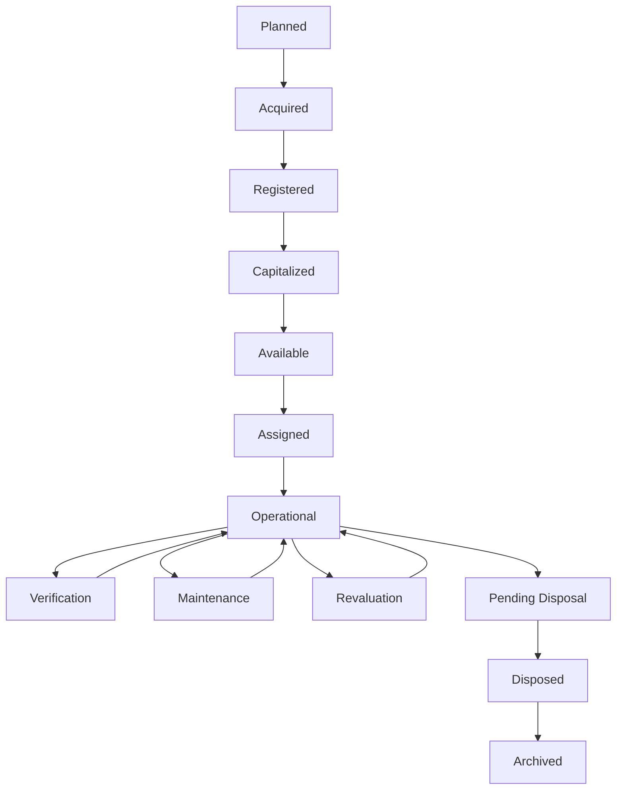
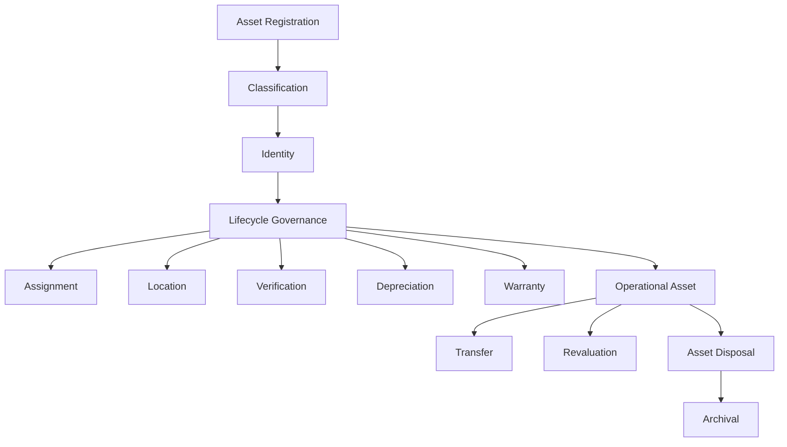
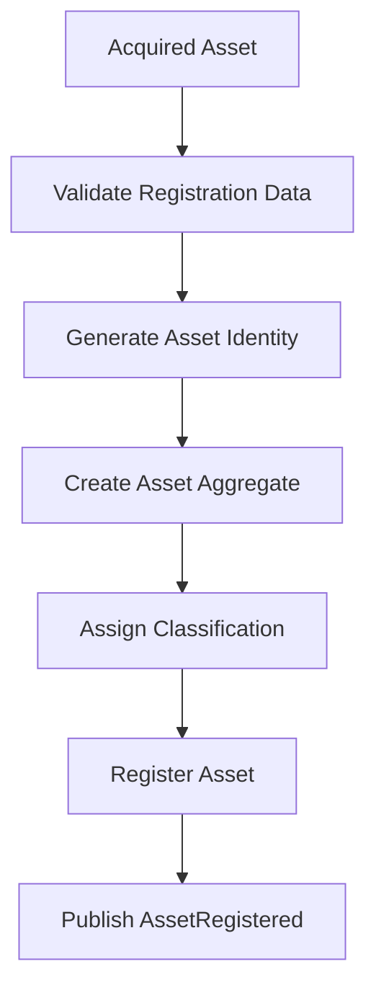
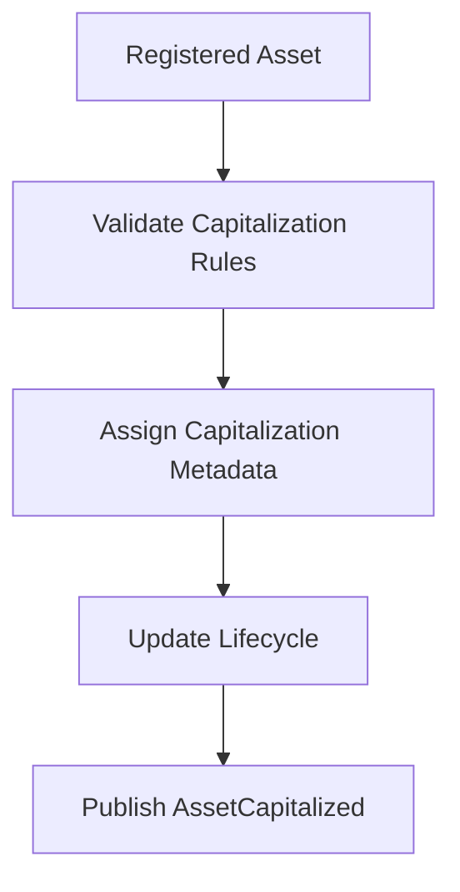
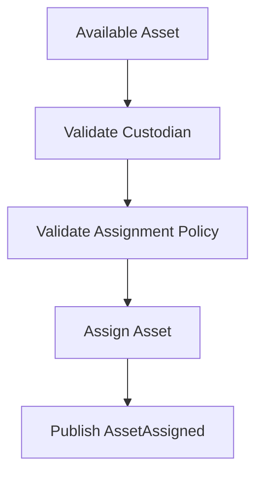
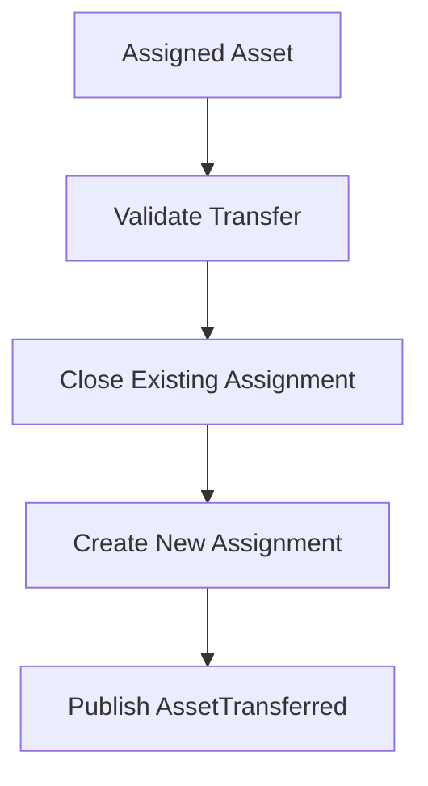
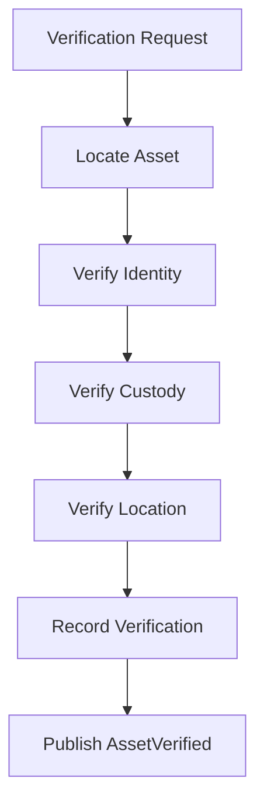
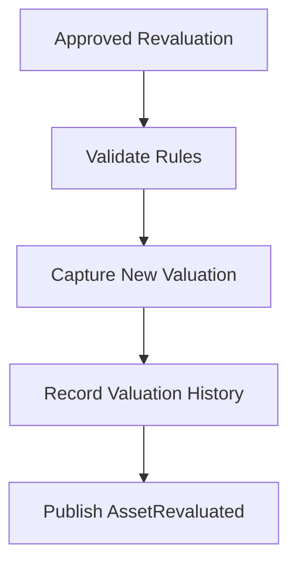
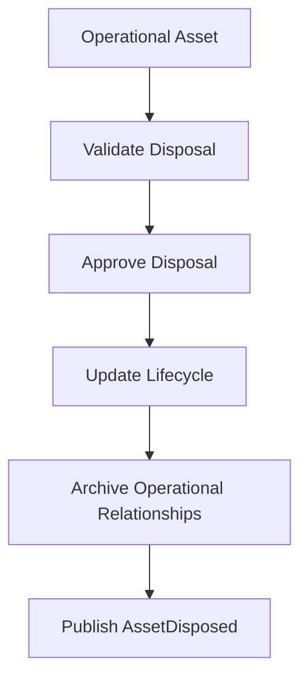

# L2-F12 — Asset Management Workflows

---

# Document Metadata

| Attribute | Value |
|-----------|-------|
| Document ID | L2-F12 |
| Document Name | Asset Management Workflows |
| Layer | Level 2 – Domain Workflow Architecture |
| Domain | Finance – Asset Management |
| Owner | Finance Architecture Team |
| Depends On | L2-F00 Finance Domain Model & Foundation, L2-A01 Platform & Tenant Foundation, L2-B01 Institution Lifecycle, L2-B02 Organisation Workflows, L2-B03 Campus & Infrastructure |
| Referenced By | Financial Reporting, Procurement & Supply Chain, Inventory, HR, Maintenance, Audit, Analytics |
| Status | Draft |
| Version | 1.0 |

---

# 1. Purpose

This document defines the canonical Asset Management architecture for the SutraERP platform.

The Asset Management domain governs the complete lifecycle of institutional assets from acquisition through registration, capitalization, assignment, transfer, verification, depreciation, revaluation, maintenance linkage, retirement, disposal, and archival.

The architecture establishes Asset Management as the single authoritative owner of institutional asset records while integrating with Procurement, Finance, Human Resources, Campus Infrastructure, Inventory, Reporting, and Audit through well-defined domain contracts.

This document defines business architecture only.

Implementation technologies, databases, APIs, user interface design, reporting tools, depreciation algorithms, and infrastructure choices remain outside the scope of this architecture.

---

# 2. Scope

This document defines:

- Asset Domain Architecture
- Asset Registry
- Asset Classification
- Asset Lifecycle
- Asset Registration
- Asset Capitalization
- Asset Assignment
- Asset Custody
- Asset Location Management
- Asset Transfer
- Asset Verification
- Asset Valuation
- Asset Depreciation Lifecycle
- Warranty Management Metadata
- AMC Reference Management
- Insurance Reference Management
- Asset Retirement
- Asset Disposal
- Asset Audit Responsibilities
- Asset Domain Events
- Cross-Domain Integration Contracts
- CQRS Responsibilities
- Multi-Institution Asset Governance
- Asset Configuration Architecture

---

# 3. Out of Scope

The following responsibilities are intentionally excluded.

| Capability | Canonical Owner |
|------------|-----------------|
| Purchase Requests | Procurement & Supply Chain |
| Request for Quotations | Procurement & Supply Chain |
| Vendor Management | Procurement & Supply Chain |
| Purchase Orders | Procurement & Supply Chain |
| Goods Receipt | Procurement & Supply Chain |
| Invoice Processing | Accounts Payable |
| Vendor Payments | Treasury |
| Accounting Entries | General Ledger |
| Budget Approval | Budget & Cost Center Management |
| Employee Lifecycle | Human Resources |
| Department Lifecycle | Organisation |
| Building & Room Lifecycle | Campus & Infrastructure |
| Inventory Stock Management | Inventory Domain |
| Maintenance Work Orders | Maintenance Domain |
| Financial Statements | Financial Reporting & Analytics |

Asset Management owns institutional assets.

It does not own procurement, accounting, payments, maintenance execution, inventory operations, or human resource management.

---

# 4. Architectural Position

Within the SutraERP architecture, Asset Management serves as the canonical enterprise asset domain positioned between Procurement and Financial Reporting.

Assets originate through acquisition processes, become managed enterprise resources throughout their operational life, and ultimately provide financial, operational, and governance information to downstream domains.

The Asset Management domain owns the lifecycle of assets but consumes procurement decisions and publishes business facts to Finance, Reporting, Audit, and Analytics.

```text
                  Procurement & Supply Chain
                              │
                    Asset Acquisition
                              │
                              ▼
                L2-F12 Asset Management
     ┌────────────────────────────────────────────┐
     │ Asset Registry                             │
     │ Asset Classification                       │
     │ Asset Assignment                           │
     │ Asset Custody                              │
     │ Asset Transfer                             │
     │ Asset Verification                         │
     │ Asset Depreciation                         │
     │ Asset Disposal                             │
     └────────────────────────────────────────────┘
          │          │          │          │
          ▼          ▼          ▼          ▼
     General      Reporting    Audit    Analytics
      Ledger

      ---

# 5. Domain Vision

The Asset Management domain establishes a single canonical source of truth for institutional assets across their entire operational lifecycle.

It ensures that every asset owned, leased, assigned, or managed by an institution is uniquely identified, consistently classified, lifecycle governed, and fully traceable from acquisition through retirement.

The domain enables institutional governance by providing reliable asset information to operational, financial, audit, compliance, reporting, and analytical domains while preserving clear ownership boundaries and enterprise-wide consistency.

Asset Management is responsible for governing assets—not for executing procurement, accounting, maintenance, or inventory operations.

---

# 6. Strategic Objectives

The Asset Management domain is designed to achieve the following strategic objectives.

## 6.1 Establish Canonical Asset Ownership

Provide a single authoritative registry for all institutional assets.

No other domain may maintain an independent lifecycle for managed assets.

---

## 6.2 Standardize Asset Lifecycle Governance

Ensure that every asset progresses through a controlled lifecycle with well-defined state transitions, validation rules, and auditability.

---

## 6.3 Enable Enterprise Asset Visibility

Provide accurate asset information for operational, financial, regulatory, and institutional decision making.

Asset visibility must remain consistent across all consuming domains.

---

## 6.4 Preserve Domain Ownership

Maintain strict separation of responsibilities between:

- Procurement
- Asset Management
- Accounting
- Treasury
- Human Resources
- Infrastructure
- Inventory
- Reporting

Each domain owns only its canonical business capabilities.

---

## 6.5 Support Regulatory Compliance

Maintain complete historical traceability of asset ownership, assignment, valuation, verification, and disposal.

Asset history shall remain immutable after publication.

---

## 6.6 Enable Event-Driven Enterprise Integration

Publish canonical business events that allow downstream domains to react without creating direct ownership dependencies.

Asset Management communicates business facts rather than implementation details.

---

## 6.7 Support Multi-Institution Governance

Provide complete logical isolation of institutional assets while supporting a common enterprise architecture.

Institution boundaries must remain strictly enforced throughout the asset lifecycle.

---

# 7. Architectural Principles

The Asset Management domain follows the architectural principles established by the SutraERP repository.

## Principle 1 — Single Canonical Ownership

Asset Management is the sole owner of institutional asset lifecycles.

No other bounded context may independently govern asset states.

---

## Principle 2 — Business Identity Before Technology

Every asset possesses a stable business identity independent of storage mechanisms, deployment architecture, or implementation technologies.

Business identity never changes throughout the lifecycle.

---

## Principle 3 — Lifecycle Governance

Assets transition only through approved lifecycle states.

Every lifecycle transition shall satisfy defined business invariants.

---

## Principle 4 — Event-Driven Collaboration

Cross-domain communication occurs through published business events.

Downstream domains consume business facts without modifying Asset Management state.

---

## Principle 5 — Configuration Over Customization

Institution-specific policies including:

- Asset Categories
- Depreciation Policies
- Verification Frequency
- Asset Numbering Rules
- Capitalization Thresholds
- Disposal Policies

shall be configuration-driven rather than hardcoded.

---

## Principle 6 — Complete Auditability

Every significant business action affecting an asset shall be historically traceable.

Historical records must never be overwritten.

Corrections are represented as new business events.

---

## Principle 7 — Technology Independence

Business architecture remains independent of:

- Databases
- Programming Languages
- APIs
- UI Frameworks
- Messaging Platforms
- Deployment Models

Technology choices shall not influence business responsibilities.

---

## Principle 8 — Domain Isolation

Asset Management owns only asset-related responsibilities.

Responsibilities owned by Procurement, Finance, HR, Infrastructure, Inventory, Maintenance, and Reporting remain outside this bounded context.

---

# 8. Success Criteria

The Asset Management architecture shall be considered complete when the following conditions are satisfied.

| Objective | Success Criterion |
|------------|------------------|
| Canonical Ownership | Every institutional asset has exactly one authoritative owner. |
| Lifecycle Governance | Every asset follows a controlled lifecycle with validated state transitions. |
| Enterprise Visibility | Asset information is consistently available to authorized consuming domains. |
| Auditability | Complete immutable history exists for every asset lifecycle event. |
| Domain Isolation | Ownership boundaries remain unambiguous across all integrated domains. |
| Configuration | Institution-specific policies are configurable without architectural changes. |
| Event Integration | Business events enable loose coupling with downstream domains. |
| Multi-Tenant Governance | Assets remain isolated within institutional boundaries while supporting shared platform architecture. |

---

# 9. Architectural Success Metrics

The Asset Management architecture shall continuously support:

- Complete asset traceability
- Controlled lifecycle progression
- Accurate asset ownership
- Consistent enterprise asset identification
- Reliable financial integration
- Reliable audit support
- Standardized institutional governance
- High-quality analytical reporting
- Scalable cross-domain integration
- Repository-wide architectural consistency
---

# 10. Domain Responsibilities

The Asset Management domain is the canonical owner of institutional asset lifecycle governance.

Its primary responsibility is to maintain accurate, auditable, and authoritative information about every managed asset throughout its operational existence.

The domain owns the complete business lifecycle of assets after acquisition and before archival, ensuring consistent governance across all institutions.

The Asset Management domain is responsible for the following capabilities.

## 10.1 Asset Registry

Maintain the authoritative registry of all institutional assets.

Each asset shall possess a globally unique business identity within its institution.

The registry serves as the single source of truth for asset existence.

---

## 10.2 Asset Classification

Manage asset classification according to institution-defined categories, classes, ownership types, and business groupings.

Classification policies shall be configuration-driven.

---

## 10.3 Asset Identity

Assign and preserve immutable business identity throughout the asset lifecycle.

Business identity shall remain independent of physical labels, storage mechanisms, or implementation technologies.

---

## 10.4 Asset Lifecycle Governance

Control every valid lifecycle transition from registration through retirement and archival.

Lifecycle transitions shall satisfy business validation rules before execution.

---

## 10.5 Asset Assignment

Manage assignment of assets to:

- Employees
- Departments
- Campuses
- Laboratories
- Classrooms
- Offices
- Institutional Units

Assignment history shall remain fully auditable.

---

## 10.6 Asset Custody

Maintain the current custodian responsible for each asset.

Custody represents operational responsibility rather than ownership.

Custody changes shall be historically traceable.

---

## 10.7 Asset Location

Maintain the current physical or logical location of every managed asset.

Location history shall remain available for audit and operational reporting.

---

## 10.8 Asset Verification

Support periodic verification of institutional assets.

Verification confirms:

- Existence
- Identity
- Location
- Custody
- Operational Status

Verification results become permanent business records.

---

## 10.9 Asset Valuation

Maintain business valuation information required for institutional governance.

Valuation changes shall preserve complete historical traceability.

---

## 10.10 Asset Depreciation Profile

Maintain depreciation policies and schedules associated with assets.

The domain owns depreciation metadata and lifecycle progression.

Financial accounting entries generated from depreciation remain the responsibility of the General Ledger domain.

---

## 10.11 Warranty, AMC and Insurance References

Maintain business references associated with:

- Warranty
- Annual Maintenance Contracts (AMC)
- Insurance Coverage

The Asset Management domain governs the relationship between assets and these business references.

Execution of maintenance activities remains outside this domain.

---

## 10.12 Asset Disposal

Govern controlled disposal of institutional assets.

Disposal includes:

- Retirement
- Sale
- Donation
- Scrap
- Write-off
- Decommissioning

Every disposal action requires complete historical traceability.

---

## 10.13 Asset Audit Support

Provide immutable historical records supporting:

- Internal Audit
- External Audit
- Regulatory Compliance
- Institutional Governance

Audit consumers may query asset history but shall never modify it.

---

# 11. Domain Non-Responsibilities

The following capabilities are explicitly excluded from the Asset Management bounded context.

| Capability | Canonical Owner |
|------------|-----------------|
| Purchase Requisition | Procurement & Supply Chain |
| Vendor Management | Procurement & Supply Chain |
| Request for Quotation | Procurement & Supply Chain |
| Purchase Orders | Procurement & Supply Chain |
| Goods Receipt | Procurement & Supply Chain |
| Inventory Stock Control | Inventory Domain |
| Warehouse Operations | Inventory Domain |
| Maintenance Planning | Maintenance Domain |
| Maintenance Scheduling | Maintenance Domain |
| Work Orders | Maintenance Domain |
| Technician Assignment | Maintenance Domain |
| Spare Parts Management | Maintenance Domain |
| Employee Lifecycle | Human Resources |
| Department Management | Organisation Domain |
| Building Management | Campus & Infrastructure |
| Room Management | Campus & Infrastructure |
| Accounting Entries | General Ledger |
| Accounts Payable | Accounts Payable |
| Treasury Operations | Treasury & Banking |
| Financial Statements | Financial Reporting & Analytics |

These responsibilities remain owned by their respective bounded contexts.

Asset Management may consume or publish business events related to these domains but shall not govern their internal business rules.

---

# 12. Domain Boundary

The Asset Management bounded context begins when an institutional asset is formally recognized within the enterprise asset registry.

The bounded context governs every subsequent business activity affecting the asset until its retirement and archival.

Activities preceding asset recognition, including procurement, sourcing, purchasing, and goods receipt, remain outside this domain.

Similarly, accounting, treasury, maintenance execution, inventory operations, and financial reporting remain independent bounded contexts that consume business facts published by Asset Management.

The Asset Management domain therefore serves as the canonical authority for institutional asset lifecycle governance while collaborating with adjacent domains through well-defined business events and integration contracts.
---

# 13. Ubiquitous Language

The following terms constitute the canonical business vocabulary of the Asset Management bounded context.

| Term | Definition |
|------|------------|
| Asset | A tangible or intangible institutional resource managed throughout its lifecycle. |
| Asset Identity | Immutable business identifier assigned to an asset. |
| Asset Registry | Canonical repository of institutional assets. |
| Asset Category | High-level classification grouping assets by business purpose. |
| Asset Class | Institution-defined classification within an asset category. |
| Asset Status | Current lifecycle state of an asset. |
| Asset Lifecycle | Controlled sequence of business states through which an asset progresses. |
| Asset Assignment | Allocation of an asset to an employee, department, campus, or institutional unit. |
| Custodian | Person or organizational unit responsible for operational custody of an asset. |
| Asset Location | Current physical or logical location of an asset. |
| Verification | Business process confirming the existence and condition of an asset. |
| Capitalization | Recognition of an acquired item as an institutional asset. |
| Depreciation Profile | Business policy governing asset value reduction over time. |
| Revaluation | Adjustment of business valuation while preserving history. |
| Disposal | Controlled removal of an asset from active institutional service. |
| Retirement | Permanent conclusion of an asset's operational lifecycle. |
| Warranty | Vendor-provided coverage associated with an asset. |
| AMC | Annual Maintenance Contract linked to an asset. |
| Insurance | Insurance coverage associated with an asset. |

All workflows, events, aggregates, APIs, reports, and documentation shall use this terminology consistently.

---

# 14. Bounded Context

The Asset Management bounded context governs institutional asset lifecycle management after an asset has been formally recognized by the institution.

It establishes the authoritative business model for:

- Asset registration
- Asset identity
- Asset classification
- Lifecycle progression
- Assignment
- Custody
- Location
- Verification
- Valuation
- Depreciation profile
- Disposal
- Retirement

The bounded context collaborates with Procurement, Finance, Human Resources, Campus Infrastructure, Inventory, Maintenance, Reporting, and Audit exclusively through published business events and defined integration contracts.

No external domain may modify Asset Management state directly.

---

# 15. Aggregate Landscape

The Asset Management bounded context contains one primary aggregate.

| Aggregate | Responsibility |
|-----------|----------------|
| Asset Aggregate | Governs the complete lifecycle and business invariants of an institutional asset. |

Supporting entities exist within the Asset Aggregate and do not constitute independent aggregates.

---

# 16. Asset Aggregate

The Asset Aggregate is the transactional consistency boundary for all business operations affecting an institutional asset.

Every asset lifecycle transition shall occur within the Asset Aggregate.

The aggregate enforces:

- Business identity uniqueness
- Lifecycle validity
- Assignment rules
- Custody consistency
- Location consistency
- Verification requirements
- Depreciation policy association
- Disposal validation
- Historical traceability

No operation may violate these invariants.

---

# 17. Aggregate Structure

```mermaid
graph TD
    AssetAggregate["Asset Aggregate"] --> AssetIdentity["Asset Identity"]
    AssetAggregate --> AssetClassification["Asset Classification"]
    AssetAggregate --> AssetSpecification["Asset Specification"]
    AssetAggregate --> AssetStatus["Asset Status"]
    AssetAggregate --> AssetLifecycle["Asset Lifecycle"]
    AssetAggregate --> AssetAssignment["Asset Assignment"]
    AssetAggregate --> Custodian
    AssetAggregate --> AssetLocation["Asset Location"]
    AssetAggregate --> VerificationRecords["Verification Records"]
    AssetAggregate --> DepreciationProfile["Depreciation Profile"]
    AssetAggregate --> WarrantyReference["Warranty Reference"]
    AssetAggregate --> AMCReference["AMC Reference"]
    AssetAggregate --> InsuranceReference["Insurance Reference"]
    AssetAggregate --> ValuationHistory["Valuation History"]
    AssetAggregate --> DisposalRecord["Disposal Record"]
    AssetAggregate --> AuditReferences["Audit References"]
```



The Asset Aggregate is the single authoritative owner of all asset-related business information.

---

# 18. Aggregate Relationships

The Asset Aggregate references information owned by other bounded contexts without assuming ownership.

| External Domain | Relationship |
|-----------------|--------------|
| Procurement & Supply Chain | Source of asset acquisition events. |
| Accounts Payable | Financial settlement reference. |
| General Ledger | Accounting representation of asset capitalization and depreciation. |
| Treasury & Banking | Payment completion reference. |
| Human Resources | Employee and custodian reference. |
| Organisation | Department reference. |
| Campus & Infrastructure | Campus and building reference. |
| Inventory | Stock and warehouse reference where applicable. |
| Maintenance | Maintenance contract and work order reference. |
| Financial Reporting & Analytics | Consumer of asset business facts. |
| Audit Infrastructure | Consumer of immutable asset history. |

Relationships are reference-based.

Ownership of external business entities remains within their canonical bounded contexts.

---

# 19. Aggregate Invariants

The Asset Aggregate shall enforce the following business invariants.

1. Every asset has exactly one immutable business identity.

2. Every asset belongs to exactly one institution.

3. Every asset has exactly one current lifecycle state.

4. Every asset has at most one active custodian.

5. Every asset has at most one active operational location.

6. Every lifecycle transition must satisfy business validation rules.

7. Asset history is immutable.

8. Disposal permanently terminates operational lifecycle.

9. Archived assets cannot return to operational states.

10. Cross-domain references must reference valid canonical entities but shall never duplicate their business ownership.
---

# 20. Canonical Asset Lifecycle

Every institutional asset progresses through a controlled lifecycle governed by the Asset Aggregate.

The lifecycle defines the valid business states of an asset and the permitted transitions between those states.

No asset may bypass mandatory lifecycle states unless explicitly permitted by institutional configuration.

## 20.1 Lifecycle States

| State | Description |
|---------|-------------|
| Planned | Asset requirement identified but not yet acquired. |
| Acquired | Asset procured and ownership transferred to the institution. |
| Registered | Asset formally entered into the institutional asset registry. |
| Capitalized | Asset recognized as an institutional capital asset. |
| Available | Asset ready for operational use. |
| Assigned | Asset allocated to a custodian or organizational unit. |
| Operational | Asset actively used by the institution. |
| Under Verification | Asset undergoing verification or audit. |
| Under Maintenance | Asset temporarily unavailable due to maintenance activities. |
| Revaluated | Asset valuation updated according to institutional policy. |
| Pending Disposal | Asset approved for retirement or disposal. |
| Disposed | Asset permanently removed from operational service. |
| Archived | Asset retained only for historical, audit, or regulatory purposes. |

---

## 20.2 Canonical Lifecycle



---

## 20.3 Lifecycle Rules

The Asset Aggregate enforces the following rules.

- Registration cannot occur before acquisition.
- Capitalization requires successful registration.
- Assignment requires an operational asset.
- Operational assets may undergo verification multiple times.
- Maintenance does not terminate the lifecycle.
- Disposal permanently ends operational use.
- Archived assets are immutable.

---

# 21. Business Capabilities

The Asset Management bounded context provides the following business capabilities.

## 21.1 Asset Registration

Create the canonical institutional record for newly acquired assets.

---

## 21.2 Asset Classification

Categorize assets according to institutional classification policies.

---

## 21.3 Asset Identification

Generate and preserve immutable business identities.

---

## 21.4 Asset Assignment

Assign assets to:

- Employees
- Departments
- Campuses
- Laboratories
- Classrooms
- Administrative Units

---

## 21.5 Custody Management

Maintain operational responsibility for institutional assets.

---

## 21.6 Location Management

Maintain current physical and logical locations.

---

## 21.7 Asset Verification

Support scheduled and ad hoc verification activities.

Verification confirms:

- Identity
- Existence
- Location
- Custody
- Operational condition

---

## 21.8 Depreciation Governance

Maintain depreciation policies and lifecycle progression.

Accounting impacts remain external to this domain.

---

## 21.9 Asset Revaluation

Support controlled business valuation updates.

Historical valuation records remain immutable.

---

## 21.10 Warranty & Contract Association

Maintain references to:

- Warranty
- Annual Maintenance Contracts
- Insurance Policies

Execution of these contracts is governed by their owning domains.

---

## 21.11 Asset Transfer

Govern transfers between:

- Departments
- Employees
- Campuses
- Buildings
- Cost Centers

Transfer history remains permanently auditable.

---

## 21.12 Asset Disposal

Govern retirement through:

- Sale
- Donation
- Scrap
- Write-off
- Decommissioning

Disposal requires institutional authorization.

---

## 21.13 Asset Inquiry

Provide canonical asset information for authorized consuming domains.

Asset Management serves as the authoritative source of asset business facts.

---

# 22. Capability Map

| Capability | Primary Responsibility |
|------------|------------------------|
| Asset Registration | Create canonical asset record |
| Classification | Categorize institutional assets |
| Identity Management | Maintain immutable business identity |
| Lifecycle Governance | Control lifecycle transitions |
| Assignment | Allocate assets to custodians |
| Custody | Maintain operational ownership |
| Location | Track asset location |
| Verification | Validate existence and condition |
| Depreciation Governance | Manage depreciation lifecycle |
| Revaluation | Update business valuation |
| Warranty & AMC | Maintain contract references |
| Transfer | Govern movement between organizational units |
| Disposal | Retire institutional assets |
| Inquiry | Publish authoritative asset information |

---

# 23. Capability Dependencies


---

# 24. Aggregate Workflows

The Asset Management domain executes all business operations through aggregate-centric workflows.

Each workflow is owned by the Asset Aggregate and enforces the business rules, lifecycle constraints, and ownership boundaries defined in this architecture.

No workflow may bypass aggregate invariants.

---

## 24.1 Asset Registration Workflow

## Objective

Create a new canonical asset within the institutional asset registry.

## Entry Conditions

- Asset acquisition has been completed.
- Mandatory registration information is available.
- Asset identifier has not been previously assigned.

## Workflow



## Exit Conditions

- Asset exists in the registry.
- Asset identifier becomes immutable.
- Asset lifecycle transitions to **Registered**.

---

## 24.2 Asset Capitalization Workflow

## Objective

Recognize a registered asset as a capital asset.

## Entry Conditions

- Asset is Registered.
- Capitalization criteria are satisfied.

## Workflow



## Exit Conditions

- Asset lifecycle becomes **Capitalized**.

---

## 24.3 Asset Assignment Workflow

## Objective

Assign an operational asset to a business custodian.

## Entry Conditions

- Asset is Available.
- Custodian is valid.
- Assignment policy passes validation.

## Workflow



## Exit Conditions

- Custodian relationship established.
- Assignment history preserved.

---

## 24.4 Asset Transfer Workflow

## Objective

Transfer custody between organizational entities.

## Entry Conditions

- Asset is Assigned.
- Transfer authorization approved.

## Workflow



## Exit Conditions

- Previous custody retained historically.
- New custody becomes effective.

---

## 24.5 Asset Verification Workflow

## Objective

Verify the physical existence and correctness of asset information.

## Entry Conditions

- Verification initiated by schedule or authorized request.

## Workflow



## Exit Conditions

- Verification evidence recorded.
- Verification history retained.

---

## 24.6 Asset Revaluation Workflow

## Objective

Record an updated business valuation.

## Entry Conditions

- Revaluation approved.
- Asset eligible for revaluation.

## Workflow



## Exit Conditions

- Historical valuations remain immutable.
- Current valuation updated.

---

## 24.7 Asset Disposal Workflow

## Objective

Retire an asset from institutional service.

## Entry Conditions

- Disposal authorization approved.
- Asset eligible for disposal.

## Workflow



## Exit Conditions

- Asset becomes non-operational.
- Disposal history permanently retained.

---

# 25. Workflow Ownership Matrix

| Workflow | Owning Aggregate | Result |
|----------|------------------|--------|
| Asset Registration | Asset | Registered Asset |
| Asset Capitalization | Asset | Capitalized Asset |
| Asset Assignment | Asset | Custody Established |
| Asset Transfer | Asset | Custody Updated |
| Asset Verification | Asset | Verification Recorded |
| Asset Revaluation | Asset | Valuation Updated |
| Asset Disposal | Asset | Asset Retired |

---

# 26. Workflow Constraints

The following constraints apply to every workflow.

- All workflows execute within a single Asset Aggregate boundary.
- Aggregate invariants shall never be bypassed.
- Workflow execution shall be fully auditable.
- Lifecycle transitions shall follow the canonical lifecycle.
- Cross-domain updates shall occur only through published events.
- Historical records shall remain immutable.
- Failed workflows shall not produce business events.
- Successful workflows shall publish exactly one terminal business event.
---

# 27. Workflow-to-Event Mapping

Every successful Asset Management workflow concludes by publishing a canonical business event.

Events represent completed business facts.

The Asset Management domain owns the business meaning of these events.

Event publication, routing, delivery, replay, and infrastructure governance are delegated to the Platform Event Infrastructure (L2-A06).

Failed workflows shall never publish terminal business events.

---

## Workflow Event Matrix

| Workflow | Terminal Event | Event Category |
|-----------|----------------|----------------|
| Asset Registration | AssetRegistered | Lifecycle |
| Asset Capitalization | AssetCapitalized | Lifecycle |
| Asset Assignment | AssetAssigned | Operational |
| Asset Transfer | AssetTransferred | Operational |
| Asset Verification | AssetVerified | Governance |
| Asset Revaluation | AssetRevaluated | Financial |
| Asset Disposal | AssetDisposed | Lifecycle |
| Asset Retirement | AssetRetired | Lifecycle |
| AssetArchival | AssetArchived | Lifecycle |

---

# 28. Domain Event Catalog

The Asset Management domain publishes the following canonical business events.

---

## 28.1 AssetRegistered

### Trigger

Successful completion of Asset Registration.

### Business Meaning

A new canonical asset has been registered within the enterprise asset registry.

### Published By

Asset Aggregate

### Consumers

- Finance
- Procurement
- Maintenance
- Audit Infrastructure
- Analytics

---

## 28.2 AssetCapitalized

### Trigger

Successful capitalization.

### Business Meaning

The asset has entered its financial lifecycle.

### Published By

Asset Aggregate

### Consumers

- General Ledger
- Financial Reporting
- Audit Infrastructure

---

## 28.3 AssetAssigned

### Trigger

Successful assignment.

### Business Meaning

Operational custody has been established.

### Published By

Asset Aggregate

### Consumers

- HR
- Maintenance
- Audit Infrastructure

---

## 28.4 AssetTransferred

### Trigger

Transfer completed.

### Business Meaning

Custody has changed.

### Published By

Asset Aggregate

### Consumers

- HR
- Audit Infrastructure
- Analytics

---

## 28.5 AssetVerified

### Trigger

Verification completed.

### Business Meaning

Asset existence and operational information have been verified.

### Published By

Asset Aggregate

### Consumers

- Audit Infrastructure
- Analytics
- Compliance

---

## 28.6 AssetRevaluated

### Trigger

Revaluation completed.

### Business Meaning

Current business valuation has changed.

### Published By

Asset Aggregate

### Consumers

- Finance
- Financial Reporting
- Audit Infrastructure

---

## 28.7 AssetDisposed

### Trigger

Disposal completed.

### Business Meaning

The asset has permanently exited operational service.

### Published By

Asset Aggregate

### Consumers

- Finance
- Reporting
- Audit Infrastructure

---

## 28.8 AssetRetired

### Trigger

Retirement approved.

### Business Meaning

Operational lifecycle has ended.

### Published By

Asset Aggregate

### Consumers

- Maintenance
- Finance
- Reporting

---

## 28.9 AssetArchived

### Trigger

Archival completed.

### Business Meaning

The asset has entered long-term historical preservation.

### Published By

Asset Aggregate

### Consumers

- Audit Infrastructure
- Reporting

---

# 29. Event Lifecycle Principles

The Asset Management domain adheres to the following event principles.

## Principle 1 — Facts Only

Events represent completed business facts.

Events never represent:

- Commands
- Requests
- Intentions
- Pending operations

---

## Principle 2 — Canonical Ownership

Asset Management owns:

- Event meaning
- Event timing
- Event business semantics

Platform Infrastructure owns:

- Publication
- Delivery
- Routing
- Retry
- Replay

---

## Principle 3 — Immutable Events

Published events shall never be modified.

Corrections shall be represented by subsequent business events.

---

## Principle 4 — Single Publication

Each successful workflow publishes exactly one terminal event.

Duplicate publication is prohibited.

---

## Principle 5 — Event Independence

Consumers remain independent.

The Asset Management domain never invokes downstream consumers directly.

---

# 30. Event Publishing Rules

The following rules are mandatory.

- Events shall be published only after successful aggregate commitment.
- Events shall reference immutable Asset Identifier.
- Events shall preserve tenant boundaries.
- Events shall preserve institutional boundaries.
- Events shall include correlation metadata.
- Events shall include causation metadata where applicable.
- Events shall remain technology independent.

---

# 31. Event Dependency Matrix

| Event | Producer | Typical Consumers |
|--------|----------|-------------------|
| AssetRegistered | Asset | Procurement, Finance, Audit |
| AssetCapitalized | Asset | GL, Reporting |
| AssetAssigned | Asset | HR, Maintenance |
| AssetTransferred | Asset | HR, Audit |
| AssetVerified | Asset | Audit, Analytics |
| AssetRevaluated | Asset | Finance, Reporting |
| AssetDisposed | Asset | Finance, Audit |
| AssetRetired | Asset | Maintenance |
| AssetArchived | Asset | Reporting, Audit |

---

# 32. Event Architecture Summary

The Asset Management domain publishes immutable business facts describing the evolution of enterprise assets.

These events establish loose coupling between Asset Management and downstream domains while preserving canonical ownership.

The Platform Event Infrastructure governs event transport, routing, delivery, replay, and operational reliability.

The Asset Management domain remains responsible only for the business semantics of its published events.
---

# 33. Cross-Domain Integration Architecture

The Asset Management domain collaborates with other enterprise domains through stable business contracts and canonical domain events.

Asset Management owns only the institutional asset lifecycle.

Every collaborating domain retains ownership of its own business concepts, rules, workflows, and aggregates.

Cross-domain collaboration shall occur through published contracts and canonical business events.

Direct ownership transfer between domains is prohibited.

---

# 34. Upstream Dependencies

The Asset Management domain depends upon canonical information published by upstream domains.

## Dependency Principles

- Asset Management consumes canonical references.
- Upstream domains remain authoritative.
- Asset Management never duplicates upstream master data.
- Asset Management never modifies upstream aggregates.

---

## 34.1 Institution

**Canonical Owner**

L2-B01 — Institution Lifecycle

Consumed Information

- Institution Identifier
- Institution Status
- Institution Context

Purpose

Every asset belongs to exactly one Institution.

Asset Management inherits institutional boundaries but never manages the Institution lifecycle.

---

## 34.2 Organization

**Canonical Owner**

L2-B02 — Organization Domain

Consumed Information

- Organization Units
- Departments
- Business Units
- Organizational Hierarchy

Purpose

Assets may be assigned or transferred to organizational units.

Organization ownership remains external.

---

## 34.3 Campus & Infrastructure

**Canonical Owner**

L2-B03 — Campus & Infrastructure

Consumed Information

- Campus
- Building
- Floor
- Room
- Physical Space

Purpose

Asset Management references physical locations.

Infrastructure owns physical entities.

Asset Management owns only the relationship between assets and locations.

---

## 34.4 Procurement & Supply Chain

**Canonical Owner**

L2-F14 — Procurement & Supply Chain

Consumed Information

- Purchase Completion
- Goods Receipt
- Procurement References
- Vendor Reference

Purpose

Procurement initiates asset acquisition.

Asset Management begins only after an asset becomes institutionally recognized.

---

## 34.5 Human Resources

**Canonical Owner**

HR Domain

Consumed Information

- Employee Reference
- Employment Status
- Organizational Assignment

Purpose

Assets may be assigned to employees.

Employee lifecycle remains outside Asset Management.

---

# 35. Downstream Consumers

The following domains consume business facts published by Asset Management.

---

## 35.1 General Ledger

Consumes

- Asset Capitalization
- Asset Revaluation
- Asset Disposal

Purpose

Creates accounting entries.

General Ledger owns accounting.

Asset Management owns asset lifecycle.

---

## 35.2 Financial Reporting & Analytics

Consumes

- Asset valuation
- Asset lifecycle
- Asset classification
- Asset utilization

Purpose

Produces reports and analytical views.

Reporting never owns operational asset data.

---

## 35.3 Maintenance

Consumes

- Asset Identity
- Asset Classification
- Warranty Reference
- AMC Reference
- Asset Availability

Purpose

Maintenance executes maintenance activities.

Asset Management only maintains business references.

---

## 35.4 Audit Infrastructure

Consumes

- Asset lifecycle events
- Assignment changes
- Custody changes
- Disposal events

Purpose

Generates immutable audit evidence.

Audit Infrastructure owns evidence preservation.

---

## 35.5 Analytics

Consumes

- Asset business facts
- Lifecycle history
- Utilization history
- Verification history

Purpose

Derives KPIs, trends, forecasts, and dashboards.

Analytics never modifies asset state.

---

# 36. Integration Responsibility Matrix

| Business Capability | Owner | Asset Management Role |
|---------------------|-------|-----------------------|
| Institution Lifecycle | Institution | Reference |
| Organization Hierarchy | Organization | Reference |
| Campus Structure | Campus & Infrastructure | Reference |
| Procurement | Procurement | Consumer |
| Employee Management | HR | Reference |
| Asset Lifecycle | Asset Management | Owner |
| Maintenance Execution | Maintenance | Reference |
| Accounting Entries | General Ledger | Consumer |
| Financial Reporting | Reporting | Publisher |
| Audit Evidence | Audit Infrastructure | Publisher |
| Enterprise Analytics | Analytics | Publisher |

---

# 37. Integration Principles

## IP-01 — Canonical Ownership

Every business capability has exactly one owning domain.

Asset Management shall never assume ownership of external concepts.

---

## IP-02 — Reference Rather Than Replication

External entities shall be referenced using canonical identifiers.

Business data duplication is prohibited.

---

## IP-03 — Event-Driven Collaboration

Asset Management publishes completed business facts.

Consumers independently determine their responses.

No downstream workflow shall be orchestrated by Asset Management.

---

## IP-04 — Stable Contracts

Integration contracts shall evolve independently from internal implementation.

Internal aggregate structures shall remain private.

---

## IP-05 — Loose Coupling

Asset Management shall never require knowledge of downstream implementation.

Consumers subscribe independently.

---

# 38. Integration Constraints

The following architectural constraints are mandatory.

- Assets shall reference only canonical entities from upstream domains.
- External domains shall never modify Asset Aggregate state directly.
- All cross-domain communication shall occur through stable contracts or published business events.
- Asset Management shall remain independent of accounting implementation.
- Asset Management shall remain independent of maintenance implementation.
- Cross-domain relationships shall preserve tenant isolation.
- Cross-domain relationships shall preserve institution boundaries.
- Ownership boundaries defined in Level 1 and supporting foundation domains shall never be violated.

---

# 39. Cross-Domain Architecture Summary

The Asset Management domain acts as the canonical authority for institutional asset lifecycle governance.

It consumes authoritative information from Institution, Organization, Campus, Procurement, and Human Resources while publishing immutable business facts consumed by General Ledger, Maintenance, Reporting, Audit, and Analytics.

This collaboration model preserves:

- Single canonical ownership
- Domain isolation
- Event-driven integration
- Technology independence
- Enterprise scalability
- Long-term architectural stability
# 40. Architectural Decision Records (ADRs)

## ADR-01

Asset Management owns the complete institutional asset lifecycle.

Status: Accepted

---

## ADR-02

Asset identity is immutable.

Status: Accepted

---

## ADR-03

Maintenance remains an independent bounded context.

Asset Management stores only maintenance references.

Status: Accepted

---

## ADR-04

Accounting remains the responsibility of the General Ledger.

Asset Management publishes business facts only.

Status: Accepted

---

## ADR-05

Cross-domain communication occurs through published contracts and business events.

Status: Accepted

---

## ADR-06

Configuration governs institutional variation.

Core architecture remains stable.

Status: Accepted
# 41. Architecture Validation Checklist

The Asset Management architecture is considered complete when the following conditions are satisfied.

| Validation Item | Status |
|-----------------|--------|
| Canonical ownership defined | ✅ |
| Domain boundary established | ✅ |
| Aggregate modeled | ✅ |
| Lifecycle defined | ✅ |
| Workflows documented | ✅ |
| Domain events defined | ✅ |
| Integration architecture complete | ✅ |
| Configuration architecture defined | ✅ |
| CQRS architecture defined | ✅ |
| Security responsibilities identified | ✅ |
| Audit responsibilities identified | ✅ |
| ADRs recorded | ✅ |

---

# 42. Architecture Lock

This document establishes the canonical Level 2 architecture for Asset Management within SutraERP.

The document defines:

- Domain ownership
- Business language
- Aggregate boundaries
- Lifecycle governance
- Workflow architecture
- Event model
- Cross-domain integration
- Configuration model
- CQRS responsibilities
- Security responsibilities
- Audit responsibilities

Subsequent architectural levels shall refine implementation details without altering the business architecture defined herein.

Changes affecting canonical ownership, aggregate boundaries, lifecycle semantics, or integration contracts require formal architectural review and approval before incorporation into the repository.

---

# End of Document


