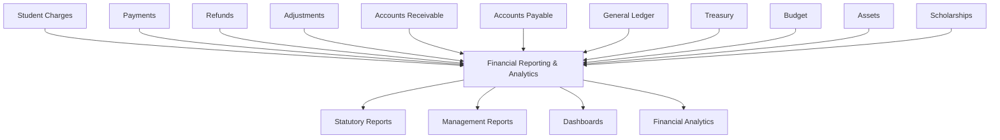
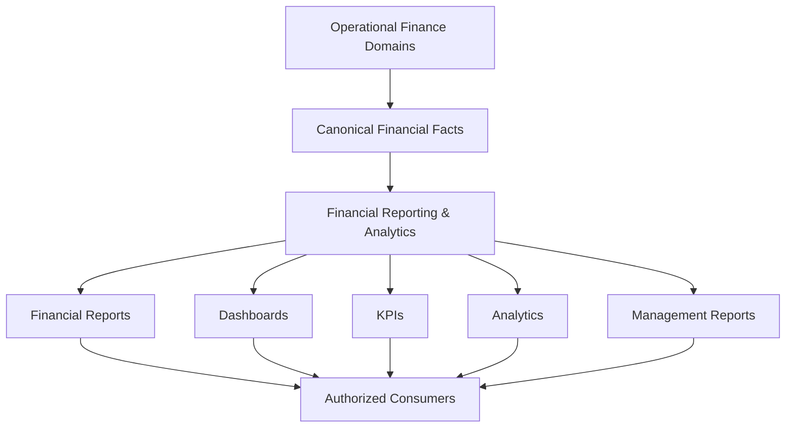
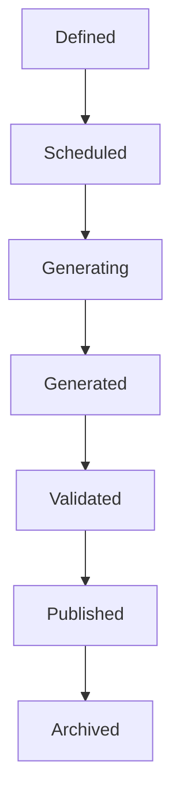
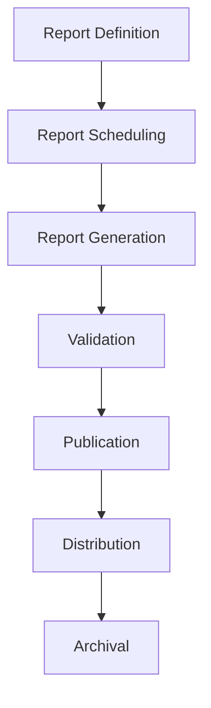

# L2-F13 — Financial Reporting & Analytics Workflows

---

## Canonical Section Crosswalk

> Added 2026-08-04 under integrity finding INT-018. `governance/constitution/Volume_3_Architecture_Framework.md` section 18 requires every L2 document to define eleven sections. This document uses its own numbered-section convention; the table below maps the required sections to where they actually live. No content was moved.

| Required section (Volume 3 §18) | Location in this document |
|---|---|
| Purpose | §1 Purpose |
| Scope | §2 Scope; §3 Out of Scope |
| Actors | — not present — |
| Entities | §17 Aggregate Landscape; §18 Primary Aggregate; §19 Aggregate Structure |
| Business Rules | §20 Aggregate Invariants |
| Workflow | §25 Aggregate Workflows; §26 Workflow Ownership Matrix; §27 Workflow Constraints |
| State Machine | Lifecycle State Descriptions |
| Contracts | IP-04 — Stable Business Contracts |
| Events | §28 Workflow-to-Event Mapping; §29 Domain Event Catalog; §30 Event Principles |
| Dependencies | §13 Upstream Dependencies; §24 Capability Dependency Flow; §32 Event Dependency Matrix |
| Locked Decisions | §56 Architectural Decision Records (ADRs) |

> **Gap:** 1 required section(s) have no counterpart in this document: Actors. Recorded, not authored.

---

# Document Metadata

| Attribute | Value |
|-----------|-------|
| Document ID | L2-F13 |
| Document Name | Financial Reporting & Analytics Workflows |
| Architecture Level | Level 2 – Domain Workflow Architecture |
| Domain | Finance |
| Module | Financial Reporting & Analytics |
| Status | Trust Certification Ready |
| Document Owner | Finance — Reporting & Analytics |
| Version | 1.0.0 |
| Review Authority | Finance Architecture Team |
| Parent Architecture | L2-F00 — Finance Domain Model & Foundation |
| Depends On | L2-F00, L2-F05, L2-F06, L2-F07, L2-F08, L2-F09, L2-F10, L2-F11, L2-F12 |
| Referenced By | Dashboards, Analytics, Regulatory Reporting, Executive MIS, BI Platform, External Reporting |

---

# 1. Purpose

This document defines the canonical Financial Reporting & Analytics architecture for the SutraERP platform.

The Financial Reporting & Analytics domain is responsible for transforming canonical financial information into governed financial reports, statutory statements, management reports, analytical models, dashboards, key performance indicators, and institutional financial insights.

This document establishes the complete reporting lifecycle, reporting ownership boundaries, reporting workflows, analytical architecture, reporting events, CQRS responsibilities, configuration model, and integration contracts required to deliver enterprise-grade financial reporting across educational institutions.

Financial Reporting consumes financial facts produced by Finance domains.

It does not create, modify, approve, or own financial transactions.

---

# 2. Scope

This architecture defines:

- Financial Reporting Domain
- Reporting Lifecycle
- Financial Statement Architecture
- Trial Balance
- Balance Sheet
- Income & Expenditure Statement
- Cash Flow Reporting
- Budget Reports
- Cost Center Reports
- Student Financial Reports
- Accounts Receivable Reports
- Accounts Payable Reports
- Treasury Reports
- Scholarship Reports
- Asset Reports
- Regulatory Reporting
- Management Information System (MIS)
- Financial Dashboards
- KPI Framework
- Financial Analytics
- Reporting Events
- Reporting Governance
- Reporting Configuration
- CQRS Read Models
- Multi-Domain Reporting Contracts

---

# 3. Out of Scope

The following responsibilities remain outside this architecture.

| Capability | Canonical Owner |
|------------|-----------------|
| Accounting Entries | L2-F05 General Ledger |
| Student Charges | L2-F01 |
| Payments | L2-F02 |
| Refunds | L2-F03 |
| Financial Adjustments | L2-F04 |
| Budget Management | L2-F06 |
| Accounts Receivable | L2-F07 |
| Accounts Payable | L2-F08 |
| Financial Closing | L2-F09 |
| Treasury Operations | L2-F10 |
| Scholarships | L2-F11 |
| Asset Lifecycle | L2-F12 |
| Procurement | L2-F14 |
| Operational Dashboards | Platform Analytics |
| Data Warehouse Implementation | Lower Architecture Levels |

Financial Reporting consumes financial information.

It never owns financial operations.

---

# 4. Architectural Position

Financial Reporting & Analytics is positioned above every operational Finance domain.

It serves as the enterprise financial information layer.

Financial Reporting owns financial information products.

Operational Finance owns financial transactions.

Each business capability has exactly one canonical owner.

---

# 5. Canonical Ownership

The Financial Reporting domain exclusively owns:

## Aggregates

- Financial Report
- Report Definition
- Report Template
- Report Execution
- KPI Definition
- Financial Dashboard
- Analytical Model
- Reporting Schedule

---

## Reporting Responsibilities

Financial Reporting owns:

- Financial statement generation
- Report lifecycle
- Report scheduling
- Report publication
- KPI calculation
- Analytical projections
- Executive dashboards
- Financial metrics
- Report archival
- Report governance

---

## Explicit Non-Ownership

Financial Reporting shall never own:

- Accounting entries
- Ledger balances
- Student charges
- Receipts
- Vendor liabilities
- Budget definitions
- Treasury accounts
- Asset lifecycle
- Scholarship lifecycle

Those remain owned by their canonical finance domains.

---

# 6. Architectural Principles

The Financial Reporting domain adheres to the following principles.

## FRP-01 — Reports Consume Canonical Financial Facts

Reports derive information exclusively from canonical Finance domains.

Reports never become the source of financial truth.

---

## FRP-02 — Read-Only Architecture

Financial Reporting never modifies operational financial state.

It consumes immutable business facts.

---

## FRP-03 — Reporting Independence

Financial reports remain independent of operational workflow execution.

Operational domains publish business facts.

Reporting consumes them.

---

## FRP-04 — Configuration-Driven Reporting

Institutional reporting requirements shall be configurable.

Examples include:

- Financial statement layouts
- Regulatory templates
- KPI definitions
- Dashboard composition
- Reporting schedules
- Fiscal presentation rules

---

## FRP-05 — Complete Traceability

Every reported financial value shall be traceable back to canonical financial records.

---

## FRP-06 — Technology Independence

This architecture defines business reporting responsibilities.

Visualization tools, BI platforms, databases, OLAP engines, and reporting technologies remain outside the scope of Level 2 Architecture.

---

# 7. Domain Vision

Provide a unified enterprise financial reporting capability that transforms canonical financial facts into trusted institutional intelligence supporting operational management, executive governance, statutory compliance, accreditation, and strategic decision-making.

---

# 8. Architectural Objectives

The Financial Reporting domain exists to:

- Standardize financial reporting.
- Eliminate duplicate report logic.
- Support statutory compliance.
- Provide executive financial visibility.
- Deliver reusable reporting services.
- Enable analytical decision support.
- Maintain reporting consistency.
- Preserve financial traceability.
- Support enterprise-scale reporting.
- Remain configuration driven.
---

# 9. Domain Model

The Financial Reporting & Analytics domain transforms canonical financial facts into governed financial information products.

It provides institutional visibility into financial performance without assuming ownership of operational financial data.

Financial Reporting consumes financial information published by upstream Finance domains and produces reports, dashboards, KPIs, and analytical views.

The domain owns only reporting artifacts and analytical models.

---

# 10. Domain Responsibilities

The Financial Reporting domain is responsible for the following business capabilities.

## Financial Statement Generation

Generate standardized financial statements including:

- Trial Balance
- Balance Sheet
- Income & Expenditure Statement
- Cash Flow Statement

Generation follows configured institutional reporting policies.

---

## Management Reporting

Produce operational and executive financial reports including:

- Department Financial Reports
- Cost Center Reports
- Budget Utilization Reports
- Revenue Reports
- Expense Reports
- Collection Reports
- Outstanding Reports

---

## Financial Analytics

Provide analytical views including:

- Revenue Trends
- Expense Trends
- Collection Performance
- Budget Variance
- Cash Position Analysis
- Receivable Aging
- Payable Aging
- Scholarship Utilization
- Asset Valuation Trends

---

## Dashboard Management

Provide reusable financial dashboards for different institutional roles.

Examples include:

- CFO Dashboard
- Finance Officer Dashboard
- Principal Dashboard
- Trustee Dashboard
- Department Financial Dashboard

---

## KPI Management

Maintain canonical financial KPI definitions.

Examples include:

- Collection Efficiency
- Outstanding Receivables
- Budget Utilization
- Operating Surplus
- Liquidity Position
- Cash Flow Stability

---

## Report Scheduling

Manage scheduled report generation.

Supports:

- Daily
- Weekly
- Monthly
- Quarterly
- Annual
- On-demand

---

## Report Publication

Publish finalized financial reports for authorized consumers.

Publication does not alter underlying financial records.

---

# 11. Domain Non-Responsibilities

The Financial Reporting domain explicitly excludes the following responsibilities.

## Financial Transactions

The domain never creates:

- Journal Entries
- Student Charges
- Receipts
- Refunds
- Payments
- Adjustments

These remain owned by operational Finance domains.

---

## Accounting

Financial Reporting never:

- Posts accounting entries
- Calculates ledger balances
- Maintains Chart of Accounts

These remain owned by General Ledger.

---

## Budget Management

Financial Reporting reports budget information.

Budget ownership remains with Budget & Cost Center Management.

---

## Treasury Operations

Financial Reporting consumes treasury information.

Treasury owns banking operations, liquidity, and cash management.

---

## Asset Lifecycle

Financial Reporting reports asset information.

Section J owns asset registration, assignment, valuation, and retirement.

---

## Procurement

Financial Reporting reports procurement expenditure.

Procurement owns purchasing operations.

---

# 12. Domain Boundaries

The Financial Reporting domain exists above operational Finance domains.

The domain never modifies operational financial information.

It only transforms canonical financial facts into governed information products.

---

# 13. Upstream Dependencies

Financial Reporting depends upon the following canonical domains.

| Domain | Consumed Information |
|----------|----------------------|
| Student Charges | Charge information |
| Payment Management | Payment information |
| Refund Management | Refund information |
| Financial Adjustments | Adjustment information |
| General Ledger | Accounting balances |
| Budget & Cost Center | Budget information |
| Accounts Receivable | Outstanding receivables |
| Accounts Payable | Outstanding liabilities |
| Financial Period Closing | Closed financial periods |
| Treasury | Cash position |
| Scholarship | Financial aid information |
| Asset Management | Asset valuation |

Financial Reporting assumes these domains remain the canonical owners of their information.

---

# 14. Downstream Consumers

The following consumers utilize Financial Reporting outputs.

| Consumer | Purpose |
|-----------|---------|
| Institutional Management | Executive oversight |
| Finance Department | Operational reporting |
| Governing Board | Strategic reporting |
| Auditors | Financial verification |
| Regulatory Authorities | Statutory reporting |
| Analytics Platforms | Business intelligence |
| Executive Dashboards | Decision support |
| External Reporting Systems | Financial publication |

Financial Reporting publishes information products.

Consumers never access internal reporting models directly.

---

# 15. Ubiquitous Language

The following terminology is canonical throughout the Financial Reporting domain.

| Term | Definition |
|------|------------|
| Financial Report | Structured presentation of financial information. |
| Financial Statement | Formal accounting statement generated from canonical financial facts. |
| Report Definition | Canonical specification governing report structure and content. |
| Report Template | Configurable presentation model for reports. |
| Report Execution | One generation of a report instance. |
| Dashboard | Role-oriented financial information view. |
| KPI | Canonical financial performance indicator. |
| Analytical Model | Business model used to derive financial insights. |
| Reporting Schedule | Configuration governing report execution frequency. |
| Report Publication | Controlled release of finalized financial reports. |

These definitions shall remain consistent across all downstream architecture levels.

---

# 16. Bounded Context

Financial Reporting operates as an independent bounded context within the Finance architecture.

It owns:

- Financial Reports
- Report Definitions
- Report Templates
- Report Executions
- Dashboards
- KPI Definitions
- Analytical Models
- Reporting Schedules

It consumes financial facts from operational Finance domains without duplicating their ownership.

No operational Finance domain shall implement independent financial reporting models outside this bounded context.

---

# 17. Aggregate Landscape

The Financial Reporting domain consists of the following canonical aggregates.

| Aggregate | Responsibility |
|-----------|----------------|
| Financial Report | Owns report lifecycle and publication. |
| Report Definition | Owns report structure and business rules. |
| Report Template | Owns presentation configuration. |
| Report Execution | Owns report generation lifecycle. |
| KPI Definition | Owns financial KPI configuration. |
| Financial Dashboard | Owns dashboard lifecycle. |
| Analytical Model | Owns analytical calculations and derived insights. |
| Reporting Schedule | Owns scheduled report execution. |

Each aggregate owns one business responsibility.

Aggregate ownership shall never overlap.
---

# 18. Primary Aggregate

The Financial Reporting domain is centered around the **Financial Report Aggregate**.

The Financial Report Aggregate is the canonical consistency boundary for report lifecycle management.

It governs:

- Report identity
- Report definition association
- Report execution
- Validation status
- Publication status
- Report version
- Report archival

The aggregate does not own financial transactions.

It owns only the lifecycle of financial information products.

---

# 19. Aggregate Structure

```mermaid
graph TD
    FRA["Financial Report Aggregate"] --> ReportIdentity["Report Identity"]
    FRA --> ReportDefinitionRef["Report Definition Reference"]
    FRA --> ReportTemplateRef["Report Template Reference"]
    FRA --> ReportingPeriod["Reporting Period"]
    FRA --> ReportParameters["Report Parameters"]
    FRA --> ReportExecution["Report Execution"]
    FRA --> ValidationStatus["Validation Status"]
    FRA --> PublicationStatus["Publication Status"]
    FRA --> ReportVersion["Report Version"]
    FRA --> OutputReferences["Generated Output References"]
    FRA --> DistributionInfo["Distribution Information"]
    FRA --> ArchiveInfo["Archive Information"]
    FRA --> AuditReferences["Audit References"]
```

Supporting aggregates include:

- Report Definition
- Report Template
- KPI Definition
- Dashboard
- Analytical Model
- Reporting Schedule

These aggregates collaborate through business references while maintaining independent ownership.

---

# 20. Aggregate Invariants

The Financial Report Aggregate enforces the following business invariants.

## FRI-01

Every report possesses one immutable Report Identifier.

---

## FRI-02

Every report is generated for exactly one reporting period.

---

## FRI-03

Every report references exactly one Report Definition.

---

## FRI-04

Every generated report has one current lifecycle state.

---

## FRI-05

Only validated reports may be published.

---

## FRI-06

Published reports become immutable.

Subsequent changes require generation of a new report version.

---

## FRI-07

Archived reports remain permanently accessible for audit purposes.

---

## FRI-08

Financial Reporting never modifies canonical financial facts.

---

# 21. Canonical Report Lifecycle

Every Financial Report progresses through the following lifecycle.

---

## Lifecycle State Descriptions

### Defined

The report definition exists but has not yet been scheduled.

---

### Scheduled

A report generation request has been accepted.

Execution is pending.

---

### Generating

The report engine is assembling financial information from canonical Finance domains.

---

### Generated

Report generation has completed successfully.

The report awaits business validation.

---

### Validated

The report has been reviewed according to institutional policy.

The report is eligible for publication.

---

### Published

The report has been officially released.

Published reports are immutable.

---

### Archived

The report has completed its operational lifecycle.

Archived reports remain available for historical, regulatory, and audit purposes.

---

# 22. Lifecycle Constraints

The following constraints govern lifecycle transitions.

- Reports cannot skip lifecycle states.
- Validation is mandatory before publication.
- Published reports cannot return to earlier states.
- Archived reports cannot be republished.
- Every lifecycle transition shall be auditable.
- Failed report generation shall not create published reports.

---

# 23. Business Capabilities

The Financial Reporting domain provides the following business capabilities.

| Capability | Purpose |
|------------|---------|
| Report Definition Management | Define report structure |
| Report Generation | Produce financial reports |
| Report Validation | Verify report correctness |
| Report Publication | Release reports to consumers |
| Report Scheduling | Automate report execution |
| Dashboard Management | Deliver role-based dashboards |
| KPI Management | Calculate financial metrics |
| Financial Analytics | Produce derived business insights |
| Report Distribution | Deliver reports to authorized consumers |
| Report Archival | Preserve historical reports |

---

# 24. Capability Dependency Flow

Every capability contributes to the governed lifecycle of financial information.

---

# 25. Aggregate Workflows

The Financial Report Aggregate supports the following canonical workflows.

1. Report Definition Workflow
2. Report Scheduling Workflow
3. Report Generation Workflow
4. Report Validation Workflow
5. Report Publication Workflow
6. Dashboard Refresh Workflow
7. KPI Calculation Workflow
8. Report Archival Workflow

Each workflow executes within aggregate boundaries and preserves aggregate invariants.

---

# 26. Workflow Ownership Matrix

| Workflow | Aggregate Owner |
|-----------|-----------------|
| Report Definition | Financial Report |
| Report Scheduling | Financial Report |
| Report Generation | Financial Report |
| Report Validation | Financial Report |
| Report Publication | Financial Report |
| Dashboard Refresh | Financial Dashboard |
| KPI Calculation | KPI Definition |
| Report Archival | Financial Report |

No workflow shall modify aggregates owned by other Finance domains.

---

# 27. Workflow Constraints

All Financial Reporting workflows shall comply with the following architectural constraints.

- Workflows execute within canonical aggregate boundaries.
- Aggregate invariants shall never be violated.
- Report publication requires successful validation.
- Published reports remain immutable.
- Workflow execution shall generate complete audit evidence.
- Multi-domain collaboration occurs only through published financial facts.
- Failed workflows publish no terminal business events.
- Successful workflows publish exactly one business completion event.
---

# 28. Workflow-to-Event Mapping

Every successfully completed workflow publishes one canonical business event.

| Workflow | Published Event |
|----------|-----------------|
| Report Definition Workflow | ReportDefinitionCreated |
| Report Scheduling Workflow | ReportScheduled |
| Report Generation Workflow | FinancialReportGenerated |
| Report Validation Workflow | FinancialReportValidated |
| Report Publication Workflow | FinancialReportPublished |
| Dashboard Refresh Workflow | FinancialDashboardUpdated |
| KPI Calculation Workflow | FinancialKPICalculated |
| Report Archival Workflow | FinancialReportArchived |

Business events are immutable.

They communicate completed business facts.

---

# 29. Domain Event Catalog

The Financial Reporting domain publishes the following canonical business events.

---

## ReportDefinitionCreated

### Trigger

A new report definition becomes available.

### Business Meaning

A canonical financial report structure has been established.

### Published By

Financial Report Aggregate

### Typical Consumers

- Reporting Administration
- Audit
- Analytics

---

## ReportScheduled

### Trigger

A report generation request has been accepted.

### Business Meaning

Report generation has entered the institutional reporting schedule.

### Published By

Financial Report Aggregate

### Typical Consumers

- Reporting Scheduler
- Monitoring
- Audit

---

## FinancialReportGenerated

### Trigger

Financial report generation completes successfully.

### Business Meaning

A financial report is available for validation.

### Published By

Financial Report Aggregate

### Typical Consumers

- Finance Review
- Audit
- Dashboard Services

---

## FinancialReportValidated

### Trigger

Business validation completes successfully.

### Business Meaning

The report is approved for publication.

### Published By

Financial Report Aggregate

### Typical Consumers

- Publication Services
- Audit
- Compliance

---

## FinancialReportPublished

### Trigger

A validated report is officially released.

### Business Meaning

The report becomes an official institutional financial information product.

### Published By

Financial Report Aggregate

### Typical Consumers

- Executive Dashboards
- Regulatory Reporting
- Finance Department
- Institutional Management
- External Reporting

---

## FinancialDashboardUpdated

### Trigger

Dashboard projections are refreshed.

### Business Meaning

Financial dashboards now reflect the latest published financial information.

### Published By

Financial Dashboard Aggregate

### Typical Consumers

- Executive Portals
- Management Dashboards
- Analytics

---

## FinancialKPICalculated

### Trigger

Financial KPI calculations complete.

### Business Meaning

Updated institutional financial metrics are available.

### Published By

KPI Definition Aggregate

### Typical Consumers

- Dashboards
- Executive Reporting
- Analytics

---

## FinancialReportArchived

### Trigger

A report reaches the end of its operational lifecycle.

### Business Meaning

The report has transitioned to long-term historical storage.

### Published By

Financial Report Aggregate

### Typical Consumers

- Audit
- Compliance
- Historical Reporting

---

# 30. Event Principles

The Financial Reporting domain follows these event principles.

## EP-01 — Business Facts Only

Events communicate completed business outcomes.

Events never describe technical implementation.

---

## EP-02 — Immutable Events

Published events are permanent.

Events shall never be modified after publication.

---

## EP-03 — Canonical Ownership

Only Financial Reporting publishes reporting events.

No external domain may publish reporting events on its behalf.

---

## EP-04 — Event Independence

Consumers determine their own responses.

Publishing a reporting event never orchestrates downstream workflows.

---

## EP-05 — Technology Independence

Business events remain independent of transport mechanisms, messaging platforms, and implementation technologies.

---

# 31. Event Publishing Rules

Financial Reporting publishes events only after successful aggregate completion.

Every published event shall include canonical business metadata including:

- Report Identifier
- Institution Identifier
- Reporting Period
- Business Timestamp
- Correlation Identifier
- Causation Identifier
- Aggregate Version

Internal implementation details shall never be exposed.

---

# 32. Event Dependency Matrix

| Event | Published By | Typical Consumers |
|--------|--------------|-------------------|
| ReportDefinitionCreated | Financial Report | Audit, Reporting Administration |
| ReportScheduled | Financial Report | Scheduler, Monitoring |
| FinancialReportGenerated | Financial Report | Validation Services, Dashboards |
| FinancialReportValidated | Financial Report | Publication Services, Compliance |
| FinancialReportPublished | Financial Report | Executive Dashboards, Finance, Regulatory Reporting, Analytics |
| FinancialDashboardUpdated | Financial Dashboard | Executive Portals |
| FinancialKPICalculated | KPI Definition | Dashboards, Analytics |
| FinancialReportArchived | Financial Report | Audit, Compliance |

---

# 33. Event Architecture Summary

Financial Reporting owns the business meaning of reporting events.

The Platform Event Infrastructure owns:

- Event routing
- Event delivery
- Event persistence
- Retry
- Replay
- Subscription management

Consumers receive immutable financial reporting facts without coupling to the internal implementation of the Financial Reporting domain.
---

# 34. Multi-Domain Integration Architecture

The Financial Reporting & Analytics domain collaborates with other enterprise domains through canonical business contracts and immutable domain events.

Financial Reporting owns financial information products.

Operational Finance domains own financial business facts.

Multi-domain collaboration shall preserve canonical ownership at all times.

---

# 35. Upstream Dependencies

Financial Reporting depends upon canonical information published by upstream domains.

Financial Reporting never duplicates ownership of operational financial data.

---

## 35.1 General Ledger

**Canonical Owner**

L2-F05 — Accounting & General Ledger

Consumed Information

- Trial Balance
- Journal Balances
- Ledger Balances
- Chart of Accounts References
- Accounting Period Status

Purpose

Financial Reporting derives statutory financial statements from canonical accounting information.

General Ledger remains the authoritative accounting source.

---

## 35.2 Budget & Cost Center

**Canonical Owner**

L2-F06 — Budget & Cost Center Management

Consumed Information

- Budget Allocation
- Budget Utilization
- Cost Center Information
- Variance Information

Purpose

Budget reports consume budget facts without modifying them.

---

## 35.3 Accounts Receivable

**Canonical Owner**

L2-F07 — Accounts Receivable

Consumed Information

- Outstanding Receivables
- Aging Information
- Collection Statistics

Purpose

Receivable reports present financial exposure.

Receivable ownership remains external.

---

## 35.4 Accounts Payable

**Canonical Owner**

L2-F08 — Accounts Payable

Consumed Information

- Outstanding Liabilities
- Vendor Payment Obligations
- Payable Aging

Purpose

Payable reports summarize institutional liabilities.

---

## 35.5 Treasury & Banking

**Canonical Owner**

L2-F10 — Treasury & Banking

Consumed Information

- Cash Position
- Liquidity
- Bank Balances
- Settlement Information

Purpose

Treasury information supports cash flow reporting.

Treasury remains the canonical owner.

---

## 35.6 Scholarship & Financial Aid

**Canonical Owner**

L2-F11 — Scholarship & Financial Aid

Consumed Information

- Scholarship Allocation
- Sponsorship Utilization
- Financial Aid Distribution

Purpose

Reporting provides institutional visibility into financial assistance.

---

## 35.7 Asset Management

**Canonical Owner**

L2-F12 — Asset Management

Consumed Information

- Asset Valuation
- Asset Classification
- Depreciation Information
- Asset Disposal

Purpose

Financial statements consume asset-related financial information.

Asset lifecycle ownership remains external.

---

# 36. Downstream Consumers

Financial Reporting publishes governed financial information for enterprise consumers.

---

## Executive Management

Consumes

- Executive Dashboards
- KPI Reports
- Financial Statements

Purpose

Supports strategic institutional decision-making.

---

## Governing Board

Consumes

- Financial Statements
- Budget Reports
- Performance Reports

Purpose

Supports governance and oversight.

---

## Finance Department

Consumes

- Operational Reports
- Financial Statements
- Compliance Reports

Purpose

Supports financial operations and management.

---

## Regulatory Authorities

Consumes

- Statutory Financial Reports
- Regulatory Statements
- Compliance Reports

Purpose

Supports institutional compliance.

---

## Audit Infrastructure

Consumes

- Report Publication Events
- Validation Events
- Archive Events

Purpose

Preserves immutable audit evidence.

---

## Enterprise Analytics

Consumes

- Financial KPIs
- Analytical Models
- Published Reports

Purpose

Supports enterprise-wide business intelligence.

---

# 37. Integration Responsibility Matrix

| Business Capability | Owner | Financial Reporting Role |
|---------------------|-------|--------------------------|
| Accounting | General Ledger | Consumer |
| Budget | Budget & Cost Center | Consumer |
| Accounts Receivable | AR | Consumer |
| Accounts Payable | AP | Consumer |
| Treasury | Treasury | Consumer |
| Scholarship | Scholarship | Consumer |
| Asset Management | Asset Management | Consumer |
| Financial Reporting | Financial Reporting | Owner |
| Audit Evidence | Audit Infrastructure | Publisher |
| Enterprise Analytics | Analytics | Publisher |

---

# 38. Integration Principles

## IP-01 — Canonical Ownership

Every business capability has exactly one owner.

Financial Reporting owns only reporting artifacts.

---

## IP-02 — Read-Only Consumption

Financial Reporting consumes business facts.

Operational Finance domains remain authoritative.

---

## IP-03 — Event-Driven Collaboration

Reporting reacts to completed financial events.

Operational domains remain independent.

---

## IP-04 — Stable Business Contracts

Only stable business contracts shall be exposed.

Internal reporting models remain private.

---

## IP-05 — Loose Coupling

Financial Reporting shall not depend upon implementation details of upstream Finance domains.

---

# 39. Integration Constraints

The following architectural constraints are mandatory.

- Financial Reporting shall never modify financial transactions.
- Financial Reporting shall never own accounting balances.
- Published reports shall reference canonical financial information.
- Integration shall preserve tenant boundaries.
- Integration shall preserve institution boundaries.
- Financial Reporting shall remain technology independent.
- Multi-domain ownership shall never overlap.

---

# 40. Business Scenario Architecture Summary

Financial Reporting serves as the institutional financial information layer.

It consumes authoritative financial information from operational Finance domains and transforms those business facts into governed reports, dashboards, KPIs, and analytical products.

This architecture preserves:

- Single canonical ownership
- Read-only financial reporting
- Event-driven collaboration
- Technology independence
- Enterprise scalability
- Institutional traceability
---

# 41. Configuration Architecture

The Financial Reporting & Analytics domain is configuration-driven.

Institutional reporting requirements shall be managed through configurable business policies rather than structural customization.

Configuration influences reporting behavior without altering canonical ownership, report lifecycle, or aggregate boundaries.

---

# 42. Configuration Principles

The following principles govern reporting configuration.

## CP-01 — Configuration Over Customization

Institution-specific reporting behavior shall be implemented through configuration.

Core reporting architecture shall remain unchanged.

---

## CP-02 — Canonical Ownership

Configuration shall never transfer ownership of financial information.

Operational Finance domains remain authoritative.

---

## CP-03 — Tenant Isolation

Reporting configuration shall remain isolated within tenant boundaries.

Institutional reporting policies shall never affect other tenants.

---

## CP-04 — Versioned Configuration

Configuration changes shall be version controlled.

Historical reports shall preserve the configuration context under which they were generated.

---

## CP-05 — Auditability

Every configuration modification shall generate immutable audit evidence.

---

# 43. Configurable Business Policies

The following reporting policies are configurable.

| Policy | Purpose |
|----------|---------|
| Financial Statement Templates | Statement presentation |
| Report Definitions | Report structure |
| KPI Definitions | Financial metric calculation |
| Dashboard Layouts | Executive dashboards |
| Reporting Schedule | Automated execution |
| Regulatory Templates | Statutory reporting |
| Fiscal Calendar | Reporting periods |
| Cost Center Presentation | Organizational reporting |
| Budget Variance Rules | Budget comparison |
| Report Retention Policy | Historical preservation |
| Distribution Policy | Report publication |
| Approval Policy | Validation workflow |

---

# 44. Configuration Ownership

| Configuration | Canonical Owner |
|---------------|-----------------|
| Report Definitions | Financial Reporting |
| KPI Definitions | Financial Reporting |
| Dashboard Configuration | Financial Reporting |
| Regulatory Templates | Financial Reporting |
| Fiscal Calendar | Financial Period & Closing |
| Budget Policies | Budget & Cost Center |
| Accounting Policies | General Ledger |

Financial Reporting configures only reporting behavior.

Operational Finance retains ownership of financial operations.

---

# 45. Configuration Constraints

The following architectural constraints apply.

- Configuration shall not modify financial facts.
- Configuration shall not bypass report validation.
- Configuration shall not violate aggregate invariants.
- Configuration shall preserve auditability.
- Configuration shall remain technology independent.

---

# 46. Configuration Architecture Summary

Configuration enables institutional flexibility while preserving canonical reporting architecture.

Reporting behavior changes through governed configuration rather than structural modification.

---

# 47. CQRS Architecture

Financial Reporting follows a Command Query Responsibility Segregation (CQRS) architectural model.

Commands govern report lifecycle.

Queries provide optimized financial information.

Read models never become the authoritative source of financial data.

---

# 48. Command Responsibilities

Commands modify reporting aggregates.

Examples include:

- Create Report Definition
- Schedule Report
- Generate Report
- Validate Report
- Publish Report
- Archive Report

Commands preserve aggregate consistency.

Operational financial data remains unchanged.

---

# 49. Query Responsibilities

Queries expose optimized financial information.

Typical read models include:

- Trial Balance View
- Balance Sheet View
- Income & Expenditure View
- Cash Flow View
- Budget Performance View
- Receivable Aging View
- Payable Aging View
- Treasury Position View
- Asset Financial View
- Scholarship Financial View
- Executive Dashboard
- CFO Dashboard

These read models are projections.

They are not transactional aggregates.

---

# 50. Projection Principles

Financial Reporting maintains projection models for analytical consumption.

Projection models include:

- Executive Dashboards
- KPI Views
- Trend Analysis
- Budget Variance Analysis
- Cash Position Analysis
- Financial Performance Trends

Projection models:

- Consume published financial events.
- Are eventually consistent.
- Never own financial truth.
- May be rebuilt at any time.

---

# 51. CQRS Constraints

- Commands own business consistency.
- Queries own business visibility.
- Projection models consume immutable events.
- Commands never update projections directly.
- Aggregate consistency takes precedence over query optimization.

---

# 52. Security & Governance

Authentication and authorization are delegated to the Platform Foundation.

Financial Reporting evaluates business authorization before report publication.

The domain shall not implement independent security mechanisms.

---

# 53. Security Principles

Financial Reporting follows these security principles.

- Platform authentication
- Platform authorization
- Least privilege
- Tenant isolation
- Institution isolation
- Immutable audit history
- Controlled report publication

---

# 54. Audit Requirements

Every reporting lifecycle transition shall generate immutable audit evidence.

Examples include:

- Report definition
- Report generation
- Report validation
- Report publication
- Report archival
- Configuration changes

Audit Infrastructure governs evidence preservation.

Financial Reporting publishes business facts only.

---

# 55. Compliance

The architecture supports institutional compliance through:

- Financial traceability
- Immutable reporting history
- Controlled publication
- Regulatory reporting support
- Policy-driven governance
- Configuration-driven reporting
# 56. Architectural Decision Records (ADRs)

## ADR-01

Financial Reporting owns financial information products.

Status: Accepted

---

## ADR-02

Operational Finance domains remain the canonical owners of financial facts.

Status: Accepted

---

## ADR-03

Reports are immutable after publication.

Corrections require generation of a new report version.

Status: Accepted

---

## ADR-04

Dashboards and KPI views are CQRS projections.

They are not transactional aggregates.

Status: Accepted

---

## ADR-05

Financial Reporting consumes immutable business facts through event-driven integration.

Status: Accepted

---

## ADR-06

Institutional reporting variation is achieved through governed configuration.

Status: Accepted

---

# 57. Architecture Validation Checklist

The Financial Reporting architecture is considered complete when the following conditions are satisfied.

| Validation Item | Status |
|-----------------|--------|
| Canonical ownership defined | ✅ |
| Domain boundary established | ✅ |
| Aggregate modeled | ✅ |
| Report lifecycle defined | ✅ |
| Workflows documented | ✅ |
| Domain events defined | ✅ |
| Integration architecture complete | ✅ |
| Configuration architecture defined | ✅ |
| CQRS architecture defined | ✅ |
| Security responsibilities identified | ✅ |
| Audit responsibilities identified | ✅ |
| ADRs recorded | ✅ |

---

# 58. Architecture Lock

This document establishes the canonical Level 2 architecture for Financial Reporting & Analytics within SutraERP.

The document defines:

- Domain ownership
- Business language
- Aggregate boundaries
- Report lifecycle
- Workflow architecture
- Event model
- Multi-domain integration
- Configuration model
- CQRS responsibilities
- Security responsibilities
- Audit responsibilities

Subsequent architectural levels shall refine implementation details without altering the business architecture defined herein.

Changes affecting canonical ownership, aggregate boundaries, lifecycle semantics, reporting contracts, or integration boundaries require formal architectural review and approval before incorporation into the repository.

---

# End of Document

