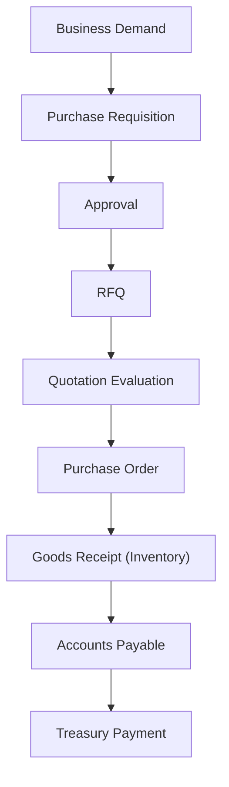
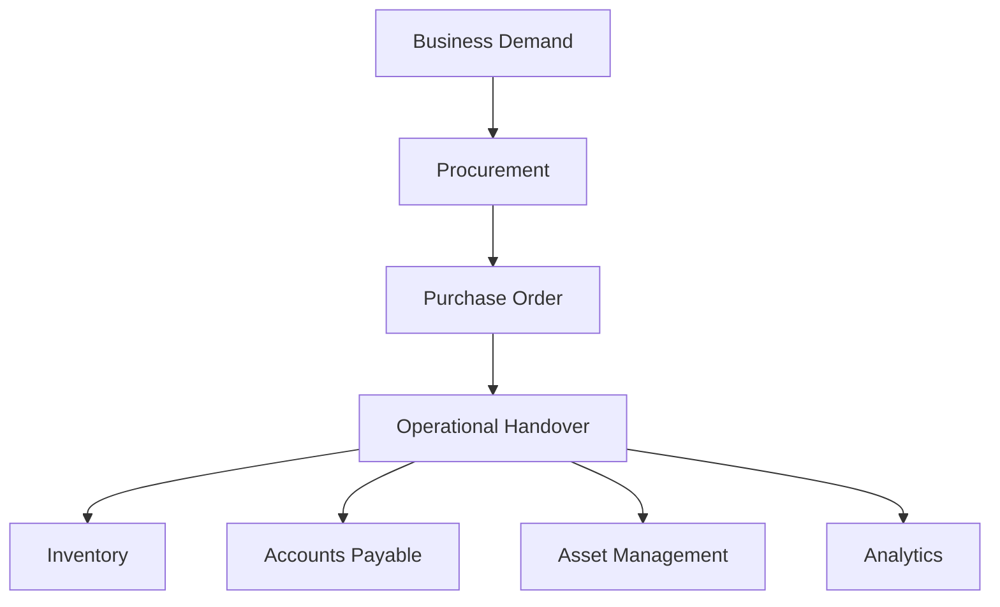
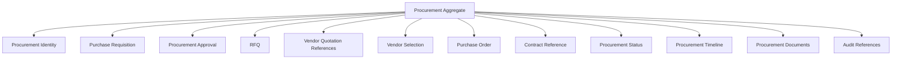
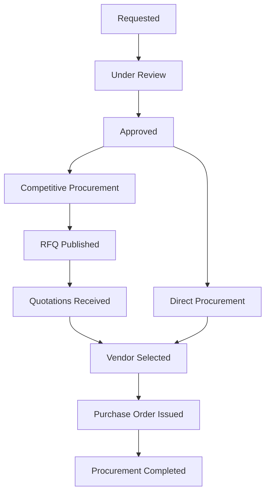
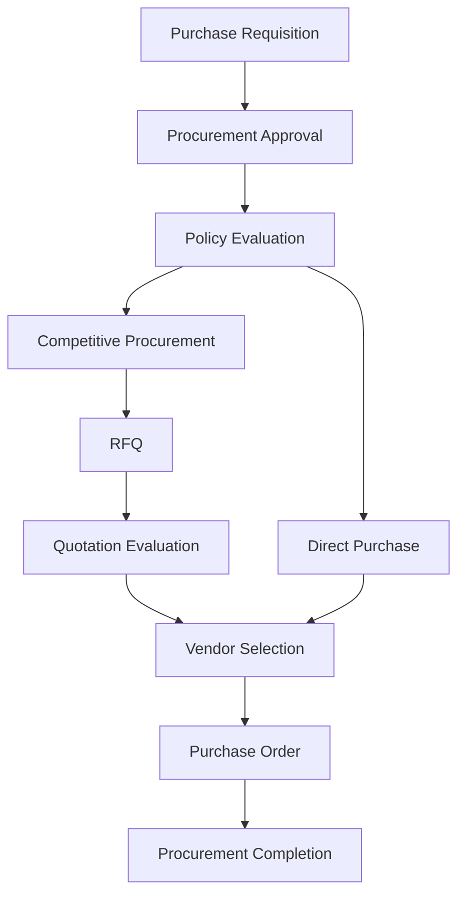

# L2-F14 — Procurement & Supply Chain Workflows

---

# Document Metadata

| Attribute | Value |
|-----------|-------|
| Document ID | L2-F14 |
| Document Name | Procurement & Supply Chain Workflows |
| Architecture Level | Level 2 – Domain Workflow Architecture |
| Domain | Finance |
| Module | Procurement & Supply Chain |
| Status | Draft |
| Version | 1.0.0 |
| Owner | Finance Architecture Team |
| Parent Architecture | L2-F00 — Finance Domain Model & Foundation |
| Depends On | L2-F00, L2-F06, L2-F08, L2-F12 |
| Referenced By | Inventory, Asset Management, Accounts Payable, Budget, Analytics, Audit |

---

# 1. Purpose

This document defines the canonical Procurement & Supply Chain architecture for the SutraERP platform.

The Procurement & Supply Chain domain governs the institutional acquisition lifecycle, from purchase demand through procurement planning, supplier engagement, purchase authorization, procurement execution, and handoff for receipt and financial settlement.

This document establishes canonical ownership boundaries, aggregate design, procurement workflows, lifecycle governance, business events, integration contracts, configuration architecture, and enterprise procurement principles.

Procurement governs acquisition activities.

It does not own inventory, accounting, payments, or asset lifecycle.

---

# 2. Scope

This architecture defines:

- Procurement Lifecycle
- Purchase Requisition
- Purchase Request Approval
- RFQ Management
- Quotation Evaluation
- Vendor Selection Recommendation
- Purchase Order Management
- Purchase Order Revision
- Procurement Tracking
- Contract References
- Procurement Scheduling
- Procurement Policies
- Procurement Events
- Procurement Analytics
- Procurement Configuration
- CQRS Read Models
- Cross-Domain Procurement Contracts

---

# 3. Out of Scope

The following responsibilities remain outside this architecture.

| Capability | Canonical Owner |
|------------|-----------------|
| Budget Allocation | L2-F06 Budget & Cost Center |
| Accounts Payable | L2-F08 Accounts Payable |
| Treasury Payments | L2-F10 Treasury |
| Asset Registration | L2-F12 Asset Management |
| Inventory Stock | Inventory Domain |
| Warehouse Operations | Inventory Domain |
| Goods Receipt Ownership | Inventory Domain |
| Accounting Entries | L2-F05 General Ledger |
| Vendor Payment | Treasury |
| Financial Reporting | L2-F13 Financial Reporting |

Procurement governs acquisition.

Operational ownership transfers after procurement completion.

---

# 4. Architectural Position

Procurement bridges institutional demand and operational fulfillment.

Procurement owns the acquisition lifecycle.

Downstream domains own fulfillment, financial settlement, and operational management.

---

# 5. Canonical Ownership

The Procurement & Supply Chain domain exclusively owns:

## Primary Aggregate

- Procurement Aggregate

---

## Internal Components

- Purchase Requisition
- RFQ
- Vendor Quotation Reference
- Purchase Order
- Procurement Approval
- Procurement Schedule
- Contract Reference
- Procurement Status
- Procurement Audit References

The Procurement Aggregate is the single consistency boundary for institutional acquisition.

---

# 6. Architectural Principles

## PP-01 — Single Procurement Ownership

Procurement owns institutional acquisition.

No other domain shall manage procurement workflows.

---

## PP-02 — Separation of Acquisition and Fulfillment

Procurement ends when acquisition is completed.

Inventory, Accounts Payable, Asset Management, and Treasury own subsequent business lifecycles.

---

## PP-03 — Event-Driven Collaboration

Completed procurement activities publish immutable business facts.

Downstream domains determine their own actions.

---

## PP-04 — Configuration Over Customization

Institutional procurement behavior shall be governed through configuration.

---

## PP-05 — Complete Auditability

Every procurement decision shall produce immutable audit evidence.

---

## PP-06 — Technology Independence

Procurement architecture defines business responsibilities only.

Implementation technologies remain outside Level 2.
---

# 7. Domain Vision

Provide a unified, transparent, policy-driven procurement capability that governs institutional acquisition from business demand through procurement completion while preserving financial control, operational efficiency, supplier fairness, and enterprise auditability.

Procurement serves as the canonical acquisition authority for the institution.

---

# 8. Architectural Objectives

The Procurement & Supply Chain domain exists to:

- Standardize institutional procurement.
- Govern acquisition workflows.
- Ensure policy compliance.
- Support competitive procurement.
- Improve procurement transparency.
- Enable enterprise procurement analytics.
- Integrate seamlessly with Finance and Inventory.
- Preserve procurement traceability.
- Support multi-campus procurement.
- Remain configuration driven.

---

# 9. Domain Model

The Procurement & Supply Chain domain governs institutional acquisition.

Business demand is transformed into authorized procurement activities through governed workflows.

The Procurement domain owns procurement decisions.

Operational fulfillment remains outside this bounded context.

---

# 10. Domain Responsibilities

The Procurement domain owns the following business capabilities.

## Purchase Requisition Management

Manage institutional requests for goods and services.

Includes:

- Requisition creation
- Requisition modification
- Requisition submission
- Requisition withdrawal

---

## Procurement Approval

Manage procurement authorization according to institutional procurement policies.

Supports:

- Single-level approval
- Multi-level approval
- Conditional approval
- Procurement rejection

---

## RFQ Management

Manage competitive procurement.

Includes:

- RFQ creation
- RFQ publication
- RFQ closure

---

## Vendor Quotation Management

Manage supplier quotations.

Supports:

- Quotation submission
- Quotation comparison
- Commercial evaluation
- Technical evaluation

Vendor master ownership remains external.

---

## Vendor Selection

Manage procurement decisions.

Supports:

- Vendor recommendation
- Procurement committee decisions
- Selection documentation

---

## Purchase Order Management

Manage institutional purchase commitments.

Supports:

- Purchase Order creation
- Purchase Order revision
- Purchase Order approval
- Purchase Order cancellation
- Purchase Order closure

---

## Procurement Monitoring

Track procurement execution.

Examples include:

- Pending procurement
- Approved procurement
- Open Purchase Orders
- Procurement completion

---

## Procurement Analytics

Provide institutional procurement visibility.

Examples include:

- Procurement spend
- Vendor utilization
- Procurement efficiency
- Procurement cycle time

---

# 11. Domain Non-Responsibilities

The Procurement domain explicitly excludes the following responsibilities.

## Inventory

Procurement never owns:

- Stock
- Warehouses
- Goods Receipt
- Inventory valuation

---

## Asset Management

Procurement never registers institutional assets.

Asset Management owns institutional asset lifecycle.

---

## Accounts Payable

Procurement never creates vendor liabilities.

Accounts Payable owns invoice processing and liabilities.

---

## Treasury

Procurement never executes vendor payments.

Treasury owns payment execution.

---

## General Ledger

Procurement never posts accounting entries.

Accounting ownership remains with General Ledger.

---

## Vendor Master

Vendor identity, registration, compliance, and master information remain outside Procurement.

Procurement references vendors using canonical identifiers.

---

# 12. Domain Boundary

The Procurement domain begins when an institutional acquisition need is identified.

It concludes when procurement responsibilities are completed and operational fulfillment begins.

Procurement owns acquisition.

Downstream domains own fulfillment.

---

# 13. Ubiquitous Language

The following terminology is canonical.

| Term | Definition |
|------|------------|
| Procurement | Institutional acquisition process. |
| Purchase Requisition | Internal request to procure goods or services. |
| Procurement Approval | Institutional authorization for acquisition. |
| RFQ | Request for supplier quotations. |
| Vendor Quotation | Supplier commercial proposal. |
| Vendor Selection | Procurement decision identifying preferred supplier. |
| Purchase Order | Formal institutional procurement commitment. |
| Procurement Schedule | Planned procurement timeline. |
| Procurement Status | Current procurement lifecycle state. |
| Contract Reference | Reference to governing procurement agreement. |

These definitions shall remain consistent across all architecture levels.

---

# 14. Bounded Context

The Procurement domain operates as an independent bounded context.

It owns:

- Procurement lifecycle
- Purchase Requisitions
- Procurement Approvals
- RFQs
- Vendor Selection
- Purchase Orders
- Procurement Monitoring

External domains collaborate through canonical business events and stable business contracts.

No external domain shall directly modify Procurement state.

---

# 15. Aggregate Landscape

The Procurement domain contains one primary aggregate.

## Procurement Aggregate

The Procurement Aggregate governs:

- Requisition
- Approval
- RFQ
- Vendor Selection
- Purchase Order
- Procurement Status
- Audit References

Supporting entities remain internal to the aggregate.

External business concepts are referenced using canonical identifiers.

---

# 16. Aggregate Structure

The Procurement Aggregate represents the canonical consistency boundary for institutional acquisition.
---

# 17. Canonical Procurement Lifecycle

Every procurement request progresses through a governed institutional lifecycle.

The exact execution path is determined by institutional procurement policies.

Not every procurement process requires competitive procurement.

Lifecycle progression is governed by institutional procurement policies.

---

## Lifecycle State Descriptions

### Requested

A procurement request has been submitted.

Business demand has been formally recorded.

---

### Under Review

The procurement request is being evaluated.

Institutional approvals are pending.

---

### Approved

The procurement request has been authorized.

Procurement execution may begin.

---

### RFQ Published

Supplier quotations have been requested.

This state exists only for procurement policies requiring competitive sourcing.

---

### Quotations Received

Supplier quotations have been received.

Commercial and technical evaluation may begin.

---

### Vendor Selected

Institutional procurement decision has been completed.

Preferred supplier has been identified.

---

### Purchase Order Issued

An official procurement commitment has been issued.

The institution has formally authorized acquisition.

---

### Procurement Completed

Procurement responsibilities have concluded.

Operational fulfillment transfers to downstream domains.

---

# 18. Lifecycle Constraints

The Procurement lifecycle shall comply with the following constraints.

- Procurement requests shall possess exactly one lifecycle state.
- Procurement identity shall remain immutable.
- Procurement approvals shall precede purchase commitment.
- Competitive procurement shall execute only when required by policy.
- Purchase Orders shall reference approved procurement requests.
- Procurement completion shall be immutable.
- Completed procurement shall never return to earlier lifecycle states.
- Every lifecycle transition shall be auditable.

---

# 19. Business Capabilities

The Procurement domain provides the following business capabilities.

| Capability | Purpose |
|------------|---------|
| Purchase Requisition Management | Capture procurement demand |
| Procurement Approval | Authorize procurement |
| Procurement Policy Evaluation | Determine procurement path |
| RFQ Management | Competitive sourcing |
| Vendor Quotation Evaluation | Compare supplier proposals |
| Vendor Selection | Select preferred supplier |
| Purchase Order Management | Create institutional purchase commitment |
| Procurement Tracking | Monitor procurement lifecycle |
| Procurement Analytics | Institutional procurement insights |
| Procurement Inquiry | Procurement visibility |

---

# 20. Capability Dependency Flow

The procurement policy determines the execution path.

---

# 21. Aggregate Workflows

The Procurement Aggregate supports the following canonical workflows.

1. Purchase Requisition Workflow
2. Procurement Approval Workflow
3. Procurement Policy Evaluation Workflow
4. RFQ Management Workflow
5. Vendor Evaluation Workflow
6. Vendor Selection Workflow
7. Purchase Order Workflow
8. Procurement Completion Workflow

Each workflow executes within Procurement Aggregate boundaries.

---

# 22. Workflow Ownership Matrix

| Workflow | Aggregate Owner |
|-----------|-----------------|
| Purchase Requisition | Procurement Aggregate |
| Procurement Approval | Procurement Aggregate |
| Procurement Policy Evaluation | Procurement Aggregate |
| RFQ Management | Procurement Aggregate |
| Vendor Evaluation | Procurement Aggregate |
| Vendor Selection | Procurement Aggregate |
| Purchase Order | Procurement Aggregate |
| Procurement Completion | Procurement Aggregate |

The Procurement Aggregate remains the sole consistency boundary.

---

# 23. Workflow Constraints

All Procurement workflows shall comply with the following architectural constraints.

- Workflow execution shall preserve aggregate invariants.
- Procurement identity shall remain immutable.
- Procurement policies shall determine execution paths.
- External domains shall never directly modify Procurement state.
- Every successful workflow shall publish exactly one terminal business event.
- Failed workflows shall publish no completion events.
- Procurement completion shall transfer responsibility through published business facts.
- Every workflow shall generate complete audit evidence.
---

# 24. Workflow-to-Event Mapping

Every successfully completed Procurement workflow publishes one canonical business event.

| Workflow | Published Event |
|----------|-----------------|
| Purchase Requisition Workflow | ProcurementRequested |
| Procurement Approval Workflow | ProcurementApproved |
| Procurement Policy Evaluation Workflow | ProcurementPathDetermined |
| RFQ Management Workflow | ProcurementRFQPublished |
| Vendor Evaluation Workflow | VendorEvaluationCompleted |
| Vendor Selection Workflow | VendorSelected |
| Purchase Order Workflow | PurchaseOrderIssued |
| Procurement Completion Workflow | ProcurementCompleted |

Business events communicate completed procurement facts.

Events are immutable.

---

# 25. Domain Event Catalog

The Procurement domain publishes the following canonical business events.

---

## ProcurementRequested

### Trigger

A procurement request has been formally submitted.

### Business Meaning

An institutional procurement demand has been created.

### Published By

Procurement Aggregate

### Typical Consumers

- Approval Services
- Procurement Analytics
- Audit Infrastructure

---

## ProcurementApproved

### Trigger

The procurement request has been approved.

### Business Meaning

The institution has authorized procurement.

### Published By

Procurement Aggregate

### Typical Consumers

- Procurement Operations
- Audit Infrastructure

---

## ProcurementPathDetermined

### Trigger

Procurement policy evaluation completes.

### Business Meaning

The acquisition path has been selected according to institutional procurement policy.

Possible paths include:

- Direct Procurement
- Competitive Procurement
- Framework Procurement
- Emergency Procurement

### Published By

Procurement Aggregate

### Typical Consumers

- Procurement Operations
- Audit

---

## ProcurementRFQPublished

### Trigger

A Request for Quotation has been released.

### Business Meaning

Competitive supplier engagement has officially begun.

### Published By

Procurement Aggregate

### Typical Consumers

- Supplier Portal
- Procurement Monitoring
- Audit

---

## VendorEvaluationCompleted

### Trigger

Quotation evaluation has concluded.

### Business Meaning

Supplier assessment has completed.

### Published By

Procurement Aggregate

### Typical Consumers

- Procurement Committee
- Audit

---

## VendorSelected

### Trigger

Supplier selection has been finalized.

### Business Meaning

The preferred supplier has been determined.

### Published By

Procurement Aggregate

### Typical Consumers

- Purchase Order Processing
- Analytics
- Audit

---

## PurchaseOrderIssued

### Trigger

Purchase Order generation completes successfully.

### Business Meaning

The institution has formally committed to procure goods or services.

### Published By

Procurement Aggregate

### Typical Consumers

- Inventory
- Accounts Payable
- Asset Management
- Supplier Integration
- Audit

---

## ProcurementCompleted

### Trigger

The Procurement Aggregate reaches the end of its lifecycle.

### Business Meaning

Procurement responsibility has concluded.

Operational fulfillment transfers to downstream domains.

### Published By

Procurement Aggregate

### Typical Consumers

- Inventory
- Accounts Payable
- Asset Management
- Analytics
- Audit

---

# 26. Event Principles

The Procurement domain follows these architectural principles.

## EP-01 — Business Facts Only

Events communicate completed procurement business outcomes.

Implementation events are outside the scope of this architecture.

---

## EP-02 — Immutable Events

Published events shall never be modified.

Events represent permanent institutional business facts.

---

## EP-03 — Canonical Ownership

Only Procurement publishes procurement events.

External domains shall never publish Procurement events.

---

## EP-04 — Consumer Independence

Consumers determine their own responses.

Procurement never orchestrates downstream workflows.

---

## EP-05 — Technology Independence

Business events remain independent of transport protocols, middleware, messaging platforms, or implementation technologies.

---

# 27. Event Publishing Rules

Procurement publishes events only after successful aggregate completion.

Each event shall include canonical business metadata.

Examples include:

- Procurement Identifier
- Institution Identifier
- Procurement Type
- Business Timestamp
- Correlation Identifier
- Causation Identifier
- Aggregate Version

Internal implementation details shall never be exposed.

---

# 28. Event Dependency Matrix

| Event | Published By | Typical Consumers |
|--------|--------------|-------------------|
| ProcurementRequested | Procurement Aggregate | Approval, Analytics, Audit |
| ProcurementApproved | Procurement Aggregate | Procurement Operations, Audit |
| ProcurementPathDetermined | Procurement Aggregate | Procurement Operations |
| ProcurementRFQPublished | Procurement Aggregate | Supplier Portal, Monitoring |
| VendorEvaluationCompleted | Procurement Aggregate | Procurement Committee |
| VendorSelected | Procurement Aggregate | Purchase Order Processing |
| PurchaseOrderIssued | Procurement Aggregate | Inventory, Accounts Payable, Asset Management |
| ProcurementCompleted | Procurement Aggregate | Inventory, Accounts Payable, Asset Management, Analytics, Audit |

---

# 29. Event Architecture Summary

The Procurement domain owns the business meaning and publication of procurement events.

The Platform Event Infrastructure owns:

- Event publication
- Routing
- Delivery
- Retry
- Replay
- Subscription management

Downstream domains consume immutable procurement business facts independently while preserving loose coupling and canonical ownership.
---

# 30. Cross-Domain Integration Architecture

The Procurement & Supply Chain domain collaborates with enterprise domains through canonical business contracts and immutable domain events.

Procurement owns institutional acquisition.

Operational fulfillment remains the responsibility of downstream domains.

Cross-domain collaboration shall preserve canonical ownership at all times.

---

# 31. Upstream Dependencies

Procurement depends upon authoritative information published by upstream enterprise domains.

Procurement references external business entities using canonical identifiers.

It never duplicates master business data.

---

## 31.1 Budget & Cost Center

**Canonical Owner**

L2-F06 — Budget & Cost Center Management

Consumed Information

- Budget Availability
- Cost Center Reference
- Budget Allocation
- Procurement Budget Constraints

Purpose

Procurement validates budget availability before institutional commitment.

Budget ownership remains external.

---

## 31.2 Organization

**Canonical Owner**

Organization Domain

Consumed Information

- Department
- Business Unit
- Organizational Hierarchy

Purpose

Procurement requests originate from organizational units.

Organization ownership remains external.

---

## 31.3 Institution

**Canonical Owner**

Institution Domain

Consumed Information

- Institution Identifier
- Institution Context
- Institutional Policies

Purpose

Every procurement activity belongs to one institution.

---

## 31.4 Vendor Management

**Canonical Owner**

Vendor Management Domain

Consumed Information

- Vendor Identifier
- Vendor Status
- Vendor Classification
- Vendor Compliance Status

Purpose

Procurement references approved suppliers.

Vendor lifecycle ownership remains external.

---

# 32. Downstream Consumers

Procurement publishes acquisition business facts consumed by downstream enterprise domains.

---

## 32.1 Inventory

Consumes

- Purchase Order
- Procurement Completion

Purpose

Inventory manages:

- Goods Receipt
- Stock
- Warehouse Operations
- Inventory Valuation

Inventory owns operational fulfillment.

---

## 32.2 Accounts Payable

Consumes

- Purchase Order
- Procurement Completion

Purpose

Accounts Payable establishes supplier liabilities after invoice processing.

Procurement never owns financial liabilities.

---

## 32.3 Asset Management

Consumes

- Purchase Order
- Procurement Completion

Purpose

Asset Management registers institutional assets when acquired items qualify as capital assets.

Asset lifecycle ownership remains independent.

---

## 32.4 Treasury

Consumes

Accounts Payable settlement outcomes.

Purpose

Treasury executes supplier payments.

Procurement never performs payment execution.

---

## 32.5 Financial Reporting

Consumes

- Procurement Spend
- Purchase Order Statistics
- Procurement KPIs

Purpose

Supports institutional procurement reporting.

---

## 32.6 Audit Infrastructure

Consumes

- Procurement Events
- Approval Events
- Purchase Order Events

Purpose

Maintains immutable institutional audit evidence.

---

## 32.7 Enterprise Analytics

Consumes

- Procurement Metrics
- Spend Analysis
- Procurement Trends
- Vendor Utilization Statistics

Purpose

Supports enterprise decision-making.

---

# 33. Integration Responsibility Matrix

| Business Capability | Canonical Owner | Procurement Role |
|---------------------|-----------------|------------------|
| Budget Allocation | Budget & Cost Center | Consumer |
| Organization Structure | Organization | Reference |
| Institution Lifecycle | Institution | Reference |
| Vendor Master | Vendor Management | Reference |
| Procurement Lifecycle | Procurement | Owner |
| Goods Receipt | Inventory | Publisher |
| Inventory Management | Inventory | Publisher |
| Supplier Liability | Accounts Payable | Publisher |
| Supplier Payment | Treasury | Publisher |
| Asset Registration | Asset Management | Publisher |
| Financial Reporting | Financial Reporting | Publisher |
| Audit Evidence | Audit Infrastructure | Publisher |
| Enterprise Analytics | Analytics | Publisher |

---

# 34. Integration Principles

## IP-01 — Canonical Ownership

Every procurement-related capability has exactly one owner.

Ownership shall never overlap.

---

## IP-02 — Reference Rather Than Replication

Procurement references external business entities.

Master data duplication is prohibited.

---

## IP-03 — Event-Driven Collaboration

Procurement publishes immutable acquisition facts.

Consumers determine their own business responses.

---

## IP-04 — Stable Business Contracts

Only stable business contracts shall be exposed.

Internal Procurement Aggregate structures remain private.

---

## IP-05 — Loose Coupling

Procurement shall remain independent of downstream implementation.

Operational fulfillment shall never require direct aggregate access.

---

# 35. Integration Constraints

The following architectural constraints are mandatory.

- Procurement shall never own inventory.
- Procurement shall never own supplier liabilities.
- Procurement shall never execute payments.
- Procurement shall never register institutional assets.
- Procurement shall never create accounting entries.
- Procurement shall preserve tenant isolation.
- Procurement shall preserve institution boundaries.
- Procurement shall remain technology independent.

---

# 36. Cross-Domain Architecture Summary

The Procurement & Supply Chain domain serves as the canonical acquisition authority within SutraERP.

It consumes authoritative information from Budget, Organization, Institution, and Vendor Management while publishing immutable acquisition facts consumed by Inventory, Accounts Payable, Asset Management, Financial Reporting, Audit Infrastructure, and Enterprise Analytics.

This architecture preserves:

- Single canonical ownership
- Domain isolation
- Event-driven collaboration
- Technology independence
- Enterprise scalability
- Complete procurement traceability
---

# 37. Configuration Architecture

The Procurement & Supply Chain domain is configuration-driven.

Institutional procurement behavior shall be governed through configurable business policies rather than structural customization.

Configuration influences procurement execution without altering canonical ownership, aggregate boundaries, or lifecycle definitions.

---

# 38. Configuration Principles

The following principles govern Procurement configuration.

## CP-01 — Configuration Over Customization

Institution-specific procurement behavior shall be implemented through configuration.

The core Procurement architecture shall remain unchanged.

---

## CP-02 — Canonical Ownership

Configuration shall never transfer ownership of procurement capabilities.

Procurement remains the canonical owner of institutional acquisition.

---

## CP-03 — Tenant Isolation

Procurement configuration shall remain isolated within tenant boundaries.

Institutional procurement policies shall never affect other tenants.

---

## CP-04 — Versioned Configuration

Configuration changes shall be version controlled.

Historical procurement records shall preserve the configuration context under which they were executed.

---

## CP-05 — Auditability

Every configuration modification shall generate immutable audit evidence.

---

# 39. Configurable Business Policies

The following procurement policies are configurable.

| Policy | Purpose |
|----------|---------|
| Procurement Method Rules | Direct, RFQ, Tender, Framework, Emergency |
| Approval Matrix | Institutional approval hierarchy |
| Procurement Thresholds | Monetary approval limits |
| RFQ Requirements | Competitive procurement criteria |
| Vendor Eligibility Rules | Procurement participation |
| Purchase Order Numbering | Institutional document numbering |
| Contract Reference Policy | Procurement contract governance |
| Procurement Schedule | Planned acquisition cycles |
| Cancellation Policy | Procurement cancellation governance |
| Procurement Retention Policy | Historical record preservation |
| Spend Categories | Procurement classification |
| Procurement Committee Rules | Committee participation requirements |

---

# 40. Configuration Ownership

| Configuration | Canonical Owner |
|---------------|-----------------|
| Procurement Policies | Procurement |
| Approval Policies | Procurement |
| Budget Policies | Budget & Cost Center |
| Vendor Policies | Vendor Management |
| Institution Policies | Institution Domain |

Procurement configures only procurement behavior.

External domains retain ownership of their business policies.

---

# 41. Configuration Constraints

The following architectural constraints apply.

- Configuration shall not bypass procurement approval.
- Configuration shall not violate aggregate invariants.
- Configuration shall not transfer ownership.
- Configuration shall preserve auditability.
- Configuration shall remain technology independent.

---

# 42. Configuration Architecture Summary

Configuration enables institutional procurement flexibility while preserving canonical acquisition architecture.

Behavior varies through governed configuration rather than structural modification.

---

# 43. CQRS Architecture

The Procurement domain follows a Command Query Responsibility Segregation (CQRS) architectural model.

Commands govern procurement state.

Queries provide optimized procurement visibility.

Read models never become the authoritative source of procurement truth.

---

# 44. Command Responsibilities

Commands modify Procurement Aggregate state.

Examples include:

- Submit Purchase Requisition
- Approve Procurement
- Publish RFQ
- Record Vendor Evaluation
- Select Vendor
- Issue Purchase Order
- Complete Procurement

Commands preserve aggregate consistency.

---

# 45. Query Responsibilities

Queries expose optimized procurement information.

Typical read models include:

- Procurement Register
- Open Requisitions
- Pending Approvals
- Active RFQs
- Vendor Comparison View
- Purchase Order Register
- Procurement Status Dashboard
- Procurement Spend Dashboard

These read models are projections.

They are not transactional aggregates.

---

# 46. Projection Principles

Projection models consume published procurement events.

Projection models:

- Are eventually consistent.
- May be rebuilt at any time.
- Never own procurement truth.
- Exist solely for business visibility and analytics.

---

# 47. CQRS Constraints

- Commands own business consistency.
- Queries own business visibility.
- Commands publish events.
- Queries consume events.
- Aggregate consistency takes precedence over query optimization.

---

# 48. Security & Governance

Authentication and authorization are delegated to the Platform Foundation.

Business authorization shall be evaluated before procurement state transitions.

The Procurement domain shall not implement independent security mechanisms.

---

# 49. Security Principles

The Procurement domain follows these principles.

- Platform authentication.
- Platform authorization.
- Least privilege.
- Tenant isolation.
- Institution isolation.
- Immutable procurement history.
- Controlled procurement approvals.

---

# 50. Audit Requirements

Every procurement lifecycle transition shall generate immutable audit evidence.

Examples include:

- Purchase Requisition
- Procurement Approval
- RFQ Publication
- Vendor Selection
- Purchase Order Issuance
- Procurement Completion
- Configuration Changes

Audit Infrastructure governs evidence preservation.

Procurement publishes business facts only.

---

# 51. Compliance

The Procurement architecture supports institutional compliance through:

- Complete procurement traceability.
- Immutable procurement history.
- Controlled approval governance.
- Policy-driven procurement execution.
- Configuration-driven institutional variation.
- Separation of canonical ownership.

---

# 52. Architectural Decision Records (ADRs)

## ADR-01

Procurement owns the institutional acquisition lifecycle.

Status: Accepted

---

## ADR-02

Inventory owns goods receipt and inventory operations.

Status: Accepted

---

## ADR-03

Accounts Payable owns supplier liabilities.

Status: Accepted

---

## ADR-04

Treasury owns supplier payment execution.

Status: Accepted

---

## ADR-05

Procurement publishes immutable business facts through event-driven collaboration.

Status: Accepted

---

## ADR-06

Institutional procurement variation is governed through configuration.

Status: Accepted

---

# 53. Architecture Validation Checklist

The Procurement architecture is considered complete when the following conditions are satisfied.

| Validation Item | Status |
|-----------------|--------|
| Canonical ownership defined | ✅ |
| Domain boundary established | ✅ |
| Aggregate modeled | ✅ |
| Procurement lifecycle defined | ✅ |
| Business capabilities defined | ✅ |
| Workflows documented | ✅ |
| Domain events defined | ✅ |
| Cross-domain integration complete | ✅ |
| Configuration architecture defined | ✅ |
| CQRS architecture defined | ✅ |
| Security responsibilities identified | ✅ |
| Audit responsibilities identified | ✅ |
| ADRs recorded | ✅ |

---

# 54. Architecture Lock

This document establishes the canonical Level 2 architecture for Procurement & Supply Chain within SutraERP.

The document defines:

- Domain ownership
- Business language
- Aggregate boundaries
- Procurement lifecycle
- Workflow architecture
- Event model
- Cross-domain integration
- Configuration model
- CQRS responsibilities
- Security responsibilities
- Audit responsibilities

Subsequent architectural levels shall refine implementation details without altering the business architecture defined herein.

Changes affecting canonical ownership, aggregate boundaries, procurement lifecycle semantics, or integration contracts require formal architectural review and approval before incorporation into the repository.

---

# End of Document

