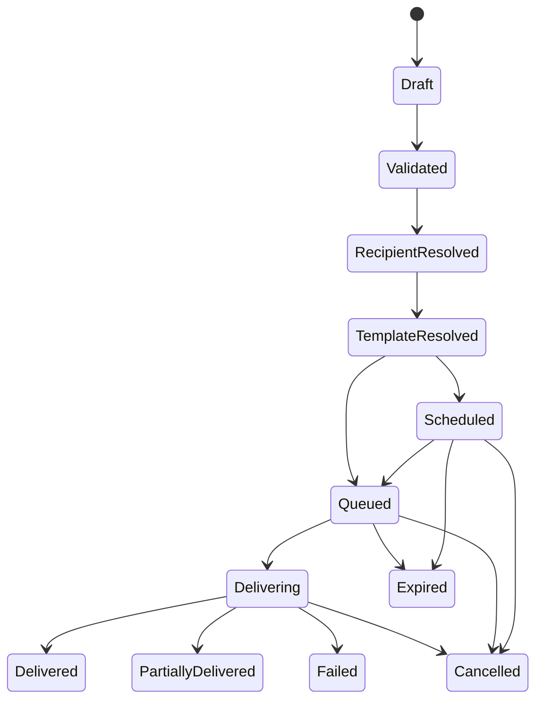
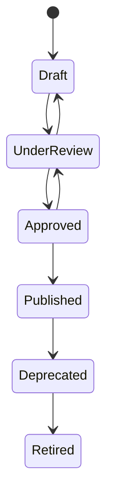
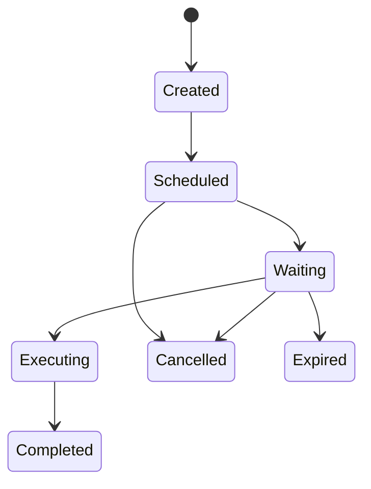
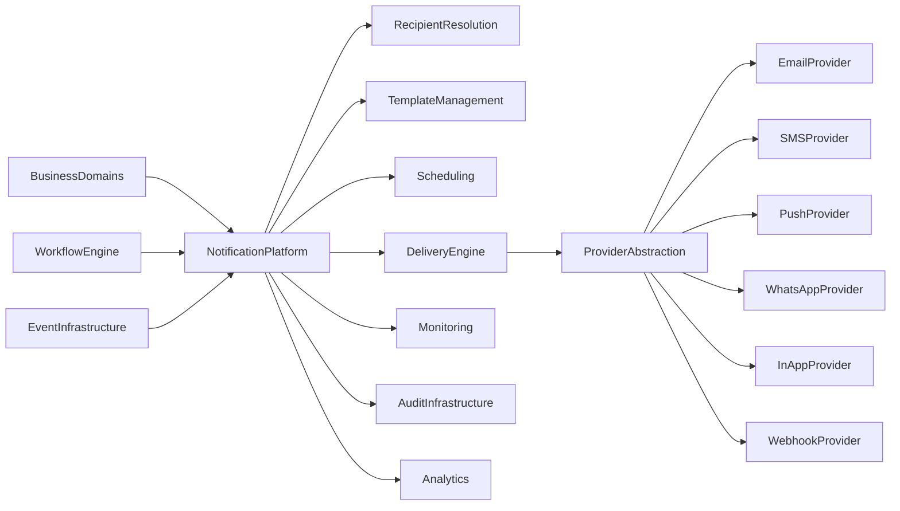
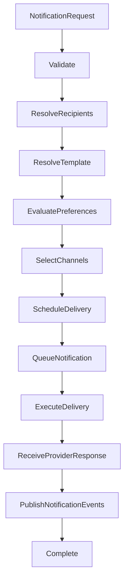
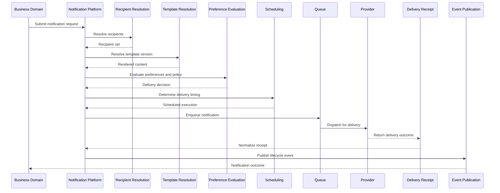

# L2-H02 — Notification Workflows

---

## Canonical Section Crosswalk

> Added 2026-08-04 under integrity finding INT-018. `governance/constitution/Volume_3_Architecture_Framework.md` section 18 requires every L2 document to define eleven sections. This document uses its own numbered-section convention; the table below maps the required sections to where they actually live. No content was moved.

| Required section (Volume 3 §18) | Location in this document |
|---|---|
| Purpose | §1 Purpose |
| Scope | §2 Scope; §3 Out of Scope; §20.2 Preference Scope |
| Actors | — not present — |
| Entities | §11.5 Canonical Notification Entity |
| Business Rules | §11.4 Aggregate Invariants |
| Workflow | §5.3 Workflow Engine Owns; L2-H02 — Notification Workflows |
| State Machine | §12.4 Notification Lifecycle State Machine; §15.2 Lifecycle State Machine |
| Contracts | §33 Integration Contracts; §33.1 Upstream Contracts; §33.2 Downstream Contracts |
| Events | §32 Notification Events; §5.4 Event Infrastructure Owns; §32.2 Standard Events |
| Dependencies | §9.1 Upstream Contexts; §33.1 Upstream Contracts |
| Locked Decisions | §38 Architecture Decision Records (ADRs) |

> **Gap:** 1 required section(s) have no counterpart in this document: Actors. Recorded, not authored.

---

# Document Metadata

| Attribute | Value |
|-----------|-------|
| Document ID | L2-H02 |
| Document Name | Notification Workflows |
| Layer | Level 2 – Enterprise Platform & Business Services Architecture |
| Domain | Notification Platform |
| Owner | Notification Domain |
| Document Owner | Institutional Services — Notifications |
| Depends On | L2-A01 Platform & Tenant Foundation, L2-A02 Person & Identity Workflows, L2-A03 Authentication Workflows, L2-A04 Authorization & Policy Workflows, L2-A05 Workflow Engine Workflows, L2-A06 Event Infrastructure Workflows, L2-A07 Audit Infrastructure Workflows |
| Referenced By | All Business Domains and Platform Services |
| Status | Draft |
| Version | 1.0 |

---

# 1. Purpose

This document defines the complete Notification Platform architecture of the SutraERP platform.

It establishes the architectural standards governing enterprise notification management, notification orchestration, recipient resolution, notification scheduling, template governance, multi-channel delivery, delivery lifecycle management, user preference enforcement, provider abstraction, operational monitoring, audit integration, event-driven notification processing, and enterprise-wide notification governance.

The Notification Platform provides a reusable, technology-independent, policy-governed platform capability enabling every business and platform domain to communicate with users, organizations, institutions, external stakeholders, and integrated systems through governed notification workflows while remaining independent of delivery technologies and provider implementations.

This document serves as the canonical architectural reference for all notification processing within SutraERP.

---

# 2. Scope

This document defines:

- Notification Platform Architecture
- Notification Domain Model
- Notification Aggregate
- Notification Lifecycle
- Recipient Resolution
- Recipient Groups
- Notification Channels
- Channel Selection
- Multi-Channel Delivery
- Notification Templates
- Template Versioning
- Localization
- Variable Resolution
- Notification Scheduling
- Immediate Notifications
- Delayed Notifications
- Scheduled Notifications
- Recurring Notifications
- Bulk Notification Processing
- Campaign Notifications
- Digest Notifications
- Notification Preferences
- Quiet Hours
- Emergency Notification Policies
- Subscription Management
- Delivery Lifecycle
- Retry Management
- Dead-Letter Handling
- Provider Abstraction
- Provider Failover
- Delivery Receipts
- Notification Audit Integration
- Notification Event Contracts
- Monitoring and Operational Metrics
- Notification Governance
- Security Architecture
- Configuration Architecture
- Multi-Domain Notification Contracts

---

# 3. Out of Scope

The following responsibilities belong to other architecture documents.

### L2-A01 — Platform & Tenant Foundation

- Tenant Management
- Institution Management
- Platform Configuration
- Runtime Foundation
- Shared Platform Services

### L2-A02 — Person & Identity

- Person Lifecycle
- Identity Resolution
- User Accounts
- Organizational Relationships
- Identity Ownership

### L2-A03 — Authentication

- Authentication
- Credential Management
- Session Management
- Multi-Factor Authentication

### L2-A04 — Authorization & Policy

- Roles
- Permissions
- Authorization Decisions
- Policy Evaluation
- Access Control
- Delegation

### L2-A05 — Workflow Engine

The Workflow Engine owns:

- Workflow Definitions
- Workflow Runtime
- Workflow Execution
- Human Tasks
- Workflow Orchestration

The Notification Platform may participate in workflow execution but never owns workflow state.

### L2-A06 — Event Infrastructure

The Event Infrastructure owns:

- Event Publication
- Event Routing
- Event Delivery
- Event Replay
- Event Registry
- Event Schema Governance

The Notification Platform consumes canonical events but does not own enterprise event transport.

### L2-A07 — Audit Infrastructure

The Audit Infrastructure owns:

- Audit Evidence
- Audit Storage
- Audit Timeline
- Audit Investigation
- Audit Retention
- Audit Integrity

The Notification Platform produces notification evidence but does not own enterprise audit persistence.

### Business Domains

Business domains own:

- Business Transactions
- Business Decisions
- Business Rules
- Domain Data
- Domain Lifecycles

The Notification Platform communicates business outcomes but never owns business state.

### External Communication Providers

External communication providers own:

- Physical message transmission
- Carrier infrastructure
- Provider-specific APIs
- Gateway implementations
- Vendor operational services

The Notification Platform governs notification orchestration while remaining independent of provider-specific implementations.

---

# 4. Architectural Principles

The Notification Platform is an enterprise platform capability responsible for governed notification orchestration across all business and platform domains.

It provides standardized notification services while ensuring that ownership of business facts, business decisions, workflow execution, authorization, event publication, and audit persistence remain within their respective architectural boundaries.

The Notification Platform coordinates notification processing but never becomes the owner of business transactions.

---

## 4.1 Architectural Objectives

The Notification Platform shall satisfy the following objectives.

- Provide a single enterprise notification capability.
- Support multi-channel communication.
- Enable event-driven notification processing.
- Ensure tenant isolation.
- Preserve canonical ownership.
- Support configurable notification policies.
- Enable recipient preference enforcement.
- Support provider independence.
- Ensure delivery reliability.
- Maintain operational observability.
- Preserve auditability.
- Support future notification channels without architectural modification.

---

## 4.2 Architectural Principles

### NP-01 — Single Notification Platform

All notifications within SutraERP shall be orchestrated through the Notification Platform.

Business domains shall not implement independent notification engines.

---

### NP-02 — Canonical Ownership

The Notification Platform owns notification orchestration.

Business domains remain the canonical owners of business events and business decisions.

---

### NP-03 — Event Driven Communication

Notification requests should originate from canonical business events, workflow events, or explicitly governed service requests.

The Notification Platform shall not poll business databases for business changes.

---

### NP-04 — Technology Independence

Notification architecture shall remain independent of:

- Email providers
- SMS gateways
- Push notification vendors
- WhatsApp providers
- Communication APIs
- Cloud messaging platforms
- Infrastructure products

Technology selection belongs to implementation architecture.

---

### NP-05 — Provider Abstraction

External communication providers shall be accessed only through provider abstraction interfaces.

Business domains shall never directly invoke provider-specific services.

---

### NP-06 — Multi-Channel Architecture

Notification processing shall support multiple communication channels without modifying business workflows.

Adding a new notification channel shall not require changes to business domains.

---

### NP-07 — Tenant Isolation

Notification processing shall preserve complete tenant isolation.

Notification data, templates, recipients, delivery history, and operational metrics shall never cross tenant boundaries unless explicitly governed by enterprise federation architecture.

---

### NP-08 — Policy Driven Processing

Notification behaviour shall be governed through configuration and policy rather than embedded business logic.

Examples include:

- Channel selection
- Retry policy
- Escalation policy
- Quiet hour policy
- Delivery priority
- Provider selection
- Failover policy
- Digest policy

---

### NP-09 — Reliability First

Notification delivery shall prioritize correctness, traceability, and recoverability over delivery speed.

Operational failures shall never compromise notification governance.

---

### NP-10 — Complete Observability

Every notification lifecycle transition shall remain observable through monitoring, metrics, logging, tracing, and audit integration.

---

# 5. Canonical Ownership

The Notification Platform owns only notification responsibilities.

Business ownership shall never migrate into the Notification Platform.

---

## 5.1 Notification Platform Owns

The Notification Platform owns:

- Notification Aggregate
- Notification Lifecycle
- Recipient Resolution
- Recipient Expansion
- Notification Scheduling
- Delivery Coordination
- Channel Selection
- Template Resolution
- Template Versioning
- Localization
- Variable Resolution
- Delivery Retry
- Dead-Letter Processing
- Provider Abstraction
- Provider Failover
- Delivery Receipt Management
- Notification Preferences
- Subscription Management
- Notification Campaigns
- Digest Processing
- Operational Monitoring
- Notification Metrics
- Notification Configuration

---

## 5.2 Business Domains Own

Business domains own:

- Business Transactions
- Business Decisions
- Business Rules
- Business State
- Business Lifecycles
- Business Events
- Approval Decisions
- Academic Decisions
- Financial Decisions
- Human Resource Decisions
- Student Decisions

The Notification Platform communicates business outcomes but never creates or modifies them.

---

## 5.3 Workflow Engine Owns

The Workflow Engine owns:

- Workflow Definitions
- Workflow Execution
- Workflow State
- Human Tasks
- Workflow Runtime
- Workflow Orchestration

The Notification Platform may notify workflow participants but shall never own workflow execution.

---

## 5.4 Event Infrastructure Owns

The Event Infrastructure owns:

- Event Publication
- Event Routing
- Event Delivery
- Event Replay
- Event Registry
- Event Contracts
- Event Metadata
- Event Ordering

The Notification Platform consumes events but never governs enterprise event transport.

---

## 5.5 Audit Infrastructure Owns

The Audit Infrastructure owns:

- Audit Records
- Audit Timeline
- Evidence Management
- Investigation Support
- Retention
- Integrity Verification

The Notification Platform supplies notification evidence but does not own audit persistence.

---

# 6. Architectural Boundary Rules

The following rules are mandatory.

1. Business domains shall never directly invoke external notification providers.

2. Notification providers shall never contain business rules.

3. Notification processing shall never modify business transactions.

4. Recipient resolution shall not change business ownership.

5. Notification templates shall not contain executable business logic.

6. Notification retries shall never repeat business transactions.

7. Delivery failures shall never roll back completed business operations.

8. Provider-specific implementations shall remain behind provider abstraction interfaces.

9. Notification preferences shall be evaluated before delivery unless overridden by governed emergency policies.

10. Every notification shall remain fully traceable from request through final delivery outcome.

11. Notification orchestration shall remain independent of infrastructure technologies.

12. Notification processing shall preserve tenant isolation throughout the entire lifecycle.

---

# 7. Ubiquitous Language

The following terminology is normative throughout this document.

| Term | Definition |
|------|------------|
| Notification | A governed communication request generated by the Notification Platform for one or more recipients. |
| Notification Request | The canonical instruction initiating notification processing. |
| Notification Aggregate | The aggregate responsible for governing notification lifecycle and orchestration. |
| Recipient | A person, user, organization, system, role, or endpoint eligible to receive notifications. |
| Recipient Group | A logical collection of recipients resolved dynamically or statically. |
| Channel | A governed communication medium such as Email, SMS, Push, WhatsApp, In-App, Webhook, or future channels. |
| Delivery | The execution of notification transmission through an approved provider. |
| Delivery Attempt | A single execution attempt to deliver a notification through a selected provider. |
| Delivery Status | The operational state representing delivery progress. |
| Provider | An abstract communication service responsible for physical message transmission. |
| Provider Adapter | The abstraction layer isolating provider-specific implementation details. |
| Template | A reusable notification definition containing presentation content and variables. |
| Template Version | A governed immutable revision of a notification template. |
| Localization | Resolution of language and regional presentation for notification content. |
| Variable Resolution | The controlled substitution of runtime values into template placeholders. |
| Notification Preference | User or organizational configuration governing notification behaviour. |
| Quiet Hours | Configured period during which eligible notifications may be deferred. |
| Emergency Notification | A notification permitted to bypass configured delivery restrictions. |
| Campaign | A governed bulk notification operation targeting a defined audience. |
| Digest | A consolidated notification generated from multiple notification events. |
| Subscription | A governed relationship allowing recipients to receive specific notification categories. |
| Delivery Receipt | Confirmation representing provider acknowledgement or final delivery outcome. |
| Retry Policy | Rules governing repeated delivery attempts after transient failures. |
| Dead-Letter Queue (DLQ) | Isolated storage for notifications that repeatedly fail delivery. |
| Notification Event | Canonical event representing significant notification lifecycle transitions. |

---

# 8. Domain Model

## 8.1 Overview

The Notification Platform represents the enterprise capability responsible for orchestrating governed communication across all platform and business domains.

It receives notification requests originating from canonical business events, workflow execution, administrative actions, scheduled operations, and approved platform services.

The Notification Platform determines recipients, evaluates notification policies, resolves templates, selects delivery channels, schedules delivery, coordinates provider execution, records operational outcomes, and publishes notification lifecycle events.

The platform remains independent of business transactions and external communication technologies.

---

## 8.2 Domain Responsibilities

The Notification Platform is responsible for:

- Notification orchestration
- Recipient resolution
- Recipient expansion
- Channel selection
- Template management
- Template rendering
- Variable resolution
- Localization
- Notification scheduling
- Delivery coordination
- Retry management
- Provider abstraction
- Provider failover
- Delivery receipt processing
- Notification preference evaluation
- Quiet hour enforcement
- Emergency notification handling
- Campaign execution
- Digest generation
- Operational monitoring
- Notification metrics
- Notification governance

The Notification Platform shall not assume ownership of business rules, workflow execution, authorization decisions, business state, or enterprise event transport.

---

## 8.3 Domain Capabilities

| Capability | Description |
|------------|-------------|
| Notification Orchestration | Coordinates the complete notification lifecycle. |
| Recipient Resolution | Determines all eligible recipients for notification delivery. |
| Channel Management | Selects appropriate communication channels according to policy. |
| Template Management | Maintains reusable notification templates. |
| Template Rendering | Produces final notification content using approved variables. |
| Localization | Resolves language and regional presentation. |
| Scheduling | Coordinates immediate, delayed, scheduled, and recurring notifications. |
| Delivery Coordination | Executes governed notification delivery. |
| Provider Management | Abstracts provider-specific communication services. |
| Retry Management | Coordinates controlled recovery from transient failures. |
| Dead-Letter Management | Isolates permanently failed notifications. |
| Preference Management | Applies notification preferences before delivery. |
| Campaign Management | Coordinates bulk notification execution. |
| Digest Management | Consolidates multiple notifications into governed digests. |
| Monitoring | Provides operational visibility and health monitoring. |
| Governance | Enforces architectural standards and operational policies. |

---

# 9. Bounded Context

The Notification Platform represents a single bounded context within the enterprise platform architecture.

Its responsibility is limited to notification orchestration and communication governance.

Business meaning, workflow state, authorization, business events, and audit persistence remain within their respective bounded contexts.

The Notification Platform consumes canonical business events and produces notification outcomes without becoming the owner of business semantics.

---

## 9.1 Upstream Contexts

The following bounded contexts may initiate notification processing.

- Platform Foundation
- Person & Identity
- Authentication
- Authorization & Policy
- Workflow Engine
- Event Infrastructure
- Audit Infrastructure
- Admissions
- Student Lifecycle
- Academic Management
- Examination
- Finance
- Human Resources
- Library
- Hostel
- Transport
- Procurement
- Inventory
- CRM
- Analytics
- Reporting
- Future Business Domains

Notification requests originating from upstream contexts shall use approved service contracts or canonical events.

---

## 9.2 Downstream Contexts

The Notification Platform collaborates with downstream capabilities including:

- Email Providers
- SMS Providers
- Push Notification Services
- WhatsApp Providers
- In-App Notification Services
- Webhook Consumers
- Monitoring Platform
- Audit Infrastructure
- Reporting
- Analytics

The Notification Platform governs orchestration while remaining independent of downstream implementation technologies.

---

## 9.3 Context Responsibilities

The Notification Platform shall:

- Accept governed notification requests.
- Resolve recipients.
- Evaluate delivery policies.
- Select communication channels.
- Render notification content.
- Schedule delivery.
- Coordinate provider execution.
- Process delivery outcomes.
- Publish notification lifecycle events.
- Maintain operational observability.

The Notification Platform shall not:

- Modify business data.
- Execute business workflows.
- Evaluate business rules.
- Publish business events on behalf of other domains.
- Persist enterprise audit evidence.
- Authenticate users.
- Authorize business operations.

---

# 10. Aggregate Model

The Notification Platform is composed of a set of canonical aggregates responsible for governing the complete notification lifecycle.

Each aggregate owns a well-defined responsibility and collaborates with other aggregates through explicit contracts.

No aggregate shall directly own responsibilities assigned to another bounded context.

---

## 10.1 Aggregate Overview

| Aggregate | Primary Responsibility |
|------------|------------------------|
| Notification | Governs notification lifecycle and orchestration. |
| Notification Template | Governs reusable notification templates and versioning. |
| Recipient Resolution | Resolves notification recipients. |
| Delivery | Governs notification delivery execution. |
| Delivery Attempt | Governs individual provider delivery attempts. |
| Notification Schedule | Governs scheduled and recurring notifications. |
| Notification Preference | Governs recipient notification preferences. |
| Notification Subscription | Governs notification category subscriptions. |
| Notification Campaign | Governs bulk notification execution. |
| Notification Digest | Governs digest generation and delivery. |
| Provider Configuration | Governs provider registration and operational configuration. |

---

## 10.2 Aggregate Relationships

```text
Notification
    │
    ├──────────► Notification Template
    │
    ├──────────► Recipient Resolution
    │
    ├──────────► Notification Preference
    │
    ├──────────► Delivery
    │                  │
    │                  └────────► Delivery Attempt
    │
    ├──────────► Notification Schedule
    │
    ├──────────► Notification Campaign
    │
    ├──────────► Notification Digest
    │
    └──────────► Provider Configuration
```

The Notification aggregate coordinates orchestration but delegates specialized responsibilities to supporting aggregates.

---

# 11. Notification Aggregate

## 11.1 Purpose

The Notification Aggregate represents the canonical owner of notification orchestration.

It governs the lifecycle of every notification from creation through successful completion, cancellation, expiration, or failure.

The aggregate does not own business transactions or communication provider implementations.

---

## 11.2 Responsibilities

The Notification Aggregate shall own:

- Notification identity
- Notification lifecycle
- Notification category
- Notification priority
- Recipient references
- Channel coordination
- Scheduling references
- Template references
- Delivery coordination
- Operational status
- Correlation identifiers
- Causation identifiers
- Retry references
- Completion state

---

## 11.3 Aggregate State

Every Notification Aggregate shall maintain at minimum:

| Attribute | Description |
|------------|-------------|
| Notification Identifier | Unique notification identity. |
| Tenant Identifier | Tenant ownership. |
| Institution Identifier | Institution ownership where applicable. |
| Notification Type | Business classification. |
| Notification Category | Functional grouping. |
| Priority | Delivery priority. |
| Template Reference | Associated template version. |
| Recipient Reference | Recipient resolution reference. |
| Schedule Reference | Scheduling reference where applicable. |
| Delivery Status | Current delivery lifecycle state. |
| Correlation Identifier | Links related business activities. |
| Causation Identifier | References originating business event. |
| Created Timestamp | Notification creation time. |
| Updated Timestamp | Latest lifecycle update. |

---

## 11.4 Aggregate Invariants

The following invariants are mandatory.

1. Every notification belongs to exactly one tenant.

2. Every notification possesses a unique immutable identifier.

3. Every notification references an approved notification template.

4. Every notification maintains complete lifecycle traceability.

5. Every notification shall reference one or more resolved recipients.

6. Every notification shall reference one or more approved delivery channels.

7. Notification identity shall remain immutable throughout its lifecycle.

8. Business data shall never be stored as aggregate-owned state beyond notification rendering requirements.

---

## 11.5 Canonical Notification Entity

The Notification entity is the canonical, tenant-scoped representation of a governed notification request and its lifecycle state.

The entity shall preserve a clear distinction between immutable identity and provenance attributes and mutable lifecycle attributes.

### 11.5.1 Immutable Attributes

The following attributes shall remain immutable once the Notification entity is created and canonically resolved.

| Attribute | Description |
|-----------|-------------|
| Notification ID | Canonical notification identity. |
| Tenant ID | Tenant ownership. |
| Institution ID | Institution ownership where applicable. |
| Notification Type | Canonical business classification. |
| Notification Category | Canonical functional grouping. |
| Recipient Reference | Canonical recipient reference set. |
| Template Version | Approved immutable template revision used for rendering. |
| Correlation ID | Links related business and notification activity. |
| Causation ID | References the originating business event or request. |
| Created Timestamp | Time of canonical notification creation. |

### 11.5.2 Mutable Lifecycle Attributes

The following attributes shall be mutable only through governed lifecycle transitions.

| Attribute | Description |
|-----------|-------------|
| Priority | Governs delivery urgency and execution order. |
| Lifecycle Status | Current notification lifecycle state. |
| Channel List | Approved delivery channels. |
| Schedule Reference | Reference to governed scheduling context. |
| Retry Count | Number of executed delivery retries. |
| Expiry Timestamp | Time after which delivery is no longer valid. |
| Updated Timestamp | Latest lifecycle update time. |

---

## 11.6 Notification Priority Model

The Notification Platform shall apply a canonical priority model to govern delivery ordering, scheduling, retry behavior, quiet hour handling, and service expectations.

| Priority | Intended Usage | Scheduling Behavior | Retry Expectations | Quiet Hour Behavior | SLA Expectations |
|----------|----------------|---------------------|-------------------|---------------------|-----------------|
| Critical | Emergency, security, service interruption, and other time-sensitive governed communications. | Execute ahead of all lower priorities as soon as eligibility is satisfied. | Highest retry urgency and shortest retry delays. | May bypass quiet hours only under governed emergency policy. | Highest urgency and shortest response objective. |
| High | Operational, academic, financial, or workflow communications requiring prompt attention. | Schedule ahead of Normal and Low priorities. | Expedited retry behavior. | Normally respects quiet hours unless policy override applies. | Strong response objective. |
| Normal | Default priority for routine governed notifications. | Schedule according to standard execution policy. | Standard retry cadence. | Quiet hours are respected. | Standard response objective. |
| Low | Informational or non-urgent communications. | May be deferred behind higher-priority work. | Conservative retry cadence. | Quiet hours are respected. | Relaxed response objective. |
| Background | Bulk, digest, maintenance, or non-urgent system communications. | Scheduled in low-impact execution windows. | Minimal retry urgency and governed backoff. | Quiet hours are respected. | Best-effort response objective. |

---

## 11.7 Notification Category Model

The Notification Category is a canonical classification used for governance, policy, reporting, subscription control, and operational routing.

Categories are configurable within tenant and institution governance while remaining canonically classified across the platform.

| Category | Typical Use |
|----------|-------------|
| Academic | Learning, attendance, timetable, and academic process communications. |
| Examination | Examination schedules, admit cards, results, and related notices. |
| Finance | Fee, payment, refund, and financial obligation communications. |
| HR | Employee onboarding, payroll, policy, and workforce notices. |
| Workflow | Approval, task, and process notifications. |
| Security | Authentication, access, anomaly, and security notices. |
| Compliance | Policy, regulatory, retention, and governance notices. |
| Marketing | Optional outreach and campaign communications. |
| System | Operational, maintenance, and platform notices. |
| Emergency | Urgent interruption and safety communications. |

---

## 11.8 Failure Classification

The Notification Platform shall classify failures canonically so that retry behavior, terminal handling, and audit requirements remain consistent.

| Failure Classification | Meaning | Retry Eligible? | Terminal? | Audit Requirement |
|------------------------|---------|----------------|----------|------------------|
| Validation Failure | The notification request, template, or rendered content is structurally invalid. | No | Yes | Required |
| Policy Failure | Delivery is blocked by policy, authorization, subscription, or governed restriction. | No | Yes | Required |
| Recipient Failure | The recipient cannot be resolved or is currently ineligible for delivery. | Conditional | Conditional | Required |
| Provider Failure | The provider rejects, cannot accept, or cannot complete delivery. | Conditional | Conditional | Required |
| Rendering Failure | Template resolution or variable substitution cannot complete successfully. | No | Yes | Required |
| Configuration Failure | A required governed configuration element is missing or invalid. | No | Yes | Required |
| Temporary Failure | A transient dependency, transport, or availability issue prevented delivery. | Yes | No | Required |
| Permanent Failure | The condition cannot be recovered through retry or governed re-evaluation. | No | Yes | Required |

---

## 11.9 Idempotency Model

Notification idempotency shall align with Event Infrastructure replay semantics and shall prevent duplicate notification creation, duplicate processing, and duplicate side effects within the same governed scope.

| Element | Canonical Role |
|---------|----------------|
| Notification Request ID | Identifies the governed request that initiated notification processing. |
| Idempotency Key | Stable key used to suppress duplicate request processing within policy scope. |
| Correlation ID | Links the request, notification, delivery attempts, and lifecycle events. |
| Duplicate Suppression | Prevents repeated creation of the same canonical notification. |
| Replay Protection | Prevents replayed events from re-emitting completed side effects. |
| Event Replay Compatibility | Preserves deterministic reprocessing without mutating historical outcomes. |

The Notification Platform shall treat duplicate suppression as a logical governance outcome rather than as a substitute for event history.

---

## 11.10 Delivery Guarantee Model

The Notification Platform shall define delivery guarantees at the architectural level rather than as a promise of exact end-to-end delivery across external providers.

The following guarantees apply.

- At Most Once: A notification may be executed a single time when policy favors duplicate avoidance over recovery.
- At Least Once: A notification may be retried after transient failure when policy favors eventual delivery over duplicate avoidance.
- Duplicate Prevention: The platform shall use notification identity, idempotency, correlation, and immutable attempt history to suppress duplicate processing within its own boundary.
- Exactly Once: Exactly once delivery cannot be guaranteed across external communication providers because network interruption, provider acknowledgement timing, and downstream recipient handling cannot be controlled as one atomic system boundary.

The Notification Platform shall therefore provide governed duplicate suppression and replay-safe processing, but never claim absolute exactly-once delivery across provider boundaries.

---

# 12. Notification Lifecycle

## 12.1 Lifecycle Overview

The Notification Aggregate progresses through a governed lifecycle from creation until terminal completion.

Lifecycle transitions shall remain fully observable, auditable, and recoverable.

---

## 12.2 Lifecycle States

| State | Description |
|---------|-------------|
| Draft | Notification created but not yet validated. |
| Validated | Notification passed structural validation. |
| RecipientResolved | Recipient expansion completed successfully. |
| TemplateResolved | Template and variables resolved successfully. |
| Scheduled | Waiting for execution time. |
| Queued | Awaiting delivery execution. |
| Delivering | Delivery currently executing. |
| PartiallyDelivered | One or more channels completed while others remain pending. |
| Delivered | Delivery completed successfully. |
| Failed | Delivery permanently failed. |
| Cancelled | Notification cancelled before completion. |
| Expired | Notification validity expired. |

---

## 12.3 Lifecycle Principles

The lifecycle shall satisfy the following principles.

- Every transition is deterministic.
- Every transition is auditable.
- Terminal states are immutable.
- Delivery retries shall not recreate notifications.
- Scheduling shall preserve lifecycle integrity.
- Provider changes shall not alter notification identity.
- Retry execution shall preserve correlation identifiers.
- Failed notifications remain recoverable according to configured retry policy.

---

## 12.4 Notification Lifecycle State Machine



---

## 12.5 Notification Expiration Model

Notification expiration governs how long a notification remains eligible for governed execution.

| Element | Description |
|---------|-------------|
| Notification TTL | Maximum governed lifetime of the notification from creation until expiry. |
| Queue Expiry | Maximum time a notification may remain in a queue before it becomes ineligible. |
| Scheduled Expiry | A scheduled notification becomes ineligible when the scheduled execution time exceeds the governed delivery window or TTL. |
| Delivery Window | Approved time interval during which delivery may occur. |
| Expired Notification Behavior | Expired notifications become terminal, stop retry processing, preserve audit evidence, and publish governed expiration events. |

The following lifecycle interactions apply.

1. Expiration shall supersede queued or scheduled execution.

2. Retry eligibility shall end when TTL or delivery window governance is exhausted.

3. Expiration shall not delete or mutate the notification record.

4. Expired notifications shall remain auditable and traceable.

---

# 13. Recipient Resolution

## 13.1 Purpose

Recipient Resolution determines every eligible recipient for a notification before delivery execution begins.

Recipient resolution is policy-driven and independent of delivery channels.

Business domains provide recipient context, while the Notification Platform governs recipient expansion and validation.

---

## 13.2 Supported Recipient Types

Recipient resolution shall support:

- Individual User
- Person
- Student
- Employee
- Faculty
- Guardian
- Applicant
- Alumni
- Organization
- Department
- Campus
- Institution
- Security Role
- Dynamic Group
- Static Group
- External Contact
- System Endpoint
- Webhook Endpoint

---

## 13.3 Recipient Resolution Principles

Recipient resolution shall satisfy the following principles.

- Every resolved recipient shall belong to the requesting tenant.
- Authorization boundaries shall be respected.
- Duplicate recipients shall be eliminated.
- Invalid recipients shall be excluded.
- Dynamic groups shall resolve at execution time.
- Static groups shall remain configuration-driven.
- Recipient expansion shall remain deterministic.
- Resolution shall complete before delivery execution begins.

---

# 14. Notification Template Management

## 14.1 Purpose

Notification Template Management governs the creation, validation, approval, publication, localization, versioning, retirement, and operational usage of all notification templates within the Notification Platform.

Templates provide reusable presentation definitions while remaining independent of business logic and provider-specific implementations.

---

## 14.2 Responsibilities

Template Management owns:

- Template lifecycle
- Template metadata
- Template versioning
- Template localization
- Variable definitions
- Variable validation
- Template approval
- Template publication
- Template retirement
- Template governance

Business domains own business content but do not own template lifecycle management.

---

## 14.3 Template Components

Every template shall define:

| Component | Description |
|-----------|-------------|
| Template Identifier | Unique immutable identifier |
| Template Name | Business-readable name |
| Template Category | Functional classification |
| Template Version | Immutable version identifier |
| Channel | Supported communication channel |
| Language | Localization identifier |
| Subject | Optional subject where applicable |
| Content | Notification body |
| Variable Definitions | Supported placeholders |
| Approval Status | Governance status |
| Effective Date | Activation timestamp |
| Expiry Date | Retirement timestamp |

---

## 14.4 Template Principles

The Notification Platform shall enforce the following principles.

1. Templates shall remain immutable after publication.

2. Published templates shall never be modified.

3. New revisions shall create new template versions.

4. Variables shall be validated before rendering.

5. Template rendering shall never execute business logic.

6. Templates shall remain independent of communication providers.

7. Localization shall not change template identity.

8. Every published template shall remain auditable.

---

# 15. Template Version Lifecycle

## 15.1 Lifecycle States

| State | Description |
|---------|-------------|
| Draft | Initial editable version |
| Under Review | Awaiting approval |
| Approved | Approved for publication |
| Published | Available for production use |
| Deprecated | Scheduled for retirement |
| Retired | No longer available |

---

## 15.2 Lifecycle State Machine



---

# 16. Variable Resolution

## 16.1 Purpose

Variable Resolution transforms approved notification templates into executable notification content by replacing governed placeholders with validated runtime values.

The Notification Platform owns rendering while business domains own the source business data.

---

## 16.2 Variable Categories

Supported variables include:

- Recipient Variables
- Institution Variables
- Organization Variables
- Academic Variables
- Financial Variables
- Workflow Variables
- Event Variables
- Date Variables
- Time Variables
- Configuration Variables
- Platform Variables
- Custom Extension Variables

---

## 16.3 Variable Resolution Rules

The Notification Platform shall enforce the following rules.

1. Undefined variables shall never be rendered.

2. Null values shall follow configured rendering policies.

3. Variable names shall remain case-sensitive.

4. Variable evaluation shall be deterministic.

5. Rendering shall complete before delivery begins.

6. Variable substitution shall preserve template integrity.

7. Sensitive values shall be masked where required by policy.

8. Rendered content shall remain immutable during delivery.

---

# 17. Notification Channels

## 17.1 Purpose

Notification Channels represent governed communication mechanisms through which notification content reaches recipients.

Channel implementations remain abstracted from business domains.

---

## 17.2 Supported Channels

The architecture supports the following channels.

| Channel | Purpose |
|----------|---------|
| Email | Electronic mail delivery |
| SMS | Mobile messaging |
| Push Notification | Mobile and desktop push delivery |
| In-App Notification | Platform notification center |
| WhatsApp | Governed WhatsApp communication |
| Webhook | System-to-system notification |
| Future Channels | Extension through provider abstraction |

---

## 17.3 Channel Selection Principles

Channel selection shall satisfy the following principles.

- Channel selection shall be policy driven.
- Multiple channels may be selected simultaneously.
- Channel priority shall be configurable.
- Provider availability shall influence execution.
- User preferences shall be respected.
- Emergency policies may override preferences.
- Channel selection shall remain deterministic.
- Business domains shall never directly choose providers.

---

## 17.4 Channel Capability Matrix

The following matrix compares canonical channel capabilities.

| Channel | Subject | Attachments | Rich Content | Delivery Receipt | Read Receipt | Scheduling | Localization | Retry Support |
|---------|---------|-------------|--------------|------------------|--------------|------------|--------------|---------------|
| Email | Yes | Yes | Yes | Yes | Conditional | Yes | Yes | Yes |
| SMS | No | No | Limited | Yes | No | Yes | Yes | Yes |
| Push | Limited | No | Yes | Yes | Conditional | Yes | Yes | Yes |
| WhatsApp | No | Yes | Yes | Yes | Conditional | Yes | Yes | Yes |
| In-App | Yes | Limited | Yes | Yes | Yes | Yes | Yes | Yes |
| Webhook | No | Payload only | Yes | Yes | No | Yes | Conditional | Yes |

The matrix expresses architectural capability only. Actual receipt semantics remain governed by the selected provider and channel policy.

---

# 18. Multi-Channel Delivery

## 18.1 Purpose

Multi-channel delivery enables a single notification to be delivered through one or more approved communication channels.

Delivery coordination remains owned by the Notification Platform.

---

## 18.2 Delivery Strategies

Supported strategies include:

| Strategy | Description |
|-----------|-------------|
| Primary Only | Deliver using preferred channel |
| Sequential | Attempt channels in configured order |
| Parallel | Deliver through all selected channels simultaneously |
| Fallback | Use secondary channel upon failure |
| Policy Driven | Determined by notification policy |

---

## 18.3 Delivery Principles

The following principles apply.

1. Channel execution shall remain independent.

2. Failure in one channel shall not automatically fail remaining channels.

3. Delivery status shall aggregate individual channel outcomes.

4. Retry policies shall execute independently for each channel.

5. Provider failures shall not invalidate notification identity.

6. Delivery completion shall preserve operational traceability.

---

# 19. Notification Scheduling

## 19.1 Purpose

Notification Scheduling governs deferred notification execution while preserving delivery correctness and operational predictability.

---

## 19.2 Supported Scheduling Modes

The Notification Platform shall support:

- Immediate Delivery
- Delayed Delivery
- Scheduled Delivery
- Recurring Delivery
- Calendar-Based Scheduling
- Event-Triggered Scheduling
- Policy-Driven Scheduling

---

## 19.3 Scheduling Principles

Scheduling shall satisfy the following principles.

1. Scheduling shall not modify notification identity.

2. Scheduled notifications shall remain cancelable until execution begins.

3. Scheduling shall preserve tenant isolation.

4. Time zone evaluation shall be configuration driven.

5. Recurring schedules shall generate independent notification instances.

6. Expired schedules shall never execute.

7. Schedule modifications shall remain auditable.

---

## 19.4 Scheduling Lifecycle



---

# 20. Notification Preferences

## 20.1 Purpose

Notification Preferences govern recipient-specific communication behavior while preserving enterprise policies and institutional governance.

Preferences allow recipients to customize notification delivery without affecting business correctness.

---

## 20.2 Preference Scope

Notification preferences may be configured at the following levels.

| Scope | Description |
|--------|-------------|
| Platform | Platform-wide default preferences |
| Tenant | Tenant-wide notification defaults |
| Institution | Institution-specific defaults |
| Organization | Organizational overrides |
| Department | Department-level defaults |
| Role | Role-based defaults |
| User | Individual recipient preferences |
| Notification Category | Category-specific preferences |
| Channel | Channel-specific preferences |

---

## 20.3 Preference Categories

The Notification Platform shall support preferences including:

- Preferred Channels
- Language
- Time Zone
- Quiet Hours
- Digest Participation
- Marketing Opt-In
- Administrative Notifications
- Academic Notifications
- Financial Notifications
- Security Notifications
- Emergency Notifications

---

## 20.4 Preference Evaluation Principles

Preference evaluation shall satisfy the following principles.

1. Enterprise policies take precedence over user preferences.

2. Emergency notifications may bypass configured preferences.

3. Preference evaluation shall occur before delivery execution.

4. Preference inheritance shall remain deterministic.

5. Preference changes shall not modify historical notifications.

6. Preference updates shall remain auditable.

---

# 21. Quiet Hours

## 21.1 Purpose

Quiet Hours prevent non-critical notifications from interrupting recipients during configured restricted periods.

Quiet Hour evaluation is policy-driven and configurable.

---

## 21.2 Quiet Hour Rules

The Notification Platform shall enforce the following rules.

- Quiet hours shall be configurable.
- Quiet hours may differ by tenant.
- Quiet hours may differ by institution.
- Time zone evaluation shall be recipient specific.
- Deferred notifications shall retain notification identity.
- Emergency notifications may bypass quiet hours.
- Expired deferred notifications shall not execute.

---

# 22. Subscription Management

## 22.1 Purpose

Subscription Management governs recipient participation in notification categories where subscription is permitted.

Subscription management shall not affect mandatory business notifications.

---

## 22.2 Subscription Types

Supported subscription types include:

- Academic Updates
- Examination Updates
- Financial Updates
- Library Notifications
- Hostel Notifications
- Transport Notifications
- Placement Notifications
- Alumni Updates
- General Announcements
- Marketing Communications

---

## 22.3 Subscription Principles

The following principles apply.

1. Mandatory notifications cannot be unsubscribed.

2. Subscription changes are effective immediately.

3. Subscription history shall remain auditable.

4. Tenant policies may restrict subscription behavior.

5. Emergency notifications ignore subscription settings.

---

# 23. Campaign Management

## 23.1 Purpose

Campaign Management coordinates governed bulk notification execution across large recipient populations.

Campaign execution remains independent of communication providers.

---

## 23.2 Campaign Responsibilities

Campaign Management owns:

- Campaign Definition
- Audience Resolution
- Scheduling
- Delivery Coordination
- Progress Monitoring
- Failure Tracking
- Completion Reporting

---

## 23.3 Campaign Principles

The Notification Platform shall enforce the following principles.

1. Campaigns shall use approved templates.

2. Campaign audiences shall be resolved before execution.

3. Duplicate recipients shall be eliminated.

4. Campaign execution shall support throttling.

5. Campaign execution shall remain tenant isolated.

6. Campaign execution shall remain observable.

---

# 24. Digest Notifications

## 24.1 Purpose

Digest Notifications consolidate multiple notification requests into a single governed communication.

Digest generation reduces notification volume while preserving communication correctness.

---

## 24.2 Digest Types

Supported digest types include:

- Daily Digest
- Weekly Digest
- Monthly Digest
- Category Digest
- Event Digest
- Custom Digest

---

## 24.3 Digest Principles

Digest generation shall satisfy the following principles.

1. Digest policies shall be configurable.

2. Digest generation shall preserve notification ordering.

3. Mandatory notifications may bypass digest generation.

4. Digest content shall remain traceable to originating notifications.

5. Digest generation shall remain auditable.

---

# 25. Delivery Coordination

## 25.1 Purpose

Delivery Coordination governs execution of notification delivery through approved provider abstractions.

It coordinates provider selection, retry execution, failover handling, delivery confirmation, and operational status updates.

---

## 25.2 Responsibilities

Delivery Coordination owns:

- Delivery Queue
- Delivery Scheduling
- Provider Selection
- Delivery Dispatch
- Retry Coordination
- Failover Coordination
- Delivery Confirmation
- Completion Tracking

---

## 25.3 Delivery Lifecycle

| State | Description |
|---------|-------------|
| Pending | Awaiting execution |
| Queued | Ready for provider assignment |
| Dispatching | Being dispatched |
| In Progress | Provider processing |
| Delivered | Successfully delivered |
| Failed | Permanently failed |
| Cancelled | Delivery cancelled |
| Expired | Delivery window expired |

---

## 25.4 Delivery Principles

1. Every delivery shall reference exactly one notification.

2. Delivery attempts shall remain independently traceable.

3. Delivery retries shall preserve notification identity.

4. Delivery failures shall not alter business state.

5. Delivery execution shall remain provider independent.

6. Completion shall publish governed notification lifecycle events.

---

## 25.5 Queue Architecture

The Notification Platform owns the logical queue architecture used to separate notification intake, deferred execution, prioritization, retry handling, and terminal failure isolation.

| Queue | Ownership | Responsibility |
|-------|-----------|-----------------|
| Incoming Queue | Notification Platform | Accepts governed notification requests awaiting validation, enrichment, or routing. |
| Scheduled Queue | Notification Platform | Holds notifications awaiting their delivery window. |
| Priority Queue | Notification Platform | Orders eligible notifications by governed priority and policy. |
| Retry Queue | Notification Platform | Holds failed delivery work awaiting governed retry processing. |
| Dead Letter Queue | Notification Platform | Isolates terminal or exhausted notifications for investigation and controlled recovery. |

Queue responsibilities remain technology independent and do not imply any broker implementation.

---

# 26. Delivery Attempts

## 26.1 Purpose

A Delivery Attempt represents a single execution against an approved provider.

Multiple attempts may exist for a single notification.

---

## 26.2 Delivery Attempt Attributes

Every delivery attempt shall record:

- Attempt Identifier
- Notification Identifier
- Provider Identifier
- Channel
- Attempt Number
- Start Timestamp
- Completion Timestamp
- Result
- Failure Reason
- Response Metadata
- Correlation Identifier

---

## 26.3 Delivery Attempt Principles

The following principles apply.

1. Attempts shall be immutable after completion.

2. Attempt history shall remain permanently available.

3. Provider responses shall never overwrite historical attempts.

4. Each retry creates a new delivery attempt.

5. Attempts shall remain fully auditable.

---

# 27. Retry Management

## 27.1 Purpose

Retry Management governs controlled re-execution of failed notification deliveries while preserving notification identity, operational traceability, and delivery correctness.

Retries address transient delivery failures and shall never duplicate business operations.

---

## 27.2 Retry Responsibilities

Retry Management owns:

- Retry Policy Evaluation
- Retry Scheduling
- Retry Execution
- Retry Limits
- Retry Delay Calculation
- Retry History
- Retry Completion
- Retry Escalation

---

## 27.3 Retry Principles

The Notification Platform shall enforce the following principles.

1. Retries shall create new Delivery Attempts.

2. Notification identity shall remain unchanged.

3. Retry execution shall preserve correlation identifiers.

4. Retry limits shall be policy driven.

5. Permanent failures shall terminate retry execution.

6. Retry execution shall remain observable.

7. Retry history shall remain immutable.

8. Business transactions shall never be repeated through notification retries.

---

# 28. Dead-Letter Queue (DLQ)

## 28.1 Purpose

The Dead-Letter Queue isolates notifications that cannot be successfully delivered after exhausting approved retry policies.

DLQ processing supports operational investigation and controlled recovery.

---

## 28.2 Dead-Letter Entry

Each DLQ record shall contain:

- Notification Identifier
- Delivery Identifier
- Channel
- Provider
- Failure Reason
- Retry Count
- Last Failure Timestamp
- Correlation Identifier
- Operational Metadata

---

## 28.3 DLQ Principles

The following principles apply.

1. DLQ entries shall remain immutable.

2. DLQ processing shall never alter historical delivery attempts.

3. Recovery actions shall create new delivery executions.

4. DLQ processing shall remain auditable.

5. Operational personnel may reprocess eligible entries through governed procedures.

---

# 29. Provider Abstraction

## 29.1 Purpose

Provider Abstraction isolates business architecture from provider-specific communication technologies.

Providers may be replaced, upgraded, or expanded without impacting business domains.

---

## 29.2 Supported Provider Types

The Notification Platform shall support provider abstractions for:

- Email Providers
- SMS Providers
- Push Providers
- WhatsApp Providers
- In-App Providers
- Webhook Providers
- Future Communication Providers

---

## 29.3 Provider Responsibilities

Provider adapters shall be responsible for:

- Provider Authentication
- Request Transformation
- Response Normalization
- Error Mapping
- Delivery Confirmation
- Health Reporting

Provider adapters shall not own notification lifecycle or business logic.

---

## 29.4 Provider Principles

1. Provider implementations shall remain interchangeable.

2. Business domains shall never reference provider APIs.

3. Provider failures shall not compromise notification identity.

4. Provider selection shall remain configuration driven.

5. Provider implementations shall expose standardized operational metrics.

---

## 29.5 Provider Health Model

Provider health shall influence provider selection, failover, and retry routing while remaining an architectural governance concern rather than an implementation detail.

| State | Meaning | Provider Selection | Failover Influence | Retry Routing |
|-------|---------|-------------------|-------------------|---------------|
| Healthy | Provider is available for normal governed use. | Eligible for normal selection. | No failover required. | Standard retry routing. |
| Degraded | Provider remains available but with reduced quality or reliability. | Lower priority selection. | Failover may be preferred according to policy. | Retries may be delayed or routed away from the provider. |
| Unavailable | Provider cannot accept or complete governed traffic. | Removed from normal selection. | Immediate failover to eligible alternatives. | Retries shall be routed according to failover policy. |
| Maintenance | Provider is temporarily withdrawn for governed operational activity. | Excluded unless explicitly allowed by policy. | Failover is expected. | Retries shall be held or rerouted by policy. |
| Disabled | Provider is administratively or policy disabled. | Not eligible for selection. | Not used for failover until re-enabled. | No retry routing to the provider. |

Health state does not alter notification identity, delivery history, or audit evidence.

---

# 30. Provider Failover

## 30.1 Purpose

Provider Failover enables continued notification delivery when preferred providers become unavailable.

Failover policies are governed centrally by the Notification Platform.

---

## 30.2 Failover Principles

The Notification Platform shall enforce the following principles.

- Failover shall be policy driven.
- Failover shall preserve notification identity.
- Failover shall preserve delivery traceability.
- Provider health shall influence failover decisions.
- Failover actions shall remain auditable.
- Successful failover shall publish delivery status updates.

---

# 31. Delivery Receipts

## 31.1 Purpose

Delivery Receipts record provider acknowledgements and final delivery outcomes.

Receipts provide operational visibility but do not determine business transaction success.

---

## 31.2 Receipt Types

Supported receipt types include:

| Receipt | Description |
|----------|-------------|
| Accepted | Provider accepted request |
| Queued | Provider queued request |
| Sent | Provider transmitted notification |
| Delivered | Recipient delivery confirmed |
| Read | Recipient viewed notification where supported |
| Failed | Provider reported permanent failure |
| Expired | Delivery validity expired |
| Rejected | Provider rejected notification |

---

## 31.3 Receipt Principles

1. Receipts shall remain immutable.

2. Receipts shall reference exactly one delivery attempt.

3. Receipt ordering shall remain chronological.

4. Receipt processing shall remain provider independent.

5. Receipt history shall remain permanently available.

---

# 32. Notification Events

## 32.1 Purpose

The Notification Platform publishes canonical events representing notification lifecycle transitions.

These events enable downstream monitoring, reporting, analytics, and operational integrations.

---

## 32.2 Standard Events

The Notification Platform shall publish events including:

- NotificationCreated
- NotificationValidated
- RecipientResolved
- TemplateResolved
- NotificationScheduled
- NotificationQueued
- DeliveryStarted
- DeliveryCompleted
- DeliveryFailed
- NotificationCancelled
- NotificationExpired
- NotificationRetryStarted
- NotificationRetryCompleted
- NotificationDelivered

---

## 32.3 Event Principles

The Notification Platform shall ensure:

1. Events represent completed state transitions.

2. Events shall remain immutable.

3. Event identifiers shall remain globally unique.

4. Events shall preserve correlation identifiers.

5. Events shall remain replay safe.

6. Events shall not contain provider-specific implementation details.

---

# 33. Integration Contracts

## 33.1 Upstream Contracts

The Notification Platform accepts notification requests from:

- Business Domains
- Workflow Engine
- Platform Services
- Scheduled Services
- Administrative Services

Requests shall use approved enterprise service contracts or canonical events.

---

## 33.2 Downstream Contracts

The Notification Platform integrates with:

- Email Providers
- SMS Providers
- Push Services
- WhatsApp Providers
- Webhook Consumers
- Monitoring Platform
- Audit Platform
- Analytics Platform

Downstream integrations shall occur exclusively through governed provider abstraction interfaces.

---

## 33.3 Integration Principles

1. Integrations shall remain loosely coupled.

2. Contracts shall be version controlled.

3. Breaking changes require architectural governance.

4. Provider contracts shall remain isolated from business domains.

5. Integration failures shall remain recoverable.

---

# 34. Monitoring & Observability

## 34.1 Purpose

Monitoring and Observability provide operational visibility into the Notification Platform to ensure reliable notification processing, rapid incident detection, performance analysis, and capacity planning.

Operational monitoring complements Audit Infrastructure but does not replace enterprise audit records.

---

## 34.2 Monitoring Scope

The Notification Platform shall monitor:

- Notification Throughput
- Queue Depth
- Delivery Latency
- Channel Performance
- Provider Availability
- Retry Activity
- Dead-Letter Queue Volume
- Delivery Success Rate
- Delivery Failure Rate
- Template Rendering Errors
- Recipient Resolution Failures
- Scheduling Performance
- Campaign Execution
- Digest Processing
- Provider Response Time

---

## 34.3 Operational Metrics

Representative operational metrics include:

| Metric | Description |
|---------|-------------|
| Notifications Created | Number of notification requests received |
| Notifications Delivered | Successfully completed notifications |
| Delivery Success Rate | Percentage of successful deliveries |
| Average Delivery Latency | Mean end-to-end delivery duration |
| Retry Count | Number of retry executions |
| DLQ Count | Number of notifications in the Dead-Letter Queue |
| Provider Availability | Provider operational health |
| Queue Processing Time | Time spent awaiting execution |
| Template Rendering Errors | Failed template rendering operations |
| Recipient Resolution Failures | Failed recipient resolution operations |

---

## 34.4 Monitoring Principles

The Notification Platform shall enforce the following principles.

1. Operational metrics shall be collected continuously.

2. Monitoring shall remain provider independent.

3. Monitoring shall preserve tenant isolation.

4. Monitoring data shall support capacity planning.

5. Monitoring shall enable proactive operational alerting.

6. Monitoring shall not expose sensitive notification content.

---

# 35. Security Architecture

## 35.1 Purpose

The Notification Platform shall protect notification data, communication channels, operational integrity, and tenant isolation throughout the notification lifecycle.

Security architecture complements enterprise Authentication, Authorization, and Audit Infrastructure.

---

## 35.2 Security Responsibilities

The Notification Platform is responsible for:

- Notification confidentiality
- Delivery integrity
- Secure provider communication
- Tenant isolation
- Configuration protection
- Template protection
- Sensitive data masking
- Operational security logging

Authentication and authorization remain outside the Notification Platform.

---

## 35.3 Security Principles

The Notification Platform shall enforce the following principles.

1. Every notification belongs to a single tenant.

2. Communication with providers shall use secure protocols.

3. Sensitive values shall be protected during rendering and delivery.

4. Notification content shall be accessible only to authorized recipients.

5. Provider credentials shall never be embedded in templates.

6. Operational security events shall be auditable.

7. Security controls shall remain independent of provider implementations.

---

# 36. Configuration Management

## 36.1 Purpose

Configuration Management governs operational behavior without requiring architectural or application changes.

Configuration enables controlled adaptation across tenants and institutions.

---

## 36.2 Configurable Components

The following configuration areas shall be supported.

- Notification Channels
- Retry Policies
- Provider Priorities
- Failover Policies
- Scheduling Rules
- Quiet Hours
- Notification Categories
- Campaign Policies
- Digest Policies
- Localization Defaults
- Delivery Priorities
- Monitoring Thresholds

---

## 36.3 Configuration Principles

1. Configuration shall be version controlled.

2. Configuration changes shall be auditable.

3. Configuration shall preserve tenant isolation.

4. Configuration shall support institution overrides.

5. Invalid configuration shall not enter production.

6. Configuration changes shall not invalidate completed notifications.

---

# 37. Governance

## 37.1 Architectural Governance

All Notification Platform implementations shall comply with the canonical architecture defined in this document.

Architectural deviations require formal architecture review and approval.

---

## 37.2 Governance Principles

The Notification Platform shall enforce the following governance principles.

1. Notification lifecycle ownership shall remain centralized.

2. Business rules shall remain outside the Notification Platform.

3. Provider implementations shall remain abstracted.

4. Templates shall follow governed approval processes.

5. Contracts shall remain version controlled.

6. Notification events shall follow canonical event standards.

7. Operational procedures shall remain documented.

---

# 38. Architecture Decision Records (ADRs)

## ADR-001 — Centralized Notification Platform

**Decision**

A single enterprise Notification Platform shall orchestrate all notification processing.

**Rationale**

Centralization provides consistent governance, operational visibility, provider abstraction, and simplified maintenance.

---

## ADR-002 — Provider Abstraction

**Decision**

All communication providers shall be accessed through provider abstraction interfaces.

**Rationale**

Provider abstraction enables technology independence and simplifies provider replacement.

---

## ADR-003 — Event-Driven Notification Requests

**Decision**

Notification processing shall be initiated through canonical events or governed service contracts.

**Rationale**

Event-driven processing improves scalability, loose coupling, and operational consistency.

---

## ADR-004 — Immutable Template Versions

**Decision**

Published notification templates shall remain immutable.

**Rationale**

Immutable templates preserve auditability, reproducibility, and operational stability.

---

## ADR-005 — Policy-Driven Notification Processing

**Decision**

Notification behavior shall be governed through configuration and policy.

**Rationale**

Policy-driven architecture minimizes implementation changes while supporting institution-specific requirements.

---

# 39. Reference Architecture

## 39.1 High-Level Architecture



---

## 39.2 Notification Processing Flow



---

## 39.3 Canonical Notification Processing Sequence



---

# 40. Glossary

| Term | Definition |
|------|------------|
| Campaign | Governed bulk notification execution. |
| Channel | Approved communication medium used for notification delivery. |
| Delivery | Execution of notification transmission. |
| Delivery Attempt | Individual provider execution for a notification. |
| Delivery Receipt | Provider acknowledgement or delivery outcome. |
| Digest | Consolidated notification generated from multiple events. |
| Notification | Canonical communication request managed by the Notification Platform. |
| Notification Preference | Recipient-specific notification behavior configuration. |
| Provider | External communication service responsible for physical transmission. |
| Provider Adapter | Technology-specific implementation behind provider abstraction. |
| Quiet Hours | Configured period restricting eligible notification delivery. |
| Recipient | Entity eligible to receive notifications. |
| Retry Policy | Rules governing repeated delivery attempts. |
| Subscription | Recipient enrollment for optional notification categories. |
| Template | Reusable notification content definition. |
| Template Version | Immutable published revision of a notification template. |
| Variable Resolution | Controlled substitution of runtime values into template placeholders. |

---
