# L2-H08 — NEP, NAAC & AISHE Reporting Workflows

| Attribute | Value |
|-----------|-------|
| **Document ID** | L2-H08 |
| **Document Name** | NEP, NAAC & AISHE Reporting Workflows |
| **Architecture Layer** | Level 2 — Domain Workflow Architecture |
| **Section** | H — Institutional Services & Intelligence |
| **Bounded Context** | Regulatory Reporting & Compliance |
| **Architecture Style** | Domain-Driven Design (DDD), CQRS, Event-Driven Architecture (EDA), API-First Architecture |
| **Primary Aggregates** | Reporting Cycle, Report Template, Reporting Snapshot, Submission Package |
| **Supporting Aggregates** | Validation Result, Compliance Evidence Mapping, Submission Record |
| **Communication Pattern** | Commands, Queries, Domain Events |
| **Canonical Owner** | Regulatory Reporting & Compliance Domain |
| **Status** | Architecture Locked |
| **Version** | 1.0 |
| **Repository** | SutraERP Canonical Enterprise Repository |
| **Classification** | Canonical Enterprise Architecture |

---

# 1. Purpose

## 1.1 Purpose Statement

The purpose of the **L2-H08 — NEP, NAAC & AISHE Reporting Workflows** domain is to establish the canonical enterprise architecture for regulatory reporting, accreditation reporting, institutional compliance reporting, statutory submissions, compliance validation, evidence management, and reporting lifecycle governance across the SutraERP ecosystem.

The Regulatory Reporting & Compliance domain provides a centralized, metadata-driven, configurable, and auditable platform for generating, validating, governing, and submitting institutional reports required by regulatory bodies while preserving strict canonical ownership boundaries across operational domains.

The domain orchestrates reporting activities by consuming authoritative information from canonical business domains without assuming ownership of academic, student, faculty, workforce, finance, examination, research, or institutional operational data.

---

## 1.2 Architectural Intent

The Regulatory Reporting & Compliance domain exists to provide a unified compliance reporting platform capable of supporting multiple present and future regulatory frameworks through a single configurable architecture.

Rather than creating framework-specific implementations, the architecture defines reusable reporting capabilities driven by metadata, reporting templates, validation rules, evidence mappings, workflow configurations, and submission policies.

The architecture intentionally separates:

- Business data ownership
- Reporting metadata
- Reporting lifecycle
- Validation processing
- Compliance governance
- Submission orchestration
- Evidence management

This separation preserves bounded context integrity while enabling future regulatory frameworks to be incorporated without architectural redesign.

---

## 1.3 Domain Mission

The mission of the Regulatory Reporting & Compliance domain is:

> To provide institutions with a governed, auditable, configurable, and future-ready regulatory reporting platform capable of producing authoritative compliance submissions while preserving canonical enterprise ownership and architectural consistency.

The platform shall support institutions ranging from single-campus colleges to large multi-campus universities, autonomous institutions, educational trusts, and multi-tenant SaaS deployments without requiring architectural modification.

---

## 1.4 Business Purpose

Educational institutions continuously submit information to regulatory, accreditation, ranking, statutory, and governmental bodies.

Traditional reporting approaches frequently suffer from:

- Manual data collection.
- Spreadsheet-based consolidation.
- Duplicate report preparation.
- Inconsistent reporting definitions.
- Missing supporting evidence.
- Poor auditability.
- Repeated validation effort.
- Framework-specific implementations.
- Limited historical traceability.

The Regulatory Reporting & Compliance domain eliminates these architectural limitations by providing a centralized reporting engine capable of orchestrating enterprise-wide compliance reporting while consuming authoritative business information directly from canonical source domains.

---

## 1.5 Architectural Objectives

The architecture shall satisfy the following enterprise objectives.

### Unified Regulatory Reporting

Provide a single enterprise capability for generating all institutional regulatory and accreditation reports.

---

### Canonical Ownership Preservation

Operational business data shall remain exclusively owned by its respective bounded context.

The Reporting domain shall consume information through Query APIs and Read Models without duplicating business ownership.

---

### Metadata-Driven Framework Support

Support multiple reporting frameworks through configurable metadata instead of hardcoded implementations.

Examples include:

- National Education Policy (NEP)
- National Assessment and Accreditation Council (NAAC)
- All India Survey on Higher Education (AISHE)
- National Institutional Ranking Framework (NIRF)
- National Board of Accreditation (NBA)
- University Grants Commission (UGC)
- State Government Regulatory Reports
- Future Institutional Reporting Frameworks

---

### Enterprise Compliance Validation

Provide configurable validation mechanisms capable of evaluating:

- Structural completeness
- Business consistency
- Cross-domain integrity
- Regulatory compliance

before institutional submissions are approved.

---

### Evidence-Centric Reporting

Support complete traceability between every reported value and its supporting evidence, ensuring institutional readiness for audits, accreditation visits, and regulatory inspections.

---

### Governed Submission Lifecycle

Manage the complete reporting lifecycle from planning through archival while preserving complete version history, approval lineage, submission history, and audit evidence.

---

### Enterprise Scalability

Support:

- Single Institution Deployments
- Multi-Campus Institutions
- University Groups
- Educational Trusts
- Multi-Tenant SaaS Platforms

without requiring architectural redesign.

---

## 1.6 Strategic Goals

The Regulatory Reporting & Compliance domain shall achieve the following strategic goals.

- Centralize institutional regulatory reporting.
- Eliminate duplicate reporting implementations.
- Preserve canonical business ownership.
- Support reusable reporting templates.
- Enable metadata-driven reporting.
- Provide configurable validation engines.
- Maintain immutable reporting history.
- Support enterprise-wide compliance governance.
- Enable future reporting frameworks without redesign.
- Preserve complete auditability.

---

## 1.7 Domain Responsibilities

The Regulatory Reporting & Compliance domain shall be responsible for:

- Reporting framework management.
- Reporting cycle management.
- Report template management.
- Reporting metadata management.
- Reporting execution.
- Cross-domain data collection orchestration.
- Validation orchestration.
- Reporting snapshot generation.
- Compliance evidence mapping.
- Submission package generation.
- Reporting approval workflows.
- Submission lifecycle management.
- Submission history management.
- Reporting version management.
- Compliance audit support.
- Reporting governance.
- Reporting archival.

The domain intentionally excludes ownership of:

- Student master data.
- Academic data.
- Workforce data.
- Financial transactions.
- Examination records.
- Research records.
- Institutional master data.
- Business workflow execution.
- Operational business decisions.

---

## 1.8 Core Architectural Principles

The Regulatory Reporting & Compliance domain follows the enterprise architectural principles defined by SutraERP.

### Principle 1 — Single Canonical Ownership

Every business capability shall have exactly one authoritative owner.

The Reporting domain owns reporting metadata, reporting lifecycle, compliance validation, reporting snapshots, and submission governance.

Operational business data remains owned by operational domains.

---

### Principle 2 — Query-Based Data Consumption

Reporting processes shall retrieve operational information exclusively through:

- Canonical Query APIs
- CQRS Read Models
- Published Projections
- Approved Reporting Contracts

The Reporting domain shall never directly access operational databases.

---

### Principle 3 — Snapshot-Based Reporting

Every regulatory submission shall be generated from immutable reporting snapshots.

Snapshots preserve historical reproducibility regardless of future operational changes.

---

### Principle 4 — Configuration Over Customization

Institutional variations shall be achieved through metadata, templates, validation rules, reporting configurations, and policy definitions rather than implementation changes.

---

### Principle 5 — Evidence Before Submission

Every reported value may be associated with supporting institutional evidence.

Evidence references shall remain traceable throughout the reporting lifecycle.

---

### Principle 6 — Validation Before Approval

No reporting package shall proceed for institutional approval until mandatory validation stages have completed successfully.

---

### Principle 7 — Event-Driven Reporting

Reporting activities may be initiated by:

- Scheduled reporting cycles.
- Manual reporting requests.
- Administrative triggers.
- Published enterprise events.

The Reporting domain shall react to business events without assuming ownership of operational workflows.

---

### Principle 8 — Future Regulatory Extensibility

New regulatory frameworks shall be introduced through metadata, templates, mappings, and validation configurations without requiring architectural redesign.

---

## 1.9 Domain Vision

The Regulatory Reporting & Compliance domain forms the enterprise compliance layer of SutraERP.

Operational domains remain authoritative owners of institutional business information while H08 provides the governed reporting capability through which institutions generate, validate, approve, submit, and archive regulatory reports.

The architecture supports:

- Regulatory Compliance
- Accreditation
- Government Reporting
- Institutional Intelligence
- Compliance Governance
- Audit Readiness
- Evidence Management
- Submission Lifecycle Management

while preserving strict domain ownership and enterprise architectural integrity.

---

## 1.10 Success Criteria

The Regulatory Reporting & Compliance domain shall be considered successful when:

- Institutions prepare reports without manual consolidation.
- Reporting frameworks are metadata-driven.
- Business ownership remains unchanged.
- Reports are generated from immutable reporting snapshots.
- Validation prevents inconsistent submissions.
- Every reported value is traceable to supporting evidence.
- Submission history is completely auditable.
- New reporting frameworks require only configuration.
- Enterprise scalability is preserved.
- Regulatory compliance remains fully governed.

---

## 1.11 Non-Goals

The Regulatory Reporting & Compliance domain shall not attempt to replace or duplicate:

| Capability | Canonical Owner |
|------------|-----------------|
| Student Management | Student Lifecycle Domains |
| Academic Delivery | Academic Delivery Domains |
| Workforce Management | People & Workforce Domains |
| Finance | Finance Domains |
| Examination | Examination Domains |
| Research Management | Research Domains |
| Notifications | Notification Platform |
| Enterprise Search | Enterprise Directory & Search |
| Dashboard Composition | Enterprise Dashboard |
| Analytics Computation | Analytics Domain |
| Identity & Access | Platform Foundation |

The Reporting domain consumes authoritative information but never becomes an operational system of record.

---

# 2. Scope

## 2.1 Domain Scope

The Regulatory Reporting & Compliance domain governs the complete lifecycle of institutional compliance reporting across the SutraERP ecosystem.

Its responsibility extends from reporting framework definition through reporting cycle execution, enterprise data collection orchestration, validation, snapshot generation, evidence mapping, institutional approvals, submission management, regulatory acknowledgement, historical preservation, and reporting archival.

The domain provides enterprise reporting capabilities while preserving strict canonical ownership across all operational domains.

---

## 2.2 Functional Scope

The Regulatory Reporting & Compliance domain includes responsibility for the following capabilities.

### Reporting Framework Management

- Reporting framework registration
- Framework activation
- Framework versioning
- Framework retirement
- Framework lifecycle governance

---

### Reporting Cycle Management

- Reporting cycle planning
- Reporting schedule management
- Reporting execution
- Reporting completion
- Reporting closure
- Reporting archival

---

### Report Template Management

- Report template creation
- Template versioning
- Template publication
- Template retirement
- Template governance

---

### Enterprise Data Collection

- Cross-domain data orchestration
- Data collection execution
- Query coordination
- Read model aggregation
- Data completeness monitoring

---

### Validation Management

- Structural validation
- Business validation
- Cross-domain validation
- Regulatory validation
- Validation reporting
- Validation history

---

### Reporting Snapshot Management

- Snapshot creation
- Snapshot versioning
- Snapshot locking
- Snapshot reconstruction
- Historical reporting preservation

---

### Compliance Evidence Management

- Evidence mapping
- Supporting document association
- Evidence completeness verification
- Evidence traceability
- Evidence history

---

### Submission Management

- Submission package generation
- Approval workflow participation
- Regulatory submission
- Acknowledgement recording
- Re-submission management
- Submission archival

---

## 2.3 Explicit Ownership

The Regulatory Reporting & Compliance domain is the canonical owner of:

- Reporting Framework
- Reporting Cycle
- Report Template
- Reporting Snapshot
- Validation Result
- Submission Package
- Submission Record
- Compliance Evidence Mapping
- Reporting Metadata
- Reporting Configuration
- Reporting Version History
- Submission History

No other domain shall own these entities.

---

## 2.4 Explicit Non-Ownership

The Regulatory Reporting & Compliance domain intentionally excludes ownership of:

### Academic Information

- Students
- Courses
- Curriculum
- Timetable
- Attendance
- Academic Results

Owned by Academic and Student domains.

---

### Workforce Information

- Employees
- Faculty
- Leave
- Payroll
- Position Assignments

Owned by People & Workforce domains.

---

### Financial Information

- Student Fees
- Payments
- Accounting
- Budgets
- Procurement

Owned by Finance domains.

---

### Examination Information

- Examination Sessions
- Marks
- Results
- Hall Tickets
- Evaluation

Owned by Examination domains.

---

### Research Information

- Research Projects
- Publications
- Grants
- Research Outcomes

Owned by Research domains.

---

### Platform Services

- Notifications
- Enterprise Search
- Dashboard Composition
- Authentication
- Authorization
- Audit Infrastructure

Owned by their respective platform domains.

---

## 2.5 Enterprise Position

Within the SutraERP enterprise architecture, H08 occupies the Enterprise Compliance & Regulatory Reporting Layer.

```text
Institutional Users
        │
Regulatory Reporting & Compliance (H08)
        │
────────────────────────────────────────────
Enterprise Query APIs
CQRS Read Models
Reporting Projections
────────────────────────────────────────────
        │
Operational Domains
        │
Canonical Business Data
```

The Reporting domain consumes authoritative information exclusively through approved enterprise contracts while preserving strict bounded-context ownership.

# 3. Upstream Dependencies

## 3.1 Overview

The Regulatory Reporting & Compliance domain operates as an enterprise consumer of authoritative business information published by canonical operational domains.

The domain SHALL NOT create, modify, or own operational business records.

Instead, H08 orchestrates reporting activities by consuming approved enterprise Query APIs, CQRS Read Models, Reporting Projections, Service Contracts, and Domain Events.

Every upstream domain remains the authoritative owner of its respective business capability.

---

## 3.2 Dependency Principles

All upstream integrations SHALL satisfy the following architectural principles.

- Operational domains retain canonical ownership.
- H08 consumes information exclusively through published enterprise contracts.
- H08 never duplicates operational systems of record.
- Cross-domain synchronization shall be contract-driven.
- Event-driven synchronization is preferred whenever available.
- Scheduled synchronization may supplement event-driven updates.
- Reporting snapshots SHALL preserve immutable reporting history.
- Operational domains SHALL remain independently deployable.

---

## 3.3 Enterprise Upstream Dependency Matrix

| Upstream Domain | Information Consumed | Purpose |
|-----------------|---------------------|---------|
| Platform Foundation | Institution, Tenant, Identity Context | Reporting scope and security |
| Organization Management | Campus, Faculty, Department, Organization Hierarchy | Institutional structure reporting |
| Student Lifecycle | Student demographics, enrollment, progression, graduation | Student reporting |
| Academic Delivery | Courses, Curriculum, Timetable, Academic Operations | Academic reporting |
| People & Workforce | Employees, Faculty, Positions, Workforce Metrics | HR reporting |
| Finance | Fee, Accounting, Budget, Financial Metrics | Financial reporting |
| Examination | Examination statistics, Results, Evaluation | Examination reporting |
| Research | Publications, Projects, Grants, Patents | Research reporting |
| Campus Operations | Library, Hostel, Facilities, Transport | Institutional infrastructure reporting |
| Analytics Platform | Analytical projections where approved | Derived reporting indicators |

---

## 3.4 Platform Foundation

The Platform Foundation provides enterprise context required for regulatory reporting.

Consumed capabilities include:

- Tenant Context
- Institution Context
- Identity Context
- Authorization Context
- Audit Context

The Platform Foundation remains the authoritative owner of these capabilities.

The Reporting domain SHALL reference them without assuming ownership.

---

## 3.5 Organization Management

Organization Management provides institutional structural information.

Consumed information includes:

- Institution
- Organization
- Campus
- Faculty
- Department
- Academic Unit
- Administrative Unit
- Organizational Hierarchy

H08 SHALL consume organization information exclusively through enterprise Query APIs.

Organization structures SHALL NEVER be maintained locally.

---

## 3.6 Student Lifecycle

Student domains provide institutional student information required for regulatory reporting.

Examples include:

- Student Population
- Admission Statistics
- Enrollment
- Registration
- Progression
- Graduation
- Student Categories
- Reservation Statistics
- Scholarship Statistics
- Alumni Transition

Student domains remain authoritative owners.

Reporting SHALL consume only approved reporting contracts.

---

## 3.7 Academic Delivery

Academic Delivery provides academic operational information.

Examples include:

- Academic Programs
- Curriculum
- Courses
- Course Offerings
- Faculty Assignments
- Timetable
- Teaching Sessions
- Attendance Statistics
- Academic Monitoring

The Reporting domain SHALL consume academic information without modifying academic business records.

---

## 3.8 People & Workforce

People & Workforce domains provide institutional workforce information.

Examples include:

- Workforce Statistics
- Faculty Statistics
- Employee Demographics
- Position Information
- Leave Statistics
- Payroll Indicators
- Faculty Qualifications

People & Workforce remains the canonical owner of workforce information.

---

## 3.9 Finance

Finance domains provide financial information required for regulatory reporting.

Examples include:

- Revenue Statistics
- Fee Collection
- Budget Utilization
- Financial Statements
- Scholarship Expenditure
- Capital Expenditure
- Operational Expenditure

The Reporting domain SHALL consume approved financial projections.

Financial ownership SHALL remain unchanged.

---

## 3.10 Examination

Examination domains provide examination information.

Examples include:

- Examination Sessions
- Student Results
- Pass Percentages
- Evaluation Statistics
- Assessment Outcomes
- Academic Performance Indicators

Examination remains the authoritative owner.

---

## 3.11 Research

Research domains provide research metrics.

Examples include:

- Publications
- Research Projects
- Grants
- Patents
- Consultancy
- Innovation Activities
- Research Centers

Research ownership SHALL remain within Research domains.

---

## 3.12 Campus Operations

Campus Operations provides institutional operational metrics.

Examples include:

- Library Statistics
- Hostel Capacity
- Laboratory Information
- Sports Facilities
- Infrastructure Statistics
- Campus Assets

Operational ownership SHALL remain unchanged.

---

## 3.13 Upstream Communication Patterns

The Reporting domain SHALL consume information using the following mechanisms.

| Integration Pattern | Purpose |
|---------------------|---------|
| Query APIs | Real-time reporting queries |
| CQRS Read Models | Reporting projections |
| Service Contracts | Controlled enterprise integration |
| Domain Events | Reporting synchronization |
| Reporting Contracts | Standardized regulatory datasets |

Direct database integration SHALL NOT be permitted.

---

## 3.14 Upstream Dependency Rules

The following architectural rules are mandatory.

- Operational ownership SHALL never migrate into H08.
- Reporting SHALL never directly update upstream business records.
- Reporting SHALL consume only published contracts.
- Read models SHALL never become systems of record.
- Reporting snapshots SHALL remain immutable.
- Every integration SHALL support version evolution.
- Tenant isolation SHALL always be preserved.
- Institution isolation SHALL always be preserved.

---

# 4. Downstream Dependencies

## 4.1 Overview

The Regulatory Reporting & Compliance domain publishes reporting outcomes consumed by enterprise services, platform capabilities, dashboards, analytics platforms, notification services, and external regulatory agencies.

Downstream consumers SHALL consume reporting information exclusively through canonical service contracts, Query APIs, reporting projections, or immutable Domain Events.

The Reporting domain SHALL remain the authoritative owner of reporting metadata, reporting lifecycle, reporting snapshots, submission history, and compliance evidence mappings.

---

## 4.2 Enterprise Downstream Dependency Matrix

| Consumer | Information Consumed |
|----------|----------------------|
| Notification Platform | Reporting notifications |
| Enterprise Dashboard | Compliance dashboards |
| Enterprise Directory & Search | Reporting metadata discovery |
| Analytics Platform | Reporting datasets |
| Audit Platform | Compliance audit evidence |
| Document Platform | Submission packages and evidence references |
| External Regulatory Portals | Submission packages |
| Institutional Leadership | Compliance intelligence |
| Regulatory Authorities | Approved regulatory reports |

---

## 4.3 Notification Platform

The Notification Platform consumes reporting events requiring communication.

Examples include:

- Reporting Cycle Started
- Validation Completed
- Submission Ready
- Submission Approved
- Submission Rejected
- Submission Accepted
- Compliance Gap Detected
- Reporting Deadline Reminder

The Notification Platform owns communication delivery.

H08 owns reporting events only.

---

## 4.4 Enterprise Dashboard

Enterprise Dashboard consumes reporting projections to present institutional compliance information.

Examples include:

- Compliance Status
- Reporting Progress
- Submission Status
- Validation Health
- Regulatory Deadlines
- Compliance Trends

Dashboard ownership remains limited to presentation.

Business ownership remains with H08.

---

## 4.5 Enterprise Directory & Search

Enterprise Directory & Search indexes reporting metadata.

Examples include:

- Reporting Cycles
- Report Templates
- Submission History
- Reporting Frameworks
- Reporting Packages

H03 SHALL maintain searchable projections without assuming reporting ownership.

---

## 4.6 Analytics Platform

Analytics consumes reporting facts to produce institutional intelligence.

Examples include:

- Compliance Trends
- Historical Reporting
- Institutional Performance
- Accreditation Readiness
- Regulatory Comparison

Analytics SHALL compute insights without modifying reporting records.

---

## 4.7 Audit Platform

Audit Infrastructure consumes reporting evidence.

Examples include:

- Approval History
- Submission History
- Reporting Snapshots
- Validation Outcomes
- Compliance Evidence

Audit ownership remains with the Audit Platform.

---

## 4.8 Document Platform

Document Platform stores reporting artifacts.

Examples include:

- Submission Documents
- Supporting Evidence
- Generated Reports
- Regulatory Acknowledgements

The Document Platform owns storage.

H08 owns business references only.

---

## 4.9 External Regulatory Authorities

External regulatory systems consume approved reporting packages.

Examples include:

- AISHE
- NAAC
- NIRF
- NBA
- UGC
- State Regulatory Portals
- Future Government Reporting Systems

Submission mechanisms may include:

- API Integration
- Secure File Upload
- Manual Portal Submission

The Reporting domain records submission outcomes but never owns external regulatory systems.

---

## 4.10 Downstream Communication Patterns

The Reporting domain SHALL expose information through:

| Integration Mechanism | Purpose |
|-----------------------|---------|
| Query APIs | Reporting retrieval |
| Reporting Read Models | Dashboard consumption |
| Domain Events | Enterprise synchronization |
| Service Contracts | External integrations |
| Submission APIs | Regulatory exchange |

---

## 4.11 Downstream Dependency Rules

The following architectural rules SHALL apply.

- Downstream systems SHALL NOT modify reporting snapshots.
- Reporting ownership SHALL remain exclusively with H08.
- Reporting events SHALL remain immutable.
- Consumers SHALL remain loosely coupled.
- Reporting SHALL support replayable event histories.
- Reporting SHALL preserve complete auditability.
- Reporting SHALL remain independently deployable.

---

# 5. Domain Ownership Boundaries

## 5.1 Purpose

The Regulatory Reporting & Compliance domain exists to provide the canonical enterprise model for regulatory reporting, compliance governance, reporting execution, validation orchestration, evidence management, reporting snapshots, submission management, and compliance history.

Ownership boundaries defined within this document eliminate ambiguity, preserve canonical business ownership, prevent duplication, and enable independent evolution of every bounded context.

The ownership model defined herein is normative for the entire SutraERP repository.

## 5.2 Canonical Ownership Matrix

| Business Concept | Canonical Owner |
|------------------|-----------------|
| Reporting Framework | H08 |
| Reporting Cycle | H08 |
| Report Template | H08 |
| Reporting Metadata | H08 |
| Reporting Snapshot | H08 |
| Validation Result | H08 |
| Compliance Evidence Mapping | H08 |
| Submission Package | H08 |
| Submission Record | H08 |
| Reporting Version History | H08 |
| Reporting Configuration | H08 |
| Reporting Schedule | H08 |
| Reporting Lifecycle | H08 |
| Reporting Approval State | H08 |
| Compliance Readiness Status | H08 |

---

## 5.3 Explicitly Not Owned

The following concepts SHALL NEVER be owned by the Regulatory Reporting & Compliance domain.

| Business Concept | Canonical Owner |
|------------------|-----------------|
| Student Master | Student Lifecycle Domains |
| Applicant Information | Admissions Domains |
| Academic Structure | Academic Delivery Domains |
| Curriculum | Academic Delivery Domains |
| Timetable | Academic Delivery Domains |
| Attendance | Academic Delivery Domains |
| Faculty Profile | People & Workforce |
| Employee Profile | People & Workforce |
| Position Assignment | People & Workforce |
| Leave Records | People & Workforce |
| Payroll Records | People & Workforce |
| Financial Ledger | Finance Domains |
| Student Fees | Finance Domains |
| Examination Results | Examination Domains |
| Research Projects | Research Domains |
| Notifications | Notification Platform |
| Search Indexes | Enterprise Directory & Search |
| Dashboard Layouts | Enterprise Dashboard |
| Identity | Platform Foundation |
| Authorization Policies | Platform Foundation |

The Reporting domain SHALL reference these concepts through approved enterprise contracts but SHALL NEVER own or modify them.

---

## 5.4 Shared Reference Matrix

The following enterprise concepts are referenced by H08 while remaining externally owned.

| Referenced Concept | Used For | Canonical Owner |
|--------------------|----------|-----------------|
| Institution | Reporting Scope | Platform Foundation |
| Organization | Organizational Reporting | Organization Management |
| Campus | Campus Reporting | Organization Management |
| Department | Department Reporting | Organization Management |
| Student | Student Statistics | Student Lifecycle |
| Faculty | Faculty Statistics | People & Workforce |
| Employee | HR Statistics | People & Workforce |
| Examination | Academic Reporting | Examination |
| Research Project | Research Reporting | Research |
| Financial Summary | Financial Reporting | Finance |

Shared references SHALL NEVER imply shared ownership.

---

## 5.5 Ownership Decision Tree

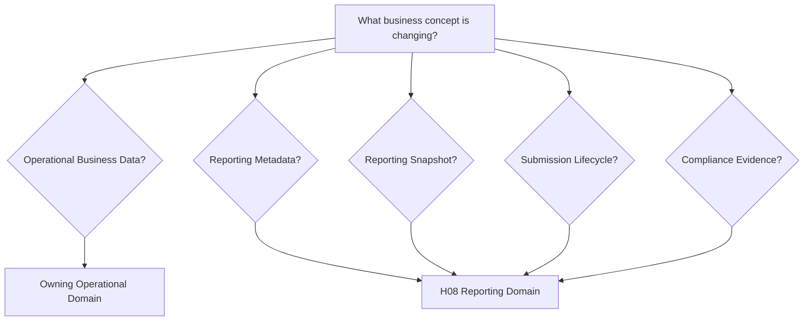

---

## 5.6 Aggregate Ownership Model

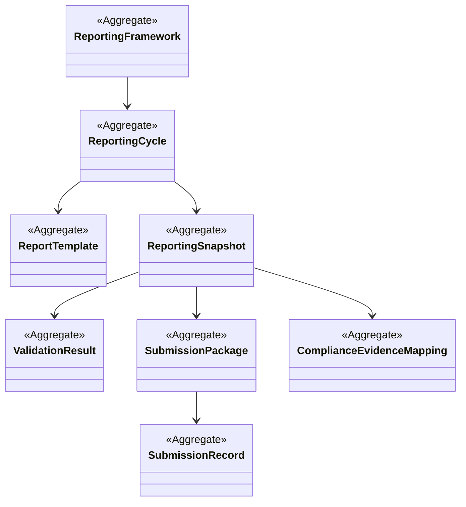

---

## 5.7 Ownership Invariants

### Invariant O-001

Reporting metadata SHALL belong exclusively to H08.

---

### Invariant O-002

Operational business data SHALL remain owned by operational domains.

---

### Invariant O-003

Reporting Snapshots SHALL be immutable after generation.

Corrections SHALL create new versions.

---

### Invariant O-004

Every regulatory submission SHALL reference exactly one immutable Reporting Snapshot.

---

### Invariant O-005

Evidence Mapping SHALL reference supporting business records without assuming ownership.

---

### Invariant O-006

Validation SHALL never modify operational business data.

Validation only evaluates reporting readiness.

---

### Invariant O-007

Submission history SHALL remain immutable.

Re-submissions SHALL generate new Submission Records.

---

### Invariant O-008

Every Reporting Cycle SHALL maintain complete version lineage.

---

## 5.8 Forbidden Architectural Patterns

The following repository patterns are explicitly prohibited.

❌ Reporting modifying student records

❌ Reporting modifying workforce records

❌ Reporting modifying finance records

❌ Reporting storing duplicate operational databases

❌ Reporting recalculating authoritative business KPIs

❌ Dashboards modifying Reporting Snapshots

❌ External systems updating Reporting metadata

❌ Direct database coupling with operational domains

❌ Multiple reporting systems of record

---

## 5.9 Enterprise Ownership Principles

The following ownership principles are mandatory.

1. One business capability SHALL have one canonical owner.

2. Reporting metadata SHALL remain owned by H08.

3. Operational domains SHALL own operational business data.

4. Read Models SHALL never become systems of record.

5. Reporting Snapshots SHALL preserve immutable reporting history.

6. Domain Events SHALL publish completed reporting facts.

7. Commands SHALL never bypass ownership boundaries.

8. Evidence SHALL always reference authoritative operational records.

---

## 5.10 Section Summary

The Regulatory Reporting & Compliance domain is the exclusive owner of reporting metadata, reporting lifecycle, reporting snapshots, validation outcomes, compliance evidence mappings, submission packages, reporting configurations, and reporting governance.

This ownership model establishes H08 as the enterprise regulatory reporting platform while preserving strict canonical ownership across every operational bounded context.

---

# 6. Domain Model / Aggregate / Lifecycle

## 6.1 Domain Overview

The Regulatory Reporting & Compliance domain models regulatory reporting as a governed business capability rather than a collection of generated documents.

The domain is centered around Reporting Cycles that orchestrate data collection, validation, evidence management, approvals, submissions, acknowledgements, corrections, and historical preservation.

The architecture follows Domain-Driven Design (DDD), CQRS, and Event-Driven Architecture while preserving complete auditability and immutable reporting history.

---

## 6.2 Aggregate Overview

The domain consists of eight primary aggregates.

| Aggregate | Responsibility |
|-----------|----------------|
| Reporting Framework | Defines supported regulatory frameworks and reporting standards |
| Reporting Cycle | Governs execution of an institutional reporting period and owns the Reporting Schedule value object |
| Report Template | Defines metadata-driven report structures |
| Reporting Snapshot | Immutable reporting data used for submissions |
| Validation Result | Captures validation outcomes and compliance findings |
| Compliance Evidence Mapping | Associates reported values with supporting evidence |
| Submission Package | Governs packaging, approval and submission lifecycle |
| Submission Record | Captures regulatory submission transmission, acknowledgement, and authority response history |

---

## 6.3 Aggregate Relationship Model

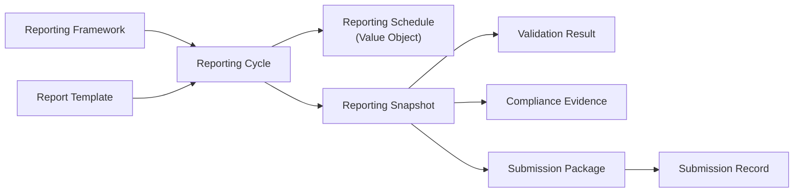

Reporting Schedule is modeled as a Value Object inside Reporting Cycle and is not an independent aggregate.

---

## 6.4 Aggregate Design Principles

The aggregate model follows these principles.

- Every Reporting Cycle belongs to exactly one Reporting Framework.
- Every Reporting Snapshot belongs to exactly one Reporting Cycle.
- Reporting Snapshots are immutable.
- Validation Results are append-only.
- Evidence mappings are version-controlled.
- Reporting Schedules are owned value objects within Reporting Cycles.
- Submission Packages always reference immutable snapshots.
- Submission Records preserve complete submission lineage.

---

## 6.5 Aggregate — Reporting Framework

### Purpose

The Reporting Framework aggregate defines the regulatory authority, reporting standard, reporting configuration, reporting policies, supported reporting periods, submission mechanisms, validation rules, and lifecycle applicable to a particular compliance framework.

Examples include:

- National Education Policy (NEP)
- National Assessment and Accreditation Council (NAAC)
- All India Survey on Higher Education (AISHE)
- National Institutional Ranking Framework (NIRF)
- National Board of Accreditation (NBA)
- University Grants Commission (UGC)
- State Regulatory Reporting
- Future Regulatory Frameworks

The aggregate enables the platform to support multiple regulatory authorities through metadata rather than framework-specific implementations.

### Responsibilities

- Register reporting frameworks.
- Maintain framework metadata.
- Define reporting frequency.
- Configure reporting periods.
- Associate report templates.
- Define validation policies.
- Configure submission mechanisms.
- Define evidence requirements.
- Maintain framework lifecycle.
- Support framework versioning.

### Lifecycle

```text
Draft
   │
   ▼
Configured
   │
   ▼
Validated
   │
   ▼
Published
   │
   ▼
Active
   │
   ▼
Deprecated
   │
   ▼
Retired
```

### Invariants

- Every framework SHALL possess a unique identifier.
- Every framework SHALL maintain version history.
- Framework versions SHALL be immutable after publication.
- Framework retirement SHALL NOT invalidate historical reporting cycles.
- Every reporting cycle SHALL reference exactly one published framework version.

---

## 6.6 Aggregate — Reporting Cycle

### Purpose

The Reporting Cycle aggregate governs the execution of a complete institutional reporting period for a specific reporting framework.

It acts as the orchestration aggregate coordinating data collection, validation, snapshot creation, approvals, submissions, acknowledgements, corrections, and closure.

The Reporting Cycle is the central business aggregate of H08.

Reporting Schedule is modeled as a Value Object owned by the Reporting Cycle and is never treated as an independent aggregate.

### Responsibilities

- Create reporting cycles.
- Schedule reporting execution.
- Coordinate enterprise data collection.
- Track reporting progress.
- Coordinate validations.
- Generate reporting snapshots.
- Maintain the Reporting Schedule value object.
- Manage institutional approvals.
- Manage reporting deadlines.
- Coordinate submissions.
- Close reporting cycles.

### Lifecycle

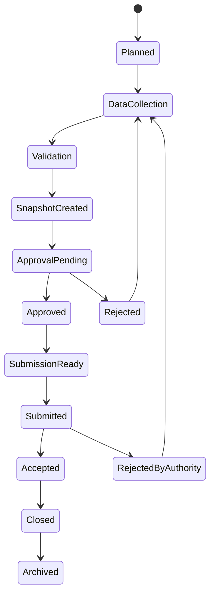

### Invariants

- Every Reporting Cycle belongs to exactly one Reporting Framework.
- A Reporting Cycle SHALL own one active reporting snapshot at submission time.
- A Reporting Cycle SHALL own its Reporting Schedule as a Value Object.
- Closed reporting cycles SHALL be immutable.
- Corrections SHALL create new snapshot versions.
- Submission SHALL only occur after approval.

---

## 6.7 Aggregate — Report Template

### Purpose

The Report Template aggregate defines the metadata describing report structure, sections, data mappings, validation rules, evidence requirements, formatting rules, and submission layouts.

Templates are reusable across reporting cycles.

### Responsibilities

- Define report structure.
- Define report sections.
- Define reporting fields.
- Associate data sources.
- Configure validation mappings.
- Configure evidence mappings.
- Maintain template versions.
- Publish templates.

### Lifecycle

```text
Draft
   │
   ▼
Configured
   │
   ▼
Validated
   │
   ▼
Published
   │
   ▼
Superseded
   │
   ▼
Retired
```

### Invariants

- Published templates SHALL be immutable.
- Template modifications SHALL create new versions.
- Reporting Cycles SHALL reference published template versions only.
- Historical submissions SHALL preserve template version references.

---

## 6.8 Aggregate — Reporting Snapshot

### Purpose

The Reporting Snapshot aggregate represents an immutable representation of all institutional data used for a regulatory submission at a specific point in time.

Snapshots guarantee historical reproducibility even if operational systems change after submission.

Snapshots are the authoritative reporting record.

### Responsibilities

- Capture enterprise reporting data.
- Preserve reporting versions.
- Store reporting metadata.
- Reference supporting evidence.
- Support audit reconstruction.
- Provide immutable reporting history.

### Lifecycle

```text
Building
   │
   ▼
Validated
   │
   ▼
Locked
   │
   ▼
Submitted
   │
   ▼
Archived
```

### Invariants

- Reporting Snapshots SHALL NEVER be modified after locking.
- Corrections SHALL generate new snapshots.
- Every submission SHALL reference exactly one snapshot.
- Snapshot identifiers SHALL remain globally unique.
- Snapshot history SHALL remain permanently available.

---

## 6.9 Aggregate — Validation Result

### Purpose

The Validation Result aggregate records the outcome of enterprise reporting validation executed against a Reporting Snapshot.

Validation ensures regulatory completeness and institutional consistency before submission package approval.

### Responsibilities

- Execute structural validation.
- Execute business validation.
- Execute cross-domain validation.
- Execute compliance validation.
- Record validation findings.
- Maintain validation history.
- Publish validation outcomes.

### Validation Categories

| Category | Purpose |
|-----------|---------|
| Structural Validation | Required fields and report completeness |
| Business Validation | Institutional business rules |
| Cross-Domain Validation | Consistency across canonical domains |
| Compliance Validation | Regulatory framework conformance |

### Lifecycle

```text
Created
   │
   ▼
Executing
   │
   ▼
Completed
   │
   ▼
Passed
or
Failed
```

### Invariants

- Validation SHALL reference one Reporting Snapshot.
- Validation SHALL NOT modify reporting data.
- Validation SHALL preserve execution history.
- Validation findings SHALL remain immutable after completion.

---

## 6.10 Aggregate — Compliance Evidence Mapping

### Purpose

The Compliance Evidence Mapping aggregate links every reported value with supporting institutional evidence.

Evidence may include documents, approvals, reports, policies, certificates, research outputs, financial statements, or references to authoritative operational records.

This aggregate enables complete audit readiness.

Evidence is classified so that the reporting model can distinguish between direct institutional artifacts, references to authoritative records, calculated results, and externally issued materials.

### Responsibilities

- Map evidence.
- Classify evidence.
- Track evidence completeness.
- Verify evidence availability.
- Maintain evidence references.
- Preserve evidence history.
- Support audit inspection.

### Evidence Categories

- Document Evidence: Files, forms, certificates, and other institutional documents retained as supporting artifacts.
- Reference Evidence: Stable references to authoritative operational records that remain owned by upstream domains.
- Calculated Evidence: Derived values, summaries, or compliance indicators computed from canonical reporting inputs.
- External Evidence: Materials issued by external authorities, regulators, accreditors, or third-party bodies.

### Lifecycle

```text
Created
   │
   ▼
Mapped
   │
   ▼
Verified
   │
   ▼
Approved
   │
   ▼
Archived
```

### Invariants

- Evidence SHALL reference authoritative business records.
- Evidence SHALL support version history.
- Evidence SHALL remain traceable.
- Evidence SHALL never duplicate operational ownership.

---

## 6.11 Aggregate — Submission Package

### Purpose

The Submission Package aggregate governs the packaging, approval, submission, acknowledgement, correction, and archival of regulatory submissions.

It represents the official institutional submission sent to a regulatory authority.

It also preserves package integrity metadata, including digital signatures, package hashes, integrity verification results, and submission checksums.

### Responsibilities

- Generate submission packages.
- Coordinate approvals.
- Package reports.
- Associate evidence.
- Maintain package integrity metadata.
- Preserve digital signatures.
- Maintain package hashes.
- Verify integrity.
- Preserve submission checksums.
- Execute submissions.
- Record acknowledgements.
- Support resubmissions.
- Preserve submission history.

### Lifecycle

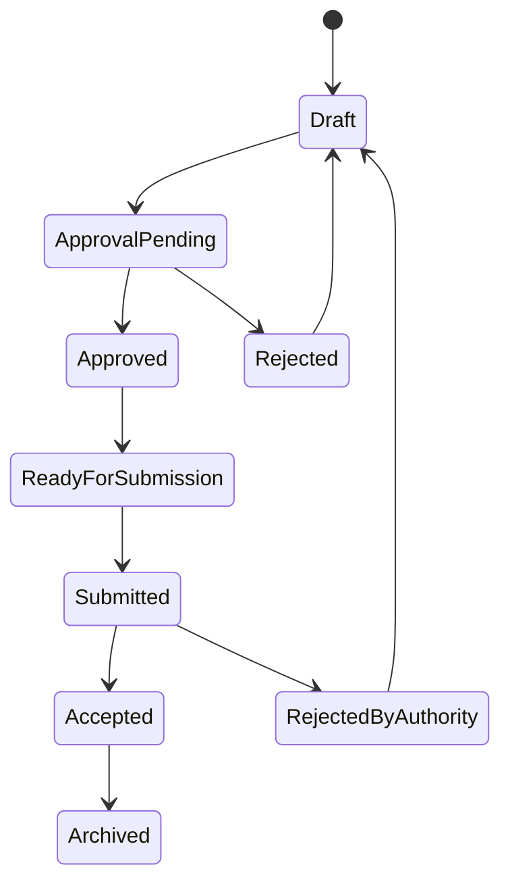

### Invariants

- Every Submission Package SHALL reference exactly one Reporting Snapshot.
- Submission Packages SHALL preserve approval history.
- Accepted submissions SHALL be immutable.
- Regulatory acknowledgements SHALL be permanently retained.
- Resubmissions SHALL create new Submission Records.
- Submission integrity metadata SHALL remain associated with the package history.

---

## 6.12 Aggregate — Submission Record

### Purpose

The Submission Record aggregate is the authoritative business record of a single regulatory transmission and its full authority response history.

It is a first-class supporting aggregate, not merely a persistence object, and it preserves every externally observable step in the submission lifecycle.

### Responsibilities

- Record regulatory submissions.
- Maintain submission status.
- Store acknowledgement metadata.
- Store delivery metadata.
- Store submission channel.
- Maintain retry history.
- Store external reference IDs.
- Store response timestamps.
- Store package checksum/hash.
- Maintain authority responses.
- Preserve immutable submission history.
- Support audit reconstruction.

### Lifecycle

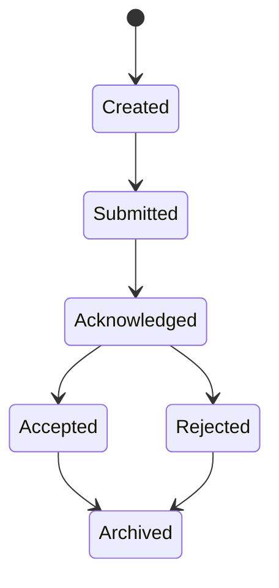

### Invariants

- Every Submission Record references exactly one Submission Package.
- Submission history is immutable.
- Acknowledgements cannot overwrite previous history.
- Every resubmission creates a new Submission Record.
- External tracking identifiers remain immutable.

---

## 6.13 Aggregate Lifecycle Relationships

The aggregate lifecycle dependencies are illustrated below.

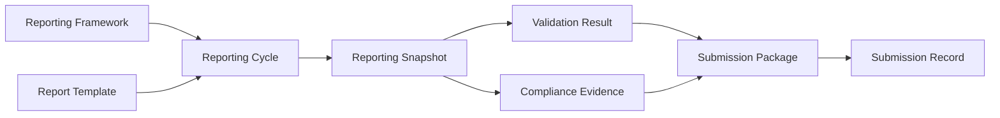

---

## 6.14 Aggregate Design Principles

The aggregate model follows the following enterprise principles.

- Reporting Framework governs regulatory configuration.
- Reporting Cycle governs execution.
- Reporting Schedule is owned by Reporting Cycle as a Value Object.
- Report Template governs report structure.
- Reporting Snapshot preserves immutable reporting facts.
- Validation Result evaluates reporting readiness.
- Compliance Evidence Mapping establishes audit traceability.
- Submission Package governs institutional submission lifecycle.
- Submission Record preserves authoritative submission history.
- Submission Record preserves permanent regulatory submission history.
```
# 7. Workflow Specifications

## 7.1 Workflow Overview

The Regulatory Reporting & Compliance domain orchestrates the complete lifecycle of institutional reporting through a series of governed workflows.

Each workflow is implemented using Commands, Queries, Domain Events, immutable Reporting Snapshots, and well-defined aggregate boundaries.

No workflow directly accesses operational databases.

All business information is retrieved through enterprise Query APIs, CQRS Read Models, and approved reporting projections.

---

## 7.2 Workflow Catalogue

| Workflow ID | Workflow |
|-------------|----------|
| H08-W01 | Reporting Framework Management |
| H08-W02 | Reporting Cycle Planning |
| H08-W03 | Enterprise Data Collection |
| H08-W04 | Reporting Validation |
| H08-W05 | Reporting Snapshot Generation |
| H08-W06 | Compliance Evidence Mapping |
| H08-W07 | Institutional Approval |
| H08-W08 | Submission Package Generation |
| H08-W09 | Regulatory Submission |
| H08-W10 | Regulatory Acknowledgement |
| H08-W11 | Reporting Correction & Resubmission |
| H08-W12 | Reporting Closure & Archival |

---

# H08-W01 — Reporting Framework Management

## Purpose

Registers and governs regulatory reporting frameworks supported by the institution.

Frameworks define reporting metadata, validation rules, submission mechanisms, schedules, templates, and evidence requirements.

---

## Primary Aggregate

**Reporting Framework**

---

## Participating Aggregates

- Report Template
- Reporting Configuration

---

## Trigger

- New regulatory framework introduced.
- Existing framework updated.
- Regulatory authority changes reporting requirements.

---

## Preconditions

- User possesses Reporting Administrator privileges.
- Framework metadata is available.
- Required templates have been defined.

---

## Workflow

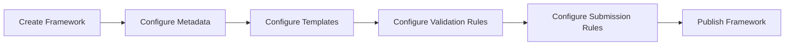

---

## Postconditions

- Framework becomes available for Reporting Cycles.
- Framework version is published.
- Audit history recorded.

---

## Commands

- CreateReportingFramework
- ConfigureReportingFramework
- PublishReportingFramework
- RetireReportingFramework

---

## Queries

- GetReportingFramework
- GetFrameworkVersionHistory
- ListReportingFrameworks

---

## Domain Events

- ReportingFrameworkCreated
- ReportingFrameworkPublished
- ReportingFrameworkRetired

---

# H08-W02 — Reporting Cycle Planning

## Purpose

Creates a reporting cycle for a reporting framework and schedules reporting activities.

---

## Primary Aggregate

**Reporting Cycle**

---

## Trigger

- Scheduled reporting period.
- Administrative initiation.
- Regulatory deadline.

---

## Preconditions

- Framework published.
- Reporting schedule defined.

---

## Workflow

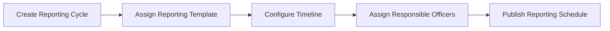

---

## Postconditions

- Reporting Cycle enters Planned state.
- Reporting timeline published.
- Notifications issued.

---

## Commands

- CreateReportingCycle
- ScheduleReportingCycle
- PublishReportingSchedule
- CloseReportingCycle

---

## Queries

- GetReportingCycle
- ListReportingSchedules
- GetReportingCalendar

---

## Domain Events

- ReportingCycleCreated
- ReportingCycleScheduled
- ReportingCycleStarted

---

# H08-W03 — Enterprise Data Collection

## Purpose

Collects reporting data from canonical operational domains using enterprise Query APIs and CQRS Read Models.

---

## Primary Aggregate

**Reporting Cycle**

---

## Participating Aggregates

- Reporting Snapshot

---

## Trigger

Reporting Cycle enters Data Collection phase.

---

## Preconditions

- Reporting Cycle active.
- Reporting framework published.
- Reporting template assigned.

---

## Workflow

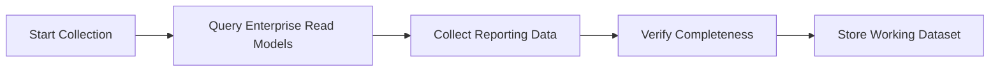

The working dataset is a transient reporting projection used as orchestration staging data.

It is not an operational system of record, may be deleted or regenerated as required, and never becomes the canonical owner of operational data.

---

## Data Sources

- Student Lifecycle
- Academic Delivery
- People & Workforce
- Finance
- Examination
- Research
- Organization Management

---

## Postconditions

- Reporting dataset assembled.
- Missing data identified.
- Collection status updated.

---

## Commands

- StartDataCollection
- CollectReportingData
- VerifyCollectedData
- CompleteDataCollection

---

## Queries

- GetReportingDataset
- GetCollectionStatus
- GetMissingReportingData

---

## Domain Events

- DataCollectionStarted
- ReportingDataCollected
- DataCollectionCompleted
- ReportingDataMissing

---

# H08-W04 — Reporting Validation

## Purpose

Executes enterprise validation before submission package approval.

Validation ensures completeness, consistency, and regulatory compliance.

---

## Primary Aggregate

**Validation Result**

---

## Trigger

Enterprise Data Collection completed.

---

## Preconditions

- Dataset complete.
- Reporting Cycle active.

---

## Validation Stages

1. Structural Validation
2. Business Validation
3. Cross-Domain Validation
4. Regulatory Validation

---

## Workflow

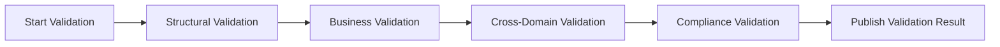

---

## Validation Outcomes

- Passed
- Passed With Warnings
- Failed

---

## Postconditions

Successful validation allows Snapshot generation.

Failed validation returns Reporting Cycle to Data Collection.

---

## Commands

- ExecuteStructuralValidation
- ExecuteBusinessValidation
- ExecuteCrossDomainValidation
- ExecuteComplianceValidation
- PublishValidationResult

---

## Queries

- GetValidationResult
- GetValidationErrors
- GetValidationWarnings

---

## Domain Events

- ValidationStarted
- ValidationCompleted
- ValidationPassed
- ValidationFailed
- ComplianceGapDetected

---

# H08-W05 — Reporting Snapshot Generation

## Purpose

Creates an immutable Reporting Snapshot representing all reporting information used for institutional approval and regulatory submission.

---

## Primary Aggregate

**Reporting Snapshot**

---

## Trigger

Validation completed successfully.

---

## Preconditions

- Validation passed.
- Reporting dataset finalized.

---

## Workflow

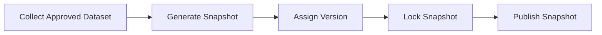

---

## Snapshot Characteristics

- Immutable
- Version-controlled
- Audit-ready
- Evidence-aware
- Submission-ready

---

## Postconditions

Snapshot becomes the authoritative reporting dataset.

---

## Commands

- GenerateReportingSnapshot
- LockReportingSnapshot
- PublishReportingSnapshot

---

## Queries

- GetReportingSnapshot
- GetSnapshotVersion
- GetSnapshotHistory

---

## Domain Events

- ReportingSnapshotGenerated
- ReportingSnapshotLocked
- ReportingSnapshotPublished

# H08-W06 — Compliance Evidence Mapping

## Purpose

Associates every reported value with authoritative institutional evidence to ensure complete auditability, accreditation readiness, and regulatory traceability.

Evidence may originate from operational systems, institutional policies, supporting documents, approvals, reports, or externally issued certificates.

The Reporting domain references evidence without becoming the system of record for operational artifacts.

Evidence mapping is classified so that the domain can distinguish how each supporting item should be validated, retained, and audited.

---

## Evidence Categories

| Category | Description |
|----------|-------------|
| Document Evidence | Documents, certificates, forms, and other institutional artifacts retained as supporting evidence |
| Reference Evidence | References to authoritative records that remain owned by upstream operational domains |
| Calculated Evidence | Derived values, summaries, and compliance indicators computed from canonical reporting inputs |
| External Evidence | Materials issued by regulators, accreditors, or third-party authorities |

---

## Primary Aggregate

**Compliance Evidence Mapping**

---

## Participating Aggregates

- Reporting Snapshot
- Submission Package

---

## Trigger

- Reporting Snapshot generated.
- Manual evidence attachment requested.
- Evidence verification initiated.

---

## Preconditions

- Reporting Snapshot locked.
- Reporting values available.
- Evidence sources accessible.

---

## Workflow

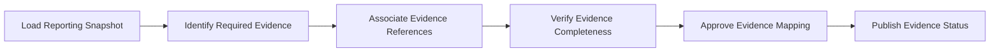

---

## Evidence Sources

- Institutional Policies
- Governing Body Resolutions
- Academic Regulations
- Student Records
- Faculty Records
- Financial Statements
- Examination Reports
- Research Publications
- Accreditation Documents
- Infrastructure Certificates
- Laboratory Approvals
- Government Notifications

---

## Postconditions

- Evidence mapping completed.
- Missing evidence identified.
- Audit traceability established.

---

## Commands

- CreateEvidenceMapping
- AttachEvidenceReference
- VerifyEvidenceCompleteness
- ApproveEvidenceMapping
- RemoveEvidenceReference

---

## Queries

- GetEvidenceMappings
- GetMissingEvidence
- GetEvidenceStatus
- GetEvidenceHistory

---

## Domain Events

- EvidenceMappingCreated
- EvidenceAttached
- EvidenceVerified
- EvidenceMissing
- EvidenceMappingApproved

---

# H08-W07 — Institutional Approval

## Purpose

Obtains institutional approval before any regulatory submission is released to external authorities.

Approval workflows are configurable and may involve multiple institutional authorities.

---

## Primary Aggregate

**Submission Package**

---

## Trigger

- Reporting Snapshot finalized.
- Validation completed.
- Evidence mapping approved.

---

## Preconditions

- Reporting Snapshot locked.
- Validation successful.
- Mandatory evidence available.

---

## Workflow

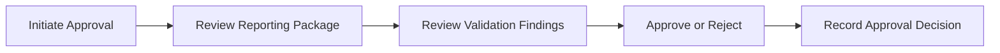

---

## Possible Approvers

- Reporting Coordinator
- Department Head
- Dean
- Registrar
- Controller of Examinations
- Finance Officer
- Principal
- Vice Chancellor
- Institutional Compliance Officer

Approval hierarchy shall remain configurable.

---

## Approval Outcomes

- Approved
- Rejected
- Returned For Correction

---

## Postconditions

Approved packages become eligible for regulatory submission.

Rejected packages return to correction workflow.

---

## Commands

- InitiateApproval
- RecordApprovalDecision
- ApproveSubmissionPackage
- RejectSubmissionPackage
- ReturnForCorrection

---

## Queries

- GetApprovalStatus
- GetPendingApprovals
- GetApprovalHistory

---

## Domain Events

- ApprovalInitiated
- SubmissionApproved
- SubmissionRejected
- SubmissionReturnedForCorrection

---

# H08-W08 — Submission Package Generation

## Purpose

Generates the official submission package that will be transmitted to the regulatory authority.

The package contains reporting data, supporting evidence references, metadata, validation outcomes, submission metadata, and integrity metadata used to verify package authenticity.

---

## Primary Aggregate

**Submission Package**

---

## Trigger

Institutional approval completed.

---

## Preconditions

- Reporting approved.
- Snapshot locked.
- Evidence verified.

---

## Workflow

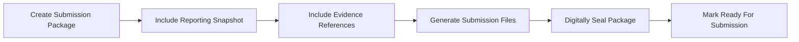

Submission package integrity is verified through digital signatures, package hashes, integrity checks, and checksum metadata.

---

## Package Contents

- Reporting Metadata
- Reporting Snapshot
- Evidence References
- Validation Summary
- Submission Manifest
- Submission Version
- Institutional Metadata
- Digital Signature
- Package Hash
- Integrity Verification Result
- Submission Checksum

---

## Postconditions

Submission package ready for regulatory submission.

---

## Commands

- CreateSubmissionPackage
- GenerateSubmissionFiles
- SealSubmissionPackage
- MarkSubmissionReady

---

## Queries

- GetSubmissionPackage
- GetSubmissionManifest
- GetSubmissionVersion

---

## Domain Events

- SubmissionPackageCreated
- SubmissionFilesGenerated
- SubmissionPackageReady

---

# H08-W09 — Regulatory Submission

## Purpose

Submits approved reporting packages to external regulatory authorities through supported submission mechanisms.

Submission may occur automatically through APIs or manually through regulatory portals.

---

## Primary Aggregate

**Submission Record**

---

## Trigger

Submission Package marked Ready For Submission.

---

## Preconditions

- Submission Package approved.
- Submission window open.
- Submission mechanism available.

---

## Workflow

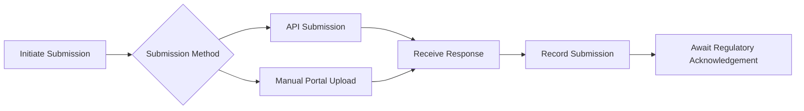

---

## Supported Submission Mechanisms

- REST API
- Secure File Transfer
- Government Portal Upload
- Manual Upload
- Future Regulatory Connectors

---

## External Connector Behaviour

External regulatory connectors follow API-first and event-driven principles.

- Submissions are idempotent so repeated delivery attempts do not create duplicate business records.
- Acknowledgements may arrive asynchronously through callback or webhook channels.
- Polling is supported where external authorities do not provide callbacks.
- Retry policies SHALL be configured for transport failures and transient authority unavailability.
- Submission Records SHALL capture the full response timeline, including callback, webhook, and polling outcomes.

---

## Postconditions

Submission history recorded.

Submission status updated.

---

## Commands

- SubmitReport
- UploadSubmissionPackage
- RecordSubmission
- CancelSubmission

---

## Queries

- GetSubmissionStatus
- GetSubmissionHistory
- GetSubmissionLog

---

## Domain Events

- SubmissionInitiated
- ReportSubmitted
- SubmissionCompleted
- SubmissionFailed

---

# H08-W10 — Regulatory Acknowledgement

## Purpose

Records acknowledgement received from the regulatory authority following report submission.

Acknowledgements become part of the permanent institutional compliance history.

---

## Primary Aggregate

**Submission Record**

---

## Trigger

Regulatory authority responds.

---

## Preconditions

- Submission completed.

---

## Workflow

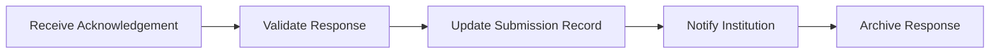

---

## Possible Outcomes

- Accepted
- Accepted With Remarks
- Rejected
- Resubmission Required

---

## Postconditions

Submission lifecycle updated.

Institution notified.

---

## Commands

- RecordAcknowledgement
- RecordSubmissionAcceptance
- RecordSubmissionRejection
- ArchiveAcknowledgement

---

## Queries

- GetAcknowledgement
- GetSubmissionOutcome
- GetRegulatoryRemarks

---

## Domain Events

- SubmissionAccepted
- SubmissionRejected
- RegulatoryRemarksReceived
- ResubmissionRequested

---

# H08-W11 — Reporting Correction & Resubmission

## Purpose

Supports correction of reporting issues identified during institutional review or by regulatory authorities while preserving immutable reporting history.

Corrections never modify existing Reporting Snapshots.

Instead, new snapshot versions are generated.

---

## Primary Aggregate

**Reporting Cycle**

---

## Participating Aggregates

- Reporting Snapshot
- Submission Package
- Submission Record

---

## Trigger

- Validation failure.
- Approval rejection.
- Regulatory rejection.
- Institutional correction request.

---

## Preconditions

- Existing Reporting Cycle available.

---

## Workflow

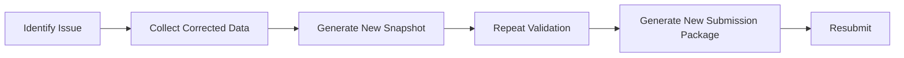

---

## Postconditions

Previous submission history preserved.

New reporting version created.

Full audit lineage maintained.

---

## Commands

- InitiateCorrection
- GenerateCorrectedSnapshot
- CreateResubmission
- SubmitCorrectedReport

---

## Queries

- GetCorrectionHistory
- GetSnapshotVersions
- GetResubmissionStatus

---

## Domain Events

- CorrectionInitiated
- SnapshotVersionCreated
- ResubmissionPrepared
- ReportResubmitted

---

# H08-W12 — Reporting Closure & Archival

## Purpose

Closes the Reporting Cycle after regulatory processing has completed and permanently archives reporting history.

---

## Primary Aggregate

**Reporting Cycle**

---

## Trigger

Submission accepted or reporting cycle completed.

---

## Preconditions

- Reporting obligations completed.
- Submission history finalized.

---

## Workflow

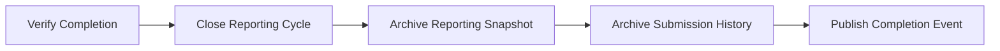

---

## Postconditions

- Reporting Cycle closed.
- Reporting history archived.
- Audit history preserved.
- Compliance records retained.

---

## Commands

- CloseReportingCycle
- ArchiveReportingSnapshot
- ArchiveSubmissionHistory

---

## Queries

- GetArchivedReportingCycle
- GetReportingHistory
- GetComplianceArchive

---

## Domain Events

- ReportingCycleClosed
- ReportingArchived
- ComplianceHistoryArchived
- ReportingLifecycleCompleted

# 8. Commands Catalogue

## 8.1 Overview

Commands represent intent to change the state of aggregates within the Regulatory Reporting & Compliance domain.

Commands are processed exclusively by their owning aggregate.

Every command is validated before execution, produces deterministic state transitions, records audit history, and may publish one or more Domain Events.

Commands SHALL NEVER directly modify aggregates owned by other bounded contexts.

---

## 8.2 Reporting Framework Commands

| Command | Aggregate | Purpose |
|----------|-----------|---------|
| CreateReportingFramework | Reporting Framework | Register a new reporting framework |
| ConfigureReportingFramework | Reporting Framework | Configure framework metadata |
| PublishReportingFramework | Reporting Framework | Publish framework for institutional use |
| RetireReportingFramework | Reporting Framework | Retire a reporting framework |

---

## 8.3 Reporting Cycle Commands

| Command | Aggregate | Purpose |
|----------|-----------|---------|
| CreateReportingCycle | Reporting Cycle | Create reporting cycle |
| ScheduleReportingCycle | Reporting Cycle | Schedule reporting activities |
| PublishReportingSchedule | Reporting Cycle | Publish reporting calendar |
| StartDataCollection | Reporting Cycle | Begin enterprise data collection |
| CollectReportingData | Reporting Cycle | Collect reporting data |
| VerifyCollectedData | Reporting Cycle | Verify collected data |
| CompleteDataCollection | Reporting Cycle | Mark collection complete |
| CloseReportingCycle | Reporting Cycle | Close reporting cycle |

---

## 8.4 Validation Commands

| Command | Aggregate | Purpose |
|----------|-----------|---------|
| ExecuteStructuralValidation | Validation Result | Validate report completeness |
| ExecuteBusinessValidation | Validation Result | Validate institutional business rules |
| ExecuteCrossDomainValidation | Validation Result | Validate cross-domain consistency |
| ExecuteComplianceValidation | Validation Result | Validate regulatory compliance |
| PublishValidationResult | Validation Result | Publish validation outcome |

---

## 8.5 Reporting Snapshot Commands

| Command | Aggregate | Purpose |
|----------|-----------|---------|
| GenerateReportingSnapshot | Reporting Snapshot | Create immutable reporting snapshot |
| LockReportingSnapshot | Reporting Snapshot | Lock snapshot for submission |
| PublishReportingSnapshot | Reporting Snapshot | Publish reporting snapshot |

---

## 8.6 Compliance Evidence Commands

| Command | Aggregate | Purpose |
|----------|-----------|---------|
| CreateEvidenceMapping | Compliance Evidence Mapping | Create evidence mapping |
| AttachEvidenceReference | Compliance Evidence Mapping | Associate supporting evidence |
| VerifyEvidenceCompleteness | Compliance Evidence Mapping | Verify evidence availability |
| ApproveEvidenceMapping | Compliance Evidence Mapping | Approve evidence mappings |
| RemoveEvidenceReference | Compliance Evidence Mapping | Remove evidence association |

---

## 8.7 Approval Commands

| Command | Aggregate | Purpose |
|----------|-----------|---------|
| InitiateApproval | Submission Package | Start approval workflow |
| RecordApprovalDecision | Submission Package | Record approval outcome |
| ApproveSubmissionPackage | Submission Package | Approve reporting package |
| RejectSubmissionPackage | Submission Package | Reject reporting package |
| ReturnForCorrection | Submission Package | Return package for correction |

---

## 8.8 Submission Commands

| Command | Aggregate | Purpose |
|----------|-----------|---------|
| CreateSubmissionPackage | Submission Package | Create submission package |
| GenerateSubmissionFiles | Submission Package | Generate submission artifacts |
| SealSubmissionPackage | Submission Package | Seal package for submission |
| MarkSubmissionReady | Submission Package | Mark package ready |
| SubmitReport | Submission Record | Submit report |
| UploadSubmissionPackage | Submission Record | Upload submission |
| RecordSubmission | Submission Record | Record submission history |
| RecordAcknowledgement | Submission Record | Record regulatory acknowledgement |
| RecordSubmissionAcceptance | Submission Record | Record submission acceptance |
| RecordSubmissionRejection | Submission Record | Record submission rejection |
| CancelSubmission | Submission Record | Cancel submission before completion |

---

## 8.9 Correction Commands

| Command | Aggregate | Purpose |
|----------|-----------|---------|
| InitiateCorrection | Reporting Cycle | Begin correction workflow |
| GenerateCorrectedSnapshot | Reporting Snapshot | Generate corrected snapshot |
| CreateResubmission | Submission Package | Prepare resubmission |
| SubmitCorrectedReport | Submission Record | Submit corrected report |

---

## 8.10 Archival Commands

| Command | Aggregate | Purpose |
|----------|-----------|---------|
| ArchiveReportingSnapshot | Reporting Snapshot | Archive reporting snapshot |
| ArchiveSubmissionHistory | Submission Record | Archive submission history |
| ArchiveAcknowledgement | Submission Record | Archive acknowledgement |

---

# 9. Queries Catalogue

## 9.1 Overview

Queries retrieve reporting information without modifying aggregate state.

Queries are implemented using CQRS Read Models, Reporting Projections, or immutable Reporting Snapshots.

Queries SHALL NEVER perform business updates.

---

## 9.2 Reporting Framework Queries

| Query | Purpose |
|--------|---------|
| GetReportingFramework | Retrieve framework |
| ListReportingFrameworks | List available frameworks |
| GetFrameworkVersionHistory | Retrieve framework history |

---

## 9.3 Reporting Cycle Queries

| Query | Purpose |
|--------|---------|
| GetReportingCycle | Retrieve reporting cycle |
| ListReportingSchedules | Retrieve reporting schedules |
| GetReportingCalendar | Retrieve reporting calendar |

---

## 9.4 Data Collection Queries

| Query | Purpose |
|--------|---------|
| GetReportingDataset | Retrieve collected dataset |
| GetCollectionStatus | Retrieve collection progress |
| GetMissingReportingData | Retrieve missing data |

---

## 9.5 Validation Queries

| Query | Purpose |
|--------|---------|
| GetValidationResult | Retrieve validation outcome |
| GetValidationErrors | Retrieve validation failures |
| GetValidationWarnings | Retrieve validation warnings |

---

## 9.6 Snapshot Queries

| Query | Purpose |
|--------|---------|
| GetReportingSnapshot | Retrieve reporting snapshot |
| GetSnapshotVersion | Retrieve snapshot version |
| GetSnapshotHistory | Retrieve snapshot history |

---

## 9.7 Evidence Queries

| Query | Purpose |
|--------|---------|
| GetEvidenceMappings | Retrieve evidence mappings |
| GetMissingEvidence | Retrieve missing evidence |
| GetEvidenceStatus | Retrieve evidence status |
| GetEvidenceHistory | Retrieve evidence history |

---

## 9.8 Approval Queries

| Query | Purpose |
|--------|---------|
| GetApprovalStatus | Retrieve approval state |
| GetPendingApprovals | Retrieve pending approvals |
| GetApprovalHistory | Retrieve approval history |

---

## 9.9 Submission Queries

| Query | Purpose |
|--------|---------|
| GetSubmissionPackage | Retrieve submission package |
| GetSubmissionManifest | Retrieve submission manifest |
| GetSubmissionVersion | Retrieve package version |
| GetSubmissionStatus | Retrieve submission status |
| GetSubmissionHistory | Retrieve submission history |
| GetSubmissionLog | Retrieve submission logs |
| GetAcknowledgement | Retrieve acknowledgement |
| GetSubmissionOutcome | Retrieve regulatory outcome |
| GetRegulatoryRemarks | Retrieve authority remarks |

---

## 9.10 Correction Queries

| Query | Purpose |
|--------|---------|
| GetCorrectionHistory | Retrieve correction history |
| GetSnapshotVersions | Retrieve snapshot versions |
| GetResubmissionStatus | Retrieve resubmission status |

---

## 9.11 Archive Queries

| Query | Purpose |
|--------|---------|
| GetArchivedReportingCycle | Retrieve archived reporting cycle |
| GetReportingHistory | Retrieve historical reports |
| GetComplianceArchive | Retrieve archived compliance records |

---

# 10. Domain Events Catalogue

## 10.1 Overview

Domain Events communicate completed business facts after successful state transitions.

Events are immutable, versioned, replayable, and form the foundation of enterprise synchronization.

---

## 10.2 Reporting Framework Events

| Domain Event | Published When |
|--------------|----------------|
| ReportingFrameworkCreated | Framework created |
| ReportingFrameworkPublished | Framework published |
| ReportingFrameworkRetired | Framework retired |

---

## 10.3 Reporting Cycle Events

| Domain Event | Published When |
|--------------|----------------|
| ReportingCycleCreated | Reporting cycle created |
| ReportingCycleScheduled | Schedule published |
| ReportingCycleStarted | Reporting begins |
| ReportingCycleClosed | Cycle closed |
| ReportingArchived | Reporting archived |
| ReportingLifecycleCompleted | Lifecycle completed |

---

## 10.4 Data Collection Events

| Domain Event | Published When |
|--------------|----------------|
| DataCollectionStarted | Collection initiated |
| ReportingDataCollected | Dataset collected |
| DataCollectionCompleted | Collection finished |
| ReportingDataMissing | Missing data detected |

---

## 10.5 Validation Events

| Domain Event | Published When |
|--------------|----------------|
| ValidationStarted | Validation begins |
| ValidationCompleted | Validation completed |
| ValidationPassed | Validation successful |
| ValidationFailed | Validation failed |
| ComplianceGapDetected | Compliance issues detected |

---

## 10.6 Snapshot Events

| Domain Event | Published When |
|--------------|----------------|
| ReportingSnapshotGenerated | Snapshot created |
| ReportingSnapshotLocked | Snapshot locked |
| ReportingSnapshotPublished | Snapshot published |

---

## 10.7 Evidence Events

| Domain Event | Published When |
|--------------|----------------|
| EvidenceMappingCreated | Mapping created |
| EvidenceAttached | Evidence linked |
| EvidenceVerified | Evidence verified |
| EvidenceMissing | Evidence unavailable |
| EvidenceMappingApproved | Mapping approved |

---

## 10.8 Approval Events

| Domain Event | Published When |
|--------------|----------------|
| ApprovalInitiated | Approval workflow started |
| SubmissionApproved | Submission approved |
| SubmissionRejected | Submission rejected |
| SubmissionReturnedForCorrection | Returned for correction |

---

## 10.9 Submission Events

| Domain Event | Published When |
|--------------|----------------|
| SubmissionPackageCreated | Package created |
| SubmissionFilesGenerated | Files generated |
| SubmissionPackageReady | Package ready |
| SubmissionInitiated | Submission started |
| ReportSubmitted | Report submitted |
| SubmissionCompleted | Submission completed |
| SubmissionFailed | Submission failed |
| SubmissionAccepted | Regulatory acceptance received |
| RegulatoryRemarksReceived | Remarks received |
| ResubmissionRequested | Authority requested resubmission |

---

## 10.10 Correction Events

| Domain Event | Published When |
|--------------|----------------|
| CorrectionInitiated | Correction started |
| SnapshotVersionCreated | New snapshot generated |
| ResubmissionPrepared | Resubmission package prepared |
| ReportResubmitted | Corrected report submitted |

---

## 10.11 Archival Events

| Domain Event | Published When |
|--------------|----------------|
| ComplianceHistoryArchived | Compliance history archived |
| AcknowledgementArchived | Regulatory acknowledgement archived |
```
# 11. CQRS Read Models

## 11.1 Overview

The Regulatory Reporting & Compliance domain implements Command Query Responsibility Segregation (CQRS) by separating transactional aggregates from optimized read models.

Read Models are derived projections intended exclusively for reporting, dashboards, search, analytics, monitoring, and external integrations.

Read Models SHALL NEVER become systems of record.

---

## 11.2 Design Principles

The CQRS implementation follows these principles.

- Read Models are immutable projections.
- Read Models are asynchronously updated.
- Aggregates remain transactional.
- Read Models may be rebuilt from Domain Events.
- Query performance is prioritized over normalization.
- Read Models never own business state.
- Snapshot history remains immutable.

---

## 11.3 Enterprise Read Model Catalogue

| Read Model | Purpose |
|------------|---------|
| ReportingFrameworkView | Framework catalogue |
| ReportingCycleView | Reporting cycle overview |
| ReportingScheduleView | Reporting calendar |
| ReportingProgressView | Execution progress |
| ValidationSummaryView | Validation dashboard |
| ReportingSnapshotView | Snapshot history |
| ComplianceEvidenceView | Evidence tracking |
| SubmissionStatusView | Submission monitoring |
| ComplianceReadinessView | Institutional readiness |
| ReportingHistoryView | Historical reporting |

---

## 11.4 ReportingFrameworkView

### Purpose

Provides searchable reporting framework information.

### Fields

- Framework Id
- Framework Name
- Framework Version
- Framework Status
- Reporting Frequency
- Supported Templates
- Submission Mechanisms
- Effective Date
- Retirement Date

---

## 11.5 ReportingCycleView

### Purpose

Provides current reporting cycle status.

### Fields

- Reporting Cycle Id
- Framework
- Institution
- Reporting Period
- Current State
- Progress
- Responsible Officer
- Deadline
- Approval Status

---

## 11.6 ReportingProgressView

### Purpose

Tracks reporting execution progress.

### Fields

- Collection Status
- Validation Status
- Evidence Status
- Approval Status
- Submission Status
- Overall Progress
- Pending Activities

---

## 11.7 ValidationSummaryView

### Purpose

Provides validation outcomes.

### Fields

- Snapshot Version
- Validation Result
- Errors
- Warnings
- Compliance Issues
- Completion Time

---

## 11.8 ReportingSnapshotView

### Purpose

Displays immutable reporting snapshot metadata.

### Fields

- Snapshot Id
- Version
- Reporting Cycle
- Generated Time
- Locked Status
- Submission Status

---

## 11.9 ComplianceEvidenceView

### Purpose

Displays institutional evidence readiness.

### Fields

- Reporting Section
- Evidence Availability
- Verification Status
- Missing Evidence
- Approval Status

---

## 11.10 SubmissionStatusView

### Purpose

Tracks external regulatory submissions.

### Fields

- Submission Id
- Authority
- Submission Method
- Submission Time
- Regulatory Status
- Acknowledgement
- Current State

---

## 11.11 ComplianceReadinessView

### Purpose

Provides institution-wide compliance readiness.

### Fields

- Reporting Framework
- Readiness Percentage
- Missing Data
- Validation Status
- Pending Approvals
- Submission Readiness

---

## 11.12 ReportingHistoryView

### Purpose

Provides historical reporting information.

### Fields

- Reporting Period
- Framework
- Snapshot Version
- Submission Date
- Outcome
- Regulatory Remarks

---

# 12. Service Contracts

## 12.1 Overview

The Regulatory Reporting & Compliance domain exposes well-defined service contracts for enterprise integration.

All integrations SHALL occur through versioned APIs, Queries, Commands, or Domain Events.

Direct aggregate access is prohibited.

---

## 12.2 Internal Service Contracts

| Service | Purpose |
|----------|---------|
| Reporting Framework Service | Framework management |
| Reporting Cycle Service | Reporting execution |
| Validation Service | Validation execution |
| Snapshot Service | Snapshot management |
| Evidence Service | Evidence management |
| Submission Service | Submission management |

---

## 12.3 External Service Contracts

| Consumer | Contract |
|----------|----------|
| Student Lifecycle | Reporting Query Contract |
| Academic Delivery | Academic Reporting Contract |
| People & Workforce | Workforce Reporting Contract |
| Finance | Financial Reporting Contract |
| Examination | Examination Reporting Contract |
| Research | Research Reporting Contract |
| Notification Platform | Reporting Event Contract |
| Dashboard | Reporting Projection Contract |
| Analytics | Reporting Analytics Contract |

---

## 12.4 Contract Versioning Rules

The following versioning principles SHALL apply.

- Service contracts SHALL be backward compatible.
- Breaking changes SHALL require a new version.
- Deprecated contracts SHALL remain supported during transition.
- Consumers SHALL migrate using controlled release plans.

---

# 13. API Contracts

## 13.1 API Principles

The Regulatory Reporting & Compliance domain follows the enterprise API-first architecture.

APIs SHALL expose business capabilities rather than persistence models.

All APIs SHALL be versioned.

---

## 13.2 Framework APIs

| API | Purpose |
|-----|---------|
| POST /reporting/frameworks | Create framework |
| GET /reporting/frameworks | List frameworks |
| GET /reporting/frameworks/{id} | Retrieve framework |
| PUT /reporting/frameworks/{id} | Update framework |
| POST /reporting/frameworks/{id}/publish | Publish framework |

---

## 13.3 Reporting Cycle APIs

| API | Purpose |
|-----|---------|
| POST /reporting/cycles | Create reporting cycle |
| GET /reporting/cycles | List cycles |
| GET /reporting/cycles/{id} | Retrieve reporting cycle |
| POST /reporting/cycles/{id}/collect | Start data collection |
| POST /reporting/cycles/{id}/close | Close reporting cycle |

---

## 13.4 Validation APIs

| API | Purpose |
|-----|---------|
| POST /validation/execute | Execute validation |
| GET /validation/{id} | Retrieve validation |
| GET /validation/{id}/errors | Validation errors |
| GET /validation/{id}/warnings | Validation warnings |

---

## 13.5 Snapshot APIs

| API | Purpose |
|-----|---------|
| POST /snapshots | Generate snapshot |
| GET /snapshots/{id} | Retrieve snapshot |
| GET /snapshots/{id}/history | Snapshot history |

---

## 13.6 Submission APIs

| API | Purpose |
|-----|---------|
| POST /submission/packages | Generate package |
| POST /submission/packages/{id}/approve | Approve package |
| POST /submission/packages/{id}/submit | Submit package |
| GET /submission/{id} | Retrieve submission |
| GET /submission/{id}/status | Submission status |

---

## 13.7 Reporting Operations APIs

| API | Purpose |
|-----|---------|
| GET /reporting/history | Retrieve reporting history |
| GET /reporting/compliance | Retrieve compliance readiness |
| GET /reporting/evidence | Retrieve reporting evidence |
| POST /reporting/resubmit | Request reporting resubmission |
| POST /reporting/cycles/{id}/approve | Approve reporting cycle |
| POST /submission/{id}/acknowledge | Record regulatory acknowledgement |

---

# 14. Integration Architecture

## 14.1 Enterprise Integration Overview

The Regulatory Reporting & Compliance domain functions as an orchestration layer rather than an operational system of record.

Operational domains publish authoritative business information.

H08 consumes those datasets through enterprise contracts, performs reporting orchestration, and publishes reporting outcomes for enterprise consumption.

---

## 14.2 Integration Principles

The enterprise integration architecture follows these principles.

- Loose coupling
- API-first communication
- Event-driven synchronization
- CQRS read models
- Immutable reporting snapshots
- Independent deployment
- Backward-compatible contracts
- Tenant isolation
- Institutional isolation

---

## 14.3 Enterprise Integration Model

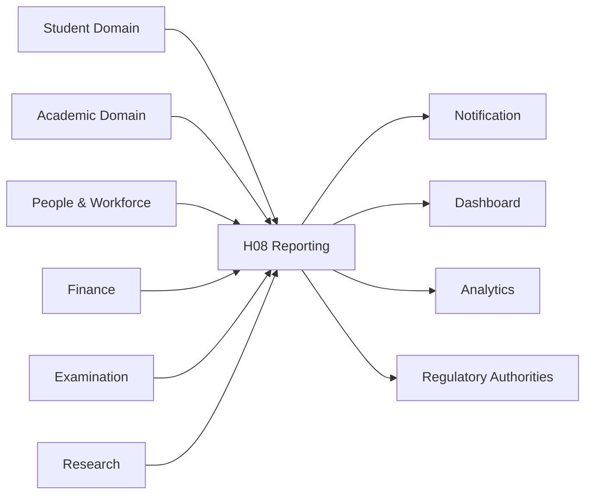

---

## 14.4 Integration Patterns

| Pattern | Purpose |
|----------|---------|
| REST APIs | Synchronous communication |
| CQRS Read Models | Reporting projections |
| Domain Events | Enterprise synchronization |
| Service Contracts | Cross-domain integration |
| Immutable Snapshots | Regulatory submissions |

---

## 14.5 Enterprise Integration Rules

The following rules are mandatory.

- H08 SHALL NEVER directly access operational databases.
- H08 SHALL NEVER own operational business records.
- Every integration SHALL use published enterprise contracts.
- Reporting snapshots SHALL remain immutable.
- Domain events SHALL remain replayable.
- Consumers SHALL remain loosely coupled.
- Every integration SHALL support version evolution.
- Cross-domain ownership boundaries SHALL remain intact.
```
# 15. Security Architecture

## 15.1 Overview

The Regulatory Reporting & Compliance domain manages institution-wide regulatory submissions, compliance evidence, reporting snapshots, and submission history.

Accordingly, H08 follows a defense-in-depth security architecture combining authentication, authorization, auditability, data integrity, immutable reporting history, and secure regulatory communication.

Security is enforced at every layer of the reporting lifecycle.

---

## 15.2 Security Objectives

The architecture shall satisfy the following objectives.

- Protect regulatory reporting information.
- Preserve immutable reporting history.
- Prevent unauthorized report modification.
- Secure evidence references.
- Protect submission packages.
- Maintain complete auditability.
- Ensure tenant isolation.
- Ensure institution isolation.
- Support regulatory compliance.

---

## 15.3 Authentication

Authentication SHALL be delegated to the Platform Foundation.

Supported mechanisms include:

- Enterprise Single Sign-On
- OAuth2
- OpenID Connect
- Multi-Factor Authentication
- Institutional Identity Providers

H08 SHALL never implement its own identity management.

---

## 15.4 Authorization

Authorization SHALL follow enterprise Role-Based Access Control (RBAC).

Typical enterprise roles include:

| Role | Responsibilities |
|------|------------------|
| Reporting Administrator | Configure reporting frameworks |
| Reporting Coordinator | Manage reporting cycles |
| Compliance Officer | Review compliance readiness |
| Institutional Approver | Approve submissions |
| Auditor | Review reporting history |
| Evidence Manager | Manage evidence mappings |
| Regulatory Submission Officer | Submit reports |

Authorization policies remain centrally managed.

---

## 15.5 Data Protection

The Reporting domain shall protect:

- Reporting metadata
- Validation results
- Reporting snapshots
- Evidence mappings
- Submission packages
- Regulatory acknowledgements
- Submission history

Sensitive information shall be protected both in transit and at rest.

---

## 15.6 Immutable Reporting History

The following records SHALL become immutable after completion.

- Reporting Snapshots
- Validation Results
- Approved Submission Packages
- Submission Records
- Regulatory Acknowledgements
- Archived Reporting Cycles

Corrections SHALL generate new versions.

Historical records SHALL never be modified.

---

## 15.7 Audit Requirements

Every significant reporting action SHALL generate an audit record.

Examples include:

- Framework creation
- Reporting cycle creation
- Validation execution
- Snapshot generation
- Evidence approval
- Institutional approval
- Submission execution
- Regulatory acknowledgement
- Reporting archival

Audit records SHALL be immutable.

---

## 15.8 Security Events

Examples include:

- Unauthorized Access Attempt
- Reporting Framework Modified
- Reporting Snapshot Locked
- Submission Approved
- Submission Executed
- Regulatory Acknowledgement Received
- Evidence Mapping Updated

Security events SHALL integrate with enterprise monitoring infrastructure.

---

# 16. Configuration Architecture

## 16.1 Overview

The Reporting domain is designed as a metadata-driven platform.

Institution-specific behavior shall be achieved through configuration rather than source-code customization.

Configuration SHALL remain version-controlled and auditable.

---

## 16.2 Configurable Components

| Component | Configurable |
|-----------|--------------|
| Reporting Frameworks | Yes |
| Report Templates | Yes |
| Validation Rules | Yes |
| Evidence Requirements | Yes |
| Reporting Schedules | Yes |
| Approval Workflows | Yes |
| Submission Mechanisms | Yes |
| Regulatory Authorities | Yes |
| Reporting Sections | Yes |
| Notification Policies | Yes |

---

## 16.3 Framework Configuration

Each reporting framework may configure:

- Reporting periods
- Submission windows
- Validation policies
- Required evidence
- Report sections
- Submission methods
- Approval hierarchy

---

## 16.4 Validation Configuration

Validation rules may define:

- Mandatory fields
- Business constraints
- Cross-domain consistency rules
- Threshold values
- Compliance checks
- Framework-specific validations

---

## 16.5 Submission Configuration

Submission mechanisms may configure:

- REST API
- Secure File Transfer
- Manual Upload
- Government Portal
- Future Connectors

---

## 16.6 Configuration Principles

The following principles SHALL apply.

- Configuration SHALL be versioned.
- Configuration SHALL be auditable.
- Configuration SHALL support rollback.
- Configuration SHALL preserve historical compatibility.
- Configuration SHALL never invalidate completed reporting cycles.

---

# 17. Business Rules

## 17.1 Reporting Rules

BR-001  
Every Reporting Cycle SHALL reference one published Reporting Framework.

BR-002  
Every Reporting Cycle SHALL reference one published Report Template.

BR-003  
Reporting data SHALL originate from canonical operational domains.

BR-004  
Operational business data SHALL never be modified by H08.

---

## 17.2 Validation Rules

BR-005  
Validation SHALL complete successfully before Reporting Snapshot generation.

BR-006  
Validation SHALL evaluate structural, business, cross-domain, and compliance rules.

BR-007  
Validation failures SHALL prevent institutional approval.

---

## 17.3 Snapshot Rules

BR-008  
Reporting Snapshots SHALL be immutable after locking.

BR-009  
Corrections SHALL generate new Reporting Snapshot versions.

BR-010  
Every submission SHALL reference exactly one Reporting Snapshot.

---

## 17.4 Approval Rules

BR-011  
Submission SHALL require institutional approval.

BR-012  
Approval workflows SHALL remain configurable.

BR-013  
Rejected submissions SHALL return to correction workflow.

---

## 17.5 Evidence Rules

BR-014  
Evidence SHALL reference authoritative institutional records.

BR-015  
Evidence mappings SHALL remain version-controlled.

BR-016  
Missing mandatory evidence SHALL block submission.

---

## 17.6 Submission Rules

BR-017  
Only approved Submission Packages may be submitted.

BR-018  
Every submission SHALL preserve complete history.

BR-019  
Regulatory acknowledgements SHALL remain permanently available.

---

## 17.7 Archival Rules

BR-020  
Closed Reporting Cycles SHALL become immutable.

BR-021  
Historical submissions SHALL never be deleted.

BR-022  
Reporting history SHALL remain reconstructable.

---

# 18. State Machines

## 18.1 Reporting Cycle State Machine

```mermaid
stateDiagram-v2

[*] --> Planned

Planned --> DataCollection

DataCollection --> Validation

Validation --> SnapshotCreated

SnapshotCreated --> ApprovalPending

ApprovalPending --> Approved

ApprovalPending --> Rejected

Rejected --> DataCollection

Approved --> SubmissionReady

SubmissionReady --> Submitted

Submitted --> Accepted

Submitted --> RejectedByAuthority

RejectedByAuthority --> DataCollection

Accepted --> Closed

Closed --> Archived
```

---

## 18.2 Reporting Snapshot State Machine

```mermaid
stateDiagram-v2

[*] --> Building

Building --> Validated

Validated --> Locked

Locked --> Submitted

Submitted --> Archived
```

---

## 18.3 Submission Package State Machine

```mermaid
stateDiagram-v2

[*] --> Draft

Draft --> ApprovalPending

ApprovalPending --> Approved

ApprovalPending --> Rejected

Rejected --> Draft

Approved --> ReadyForSubmission

ReadyForSubmission --> Submitted

Submitted --> Accepted

Submitted --> RejectedByAuthority

RejectedByAuthority --> Draft

Accepted --> Archived
```

---

## 18.4 Validation State Machine

```mermaid
stateDiagram-v2

[*] --> Created

Created --> Executing

Executing --> Completed

Completed --> Passed

Completed --> Failed
```

---

# 19. Error Handling

## 19.1 Principles

The Reporting domain SHALL gracefully recover from operational failures while preserving reporting integrity.

No failure shall compromise immutable reporting history.

---

## 19.2 Common Error Categories

| Category | Handling Strategy |
|----------|-------------------|
| Missing Reporting Data | Return to Data Collection |
| Validation Failure | Publish validation errors |
| Evidence Missing | Block submission |
| Approval Rejected | Return for correction |
| Submission Failure | Retry or manual submission |
| External Portal Failure | Preserve package and retry |
| Duplicate Submission | Reject duplicate request |
| Snapshot Version Conflict | Generate new version |

---

## 19.3 Recovery Principles

- Operations SHALL be idempotent where applicable.
- Immutable snapshots SHALL never be overwritten.
- Failed submissions SHALL preserve history.
- Retry logic SHALL avoid duplicate regulatory submissions.
- Every failure SHALL generate audit records.

---

# 20. Performance & Scalability

## 20.1 Performance Objectives

The Reporting domain shall support enterprise-scale institutional reporting while maintaining responsiveness and reliability.

---

## 20.2 Scalability Goals

The architecture shall support:

- Single-campus institutions
- Multi-campus universities
- University groups
- Educational trusts
- Multi-tenant SaaS deployments

without architectural redesign.

---

## 20.3 Performance Principles

- CQRS for read scalability.
- Event-driven synchronization.
- Immutable reporting snapshots.
- Asynchronous validation where appropriate.
- Horizontal API scaling.
- Stateless service instances.
- Distributed processing for large reporting datasets.

---

## 20.4 Availability Objectives

The Reporting domain shall provide:

- High availability during reporting windows.
- Fault-tolerant submission processing.
- Recoverable workflow execution.
- Durable reporting history.
- Reliable regulatory submission tracking.

---

## 20.5 Scalability Principles

- Aggregates remain independently scalable.
- Reporting projections may be independently optimized.
- Read models may be horizontally replicated.
- Reporting workflows shall support parallel execution where business rules permit.
- Enterprise integrations shall remain loosely coupled.
```
# 21. Architecture Decision Records (ADRs)

## ADR-001 — Metadata-Driven Reporting Frameworks

### Status

Accepted

### Context

Educational institutions are required to comply with multiple regulatory and accreditation frameworks whose reporting structures evolve over time.

Hardcoding each framework would create duplicated implementations and increase long-term maintenance costs.

### Decision

The Regulatory Reporting & Compliance domain SHALL implement a metadata-driven reporting engine where reporting frameworks, templates, validation rules, evidence requirements, schedules, and submission mechanisms are configuration-driven.

### Consequences

Positive:

- Future regulatory frameworks require configuration instead of development.
- Reduced implementation complexity.
- Improved maintainability.
- Enterprise-wide reuse.

Negative:

- Increased metadata governance.
- More sophisticated configuration management.

---

## ADR-002 — Immutable Reporting Snapshots

### Status

Accepted

### Context

Operational business data changes continuously after regulatory submissions.

Institutions must be capable of reproducing historical submissions exactly as originally submitted.

### Decision

Every regulatory submission SHALL reference an immutable Reporting Snapshot.

Historical snapshots SHALL NEVER be modified.

Corrections SHALL generate new snapshot versions.

### Consequences

Positive:

- Complete auditability.
- Historical reproducibility.
- Regulatory defensibility.
- Reliable compliance evidence.

Negative:

- Increased storage requirements.
- Snapshot lifecycle management.

---

## ADR-003 — Canonical Ownership Preservation

### Status

Accepted

### Context

Regulatory reporting consumes information from numerous operational domains.

Duplicating operational ownership inside H08 would violate enterprise architecture.

### Decision

Operational business ownership SHALL remain exclusively within canonical operational domains.

H08 SHALL consume information only through Query APIs, CQRS Read Models, Service Contracts, and Domain Events.

### Consequences

Positive:

- Strong bounded contexts.
- Independent deployment.
- Elimination of duplicate ownership.
- Better long-term maintainability.

Negative:

- Additional integration contracts.
- Dependency on enterprise APIs.

---

## ADR-004 — Event-Driven Reporting Architecture

### Status

Accepted

### Context

Institutional reporting activities must react to changes occurring throughout the enterprise without introducing tight coupling.

### Decision

Reporting lifecycle activities SHALL publish immutable Domain Events.

Enterprise consumers SHALL synchronize through asynchronous event consumption.

### Consequences

Positive:

- Loose coupling.
- Better scalability.
- Independent evolution.
- Replay capability.

Negative:

- Event version governance.
- Eventual consistency.

---

## ADR-005 — Configuration over Customization

### Status

Accepted

### Context

Institutions differ in governance models, approval hierarchies, reporting schedules, and regulatory obligations.

### Decision

Institution-specific behavior SHALL be implemented through configuration instead of source-code customization.

### Consequences

Positive:

- SaaS readiness.
- Easier upgrades.
- Lower maintenance.
- Multi-tenant compatibility.

Negative:

- Rich configuration management required.

---

# 22. Glossary

| Term | Definition |
|------|------------|
| Reporting Framework | Metadata defining a regulatory reporting standard |
| Reporting Cycle | Execution of one institutional reporting period |
| Report Template | Metadata describing report structure |
| Reporting Snapshot | Immutable reporting dataset used for submission |
| Validation Result | Outcome of reporting validation |
| Compliance Evidence | Supporting institutional evidence linked to reported values |
| Submission Package | Official package submitted to a regulatory authority |
| Submission Record | Historical record of a regulatory submission |
| CQRS | Command Query Responsibility Segregation |
| DDD | Domain-Driven Design |
| Domain Event | Immutable business event representing a completed state transition |
| Read Model | Optimized projection used for queries |
| Service Contract | Enterprise integration contract |
| Regulatory Acknowledgement | Response received from a regulatory authority after submission |

---

# 23. Future Extensibility

The Regulatory Reporting & Compliance architecture has been intentionally designed to accommodate future institutional and regulatory requirements without requiring structural redesign.

Future capabilities may include:

- AI-assisted compliance readiness assessment.
- Intelligent evidence recommendation.
- Automated compliance gap prediction.
- Regulatory API connector marketplace.
- Real-time reporting dashboards.
- Predictive accreditation analytics.
- Cross-institution benchmarking.
- Automated report generation assistants.
- Machine-readable regulatory specifications.
- International accreditation framework support.

## 23.1 Reporting Framework Version Migration

Reporting frameworks evolve over time.

Historical Reporting Cycles remain bound to the framework version used during execution.

New Reporting Cycles adopt newer framework versions.

Historical snapshots remain reproducible.

Migration SHALL never invalidate historical submissions.

These enhancements SHALL extend the existing metadata-driven architecture while preserving aggregate ownership, CQRS boundaries, immutable reporting history, and canonical enterprise principles.

---

# 24. Final Architecture Summary

## 24.1 Architectural Position

The Regulatory Reporting & Compliance domain represents the canonical enterprise capability responsible for regulatory reporting, accreditation reporting, compliance governance, reporting lifecycle management, evidence mapping, submission orchestration, and historical reporting preservation.

H08 does not own operational institutional data.

Instead, it orchestrates enterprise reporting by consuming authoritative information from canonical business domains through approved enterprise contracts.

---

## 24.2 Primary Business Capabilities

The domain provides the following enterprise capabilities:

- Reporting Framework Management
- Reporting Cycle Management
- Enterprise Data Collection
- Reporting Validation
- Immutable Reporting Snapshot Management
- Compliance Evidence Management
- Institutional Approval Workflows
- Submission Package Management
- Regulatory Submission
- Regulatory Acknowledgement Processing
- Reporting Corrections and Resubmissions
- Reporting History and Archival

---

## 24.3 Enterprise Architectural Characteristics

The architecture conforms to the SutraERP canonical enterprise standards.

| Characteristic | Implementation |
|----------------|----------------|
| Architecture Style | Domain-Driven Design (DDD) |
| Read/Write Separation | CQRS |
| Enterprise Communication | Event-Driven Architecture |
| Integration Style | API-First |
| Ownership Model | Canonical Single Ownership |
| Reporting History | Immutable Snapshots |
| Deployment Model | Independently Deployable Domain |
| Extensibility | Metadata-Driven Configuration |
| Auditability | Complete Lifecycle Audit Trail |
| Scalability | Multi-Campus & Multi-Tenant Ready |

---

## 24.4 Aggregate Summary

| Aggregate | Responsibility |
|-----------|----------------|
| Reporting Framework | Regulatory framework definition |
| Reporting Cycle | Reporting lifecycle orchestration |
| Report Template | Report structure and metadata |
| Reporting Snapshot | Immutable reporting dataset |
| Validation Result | Compliance and consistency validation |
| Compliance Evidence Mapping | Audit evidence traceability |
| Submission Package | Institutional submission preparation |
| Submission Record | Regulatory submission history |

---

## 24.5 Architectural Guarantees

The architecture guarantees:

- Single canonical ownership for reporting capabilities.
- No duplication of operational business ownership.
- Immutable reporting history.
- Metadata-driven regulatory extensibility.
- Configuration-driven institutional customization.
- Complete auditability.
- Replayable domain events.
- Versioned service contracts.
- Enterprise-scale performance.
- Future-ready regulatory integration.

---

## 24.6 Cross-Domain Relationship Summary

H08 consumes authoritative information from enterprise operational domains while publishing reporting outcomes to enterprise services.

### Upstream Dependencies

- Platform Foundation
- Organization Management
- Student Lifecycle
- Academic Delivery
- People & Workforce
- Finance
- Examination
- Research
- Campus Operations

### Downstream Consumers

- Notification Platform
- Enterprise Dashboard
- Enterprise Directory & Search
- Analytics Platform
- Audit Platform
- Document Platform
- External Regulatory Authorities

Ownership boundaries remain strictly enforced throughout all integrations.

---

## 24.7 Compliance with Enterprise Principles

The Regulatory Reporting & Compliance domain conforms to the following enterprise principles:

- Domain-Driven Design (DDD)
- Command Query Responsibility Segregation (CQRS)
- Event-Driven Architecture (EDA)
- API-First Integration
- Canonical Single Ownership
- Immutable Business History
- Metadata-Driven Configuration
- Versioned Service Contracts
- Configuration over Customization
- Enterprise Auditability
- Loose Coupling
- Independent Deployability

---

## 24.8 Document Completion

This document defines the complete Level 2 architecture for the **H08 — Regulatory Reporting & Compliance** bounded context within the SutraERP Enterprise Architecture.

It establishes the canonical enterprise model for institutional regulatory reporting while preserving bounded context ownership, immutable reporting history, metadata-driven extensibility, enterprise integration standards, and long-term architectural consistency across the SutraERP platform.
