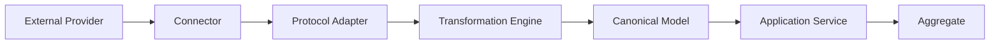

# L2-H10 — External Education Integration Workflows

| Attribute | Value |
|-----------|-------|
| Document Name | L2-H10 — External Education Integration Workflows |
| Domain Code | H10 |
| Domain Name | External Education Integration |
| Architecture Layer | Level 2 — Domain Workflow Architecture |
| Parent Architecture | SutraERP Level 1 Enterprise Architecture |
| Architecture Style | Domain-Driven Design (DDD), CQRS, Event-Driven Architecture (EDA), API-First Architecture, Hexagonal Architecture |
| Canonical Owner | External Education Integration Domain |
| Document Owner | Dhruv |
| Primary Aggregate | External Integration |
| Supporting Aggregates | External Provider, Integration Connector, Integration Configuration, External Enrollment, Learning Synchronization, Credit Transfer Request, Certificate Verification, Synchronization Job |
| Communication Pattern | Commands, Queries, Domain Events, Integration Events, Webhooks |
| Status | Draft |
| Version | 1.0 |
| Repository | SutraERP Canonical Enterprise Repository |
| Classification | Canonical Enterprise Architecture |

---

## Canonical Section Crosswalk

> Added 2026-08-04 under integrity finding INT-018. `governance/constitution/Volume_3_Architecture_Framework.md` section 18 requires every L2 document to define eleven sections. This document uses its own numbered-section convention; the table below maps the required sections to where they actually live. No content was moved.

| Required section (Volume 3 §18) | Location in this document |
|---|---|
| Purpose | §1 Purpose; §1.1 Purpose Statement; §1.4 Business Purpose |
| Scope | §2 Domain Scope; §2.1 Scope Statement; §2.2 In Scope |
| Actors | §13.5 Enterprise Roles |
| Entities | Child Entities |
| Business Rules | §12 Business Rules & Validation Framework |
| Workflow | §11 Workflow Architecture; §11.2 Workflow Classification; §11.3 Workflow — External Provider Onboarding |
| State Machine | §4.8 Integration Connector Lifecycle State Machine |
| Contracts | §14 Integration Contracts & External Communication; §14.2 Integration Contract Categories; §14.3 REST API Contracts |
| Events | §10 Domain Event Model; §10.2 Event Classification; §10.3 Provider Events |
| Dependencies | §3.3 Upstream Domains |
| Locked Decisions | — not present — |

> **Gap:** 1 required section(s) have no counterpart in this document: Locked Decisions. Recorded, not authored.

---

# 1. Purpose

## 1.1 Purpose Statement

The purpose of the **L2-H10 — External Education Integration Workflows** domain is to establish the canonical enterprise architecture governing secure, standards-based, and policy-driven integration between SutraERP and external education ecosystems.

The External Education Integration domain provides a unified orchestration platform enabling institutions to exchange academic, administrative, learning, certification, and institutional collaboration information with authorized external education providers while preserving strict canonical ownership boundaries across the SutraERP platform.

The domain enables interoperability with higher education institutions, online learning providers, government education services, accreditation agencies, assessment platforms, digital credential providers, certification organizations, research collaborators, and future educational ecosystems through standardized integration contracts.

The External Education Integration domain is the authoritative owner of external integration orchestration, connector lifecycle management, synchronization governance, integration configuration, external communication contracts, provider management, transformation pipelines, reconciliation workflows, and operational monitoring.

It is **not** the owner of students, academic records, curriculum, examinations, financial information, human resources, institutional master data, or any operational business transaction.

---

## 1.2 Architectural Intent

The External Education Integration domain exists to provide an enterprise integration boundary between authoritative internal business domains and external educational systems.

Rather than becoming a secondary academic system, H10 coordinates the secure exchange of canonical business information while preserving ownership within the originating bounded contexts.

The architecture intentionally separates:

- Academic ownership
- External interoperability
- Integration orchestration
- Data transformation
- Synchronization management
- Provider connectivity
- Operational monitoring

This separation ensures that every authoritative business fact remains owned by its originating domain while allowing institutions to participate in complex external educational ecosystems without violating architectural boundaries.

---

## 1.3 Domain Mission

The mission of the External Education Integration domain is:

> To provide a secure, extensible, metadata-driven, and standards-compliant enterprise integration platform enabling educational institutions to collaborate with external education ecosystems while preserving canonical ownership, institutional governance, auditability, and long-term architectural independence.

The domain shall support institutions ranging from single-campus colleges to federated university systems and multi-institution educational networks without requiring architectural redesign.

---

## 1.4 Business Purpose

Modern educational institutions increasingly depend upon collaboration with external academic ecosystems.

These integrations include:

- National digital education platforms
- Online learning providers
- MOOC ecosystems
- Academic partner institutions
- International exchange programs
- Credit transfer services
- Digital credential providers
- Government education services
- Accreditation agencies
- Examination partners
- Research collaboration platforms
- Industry certification providers

Traditional point-to-point integrations frequently introduce duplicated business logic, inconsistent data ownership, tightly coupled interfaces, fragmented security models, and operational complexity.

The External Education Integration domain eliminates these architectural issues by providing a single governed integration capability through which all external educational interactions are orchestrated.

Business ownership remains within the authoritative SutraERP domains.

H10 coordinates communication but never assumes ownership of business transactions.

---

## 1.5 Architectural Objectives

The External Education Integration architecture shall satisfy the following objectives.

### Enterprise Integration Platform

Provide a unified enterprise integration capability for all external education ecosystems.

---

### Canonical Ownership Preservation

Ensure that every academic, financial, administrative, and institutional business object continues to be owned exclusively by its canonical bounded context.

External integrations shall consume or publish approved business information without becoming systems of record.

---

### Metadata-Driven Integration

Allow new education providers to be onboarded through governed configuration rather than implementation changes.

Connector behavior, authentication, mappings, transformations, synchronization schedules, retry policies, and endpoint definitions shall remain metadata-driven.

---

### Standards-Based Interoperability

Support modern education interoperability standards wherever applicable while remaining implementation independent.

The architecture shall accommodate REST APIs, webhooks, event-driven communication, secure file exchange, and future education interoperability standards through extensible integration contracts.

---

### Secure External Collaboration

Provide enterprise-grade authentication, authorization, encryption, auditability, tenant isolation, credential governance, and policy enforcement across every external interaction.

External integrations shall never bypass institutional governance.

---

### Reliable Synchronization

Support reliable synchronization using:

- Real-time APIs
- Event-driven messaging
- Scheduled synchronization
- Bulk synchronization
- Incremental synchronization
- Manual reconciliation

Synchronization shall prioritize correctness, traceability, and recoverability over throughput.

---

### Operational Observability

Provide comprehensive monitoring across the complete integration lifecycle including:

- Connector health
- Provider availability
- Synchronization status
- API performance
- Failure diagnostics
- Retry execution
- SLA compliance
- Operational dashboards

Every integration activity shall remain observable without exposing business ownership.

---

### Extensible Connector Framework

Support future education providers through a reusable connector architecture.

New providers shall be introduced through governed extension points without requiring changes to the canonical integration architecture.

---

## 1.6 Strategic Goals

The External Education Integration domain shall achieve the following strategic goals.

- Establish a single enterprise education integration platform.
- Eliminate duplicated external integrations across business domains.
- Preserve canonical ownership.
- Enable secure institutional collaboration.
- Support configurable provider onboarding.
- Deliver standards-compliant interoperability.
- Provide resilient synchronization capabilities.
- Enable operational visibility across integrations.
- Maintain enterprise auditability.
- Support future education ecosystems without architectural redesign.

---

## 1.7 Domain Responsibilities

The External Education Integration domain shall be responsible for:

- External provider lifecycle management.
- Integration connector management.
- Integration configuration.
- Authentication orchestration.
- Endpoint governance.
- Data transformation.
- Field mapping.
- Integration workflow orchestration.
- Synchronization scheduling.
- Synchronization execution.
- Reconciliation management.
- Retry orchestration.
- Dead-letter processing.
- Certificate verification orchestration.
- Credit transfer orchestration.
- External enrollment orchestration.
- Learning progress synchronization.
- Operational monitoring.
- Integration analytics.
- Connector governance.
- Integration audit history.

The domain intentionally excludes ownership of:

- Student lifecycle.
- Academic records.
- Curriculum.
- Course offerings.
- Faculty.
- Examination records.
- Financial transactions.
- Employee information.
- Notifications.
- Dashboards.
- Reporting.
- Identity management.

These responsibilities remain exclusively within their canonical domains.

---

## 1.8 Core Architectural Principles

The External Education Integration domain follows the enterprise architectural principles established throughout the SutraERP Level-2 architecture.

### Principle 1 — Single Canonical Ownership

Every business capability shall have one authoritative owner.

The External Education Integration domain owns integration orchestration only.

Business data remains owned by operational domains.

---

### Principle 2 — API-First Architecture

Every external integration shall be exposed through governed service contracts.

Direct database integration between external systems and SutraERP is prohibited.

---

### Principle 3 — Event-Driven Collaboration

External integration workflows shall consume and publish approved domain events whenever asynchronous processing provides greater reliability and scalability.

Business events remain owned by their originating bounded contexts.

---

### Principle 4 — Connector Abstraction

Provider-specific implementations shall remain isolated behind reusable connector interfaces.

Business workflows shall remain independent of vendor-specific technologies.

---

### Principle 5 — Configuration over Customization

Institutional variation shall be achieved through governed metadata rather than implementation changes.

Connector behavior, mappings, authentication, and synchronization policies shall remain configurable.

---

### Principle 6 — Enterprise Security by Default

Every external interaction shall enforce authentication, authorization, encryption, auditability, tenant isolation, and governed credential management before communication is permitted.

---

### Principle 7 — Reliability First

Synchronization correctness, reconciliation, recoverability, and operational traceability shall always take precedence over processing speed.

---

### Principle 8 — Future-Proof Extensibility

The integration architecture shall accommodate future education providers, interoperability standards, and learning ecosystems without modification to existing architectural foundations.

---

## 1.9 Domain Vision

The External Education Integration domain forms the enterprise interoperability layer connecting SutraERP with the broader education ecosystem.

It enables institutions to collaborate securely with external platforms while preserving strict domain ownership, governance, scalability, and architectural maintainability.

The domain serves as the enterprise gateway through which all external educational interactions are coordinated, monitored, and governed without compromising canonical ownership or long-term architectural evolution.

# 2. Domain Scope

## 2.1 Scope Statement

The External Education Integration domain provides the enterprise capability responsible for orchestrating secure, governed, and standards-based communication between SutraERP and external educational ecosystems.

The domain acts as the institutional interoperability layer through which all external education providers exchange approved information with the authoritative SutraERP business domains.

H10 is not an operational academic domain.

It does not create or own academic records, student information, examinations, curriculum, finance, human resources, or institutional master data.

Instead, H10 coordinates communication, transformation, synchronization, monitoring, and governance while preserving canonical ownership throughout the enterprise architecture.

---

## 2.2 In Scope

The following capabilities are owned entirely by the External Education Integration domain.

### External Provider Management

Management of external educational organizations participating in institutional integrations.

Examples include:

- Universities
- Colleges
- Partner Institutions
- Government Education Platforms
- MOOC Providers
- Learning Platforms
- Digital Credential Providers
- Accreditation Bodies
- Certification Agencies
- Research Networks
- Industry Training Partners
- International Academic Partners

Responsibilities include:

- Provider registration
- Provider lifecycle
- Provider activation
- Provider suspension
- Provider retirement
- Trust relationship management
- Provider metadata
- Communication endpoints

---

### Integration Connector Management

Management of reusable connector definitions supporting standardized communication with external providers.

Responsibilities include:

- Connector registration
- Connector lifecycle
- Connector deployment
- Connector configuration
- Connector versioning
- Connector compatibility
- Connector monitoring
- Connector retirement

Connectors abstract provider-specific implementation details from business workflows.

---

### Integration Configuration

Management of metadata-driven integration configuration.

Configuration includes:

- API endpoints
- Authentication methods
- Webhook definitions
- Message formats
- Retry policies
- Scheduling policies
- Transformation rules
- Mapping templates
- Timeout policies
- SLA configuration

Configuration changes shall not require modification of business workflows.

---

### Authentication Orchestration

Management of secure communication with external providers.

Supported authentication mechanisms include:

- OAuth2
- OpenID Connect
- JWT
- API Keys
- Mutual TLS
- SAML
- Token Rotation
- Credential Refresh

Sensitive credentials remain securely managed using enterprise secret management facilities.

---

### Data Mapping

Transformation of canonical enterprise data into provider-specific formats.

Responsibilities include:

- Attribute mapping
- Field transformation
- Enumeration mapping
- Code translation
- Reference conversion
- Metadata enrichment
- Validation
- Canonical normalization

The mapping engine shall remain configuration-driven.

---

### Synchronization Management

Execution of governed synchronization workflows.

Supported synchronization models include:

- Real-time
- Scheduled
- Event-driven
- Incremental
- Full synchronization
- Manual synchronization
- On-demand synchronization
- Bulk synchronization

---

### External Enrollment Orchestration

Coordination of enrollment exchanges between SutraERP and authorized education providers.

Examples include:

- External learning enrollment
- Partner university enrollment
- Joint program enrollment
- Cross-institution registration
- Exchange program participation
- Continuing education enrollment

Academic ownership remains outside H10.

---

### Learning Progress Synchronization

Synchronization of approved learning progress originating from external learning environments.

Examples include:

- Course completion
- Learning milestones
- Progress percentage
- Assessment status
- Attendance summaries
- Completion dates

The originating academic domains remain authoritative.

---

### Credit Transfer Orchestration

Management of workflows supporting institutional credit recognition.

Responsibilities include:

- Credit transfer requests
- Mapping coordination
- Review workflow
- Approval orchestration
- External communication
- Status synchronization

Academic decisions remain owned by Academic Administration.

---

### Certificate Verification

Coordination of verification workflows for externally issued academic credentials.

Examples include:

- Certificates
- Diplomas
- Digital badges
- Micro-credentials
- Professional certifications
- Continuing education credentials

Verification orchestration does not imply ownership of credentials.

---

### Operational Monitoring

Enterprise monitoring responsibilities include:

- Connector health
- Provider availability
- Synchronization execution
- Queue status
- Retry execution
- Throughput
- Latency
- SLA compliance
- Failure diagnostics

---

### Reconciliation

Detection and controlled resolution of synchronization inconsistencies.

Responsibilities include:

- Missing records
- Duplicate transactions
- Version conflicts
- Partial synchronization
- Manual reconciliation
- Replay execution
- Audit verification

---

### Integration Analytics

Generation of operational integration metrics.

Examples include:

- API usage
- Connector utilization
- Provider activity
- Synchronization volume
- Success rates
- Failure rates
- SLA compliance
- Retry statistics

Business analytics remain outside H10 ownership.

---

## 2.3 Out of Scope

The following business capabilities are intentionally excluded from H10.

### Student Management

Owned by Student Domain.

Includes:

- Student admission
- Student lifecycle
- Student profile
- Identity
- Registration

---

### Academic Management

Owned by Academic Administration.

Includes:

- Courses
- Programs
- Curriculum
- Timetables
- Academic structures

---

### Examination

Owned by Examination Domain.

Includes:

- Assessments
- Marks
- Grades
- Results
- Examination schedules

---

### Finance

Owned by Finance Domain.

Includes:

- Fees
- Invoices
- Payments
- Scholarships
- Refunds

---

### Human Resources

Owned by People & Workforce.

Includes:

- Employees
- Faculty records
- Payroll
- Leave
- Workforce planning

---

### Identity Management

Owned by Identity & Access domain.

Includes:

- Authentication
- User lifecycle
- Password policies
- Access provisioning

---

### Notification Delivery

Owned by Notification Domain.

Includes:

- Email delivery
- SMS delivery
- Push notifications
- Communication templates

H10 publishes events but does not deliver notifications.

---

### Reporting

Owned by Reporting domains.

H10 contributes operational data only.

It does not own enterprise reports.

---

### Dashboards

Owned by Dashboard Domain.

H10 publishes operational metrics for dashboard consumption.

---

### Data Warehouse

Enterprise analytics remain outside H10.

Only integration telemetry is owned locally.

---

## 2.4 Primary Stakeholders

The External Education Integration domain serves multiple enterprise stakeholders.

### Internal Stakeholders

- Academic Administration
- Student Administration
- Examination Office
- Research Office
- International Relations
- Registrar
- Continuing Education
- IT Operations
- Integration Administrators
- Enterprise Architects
- Security Administrators
- Institutional Leadership

---

### External Stakeholders

- Universities
- Colleges
- Partner Institutions
- Learning Platforms
- MOOC Providers
- Accreditation Bodies
- Government Agencies
- Certification Providers
- Research Networks
- Industry Partners
- Digital Credential Providers

---

## 2.5 Business Outcomes

Successful implementation of H10 enables institutions to:

- Eliminate point-to-point integrations.
- Standardize external communication.
- Accelerate onboarding of new education partners.
- Improve interoperability.
- Preserve canonical ownership.
- Reduce integration maintenance costs.
- Increase synchronization reliability.
- Strengthen security governance.
- Improve operational visibility.
- Support national and international academic collaboration.
- Enable future educational ecosystem integrations without architectural redesign.

---

# 3. Domain Boundaries

## 3.1 Bounded Context Definition

The External Education Integration bounded context is responsible exclusively for enterprise interoperability with external education ecosystems.

Its responsibilities begin when an internal canonical domain authorizes information for external exchange and end when the corresponding external interaction has been successfully completed, monitored, audited, and reconciled.

H10 never extends beyond orchestration into business ownership.

---

## 3.2 Canonical Ownership

H10 is the authoritative owner of:

- External Providers
- Integration Connectors
- Integration Configurations
- Synchronization Jobs
- Transformation Rules
- Connector Health
- Provider Relationships
- External Enrollment Requests
- Credit Transfer Requests
- Certificate Verification Requests
- Integration Audit Records
- Integration Metrics
- Reconciliation Records

These entities exist solely to facilitate interoperability and have no authority over the underlying academic or administrative business data.

---

## 3.3 Upstream Domains

H10 consumes authoritative business information from:

- Student Management
- Academic Administration
- Curriculum Management
- Examination
- Research
- Finance
- HR
- Identity & Access
- Notification
- Document Management
- Alumni
- Analytics

These domains remain the source of truth for their respective business capabilities.

---

## 3.4 Downstream Consumers

Outputs produced by H10 may be consumed by:

- External Universities
- Learning Management Systems
- MOOC Platforms
- Government Portals
- Accreditation Agencies
- Digital Credential Networks
- Research Collaboration Platforms
- Industry Certification Providers
- Institutional Dashboards
- Enterprise Reporting
- Monitoring & Observability Platforms

Consumption does not transfer ownership of canonical data.

---

## 3.5 Boundary Enforcement Principles

The following principles govern all interactions across the H10 boundary:

- No direct database integration with external systems.
- All communication occurs through governed APIs, events, webhooks, or secure file exchange.
- Canonical business entities remain immutable outside their owning domains.
- Provider-specific logic is encapsulated within connectors.
- Integration workflows are metadata-driven.
- Every external transaction is auditable.
- Synchronization is recoverable and replayable.
- Security policies are enforced before any outbound or inbound communication.
- H10 never bypasses enterprise authorization or governance controls.
```

## 3.6 Canonical Ownership Enforcement

H10 shall preserve the canonical ownership boundaries of the SutraERP enterprise architecture at all times.

- Student data remains owned by the Student domain.
- Academic data remains owned by the Academic domain.
- Examination data remains owned by the Examination domain.
- Finance data remains owned by the Finance domain.
- HR data remains owned by the HR domain.
- Identity data remains owned by the Identity domain.
- Notifications remain owned by L2-H02 Notification Workflows.
- Dashboards remain owned by L2-H07 Enterprise Dashboard Workflows.
- H10 may orchestrate approved exchange only; it shall never duplicate or assume ownership of these business facts.

No ownership violation is permitted through synchronization, transformation, reconciliation, or saga coordination.

---

# 4. External Ecosystem Landscape

## 4.1 Overview

The External Education Integration domain operates as the enterprise interoperability layer connecting SutraERP with diverse educational ecosystems.

Rather than creating provider-specific business workflows, the architecture abstracts all external systems through standardized integration contracts, reusable connectors, metadata-driven mappings, and governed synchronization pipelines.

Every participating external platform is treated as an integration partner communicating through a common enterprise integration framework.

This approach eliminates point-to-point dependencies while ensuring consistent governance, monitoring, security, and extensibility.

---

## 4.2 External Education Ecosystem Categories

H10 supports integrations across multiple categories of educational organizations.

### Higher Education Institutions

Institutions participating in collaborative academic programs.

Examples include:

- Universities
- Autonomous Colleges
- Constituent Colleges
- Deemed Universities
- Community Colleges
- Polytechnic Institutions
- International Universities
- Research Universities

Typical integration scenarios include:

- Student exchange
- Joint degree programs
- Credit transfer
- Academic transcript exchange
- Cross-registration
- Faculty collaboration
- Research collaboration

---

### Learning Management Systems (LMS)

Platforms responsible for digital teaching and learning delivery.

Examples include:

- Moodle
- Canvas
- Blackboard
- Brightspace
- Open edX
- Google Classroom
- Microsoft Teams Education

Typical integration scenarios include:

- Course synchronization
- Enrollment synchronization
- Attendance synchronization
- Assignment synchronization
- Assessment synchronization
- Grade synchronization
- Learning progress synchronization

The LMS remains responsible for learning delivery.

Academic ownership remains within SutraERP.

---

### MOOC Platforms

Massive Open Online Course providers.

Examples include:

- SWAYAM
- NPTEL
- Coursera
- edX
- FutureLearn
- Udemy Business
- LinkedIn Learning

Typical integrations include:

- Course enrollment
- Completion status
- Certificate retrieval
- Credit recognition
- Learning history
- Skill verification

---

### Government Education Platforms

Government-operated educational systems.

Examples include:

- National Academic Depository
- APAAR
- DigiLocker
- AISHE
- State Higher Education Portals
- National Scholarship Platforms

Typical integrations include:

- Student verification
- Academic verification
- Certificate exchange
- Institutional reporting
- Regulatory submissions
- Identity validation

---

### Accreditation Agencies

Organizations responsible for institutional accreditation and compliance.

Examples include:

- National accreditation authorities
- Professional accreditation councils
- Regulatory education boards
- Quality assurance agencies

Typical integrations include:

- Evidence submission
- Institutional documentation
- Accreditation status
- Compliance reporting
- Review workflows

---

### Digital Credential Providers

Platforms issuing and validating digital academic credentials.

Supported credentials include:

- Digital Certificates
- Diplomas
- Academic Badges
- Professional Credentials
- Micro-Credentials
- Continuing Education Certificates

Typical workflows include:

- Credential issuance requests
- Verification
- Validation
- Revocation
- Expiration
- Authenticity confirmation

---

### Industry Certification Partners

Professional organizations delivering industry-recognized certifications.

Examples include:

- Technology certifications
- Professional licensing bodies
- Industry training organizations
- Corporate academies

Typical integrations include:

- Candidate registration
- Certification status
- Examination completion
- Credential verification
- Continuing professional education

---

### Research Collaboration Networks

Organizations supporting collaborative academic research.

Examples include:

- Research consortiums
- Grant agencies
- International research networks
- Innovation hubs

Typical integrations include:

- Research collaboration
- Faculty exchange
- Grant participation
- Publication synchronization
- Research project metadata

---

## 4.3 Supported Integration Patterns

The architecture supports multiple communication models.

### REST APIs

Used for synchronous interactions requiring immediate responses.

Typical operations include:

- Search
- Verification
- Registration
- Enrollment
- Status retrieval
- Configuration

---

### Event-Based Integration

Used when asynchronous communication improves scalability and reliability.

Events may include:

- Enrollment completed
- Progress updated
- Credit approved
- Certificate issued
- Synchronization completed
- Provider activated

---

### Webhooks

External providers notify SutraERP of significant business events.

Examples include:

- Course completion
- Grade publication
- Assessment completion
- Credential issuance
- Student participation
- Provider status changes

---

### Scheduled Synchronization

Used when providers support periodic synchronization.

Typical schedules include:

- Hourly
- Daily
- Weekly
- Semester-based
- Institution-defined

---

### Bulk Data Exchange

Supports high-volume synchronization.

Examples include:

- Student migration
- Historical transcript synchronization
- Academic archive import
- Learning history migration
- Credential migration

---

### Secure File Exchange

Used when API integration is unavailable.

Supported exchange formats include:

- CSV
- XML
- JSON
- ZIP packages
- Secure document transfer

---

### Supported Education Interoperability Standards

The H10 architecture is standards-aware but remains standards-agnostic at the canonical layer.

Support for external standards is metadata-driven, connector-isolated, and governed by versioned integration contracts.

Examples of supported interoperability standards include:

- IMS LTI
- OneRoster
- SCORM
- xAPI
- Open Badges
- Comprehensive Learner Record (CLR)
- PESC Standards
- REST APIs
- Webhooks
- SFTP
- Secure File Exchange
- JSON
- XML

Standards may evolve independently of business workflows.

Provider-specific interpretations of these standards shall remain encapsulated within connectors and protocol adapters.

The H10 domain remains standards-agnostic and does not embed any single external standard into business logic.

---

## 4.4 Supported Business Scenarios

The External Education Integration domain supports enterprise-wide interoperability scenarios.

### Student Mobility

Supports academic movement between institutions.

Includes:

- Exchange programs
- Visiting students
- Joint programs
- Semester mobility
- International mobility

---

### Cross-Institution Enrollment

Allows enrollment coordination between partner institutions.

Typical workflow:

Student Domain
→ H10
→ Partner Institution
→ Confirmation
→ Academic Administration

---

### Learning Synchronization

Coordinates learning activities originating outside SutraERP.

Examples:

- Online learning
- Hybrid learning
- Virtual classrooms
- External assessments
- Continuing education

---

### Credit Transfer

Supports recognition of externally completed academic work.

Workflow includes:

- Submission
- Mapping
- Review
- Approval
- Synchronization

Academic approval remains external to H10.

---

### Certificate Verification

Supports institutional verification of external credentials.

Examples:

- Degree validation
- Professional certification
- Digital badge verification
- Academic diploma verification

---

### Faculty Collaboration

Supports institutional academic collaboration.

Examples include:

- Visiting faculty
- Joint teaching
- Collaborative supervision
- Academic exchange

Faculty ownership remains within HR.

---

### Research Collaboration

Supports collaboration between research institutions.

Examples:

- Joint projects
- Shared publications
- Grant participation
- Research exchanges

---

## 4.5 Enterprise Integration Principles

All ecosystem integrations comply with enterprise principles.

### Principle 1 — Loose Coupling

Business workflows remain independent of provider implementations.

Provider replacement shall not require redesign of business workflows.

---

### Principle 2 — Canonical Communication

Internal domains communicate using canonical models.

Provider-specific transformations occur only within H10.

---

### Principle 3 — Configuration-Driven Behavior

Institution-specific differences shall be implemented through metadata.

Business workflow implementations remain identical.

---

### Principle 4 — Secure Communication

Every communication channel must enforce:

- Authentication
- Authorization
- Encryption
- Audit logging
- Policy validation

---

### Principle 5 — Recoverable Synchronization

Every synchronization workflow must support:

- Retry
- Replay
- Recovery
- Reconciliation
- Audit verification

---

## 4.6 Integration Architecture Layers

The H10 architecture is organized into logical layers.

### External Provider Layer

Represents external education ecosystems.

Examples:

- Universities
- LMS
- MOOCs
- Credential Providers
- Government Platforms

---

### Connector Layer

Implements provider-specific communication.

Responsibilities:

- Authentication
- Protocol adaptation
- Request formatting
- Response parsing

---

### Transformation Layer

Responsible for canonical mapping.

Functions include:

- Field mapping
- Validation
- Normalization
- Data enrichment
- Enumeration conversion

---

### Orchestration Layer

Coordinates enterprise workflows.

Responsibilities:

- Command execution
- Event publication
- Synchronization
- Retry orchestration
- Reconciliation
- Workflow state management

---

### Canonical Domain Layer

Represents authoritative SutraERP bounded contexts.

Examples:

- Student
- Academic
- Examination
- Finance
- HR
- Identity
- Notification
- Research

These domains remain the exclusive owners of business data.

---

## 4.7 Saga / Process Manager Architecture

The H10 orchestration layer shall use saga and process manager patterns for long-running, multi-step external integration workflows.

Sagas coordinate commands and events across bounded contexts.

They never own business data.

They never violate canonical ownership.

They only orchestrate workflow progression, compensation, timeout handling, and recovery across participating domains.

### Saga Architecture Principles

- Sagas are process coordinators, not systems of record.
- Saga state is limited to process progress, correlation, and recovery metadata.
- Saga transitions are driven by domain events and integration events.
- Saga commands are always issued to the owning bounded context of the target business fact.
- Compensation must always be executed by the owning domain or its governed integration boundary.
- Saga failure never changes canonical ownership.

### External Enrollment Saga

- Purpose: coordinate multi-domain enrollment exchange between SutraERP and an external education provider.
- Trigger: enrollment request approved by the owning student or academic workflow.
- Participating aggregates: External Enrollment, External Provider, Integration Connector, Integration Configuration, Synchronization Job, and the student or academic enrollment aggregate in the owning domain.
- Consumed Events: EnrollmentRequested, ProviderActivated, ConnectorCertified, EnrollmentValidated, StudentApprovedForExternalEnrollment.
- Published Events: ExternalEnrollmentSubmitted, ExternalEnrollmentConfirmed, ExternalEnrollmentRejected, ExternalEnrollmentCompensationRequested.
- Compensation strategy: cancel pending enrollment requests in the owning context and issue reversal commands to the originating workflow where required.
- Failure handling: validation, provider, transport, and reconciliation failures are isolated and routed to a governed exception state.
- Retry behaviour: transient provider and transport errors are retried according to policy and idempotency rules.
- Timeout handling: timeouts trigger escalation and compensation evaluation but never finalize ownership transfer.
- Completion criteria: provider acknowledgement is received, canonical source domains confirm enrollment state, and audit records are persisted.

### Learning Synchronization Saga

- Purpose: coordinate learning progress exchange from external learning ecosystems into authoritative SutraERP domains.
- Trigger: provider-issued learning progress event, scheduled synchronization request, or reconciliation replay.
- Participating aggregates: Learning Synchronization, External Provider, Integration Connector, Integration Configuration, Synchronization Job, and the student progress aggregate in the owning domain.
- Consumed Events: LearningActivityCompleted, LearningProgressUpdated, AssessmentResultReceived, SynchronizationRequested, ProviderActivated.
- Published Events: LearningProgressAccepted, LearningProgressRejected, LearningProgressMapped, LearningProgressSyncCompleted.
- Compensation strategy: reject or quarantine invalid inbound payloads and request replay only when governed by contract.
- Failure handling: duplicate or conflicting updates are routed to reconciliation without halting unrelated synchronizations.
- Retry behaviour: transport failures are retried under connector policy; business validation failures are not auto-retried.
- Timeout handling: stalled jobs trigger recovery using the last verified checkpoint.
- Completion criteria: payload validation succeeds, mapping is accepted by the canonical target domain, and the synchronization outcome is recorded.

### Credit Transfer Saga

- Purpose: coordinate cross-institution credit recognition while preserving academic decision ownership.
- Trigger: approved credit transfer request, equivalency review outcome, or external transcript intake.
- Participating aggregates: Credit Transfer Request, External Provider, Integration Connector, Integration Configuration, Synchronization Job, and the academic credit or equivalency aggregate in the owning domain.
- Consumed Events: CreditTransferRequested, TranscriptReceived, MappingValidated, AcademicReviewCompleted, ProviderCertified.
- Published Events: CreditTransferSubmitted, CreditTransferMapped, CreditTransferApproved, CreditTransferRejected, CreditTransferCompensationRequested.
- Compensation strategy: revoke pending transfer submissions in the external boundary and restore the request to a review state in the owning academic workflow if required.
- Failure handling: mapping mismatches or missing evidence are routed to review; provider failures remain isolated from academic approval state.
- Retry behaviour: retries are permitted only for transport, acknowledgement, or transient integration failures.
- Timeout handling: expired transfer reviews escalate to the owning academic authority.
- Completion criteria: the approved transfer outcome is recorded by the owning academic domain and the external submission state is synchronized.

### Certificate Verification Saga

- Purpose: coordinate authenticity checks for externally issued credentials.
- Trigger: certificate verification request or inbound credential reference requiring validation.
- Participating aggregates: Certificate Verification, External Provider, Integration Connector, Integration Configuration, Synchronization Job, and the credential reference in the owning domain.
- Consumed Events: CertificateVerificationRequested, CredentialReceived, ProviderActivated, ProviderCertified, DocumentReferenceLinked.
- Published Events: CertificateVerificationSubmitted, CertificateVerificationValidated, CertificateVerificationFailed, CertificateVerificationCompensationRequested.
- Compensation strategy: withdraw the verification request where permitted and mark the credential as unverified without modifying the source credential.
- Failure handling: unreachable providers, signature failures, and suspected fraud move the workflow to an exception path.
- Retry behaviour: network and timeout failures may be retried under policy; cryptographic failures are not auto-retried without new evidence.
- Timeout handling: verification timeouts trigger retry or escalation based on provider SLA and policy.
- Completion criteria: authenticity is confirmed or rejected, a canonical verification result is published, and audit evidence is retained.

### Provider Onboarding Saga

- Purpose: coordinate trusted provider onboarding from registration through certification and activation.
- Trigger: provider registration request submitted by an institutional administrator or governed integration workflow.
- Participating aggregates: External Provider, Integration Connector, Integration Configuration, authentication and trust metadata, and the provider certification workflow record.
- Consumed Events: ProviderRegistered, ProviderValidated, ConnectorConfigured, ConnectorCertified, TrustVerified.
- Published Events: ProviderOnboardingStarted, ProviderOnboardingCertified, ProviderActivationRequested, ProviderActivated, ProviderOnboardingRejected.
- Compensation strategy: revert non-production onboarding artifacts and disable credentials or endpoints created during onboarding.
- Failure handling: any validation, security, or certification failure prevents activation and leaves partial onboarding states quarantined.
- Retry behaviour: technical checks may be repeated after remediation; administrative review steps are not auto-retried.
- Timeout handling: onboarding workflows that exceed policy thresholds are escalated for review.
- Completion criteria: the provider and connector are certified, trust is established, and production activation is explicitly approved and recorded.

### Synchronization Recovery Saga

- Purpose: recover interrupted, partial, or failed synchronization workflows without violating canonical ownership.
- Trigger: dead-letter entry, checkpoint failure, provider outage recovery, or operational replay request.
- Participating aggregates: Synchronization Job, Reconciliation Record, External Provider, Integration Connector, and Integration Configuration.
- Consumed Events: SynchronizationFailed, RetryExhausted, ProviderRecovered, CheckpointRestored, ReconciliationRequested.
- Published Events: SynchronizationRecoveryStarted, SynchronizationRecovered, SynchronizationRecoveryDeferred, SynchronizationRecoveryFailed.
- Compensation strategy: resume from the last verified checkpoint when safe, or quarantine irrecoverable records for reconciliation.
- Failure handling: recovery is isolated from normal synchronization flows and persistent failures are deferred for operator review.
- Retry behaviour: recovery retries follow a separate policy from normal synchronization retries and are bounded by safety rules.
- Timeout handling: recovery timeouts halt replay and preserve the last verified execution point.
- Completion criteria: the workload is safely replayed or formally quarantined and a complete audit trail is written.

## 4.8 Integration Connector Lifecycle State Machine

Integration connectors follow a governed lifecycle that ensures no connector reaches production use without validation, certification, and institutional approval.

### Lifecycle States

| State | Entry Criteria | Exit Criteria | Allowed Transitions | Invalid Transitions | Published Events | Operational Implications |
|------|----------------|---------------|---------------------|--------------------|-----------------|------------------------|
| Draft | Connector proposal exists and no production access has been granted. | Configuration is complete and ready for validation. | Configured, Retired | Validated, Certified, Active, Suspended, Deprecated | ConnectorDrafted | Not deployable; metadata may change freely. |
| Configured | Protocol, endpoint, mapping, and security metadata are defined. | Validation passes and the connector is ready for certification. | Validated, Draft, Retired | Certified, Active, Suspended | ConnectorConfigured | Suitable for sandbox and controlled test execution only. |
| Validated | Functional, security, and compatibility checks have passed. | Certification approval is granted. | Certified, Configured, Retired | Active, Suspended | ConnectorValidated | Eligible for certification review; not yet production active. |
| Certified | Institutional certification is complete and recorded. | Production approval or activation is issued. | Active, Deprecated, Retired | Draft, Configured | ConnectorCertified | Eligible for production approval and governed deployment. |
| Active | Connector is approved for production use. | Connector is suspended, deprecated, or retired. | Suspended, Deprecated | Draft, Configured, Validated | ConnectorActivated | May process production traffic and synchronization workloads. |
| Suspended | Connector use is temporarily halted due to risk, incident, or governance decision. | Re-validation restores activation or retirement is approved. | Active, Deprecated, Retired | Draft, Configured, Validated | ConnectorSuspended | No new production traffic is permitted. |
| Deprecated | Connector remains supported only for controlled transition. | Sunset criteria are satisfied and retirement is approved. | Active, Suspended, Retired | Draft, Configured, Validated | ConnectorDeprecated | Operational use is limited and migration planning is expected. |
| Retired | Connector has reached end-of-life and is no longer supported. | None. Retired is terminal. | None | All non-terminal states | ConnectorRetired | No new traffic, deployment, or certification is permitted. |

### Lifecycle Governance

- Every state transition shall be metadata-driven and auditable.
- Production activation requires certification and explicit approval.
- Validation failures return the connector to a non-production state.
- Deprecated connectors may remain available only within governed support windows.
- Retired connectors shall not accept new requests or deployments.
- State changes shall publish domain events for monitoring and downstream projections.

### Invalid Transition Rules

- Draft to Active is invalid.
- Configured to Active is invalid.
- Validated to Active without certification is invalid.
- Retired to any non-terminal state is invalid.
- Suspended to Active without governed re-validation is invalid.

---

## 4.9 Provider Trust Lifecycle

External providers follow a trust lifecycle that separates identity verification, technical certification, operational approval, and restricted use.

### Lifecycle States

| State | Entry Criteria | Exit Criteria | Allowed Transitions | Invalid Transitions | Published Events | Operational Implications |
|------|----------------|---------------|---------------------|--------------------|-----------------|------------------------|
| Pending Verification | Provider has been registered but not yet verified. | Verification checks are completed. | Verified, Retired | Certified, Active, Restricted, Suspended | ProviderVerificationStarted | Provider is not trusted for operational exchange. |
| Verified | Legal, identity, and basic technical checks are complete. | Certification review is approved. | Certified, Restricted, Retired | Active, Suspended | ProviderVerified | Provider is trusted in principle but not yet production active. |
| Certified | Security, protocol, and governance checks have passed. | Operational activation is approved. | Active, Restricted, Suspended, Retired | Pending Verification | ProviderCertified | Provider may be allowed for controlled or production use according to policy. |
| Active | Provider is approved for normal governed operation. | Risk, incident, or governance conditions change the status. | Restricted, Suspended, Retired | Pending Verification | ProviderActivated | Provider may exchange approved business information. |
| Restricted | Provider is permitted only within limited scope or constrained channels. | Risk is remediated and trust is restored, or the provider is suspended or retired. | Active, Suspended, Retired | Pending Verification | ProviderRestricted | Only specific capabilities, tenants, or endpoints may be used. |
| Suspended | Provider communication is temporarily halted. | Re-activation or retirement is approved. | Active, Retired | Pending Verification | ProviderSuspended | No new production communication is permitted. |
| Retired | Provider is permanently removed from active trust. | None. Retired is terminal. | None | All non-terminal states | ProviderRetired | Provider cannot receive new integration requests. |

### Trust Establishment Process

- Registration creates the onboarding record and initiates verification.
- Verification confirms institutional, legal, and technical legitimacy.
- Certification confirms that the provider satisfies enterprise security and interoperability requirements.
- Activation authorizes governed production communication.

### Suspension and Re-Activation

- Suspension is used for incidents, policy violations, expired credentials, or operational risk.
- Re-activation requires remediation, re-validation, and governed approval.
- Restricted status may be used when partial trust remains acceptable under policy.

### Retirement Process

- Retirement permanently ends trust and production communication.
- Retirement preserves historical records, audit evidence, and reconciliation history.
- Retired providers may only be referenced for archival and reporting purposes.

### Transition Matrix

| From | To | Business Rule |
|------|----|---------------|
| Pending Verification | Verified | Initial checks have succeeded. |
| Verified | Certified | Security and governance approval is complete. |
| Certified | Active | Production approval is granted. |
| Active | Restricted | Risk, scope reduction, or policy controls require limitation. |
| Active | Suspended | A security, operational, or contractual issue requires immediate halt. |
| Restricted | Active | Remediation has restored full trust. |
| Restricted | Suspended | Partial trust is no longer acceptable. |
| Suspended | Active | Re-validation and approval restore trust. |
| Suspended | Retired | Restoration is not pursued or is no longer permitted. |
| Any non-terminal state | Retired | Governance approves permanent withdrawal. |

### Business Rules

- A provider shall not become Active without passing verification and certification.
- Restricted status shall always be explicitly governed and scope-limited.
- Suspended providers shall not initiate new synchronization or enrollment flows.
- Retirement shall preserve immutable audit history.
- Trust changes shall publish canonical provider lifecycle events.

---

## 4.10 Protocol Abstraction Architecture

Protocol abstraction isolates provider-specific transport and message formats from canonical business logic.

Provider protocols shall never leak into application services, aggregates, or canonical models.

### Architecture Flow



### Layer Responsibilities

- External Provider: exposes the external protocol, transport, and payload conventions.
- Connector: establishes governed communication and isolates provider access.
- Protocol Adapter: translates provider protocol semantics into internal exchange contracts.
- Transformation Engine: maps provider-specific payloads to canonical enterprise structures.
- Canonical Model: holds protocol-independent business meaning.
- Application Service: coordinates use-case execution and orchestration.
- Aggregate: enforces invariants within the owning bounded context.

### Architectural Rules

- Business logic never depends on provider protocols.
- Provider implementation details remain encapsulated behind adapters.
- Canonical models remain protocol independent.
- Protocol changes affect adapters and metadata first, never business rules.
- Application services consume canonical models only.
- Aggregates never parse provider-specific transport details.

### Operational Implications

- New provider protocols can be added without redesigning business workflows.
- Provider upgrades are absorbed within adapter and transformation boundaries.
- Contract validation occurs before canonical command execution.

---

## 4.11 Version Negotiation Strategy

H10 shall negotiate versions through governed contracts rather than hard-coded provider assumptions.

### Semantic Versioning

- Major versions indicate breaking changes.
- Minor versions add backward-compatible capability.
- Patch versions correct defects without changing contract semantics.

### Contract Evolution

- Contract evolution shall be additive wherever possible.
- Optional fields are preferred over replacement fields.
- Removed fields require deprecation and migration planning.
- Version metadata shall be explicit in connector, API, mapping, and schema configuration.

### Compatibility Rules

- Backward compatibility is mandatory during supported deprecation windows.
- Forward compatibility shall be tolerated where consumers can safely ignore unknown fields.
- Breaking changes require a new major contract version and governance approval.

### Deprecation Policy

- Deprecated versions remain supported for a defined governance window.
- Providers must receive migration guidance before deprecation begins.
- Deprecated contracts shall not be used for new development.

### Sunset Policy

- Sunset dates shall be published and enforced.
- No new production onboarding may target a sunset version.
- Sunset completion retires the previous version and closes overlap support.

### Parallel Version Support

- Multiple versions may run in parallel during controlled transition.
- Version routing shall be metadata-driven.
- Canonical models remain stable even when multiple provider versions are active.

### Provider-Specific Contract Versions

- Each provider may expose distinct contract versions for APIs, webhooks, files, and schemas.
- H10 shall map provider-specific versions to canonical version policies through metadata.
- Version selection shall never be embedded in business workflows.

### Architectural Rules

- Version negotiation shall remain explicit and auditable.
- Contract compatibility shall be validated before activation.
- H10 shall remain compatible with supported provider versions until sunset.
- Provider upgrades shall not alter canonical ownership.

---

# 5. Domain Capability Model

## 5.1 Capability Overview

The External Education Integration domain delivers enterprise interoperability through a collection of cohesive business capabilities.

Each capability owns a well-defined responsibility while collaborating through commands, queries, domain events, and integration events.

Collectively, these capabilities enable secure, governed, observable, and extensible communication between SutraERP and external education ecosystems.

The capability model intentionally separates orchestration responsibilities from business ownership, ensuring that H10 coordinates interactions without becoming the system of record for academic or administrative information.

## 5.2 Business Capability Map

The External Education Integration domain is composed of a set of cohesive capabilities responsible for enabling secure, governed, and scalable interoperability with external educational ecosystems.

Each capability owns a distinct responsibility while collaborating through commands, queries, domain events, integration events, and metadata-driven orchestration.

| Capability | Primary Responsibility | Primary Aggregate |
|------------|------------------------|-------------------|
| External Provider Management | Manage provider lifecycle | External Provider |
| Integration Connector Management | Manage reusable connectors | Integration Connector |
| Integration Configuration | Configure provider integrations | Integration Configuration |
| Authentication & Trust Management | Secure external communication | Integration Configuration |
| API & Webhook Management | Govern communication endpoints | Integration Connector |
| Data Transformation & Mapping | Canonical ↔ Provider mapping | Transformation Rule |
| Synchronization Management | Execute synchronization workflows | Synchronization Job |
| External Enrollment Orchestration | Coordinate enrollment exchange | External Enrollment |
| Learning Progress Synchronization | Synchronize learning activities | Learning Synchronization |
| Credit Transfer Orchestration | Coordinate credit transfers | Credit Transfer Request |
| Certificate Verification | Verify external credentials | Certificate Verification |
| Reconciliation Management | Resolve synchronization inconsistencies | Reconciliation Record |
| Monitoring & Observability | Operational visibility | Connector Health |
| Integration Analytics | Operational metrics | Integration Metric |
| Connector Governance | Versioning and lifecycle | Integration Connector |

---

## 5.3 Capability — External Provider Management

### Purpose

Maintains the institutional relationship with every external educational organization integrated with SutraERP.

The provider registry acts as the enterprise catalog of trusted integration partners.

---

### Responsibilities

- Register providers
- Maintain provider metadata
- Activate providers
- Suspend providers
- Retire providers
- Validate trust relationships
- Maintain communication endpoints
- Maintain supported capabilities
- Maintain supported authentication methods
- Maintain provider status

---

### Inputs

- Provider onboarding request
- Administrative approval
- Security review
- Legal approval
- Technical certification

---

### Outputs

- Provider registered
- Provider activated
- Provider suspended
- Provider retired
- Provider updated

---

### Collaborating Capabilities

- Connector Management
- Authentication Management
- Monitoring
- Configuration Management

---

## 5.4 Capability — Integration Connector Management

### Purpose

Provides reusable adapters responsible for communicating with external systems.

Connector implementations isolate provider-specific protocols from enterprise workflows.

---

### Responsibilities

- Connector registration
- Connector deployment
- Connector versioning
- Connector lifecycle
- Compatibility management
- Connector health monitoring
- Upgrade coordination
- Retirement

---

### Supported Connector Types

- REST Connector
- GraphQL Connector
- Webhook Connector
- Message Queue Connector
- Secure File Transfer Connector
- SOAP Connector (legacy)
- Batch Connector

---

### Outputs

- Connector Available
- Connector Updated
- Connector Deprecated
- Connector Retired

---

## 5.5 Capability — Integration Configuration

### Purpose

Provides metadata-driven configuration for every provider integration.

Business workflows remain unchanged while institutional variation is introduced through governed configuration.

---

### Responsibilities

- Endpoint configuration
- Authentication configuration
- Timeout configuration
- Retry policies
- Scheduling
- Event subscriptions
- Mapping configuration
- Transformation configuration
- SLA configuration
- Environment configuration

---

### Configuration Categories

#### Communication

- Base URL
- API Version
- Endpoints
- Webhooks
- Protocol

---

#### Security

- Authentication
- Certificates
- Secrets
- Encryption
- Token policies

---

#### Synchronization

- Frequency
- Batch size
- Delta synchronization
- Retry strategy
- Replay policy

---

#### Transformation

- Canonical mappings
- Field mappings
- Enumerations
- Validation rules
- Default values

---

## 5.6 Capability — Authentication & Trust Management

### Purpose

Establishes trusted communication channels between SutraERP and external providers.

Authentication policies are enforced before any integration request is executed.

---

### Supported Authentication Methods

- OAuth2
- OpenID Connect
- Mutual TLS
- JWT
- API Keys
- SAML
- Client Credentials

---

### Responsibilities

- Token acquisition
- Token renewal
- Secret management
- Certificate validation
- Provider authentication
- Credential rotation
- Trust verification

---

### Security Principles

- Least privilege
- Zero trust
- Encrypted secrets
- Tenant isolation
- Credential auditing

---

## 5.7 Capability — API & Webhook Management

### Purpose

Provides standardized communication interfaces between SutraERP and external providers.

---

### Responsibilities

#### API Management

- API publishing
- API discovery
- API versioning
- API throttling
- API documentation
- API monitoring

---

#### Webhook Management

- Subscription management
- Event routing
- Signature validation
- Retry
- Replay
- Dead-letter handling

---

### Supported Communication Models

- Request / Response
- Publish / Subscribe
- Event Streaming
- Callback
- Scheduled Pull
- Batch Exchange

---

## 5.8 Capability — Data Transformation & Mapping

### Purpose

Transforms canonical enterprise models into provider-specific representations without exposing internal business models.

---

### Responsibilities

- Canonical transformation
- Field mapping
- Enumeration translation
- Code conversion
- Validation
- Data normalization
- Metadata enrichment

---

### Canonical Mapping Repository

The Canonical Mapping Repository is the enterprise component that governs all metadata-driven mappings used by H10.

It is the authoritative repository for:

- Field mappings
- Entity mappings
- Enumeration mappings
- Code mappings
- Value translations
- Transformation rules
- Schema mappings
- Validation rules
- Version history

The repository shall be:

- Metadata-driven
- Version controlled
- Auditable
- Institution configurable
- Independent of application code

### Repository Responsibilities

- Maintain canonical-to-provider mapping definitions.
- Maintain provider-to-canonical mapping definitions.
- Store mapping history and effective dates.
- Govern mapping activation and deprecation.
- Validate mapping completeness and compatibility.
- Provide version-aware mapping lookup for connectors and transformation services.

### Repository Governance

- Mapping changes require controlled review and approval.
- Activated mappings shall be traceable to a specific version.
- Deprecated mappings remain available for historical replay only.
- No connector may bypass the repository to hard-code mapping logic.

### Transformation Types

#### Structural Mapping

Maps object hierarchy.

---

#### Attribute Mapping

Maps individual fields.

---

#### Reference Mapping

Maps identifiers.

---

#### Enumeration Mapping

Maps provider-specific codes.

---

#### Validation

Ensures transformed payloads satisfy provider requirements.

---

### Guiding Principle

All transformation logic shall remain metadata-driven.

Provider-specific transformation code inside business workflows is prohibited.

---

## 5.9 Capability — Synchronization Management

### Purpose

Coordinates movement of approved information between SutraERP and external education providers.

Synchronization guarantees consistency while preserving canonical ownership.

---

### Supported Synchronization Models

- Real-time
- Scheduled
- Event-driven
- Incremental
- Full synchronization
- Manual synchronization
- Bulk synchronization

---

### Responsibilities

- Synchronization planning
- Job execution
- Scheduling
- Retry orchestration
- Failure recovery
- Progress tracking
- Completion verification

---

### Synchronization Lifecycle

1. Synchronization Requested
2. Validation
3. Mapping
4. Authentication
5. Transmission
6. Response Processing
7. Verification
8. Audit Recording
9. Completion

---

## 5.10 Capability Interaction Matrix

| Capability | Depends On | Produces |
|------------|------------|----------|
| Provider Management | Security | Provider Events |
| Connector Management | Provider Registry | Connector Events |
| Configuration | Connector Management | Configuration Events |
| Authentication | Configuration | Authentication Status |
| API Management | Authentication | Integration APIs |
| Transformation | Configuration | Canonical Payloads |
| Synchronization | APIs, Connectors | Synchronization Events |
| Enrollment Orchestration | Synchronization | Enrollment Events |
| Credit Transfer | Synchronization | Credit Events |
| Certificate Verification | Synchronization | Verification Events |
| Monitoring | All Capabilities | Operational Metrics |
| Analytics | Monitoring | Dashboards & Reports |

The capability model establishes a layered enterprise architecture in which every capability has a single, well-defined responsibility while collaborating through explicit contracts. This preserves loose coupling, enables independent evolution of connectors and providers, and ensures that business ownership remains within the canonical SutraERP domains while H10 focuses exclusively on external interoperability orchestration.

---

## 5.11 Connector Certification Workflow

Connector certification is the governed enterprise workflow that validates, secures, and approves connector implementations before production deployment.

### Certification Stages

| Stage | Purpose | Validation | Approval Requirements | Outputs |
|-------|---------|------------|----------------------|---------|
| Connector Development | Build the connector and its metadata contract. | Code review, architecture conformance, metadata completeness. | Development owner approval. | Candidate connector package. |
| Static Validation | Detect structural and contractual defects early. | Linting, schema checks, dependency checks, policy checks. | Technical lead sign-off. | Validation report. |
| Security Scan | Confirm the connector meets security expectations. | Secret scanning, vulnerability scanning, dependency scanning. | Security review approval. | Security findings and remediation record. |
| Sandbox Testing | Verify behavior in a controlled non-production environment. | Credential validation, endpoint simulation, happy-path and error-path execution. | Test environment approval. | Sandbox test evidence. |
| Integration Testing | Validate interoperability with canonical services and provider contracts. | Contract tests, mapping tests, event tests, retry tests. | Architecture and quality assurance approval. | Integration test results. |
| Certification | Establish formal enterprise readiness. | Consolidated review of validation, security, and interoperability evidence. | Architecture governance approval. | Certified connector version. |
| Production Approval | Authorize release into production use. | Review certification evidence and operational readiness. | Operational governance approval. | Release authorization. |
| Deployment | Deploy the approved connector version. | Deployment verification and smoke checks. | Release management approval. | Production deployment record. |
| Monitoring | Observe runtime health and contractual compliance. | Health checks, metrics, alerting, audit review. | Operations ownership. | Monitoring telemetry and incidents. |
| Retirement | Remove the connector from active use. | Dependency review, migration validation, archival verification. | Governance approval. | Retired connector record. |

### Governance Responsibilities

- Development owns connector implementation quality.
- Architecture owns contract conformance and bounded-context integrity.
- Security owns vulnerability, credential, and policy review.
- QA owns validation evidence and test completion.
- Operations owns deployment readiness and runtime monitoring.
- Governance owns certification, approval, deprecation, and retirement decisions.

### Workflow Rules

- No connector may enter production without certification.
- Certification evidence shall be versioned and auditable.
- Production approval shall be separate from development approval.
- Retirement shall preserve historical validation and deployment records.
- Connector certification shall use the Canonical Mapping Repository for mapping validation.

---

# 6. Aggregate Model

## 6.1 Aggregate Overview

The External Education Integration domain follows Domain-Driven Design (DDD) principles by organizing business capabilities into independent aggregates.

Each aggregate represents a transactional consistency boundary responsible for enforcing business invariants, maintaining lifecycle integrity, and publishing domain events.

Aggregates communicate exclusively through commands, queries, and events.

No aggregate directly modifies another aggregate's internal state.

---

## 6.2 Aggregate Landscape

| Aggregate | Purpose | Aggregate Root |
|------------|---------|----------------|
| External Provider | Represents an external educational organization | ExternalProvider |
| Integration Connector | Represents a reusable provider connector | IntegrationConnector |
| Integration Configuration | Defines metadata-driven integration behavior | IntegrationConfiguration |
| External Enrollment | Coordinates external enrollment workflows | ExternalEnrollment |
| Learning Synchronization | Manages learning progress synchronization | LearningSynchronization |
| Credit Transfer Request | Coordinates institutional credit transfer | CreditTransferRequest |
| Certificate Verification | Verifies external academic credentials | CertificateVerification |
| Synchronization Job | Executes synchronization workflows | SynchronizationJob |
| Reconciliation Record | Tracks synchronization inconsistencies | ReconciliationRecord |

---

# 6.3 Aggregate — External Provider

## Purpose

Represents a trusted educational institution or external platform authorized to exchange information with SutraERP.

The External Provider aggregate owns the lifecycle of institutional partnerships from onboarding through retirement.

---

## Aggregate Root

**ExternalProvider**

---

## Responsibilities

- Register provider
- Maintain provider profile
- Maintain institutional metadata
- Maintain trust status
- Maintain communication endpoints
- Maintain provider capabilities
- Activate provider
- Suspend provider
- Retire provider
- Publish provider lifecycle events

---

## Child Entities

### Provider Endpoint

Represents an API endpoint exposed by the provider.

Attributes include:

- Endpoint Identifier
- Endpoint Name
- URL
- Protocol
- HTTP Method
- API Version
- Status

---

### Provider Capability

Represents a supported business capability.

Examples:

- Enrollment
- Course Synchronization
- Credit Transfer
- Transcript Exchange
- Certificate Verification
- Learning Progress
- Faculty Collaboration

---

### Provider Contact

Stores institutional contact information.

Examples:

- Technical Contact
- Security Contact
- Business Contact
- Operations Contact

---

### Provider Certificate

Represents trusted certificates used during secure communication.

---

## Value Objects

- Provider Name
- Provider Type
- Institution Code
- Country
- Time Zone
- Communication Policy
- Authentication Policy
- Provider Status
- SLA Profile

---

## Invariants

- Provider Code must be unique.
- Active providers must have at least one valid endpoint.
- Authentication configuration is mandatory.
- Suspended providers cannot initiate synchronization.
- Retired providers cannot receive new transactions.

---

## Lifecycle

Draft

↓

Validation

↓

Technical Certification

↓

Business Approval

↓

Active

↓

Suspended

↓

Retired

---

## Published Events

- ProviderRegistered
- ProviderActivated
- ProviderUpdated
- ProviderSuspended
- ProviderRetired

---

# 6.4 Aggregate — Integration Connector

## Purpose

Represents reusable software adapters responsible for communicating with external providers.

Business workflows remain completely independent of connector implementation.

---

## Aggregate Root

**IntegrationConnector**

---

## Responsibilities

- Register connector
- Configure connector
- Deploy connector
- Upgrade connector
- Monitor connector
- Disable connector
- Retire connector

---

## Child Entities

### Connector Version

Stores released connector versions.

Attributes:

- Version
- Release Date
- Compatibility
- Deployment Status

---

### Connector Protocol

Defines communication technology.

Examples:

- REST
- GraphQL
- SOAP
- Webhook
- Message Queue
- Secure File Exchange

---

### Connector Environment

Represents deployment environments.

- Development
- Sandbox
- UAT
- Production

---

## Value Objects

- Connector Name
- Connector Type
- Connector Version
- Provider Category
- Deployment Status
- Runtime Status

---

## Invariants

- Connector version cannot decrease.
- Production deployment requires certification.
- Disabled connectors reject new requests.
- Deprecated versions remain available until retirement.

---

## Lifecycle

Registered

↓

Configured

↓

Certified

↓

Deployed

↓

Operational

↓

Deprecated

↓

Retired

---

## Published Events

- ConnectorRegistered
- ConnectorConfigured
- ConnectorCertified
- ConnectorDeployed
- ConnectorDeprecated
- ConnectorRetired

---

# 6.5 Aggregate — Integration Configuration

## Purpose

Represents metadata controlling provider-specific behavior.

No workflow implementation changes are required when configuration changes.

---

## Aggregate Root

**IntegrationConfiguration**

---

## Responsibilities

- Configure endpoints
- Configure authentication
- Configure mappings
- Configure retries
- Configure scheduling
- Configure webhooks
- Configure synchronization policies

---

## Child Entities

### Endpoint Configuration

Stores:

- Base URL
- Resource Paths
- API Versions
- Timeouts

---

### Retry Policy

Stores:

- Retry Count
- Retry Interval
- Backoff Strategy
- Failure Threshold

---

### Schedule Policy

Stores:

- Frequency
- Execution Window
- Calendar Rules
- Time Zone

---

### Mapping Configuration

Stores:

- Field Mapping
- Enumeration Mapping
- Validation Rules
- Default Values

---

## Value Objects

- Environment
- Timeout
- Retry Interval
- Authentication Method
- Synchronization Mode
- Batch Size

---

## Invariants

- Active configuration must pass validation.
- Authentication must be configured.
- Endpoint URLs must be unique.
- Retry policy cannot exceed enterprise limits.
- Mapping definitions must be complete before activation.

---

## Published Events

- ConfigurationCreated
- ConfigurationValidated
- ConfigurationActivated
- ConfigurationUpdated
- ConfigurationArchived

---

# 6.6 Aggregate — External Enrollment

## Purpose

Coordinates enrollment requests between SutraERP and external education providers.

Academic ownership remains with Student and Academic domains.

---

## Aggregate Root

**ExternalEnrollment**

---

## Responsibilities

- Create enrollment request
- Validate request
- Submit to provider
- Track provider response
- Update synchronization status
- Record audit history

---

## Child Entities

### Enrollment Participant

Represents the participating learner.

References only:

- Student Identifier
- Institution Identifier

No student master data is stored.

---

### Enrollment Target

Represents the external learning destination.

Examples:

- Course
- Program
- Certification
- Exchange Semester

---

## Value Objects

- Enrollment Status
- Enrollment Date
- Enrollment Type
- External Reference
- Synchronization Status

---

## Invariants

- Enrollment requires an active provider.
- Student reference must exist.
- Duplicate active enrollment requests are prohibited.
- Cancelled enrollments cannot be resubmitted.

---

## Lifecycle

Created

↓

Validated

↓

Submitted

↓

Pending Response

↓

Confirmed

↓

Completed

or

Rejected

or

Cancelled

---

## Published Events

- EnrollmentRequested
- EnrollmentSubmitted
- EnrollmentConfirmed
- EnrollmentRejected
- EnrollmentCancelled

---

# 6.7 Aggregate — Learning Synchronization

## Purpose

Coordinates synchronization of learning activities originating from external learning environments.

The aggregate maintains synchronization state rather than academic ownership.

---

## Aggregate Root

**LearningSynchronization**

---

## Responsibilities

- Receive progress updates
- Validate payloads
- Transform canonical model
- Synchronize progress
- Record synchronization history
- Publish synchronization events

---

## Child Entities

### Learning Activity

Represents synchronized activities.

Examples:

- Module
- Assignment
- Quiz
- Assessment
- Completion

---

### Synchronization Attempt

Maintains retry history.

Stores:

- Attempt Number
- Timestamp
- Result
- Failure Reason

---

## Value Objects

- Progress Percentage
- Completion Status
- Learning Duration
- Synchronization Timestamp
- Provider Reference

---

## Invariants

- Synchronization requires valid enrollment.
- Duplicate events are ignored using idempotency keys.
- Progress cannot exceed provider limits.
- Failed attempts are fully auditable.

---

## Published Events

- LearningProgressReceived
- LearningProgressValidated
- LearningProgressSynchronized
- LearningSynchronizationFailed
- LearningSynchronizationCompleted

# 6.8 Aggregate — Credit Transfer Request

## Purpose

Coordinates the institutional workflow for recognition and transfer of academic credits earned outside the institution.

The aggregate orchestrates the communication, validation, synchronization, and approval lifecycle between SutraERP and external education providers.

It **does not** evaluate academic equivalence or award credits.

Academic decisions remain the responsibility of the Academic Administration domain.

---

## Aggregate Root

**CreditTransferRequest**

---

## Responsibilities

- Create transfer request
- Validate request
- Coordinate provider communication
- Track transfer lifecycle
- Manage synchronization
- Record supporting references
- Maintain audit history
- Publish transfer events

---

## Child Entities

### Credit Mapping

Represents the relationship between external academic work and internal curriculum.

Attributes include:

- External Course Identifier
- Internal Course Identifier
- Credit Value
- Grade Mapping
- Semester Mapping
- Mapping Status

---

### Supporting Document

References documentation required for evaluation.

Examples:

- Transcript
- Grade Sheet
- Completion Certificate
- Course Syllabus
- Learning Outcomes
- Academic Calendar

Documents are referenced through the Document Management domain.

---

### Approval Record

Maintains the approval history.

Attributes:

- Reviewer
- Decision
- Decision Date
- Comments
- Approval Stage

---

## Value Objects

- Transfer Status
- External Institution
- Internal Programme
- Credit Total
- Academic Session
- Request Date
- Transfer Type
- External Reference

---

## Invariants

- Transfer requests require an active provider.
- Duplicate transfer requests for the same academic activity are prohibited.
- Supporting documentation must be available before submission.
- Academic approval is mandatory before completion.
- Completed requests become immutable.

---

## Lifecycle

Created

↓

Validated

↓

Submitted

↓

Under Review

↓

Academic Evaluation

↓

Approved

↓

Credit Synchronized

↓

Completed

or

Rejected

or

Withdrawn

---

## Published Events

- CreditTransferRequested
- CreditTransferSubmitted
- CreditTransferValidated
- CreditTransferApproved
- CreditTransferRejected
- CreditTransferCompleted

---

# 6.9 Aggregate — Certificate Verification

## Purpose

Coordinates verification of externally issued academic credentials.

Verification establishes authenticity of credentials without becoming the authoritative owner of those credentials.

---

## Aggregate Root

**CertificateVerification**

---

## Responsibilities

- Receive verification request
- Validate request
- Contact issuing organization
- Verify credential authenticity
- Record verification outcome
- Publish verification events

---

## Child Entities

### Credential Reference

Represents the credential under verification.

Examples:

- Degree
- Diploma
- Certificate
- Digital Badge
- Micro-Credential
- Professional Certification

---

### Verification Attempt

Maintains every verification execution.

Attributes:

- Attempt Number
- Provider
- Timestamp
- Response
- Duration
- Verification Result

---

### Verification Evidence

Stores references supporting verification.

Examples:

- Verification Token
- QR Code
- Digital Signature
- Blockchain Reference
- Provider Confirmation
- Verification URL

---

## Value Objects

- Verification Status
- Credential Identifier
- Issuing Institution
- Issue Date
- Expiry Date
- Verification Method
- Verification Timestamp

---

## Invariants

- Credential identifier is mandatory.
- Verification provider must be trusted.
- Expired credentials remain verifiable.
- Verification history cannot be modified.
- Successful verification cannot be overwritten.

---

## Lifecycle

Requested

↓

Validated

↓

Verification Initiated

↓

Awaiting Response

↓

Verified

or

Failed

or

Expired

↓

Archived

---

## Published Events

- VerificationRequested
- VerificationStarted
- VerificationSucceeded
- VerificationFailed
- VerificationExpired

---

# 6.10 Aggregate — Synchronization Job

## Purpose

Represents execution of an individual synchronization workload between SutraERP and an external provider.

This aggregate manages execution state, retries, checkpointing, reconciliation, and operational observability.

---

## Aggregate Root

**SynchronizationJob**

---

## Responsibilities

- Create synchronization job
- Schedule execution
- Execute synchronization
- Track progress
- Retry failures
- Resume interrupted execution
- Publish operational events

---

## Child Entities

### Synchronization Batch

Represents a logical processing batch.

Attributes:

- Batch Number
- Record Count
- Batch Status
- Start Time
- End Time

---

### Processing Checkpoint

Stores resumable execution state.

Examples:

- Last Processed Record
- Cursor Position
- Timestamp
- Offset
- Continuation Token

---

### Retry Attempt

Maintains retry execution history.

Attributes:

- Attempt Number
- Failure Reason
- Retry Timestamp
- Execution Duration
- Result

---

## Value Objects

- Job Status
- Synchronization Mode
- Execution Priority
- Execution Window
- Retry Policy
- Batch Size
- Throughput
- Duration

---

## Invariants

- Only one active execution per synchronization definition.
- Checkpoints must remain sequential.
- Completed jobs become immutable.
- Retry limits follow enterprise policy.
- Failed jobs remain recoverable.

---

## Lifecycle

Scheduled

↓

Queued

↓

Executing

↓

Checkpoint Saved

↓

Completed

or

Retry Pending

↓

Retry Executing

↓

Completed

or

Failed

↓

Archived

---

## Published Events

- SynchronizationScheduled
- SynchronizationStarted
- SynchronizationCheckpointCreated
- SynchronizationCompleted
- SynchronizationRetried
- SynchronizationFailed

---

# 6.11 Aggregate — Reconciliation Record

## Purpose

Captures inconsistencies identified during synchronization and governs their resolution.

This aggregate guarantees operational traceability and supports enterprise audit requirements.

---

## Aggregate Root

**ReconciliationRecord**

---

## Responsibilities

- Detect inconsistency
- Categorize issue
- Assign resolution
- Track investigation
- Record corrective action
- Publish reconciliation events

---

## Child Entities

### Reconciliation Issue

Represents an identified synchronization inconsistency.

Examples:

- Missing Record
- Duplicate Record
- Invalid Mapping
- Version Conflict
- Authentication Failure
- Timeout
- Provider Error

---

### Resolution Activity

Records corrective actions.

Attributes:

- Resolution Type
- Performed By
- Timestamp
- Outcome
- Comments

---

## Value Objects

- Severity
- Issue Category
- Resolution Status
- Detection Timestamp
- Resolution Timestamp
- Assigned Team

---

## Invariants

- Every issue receives a severity classification.
- Closed records become immutable.
- Every resolution action is audited.
- Automatic resolutions require policy approval.
- Manual overrides require authorization.

---

## Lifecycle

Detected

↓

Classified

↓

Assigned

↓

Under Investigation

↓

Resolved

↓

Verified

↓

Closed

---

## Published Events

- ReconciliationIssueDetected
- ReconciliationAssigned
- ReconciliationResolved
- ReconciliationVerified
- ReconciliationClosed

---

# 6.12 Aggregate Relationships

The aggregates collaborate exclusively through explicit commands, queries, domain events, and integration events.

```
External Provider
        │
        ▼
Integration Connector
        │
        ▼
Integration Configuration
        │
        ▼
Synchronization Job
        │
        ├──────────────┬────────────────┬─────────────────────┐
        ▼              ▼                ▼                     ▼
External        Learning        Credit Transfer      Certificate
Enrollment    Synchronization      Request          Verification
        │              │                │                     │
        └──────────────┴────────────────┴─────────────────────┘
                           │
                           ▼
                 Reconciliation Record
```

The dependency direction is strictly top-down.

Operational aggregates coordinate execution, while business aggregates encapsulate individual workflows.

No aggregate directly modifies another aggregate's internal state.

All collaboration occurs through published events and explicit command contracts, preserving loose coupling, transactional consistency, and clear bounded-context ownership across the External Education Integration domain.

# 7. Domain Services

## 7.1 Domain Service Overview

The External Education Integration domain exposes business behavior through stateless domain services.

Each service encapsulates orchestration logic that spans multiple aggregates while preserving aggregate autonomy.

Domain services never become systems of record.

Instead, they coordinate commands, queries, validation, synchronization, event publication, reconciliation, and monitoring across the H10 bounded context.

Every domain service is:

- Stateless
- Idempotent
- Transaction-aware
- Event-driven
- Observable
- Secure
- Independently deployable
- Configuration-driven

---

## 7.2 Service Landscape

| Domain Service | Primary Responsibility | Primary Aggregates |
|---------------|------------------------|--------------------|
| External Provider Service | Provider lifecycle | External Provider |
| Connector Service | Connector management | Integration Connector |
| Configuration Service | Integration configuration | Integration Configuration |
| Authentication Service | Trust establishment | Integration Configuration |
| Transformation Service | Canonical mapping | Integration Configuration |
| Synchronization Service | Synchronization execution | Synchronization Job |
| Enrollment Integration Service | External enrollment | External Enrollment |
| Learning Synchronization Service | Learning progress | Learning Synchronization |
| Credit Transfer Service | Credit transfer orchestration | Credit Transfer Request |
| Certificate Verification Service | Credential verification | Certificate Verification |
| Reconciliation Service | Conflict resolution | Reconciliation Record |
| Monitoring Service | Operational monitoring | Synchronization Job |
| Analytics Service | Operational analytics | Integration Metrics |

---

# 7.3 External Provider Service

## Purpose

Manages the complete lifecycle of trusted education partners.

The service ensures institutional governance before any provider becomes operational.

---

## Responsibilities

- Register provider
- Validate provider
- Approve provider
- Activate provider
- Suspend provider
- Retire provider
- Update metadata
- Publish lifecycle events

---

## Collaborating Aggregates

- External Provider
- Integration Configuration
- Integration Connector

---

## Commands

- RegisterProvider
- UpdateProvider
- ActivateProvider
- SuspendProvider
- RetireProvider

---

## Queries

- GetProvider
- SearchProviders
- GetProviderCapabilities
- GetProviderStatus

---

## Published Events

- ProviderRegistered
- ProviderActivated
- ProviderUpdated
- ProviderSuspended
- ProviderRetired

---

# 7.4 Connector Service

## Purpose

Provides lifecycle management for reusable provider connectors.

Connector implementations remain completely isolated from business workflows.

---

## Responsibilities

- Register connector
- Deploy connector
- Upgrade connector
- Validate connector
- Monitor connector
- Deprecate connector
- Retire connector

---

## Commands

- RegisterConnector
- DeployConnector
- UpgradeConnector
- ValidateConnector
- RetireConnector

---

## Queries

- GetConnector
- GetConnectorVersion
- SearchConnectors
- GetConnectorHealth

---

## Published Events

- ConnectorRegistered
- ConnectorValidated
- ConnectorDeployed
- ConnectorDeprecated
- ConnectorRetired

---

# 7.5 Integration Configuration Service

## Purpose

Provides centralized metadata management for every external integration.

No provider-specific implementation logic exists outside this service.

---

## Responsibilities

- Maintain endpoint definitions
- Configure authentication
- Configure retries
- Configure mappings
- Configure schedules
- Configure webhook subscriptions
- Validate configuration
- Activate configuration

---

## Commands

- CreateConfiguration
- UpdateConfiguration
- ValidateConfiguration
- ActivateConfiguration
- ArchiveConfiguration

---

## Queries

- GetConfiguration
- GetProviderConfiguration
- GetRetryPolicy
- GetMappingDefinition

---

## Published Events

- ConfigurationCreated
- ConfigurationValidated
- ConfigurationActivated
- ConfigurationUpdated

---

# 7.6 Authentication Service

## Purpose

Provides secure communication between SutraERP and trusted external providers.

Authentication is established before every protected interaction.

---

## Responsibilities

- Acquire access tokens
- Validate credentials
- Rotate secrets
- Refresh tokens
- Verify certificates
- Validate provider trust
- Audit authentication activity

---

## Supported Authentication

- OAuth2
- OpenID Connect
- JWT
- API Keys
- Mutual TLS
- SAML

---

## Commands

- AuthenticateProvider
- RefreshAccessToken
- RotateCredential
- ValidateCertificate

---

## Queries

- GetAuthenticationStatus
- GetCredentialExpiry
- GetTrustStatus

---

## Published Events

- AuthenticationSucceeded
- AuthenticationFailed
- CredentialExpired
- CredentialRotated

---

# 7.7 Transformation Service

## Purpose

Transforms canonical enterprise models into provider-specific payloads and vice versa.

Business domains never contain provider-specific transformation logic.

---

## Responsibilities

- Transform outbound payloads
- Normalize inbound payloads
- Validate mappings
- Convert enumerations
- Apply defaults
- Validate schemas

---

## Commands

- TransformOutboundPayload
- TransformInboundPayload
- ValidateTransformation

---

## Queries

- GetTransformationRule
- PreviewTransformation
- ValidateMapping

---

## Published Events

- PayloadTransformed
- MappingValidated
- TransformationFailed

---

# 7.8 Synchronization Service

## Purpose

Coordinates execution of synchronization jobs between SutraERP and external education providers.

The service guarantees reliable, recoverable synchronization while preserving canonical ownership.

---

## Responsibilities

- Schedule synchronization
- Execute synchronization
- Resume synchronization
- Retry failures
- Verify completion
- Publish synchronization events
- Update operational metrics

---

## Commands

- ScheduleSynchronization
- StartSynchronization
- RetrySynchronization
- ResumeSynchronization
- CancelSynchronization

---

## Queries

- GetSynchronizationStatus
- GetSynchronizationHistory
- GetSynchronizationProgress
- SearchSynchronizationJobs

---

## Published Events

- SynchronizationScheduled
- SynchronizationStarted
- SynchronizationCompleted
- SynchronizationFailed
- SynchronizationRetried

---

# 7.9 Enrollment Integration Service

## Purpose

Coordinates enrollment requests exchanged with external learning providers.

Academic ownership remains with Student and Academic domains.

---

## Responsibilities

- Validate enrollment request
- Submit enrollment
- Receive provider response
- Update synchronization
- Publish enrollment events

---

## Commands

- SubmitExternalEnrollment
- CancelExternalEnrollment
- SynchronizeEnrollmentStatus

---

## Queries

- GetEnrollmentStatus
- SearchEnrollmentRequests
- GetProviderEnrollment

---

## Published Events

- EnrollmentRequested
- EnrollmentSubmitted
- EnrollmentConfirmed
- EnrollmentRejected

---

# 7.10 Learning Synchronization Service

## Purpose

Coordinates synchronization of externally generated learning activities.

---

## Responsibilities

- Receive learning updates
- Validate progress
- Synchronize completion
- Track attempts
- Publish synchronization events

---

## Commands

- SynchronizeLearningProgress
- RetryLearningSynchronization
- ValidateLearningProgress

---

## Queries

- GetLearningSynchronization
- GetProgressHistory
- GetLearningStatus

---

## Published Events

- LearningProgressReceived
- LearningProgressValidated
- LearningSynchronizationCompleted
- LearningSynchronizationFailed

---

# 7.11 Credit Transfer Service

## Purpose

Coordinates enterprise credit transfer workflows between external providers and Academic Administration.

The service orchestrates communication but never determines academic equivalence.

---

## Responsibilities

- Submit transfer request
- Validate documentation
- Coordinate provider communication
- Track approvals
- Synchronize outcomes

---

## Commands

- SubmitCreditTransfer
- ValidateTransferRequest
- SynchronizeTransferStatus
- CompleteTransfer

---

## Queries

- GetTransferRequest
- SearchTransferRequests
- GetTransferStatus

---

## Published Events

- CreditTransferRequested
- CreditTransferValidated
- CreditTransferApproved
- CreditTransferRejected
- CreditTransferCompleted

---

# 7.12 Certificate Verification Service

## Purpose

Provides secure verification of externally issued academic credentials.

---

## Responsibilities

- Receive verification request
- Contact issuing organization
- Validate authenticity
- Record verification evidence
- Publish verification events

---

## Commands

- VerifyCertificate
- RetryVerification
- ArchiveVerification

---

## Queries

- GetVerificationStatus
- SearchVerificationHistory
- GetVerificationEvidence

---

## Published Events

- VerificationRequested
- VerificationSucceeded
- VerificationFailed
- VerificationArchived

---

# 7.13 Reconciliation Service

## Purpose

Detects, investigates, and resolves synchronization inconsistencies.

---

## Responsibilities

- Detect conflicts
- Create reconciliation cases
- Assign investigations
- Execute corrective actions
- Verify resolution
- Publish reconciliation events

---

## Commands

- CreateReconciliationCase
- AssignReconciliation
- ResolveIssue
- CloseCase

---

## Queries

- GetReconciliationCase
- SearchIssues
- GetOutstandingConflicts

---

## Published Events

- ReconciliationIssueDetected
- ReconciliationAssigned
- ReconciliationResolved
- ReconciliationClosed

---

# 7.14 Monitoring Service

## Purpose

Provides operational visibility across every connector, provider, synchronization workflow, and communication channel.

---

## Responsibilities

- Monitor connector health
- Monitor synchronization jobs
- Track provider availability
- Detect SLA violations
- Generate operational alerts
- Publish health events

---

## Metrics Captured

- Connector availability
- API latency
- Throughput
- Queue depth
- Retry count
- Failure rate
- Success rate
- Synchronization duration
- Provider uptime

---

## Published Events

- ConnectorUnavailable
- SynchronizationDelayed
- SLAThresholdExceeded
- ProviderUnavailable
- IntegrationRecovered

---

# 7.15 Analytics Service

## Purpose

Produces operational intelligence for dashboards, observability platforms, and enterprise reporting domains.

This service reports integration behavior only.

Business analytics remain owned by their canonical domains.

---

## Responsibilities

- Aggregate operational metrics
- Calculate SLA compliance
- Measure connector utilization
- Analyze synchronization trends
- Produce health indicators
- Publish analytical summaries

---

## Generated Analytics

- Integration volume
- Provider utilization
- Connector performance
- Average response time
- Synchronization trends
- Failure trends
- Recovery trends
- Credential verification statistics
- Credit transfer statistics
- External enrollment statistics

---

## Architectural Characteristics

All H10 domain services adhere to the following enterprise architectural standards:

- Stateless service implementation
- Domain-driven orchestration
- CQRS command/query separation
- Event-first collaboration
- Metadata-driven behavior
- Idempotent operations
- Retry-safe execution
- Distributed tracing support
- Comprehensive audit logging
- Horizontal scalability
- Zero direct database coupling between domains
- Canonical ownership preservation

# 8. Command Model

## 8.1 Command Model Overview

The External Education Integration domain follows the Command Query Responsibility Segregation (CQRS) pattern.

Commands represent explicit business intentions that change the state of aggregates.

A command:

- Expresses intent
- Is validated before execution
- Is processed exactly once
- Produces zero or more domain events
- Never returns business objects
- Executes within a single aggregate boundary
- May trigger downstream integration workflows through published events

Every command is:

- Idempotent
- Authenticated
- Authorized
- Audited
- Correlated
- Traceable

---

# 8.2 Command Classification

Commands within H10 are grouped into the following business categories.

| Category | Purpose |
|-----------|---------|
| Provider Commands | Manage external education providers |
| Connector Commands | Manage integration connectors |
| Configuration Commands | Manage metadata-driven configuration |
| Authentication Commands | Establish trusted communication |
| Synchronization Commands | Execute synchronization workflows |
| Enrollment Commands | Coordinate external enrollments |
| Learning Commands | Synchronize learning progress |
| Credit Transfer Commands | Coordinate transfer requests |
| Certificate Commands | Verify external credentials |
| Reconciliation Commands | Resolve synchronization conflicts |
| Operational Commands | Monitoring and recovery |

---

# 8.3 Provider Commands

## RegisterProvider

### Purpose

Registers a new trusted external education provider.

### Preconditions

- Provider does not already exist.
- Required metadata supplied.
- Administrative approval available.

### Validation

- Provider Code unique.
- Institution name valid.
- Provider type supported.
- Contact information complete.

### Aggregate

External Provider

### Published Events

- ProviderRegistered

---

## UpdateProvider

Updates provider metadata.

### Validation

- Provider exists.
- Provider is not retired.

### Events

- ProviderUpdated

---

## ActivateProvider

Makes a provider available for integration.

### Preconditions

- Technical certification completed.
- Authentication configured.
- Connector deployed.

### Events

- ProviderActivated

---

## SuspendProvider

Temporarily disables provider communication.

### Events

- ProviderSuspended

---

## RetireProvider

Permanently retires provider.

### Events

- ProviderRetired

---

# 8.4 Connector Commands

## RegisterConnector

Registers a reusable connector.

### Validation

- Connector Name unique.
- Provider Category supported.

### Events

- ConnectorRegistered

---

## DeployConnector

Deploys connector to an environment.

### Validation

- Certified version exists.
- Environment available.

### Events

- ConnectorDeployed

---

## UpgradeConnector

Deploys a newer certified connector version.

### Validation

- Version greater than existing.
- Backward compatibility verified.

### Events

- ConnectorUpgraded

---

## RetireConnector

Retires connector.

### Validation

- No active dependencies.

### Events

- ConnectorRetired

---

# 8.5 Configuration Commands

## CreateIntegrationConfiguration

Creates provider configuration.

### Validation

- Provider exists.
- Connector exists.

### Events

- ConfigurationCreated

---

## UpdateIntegrationConfiguration

Updates configuration metadata.

### Validation

- Active configuration exists.
- Changes pass validation.

### Events

- ConfigurationUpdated

---

## ValidateConfiguration

Runs enterprise validation.

### Validation Rules

- Authentication
- Endpoint availability
- Retry policy
- Mapping completeness
- Schedule validity

### Events

- ConfigurationValidated

---

## ActivateConfiguration

Activates validated configuration.

### Events

- ConfigurationActivated

---

# 8.6 Authentication Commands

## AuthenticateProvider

Establishes authenticated session.

### Validation

- Credentials available.
- Provider active.
- Certificates valid.

### Events

- AuthenticationSucceeded
- AuthenticationFailed

---

## RefreshAccessToken

Refreshes authentication token.

### Events

- CredentialRefreshed

---

## RotateCredentials

Rotates provider credentials.

### Events

- CredentialRotated

---

# 8.7 Synchronization Commands

## ScheduleSynchronization

Schedules synchronization execution.

### Validation

- Configuration active.
- Provider available.

### Events

- SynchronizationScheduled

---

## StartSynchronization

Starts synchronization immediately.

### Validation

- Authentication valid.
- Job not already executing.

### Events

- SynchronizationStarted

---

## RetrySynchronization

Retries failed execution.

### Validation

- Retry policy allows retry.
- Failure recoverable.

### Events

- SynchronizationRetried

---

## ResumeSynchronization

Continues execution from checkpoint.

### Validation

- Checkpoint exists.
- Job incomplete.

### Events

- SynchronizationResumed

---

## CancelSynchronization

Cancels execution.

### Events

- SynchronizationCancelled

---

# 8.8 External Enrollment Commands

## SubmitExternalEnrollment

Submits enrollment request.

### Validation

- Student reference valid.
- Provider active.
- Course mapping exists.

### Events

- EnrollmentRequested

---

## SynchronizeEnrollmentStatus

Updates enrollment lifecycle.

### Events

- EnrollmentConfirmed
- EnrollmentRejected
- EnrollmentCompleted

---

## CancelExternalEnrollment

Cancels pending enrollment.

### Validation

- Enrollment not completed.

### Events

- EnrollmentCancelled

---

# 8.9 Learning Synchronization Commands

## SynchronizeLearningProgress

Synchronizes externally generated learning activity.

### Validation

- Enrollment exists.
- Payload valid.
- Duplicate event check passed.

### Events

- LearningProgressSynchronized

---

## RetryLearningSynchronization

Retries failed synchronization.

### Events

- LearningSynchronizationRetried

---

## CompleteLearningSynchronization

Marks synchronization complete.

### Events

- LearningSynchronizationCompleted

---

# 8.10 Credit Transfer Commands

## SubmitCreditTransfer

Creates transfer request.

### Validation

- Documentation complete.
- Provider trusted.
- Student reference valid.

### Events

- CreditTransferRequested

---

## ValidateCreditTransfer

Performs enterprise validation.

### Validation

- Required documents
- Mapping completeness
- Academic references

### Events

- CreditTransferValidated

---

## CompleteCreditTransfer

Completes orchestration.

Academic approval is performed by Academic Administration.

### Events

- CreditTransferCompleted

---

# 8.11 Certificate Verification Commands

## VerifyCertificate

Initiates credential verification.

### Validation

- Credential supplied.
- Issuer trusted.
- Verification method supported.

### Events

- VerificationRequested

---

## RetryVerification

Retries verification.

### Events

- VerificationRetried

---

## ArchiveVerification

Archives completed verification.

### Events

- VerificationArchived

---

# 8.12 Reconciliation Commands

## CreateReconciliationCase

Creates reconciliation record.

### Validation

- Synchronization failure detected.

### Events

- ReconciliationIssueDetected

---

## AssignReconciliation

Assigns investigation.

### Events

- ReconciliationAssigned

---

## ResolveReconciliation

Records resolution.

### Validation

- Authorized reviewer.
- Resolution supplied.

### Events

- ReconciliationResolved

---

## CloseReconciliation

Closes investigation.

### Events

- ReconciliationClosed

---

# 8.13 Operational Commands

## ExecuteHealthCheck

Performs connector health verification.

### Events

- ConnectorHealthUpdated

---

## GenerateOperationalMetrics

Generates monitoring metrics.

### Events

- MetricsGenerated

---

## ExecuteReplay

Replays failed synchronization messages.

### Validation

- Replay permitted.
- Message exists.

### Events

- ReplayExecuted

---

## ExecuteRecovery

Performs enterprise recovery workflow.

### Events

- RecoveryStarted
- RecoveryCompleted

---

# 8.14 Command Authorization Matrix

| Command Category | Integration Administrator | Academic Administrator | System Administrator | Integration Operator | Automated Process |
|------------------|--------------------------:|-----------------------:|---------------------:|--------------------:|------------------:|
| Provider Commands | ✓ | — | ✓ | — | — |
| Connector Commands | ✓ | — | ✓ | — | — |
| Configuration Commands | ✓ | — | ✓ | — | — |
| Authentication Commands | ✓ | — | ✓ | — | ✓ |
| Synchronization Commands | ✓ | — | ✓ | ✓ | ✓ |
| Enrollment Commands | ✓ | ✓ | — | ✓ | ✓ |
| Learning Commands | ✓ | ✓ | — | ✓ | ✓ |
| Credit Transfer Commands | ✓ | ✓ | — | ✓ | ✓ |
| Certificate Commands | ✓ | ✓ | — | ✓ | ✓ |
| Reconciliation Commands | ✓ | — | ✓ | ✓ | ✓ |
| Operational Commands | — | — | ✓ | ✓ | ✓ |

---

# 8.15 Command Processing Lifecycle

Every command executed within H10 follows the same enterprise lifecycle to guarantee consistency, reliability, auditability, and recoverability.

```
Command Received
        │
        ▼
Authentication
        │
        ▼
Authorization
        │
        ▼
Command Validation
        │
        ▼
Business Rule Validation
        │
        ▼
Aggregate Execution
        │
        ▼
State Persistence
        │
        ▼
Domain Event Publication
        │
        ▼
Integration Event Publication
        │
        ▼
Audit Recording
        │
        ▼
Observability & Metrics
        │
        ▼
Command Completed
```

This standardized processing pipeline ensures that every state-changing operation within the External Education Integration domain is secure, deterministic, idempotent, observable, and fully aligned with the enterprise CQRS and Event-Driven architecture principles adopted across the SutraERP platform.
# 9. Query Model

## 9.1 Query Model Overview

The External Education Integration domain implements the Query side of the CQRS architecture by exposing optimized, read-only projections designed for operational visibility, administration, monitoring, analytics, and integration governance.

Queries never modify business state.

Instead, they retrieve information from purpose-built read models that are continuously updated through domain events and integration events published by H10 aggregates.

The query architecture is optimized for:

- Low-latency retrieval
- High-volume operational reporting
- Administrative dashboards
- Integration monitoring
- Provider management
- Synchronization tracking
- Certificate verification history
- Credit transfer visibility
- Connector observability

Read models are eventually consistent with their corresponding write models.

---

# 9.2 Query Categories

| Query Category | Purpose |
|---------------|---------|
| Provider Queries | External provider information |
| Connector Queries | Connector catalog and health |
| Configuration Queries | Integration configuration |
| Authentication Queries | Trust and credential status |
| Synchronization Queries | Synchronization monitoring |
| Enrollment Queries | External enrollment tracking |
| Learning Queries | Learning synchronization history |
| Credit Transfer Queries | Transfer lifecycle |
| Certificate Queries | Credential verification |
| Reconciliation Queries | Operational issue tracking |
| Monitoring Queries | Operational health |
| Analytics Queries | Integration statistics |

---

# 9.3 Provider Queries

## GetProvider

Returns complete provider information.

### Input

- Provider Identifier

### Returns

- Provider Profile
- Provider Type
- Status
- Capabilities
- Authentication Method
- Endpoints
- SLA Profile
- Communication Status

---

## SearchProviders

Returns providers matching search criteria.

### Supported Filters

- Provider Name
- Provider Type
- Country
- Status
- Authentication Method
- Capability
- Institution Category

---

## GetProviderCapabilities

Returns supported business capabilities.

Example output:

- Enrollment
- Transcript Exchange
- Credit Transfer
- Certificate Verification
- Learning Synchronization
- Faculty Collaboration

---

## GetProviderHealth

Returns operational health.

Includes:

- Availability
- Average Response Time
- SLA Compliance
- Error Rate
- Synchronization Success Rate

---

# 9.4 Connector Queries

## GetConnector

Returns connector details.

### Includes

- Connector Name
- Version
- Protocol
- Deployment Status
- Runtime Status
- Compatibility

---

## SearchConnectors

Supports filtering by:

- Provider
- Connector Type
- Version
- Status
- Environment

---

## GetConnectorHealth

Returns:

- Availability
- Failure Rate
- Throughput
- Queue Depth
- Active Connections
- Last Successful Execution

---

## GetConnectorVersions

Returns deployment history.

Includes:

- Released Version
- Deployment Date
- Certification Status
- Retirement Status

---

# 9.5 Configuration Queries

## GetIntegrationConfiguration

Returns complete provider configuration.

Includes:

- Endpoints
- Authentication
- Retry Policy
- Mapping Rules
- Schedule
- Webhooks

---

## SearchConfigurations

Supports filtering by:

- Provider
- Environment
- Status
- Authentication Method
- Synchronization Mode

---

## GetTransformationRules

Returns metadata-driven mapping definitions.

---

## PreviewConfiguration

Displays effective runtime configuration after policy inheritance.

---

# 9.6 Authentication Queries

## GetAuthenticationStatus

Returns authentication state.

Includes:

- Current Token Status
- Expiration
- Trust Status
- Certificate Status

---

## GetCredentialExpiry

Returns credential expiration schedule.

---

## GetTrustRelationship

Returns trust information.

Includes:

- Certificates
- Mutual TLS
- OAuth Configuration
- API Key Status

---

# 9.7 Synchronization Queries

## GetSynchronizationJob

Returns complete execution details.

### Includes

- Job Status
- Progress
- Duration
- Retry Count
- Provider
- Synchronization Mode

---

## SearchSynchronizationJobs

Supports filtering by:

- Status
- Provider
- Date Range
- Synchronization Type
- Environment

---

## GetSynchronizationHistory

Returns historical execution timeline.

---

## GetSynchronizationMetrics

Returns:

- Throughput
- Success Rate
- Failure Rate
- Average Duration
- Queue Size
- Replay Count

---

# 9.8 External Enrollment Queries

## GetEnrollmentRequest

Returns enrollment workflow details.

Includes:

- Enrollment Status
- Provider
- Submission Date
- External Reference
- Synchronization Status

---

## SearchEnrollmentRequests

Supports filtering by:

- Student Reference
- Provider
- Institution
- Status
- Course
- Date Range

---

## GetEnrollmentTimeline

Returns chronological workflow history.

---

# 9.9 Learning Synchronization Queries

## GetLearningSynchronization

Returns synchronized learning activity.

---

## SearchLearningSynchronizations

Supports filtering by:

- Provider
- Student Reference
- Completion Status
- Synchronization Status

---

## GetLearningProgressHistory

Returns chronological progress updates.

---

## GetLearningFailures

Returns failed synchronization attempts.

---

# 9.10 Credit Transfer Queries

## GetTransferRequest

Returns transfer details.

Includes:

- Current Status
- Academic Session
- Credit Mapping
- Approval Stage
- Synchronization State

---

## SearchTransferRequests

Supports filtering by:

- Institution
- Provider
- Student Reference
- Status
- Academic Session

---

## GetTransferTimeline

Returns complete workflow history.

---

## GetTransferStatistics

Returns:

- Submitted
- Approved
- Rejected
- Pending
- Average Processing Time

---

# 9.11 Certificate Verification Queries

## GetVerification

Returns credential verification details.

Includes:

- Verification Status
- Verification Method
- Provider
- Timestamp
- Evidence

---

## SearchVerifications

Supports filtering by:

- Credential Type
- Provider
- Status
- Date Range

---

## GetVerificationHistory

Returns historical verification attempts.

---

## GetVerificationStatistics

Returns:

- Verified
- Failed
- Expired
- Pending
- Average Verification Time

---

# 9.12 Reconciliation Queries

## GetReconciliationCase

Returns complete reconciliation record.

---

## SearchReconciliationCases

Supports filtering by:

- Severity
- Provider
- Issue Category
- Assigned Team
- Resolution Status

---

## GetOutstandingIssues

Returns unresolved operational issues.

---

## GetResolutionMetrics

Returns:

- Average Resolution Time
- Resolution Rate
- Open Cases
- Escalated Cases

---

# 9.13 Monitoring Queries

## GetOperationalDashboard

Returns enterprise operational summary.

Includes:

- Provider Availability
- Connector Health
- Active Synchronizations
- Failed Synchronizations
- SLA Status

---

## GetProviderAvailability

Returns provider uptime.

---

## GetSLACompliance

Returns SLA performance.

Includes:

- Compliance %
- Violations
- Recovery Time

---

## GetOperationalAlerts

Returns active alerts requiring investigation.

---

# 9.14 Analytics Queries

## GetIntegrationAnalytics

Returns enterprise integration statistics.

Includes:

- API Calls
- Synchronizations
- Provider Activity
- Connector Usage
- Verification Volume
- Credit Transfer Volume

---

## GetTrendAnalysis

Returns historical trends.

Examples:

- Monthly Synchronization Growth
- Provider Adoption
- Connector Utilization
- Failure Trends
- Recovery Trends

---

## GetCapacityMetrics

Returns infrastructure utilization.

Examples:

- Queue Utilization
- Concurrent Jobs
- Peak Throughput
- Processing Capacity

---

# 9.15 Read Model Architecture

The H10 query layer is backed by dedicated read models optimized for operational reporting and administration.

| Read Model | Source Events | Primary Consumers |
|------------|---------------|-------------------|
| Provider Read Model | Provider lifecycle events | Integration Administrators |
| Connector Read Model | Connector events | Integration Operations |
| Configuration Read Model | Configuration events | Administrators |
| Authentication Read Model | Authentication events | Security Teams |
| Synchronization Read Model | Synchronization events | Operations |
| Enrollment Read Model | Enrollment events | Academic Integration Teams |
| Learning Read Model | Learning synchronization events | Academic Operations |
| Credit Transfer Read Model | Credit transfer events | Academic Administration |
| Verification Read Model | Verification events | Credential Office |
| Reconciliation Read Model | Reconciliation events | Support Teams |
| Monitoring Read Model | Operational events | NOC / Operations |
| Analytics Read Model | Aggregated domain events | Executive Dashboards |

All read models are asynchronously updated through the domain event pipeline, ensuring high-performance queries without impacting transactional workloads. This architecture preserves CQRS principles by maintaining a strict separation between write-side business logic and read-side operational projections while enabling scalable reporting, monitoring, and administrative visibility across the External Education Integration domain.

# 10. Domain Event Model

## 10.1 Domain Event Overview

The External Education Integration domain is fundamentally event-driven.

Every significant business state transition results in the publication of immutable domain events.

These events enable loose coupling between bounded contexts while preserving canonical ownership of business information.

Events produced by H10 communicate **facts that have already occurred**.

They do not represent commands or requests.

Every published event is:

- Immutable
- Versioned
- Timestamped
- Correlated
- Traceable
- Auditable
- Idempotent
- Tenant-aware

Events are persisted within the enterprise event infrastructure before being delivered to downstream consumers.

---

# 10.2 Event Classification

| Category | Purpose |
|----------|---------|
| Provider Events | External provider lifecycle |
| Connector Events | Connector lifecycle |
| Configuration Events | Configuration lifecycle |
| Authentication Events | Security state changes |
| Synchronization Events | Synchronization execution |
| Enrollment Events | External enrollment workflows |
| Learning Events | Learning synchronization |
| Credit Transfer Events | Academic transfer orchestration |
| Certificate Events | Credential verification |
| Reconciliation Events | Conflict resolution |
| Monitoring Events | Operational health |
| Analytics Events | Operational metrics |

---

# 10.3 Provider Events

Provider lifecycle events notify the enterprise about changes affecting trusted education partners.

---

## ProviderRegistered

Published when a new provider has successfully completed registration.

### Trigger

Successful provider onboarding.

### Consumers

- Connector Domain
- Configuration Service
- Monitoring
- Security
- Dashboard

---

## ProviderActivated

Published when a provider becomes operational.

### Consumers

- Synchronization Service
- Enrollment Integration
- Credit Transfer
- Certificate Verification

---

## ProviderUpdated

Published whenever provider metadata changes.

---

## ProviderSuspended

Published when provider communication is temporarily disabled.

Consumers immediately suspend outbound communication.

---

## ProviderRetired

Published when institutional partnership ends.

Consumers archive integration relationships.

---

# 10.4 Connector Events

---

## ConnectorRegistered

Connector added to enterprise registry.

---

## ConnectorValidated

Connector passed enterprise certification.

---

## ConnectorDeployed

Connector deployed successfully.

---

## ConnectorUpgraded

Connector upgraded.

Consumers may refresh compatibility information.

---

## ConnectorDeprecated

Connector scheduled for retirement.

---

## ConnectorRetired

Connector permanently removed.

Consumers discontinue usage.

---

# 10.5 Configuration Events

---

## ConfigurationCreated

Published after configuration creation.

---

## ConfigurationValidated

Configuration passes enterprise validation.

---

## ConfigurationActivated

Configuration becomes active.

Synchronization services begin using new metadata.

---

## ConfigurationUpdated

Published after configuration modification.

---

## ConfigurationArchived

Configuration retired.

---

# 10.6 Authentication Events

---

## AuthenticationSucceeded

Published following successful provider authentication.

---

## AuthenticationFailed

Published whenever authentication cannot be established.

Consumers may:

- Retry
- Alert Operations
- Pause Synchronization

---

## CredentialRotated

Published following secret rotation.

---

## CredentialExpired

Published when credentials expire.

Triggers administrative action.

---

## TrustRelationshipEstablished

Provider trust successfully created.

---

## TrustRelationshipRevoked

Existing trust relationship removed.

---

# 10.7 Synchronization Events

Synchronization events represent execution of enterprise synchronization workflows.

---

## SynchronizationScheduled

Job successfully scheduled.

---

## SynchronizationStarted

Execution begins.

---

## SynchronizationCheckpointCreated

Checkpoint persisted.

Supports resumable execution.

---

## SynchronizationCompleted

Synchronization completed successfully.

---

## SynchronizationFailed

Synchronization terminated unexpectedly.

Consumers include:

- Monitoring
- Reconciliation
- Analytics

---

## SynchronizationRetried

Retry execution initiated.

---

## SynchronizationCancelled

Execution terminated intentionally.

---

## SynchronizationRecovered

Previously failed synchronization recovered successfully.

---

# 10.8 External Enrollment Events

---

## EnrollmentRequested

Enrollment submitted.

---

## EnrollmentSubmitted

Request transmitted to provider.

---

## EnrollmentConfirmed

Provider accepted enrollment.

---

## EnrollmentRejected

Provider declined enrollment.

---

## EnrollmentCompleted

Enrollment finalized.

---

## EnrollmentCancelled

Enrollment withdrawn.

---

# 10.9 Learning Synchronization Events

---

## LearningProgressReceived

Learning activity received from provider.

---

## LearningProgressValidated

Payload successfully validated.

---

## LearningProgressSynchronized

Canonical synchronization completed.

---

## LearningSynchronizationFailed

Synchronization unsuccessful.

---

## LearningSynchronizationRetried

Retry initiated.

---

## LearningSynchronizationCompleted

Workflow completed successfully.

---

# 10.10 Credit Transfer Events

---

## CreditTransferRequested

Transfer initiated.

---

## CreditTransferValidated

Enterprise validation completed.

---

## CreditTransferSubmitted

Transferred to Academic Administration.

---

## CreditTransferApproved

Academic approval completed.

---

## CreditTransferRejected

Academic review rejected request.

---

## CreditTransferCompleted

Entire orchestration completed.

---

# 10.11 Certificate Verification Events

---

## VerificationRequested

Verification initiated.

---

## VerificationStarted

Provider verification begins.

---

## VerificationSucceeded

Credential verified successfully.

---

## VerificationFailed

Verification unsuccessful.

---

## VerificationExpired

Credential expired.

---

## VerificationArchived

Verification lifecycle closed.

---

# 10.12 Reconciliation Events

---

## ReconciliationIssueDetected

Synchronization inconsistency identified.

---

## ReconciliationAssigned

Case assigned.

---

## ReconciliationInvestigationStarted

Investigation initiated.

---

## ReconciliationResolved

Issue resolved.

---

## ReconciliationVerified

Resolution verified.

---

## ReconciliationClosed

Case completed.

---

# 10.13 Monitoring Events

Monitoring events communicate operational state changes affecting integration reliability.

---

## ConnectorUnavailable

Connector no longer operational.

---

## ProviderUnavailable

Provider unreachable.

---

## SLAThresholdExceeded

Operational SLA violated.

---

## QueueBacklogDetected

Queue exceeds configured threshold.

---

## ReplayStarted

Replay execution initiated.

---

## ReplayCompleted

Replay completed successfully.

---

## RecoveryStarted

Enterprise recovery initiated.

---

## RecoveryCompleted

Recovery successful.

---

## OperationalAlertRaised

Critical operational alert generated.

---

## OperationalAlertResolved

Operational alert cleared.

---

# 10.14 Event Consumers

The following matrix identifies the primary consumers of H10 domain events.

| Event Category | Student | Academic | Examination | Finance | HR | Notification | Dashboard | Analytics | External Systems |
|---------------|:------:|:--------:|:-----------:|:-------:|:--:|:------------:|:---------:|:---------:|:----------------:|
| Provider Events | — | ✓ | — | — | — | ✓ | ✓ | ✓ | ✓ |
| Connector Events | — | — | — | — | — | — | ✓ | ✓ | ✓ |
| Configuration Events | — | — | — | — | — | — | ✓ | ✓ | ✓ |
| Authentication Events | — | — | — | — | — | ✓ | ✓ | ✓ | ✓ |
| Synchronization Events | ✓ | ✓ | ✓ | ✓ | ✓ | ✓ | ✓ | ✓ | ✓ |
| Enrollment Events | ✓ | ✓ | — | — | — | ✓ | ✓ | ✓ | ✓ |
| Learning Events | ✓ | ✓ | ✓ | — | — | ✓ | ✓ | ✓ | ✓ |
| Credit Transfer Events | ✓ | ✓ | ✓ | — | — | ✓ | ✓ | ✓ | ✓ |
| Certificate Events | ✓ | ✓ | — | — | — | ✓ | ✓ | ✓ | ✓ |
| Reconciliation Events | — | — | — | — | — | ✓ | ✓ | ✓ | — |
| Monitoring Events | — | — | — | — | — | ✓ | ✓ | ✓ | ✓ |

---

# 10.15 Enterprise Event Lifecycle

Every domain event follows the standardized enterprise publication lifecycle.

```
Business Action
       │
       ▼
Aggregate Validation
       │
       ▼
Aggregate State Change
       │
       ▼
Domain Event Created
       │
       ▼
Event Version Assigned
       │
       ▼
Correlation Metadata Added
       │
       ▼
Event Persisted
       │
       ▼
Event Published
       │
       ▼
Subscriber Delivery
       │
       ▼
Read Model Updates
       │
       ▼
Analytics & Monitoring
       │
       ▼
Audit Archive
```

This event lifecycle guarantees reliable event publication, eventual consistency across bounded contexts, replay capability, operational observability, and enterprise-grade auditability while preserving the loose coupling required by the SutraERP Event-Driven Architecture.

# 11. Workflow Architecture

## 11.1 Workflow Architecture Overview

The External Education Integration domain orchestrates long-running business processes through event-driven workflows.

Each workflow coordinates multiple bounded contexts without violating aggregate consistency or canonical ownership.

Workflows are implemented as process managers (sagas) that:

- Execute asynchronously
- Maintain workflow state
- React to domain events
- Issue commands
- Support retries
- Support compensation
- Maintain complete audit history

Every workflow follows enterprise orchestration principles.

---

# 11.2 Workflow Classification

| Workflow | Purpose |
|----------|---------|
| External Provider Onboarding | Register trusted providers |
| Connector Deployment | Deploy reusable connectors |
| Configuration Activation | Activate provider configuration |
| Authentication Establishment | Create trusted communication |
| Synchronization Execution | Execute synchronization jobs |
| External Enrollment | Coordinate enrollments |
| Learning Synchronization | Synchronize learning activities |
| Credit Transfer | Coordinate credit recognition |
| Certificate Verification | Verify credentials |
| Reconciliation | Resolve inconsistencies |
| Disaster Recovery | Recover failed integrations |

---

# 11.3 Workflow — External Provider Onboarding

## Objective

Establish a trusted institutional relationship with a new education provider.

---

## Trigger

RegisterProvider command.

---

## Workflow

```
Provider Registration

        │

        ▼

Business Validation

        │

        ▼

Technical Certification

        │

        ▼

Security Assessment

        │

        ▼

Connector Assignment

        │

        ▼

Configuration Creation

        │

        ▼

Authentication Setup

        │

        ▼

Connectivity Test

        │

        ▼

Approval

        │

        ▼

Provider Activated
```

---

## Success Events

- ProviderRegistered
- ProviderActivated

---

## Failure Scenarios

- Duplicate provider
- Certification failed
- Authentication failed
- Connectivity failure
- Approval rejected

---

## Compensation

- Remove draft provider
- Archive onboarding
- Notify administrators

---

# 11.4 Workflow — Connector Deployment

## Objective

Deploy reusable connector into an operational environment.

---

## Trigger

DeployConnector command.

---

## Workflow

```
Connector Selected

        │

        ▼

Version Validation

        │

        ▼

Compatibility Validation

        │

        ▼

Deployment

        │

        ▼

Health Verification

        │

        ▼

Operational Certification

        │

        ▼

Connector Active
```

---

## Success Events

- ConnectorDeployed

---

## Failure Events

- ConnectorDeploymentFailed

---

## Compensation

- Rollback deployment
- Restore previous version
- Raise operational alert

---

# 11.5 Workflow — Configuration Activation

## Objective

Activate validated provider configuration.

---

## Trigger

ActivateConfiguration command.

---

## Workflow

```
Configuration Updated

        │

        ▼

Validation

        │

        ▼

Authentication Validation

        │

        ▼

Endpoint Validation

        │

        ▼

Transformation Validation

        │

        ▼

Retry Policy Validation

        │

        ▼

Configuration Activated
```

---

## Success Events

- ConfigurationActivated

---

## Failure

Configuration remains inactive.

---

# 11.6 Workflow — Authentication Establishment

## Objective

Establish trusted communication with external provider.

---

## Trigger

AuthenticateProvider command.

---

## Workflow

```
Credential Retrieval

        │

        ▼

Certificate Validation

        │

        ▼

Authentication Request

        │

        ▼

Token Validation

        │

        ▼

Trust Verification

        │

        ▼

Authenticated Session
```

---

## Success

- AuthenticationSucceeded

---

## Failure

- AuthenticationFailed

---

## Compensation

- Retry authentication
- Rotate credential
- Suspend synchronization
- Raise alert

---

# 11.7 Workflow — Synchronization Execution

## Objective

Synchronize approved enterprise information with external providers.

---

## Trigger

ScheduleSynchronization

or

StartSynchronization

---

## Workflow

```
Synchronization Scheduled

        │

        ▼

Authentication

        │

        ▼

Configuration Loading

        │

        ▼

Canonical Extraction

        │

        ▼

Transformation

        │

        ▼

Transmission

        │

        ▼

Provider Processing

        │

        ▼

Response Validation

        │

        ▼

Checkpoint Saved

        │

        ▼

Synchronization Completed
```

---

## Alternate Paths

### Authentication Failure

↓

Retry Authentication

↓

Abort Job

---

### Network Failure

↓

Retry

↓

Checkpoint Recovery

↓

Replay

---

### Provider Failure

↓

Queue Request

↓

Retry Later

---

### Partial Completion

↓

Save Checkpoint

↓

Resume Execution

---

## Success Events

- SynchronizationCompleted

---

## Failure Events

- SynchronizationFailed

---

# 11.8 Workflow — External Enrollment

## Objective

Coordinate enrollment between SutraERP and external learning providers.

---

## Trigger

SubmitExternalEnrollment

---

## Workflow

```
Enrollment Request

        │

        ▼

Student Validation

        │

        ▼

Provider Validation

        │

        ▼

Course Mapping

        │

        ▼

Authentication

        │

        ▼

Submission

        │

        ▼

Provider Response

        │

        ▼

Enrollment Confirmed
```

---

## Success

- EnrollmentConfirmed

---

## Failure

- EnrollmentRejected

---

## Compensation

- Cancel enrollment
- Reverse synchronization
- Notify academic administration

---

# 11.9 Workflow — Learning Synchronization

## Objective

Synchronize externally completed learning activities.

---

## Trigger

LearningProgressReceived

---

## Workflow

```
Learning Event Received

        │

        ▼

Payload Validation

        │

        ▼

Enrollment Verification

        │

        ▼

Transformation

        │

        ▼

Duplicate Detection

        │

        ▼

Synchronization

        │

        ▼

Audit Recording

        │

        ▼

Completed
```

---

## Failure Handling

- Retry
- Replay
- Manual review
- Reconciliation

---

# 11.10 Workflow — Credit Transfer

## Objective

Coordinate institutional credit recognition.

Academic evaluation remains outside H10.

---

## Trigger

SubmitCreditTransfer

---

## Workflow

```
Transfer Submitted

        │

        ▼

Documentation Validation

        │

        ▼

Provider Verification

        │

        ▼

Academic Administration

        │

        ▼

Decision Returned

        │

        ▼

Synchronization

        │

        ▼

Transfer Completed
```

---

## Success

- CreditTransferCompleted

---

## Failure

- CreditTransferRejected

---

## Compensation

- Withdraw request
- Archive documentation
- Publish rejection event

---

# 11.11 Workflow — Certificate Verification

## Objective

Verify authenticity of external academic credentials.

---

## Trigger

VerifyCertificate

---

## Workflow

```
Verification Requested

        │

        ▼

Credential Validation

        │

        ▼

Provider Authentication

        │

        ▼

Verification Request

        │

        ▼

Evidence Validation

        │

        ▼

Verification Result

        │

        ▼

Audit Archive
```

---

## Success

- VerificationSucceeded

---

## Failure

- VerificationFailed

---

## Compensation

- Retry verification
- Request manual verification
- Escalate to operations

---

# 11.12 Workflow — Reconciliation

## Objective

Resolve synchronization inconsistencies.

---

## Trigger

SynchronizationFailed

or

Manual Investigation

---

## Workflow

```
Issue Detected

        │

        ▼

Classification

        │

        ▼

Severity Assessment

        │

        ▼

Assignment

        │

        ▼

Investigation

        │

        ▼

Resolution

        │

        ▼

Verification

        │

        ▼

Case Closed
```

---

## Resolution Types

- Automatic Replay
- Retry
- Manual Correction
- Mapping Update
- Configuration Fix
- Provider Coordination

---

# 11.13 Workflow — Disaster Recovery

## Objective

Recover enterprise integration services following infrastructure or provider failures.

---

## Trigger

- Connector failure
- Infrastructure outage
- Queue corruption
- Provider outage
- Authentication compromise

---

## Workflow

```
Failure Detected

        │

        ▼

Incident Created

        │

        ▼

Checkpoint Recovery

        │

        ▼

Replay Preparation

        │

        ▼

Synchronization Resume

        │

        ▼

Health Verification

        │

        ▼

Recovery Complete
```

---

## Recovery Strategies

- Checkpoint recovery
- Queue replay
- Connector failover
- Credential refresh
- Configuration rollback
- Provider rerouting (where supported)

---

# 11.14 Workflow State Management

Every long-running workflow maintains explicit execution state.

| Workflow | States |
|----------|--------|
| Provider Onboarding | Draft → Validation → Certification → Approval → Active |
| Connector Deployment | Registered → Validated → Deployed → Operational |
| Configuration | Draft → Validated → Active → Archived |
| Authentication | Pending → Authenticated → Expired → Renewed |
| Synchronization | Scheduled → Running → Completed → Failed → Recovered |
| Enrollment | Requested → Submitted → Confirmed → Completed |
| Learning | Received → Validated → Synchronized → Completed |
| Credit Transfer | Submitted → Review → Approved → Completed |
| Verification | Requested → Running → Verified → Archived |
| Reconciliation | Detected → Assigned → Investigating → Resolved → Closed |

---

# 11.15 Workflow Design Principles

All H10 workflows conform to the enterprise workflow architecture adopted across SutraERP.

### Long-Running Orchestration

Business processes execute asynchronously without blocking user interactions.

---

### Event-Driven Coordination

Every workflow advances in response to immutable domain events rather than direct service invocation.

---

### Idempotent Execution

Duplicate requests, webhook deliveries, replay operations, and retries must never create duplicate business outcomes.

---

### Checkpoint-Based Recovery

Long-running synchronization workflows persist execution checkpoints, allowing interruption recovery without restarting entire jobs.

---

### Compensating Actions

Where rollback of distributed transactions is impossible, compensating business actions restore operational consistency.

---

### Complete Observability

Every workflow transition emits telemetry, audit records, correlation identifiers, and operational metrics to support enterprise monitoring, troubleshooting, SLA measurement, and compliance reporting.

# 12. Business Rules & Validation Framework

## 12.1 Overview

The External Education Integration domain enforces business integrity through a comprehensive validation framework.

Business rules ensure that every integration, synchronization, provider interaction, and external communication complies with institutional governance, enterprise architecture principles, security policies, and canonical ownership boundaries.

Business rules are evaluated before aggregate state changes occur.

No command may bypass validation.

Validation failures never produce state changes.

---

# 12.2 Validation Architecture

The validation framework consists of multiple validation layers executed sequentially.

```
Command Received

        │

        ▼

Authentication Validation

        │

        ▼

Authorization Validation

        │

        ▼

Schema Validation

        │

        ▼

Business Rule Validation

        │

        ▼

Multi-Domain Validation

        │

        ▼

Configuration Validation

        │

        ▼

Aggregate Validation

        │

        ▼

Execution
```

Each validation layer is independently testable and reusable.

---

# 12.3 Provider Validation Rules

## Rule PV-001

Provider Code must be unique.

**Severity**

Critical

---

## Rule PV-002

Provider Name is mandatory.

---

## Rule PV-003

Provider Type must belong to approved provider categories.

Supported categories include:

- University
- College
- Government
- LMS
- MOOC
- Certification Provider
- Accreditation Agency
- Research Network
- Industry Partner

---

## Rule PV-004

Active providers require at least one operational endpoint.

---

## Rule PV-005

Authentication configuration is mandatory before activation.

---

## Rule PV-006

Provider certification must be completed before production use.

---

## Rule PV-007

Suspended providers cannot initiate new synchronization jobs.

---

## Rule PV-008

Retired providers cannot receive new requests.

---

# 12.4 Connector Validation Rules

## Rule CN-001

Connector Name must be unique.

---

## Rule CN-002

Connector Version must increase monotonically.

---

## Rule CN-003

Production deployment requires certified connector version.

---

## Rule CN-004

Deprecated connectors cannot receive new deployments.

---

## Rule CN-005

Connector protocol must be supported.

Supported protocols:

- REST
- GraphQL
- Webhook
- Message Queue
- Secure File Transfer
- SOAP (Legacy)

---

## Rule CN-006

Connector health status must be Operational before activation.

---

# 12.5 Configuration Validation Rules

## Rule CF-001

Every configuration must reference an active provider.

---

## Rule CF-002

Every configuration must reference an active connector.

---

## Rule CF-003

Endpoint URLs must be unique.

---

## Rule CF-004

Authentication policy is mandatory.

---

## Rule CF-005

Retry policy must satisfy enterprise limits.

---

## Rule CF-006

Transformation mappings must pass validation.

---

## Rule CF-007

Webhook endpoints require signature validation.

---

## Rule CF-008

Inactive configurations cannot execute synchronization.

---

# 12.6 Synchronization Validation Rules

## Rule SY-001

Synchronization requires active provider.

---

## Rule SY-002

Authentication must succeed before execution.

---

## Rule SY-003

Configuration must be active.

---

## Rule SY-004

Checkpoint recovery must preserve execution order.

---

## Rule SY-005

Duplicate synchronization requests shall be ignored using enterprise idempotency keys.

---

## Rule SY-006

Failed synchronization attempts must be fully auditable.

---

## Rule SY-007

Retry execution must comply with retry policy.

---

## Rule SY-008

Partial synchronization requires checkpoint persistence.

---

# 12.7 Enrollment Validation Rules

## Rule EN-001

Student reference is mandatory.

The authoritative Student domain performs identity validation.

---

## Rule EN-002

Provider must support enrollment capability.

---

## Rule EN-003

Course mapping must exist before submission.

---

## Rule EN-004

Duplicate active enrollment requests are prohibited.

---

## Rule EN-005

Completed enrollments cannot be modified.

---

## Rule EN-006

Cancelled enrollment requests cannot be resubmitted.

---

# 12.8 Learning Synchronization Rules

## Rule LS-001

Enrollment reference must exist.

---

## Rule LS-002

Learning payload must satisfy canonical schema.

---

## Rule LS-003

Duplicate provider events shall not create duplicate progress updates.

---

## Rule LS-004

Progress percentage must remain between 0 and 100.

---

## Rule LS-005

Completion timestamps cannot precede enrollment.

---

## Rule LS-006

Provider identifiers must resolve successfully.

---

# 12.9 Credit Transfer Validation Rules

## Rule CT-001

Transfer request requires supporting documentation.

---

## Rule CT-002

Academic mapping must exist.

---

## Rule CT-003

External institution must be trusted.

---

## Rule CT-004

Academic approval remains mandatory.

---

## Rule CT-005

Completed transfers become immutable.

---

## Rule CT-006

Rejected requests cannot bypass institutional review.

---

# 12.10 Certificate Verification Rules

## Rule CV-001

Credential Identifier is mandatory.

---

## Rule CV-002

Verification provider must be trusted.

---

## Rule CV-003

Verification evidence must be retained.

---

## Rule CV-004

Verification history cannot be modified.

---

## Rule CV-005

Successful verification results are immutable.

---

## Rule CV-006

Verification failures remain fully auditable.

---

# 12.11 Reconciliation Validation Rules

## Rule RC-001

Every detected inconsistency creates exactly one reconciliation case.

---

## Rule RC-002

Severity classification is mandatory.

---

## Rule RC-003

Automatic resolution requires approved policy.

---

## Rule RC-004

Manual resolution requires authorized personnel.

---

## Rule RC-005

Closed reconciliation cases become read-only.

---

## Rule RC-006

Resolution history is immutable.

---

# 12.12 Multi-Domain Validation Rules

The External Education Integration domain never assumes ownership of business data belonging to other bounded contexts.

Multi-domain references must always be validated against authoritative domains.

| Validation | Authoritative Domain |
|------------|---------------------|
| Student Reference | Student Management |
| Academic Programme | Academic Administration |
| Course Mapping | Academic Administration |
| Credit Mapping | Academic Administration |
| Examination Result | Examination |
| Faculty Reference | HR |
| Organization Reference | Foundation Domain |
| Identity | Identity & Access |
| Documents | Document Management |

Failures in authoritative validation prevent workflow progression.

---

# 12.13 Security Validation Rules

Every inbound and outbound integration request shall satisfy enterprise security policies.

Mandatory validation includes:

- Authentication
- Authorization
- Tenant Isolation
- Secret Validation
- Certificate Validation
- API Signature Validation
- Timestamp Validation
- Replay Protection
- Rate Limiting
- Correlation Identifier Validation

Requests failing security validation shall be rejected before business processing begins.

---

# 12.14 Validation Failure Categories

Validation failures are classified to standardize operational handling.

| Category | Description | Retry Allowed |
|----------|-------------|--------------|
| Authentication Failure | Invalid or expired credentials | Yes |
| Authorization Failure | Insufficient privileges | No |
| Business Rule Violation | Rule enforcement failure | No |
| Schema Validation Failure | Invalid payload | No |
| Configuration Error | Invalid metadata | No |
| Provider Unavailable | External dependency unavailable | Yes |
| Network Failure | Communication interruption | Yes |
| Timeout | Request exceeded threshold | Yes |
| Duplicate Request | Existing idempotent request | No |
| Canonical Reference Failure | Invalid upstream reference | No |
| Internal Processing Failure | Unexpected platform failure | Yes |

---

# 12.15 Enterprise Validation Principles

The External Education Integration validation framework follows the enterprise principles adopted across all SutraERP Level-2 domains.

### Canonical Ownership

Validation may reference authoritative domains but shall never duplicate ownership.

---

### Fail Fast

Invalid requests are rejected before consuming downstream resources.

---

### Idempotency

Repeated requests with identical business intent shall produce a single business outcome.

---

### Auditability

Every validation decision, successful or failed, shall be recorded with correlation identifiers, timestamps, executing principal, and evaluation outcome.

---

### Configuration-Driven Policies

Validation rules influenced by institutional policies, provider characteristics, or regulatory requirements shall be implemented through governed metadata rather than application code.

---

### Deterministic Outcomes

Given identical inputs, configuration, and system state, validation shall always produce identical results, ensuring predictable behavior, repeatable processing, and enterprise-grade operational reliability.

# 12. Business Rules & Validation Framework

## 12.1 Overview

The External Education Integration domain enforces business integrity through a comprehensive validation framework.

Business rules ensure that every integration, synchronization, provider interaction, and external communication complies with institutional governance, enterprise architecture principles, security policies, and canonical ownership boundaries.

Business rules are evaluated before aggregate state changes occur.

No command may bypass validation.

Validation failures never produce state changes.

---

# 12.2 Validation Architecture

The validation framework consists of multiple validation layers executed sequentially.

```
Command Received

        │

        ▼

Authentication Validation

        │

        ▼

Authorization Validation

        │

        ▼

Schema Validation

        │

        ▼

Business Rule Validation

        │

        ▼

Multi-Domain Validation

        │

        ▼

Configuration Validation

        │

        ▼

Aggregate Validation

        │

        ▼

Execution
```

Each validation layer is independently testable and reusable.

---

# 12.3 Provider Validation Rules

## Rule PV-001

Provider Code must be unique.

**Severity**

Critical

---

## Rule PV-002

Provider Name is mandatory.

---

## Rule PV-003

Provider Type must belong to approved provider categories.

Supported categories include:

- University
- College
- Government
- LMS
- MOOC
- Certification Provider
- Accreditation Agency
- Research Network
- Industry Partner

---

## Rule PV-004

Active providers require at least one operational endpoint.

---

## Rule PV-005

Authentication configuration is mandatory before activation.

---

## Rule PV-006

Provider certification must be completed before production use.

---

## Rule PV-007

Suspended providers cannot initiate new synchronization jobs.

---

## Rule PV-008

Retired providers cannot receive new requests.

---

# 12.4 Connector Validation Rules

## Rule CN-001

Connector Name must be unique.

---

## Rule CN-002

Connector Version must increase monotonically.

---

## Rule CN-003

Production deployment requires certified connector version.

---

## Rule CN-004

Deprecated connectors cannot receive new deployments.

---

## Rule CN-005

Connector protocol must be supported.

Supported protocols:

- REST
- GraphQL
- Webhook
- Message Queue
- Secure File Transfer
- SOAP (Legacy)

---

## Rule CN-006

Connector health status must be Operational before activation.

---

# 12.5 Configuration Validation Rules

## Rule CF-001

Every configuration must reference an active provider.

---

## Rule CF-002

Every configuration must reference an active connector.

---

## Rule CF-003

Endpoint URLs must be unique.

---

## Rule CF-004

Authentication policy is mandatory.

---

## Rule CF-005

Retry policy must satisfy enterprise limits.

---

## Rule CF-006

Transformation mappings must pass validation.

---

## Rule CF-007

Webhook endpoints require signature validation.

---

## Rule CF-008

Inactive configurations cannot execute synchronization.

---

# 12.6 Synchronization Validation Rules

## Rule SY-001

Synchronization requires active provider.

---

## Rule SY-002

Authentication must succeed before execution.

---

## Rule SY-003

Configuration must be active.

---

## Rule SY-004

Checkpoint recovery must preserve execution order.

---

## Rule SY-005

Duplicate synchronization requests shall be ignored using enterprise idempotency keys.

---

## Rule SY-006

Failed synchronization attempts must be fully auditable.

---

## Rule SY-007

Retry execution must comply with retry policy.

---

## Rule SY-008

Partial synchronization requires checkpoint persistence.

---

# 12.7 Enrollment Validation Rules

## Rule EN-001

Student reference is mandatory.

The authoritative Student domain performs identity validation.

---

## Rule EN-002

Provider must support enrollment capability.

---

## Rule EN-003

Course mapping must exist before submission.

---

## Rule EN-004

Duplicate active enrollment requests are prohibited.

---

## Rule EN-005

Completed enrollments cannot be modified.

---

## Rule EN-006

Cancelled enrollment requests cannot be resubmitted.

---

# 12.8 Learning Synchronization Rules

## Rule LS-001

Enrollment reference must exist.

---

## Rule LS-002

Learning payload must satisfy canonical schema.

---

## Rule LS-003

Duplicate provider events shall not create duplicate progress updates.

---

## Rule LS-004

Progress percentage must remain between 0 and 100.

---

## Rule LS-005

Completion timestamps cannot precede enrollment.

---

## Rule LS-006

Provider identifiers must resolve successfully.

---

# 12.9 Credit Transfer Validation Rules

## Rule CT-001

Transfer request requires supporting documentation.

---

## Rule CT-002

Academic mapping must exist.

---

## Rule CT-003

External institution must be trusted.

---

## Rule CT-004

Academic approval remains mandatory.

---

## Rule CT-005

Completed transfers become immutable.

---

## Rule CT-006

Rejected requests cannot bypass institutional review.

---

# 12.10 Certificate Verification Rules

## Rule CV-001

Credential Identifier is mandatory.

---

## Rule CV-002

Verification provider must be trusted.

---

## Rule CV-003

Verification evidence must be retained.

---

## Rule CV-004

Verification history cannot be modified.

---

## Rule CV-005

Successful verification results are immutable.

---

## Rule CV-006

Verification failures remain fully auditable.

---

# 12.11 Reconciliation Validation Rules

## Rule RC-001

Every detected inconsistency creates exactly one reconciliation case.

---

## Rule RC-002

Severity classification is mandatory.

---

## Rule RC-003

Automatic resolution requires approved policy.

---

## Rule RC-004

Manual resolution requires authorized personnel.

---

## Rule RC-005

Closed reconciliation cases become read-only.

---

## Rule RC-006

Resolution history is immutable.

---

# 12.12 Multi-Domain Validation Rules

The External Education Integration domain never assumes ownership of business data belonging to other bounded contexts.

Multi-domain references must always be validated against authoritative domains.

| Validation | Authoritative Domain |
|------------|---------------------|
| Student Reference | Student Management |
| Academic Programme | Academic Administration |
| Course Mapping | Academic Administration |
| Credit Mapping | Academic Administration |
| Examination Result | Examination |
| Faculty Reference | HR |
| Organization Reference | Foundation Domain |
| Identity | Identity & Access |
| Documents | Document Management |

Failures in authoritative validation prevent workflow progression.

---

# 12.13 Security Validation Rules

Every inbound and outbound integration request shall satisfy enterprise security policies.

Mandatory validation includes:

- Authentication
- Authorization
- Tenant Isolation
- Secret Validation
- Certificate Validation
- API Signature Validation
- Timestamp Validation
- Replay Protection
- Rate Limiting
- Correlation Identifier Validation

Requests failing security validation shall be rejected before business processing begins.

---

# 12.14 Validation Failure Categories

Validation failures are classified to standardize operational handling.

| Category | Description | Retry Allowed |
|----------|-------------|--------------|
| Authentication Failure | Invalid or expired credentials | Yes |
| Authorization Failure | Insufficient privileges | No |
| Business Rule Violation | Rule enforcement failure | No |
| Schema Validation Failure | Invalid payload | No |
| Configuration Error | Invalid metadata | No |
| Provider Unavailable | External dependency unavailable | Yes |
| Network Failure | Communication interruption | Yes |
| Timeout | Request exceeded threshold | Yes |
| Duplicate Request | Existing idempotent request | No |
| Canonical Reference Failure | Invalid upstream reference | No |
| Internal Processing Failure | Unexpected platform failure | Yes |

---

# 12.15 Enterprise Validation Principles

The External Education Integration validation framework follows the enterprise principles adopted across all SutraERP Level-2 domains.

### Canonical Ownership

Validation may reference authoritative domains but shall never duplicate ownership.

---

### Fail Fast

Invalid requests are rejected before consuming downstream resources.

---

### Idempotency

Repeated requests with identical business intent shall produce a single business outcome.

---

### Auditability

Every validation decision, successful or failed, shall be recorded with correlation identifiers, timestamps, executing principal, and evaluation outcome.

---

### Configuration-Driven Policies

Validation rules influenced by institutional policies, provider characteristics, or regulatory requirements shall be implemented through governed metadata rather than application code.

---

### Deterministic Outcomes

Given identical inputs, configuration, and system state, validation shall always produce identical results, ensuring predictable behavior, repeatable processing, and enterprise-grade operational reliability.
# 13. Authorization, Security & Integration Governance

## 13.1 Security Architecture Overview

The External Education Integration domain serves as the enterprise boundary between SutraERP and external educational ecosystems.

Every interaction crossing this boundary shall satisfy enterprise security, governance, compliance, auditability, and institutional policy requirements before business processing begins.

Security is enforced using a **defense-in-depth** architecture consisting of:

- Identity verification
- Authentication
- Authorization
- Tenant isolation
- Secret management
- Transport security
- Payload validation
- Event integrity
- Audit logging
- Continuous monitoring

Security controls apply uniformly to:

- REST APIs
- Webhooks
- Event consumers
- Event publishers
- Batch integrations
- Secure file exchanges
- Administrative interfaces
- Operational tooling

---

# 13.2 Enterprise Security Principles

The H10 domain adopts the enterprise security principles defined across the SutraERP architecture.

### Principle 1 — Zero Trust

Every request shall be authenticated and authorized regardless of network location.

Trust is never inferred from infrastructure boundaries.

---

### Principle 2 — Least Privilege

Every principal receives only the permissions necessary to perform approved responsibilities.

---

### Principle 3 — Canonical Ownership Protection

External providers may consume only explicitly published business information.

Direct access to canonical business databases is prohibited.

---

### Principle 4 — Complete Auditability

Every externally initiated interaction shall produce immutable audit records.

---

### Principle 5 — Secure by Default

Every connector, endpoint, webhook, event subscription, and synchronization workflow shall operate with secure defaults.

---

### Principle 6 — Tenant Isolation

Institutional data shall remain logically isolated across every integration workflow.

No provider shall access another tenant's information.

---

# 13.3 Authentication Framework

All inbound and outbound communications require authenticated identities.

Supported authentication mechanisms include:

| Authentication Method | Supported |
|-----------------------|-----------|
| OAuth2 Authorization Code | ✓ |
| OAuth2 Client Credentials | ✓ |
| OpenID Connect | ✓ |
| Mutual TLS (mTLS) | ✓ |
| JWT Bearer Tokens | ✓ |
| API Keys | ✓ |
| SAML 2.0 | ✓ |
| Signed Webhooks | ✓ |

Authentication mechanisms are selected through metadata-driven configuration.

Business workflows remain independent of authentication technology.

---

# 13.4 Authorization Model

Authorization decisions are policy-driven and role-based.

Authorization is evaluated after successful authentication and before command execution.

Authorization considers:

- User role
- Service identity
- Tenant
- Integration scope
- Provider
- Requested operation
- Institutional policy
- Environment

---

## Authorization Layers

```
Identity

      │

      ▼

Authentication

      │

      ▼

Tenant Resolution

      │

      ▼

Role Validation

      │

      ▼

Permission Evaluation

      │

      ▼

Policy Validation

      │

      ▼

Command Authorization
```

---

# 13.5 Enterprise Roles

The following enterprise roles interact with H10.

| Role | Primary Responsibility |
|------|-------------------------|
| Integration Administrator | Overall integration governance |
| Integration Operator | Execute synchronization workflows |
| Security Administrator | Authentication and credential governance |
| Academic Administrator | Credit transfer and academic approvals |
| Registrar | Institutional collaboration oversight |
| Compliance Officer | Regulatory and audit oversight |
| System Administrator | Infrastructure and deployment |
| Monitoring Operator | Operational monitoring |
| External Provider Service Account | Automated provider communication |
| Enterprise Scheduler | Automated synchronization |

---

# 13.6 Permission Matrix

| Capability | Integration Administrator | Security Administrator | Academic Administrator | Operator | External Service |
|------------|:-------------------------:|:----------------------:|:----------------------:|:--------:|:----------------:|
| Register Provider | ✓ | ✓ | — | — | — |
| Activate Provider | ✓ | ✓ | — | — | — |
| Configure Integration | ✓ | ✓ | — | — | — |
| Deploy Connector | ✓ | — | — | ✓ | — |
| Execute Synchronization | ✓ | — | — | ✓ | ✓ |
| Replay Synchronization | ✓ | — | — | ✓ | ✓ |
| Credit Transfer | ✓ | — | ✓ | ✓ | ✓ |
| Certificate Verification | ✓ | — | ✓ | ✓ | ✓ |
| View Monitoring | ✓ | ✓ | ✓ | ✓ | ✓ |
| Resolve Reconciliation | ✓ | — | — | ✓ | — |

---

# 13.7 Secret Management

All credentials used by H10 are centrally managed.

Secrets shall never be:

- Stored in source code
- Logged
- Embedded inside configuration files
- Returned by APIs
- Published through events

Supported secret types include:

- OAuth Client Secret
- API Keys
- JWT Signing Keys
- Certificates
- Private Keys
- Mutual TLS Certificates
- Encryption Keys

---

## Secret Lifecycle

```
Generate

    │

    ▼

Encrypt

    │

    ▼

Store Securely

    │

    ▼

Use

    │

    ▼

Rotate

    │

    ▼

Expire

    │

    ▼

Destroy
```

---

# 13.8 API Security

Every published API shall enforce:

- HTTPS only
- TLS 1.2+
- Authentication
- Authorization
- Request validation
- Rate limiting
- Correlation identifiers
- Audit logging
- Input sanitization
- Response filtering

Public APIs shall never expose canonical internal identifiers unless explicitly approved.

---

# 13.9 Webhook Security

Webhook integrations require additional protection.

Mandatory controls include:

- Signature verification
- Timestamp validation
- Replay attack prevention
- Payload hashing
- Secret validation
- Source verification
- Retry protection

Webhook processing shall be idempotent.

---

# 13.10 Event Security

Every published event shall contain:

- Event Identifier
- Correlation Identifier
- Event Version
- Event Timestamp
- Tenant Identifier
- Aggregate Identifier

Events shall never contain:

- Passwords
- Secrets
- Authentication Tokens
- Private Keys
- Sensitive financial credentials
- Confidential security metadata

Personally identifiable information shall be minimized according to institutional policy.

---

# 13.11 Integration Governance

Integration governance ensures every external provider complies with institutional standards.

Provider governance includes:

- Registration
- Technical certification
- Security assessment
- Compliance approval
- Connectivity validation
- Production approval
- Periodic review
- Retirement

No provider may enter production without completing the governance lifecycle.

---

## Governance Lifecycle

```
Registration

      │

      ▼

Technical Review

      │

      ▼

Security Assessment

      │

      ▼

Compliance Approval

      │

      ▼

Operational Testing

      │

      ▼

Production Approval

      │

      ▼

Continuous Monitoring

      │

      ▼

Retirement
```

---

# 13.12 Operational Security Monitoring

Security monitoring continuously evaluates:

- Authentication failures
- Authorization failures
- Certificate expiration
- Credential expiration
- API abuse
- Excessive retries
- Replay attacks
- Unusual synchronization volume
- Provider outages
- Configuration changes

Critical events immediately generate operational alerts.

---

# 13.13 Compliance Requirements

The External Education Integration domain supports institutional compliance obligations through:

- Immutable audit logs
- Traceable synchronization history
- Credential governance
- Consent-aware integrations
- Data minimization
- Retention policies
- Provider certification
- Secure evidence collection

Compliance implementation remains configurable according to institutional and jurisdictional requirements.

---

# 13.14 Audit Framework

Every externally visible action generates an immutable audit record.

Audit records include:

- Audit Identifier
- Timestamp
- Tenant
- Provider
- User or Service Identity
- Executed Command
- Aggregate
- Before State Reference
- After State Reference
- Correlation Identifier
- Result
- Source IP (where applicable)
- Client Application
- Execution Duration

Audit history is append-only and cannot be modified.

---

# 13.15 Enterprise Security & Governance Principles

The External Education Integration domain adheres to the following enterprise governance principles.

### Security by Design

Security controls are embedded into every workflow rather than added after implementation.

---

### Governance Before Connectivity

Every provider must complete institutional governance before operational communication is permitted.

---

### Explicit Trust

Trust relationships are established through approved authentication, certification, and policy validation.

Implicit trust is prohibited.

---

### Immutable Auditability

Every externally initiated interaction remains permanently traceable through immutable audit records.

---

### Policy-Driven Enforcement

Security, authorization, routing, synchronization, retry behavior, and provider governance are enforced through centrally managed enterprise policies rather than application-specific implementations.

---

### Continuous Verification

Authentication, authorization, connector health, provider trust, certificate validity, and operational compliance are continuously evaluated throughout the integration lifecycle to maintain enterprise-grade security and operational resilience.
# 14. Integration Contracts & External Communication

## 14.1 Integration Architecture Overview

The External Education Integration domain communicates with external educational ecosystems exclusively through governed integration contracts.

Every interaction follows enterprise integration principles:

- API-first communication
- Event-driven interoperability
- Metadata-driven configuration
- Canonical data exchange
- Secure communication
- Versioned contracts
- Observable execution
- Reliable delivery

H10 acts as the enterprise interoperability gateway.

It translates between canonical enterprise models and provider-specific representations without transferring business ownership.

---

# 14.2 Integration Contract Categories

| Contract Type | Purpose |
|--------------|---------|
| REST API Contracts | Synchronous communication |
| Webhook Contracts | Provider callbacks |
| Event Contracts | Asynchronous messaging |
| Batch Contracts | High-volume synchronization |
| Secure File Contracts | File-based exchange |
| Authentication Contracts | Trust establishment |
| Monitoring Contracts | Operational telemetry |

---

# 14.3 REST API Contracts

REST APIs provide synchronous communication between SutraERP and external providers.

### Architectural Characteristics

- Stateless
- Versioned
- Idempotent
- Secure
- Canonical
- Observable

---

## Provider Management APIs

### Register Provider

```
POST /api/v1/providers
```

Purpose

Register a trusted external education provider.

---

### Get Provider

```
GET /api/v1/providers/{providerId}
```

Returns provider metadata.

---

### Update Provider

```
PUT /api/v1/providers/{providerId}
```

Updates provider configuration.

---

### Suspend Provider

```
POST /api/v1/providers/{providerId}/suspend
```

---

### Retire Provider

```
POST /api/v1/providers/{providerId}/retire
```

---

## Synchronization APIs

### Start Synchronization

```
POST /api/v1/synchronizations
```

---

### Get Synchronization Status

```
GET /api/v1/synchronizations/{jobId}
```

---

### Retry Synchronization

```
POST /api/v1/synchronizations/{jobId}/retry
```

---

### Cancel Synchronization

```
POST /api/v1/synchronizations/{jobId}/cancel
```

---

## Enrollment APIs

### Submit External Enrollment

```
POST /api/v1/enrollments
```

---

### Get Enrollment

```
GET /api/v1/enrollments/{id}
```

---

### Cancel Enrollment

```
POST /api/v1/enrollments/{id}/cancel
```

---

## Credit Transfer APIs

### Submit Credit Transfer

```
POST /api/v1/credit-transfers
```

---

### Get Credit Transfer

```
GET /api/v1/credit-transfers/{id}
```

---

## Certificate Verification APIs

### Verify Credential

```
POST /api/v1/verifications
```

---

### Get Verification Status

```
GET /api/v1/verifications/{id}
```

---

# 14.4 Webhook Contracts

External providers may publish asynchronous notifications through enterprise webhooks.

Webhook endpoints are registered through Integration Configuration.

---

## Supported Webhooks

### Enrollment Updated

```
POST /webhooks/enrollment
```

---

### Learning Progress Updated

```
POST /webhooks/learning-progress
```

---

### Assessment Completed

```
POST /webhooks/assessment
```

---

### Certificate Issued

```
POST /webhooks/certificate
```

---

### Credit Transfer Updated

```
POST /webhooks/credit-transfer
```

---

### Provider Status Changed

```
POST /webhooks/provider-status
```

---

## Webhook Requirements

Every webhook request shall include:

- Event Identifier
- Event Version
- Correlation Identifier
- Timestamp
- Provider Identifier
- Signature
- Payload
- Tenant Identifier

---

# 14.5 Event Contracts

Event contracts provide asynchronous communication between H10 and other SutraERP domains.

Events are immutable.

Events represent completed business facts.

---

## Published Event Categories

- Provider Events
- Connector Events
- Configuration Events
- Synchronization Events
- Enrollment Events
- Learning Events
- Credit Transfer Events
- Verification Events
- Monitoring Events

---

## Enterprise Event Metadata

Every published event contains:

| Field | Description |
|--------|-------------|
| Event ID | Globally unique identifier |
| Event Type | Business event name |
| Event Version | Schema version |
| Aggregate ID | Aggregate root identifier |
| Aggregate Type | Aggregate name |
| Correlation ID | Distributed tracing identifier |
| Tenant ID | Institution identifier |
| Timestamp | UTC event creation time |
| Source Domain | H10 |
| Event Payload | Business data |
| Metadata | Operational attributes |

---

# 14.6 Batch Integration Contracts

Large-scale synchronization executes through governed batch contracts.

Supported workloads include:

- Historical migration
- Semester synchronization
- Student imports
- Course imports
- Transcript exchange
- Credential synchronization
- Archive synchronization

---

## Batch Lifecycle

```
Batch Created

      │

      ▼

Validation

      │

      ▼

Queued

      │

      ▼

Processing

      │

      ▼

Checkpoint Saved

      │

      ▼

Completed

or

Failed
```

---

## Batch Characteristics

- Chunked processing
- Parallel execution
- Checkpoint recovery
- Replay capability
- Partial restart
- Progress monitoring

---

# 14.7 Secure File Exchange Contracts

Certain providers may require secure document exchange.

Supported exchange formats:

- JSON
- XML
- CSV
- ZIP
- PDF
- Digitally signed packages

---

## Exchange Workflow

```
File Generated

      │

      ▼

Validation

      │

      ▼

Encryption

      │

      ▼

Transmission

      │

      ▼

Receipt Confirmation

      │

      ▼

Audit Archive
```

---

# 14.8 Canonical Data Exchange

H10 exchanges canonical business information rather than provider-specific models.

Transformation occurs entirely inside H10.

Canonical domains remain isolated from provider implementations.

---

## Canonical References

H10 references information owned by:

| Canonical Domain | Referenced Information |
|------------------|-----------------------|
| Student | Student Identifier |
| Academic Administration | Programme, Course, Curriculum |
| Examination | Assessment References |
| HR | Faculty Reference |
| Finance | Financial Status (where authorized) |
| Identity | User Identity |
| Document Management | Document References |

Only approved business information is exchanged.

---

# 14.9 Versioning Strategy

Every integration contract follows semantic versioning.

Examples:

```
v1
v1.1
v1.2
v2
```

---

## Version Compatibility Rules

- Existing versions remain supported during deprecation.
- Breaking changes require new major versions.
- Minor versions remain backward compatible.
- Patch versions correct implementation defects only.

---

## Deprecation Lifecycle

```
Released

     │

     ▼

Current

     │

     ▼

Deprecated

     │

     ▼

Retirement Notice

     │

     ▼

Retired
```

---

# 14.10 Error Contract

Integration failures are standardized across every communication channel.

Every error response contains:

| Field | Description |
|--------|-------------|
| Error Code | Enterprise error identifier |
| Error Category | Validation, Security, Provider, Network, etc. |
| Message | Human-readable description |
| Correlation ID | Trace identifier |
| Timestamp | Failure time |
| Retry Allowed | Boolean |
| Suggested Action | Operational guidance |

---

## Error Categories

- Validation Failure
- Authentication Failure
- Authorization Failure
- Provider Unavailable
- Timeout
- Rate Limit Exceeded
- Network Failure
- Mapping Failure
- Configuration Error
- Internal Processing Failure

---

# 14.11 Integration SLA Contracts

Operational service levels govern provider interactions.

Example SLA metrics include:

| Metric | Target |
|---------|--------|
| API Availability | ≥ 99.9% |
| Authentication Success | ≥ 99.5% |
| Synchronization Completion | Institution Policy |
| Average API Response | Institution Policy |
| Retry Completion | Institution Policy |
| Recovery Time Objective | Institution Policy |

Actual thresholds remain metadata-driven to support institutional requirements.

---

# 14.12 Integration Monitoring Contracts

Every integration exposes operational telemetry.

Published telemetry includes:

- API latency
- Request volume
- Error rate
- Synchronization throughput
- Queue depth
- Connector availability
- Provider availability
- Authentication success
- Retry count
- Replay count

Telemetry is consumed by:

- Enterprise Dashboard
- Analytics
- Monitoring
- Observability
- Alerting

---

# 14.13 Extensibility Contracts

The connector framework supports onboarding future education providers without architectural redesign.

Extension points include:

- Authentication adapters
- Protocol adapters
- Connector plugins
- Transformation plugins
- Validation plugins
- Mapping providers
- Event publishers
- Event subscribers
- Monitoring adapters

Every extension must satisfy enterprise certification before production deployment.

---

# 14.14 Enterprise Integration Principles

Every integration contract follows these principles:

### Contract First

Interfaces are designed and governed before implementation.

---

### Canonical First

Internal domains exchange canonical business models only.

---

### Loose Coupling

External providers never directly depend upon internal implementation details.

---

### Backward Compatibility

Existing integrations continue functioning during controlled evolution.

---

### Observability

Every request, response, event, and synchronization operation remains fully traceable.

---

### Secure Communication

All communication channels enforce enterprise authentication, authorization, encryption, integrity validation, and audit logging.

---

# 14.15 External Communication Architecture

```
                    External Education Ecosystem
┌──────────────────────────────────────────────────────────────┐
│ Universities │ LMS │ MOOCs │ Govt │ Credentials │ Partners   │
└──────────────────────────────────────────────────────────────┘
                           │
                           ▼
                 Authentication & Trust Layer
                           │
                           ▼
                  API Gateway / Webhook Gateway
                           │
                           ▼
                Connector & Protocol Abstraction
                           │
                           ▼
             Canonical Transformation & Validation
                           │
                           ▼
            Workflow Orchestration & Synchronization
                           │
                           ▼
      Commands │ Queries │ Domain Events │ Integration Events
                           │
                           ▼
      Student │ Academic │ Examination │ HR │ Finance │ Identity
                           │
                           ▼
             Monitoring │ Analytics │ Audit │ Dashboard
```

This architecture establishes H10 as the governed interoperability boundary for SutraERP, ensuring that all external educational communication is secure, standards-compliant, observable, extensible, and aligned with canonical ownership principles while remaining independent of provider-specific implementations.
# 15. Data Architecture & Persistence Model

## 15.1 Data Architecture Overview

The External Education Integration domain persists only the information required to govern, orchestrate, monitor, and audit external integrations.

H10 does **not** become the system of record for academic, student, examination, financial, or HR information.

Instead, it stores integration metadata, workflow state, operational history, synchronization checkpoints, reconciliation records, and audit evidence required to execute enterprise integration processes.

The persistence architecture follows:

- Domain-Driven Design (DDD)
- CQRS
- Event Sourcing (where applicable)
- Event-Driven Architecture
- Metadata-driven configuration
- Immutable audit history

---

# 15.2 Persistence Principles

The H10 persistence model adheres to the following principles.

### Canonical Ownership

Business entities remain owned by their authoritative domains.

H10 stores only references to canonical entities.

---

### Aggregate Isolation

Each aggregate persists independently.

Cross-aggregate transactions are prohibited.

---

### Event Consistency

Read models are asynchronously updated through published domain events.

---

### Immutable History

Operational history remains append-only.

Historical records are never modified.

---

### Metadata-Driven Configuration

Provider-specific behavior is configured through metadata rather than application code.

---

# 15.3 Primary Persistence Areas

| Persistence Area | Purpose |
|------------------|---------|
| Provider Registry | Registered education providers |
| Connector Registry | Available connectors |
| Configuration Store | Integration metadata |
| Authentication Store | Trust metadata |
| Synchronization Store | Job execution history |
| Enrollment Store | External enrollment workflows |
| Learning Store | Learning synchronization |
| Credit Transfer Store | Transfer orchestration |
| Verification Store | Credential verification |
| Reconciliation Store | Operational inconsistencies |
| Audit Store | Immutable audit trail |
| Event Store | Published domain events |

---

# 15.4 Aggregate Persistence Model

## External Provider

Stores:

- Provider Identifier
- Provider Code
- Provider Name
- Provider Type
- Status
- Capabilities
- Contact Information
- Operational Metadata

References:

- Organization
- Institution
- Authentication Configuration

---

## Integration Connector

Stores:

- Connector Identifier
- Connector Name
- Version
- Protocol
- Deployment Status
- Operational Status
- Compatibility Metadata

---

## Integration Configuration

Stores:

- Configuration Identifier
- Provider Reference
- Connector Reference
- Endpoint Definitions
- Retry Policy
- Authentication Policy
- Transformation Rules
- Scheduling Metadata

---

## External Enrollment

Stores:

- Enrollment Identifier
- Student Reference
- Provider Reference
- External Enrollment Identifier
- Synchronization Status
- Audit Metadata

---

## Learning Synchronization

Stores:

- Synchronization Identifier
- Student Reference
- Provider Reference
- Progress Metadata
- Completion Metadata
- Synchronization State

---

## Credit Transfer Request

Stores:

- Transfer Identifier
- Student Reference
- Provider Reference
- Credit Mapping Reference
- Workflow State
- External References

---

## Certificate Verification

Stores:

- Verification Identifier
- Credential Identifier
- Provider Reference
- Verification Status
- Verification Timestamp
- Verification Evidence Reference

---

## Reconciliation Record

Stores:

- Reconciliation Identifier
- Issue Category
- Severity
- Resolution Status
- Assigned Team
- Investigation History

---

# 15.5 Reference Data Strategy

H10 references canonical entities without duplicating business ownership.

| Canonical Entity | Stored Representation |
|------------------|----------------------|
| Student | Student Identifier |
| Faculty | Faculty Identifier |
| Programme | Programme Identifier |
| Course | Course Identifier |
| Examination | Examination Identifier |
| Organization | Organization Identifier |
| User | Identity Identifier |
| Document | Document Identifier |

Business attributes are resolved through authoritative domains when required.

---

# 15.6 Read Model Persistence

CQRS read models are optimized for operational queries.

Dedicated read projections include:

- Provider Projection
- Connector Projection
- Configuration Projection
- Synchronization Projection
- Enrollment Projection
- Learning Projection
- Credit Transfer Projection
- Verification Projection
- Reconciliation Projection
- Monitoring Projection
- Analytics Projection

Read models may be rebuilt from domain events.

---

# 15.7 Event Store

Every published domain event is persisted within the enterprise event infrastructure.

Stored metadata includes:

- Event Identifier
- Aggregate Identifier
- Aggregate Type
- Event Type
- Event Version
- Correlation Identifier
- Tenant Identifier
- Timestamp
- Payload Reference
- Publishing Service

The event store supports:

- Replay
- Audit
- Analytics
- Recovery
- Read model reconstruction

---

# 15.8 Audit Store

The audit repository maintains immutable evidence for every externally visible operation.

Each audit record includes:

- Audit Identifier
- Timestamp
- Tenant Identifier
- User or Service Identity
- Executed Command
- Aggregate
- Provider Reference
- Correlation Identifier
- Execution Result
- Source Address
- Duration

Audit records are append-only.

Updates are prohibited.

---

# 15.9 Synchronization Persistence

Long-running synchronization workflows persist execution state.

Synchronization records include:

- Job Identifier
- Provider
- Synchronization Type
- Current State
- Progress Percentage
- Checkpoint Reference
- Retry Count
- Start Time
- Completion Time
- Failure Reason

Checkpoint persistence enables resumable execution.

---

# 15.10 Configuration Repository

Configuration metadata is stored separately from executable business logic.

Configuration includes:

- Endpoint Definitions
- Authentication Policies
- Retry Policies
- Timeout Policies
- Transformation Rules
- Mapping Definitions
- Scheduling Policies
- Webhook Definitions
- Monitoring Thresholds

Configuration changes are version-controlled.

---

# 15.11 Data Retention Policy

Different persistence areas follow independent retention policies.

| Data Category | Retention Strategy |
|--------------|--------------------|
| Provider Metadata | Until retirement plus institutional retention period |
| Connector Metadata | Version lifecycle |
| Configuration History | Complete version history |
| Synchronization History | Institutional policy |
| Enrollment Integration History | Institutional policy |
| Learning Synchronization History | Institutional policy |
| Credit Transfer History | Institutional policy |
| Verification History | Institutional policy |
| Reconciliation History | Institutional policy |
| Audit Records | Regulatory retention policy |
| Domain Events | Enterprise event retention policy |

Retention durations remain configurable according to institutional and regulatory requirements.

---

# 15.12 Archival Strategy

Historical operational records transition through the following lifecycle:

```
Active

   │

   ▼

Operational History

   │

   ▼

Archive Candidate

   │

   ▼

Archived

   │

   ▼

Retention Review

   │

   ▼

Secure Disposal (when permitted)
```

Archived information remains searchable according to authorization policies.

---

# 15.13 Multi-Tenant Data Isolation

All persisted data is logically isolated by tenant.

Every persisted record includes tenant context.

Isolation applies to:

- Provider configurations
- Connector deployments
- Synchronization jobs
- Audit records
- Events
- Read models
- Monitoring metrics
- Operational dashboards

Cross-tenant access is prohibited unless explicitly supported through enterprise governance.

---

# 15.14 Backup & Recovery

Persistence services support enterprise resilience through:

- Automated backups
- Incremental backups
- Point-in-time recovery
- Event replay
- Read model reconstruction
- Configuration restoration
- Audit preservation

Recovery procedures prioritize maintaining transactional integrity and event consistency.

---

# 15.15 Data Architecture Principles

The External Education Integration persistence architecture follows these enterprise principles.

### Single Source of Truth

Canonical business data remains owned by authoritative bounded contexts.

---

### Reference over Replication

Business entities are referenced rather than duplicated wherever practical.

---

### Immutable Operational History

Historical events, audit records, and workflow evidence remain permanently traceable.

---

### Event-Centric Persistence

Business state transitions are captured through immutable events that support replay, analytics, and disaster recovery.

---

### Metadata-Driven Evolution

Integration behavior evolves through governed metadata and configuration versioning rather than schema redesign.

---

### Enterprise Scalability

The persistence model supports horizontal scaling, asynchronous processing, independent aggregate storage, and high-volume synchronization workloads while preserving consistency, auditability, and bounded-context isolation across the SutraERP platform.
# 16. Exception Handling, Resilience & Disaster Recovery

## 16.1 Overview

The External Education Integration domain operates across organizational and network boundaries where failures are expected rather than exceptional.

Accordingly, H10 is designed to tolerate partial failures, recover automatically where possible, preserve business consistency, and provide complete operational visibility throughout the recovery lifecycle.

The resilience architecture supports:

- Transient network failures
- External provider outages
- Authentication failures
- Connector failures
- Infrastructure disruptions
- Message delivery failures
- Synchronization interruptions
- Configuration errors
- Long-running workflow recovery
- Disaster recovery

No failure shall compromise canonical business data or violate bounded context ownership.

---

# 16.2 Failure Classification

| Failure Category | Examples |
|-----------------|----------|
| Infrastructure Failure | Database outage, storage failure |
| Network Failure | Connection timeout, packet loss |
| Authentication Failure | Expired token, invalid certificate |
| Authorization Failure | Permission denied |
| Provider Failure | External LMS unavailable |
| Connector Failure | Connector runtime crash |
| Configuration Failure | Invalid endpoint, mapping error |
| Validation Failure | Business rule violation |
| Synchronization Failure | Interrupted synchronization |
| Internal Processing Failure | Unexpected application exception |

Each category has defined recovery policies.

---

# 16.3 Enterprise Error Handling Strategy

Errors are handled through a layered architecture.

```
Request Received

       │

       ▼

Validation

       │

       ▼

Business Execution

       │

       ▼

Failure Detected

       │

       ▼

Classification

       │

       ▼

Recovery Policy

       │

       ▼

Retry
Compensate
Replay
Escalate
Abort

       │

       ▼

Audit

       │

       ▼

Monitoring
```

---

# 16.4 Retry Framework

Transient failures may be automatically retried.

Eligible retry scenarios include:

- Network interruption
- Temporary provider outage
- Authentication timeout
- Service unavailable
- Queue congestion
- Gateway timeout

Retries are governed by configurable retry policies.

Retry metadata includes:

- Retry Count
- Retry Interval
- Maximum Attempts
- Backoff Strategy
- Final Outcome

Business validation failures are never retried.

---

# 16.5 Circuit Breaker Pattern

To protect enterprise resources, H10 employs circuit breakers around external provider communications.

### Circuit States

```
Closed

   │

   ▼

Failure Threshold Reached

   │

   ▼

Open

   │

   ▼

Recovery Timeout

   │

   ▼

Half Open

   │

   ▼

Healthy → Closed

Unhealthy → Open
```

When a circuit is open:

- New requests are rejected immediately.
- Synchronization jobs are deferred or queued.
- Operational alerts are generated.

---

# 16.6 Timeout Management

Every external interaction executes within configured timeout limits.

Timeouts apply to:

- REST APIs
- Webhooks
- Authentication requests
- Certificate validation
- Provider queries
- File exchanges
- Batch synchronization

Timeout values are metadata-driven and configurable per provider.

---

# 16.7 Idempotency Framework

Every externally initiated command supports idempotent execution.

Duplicate requests shall not create duplicate business outcomes.

Idempotency applies to:

- Enrollment submission
- Synchronization execution
- Credit transfer submission
- Certificate verification
- Webhook processing
- Replay execution

Idempotency keys are retained according to institutional policy.

---

# 16.8 Compensation Framework

Distributed business processes cannot rely on traditional database transactions.

Instead, H10 applies compensating actions.

Examples include:

| Failed Activity | Compensation |
|----------------|--------------|
| Provider Registration | Remove draft registration |
| Connector Deployment | Roll back previous version |
| Configuration Activation | Restore previous configuration |
| Enrollment Submission | Cancel pending enrollment |
| Credit Transfer | Withdraw orchestration request |
| Synchronization | Restore checkpoint |
| Verification | Archive failed verification |

Compensation restores operational consistency without reversing immutable historical records.

---

# 16.9 Checkpoint Recovery

Long-running synchronization workflows persist checkpoints.

Each checkpoint contains:

- Job Identifier
- Processing Position
- Completed Steps
- Pending Steps
- Correlation Identifier
- Timestamp

Recovery resumes from the most recent successful checkpoint.

Entire workflow restart is avoided whenever possible.

---

# 16.10 Replay Framework

Replay allows recovery after infrastructure disruption.

Replay sources include:

- Event Store
- Synchronization Checkpoints
- Message Queue
- Failed Job Repository

Replay execution guarantees:

- Ordered processing
- Idempotent execution
- Complete auditability
- Correlation preservation

Replay never bypasses business validation.

---

# 16.11 Dead Letter Queue Management

Messages that cannot be successfully processed are redirected to a Dead Letter Queue (DLQ).

Common causes include:

- Invalid payload
- Unsupported schema version
- Repeated processing failures
- Provider incompatibility
- Data corruption

DLQ records contain:

- Original Message
- Failure Reason
- Retry Count
- Correlation Identifier
- Timestamp
- Provider Reference

Operational teams may replay or archive DLQ messages after investigation.

---

# 16.12 Synchronization Recovery

Synchronization recovery follows a deterministic process.

```
Failure Detected

      │

      ▼

Checkpoint Located

      │

      ▼

Configuration Validated

      │

      ▼

Authentication Restored

      │

      ▼

Replay Pending Work

      │

      ▼

Continue Synchronization

      │

      ▼

Completion Verification
```

This approach minimizes duplicate processing while preserving consistency.

---

# 16.13 Provider Outage Handling

When an external provider becomes unavailable:

1. Provider health status changes to **Unavailable**.
2. Circuit breaker opens.
3. New synchronization jobs are queued.
4. Existing workflows persist checkpoints.
5. Monitoring alerts are generated.
6. Periodic health checks continue.
7. Normal processing resumes automatically after recovery.

No business data is discarded during temporary outages.

---

# 16.14 Disaster Recovery Strategy

H10 supports enterprise disaster recovery objectives through:

- Multi-stage backups
- Configuration version history
- Event persistence
- Read model reconstruction
- Synchronization checkpoint recovery
- Replay capability
- Immutable audit history

Recovery prioritizes preservation of workflow state and operational integrity.

---

## Disaster Recovery Lifecycle

```
Incident

   │

   ▼

Detection

   │

   ▼

Containment

   │

   ▼

Recovery Planning

   │

   ▼

Infrastructure Recovery

   │

   ▼

Event Replay

   │

   ▼

Synchronization Recovery

   │

   ▼

Validation

   │

   ▼

Production Restored
```

---

# 16.15 Monitoring & Alerting

Recovery activities generate operational telemetry.

Monitored indicators include:

- Retry frequency
- Provider availability
- Circuit breaker status
- Queue depth
- Dead Letter Queue size
- Synchronization failures
- Authentication failures
- Average recovery time
- Replay executions
- SLA violations

Critical failures immediately generate enterprise alerts.

---

# 16.16 Operational Escalation

Operational incidents are categorized by severity.

| Severity | Example | Response |
|----------|---------|----------|
| Critical | Enterprise integration outage | Immediate response |
| High | Provider unavailable | Rapid investigation |
| Medium | Repeated synchronization failure | Scheduled remediation |
| Low | Validation warning | Operational review |

Escalation procedures follow enterprise incident management policies.

---

# 16.17 Resilience Design Principles

The External Education Integration domain implements the following resilience principles.

### Fail Fast

Invalid requests are rejected immediately before consuming downstream resources.

---

### Recover Automatically

Transient failures should recover automatically whenever safe and technically feasible.

---

### Preserve Business Consistency

Recovery mechanisms shall never violate aggregate consistency or canonical ownership.

---

### Checkpoint Before Replay

Long-running workflows persist checkpoints before replaying unfinished work.

---

### Observe Everything

Every failure, retry, recovery action, replay, and compensation activity produces telemetry, audit records, and correlation metadata for operational visibility.

---

### Graceful Degradation

When external dependencies become unavailable, H10 continues operating in a degraded mode by preserving requests, queuing work, maintaining checkpoints, and preventing data loss until dependent services recover.
# 17. Reporting, Analytics & Key Performance Indicators

## 17.1 Overview

The External Education Integration domain provides enterprise reporting and operational analytics to support governance, integration management, service reliability, compliance monitoring, and executive decision-making.

H10 reports exclusively on integration operations, provider interactions, synchronization activities, connector performance, workflow execution, and operational health.

H10 does **not** own or report canonical academic, student, examination, finance, or HR business data. Such information is referenced from authoritative bounded contexts where required.

Reporting data is generated from CQRS read models and analytical projections without impacting transactional workloads.

---

# 17.2 Reporting Objectives

The reporting framework supports the following objectives:

- Operational visibility
- Integration governance
- Provider performance monitoring
- Synchronization monitoring
- SLA compliance measurement
- Security monitoring
- Capacity planning
- Executive dashboards
- Regulatory evidence
- Continuous service improvement

---

# 17.3 Report Classification

| Report Category | Purpose | Primary Consumers |
|----------------|---------|-------------------|
| Provider Reports | Provider governance and activity | Integration Administrators |
| Connector Reports | Connector lifecycle and health | Operations Team |
| Synchronization Reports | Job execution analysis | Operations Team |
| Enrollment Integration Reports | External enrollment activity | Academic Administration |
| Learning Synchronization Reports | Learning synchronization monitoring | Academic Operations |
| Credit Transfer Reports | Credit transfer orchestration | Registrar |
| Certificate Verification Reports | Verification activities | Academic Administration |
| Reconciliation Reports | Operational issue tracking | Support Teams |
| Security Reports | Authentication and security events | Security Administrators |
| SLA Reports | Service level compliance | Executive Management |
| Executive Dashboards | Enterprise integration overview | Leadership |

---

# 17.4 Provider Reports

Provider reporting provides visibility into institutional collaborations.

### Standard Reports

- Active Providers
- Suspended Providers
- Retired Providers
- Provider Capability Matrix
- Provider Certification Status
- Provider Availability
- Provider Utilization
- Provider Communication History

Typical report attributes include:

- Provider
- Institution
- Status
- Supported Capabilities
- Last Synchronization
- SLA Compliance
- Availability Percentage

---

# 17.5 Connector Reports

Connector reports monitor integration infrastructure.

### Standard Reports

- Connector Inventory
- Connector Versions
- Connector Deployment Status
- Connector Health
- Connector Utilization
- Connector Compatibility
- Connector Failure History

Common metrics include:

- Active Connectors
- Deprecated Connectors
- Deployment Success Rate
- Connector Availability
- Upgrade History

---

# 17.6 Synchronization Reports

Synchronization reporting provides operational visibility into enterprise integration execution.

### Standard Reports

- Synchronization Summary
- Synchronization Success Rate
- Failed Synchronizations
- Retry Analysis
- Replay Activity
- Queue Utilization
- Checkpoint Recovery
- Synchronization Duration

Typical dimensions include:

- Provider
- Connector
- Synchronization Type
- Execution Time
- Completion Status
- Retry Count
- Failure Reason

---

# 17.7 Enrollment Integration Reports

Enrollment reports monitor external enrollment workflows.

### Standard Reports

- Enrollment Requests
- Enrollment Confirmations
- Enrollment Rejections
- Enrollment Processing Time
- Enrollment Synchronization Status

Dimensions include:

- Provider
- Institution
- Academic Session
- Course
- Enrollment Status

---

# 17.8 Learning Synchronization Reports

Learning synchronization reports monitor educational activity exchanged with external platforms.

### Standard Reports

- Learning Progress Synchronization
- Course Completion Synchronization
- Failed Learning Updates
- Synchronization Latency
- Duplicate Event Detection

Metrics include:

- Progress Updates
- Completion Events
- Synchronization Success Rate
- Failed Updates
- Recovery Operations

---

# 17.9 Credit Transfer Reports

Credit transfer reports provide operational monitoring for cross-institutional credit recognition.

### Standard Reports

- Submitted Transfers
- Approved Transfers
- Rejected Transfers
- Pending Transfers
- Processing Time
- Institution-wise Transfer Activity

These reports monitor workflow execution only.

Academic evaluation remains the responsibility of the Academic Administration domain.

---

# 17.10 Certificate Verification Reports

Verification reports provide operational insight into credential validation activities.

### Standard Reports

- Verification Requests
- Successful Verifications
- Failed Verifications
- Expired Credentials
- Verification Processing Time

Dimensions include:

- Provider
- Credential Type
- Verification Method
- Verification Status
- Processing Duration

---

# 17.11 Reconciliation Reports

Reconciliation reporting supports operational issue management.

### Standard Reports

- Open Reconciliation Cases
- Closed Cases
- Automatic Resolutions
- Manual Resolutions
- Resolution Time
- Escalated Cases

Metrics include:

- Severity Distribution
- Average Resolution Time
- Outstanding Issues
- Resolution Success Rate

---

# 17.12 Security Reports

Security reporting supports governance and compliance.

### Standard Reports

- Authentication Failures
- Authorization Failures
- Certificate Expiration
- Credential Rotation History
- API Security Events
- Webhook Validation Failures
- Suspicious Provider Activity

These reports support enterprise security operations.

---

# 17.13 SLA & Operational Reports

Operational reports measure integration service performance.

### Standard Reports

- Provider Availability
- API Availability
- Connector Availability
- Synchronization SLA Compliance
- Recovery Performance
- Incident Summary
- Queue Performance

Operational indicators include:

- Uptime
- Mean Response Time
- Mean Time to Recovery (MTTR)
- Failure Rate
- Recovery Success Rate

---

# 17.14 Executive Dashboards

Executive dashboards provide consolidated enterprise visibility.

Dashboard widgets may include:

- Total Active Providers
- Active Connectors
- Daily Synchronizations
- Synchronization Success Rate
- Failed Jobs
- Open Reconciliation Cases
- Provider Availability
- SLA Compliance
- Security Alerts
- Integration Health Score

Dashboards are generated from analytical read models and refresh asynchronously.

---

# 17.15 Key Performance Indicators (KPIs)

| KPI | Description |
|-----|-------------|
| Provider Availability | Percentage of provider uptime |
| Connector Availability | Operational connector availability |
| Synchronization Success Rate | Successful synchronization percentage |
| Average Synchronization Duration | Mean execution time |
| Authentication Success Rate | Successful authentication percentage |
| Credit Transfer Processing Time | Workflow completion duration |
| Verification Success Rate | Successful credential verification percentage |
| Reconciliation Resolution Time | Average issue resolution duration |
| SLA Compliance | Percentage of transactions meeting SLA |
| Replay Success Rate | Successful recovery through replay |

Target values remain configurable according to institutional policy.

---

# 17.16 Analytics Architecture

Analytics are generated through event-driven aggregation.

```
Domain Events

      │

      ▼

Event Streaming

      │

      ▼

Analytical Projections

      │

      ▼

CQRS Read Models

      │

      ▼

Reports

      │

      ▼

Dashboards

      │

      ▼

Executive Analytics
```

This architecture isolates reporting workloads from transactional processing while supporting scalable enterprise analytics.

---

# 17.17 Reporting Principles

The reporting framework follows the enterprise principles adopted across all SutraERP domains.

### Operational Focus

Reports measure integration operations rather than canonical business ownership.

---

### Event-Driven Analytics

Analytical projections are generated from immutable domain events.

---

### Near Real-Time Visibility

Operational dashboards provide near real-time visibility through asynchronously refreshed read models.

---

### Configurable Reporting

Reporting dimensions, schedules, retention periods, and dashboard layouts are metadata-driven to accommodate institutional requirements.

---

### Complete Traceability

Every reported metric is traceable to audited workflow executions, published domain events, and immutable operational records, ensuring enterprise-grade transparency, governance, and compliance.
# 18. Non-Functional Requirements (NFRs)

## 18.1 Overview

The External Education Integration domain must satisfy enterprise-grade non-functional requirements to ensure secure, scalable, resilient, observable, and highly available integration with external educational ecosystems.

These requirements govern the quality attributes of the H10 domain independent of functional business capabilities.

Non-functional requirements apply uniformly across:

- REST APIs
- Webhooks
- Event processing
- Connector framework
- Synchronization engine
- Batch processing
- Monitoring services
- Administrative interfaces

---

# 18.2 Availability Requirements

The H10 domain shall provide high availability to support uninterrupted institutional integration services.

### Availability Objectives

| Component | Availability Target |
|-----------|--------------------|
| Integration APIs | ≥ 99.9% |
| Synchronization Services | ≥ 99.9% |
| Provider Registry | ≥ 99.9% |
| Connector Registry | ≥ 99.9% |
| Configuration Services | ≥ 99.9% |
| Event Publishing | ≥ 99.95% |
| Monitoring Services | ≥ 99.9% |

Planned maintenance windows shall be configurable according to institutional policy.

---

# 18.3 Performance Requirements

The system shall deliver predictable performance under normal operational workloads.

### Performance Objectives

| Metric | Requirement |
|---------|-------------|
| API Response Time (Typical) | < 2 seconds |
| Authentication Validation | < 1 second |
| Provider Lookup | < 1 second |
| Configuration Retrieval | < 1 second |
| Dashboard Query | < 5 seconds |
| Synchronization Scheduling | < 5 seconds |
| Event Publication | Near real-time |

Actual performance thresholds may be adjusted through institutional configuration.

---

# 18.4 Scalability Requirements

The architecture shall support horizontal scaling without requiring application redesign.

Scalability applies to:

- API instances
- Connector runtime services
- Event consumers
- Synchronization workers
- Read model processors
- Monitoring components

Scalability mechanisms include:

- Stateless services
- Message queues
- Horizontal load balancing
- Distributed event processing
- Independent aggregate persistence
- CQRS read scaling

---

# 18.5 Reliability Requirements

The H10 domain shall maintain operational reliability despite failures in external systems.

Reliability mechanisms include:

- Automatic retries
- Circuit breakers
- Checkpoint recovery
- Event replay
- Dead Letter Queues
- Health monitoring
- Graceful degradation

Transient failures shall not result in permanent business data loss.

---

# 18.6 Security Requirements

All external communications shall comply with enterprise security standards.

Mandatory controls include:

- TLS encryption
- OAuth2 / OpenID Connect support
- Mutual TLS where required
- JWT validation
- API key management
- Role-based authorization
- Tenant isolation
- Secret management
- Payload validation
- Audit logging

Sensitive information shall never be exposed through logs, events, or unsecured communication channels.

---

# 18.7 Maintainability Requirements

The domain shall remain maintainable throughout its lifecycle.

Maintainability objectives include:

- Modular bounded contexts
- Metadata-driven configuration
- Versioned integration contracts
- Reusable connector framework
- Independent deployment
- Standardized APIs
- Automated testing support
- Comprehensive documentation

Business rule changes should primarily occur through governed configuration rather than source code modifications.

---

# 18.8 Extensibility Requirements

The architecture shall support future educational providers and integration standards without redesign.

Supported extension areas include:

- Connector plugins
- Authentication providers
- Protocol adapters
- Transformation engines
- Validation modules
- Monitoring adapters
- Event subscribers
- Reporting extensions

New integrations shall conform to enterprise certification before production use.

---

# 18.9 Observability Requirements

Every operational activity shall be observable.

Observability includes:

- Structured logging
- Distributed tracing
- Metrics collection
- Health endpoints
- Event monitoring
- Correlation identifiers
- Audit trails
- Performance telemetry

Operational teams shall be able to trace an integration request from initiation through completion.

---

# 18.10 Auditability Requirements

All externally initiated business activities shall generate immutable audit records.

Audit requirements include:

- User or service identity
- Timestamp
- Correlation identifier
- Executed operation
- Target aggregate
- Provider reference
- Result
- Source information

Audit records shall be append-only and tamper-evident.

---

# 18.11 Data Integrity Requirements

The H10 domain shall preserve the integrity of operational data.

Integrity mechanisms include:

- Aggregate invariants
- Business rule validation
- Idempotent processing
- Referential validation
- Event ordering
- Checkpoint consistency
- Immutable history

Canonical business data shall remain under the ownership of authoritative domains.

---

# 18.12 Interoperability Requirements

The H10 domain shall interoperate with heterogeneous educational systems.

Supported interoperability capabilities include:

- REST APIs
- Webhooks
- Event-driven messaging
- Secure file exchange
- Metadata-driven transformation
- Protocol abstraction
- Versioned contracts

Provider-specific implementation details shall remain encapsulated within connector abstractions.

---

# 18.13 Disaster Recovery Requirements

Recovery capabilities shall support restoration following operational disruption.

Recovery objectives include:

| Capability | Requirement |
|------------|-------------|
| Configuration Recovery | Supported |
| Event Replay | Supported |
| Checkpoint Recovery | Supported |
| Read Model Reconstruction | Supported |
| Audit Preservation | Required |
| Provider Reconnection | Supported |

Recovery procedures shall preserve workflow consistency and audit integrity.

---

# 18.14 Compliance Requirements

The H10 domain shall support institutional governance and applicable regulatory obligations.

Compliance capabilities include:

- Immutable audit history
- Provider certification records
- Authentication evidence
- Operational traceability
- Retention policy enforcement
- Security monitoring
- Configuration version history

Compliance rules remain configurable to accommodate institutional and jurisdictional requirements.

---

# 18.15 Deployment Requirements

The architecture shall support modern enterprise deployment practices.

Deployment capabilities include:

- Containerized services
- Independent service deployment
- Rolling updates
- Zero or minimal downtime deployment
- Automated health verification
- Configuration externalization
- Environment-specific policies

Deployment processes shall not compromise active integration workflows.

---

# 18.16 Operational Requirements

Operational management shall support enterprise-scale administration.

Operational capabilities include:

- Health monitoring
- Capacity monitoring
- Connector lifecycle management
- Provider administration
- Synchronization scheduling
- Alert management
- Incident response
- Operational dashboards

Administrative actions shall be governed by enterprise authorization policies.

---

# 18.17 Non-Functional Design Principles

The External Education Integration domain satisfies the following enterprise quality principles.

### Security First

Every external interaction is authenticated, authorized, encrypted, and audited before business processing begins.

---

### High Availability

Critical integration services are designed to remain operational despite infrastructure or provider disruptions.

---

### Horizontal Scalability

Stateless processing, asynchronous messaging, and distributed execution enable seamless scaling as integration demand grows.

---

### Operational Excellence

Comprehensive monitoring, tracing, telemetry, and health reporting provide complete operational visibility across the integration landscape.

---

### Enterprise Resilience

Automatic recovery mechanisms—including retries, checkpoint recovery, replay, and graceful degradation—ensure continued service during transient failures.

---

### Long-Term Evolvability

Metadata-driven configuration, versioned contracts, modular connectors, and bounded-context isolation allow the H10 domain to evolve with changing educational standards, provider ecosystems, and institutional requirements while preserving architectural consistency across the SutraERP platform.
# 19. Glossary & Architectural Terminology

## 19.1 Purpose

This glossary establishes a standardized vocabulary for the **L2-H10 External Education Integration** domain.

The objective is to ensure consistent interpretation of architectural concepts, business terminology, integration semantics, and operational language across implementation teams, architects, business stakeholders, external providers, and governance bodies.

Unless explicitly stated otherwise, the definitions below apply throughout the H10 architecture.

---

# 19.2 General Architectural Terms

| Term | Definition |
|------|------------|
| Aggregate | A transactional consistency boundary in Domain-Driven Design that encapsulates business rules and maintains invariants. |
| Aggregate Root | The primary entity through which all modifications to an aggregate occur. |
| Bounded Context | A logical boundary within which a domain model is valid and authoritative. |
| Canonical Model | The enterprise-standard representation of business information exchanged between bounded contexts. |
| Canonical Ownership | The principle that every business entity has exactly one authoritative owning domain. |
| Command | A request that changes business state. |
| Query | A read-only request that retrieves information without modifying business state. |
| Domain Event | An immutable record representing a completed business fact. |
| Integration Event | A published event intended for communication across bounded contexts or external systems. |
| Read Model | A denormalized projection optimized for query performance under CQRS. |
| Saga / Process Manager | A long-running workflow that coordinates multiple business activities through events and commands. |

---

# 19.3 External Integration Terminology

| Term | Definition |
|------|------------|
| External Provider | A trusted third-party educational institution, platform, or organization integrated with SutraERP. |
| Integration Connector | A reusable component responsible for implementing provider-specific communication. |
| Connector Registry | Repository containing certified connector definitions and metadata. |
| Integration Configuration | Metadata defining communication behavior, authentication, mappings, schedules, and operational policies. |
| Integration Contract | A governed interface specification defining communication between systems. |
| Provider Capability | A business function supported by an external provider (for example, enrollment, transcript exchange, or certificate verification). |
| Protocol Adapter | A component translating provider-specific protocols into canonical enterprise interactions. |
| Transformation Engine | A component that maps provider-specific payloads to canonical enterprise models and vice versa. |
| Canonical Mapping Repository | The governed metadata repository that stores versioned canonical-to-provider mappings, transformation rules, validation rules, and schema mappings. |
| Connector Certification | The governed approval workflow that validates a connector before production deployment. |
| Provider Trust Lifecycle | The governed state model describing how a provider moves from verification through certification, activation, restriction, suspension, and retirement. |
| Synchronization | Controlled exchange of approved business information between SutraERP and external systems. |

---

# 19.4 Authentication & Security Terms

| Term | Definition |
|------|------------|
| OAuth2 | Industry-standard authorization framework used to obtain delegated access. |
| OpenID Connect (OIDC) | Identity layer built on OAuth2 providing authentication capabilities. |
| Mutual TLS (mTLS) | Authentication mechanism using certificates on both client and server. |
| API Key | Provider-issued credential used for service authentication. |
| JWT | JSON Web Token representing authenticated identity claims. |
| Trust Relationship | Approved security relationship established between SutraERP and an external provider. |
| Secret Rotation | Controlled replacement of authentication credentials according to enterprise policy. |
| Webhook Signature | Cryptographic validation used to verify webhook authenticity. |
| Tenant Isolation | Logical separation ensuring institutional data is inaccessible across tenants. |

---

# 19.5 Synchronization Terminology

| Term | Definition |
|------|------------|
| Synchronization Job | A managed execution responsible for exchanging information with an external provider. |
| Batch Synchronization | High-volume synchronization executed in grouped processing units. |
| Incremental Synchronization | Synchronization of only changed records since the previous successful execution. |
| Full Synchronization | Complete synchronization of all eligible business information. |
| Checkpoint | Persisted execution state enabling workflow recovery without restarting from the beginning. |
| Replay | Controlled reprocessing of previously persisted events or messages. |
| Retry | Controlled re-execution following transient failures. |
| Dead Letter Queue (DLQ) | Repository for messages that cannot be processed successfully after retry policies are exhausted. |
| Idempotency | Property ensuring repeated execution produces a single business outcome. |

---

# 19.6 Provider Management Terminology

| Term | Definition |
|------|------------|
| Provider Registration | Initial onboarding of a trusted education provider. |
| Provider Activation | Approval allowing operational communication with the provider. |
| Provider Suspension | Temporary operational disablement of provider interactions. |
| Provider Retirement | Permanent removal of a provider from active operations. |
| Provider Certification | Technical and governance approval required before production use. |
| Provider Health | Operational status indicating provider availability and responsiveness. |
| SLA | Service Level Agreement governing expected operational performance between parties. |

---

# 19.7 Academic Integration Terminology

| Term | Definition |
|------|------------|
| External Enrollment | Enrollment coordinated with an external educational platform or institution. |
| Learning Synchronization | Exchange of learner progress, completion, or participation information. |
| Credit Transfer | Orchestration supporting recognition of academic credits earned externally. |
| Certificate Verification | Validation of the authenticity of externally issued academic credentials. |
| Credential | A certificate, transcript, badge, diploma, or other verifiable academic record issued by an external provider. |
| Transcript Exchange | Controlled exchange of academic transcript information between trusted institutions. |

---

# 19.8 Operational Terminology

| Term | Definition |
|------|------------|
| Reconciliation | Process of identifying and resolving inconsistencies between systems. |
| Monitoring | Continuous observation of operational health and performance. |
| Observability | Ability to understand system behavior through logs, metrics, traces, and events. |
| Correlation Identifier | Unique identifier linking related requests, events, and workflow executions. |
| Audit Record | Immutable record documenting a completed operational or business activity. |
| Operational Dashboard | Real-time visualization of integration health and performance indicators. |
| Health Check | Automated verification of service availability and readiness. |

---

# 19.9 Enterprise Architecture Principles

| Principle | Definition |
|-----------|------------|
| API First | Business capabilities are exposed through governed APIs before implementation. |
| Event Driven | Business communication occurs primarily through immutable events. |
| Metadata Driven | Operational behavior is controlled through governed configuration rather than application code. |
| Configuration over Customization | Institutional differences are addressed through configurable metadata instead of source-code changes. |
| Loose Coupling | Components interact through stable contracts while remaining implementation independent. |
| Single Source of Truth | Every business entity has exactly one authoritative owning domain. |
| Separation of Concerns | Business responsibilities remain isolated within their bounded contexts. |
| Defense in Depth | Multiple independent security controls protect enterprise assets. |

---

# 19.10 Abbreviations

| Abbreviation | Meaning |
|-------------|---------|
| API | Application Programming Interface |
| CQRS | Command Query Responsibility Segregation |
| DDD | Domain-Driven Design |
| DLQ | Dead Letter Queue |
| ETL | Extract, Transform, Load |
| HR | Human Resources |
| HTTPS | Hypertext Transfer Protocol Secure |
| JWT | JSON Web Token |
| KPI | Key Performance Indicator |
| LMS | Learning Management System |
| mTLS | Mutual Transport Layer Security |
| MOOC | Massive Open Online Course |
| NFR | Non-Functional Requirement |
| OIDC | OpenID Connect |
| OAuth2 | Open Authorization 2.0 |
| REST | Representational State Transfer |
| SLA | Service Level Agreement |
| TLS | Transport Layer Security |
| UUID | Universally Unique Identifier |
| XML | Extensible Markup Language |

---

# 19.11 Terminology Governance

The terminology defined within this glossary constitutes the canonical vocabulary for the External Education Integration domain.

All future enhancements, integration specifications, API contracts, architectural decisions, implementation artifacts, operational documentation, test cases, and governance documents shall use these standardized definitions to ensure consistency across the SutraERP platform.

Any newly introduced business or technical terminology shall undergo architectural governance review before inclusion in future versions of the H10 domain documentation.
# 20. Architectural Compliance, Conclusion & Future Evolution

## 20.1 Overview

The **L2-H10 External Education Integration** domain establishes the enterprise architecture for secure, scalable, standards-based, and governed interoperability between SutraERP and external educational ecosystems.

This domain provides the orchestration capabilities required to integrate with universities, colleges, Learning Management Systems (LMS), Massive Open Online Courses (MOOCs), government education platforms, accreditation bodies, credential providers, research organizations, and future educational partners while preserving canonical ownership across the enterprise.

H10 is an orchestration and interoperability domain.

It does not become the system of record for academic, student, examination, finance, HR, or identity information.

---

# 20.2 Architectural Compliance

The H10 domain fully conforms to the enterprise architecture principles adopted across the SutraERP platform.

| Enterprise Standard | Compliance |
|---------------------|------------|
| Domain-Driven Design (DDD) | ✓ |
| Bounded Context Architecture | ✓ |
| CQRS | ✓ |
| Event-Driven Architecture | ✓ |
| API-First Design | ✓ |
| Hexagonal Architecture | ✓ |
| Metadata-Driven Configuration | ✓ |
| Canonical Data Ownership | ✓ |
| Zero Trust Security | ✓ |
| Multi-Tenant Architecture | ✓ |
| Immutable Audit Trail | ✓ |
| Event-Based Integration | ✓ |
| Versioned Contracts | ✓ |
| Enterprise Observability | ✓ |
| Disaster Recovery Support | ✓ |

All architectural decisions described within this document align with the enterprise reference architecture.

---

# 20.3 Canonical Ownership Summary

The External Education Integration domain owns only integration-specific business capabilities.

### Canonically Owned by H10

- External Provider Registry
- Connector Registry
- Integration Configuration
- Authentication Metadata
- Synchronization Management
- External Enrollment Orchestration
- Learning Synchronization Orchestration
- Credit Transfer Orchestration
- Certificate Verification Orchestration
- Reconciliation Management
- Integration Monitoring
- Operational Analytics

---

### Referenced from Other Domains

| Domain | Referenced Information |
|---------|------------------------|
| Student Management | Student identity and profile |
| Academic Administration | Programmes, Courses, Curriculum, Credit Rules |
| Examination | Assessment and examination information |
| Finance | Financial eligibility where authorized |
| HR | Faculty and workforce references |
| Identity & Access | Authentication and authorization identities |
| Document Management | Supporting document references |
| Notification | Enterprise communication delivery |
| Dashboard & Analytics | Multi-domain reporting and visualization |

No duplication of canonical business ownership is permitted.

---

# 20.4 Enterprise Responsibilities

The External Education Integration domain is responsible for:

- Managing trusted education providers
- Governing integration connectors
- Maintaining integration configuration
- Managing authentication and trust relationships
- Executing synchronization workflows
- Coordinating external enrollments
- Synchronizing learning progress
- Orchestrating credit transfer requests
- Coordinating certificate verification
- Managing reconciliation activities
- Publishing integration events
- Supporting operational monitoring
- Providing integration analytics

The domain is not responsible for academic decision-making, student lifecycle management, examination processing, payroll, finance, or institutional master data.

---

# 20.5 Multi-Domain Collaboration

H10 collaborates with multiple bounded contexts while maintaining strict architectural isolation.

```
                    External Education Ecosystem
                               │
                               ▼
             L2-H10 External Education Integration
                               │
        ┌──────────┬──────────┬──────────┬──────────┐
        ▼          ▼          ▼          ▼          ▼
   Student     Academic   Examination   HR     Finance
        │          │          │          │          │
        └──────────┴──────────┴──────────┴──────────┘
                               │
                               ▼
                  Identity • Documents • Notifications
                               │
                               ▼
                  Dashboard • Analytics • Monitoring
```

This collaboration model preserves loose coupling while enabling enterprise-wide interoperability.

---

# 20.6 Future Evolution

The architecture has been intentionally designed to support future expansion without requiring structural redesign.

Potential future enhancements include:

- Additional education provider connectors
- International university integrations
- National education platform integrations
- AI-assisted data transformation
- Intelligent synchronization scheduling
- Automated provider certification workflows
- Expanded digital credential ecosystems
- Emerging interoperability standards
- Advanced operational analytics
- Predictive integration monitoring

Future enhancements shall continue to comply with the architectural principles established in this document.

---

# 20.7 Architectural Quality Attributes

The H10 domain has been designed to satisfy the following enterprise quality objectives.

| Quality Attribute | Architectural Support |
|-------------------|----------------------|
| Scalability | Stateless services, asynchronous processing, horizontal scaling |
| Availability | Redundant services, health monitoring, resilient workflows |
| Reliability | Retry policies, checkpoint recovery, replay support |
| Security | Zero Trust, RBAC, OAuth2/OIDC, mTLS, audit logging |
| Maintainability | Modular bounded contexts, metadata-driven configuration |
| Extensibility | Plugin-based connector architecture, protocol abstraction |
| Observability | Metrics, logs, traces, dashboards, correlation identifiers |
| Auditability | Immutable audit records and event history |
| Performance | CQRS read models, optimized synchronization pipelines |
| Disaster Recovery | Backup, replay, checkpoint recovery, read model reconstruction |

These quality attributes collectively support enterprise-grade integration operations.

---

# 20.8 Architectural Principles Summary

The External Education Integration domain adheres to the following guiding principles.

1. Canonical business ownership remains within authoritative bounded contexts.
2. Integration behavior is metadata-driven rather than hard-coded.
3. Communication occurs through governed APIs and immutable events.
4. Long-running business processes are coordinated using event-driven workflows.
5. Security is enforced using Zero Trust principles.
6. Operational visibility is provided through comprehensive observability.
7. Historical information remains immutable and fully auditable.
8. Provider-specific implementations remain isolated behind connector abstractions.
9. Recovery mechanisms preserve business consistency and operational continuity.
10. Architectural evolution shall remain backward compatible wherever practical.

---

# 20.9 Final Architecture Statement

The **L2-H10 External Education Integration** domain provides the canonical enterprise architecture for integrating SutraERP with external educational ecosystems.

By combining Domain-Driven Design, CQRS, Event-Driven Architecture, Hexagonal Architecture, API-first integration, metadata-driven configuration, immutable auditing, and enterprise security, the domain enables reliable interoperability while preserving bounded-context autonomy and canonical ownership.

The architecture is designed to support institutional growth, evolving education technology standards, and future integration requirements without compromising scalability, resilience, governance, or maintainability.

This document serves as the definitive Level-2 architectural specification for the **External Education Integration** bounded context and shall be used as the governing reference for detailed design, implementation, testing, operational governance, and future architectural evolution within the SutraERP platform.
