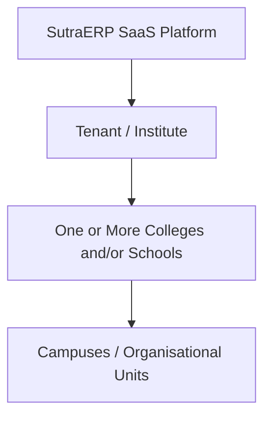
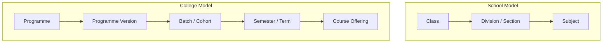

# SutraERP --- Architecture & Workflow Context Baseline

**Document Status:** Architecture Context Baseline\
**Date:** 2026-07-05\
**Purpose:** Preserve the agreed architectural, institutional,
team-boundary, tiering, and workflow context before beginning Level 1
Institute Lifecycle design.

------------------------------------------------------------------------

## 1. Product Definition

**SutraERP** is a modular institutional ERP and operating platform
intended primarily for colleges and schools.

The product must support:

-   One institute containing one or more colleges.
-   One institute containing schools and colleges simultaneously.
-   Future multi-tenant SaaS deployment for completely separate
    institutes.
-   Multiple colleges/schools under the same institute with independent
    policies and operating structures.
-   Modules that can be added, disabled, or removed without crashing
    unrelated institutional functions.
-   Separate development teams working on different ERP domains.
-   Hybrid synchronous contracts and domain-event communication.
-   Institution-wide auditability.
-   Configurable approval workflows.
-   A canonical person and identity model.
-   Complete student lifecycle ownership.
-   University-affiliated colleges, autonomous colleges, and
    universities.
-   Parent/guardian access as a first-class ERP persona.
-   Institutional document management rather than generic file storage.
- National Education Policy (NEP 2020) compliant academic workflows.
- Multiple Entry Multiple Exit (MEME).
- Academic Bank of Credits (ABC) integration.
- APAAR-based student identity.
- Flexible curriculum and multidisciplinary education.
- Choice Based Credit Registration (CBCR).
- Academic Credit Ledger.
- National education platform integrations (ABC, APAAR, DigiLocker, SWAYAM).

SutraERP is to be treated as an **Institution Operating Platform**, not
a collection of CRUD pages.

------------------------------------------------------------------------

## 2. Confirmed Institutional Scope

### 2.1 Tenant and Institution Model

Initial operating model:



A single tenant may contain both schools and colleges simultaneously.

The architecture must therefore support different academic models within
the same institute:



The platform must not force the school academic model into the college
model or vice versa.

### 2.2 Independent College/School Policies

Different colleges or schools under the same institute may have
different:

-   Academic calendars.
-   Academic years or operating periods.
-   Examination rules.
-   Fee policies.
-   Approval workflows.
-   Working calendars.
-   Institutional policies.

Therefore, configuration must support **scope inheritance and local
override**.

Conceptually:

``` text
Platform Default
      ↓
Institute Policy
      ↓
College / School Policy
      ↓
Department / Organisational Unit Policy
      ↓
Workflow-Specific Override
```

A lower scope may override a higher-level policy only where the policy
definition permits it.

### 2.3 Multiple Shifts

Multiple shifts are a valid institutional requirement.

Examples:

-   Morning Shift.
-   Evening Shift.
-   Polytechnic Shift.
-   Weekend Shift.
-   Special Programme Shift.

Shift capability is not required in the immediate core workflow
implementation and may be introduced as an additional capability/module.

However, core identifiers and scheduling concepts should avoid
assumptions that an institute has only one daily operating window.

### 2.4 Academic Year Approval

Initial default workflow:

``` text
Registrar
   ↓ Creates Academic Year / Academic Operating Period
DRAFT
   ↓ Submits
Principal
   ↓ Reviews
APPROVED
   ↓
Academic Year becomes available for operational setup
```

This is the initial business default.

The long-term architecture must allow this approval chain to be
configurable through the central Workflow Engine.

The workflow must not permanently hardcode `Registrar → Principal` in
domain service logic.

## 2.5 NEP 2020 Academic Framework

The platform shall support the academic principles defined under the National Education Policy (NEP 2020).

These include:

- Multiple Entry Multiple Exit (MEME)
- Academic Bank of Credits (ABC)
- Academic Credit Ledger
- APAAR identity integration
- Flexible curriculum
- Choice Based Credit Registration (CBCR)
- Multidisciplinary education
- Major / Minor programme structures
- Skill and vocational education

NEP capabilities shall be implemented as cross-domain architecture rather than a standalone module.

### 2.6 Guided Institute Setup

A guided Institute Setup workflow/wizard is approved as a future
capability.

It is **not a current Level 1 dependency**.

The future wizard should orchestrate existing configuration capabilities
rather than own a separate setup data model.

Expected conceptual sequence:

``` text
Institute Profile
↓
College / School Structure
↓
Campuses
↓
Organisation Units
↓
Academic Structure
↓
Roles and Positions
↓
Academic Calendar
↓
Finance Configuration
↓
Examination Configuration
↓
Module Activation
↓
Operational Readiness Check
```

Normal settings/configuration screens must remain available
independently.

------------------------------------------------------------------------

## 3. Current Repository Architecture

The audited repository is currently an **Early Modular ERP** implemented
as a **Modular Rust Monolith**.

### Current stack

-   Backend: Rust.
-   Web framework: Axum 0.7.
-   Async runtime: Tokio.
-   Database: PostgreSQL 16.
-   Database access: SQLx raw asynchronous SQL.
-   Pooling: PgBouncer.
-   Cache/support infrastructure: Redis.
-   Frontend: React 19.
-   Build tool: Vite.
-   Language: TypeScript.
-   Frontend state: Zustand for authentication.
-   HTTP client: Axios.
-   File infrastructure declared: MinIO, but complete Rust S3
    integration is not confirmed.
-   Authentication: JWT HS256 with refresh tokens and Argon2id password
    hashing.
-   Authorization: mixed database-backed RBAC and hardcoded role-name
    checks.

### Current backend model

``` text
One Rust Binary
      ↓
Axum Router
      ↓
Internal Domain Modules
      ↓
Shared AppState
      ↓
Single PostgreSQL Database
```

Current backend modules include:

-   Auth.
-   Student.
-   Academics.
-   Examination.
-   Finance.
-   Library.
-   Hostel.
-   Transport.
-   Placement.
-   Medical.
-   HR.
-   Health.

The current database uses one PostgreSQL database and one public schema
with logical domain separation.

### Architecture decision

**SutraERP will not be redesigned as microservices at this stage.**

The current modular monolith will evolve into a:

> **Contract-Driven Modular ERP Platform**

Reasons:

-   Current scale does not justify distributed-service operational
    complexity.
-   Separate teams can be supported using domain ownership and explicit
    contracts.
-   A modular monolith permits transactional consistency where
    appropriate.
-   Future extraction into services remains possible if domain
    boundaries are disciplined.

Risk:

-   Without enforcement, developers may continue using direct
    cross-domain SQL and shared files, creating a distributed-monolith
    style coupling inside one binary.

------------------------------------------------------------------------

## 4. Architecture Tier Model

Development priority such as P0/P1/P2 is separate from architectural
dependency tier.

SutraERP will use the following conceptual tiers.

### Tier 0 --- Platform Core

Mandatory architectural foundation.

``` text
SUTRA PLATFORM CORE
├── Tenant / Institution
├── Organisation Structure
├── Academic Structure
├── Person & Identity
├── Authentication
├── Authorization / Policy
├── Workflow Engine
├── Event Infrastructure
├── Audit Infrastructure
├── Module Registry
├── Master Data
└── System Configuration
```

Tier 0 components are not ordinary optional ERP modules.

Examples:

-   Person is not an optional module.
-   Institution is not an optional module.
-   Audit infrastructure is not an ordinary sidebar module.
-   Workflow infrastructure is not an ordinary business module.

Most Tier 0 configuration may be exposed through a consolidated
Settings/Administration interface.

### Tier 1 --- Institution Core Domains

Mandatory core operating domains.

#### Student Domain

-   Admissions.
-   Students.
-   Guardians.
-   Student Lifecycle.
-   Student Academic Profile.

#### Academic Domain

-   Courses.
-   Course Offerings.
-   Faculty Academic Assignment.
-   Timetable.
-   Attendance.
-   Academic Calendar.

#### People Domain

-   Employee.
-   Workforce.
-   Faculty.
-   HR.
-   Leave.
-   Payroll.

#### Finance Domain --- Team 1

-   Fees.
-   Accounts / General Ledger.
-   Budget.
-   Procurement.
-   Payables.
-   Receivables.
-   Financial Reporting.

#### Examination Domain --- Team 1

-   Examination.
-   Eligibility.
-   Hall Tickets.
-   Marks.
-   Evaluation.
-   Revaluation.
-   Results.

#### Document Domain

-   Document Registry.
-   Verification.
-   Issuance.
-   Versioning.
-   Retention.
-   Access Policy.
-   Digital signature capability where required.

### Tier 2 --- Operational Domains

Operational modules that may be essential for a specific institute but
must not become dependencies of unrelated core workflows.

Approved Tier 2 domains:

-   Library.
-   Hostel.
-   Transport.
-   Medical.
-   Facilities.
-   Placement.
-   Notifications.
-   Directory.
-   Scholarships.
-   Reports.
-   Lab Management.
-   Infrastructure Management.
-   Teacher Guardian Scheme(TGS)


### Tier 3 --- Extension Modules

Optional or institution-specific capabilities.

Examples:

-   Research.
-   Quizzes.
-   Alumni.
-   NCC / Clubs.
-   Sports.
-   Events.
-   LMS Integration.
-   Recruitment Integration.
-   External University Integration.
-   Government Portal Integration.
-   Accreditation.
-   NAAC / NBA.
-   IQAC.
-   Grievance.
-   Anti-Ragging.
-   Disciplinary Management.
-   Visitor Management.
-   Security Operations.
-   Housekeeping Operations.

Tier 3 modules must consume canonical institutional contracts and must
not duplicate core person, student, department, course, academic period,
or infrastructure data.

------------------------------------------------------------------------

## 5. Original Module Capability List

The current product capability list contains:

1.  Dashboard.
2.  Students.
3.  Faculty.
4.  Courses.
5.  Timetable.
6.  Attendance.
7.  Fees.
8.  Placement.
9.  Exams.
10. Results.
11. Hall Tickets.
12. Scholarships.
13. Accounts / GL.
14. Reports.
15. Library.
16. Hostel.
17. Transport.
18. Medical.
19. Admissions.
20. HR & Payroll.
21. Leave Management.
22. Facilities.
23. Directory.
24. Notifications.
25. Research.
26. Documents.
27. Quizzes.
28. Audit Logs.

Additional approved operational capabilities:

29. Lab Management.
30. Infrastructure Management.
31. Teacher Guardian Scheme

This is a **business/UI capability list**, not the final backend
architectural domain map.

Important corrections:

-   Dashboard is a composition/read surface, not a data-owning domain.
-   Reports should not own operational source data.
-   Directory should not own Person.
-   Audit Logs is a UI/read capability over platform audit
    infrastructure.
-   Lab In-charge is a position/assignment, not a standalone module.
-   Faculty is both a workforce persona and an academic assignment
    context.
-   Scholarships may span Student/Policy and Finance processing
    boundaries.

------------------------------------------------------------------------

## 6. Proposed Architectural Domain Map

``` text
PLATFORM
├── Institution
├── Organisation
├── Academic Structure
├── Identity
├── Authentication
├── Access Control
├── Workflow
├── Events
├── Audit
├── Documents
├── Notifications Infrastructure
├── Module Registry
├── Master Data
└── Configuration

STUDENT
├── Admissions
├── Students
├── Guardians
└── Student Lifecycle

ACADEMICS
├── Courses
├── Course Offerings
├── Faculty Academic Assignment
├── Timetable
├── Attendance
└── Quizzes

EXAMINATION — TEAM 1
├── Exams
├── Eligibility
├── Hall Tickets
├── Marks
├── Evaluation
├── Revaluation
└── Results

FINANCE — TEAM 1
├── Fees
├── Scholarship Financial Processing
├── Accounts / GL
├── Budget
├── Procurement
├── Payables
├── Receivables
└── Financial Reports

PEOPLE
├── Employee
├── Workforce
├── Faculty Workforce Profile
├── HR
├── Leave
└── Payroll

CAMPUS OPERATIONS
├── Infrastructure Management
├── Facilities
├── Lab Management
├── Hostel
├── Transport
├── Library
├── Medical
├── Security
└── Housekeeping

CAREER & RESEARCH
├── Placement
├── Research
└── Alumni

INSTITUTIONAL INTELLIGENCE
├── Dashboard
├── Reports
└── Directory
```

------------------------------------------------------------------------

## 7. Canonical Person, Identity, and Persona Model

The agreed direction is:

``` text
PERSON
  │
  ├── Identity
  │     └── User Account
  │
  ├── Student Persona
  │
  ├── Workforce Profile
  │      └── Engagement
  │             ├── Employee
  │             ├── Contractor
  │             ├── Outsourced Worker
  │             ├── Visiting Faculty
  │             ├── Consultant
  │             ├── Intern
  │             └── Temporary Staff
  │
  ├── Guardian Persona
  │
  └── Alumni Persona
```

A real-world person must have one canonical Person identity.

A person may hold multiple personas over time or simultaneously.

Example:

``` text
Person P000234
├── Student Persona
├── NCC Cadet Assignment
└── Later: Alumni Persona
```

Another example:

``` text
Person P000510
├── Workforce Profile
├── Employee Engagement
├── Faculty Assignment
└── Department Head Position
```

### Outsourced Workforce

Security and cleaning personnel are outsourced.

They should not automatically be treated as institute employees.

Use:

``` text
Person
↓
Workforce Profile
↓
Engagement
Type = OUTSOURCED_WORKER
↓
External Organisation
↓
Operational Assignment
```

This allows:

-   Institute ID/access.
-   Site assignment.
-   Shift assignment.
-   Supervisor assignment.
-   Access expiry.
-   Contractor tracking.

It prevents outsourced personnel from accidentally entering employee
payroll workflows.

### External Organisation Registry

Although vendors are not ERP users, SutraERP may maintain an External
Organisation Registry.

Examples:

-   Security agency.
-   Housekeeping contractor.
-   Equipment supplier.
-   Canteen contractor.
-   Bus maintenance contractor.

An external organisation record does not imply portal/login access.

------------------------------------------------------------------------

## 8. Organisation, Position, Role, and Reporting Model

Organisational hierarchy must not be hardcoded as a single role chain.

Potential institutional positions include:

-   Chairman.
-   Trustee.
-   Director General.
-   Director.
-   Chancellor.
-   Principal.
-   Dean.
-   Registrar.
-   Finance Officer.
-   Controller of Examination.
-   HOD.
-   Faculty.
-   Transport Officer.
-   Chief Warden.
-   Warden.
-   Security Manager.
-   Security Supervisor.
-   Security Guard.
-   Housekeeping Supervisor.
-   Cleaning Crew.
-   Infrastructure Manager.
-   Lab Manager.
-   Lab In-charge.
-   Lab Technician.
-   Additional future positions.

SutraERP must distinguish:

``` text
ORGANISATION UNIT
Where in the institution does responsibility exist?

POSITION
What institutional responsibility does a person hold?

REPORTING RELATIONSHIP
Who reports to or is supervised by whom, and in what context?

SYSTEM ROLE / PERMISSION
What system action may the identity perform?
```

Example:

``` text
Position:
HOD — Computer Science Department

System capabilities:
FACULTY
DEPARTMENT_HEAD
ATTENDANCE_APPROVER
LEAVE_APPROVER
```

A different HOD may additionally have examination coordination
permissions.

Business workflows should avoid checks such as:

``` text
if role == "HOD"
```

Workflow approver resolution should use position, organisational scope,
policy, and permissions.

------------------------------------------------------------------------

## 9. Student Lifecycle Scope

SutraERP owns the complete student lifecycle:

``` text
Enquiry
↓
Application
↓
Admission
↓
Document Verification
↓
Fee/Financial Activation
↓
Enrollment
↓
Student Identity Creation
↓
Academic Registration
↓
Course/Cohort Allocation
↓
Semester/Term Progression
↓
Examination
↓
Result
↓
Promotion / Progression
↓
Graduation / Exit
↓
Alumni
↓
Archival / Retention
```

Detailed workflows will be designed in later levels.

------------------------------------------------------------------------

## 10. Examination Model

SutraERP must support:

-   University-affiliated colleges.
-   Autonomous colleges.
-   Universities.

Therefore examination workflows must be policy/configuration driven.

Affiliated model example:

``` text
Internal Assessment
↓
Internal Marks Submission
↓
University External Examination
↓
External Result Import
↓
Institutional Result Context
```

Autonomous model example:

``` text
Exam Definition
↓
Assessment Planning
↓
Eligibility
↓
Hall Ticket
↓
Examination
↓
Evaluation
↓
Moderation
↓
Result Approval
↓
Publication
```

Finance and Examination are primarily owned by Team 1 and will be
detailed by that team.

Team 2 must provide stable platform, student, academic, identity, and
organisational contracts.

------------------------------------------------------------------------

## 11. Finance Scope

Finance is a major institutional domain and is owned by Team 1.

Expected broader scope includes:

-   Student Fees.
-   Accounts Receivable.
-   Accounts Payable.
-   General Ledger.
-   Budget.
-   Cost Centres.
-   Procurement/Purchase.
-   Vendor/External Organisation financial context.
-   Payroll Accounting.
-   Scholarship Accounting.
-   Bank Reconciliation.
-   Financial Statements.
-   Financial Reporting.

Team 2 should not implement Team 1 finance business logic.

Cross-domain financial requirements must be expressed through approved
command/read contracts and domain events.

------------------------------------------------------------------------

## 12. Workflow Engine Direction

Approval workflows must be configurable.

Conceptual model:

``` text
Request / Business Transaction
↓
Workflow Policy Resolution
↓
Workflow Definition
↓
Conditional Steps
↓
Approver Resolution
↓
Approval / Rejection / Return
↓
Final Domain State Transition
```

Example:

``` text
Leave < 3 days
Faculty → HOD

Leave > 3 days
Faculty → HOD → HR

Leave > 15 days
Faculty → HOD → HR → Principal
```

The central Workflow Engine must eventually support:

-   Workflow definition.
-   Workflow versioning.
-   Scope.
-   Trigger.
-   Conditions.
-   Steps.
-   Approver resolution.
-   Delegation.
-   Escalation.
-   Reassignment.
-   Return for correction.
-   Rejection.
-   Cancellation.
-   Timeouts/SLA.
-   Audit history.
-   Workflow instance state.

Default academic-year approval:

``` text
Registrar creates
↓
Registrar submits
↓
Principal approves/rejects/returns
```

This is a default policy, not permanent hardcoded domain logic.

------------------------------------------------------------------------

## 13. Hybrid Communication Architecture

Agreed architecture:

``` text
COMMAND / QUERY
→ Synchronous Contract

DOMAIN FACT
→ Domain Event
```

Use synchronous contracts when an immediate authoritative answer or
state change is required.

Example:

``` text
Examination asks:
"Is this student academically eligible for this examination?"
```

This requires an authoritative synchronous contract.

Use domain events to communicate facts that already occurred.

Example:

``` text
AdmissionApproved.v1
StudentActivated.v1
AttendanceFinalized.v1
LeaveApproved.v1
```

### Transaction Flow

``` text
Business Transaction
↓
Domain Service
↓
Validation
↓
Authorization
↓
State Transition
↓
Database Commit
↓
Transactional Outbox Record
↓
Event Delivery
↓
Subscribers
```

The current in-memory Tokio broadcast channel is not sufficient for
critical ERP workflow consistency because it has no transactional
outbox, durable retry, or dead-letter handling.

It may remain for non-critical internal signalling during transition,
but critical cross-domain workflows must not depend solely on ephemeral
events.

------------------------------------------------------------------------

## 14. Module Ownership Rules

### Non-Negotiable Domain Rule

> A module may read another domain only through an approved read
> contract.

> A module may never write another domain's owned table directly.

Cross-domain state changes occur through:

1.  Command Contract.
2.  Domain Event.

### Event Subscriber Rule

A subscriber must call the owning domain's service/command logic.

It must not directly insert/update another domain's tables.

Incorrect:

``` text
Hostel Event Subscriber
↓
INSERT INTO finance.fee_allocations
```

Correct:

``` text
HostelChargeAssessed.v1
↓
Finance Subscriber
↓
Finance Domain Service
↓
create_receivable()
↓
Finance-owned tables
```

------------------------------------------------------------------------

## 15. Team Ownership

There are two development teams.

### Team 1

Owns:

#### Finance

-   Fees.
-   Accounts / General Ledger.
-   Financial reporting.
-   Budget.
-   Procurement.
-   Payables.
-   Receivables.
-   Finance-owned workflows.

#### Examination

-   Examination.
-   Marks.
-   Results.
-   Hall Tickets.
-   Eligibility implementation within examination policy.
-   Evaluation.
-   Revaluation.
-   Examination-owned workflows.

### Team 2

Owns:

-   Platform architecture.
-   Institution.
-   Organisation.
-   Academic Structure.
-   Identity.
-   Authentication.
-   Authorization.
-   Workflow infrastructure.
-   Event infrastructure.
-   Audit infrastructure.
-   Student.
-   Admissions.
-   Academics.
-   People/HR platform domains.
-   Campus Operations.
-   Remaining modules.

### Shared Platform Contracts

Team 2 currently maintains the platform contracts for:

``` text
PersonId
IdentityId
UserId

InstitutionId
OrganisationUnitId
PositionId

CollegeId
DepartmentId

ProgrammeId
ProgrammeVersionId

AcademicYearId
AcademicPeriodId

CourseId
CourseOfferingId

StudentId
EmployeeId
FacultyAssignmentId

WorkflowInstanceId
DocumentId
InfrastructureSpaceId
```

Team 1 consumes these contracts and must not redefine equivalent
IDs/entities.

### Team 1-Owned IDs

Finance examples:

``` text
FeeStructureId
FeeLedgerId
FeeAllocationId
PaymentId
ReceiptId
AccountId
JournalEntryId
FiscalPeriodId
BudgetId
```

Examination examples:

``` text
ExamId
ExamSessionId
AssessmentId
HallTicketId
MarkEntryId
EvaluationId
RevaluationId
ResultId
```

------------------------------------------------------------------------

## 16. Shared Read Contract Direction

Team 1 must not depend on arbitrary SQL joins into Team 2-owned tables
for operational business logic.

Conceptual read contracts:

### StudentContextProvider

``` text
get_student_context(student_id)
get_students_by_cohort(cohort_id)
validate_student_active(student_id)
get_student_display_identity(student_id)
```

### AcademicContextProvider

``` text
get_course_offering(course_offering_id)
get_academic_period(period_id)
get_enrollment(student_id, course_offering_id)
validate_period_open(period_id)
```

Potential `StudentAcademicContext`:

``` text
student_id
person_id
institution_id
college_id
department_id
programme_id
programme_version_id
academic_year_id
academic_period_id
current_status
```

These are architectural directions. Exact Rust traits, DTOs, and
versioning will be designed after workflow contracts are identified.

------------------------------------------------------------------------

## 17. Module Degradation Principle

Optional operational modules must fail independently where possible.

Example:

``` text
Hostel unavailable

Student admission       → Works
Student fee payment     → Works
Attendance              → Works
Examination             → Works
Hostel room allocation  → Unavailable
```

Example:

``` text
Notifications unavailable

Leave approval          → Completes
Domain state            → Committed
Notification delivery   → Pending / retried
```

An optional subscriber failure must not roll back an already committed
authoritative domain transaction.

Critical exceptions are Tier 0/platform dependencies and explicitly
declared mandatory domain preconditions.

------------------------------------------------------------------------

## 18. Dashboard, Reports, and Directory Boundaries

### Dashboard

Dashboard is a composition/read surface.

It owns no authoritative institutional data.

It consumes summary/read contracts from domains.

### Reports

Reports should not own operational source data.

Operational domains remain authoritative.

Reporting may use approved reporting projections/read models in the
future.

### Directory

Directory does not own Person, Employee, Faculty, or Student.

It presents approved directory views of canonical identity and
organisational data subject to privacy/access policy.

------------------------------------------------------------------------

## 19. Lab Management Boundary Validation

**Decision: ACCEPTED WITH REFINEMENT.**

Add **Lab Management** to Tier 2.

Do not add `Lab In-charge` as a standalone module.

Model Lab In-charge as a scoped responsibility assignment.

Recommended ownership:

``` text
Lab Management owns:
Laboratory
Lab Configuration
Lab Operational Status
Lab Scheduling Context
Lab Equipment Assignment Context
Lab Access Policy
Lab Safety Context
Lab Maintenance Context
Lab In-charge Assignment
Lab Technician Assignment
```

Dependencies:

``` text
Organisation / Workforce → Person, Engagement, Position
Infrastructure           → Space / Room
Academics                → Course Offering / Lab Session context
Facilities               → Service/Maintenance requests
```

Primary architectural risk:

> Lab Management must not create its own duplicate room, faculty,
> employee, course, or asset identity systems.

------------------------------------------------------------------------

## 20. Infrastructure Management Boundary Validation

**Decision: ACCEPTED.**

Add **Infrastructure Management** to Tier 2.

It is distinct from Facilities.

Recommended boundary:

``` text
Infrastructure Management
├── Buildings
├── Blocks
├── Floors
├── Spaces / Rooms
├── Space Types
├── Capacity
├── Condition
├── Infrastructure Lifecycle
├── Inspection
├── Infrastructure Projects
└── Infrastructure Assignments

Facilities
├── Service Requests
├── Work Orders
├── Cleaning Requests
├── Electrical Requests
├── Plumbing Requests
├── HVAC Requests
├── Service Scheduling
└── Operational Resolution
```

Canonical physical hierarchy:

``` text
Institution
↓
Campus
↓
Building
↓
Block / Wing
↓
Floor
↓
Space
```

A Space may be classified as:

``` text
Classroom
Laboratory
Office
Library Space
Hostel Room
Medical Room
Store
Auditorium
Sports Space
Utility Space
Other
```

Operational modules reference `InfrastructureSpaceId`.

Example:

``` text
Lab Management → InfrastructureSpaceId
Hostel          → InfrastructureSpaceId
Medical         → InfrastructureSpaceId
Library         → InfrastructureSpaceId
Security        → InfrastructureSpaceId
Facilities      → InfrastructureSpaceId
```

Primary architectural risk:

> Infrastructure Management can become an oversized "everything
> physical" God module.

Mitigation:

-   Infrastructure owns canonical physical structure and lifecycle.
-   Facilities owns service delivery/work orders.
-   Lab owns lab operations.
-   Hostel owns residential allocation.
-   Library owns library operations.
-   Security owns security operations.

------------------------------------------------------------------------

## 21. Known Current Architecture Risks

The repository audit identified the following major risks:

1.  In-memory event bus with no outbox; critical events may be lost on
    process crash.
2.  Monolithic `DomainEvent` enum creates cross-team edit and recompile
    coupling.
3.  Audit coverage is incomplete for major mutations.
4.  Team 1 has critical direct schema dependencies on Team 2-owned
    entities.
5.  Global RBAC path mapping can allow unmatched routes to bypass
    resource authorization.
6.  No configurable workflow engine exists.
7.  Academic Year and Semester are represented as duplicated primitive
    values rather than canonical entities.
8.  No complete Employee entity exists.
9.  Identity duplication remains possible.
10. Class enrollment API is incomplete/missing.
11. Attendance-to-examination eligibility is not wired.
12. Faculty onboarding API is incomplete/missing.
13. Most defined domain events have no consumer.
14. Leave approval is not connected to attendance/payroll workflows.
15. Multi-tenant provisioning is incomplete.

These risks must inform workflow design. They do not require an
immediate microservice rewrite.

------------------------------------------------------------------------

## 22. Level 0 Institutional Operating Model

``` text
                         SUTRAERP
              INSTITUTION OPERATING PLATFORM
                              │
       ┌──────────────────────┼──────────────────────┐
       │                      │                      │
  SUTRA PLATFORM       INSTITUTE DOMAINS       GOVERNANCE LAYER
       │                      │                      │
 Identity                Academic               Workflow
 Access                  Student                Approval
 Structure               People                 Audit
 Master Data             Finance                Documents
 Events                  Examination            Notifications
 Configuration           Campus Ops             Reporting
```

### High-Level Institutional Lifecycle

``` text
Institution Provisioning
↓
Institution Created
↓
Organisation Structure Setup
↓
College / School / Campus Setup
↓
Department and Organisational Unit Setup
↓
Academic Structure & Flexible Curriculum Setup
↓
Academic Year / Operating Period Created
↓
Academic Year Approval
↓
Academic Calendar Opened
↓
Course Offerings / Academic Delivery Setup
↓
Institution Operational Readiness
↓
Admission Cycle
↓
Student Verification
↓
Student Activation
↓
Academic Enrollment
↓
Teaching Operations
↓
Attendance
↓
Academic Monitoring
↓
Examination Eligibility
↓
Examination
↓
Marks / Evaluation
↓
Result Processing
↓
Academic Progression
↓
Next Period / Graduation / Exit
↓
Alumni / Archival
```

Parallel governance plane:

``` text
Workflow
Approval
Authorization
Audit
Documents
Events
Notifications
Reporting
```

------------------------------------------------------------------------

## 23. Workflow Design Levels

The agreed workflow design process is:

``` text
LEVEL 0
SutraERP Institutional Operating Model

↓ LEVEL 1

Complete Institute Lifecycle

↓ LEVEL 2

Domain Workflows
- Platform
- Student
- Academic
- People
- Finance
- Examination
- Campus Operations
- Governance

↓ LEVEL 3

Cross-Module Workflows
Examples:
Admission → Student → Finance → Documents
Attendance → Eligibility → Examination
HR → Payroll → Accounts
Scholarship → Finance
Lab → Facilities
Infrastructure → Facilities
Hostel → Finance
Transport → Finance

↓ LEVEL 4

Individual Module Workflows

↓ LEVEL 5

Role / Position-Based Workflows

↓ LEVEL 6

Screen + API + Contract + Event + State Workflow
```

At Level 6, workflow specifications should contain:

``` text
Workflow ID
Name
Owning Domain
Actor
Position/Scope
Trigger
Preconditions
Input
Authorization
Validation
State Transition
Synchronous Contracts
Database Ownership
Domain Events
Subscribers
Approval Policy
Failure States
Retry Behaviour
Audit Requirements
Notification Requirements
Optional Module Behaviour
Team Ownership
```

------------------------------------------------------------------------

## 24. Decisions Locked Before Level 1

The following decisions are accepted as the baseline:

1.  SutraERP supports one institute with one or more colleges.
2.  Architecture should be future multi-tenant SaaS ready.
3.  One institute may contain schools and colleges simultaneously.
4.  Colleges/schools may use different academic calendars, examination
    rules, fee policies, and approval workflows.
5.  Multiple shifts are valid and may be introduced as an additional
    capability.
6.  Default Academic Year workflow is Registrar creates/submits and
    Principal approves.
7.  The approval architecture must remain configurable.
8.  Guided Institute Setup is a future capability and is not a current
    Level 1 dependency.
9.  SutraERP owns the complete student lifecycle.
10. SutraERP supports affiliated, autonomous, and university examination
    contexts.
11. Parent/guardian is a first-class ERP persona.
12. Documents are institutional records, not generic cloud-drive files.
13. Architecture remains a modular Rust monolith at this stage.
14. Communication architecture is hybrid: synchronous contracts plus
    domain events.
15. Modules are classified by architectural tiers, separate from
    P0/P1/P2 development priority.
16. Person is canonical and may hold multiple personas.
17. Outsourced security and cleaning workers use workforce engagements
    and are not automatically institute employees.
18. Organisation Position and System Role are separate concepts.
19. Team 1 owns Finance and Examination.
20. Team 2 owns the broader platform and remaining domains.
21. Cross-domain writes are prohibited.
22. Cross-domain operational reads use approved read contracts.
23. Dashboard is a composition surface.
24. Reports do not own operational source data.
25. Directory does not own Person.
26. Lab Management is added to Tier 2.
27. Lab In-charge is modelled as a position/assignment within Lab
    Management and workforce context.
28. Infrastructure Management is added to Tier 2.
29. Infrastructure Management is distinct from Facilities.
30. Physical spaces require canonical identity and are referenced by
    operational modules.

------------------------------------------------------------------------

## 25. Next Design Stage

The next architecture activity is:

# LEVEL 1 --- COMPLETE INSTITUTE LIFECYCLE

The Level 1 design will cover:

``` text
Tenant Provisioning
↓
Institute Creation
↓
College / School Creation
↓
Campus and Organisation Structure
↓
Academic Structure
↓
Academic Year Opening
↓
Operational Readiness
↓
Admission Cycle
↓
Teaching Cycle
↓
Examination Cycle
↓
Progression
↓
Graduation / Exit
↓
Academic Year Closure
```

For each lifecycle stage, define:

-   Owner.
-   Actors.
-   Trigger.
-   Preconditions.
-   State.
-   Modules involved.
-   Synchronous contracts.
-   Domain events.
-   Approvals.
-   Failure conditions.
-   Audit requirements.
-   Optional module effects.
-   Team ownership.

This document is the architecture context baseline for subsequent
SutraERP workflow design.
