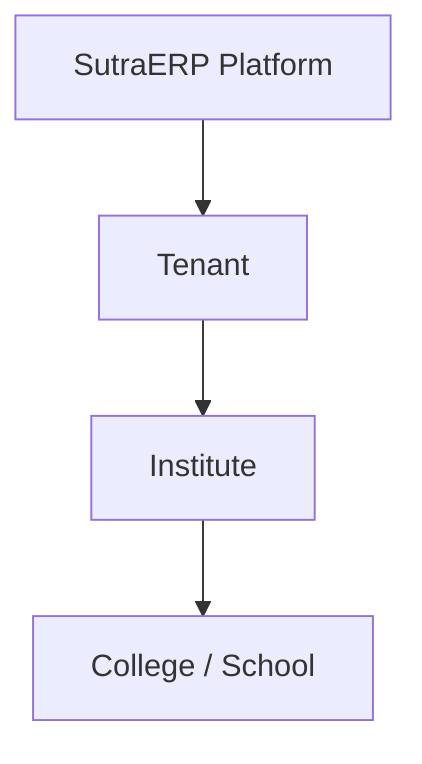
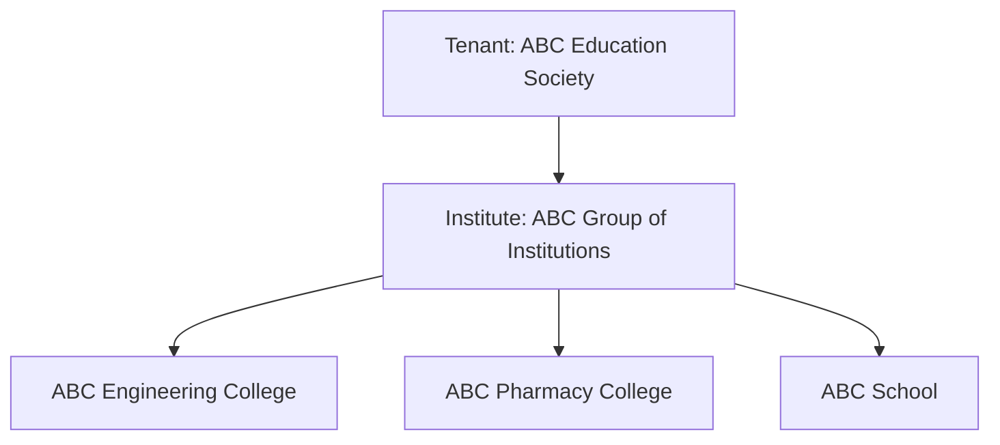

# SutraERP Level 1 Architecture --- Locked Lifecycle

**Status:** Locked\
**Scope:** Complete institute lifecycle at Level 1\
**Purpose:** Define the main business stages, ownership boundaries,
lifecycle rules, and cross-domain responsibilities before Level 2
workflows.

------------------------------------------------------------------------

## 1. Core Architecture Rules

### 1.1 Tenant, Institute, and Academic Unit



-   **Tenant** is the SaaS isolation boundary.
-   **Institute** is the institutional organisation using SutraERP.
-   **College / School** is an independent academic operating unit
    inside the institute.

Example:



**Locked rule:** Tenant and Institute are separate concepts.

------------------------------------------------------------------------

### 1.2 College and School Data Separation

College and school operational data must always remain separately
scoped.

The following records belong to a specific College or School:

-   Admission Cycle and Application
-   Student Academic Context
-   Academic Year and Academic Period
-   Programme / Class structure
-   Course Offering
-   Attendance
-   Examination academic context
-   Finance context

Example:

``` text
ABC Engineering College
└── Academic Year AY-ENG-2026

ABC School
└── Academic Year AY-SCHOOL-2026
```

Both may display `2026–27`, but they are separate records.

Institute-wide shared data may include:

-   Person
-   Tenant
-   Institute
-   Platform Identity
-   Canonical Infrastructure
-   Approved shared master data

**Locked rule:** Shared Person does not mean shared College/School
operational data.

College/School scope must later be enforced in authorization, contracts,
queries, and database constraints. It must not be treated only as a UI
filter.

------------------------------------------------------------------------

### 1.3 Canonical Person and Student Context

One real person has one canonical `Person` identity inside the
institute.

A Person may have multiple historical Student Contexts, but only one
Student Context may be `ACTIVE` at a time within the Institute.

Example:

``` text
Person P001
↓
Student Persona

├── ABC School
│   └── Student Context: COMPLETED
│
└── ABC Engineering College
    └── Student Context: ACTIVE
```

Not allowed:

``` text
Person P001

ABC School
Student Context: ACTIVE

AND

ABC Engineering College
Student Context: ACTIVE
```

Before a new Student Context becomes active, the current active context
must be closed through a valid lifecycle state such as:

``` text
COMPLETED
TRANSFERRED
WITHDRAWN
DISCONTINUED
TERMINATED
```

**Locked rule:** One Person may have many historical Student Contexts
but a maximum of one active Student Context per Institute.

Dual or parallel enrollment is outside the current scope and must not be
allowed accidentally.

------------------------------------------------------------------------

### 1.4 Cross-Domain Ownership

A domain owns its data and lifecycle.

Other domains must not directly update its tables.

Use:

-   **Synchronous contracts** when an immediate authoritative answer or
    action is required.
-   **Domain events** for completed business facts and asynchronous
    reactions.

Example:

``` text
Examination
↓ asks Academics
"What is the student's finalized attendance?"
```

Not:

``` text
Examination
↓
Direct SQL against Attendance tables
```

------------------------------------------------------------------------

## 2. Locked Level 1 Lifecycle

``` text
L1-01 Tenant Provisioning
↓
L1-02 Institute Creation
↓
L1-03 College / School and Institutional Structure Setup
↓
L1-04 Academic Structure Setup
↓
L1-05 Academic Year and Academic Period Setup
↓
L1-06 Operational Readiness Check
↓
L1-07 College / School Admission Cycle
↓
L1-08 Student Activation and Academic Registration
↓
L1-09 Teaching and Academic Delivery
↓
L1-10 Examination Cycle
↓
L1-11 Academic Progression
↓
L1-12 Graduation / Student Exit
↓
L1-13 Academic Year / Period Closure
↓
L1-14 Next Academic Cycle
        ↓
      L1-05
```

Graduation and exit branch from the repeating academic cycle.

``` text
Academic Progression
├── NEXT PERIOD
│   ↓
│   Next Academic Cycle
│
└── PROGRAMME COMPLETE / EXIT
    ↓
    Graduation / Student Exit
```

------------------------------------------------------------------------

# 3. L1-01 --- Tenant Provisioning

**Purpose:** Create an isolated SutraERP operating boundary.

**Owner:** Platform\
**Actor:** SutraERP Platform Admin or automated provisioning\
**Team:** Team 2

``` text
REQUESTED
↓
PROVISIONING
↓
ACTIVE
```

Possible failure state:

``` text
PROVISIONING_FAILED
```

Main responsibilities:

-   Create Tenant identity.
-   Initialize platform configuration.
-   Initialize Module Registry.
-   Initialize audit and identity infrastructure.
-   Prevent duplicate Tenant creation.

**Locked rule:** Tenant provisioning is a platform operation. Registrar
or Principal does not provision a Tenant.

------------------------------------------------------------------------

# 4. L1-02 --- Institute Creation

**Purpose:** Create the institutional identity inside an active Tenant.

**Owner:** Institution Domain\
**Actors:** Platform Admin / Institute Admin\
**Team:** Team 2

``` text
DRAFT
↓
SETUP_PENDING
↓
ACTIVE
```

Main responsibilities:

-   Create Institute.
-   Link Institute to Tenant.
-   Configure core Institute profile.
-   Audit major Institute changes.

**Locked rule:** Tenant and Institute must not use the same business
entity.

------------------------------------------------------------------------

# 5. L1-03 --- College / School and Institutional Structure Setup

**Purpose:** Define the academic operating units, organisation
structure, and physical operating locations.

**Owner:** Organisation Domain\
**Actors:** Institute Admin / Registrar\
**Team:** Team 2

Example:

``` text
ABC Group of Institutions
├── ABC Engineering College
│   ├── Computer Engineering Department
│   └── Mechanical Engineering Department
│
└── ABC School
    ├── Primary Section
    └── Secondary Section
```

Campuses may include:

``` text
Main Campus
City Campus
Research Campus
```

Important distinction:

``` text
Organisation Unit ≠ Campus
```

-   Organisation Unit represents institutional responsibility or
    structure.
-   Campus represents a physical operating location.

**Locked rule:** Organisation structure and physical location remain
separate concepts and are connected using canonical IDs.

------------------------------------------------------------------------

# 6. L1-04 --- Academic Structure Setup

**Purpose:** Define how education is organised inside each College or
School.

**Owner:** Academic Structure Domain\
**Actors:** Registrar / Academic Admin\
**Team:** Team 2

School model:

``` text
Class
↓
Section
↓
Subject
```

College model:

``` text
Programme
↓
Programme Version
↓
Batch / Cohort
↓
Academic Period
↓
Course
```

Example:

``` text
Programme:
B.Tech Computer Engineering

Programme Version:
2026 Curriculum

Cohort:
2026–2030
```

Programme versions preserve curriculum history.

``` text
B.Tech Computer Engineering
├── 2024 Curriculum
└── 2026 Curriculum
```

**Locked rule:** Do not directly overwrite an active curriculum. Create
a new Programme Version when the curriculum changes.

**Locked rule:** School and College academic models coexist. One must
not be forced into the other.

------------------------------------------------------------------------

# 7. L1-05 --- Academic Year and Academic Period Setup

**Purpose:** Create, approve, and open the academic cycle for a College
or School.

**Owner:** Academic Structure / Academic Calendar\
**Actor:** Registrar\
**Default Approver:** Principal\
**Team:** Team 2

## 7.1 Academic Year

The main academic cycle.

Example:

``` text
2026–27
```

## 7.2 Academic Period

A part of an Academic Year.

College example:

``` text
Academic Year 2026–27
├── Semester 1
└── Semester 2
```

School example:

``` text
Academic Year 2026–27
├── Term 1
├── Term 2
└── Term 3
```

Final hierarchy:

``` text
College / School
↓
Academic Year
↓
Academic Period
```

**Locked rule:** `AcademicYear` and `AcademicPeriod` are separate
canonical entities.

**Locked rule:** Academic Year is College/School scoped.

## 7.3 Academic Year State

``` text
DRAFT
↓
PENDING_APPROVAL
↓
APPROVED
↓
OPEN
↓
CLOSING
↓
CLOSED
```

Approval alternatives:

``` text
PENDING_APPROVAL
├── APPROVED
├── RETURNED
└── REJECTED
```

Default workflow:

``` text
Registrar creates
↓
Registrar submits
↓
Principal approves / returns / rejects
```

The approval workflow must later be configurable through the Workflow
Engine.

Important distinction:

``` text
APPROVED ≠ OPEN
```

`APPROVED` means the Academic Year is officially accepted.

`OPEN` means academic operations may start when their readiness
requirements are satisfied.

**Locked rule:** `APPROVED` and `OPEN` remain separate states.

------------------------------------------------------------------------

# 8. L1-06 --- Operational Readiness Check

**Purpose:** Check whether a specific business operation can start.

Readiness is evaluated for the requested capability.

Example:

``` text
Start Teaching

Academic Year OPEN       YES
Academic Period OPEN     YES
Course Offering Active   YES
Faculty Assigned         NO

Result:
NOT READY
```

Do not use one global flag:

``` text
institute_ready = true
```

Do not treat a stored readiness flag as authoritative.

Final model:

``` text
Operation Requested
↓
Readiness Rules Evaluated
↓
READY / NOT READY
```

Examples of capabilities:

``` text
Admission
Teaching
Attendance
Examination
```

**Locked rule:** Readiness is primarily evaluated dynamically. Caching
may be added later but is not authoritative.

------------------------------------------------------------------------

# 9. L1-07 --- College / School Admission Cycle

**Purpose:** Accept and decide admissions for a specific College or
School.

**Owner:** Admissions Domain\
**Actors:** Applicant / Admission Team\
**Team:** Team 2

Admission Cycle is College/School scoped.

Example:

``` text
Engineering College
├── 2026 Engineering Admission
└── 2026 Direct Second Year Admission

School
├── 2026 Primary Admission
└── 2026 Secondary Admission
```

An Admission Cycle is created only when admissions are required.

Basic flow:

``` text
Admission Cycle Created
↓
Applications Open
↓
Applicant Applies
↓
Person Checked / Created
↓
Application Reviewed
↓
Documents Checked
↓
Admission Decision
├── APPROVED
├── REJECTED
└── WAITLISTED
↓
Admission Completed
```

Important distinction:

``` text
ADMISSION APPROVED
≠
ACTIVE STUDENT
```

Person handling:

``` text
Applicant details received
↓
Check canonical Person
├── Existing Person found → Link Person
└── No Person found → Create Person
```

Automatic Person matching may suggest a match. Sensitive Person merges
require controlled confirmation.

**Locked rule:** Admission Cycle and admission data are College/School
scoped.

**Locked rule:** Admission Cycle is created only when required.

**Locked rule:** Admission approval does not automatically activate the
Student.

------------------------------------------------------------------------

# 10. L1-08 --- Student Activation and Academic Registration

**Purpose:** Convert an accepted applicant into an active Student and
place the Student in the correct academic structure.

**Owner:** Student Academic Lifecycle\
**Actors:** Student Administration / Academic Admin / System\
**Team:** Team 2

## 10.1 Student Activation

``` text
Admission Completed
↓
Required Documents Checked
↓
Required Financial Condition Checked
↓
Student Context Created
↓
PENDING_ACTIVATION
↓
ACTIVE
```

Finance belongs to Team 1.

Student Domain must ask Finance through an approved contract.

Example:

``` text
Student Domain
↓ asks Finance
"Is the required admission financial condition satisfied?"
↓
YES / NO
```

Student Domain must not directly read or update Finance tables.

## 10.2 Active Student Context Rule

Before activating a Student Context:

``` text
Check Person
↓
Find ACTIVE Student Context in Institute
├── Found → Reject new activation
└── Not found → Continue activation
```

A new Student Context may become active only after the previous active
context is validly closed.

## 10.3 Academic Registration

College example:

``` text
Student ACTIVE
↓
Programme
↓
Programme Version
↓
Cohort
↓
Academic Period
↓
Course Enrollment
```

School example:

``` text
Student ACTIVE
↓
Class
↓
Section
↓
Subject Allocation
```

Important ownership boundary:

``` text
Student Academic Lifecycle
→ Student lifecycle and academic placement

Academics
→ Course definitions, offerings, teaching, timetable, attendance
```

**Locked rule:** Student progression and placement remain historical.
They must not be reduced to one current semester/class field.

------------------------------------------------------------------------

# 11. L1-09 --- Teaching and Academic Delivery

**Purpose:** Prepare and conduct teaching.

**Owner:** Academics Domain\
**Actors:** Academic Admin / HOD / Faculty\
**Team:** Team 2

Basic flow:

``` text
Academic Period OPEN
↓
Course / Subject Offerings Created
↓
Faculty Assigned
↓
Teaching Spaces Referenced
↓
Timetable Prepared
↓
Timetable Published
↓
Teaching Starts
↓
Teaching Sessions Conducted
↓
Attendance Recorded
↓
Attendance Finalized
↓
Academic Monitoring
↓
Teaching Period Completed
```

## 11.1 Course and Course Offering

``` text
Course
= What is taught

Course Offering
= When and to whom the Course is taught
```

Example:

``` text
Course:
CS101 Programming
```

``` text
Course Offering:
CS101
Semester 1
2026 Cohort
ABC Engineering College
```

Attendance, timetable, faculty academic assignment, and examination
academic context should normally reference `CourseOfferingId`.

**Locked rule:** Course Offering is the central academic delivery unit.

## 11.2 Faculty Assignment

``` text
Person
↓
Workforce Profile
↓
Faculty Academic Assignment
↓
Course Offering
```

A Course Offering may have a primary faculty member and supporting
faculty members.

## 11.3 Timetable and Space

``` text
Course Offering
+
Faculty Assignment
+
Student Group
+
Time
+
Infrastructure Space
↓
Timetable Entry
```

Operational modules must reference canonical physical spaces.

They must not create duplicate classroom, laboratory, or room
identities.

## 11.4 Lab Teaching

``` text
Academics
→ Owns academic teaching context

Lab Management
→ Owns laboratory operations

Infrastructure
→ Owns physical space
```

## 11.5 Attendance

``` text
Teaching Session
↓
Expected Students
↓
Attendance Recorded
↓
SUBMITTED
↓
FINALIZED
```

Normal edits should not be allowed after finalization.

Corrections require a controlled, audited correction process.

**Locked rule:** Finalized attendance remains stable and later
corrections are audited.

## 11.6 Academic Monitoring

Academic monitoring may identify conditions such as attendance risk.

Example:

``` text
Student: Rahul
Attendance: 62%
Required: 75%

Status:
ATTENDANCE RISK
```

Academics provides authoritative academic context to Examination through
contracts.

Academics does not directly update Examination data.

------------------------------------------------------------------------

# 12. L1-10 --- Examination Cycle

**Purpose:** Check eligibility, conduct examinations, process marks, and
publish the official result.

**Owner:** Examination Domain\
**Team:** Team 1

Basic flow:

``` text
Examination Setup
↓
Eligibility Check
↓
Hall Ticket / Exam Access
↓
Examination Conducted
↓
Marks Entered
↓
Evaluation
↓
Result Processed
↓
Result Approved
↓
Result Published
```

Examination references canonical IDs such as:

``` text
AcademicPeriodId
CourseOfferingId
StudentId
```

Examination must not create duplicate Students, Courses, or Academic
Periods.

## 12.1 Eligibility

Example:

``` text
Student Active        YES
Course Enrolled       YES
Final Attendance      78%
Required Attendance   75%

Result:
ELIGIBLE
```

Examination asks owning domains for authoritative information.

## 12.2 Result Ownership

Examination owns:

``` text
PASS / FAIL
GRADE
CREDITS
RESULT STATUS
OFFICIAL RESULT
```

After publication, Examination states the official academic result.

Examination does not decide student promotion.

**Locked rule:** Team 1 Examination owns the official result.

------------------------------------------------------------------------

# 13. L1-11 --- Academic Progression

**Purpose:** Decide what happens to the Student after the official
result is published.

**Owner:** Student Academic Lifecycle\
**Team:** Team 2

Basic flow:

``` text
Official Result Published
↓
Student Academic Context Loaded
↓
Progression Policy Applied
↓
Progression Decision
↓
Decision Applied
↓
Student Academic History Updated
```

Possible decisions:

``` text
PROMOTE
CONTINUE_WITH_BACKLOG
REPEAT_PERIOD
DETAIN
PROGRAMME_COMPLETE
MANUAL_REVIEW
```

Example:

``` text
Semester 1 Result:
5 Passed
1 Failed

Policy:
Maximum 2 failed courses allowed

Decision:
CONTINUE_WITH_BACKLOG
```

Progression policy may be scoped by:

``` text
Institute
↓
College / School
↓
Programme
↓
Programme Version
```

Local policy may override inherited policy where allowed.

## 13.1 Historical Academic Progression

Do not rely only on:

``` text
student.current_semester = 4
```

Authoritative history should remain:

``` text
Semester 1   COMPLETED
Semester 2   COMPLETED
Semester 3   COMPLETED
Semester 4   ACTIVE
```

A current position may exist as a read convenience.

**Locked rule:** Historical academic progression is authoritative.

**Locked rule:** Team 2 Student Academic Lifecycle owns progression.

------------------------------------------------------------------------

# 14. L1-12 --- Graduation / Student Exit

**Purpose:** Close the active Student lifecycle when the Student
completes the programme or exits.

**Owner:** Student Lifecycle\
**Actors:** Registrar / Student Administration\
**Team:** Team 2

Basic flow:

``` text
Exit Trigger
↓
Exit Type Identified
↓
Required Checks
↓
Exit Decision
↓
Student Academic Lifecycle Closed
↓
Alumni Persona Created if Applicable
↓
Records Retained
```

Exit types:

``` text
GRADUATED
PROGRAMME_COMPLETED
WITHDRAWN
TRANSFERRED
DISCONTINUED
TERMINATED
OTHER_EXIT
```

Do not represent every exit as:

``` text
student.status = INACTIVE
```

The actual exit reason must be retained.

## 14.1 Graduation

``` text
PROGRAMME_COMPLETE
↓
Graduation Requirements Checked
↓
Graduation Approved
↓
Student Context Closed as GRADUATED
↓
Alumni Persona Added
```

The Student Persona and academic history remain part of the Person's
history.

## 14.2 Clearance

Clearance is based on policy and applicability.

``` text
Policy Requires Clearance
+
Student Used Applicable Capability
↓
Clearance Required
```

Example:

``` text
Library     REQUIRED
Finance     REQUIRED
Hostel      NOT APPLICABLE
Transport   NOT APPLICABLE
```

An enabled module does not automatically create a clearance requirement
for every Student.

**Locked rule:** Exit type is explicit.

**Locked rule:** Clearance is policy and applicability based.

------------------------------------------------------------------------

# 15. L1-13 --- Academic Year / Period Closure

**Purpose:** Officially close an Academic Year or Academic Period after
required academic work is complete.

**Owner:** Academic Structure / Academic Calendar\
**Actor:** Registrar\
**Default Approver:** Principal\
**Team:** Team 2

Basic flow:

``` text
OPEN
↓
Closure Requested
↓
Required Checks
↓
CLOSING
↓
Approval
↓
CLOSED
```

Typical closure checks:

``` text
Teaching completed?
Attendance finalized?
Required examination processing completed?
Progression processing completed?
```

Optional modules must not block closure unless policy explicitly
requires them.

## 15.1 Closed Period Corrections

Do not reopen the complete Academic Year for a normal correction.

Use:

``` text
CLOSED Period
↓
Correction Request
↓
Approval
↓
Specific Record Corrected
↓
Audit Recorded
```

The Academic Year or Academic Period remains `CLOSED`.

**Locked rule:** Closed periods use controlled corrections instead of
normal reopening.

------------------------------------------------------------------------

# 16. L1-14 --- Next Academic Cycle

**Purpose:** Prepare the next academic cycle without copying old
operational transactions.

The next cycle is College/School scoped.

Example:

``` text
ABC Engineering College
2026–27
↓
2027–28
```

``` text
ABC School
2026–27
↓
2027–28
```

Final reuse rule:

``` text
Reusable Structure
→ Reference / inherit

Versioned Academic Data
→ Reuse version or create a new version

Period Operational Data
→ Create new
```

  Data                       Next Academic Year
  -------------------------- ---------------------
  College / School           Reuse
  Department                 Reuse
  Programme                  Reuse
  Programme Version          Reuse or create new
  Academic Year              New
  Academic Period            New
  Course Offering            New
  Faculty Assignment         Revalidate / new
  Timetable                  New
  Attendance                 Never copy
  Examination transactions   Never copy

**Locked rule:** Academic Year cloning must not be implemented as a raw
database copy.

------------------------------------------------------------------------

# 17. Locked Domain Ownership Boundaries

  Business Area                     Owner
  --------------------------------- ------------------------------------------
  Tenant provisioning               Platform --- Team 2
  Institute                         Institution Domain --- Team 2
  Organisation structure            Organisation Domain --- Team 2
  Academic structure                Academic Structure --- Team 2
  Academic Year / Period            Academic Structure / Calendar --- Team 2
  Admission                         Admissions --- Team 2
  Student lifecycle                 Student Domain --- Team 2
  Student academic progression      Student Academic Lifecycle --- Team 2
  Teaching and academic delivery    Academics --- Team 2
  Attendance                        Academics / Attendance --- Team 2
  Examination and official result   Examination --- Team 1
  Finance                           Finance --- Team 1
  Physical space identity           Infrastructure --- Team 1
  Workflow execution                Workflow Engine --- Team 2

Critical ownership boundary:

``` text
TEAM 1 — Examination
↓
Official Result
↓
TEAM 2 — Student Academic Lifecycle
↓
Progression Decision
↓
Student Academic History
```

**Locked rule:** Examination owns the official result. Student Academic
Lifecycle owns progression.

------------------------------------------------------------------------

# 18. Final Level 1 Lock Decisions

  -----------------------------------------------------------------------
  Decision                            Status
  ----------------------------------- -----------------------------------
  Tenant separate from Institute      LOCKED

  College/School operational data     LOCKED
  separated by mandatory scope        

  Canonical Person institute-wide     LOCKED

  Multiple historical Student         LOCKED
  Contexts allowed                    

  Maximum one ACTIVE Student Context  LOCKED
  per Institute                       

  Parallel / dual active enrollment   LOCKED
  outside current scope               

  Admission Cycle College/School      LOCKED
  scoped                              

  Admission Cycle created only when   LOCKED
  required                            

  Admission approval does not         LOCKED
  activate Student automatically      

  Academic Year canonical entity      LOCKED

  Academic Period canonical entity    LOCKED

  Academic Year College/School scoped LOCKED

  `APPROVED` and `OPEN` are separate  LOCKED

  Readiness evaluated dynamically     LOCKED

  School and College academic models  LOCKED
  coexist                             

  Programme curriculum changes use    LOCKED
  Programme Version                   

  Course Offering central to teaching LOCKED
  delivery                            

  Canonical Infrastructure Space      LOCKED
  referenced by operational modules   

  Finalized attendance uses           LOCKED
  controlled corrections              

  Examination owns official result    LOCKED

  Student Academic Lifecycle owns     LOCKED
  progression                         

  Academic progression remains        LOCKED
  historical                          

  Student exit type is explicit       LOCKED

  Clearance is policy and             LOCKED
  applicability based                 

  Closed periods use controlled       LOCKED
  corrections                         

  No raw Academic Year cloning        LOCKED

  Cross-domain direct writes          LOCKED
  prohibited                          
  -----------------------------------------------------------------------

------------------------------------------------------------------------

# 19. Level 1 Completion

Level 1 defines the complete institutional lifecycle and the main domain
ownership boundaries.

The next architecture stage is **Level 2 --- Domain Workflows**.

Recommended starting order:

``` text
Platform / Tenant
↓
Institution
↓
Organisation
↓
Academic Structure
↓
Academic Year / Period
```

These foundation workflows should be defined before Student, Finance,
and Examination integration contracts are expanded.
