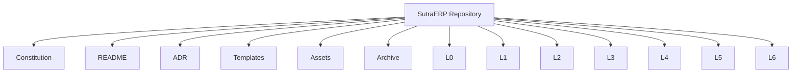
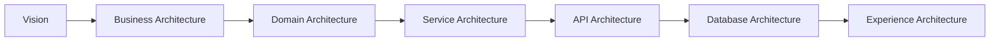
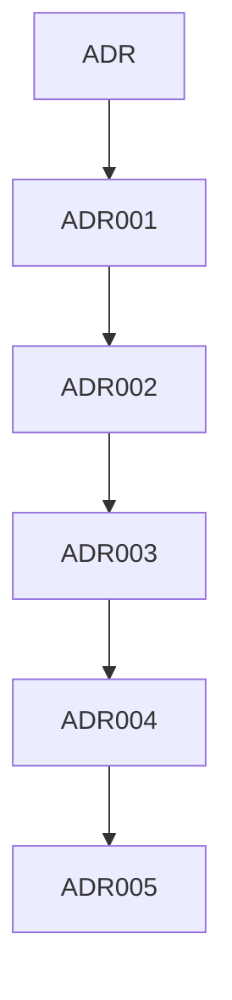
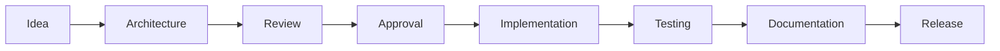
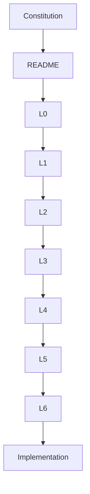
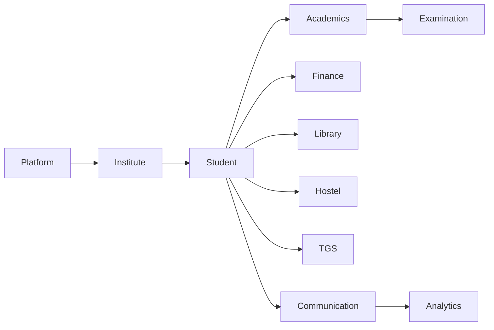

# SutraERP Repository Index

---

Version: 1.0

Status: LOCKED

Owner: Lead Architect

Purpose:
Central navigation document for the entire SutraERP repository.

---

# Repository Structure

---

# Repository Navigation

## Constitution

The Repository Constitution defines governance and engineering standards.

| Volume | Description |
|---------|-------------|
| Volume 1 | Governance & Principles |
| Volume 2 | Repository Standards |
| Volume 3 | Architectural Framework |
| Volume 4 | Engineering Governance |
| Volume 5 | Change Management & Repository Governance |
| Volume 6 | Repository Reference Manual |

---

# Architecture Levels

---

## Level 0

Strategic vision

Examples

- Vision
- Mission
- Product Strategy

---

## Level 1

Business Architecture

Current Modules

- Platform Foundation
- Institute Lifecycle
- Student Lifecycle
- Human Resource
- Academics
- Examination
- Finance
- Library
- Hostel
- Inventory
- CRM
- TGS
- Communication
- Analytics
- Security

---

## Level 2

Domain Architecture

Each Level 1 module expands into detailed domain documentation.

Example

Student Lifecycle

↓

Admission

↓

Enrollment

↓

Promotion

↓

Transfer

↓

Graduation

↓

Alumni

---

## Level 3

Service Architecture

Contains

- Application Services
- Domain Services
- Integration Services

---

## Level 4

API Architecture

Contains

- REST APIs
- Contracts
- DTOs
- Authentication
- API Versioning

---

## Level 5

Database Architecture

Contains

- Entity Models
- Database Schema
- Relationships
- Indexing
- Migration Strategy

---

## Level 6

Experience Architecture

Contains

- Student Portal

- Faculty Portal

- Parent Portal

- Admin Portal

- Mobile Apps

- Dashboards

---

# Architecture Decision Records

Every major architectural decision shall have an ADR.

---

# Templates

Available Templates

- L0 Template
- L1 Template
- L2 Template
- ADR Template
- API Template
- Database Template
- Workflow Template
- State Machine Template

---

# Repository Workflow

---

# Repository Dependency Flow

---

# Module Dependency Overview

---

# Repository Health

Repository should always maintain

- Constitutional Compliance
- Complete Documentation
- Updated ADRs
- Version Consistency
- Valid Mermaid Diagrams
- Cross References
- Traceability
- Dependency Integrity

---

# Quick Links

## Governance

- Repository Constitution

## Strategy

- Level 0

## Business

- Level 1

## Domain Design

- Level 2

## Services

- Level 3

## APIs

- Level 4

## Database

- Level 5

## Experience

- Level 6

## ADR

Architecture Decision Records

## Templates

Standard Documentation Templates

## Assets

Images and Diagrams

## Archive

Deprecated Documentation

---

# Repository Principles

The repository shall always remain

- Modular
- Traceable
- Version Controlled
- Technology Independent
- Domain Driven
- Well Documented
- AI Readable
- Human Readable

---

Status: LOCKED

END OF INDEX