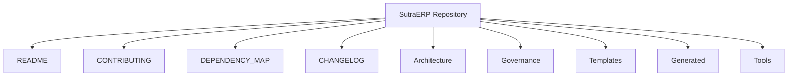
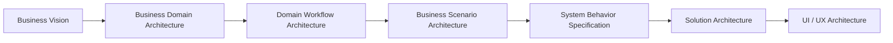
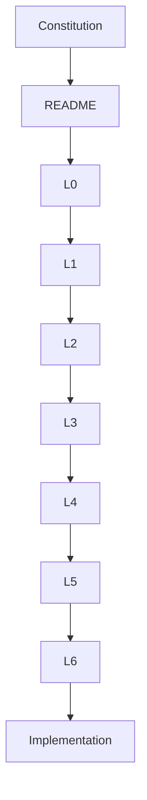

# SutraERP Repository Index

---

Version: 1.0

Status: LOCKED

Owner: Lead Architect

Purpose:
Central navigation document for the current SutraERP repository.

---

# Repository Structure

---

# Repository Navigation

## Governance

The Repository Constitution defines governance and engineering standards.

| Volume | Description |
|--------|-------------|
| Volume 1 | Governance & Principles |
| Volume 2 | Repository Standards |
| Volume 3 | Architectural Framework |
| Volume 4 | Engineering Governance |
| Volume 5 | Change Management & Repository Governance |
| Volume 6 | Repository Reference Manual |

---

# Canonical Architecture Hierarchy

| Level | Name | Definition |
|-------|------|------------|
| L0 | Business Vision | Defines why SutraERP exists, strategic intent, architectural context, and constraints. |
| L1 | Business Domain Architecture | Defines the canonical business domains, domain boundaries, and ownership. |
| L2 | Domain Workflow Architecture | Defines workflows, lifecycles, rules, and dependencies within an individual business domain. |
| L3 | Business Scenario Architecture | Defines independent end-to-end business scenarios that may derive information from one or many L2 workflow documents; L3 numbering is not dependent on L2 numbering. |
| L4 | System Behavior Specification | Defines expected system behavior for approved business scenarios without implementation design. |
| L5 | Solution Architecture | Defines engineering solution architecture needed to implement L4 behavior without changing business rules. |
| L6 | UI / UX Architecture | Defines user interaction, navigation, screens, and user journeys derived from L5 solution architecture without owning business logic. |

---

## Current Source Documents Present

- L0 Business Vision
- L1 Business Domain Architecture
- L2 Domain Workflow control artifacts and present section files

L3 through L6 are defined by the hierarchy but are not yet present as source documents in this workspace.

---

# Templates

Available templates in the current repository:

- L1 Business Domain Template
- L2 Domain Workflow Template
- L3 Business Scenario Template
- L4 System Behavior Template
- L5 Solution Architecture Template
- L6 UI / UX Template

---

# Repository Dependency Flow

---

# Repository Health

Repository health should always maintain:

- Constitutional compliance
- Complete cross references
- Version consistency
- Valid Mermaid diagrams
- Traceability
- Dependency integrity
- Ownership consistency
- Canonical terminology

---

# Quick Links

## Governance

- Repository Constitution

## Strategy

- Level 0 Business Vision

## Business Domain Architecture

- Level 1 Business Domain Architecture

## Domain Workflow Architecture

- Level 2 Domain Workflow Architecture

## Templates

- Standard Documentation Templates

---

# Repository Principles

The repository shall always remain:

- Modular
- Traceable
- Version controlled
- Technology independent at the business architecture level
- Domain driven
- Well documented
- AI readable
- Human readable

---

Status: LOCKED

END OF INDEX
