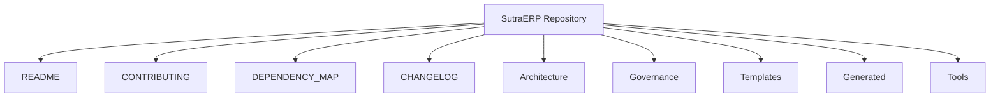
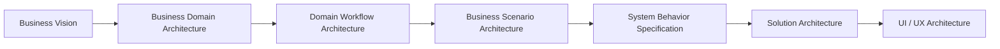
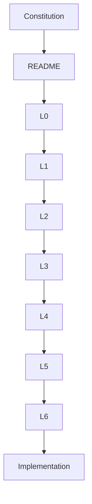

# SutraERP Repository Index

---

Version: 1.0

Status: LOCKED

Owner: Lead Architect

Purpose:
Central navigation document for the current SutraERP repository.

---

# Repository Structure

---

# Repository Navigation

## Governance

The Repository Constitution defines governance and engineering standards.

| Volume | Description |
|---------|-------------|
| Volume 1 | Governance & Principles |
| Volume 2 | Repository Standards |
| Volume 3 | Architectural Framework |
| Volume 4 | Engineering Governance |
| Volume 5 | Change Management & Repository Governance |
| Volume 6 | Repository Reference Manual |

---

# Architecture Levels

---

## Current Source Documents Present

- L0 Business Vision
- L1 Business Domain Architecture
- L2 Domain Workflow control artifacts and present section files

L3 through L6 are defined by the hierarchy but are not yet present as source documents in this workspace.

---

# Templates

Available templates in the current repository:

- L1 Business Domain Template
- L2 Domain Workflow Template
- L3 Business Scenario Template
- L4 System Behavior Template
- L5 Solution Architecture Template
- L6 UI / UX Template

---

# Repository Dependency Flow

---

# Repository Health

Repository health should always maintain:

- Constitutional Compliance
- Complete Cross References
- Version Consistency
- Valid Mermaid Diagrams
- Traceability
- Dependency Integrity

---

# Quick Links

## Governance
- Repository Constitution

## Strategy
- Level 0

## Business
- Level 1

## Domain Design
- Level 2

## Templates
- Standard Documentation Templates

---

# Repository Principles

The repository shall always remain:

- Modular
- Traceable
- Version Controlled
- Technology Independent at the business architecture level
- Domain Driven
- Well Documented
- AI Readable
- Human Readable

---

Status: LOCKED

END OF INDEX

