# SutraERP Repository Constitution
## Volume 3 — Architectural Framework

---

Version: 1.0

Status: LOCKED

Authority: Repository Constitution

Owner: Lead Architect

Depends On:

- Repository Constitution Volume 1
- Repository Constitution Volume 2

---

# 1. Purpose

This document defines the architectural framework used throughout the SutraERP platform.

It establishes how business domains are designed, how ownership is assigned, how domains communicate, how dependencies are managed, and how business architecture evolves.

Every Level 1 and Level 2 document shall conform to this framework.

---

# 2. Architecture Layers

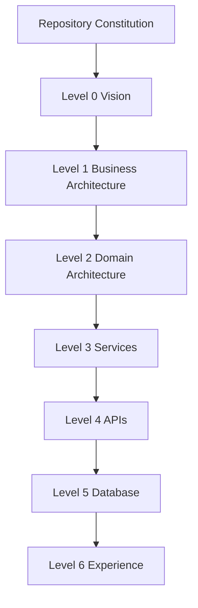

---

Business intent flows downward.

Implementation flows upward.

---

# 3. Domain Driven Architecture

SutraERP follows Domain Driven Design.

Every business capability belongs to one domain.

Every domain owns

- Business Rules
- Business Validation
- Business Lifecycle
- Canonical Entities
- Published Events
- Public Contracts

No domain owns another domain's data.

---

## Domain Model

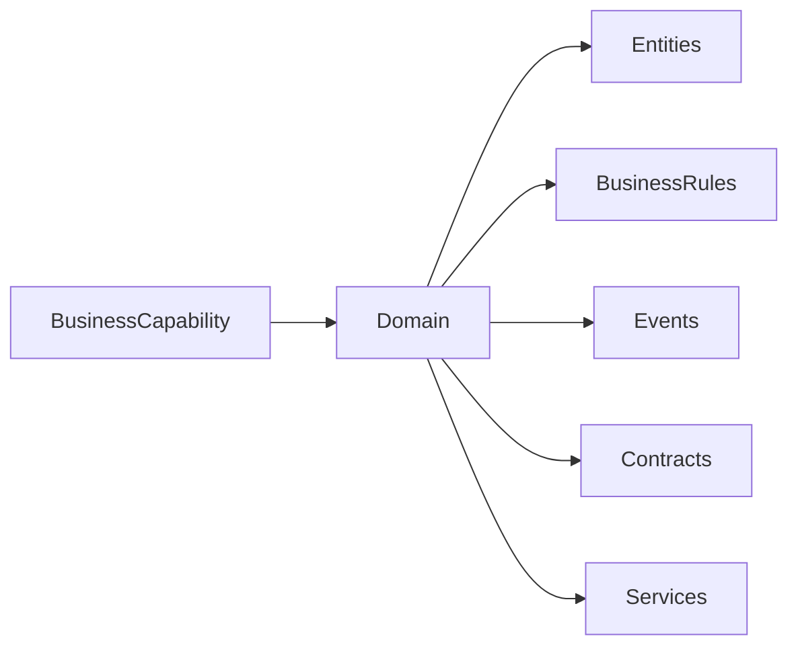

---

# 4. Domain Boundaries

Every domain shall remain autonomous.

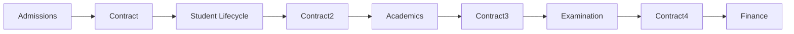

Domains communicate only through contracts.

---

# 5. Canonical Ownership

Every entity has one owner.

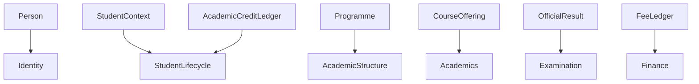

Ownership includes

- Create
- Modify
- Validate
- Delete (where applicable)
- Lifecycle

No shared ownership exists.

---

# 6. Cross Domain Communication

Two communication mechanisms exist.

## Request / Response

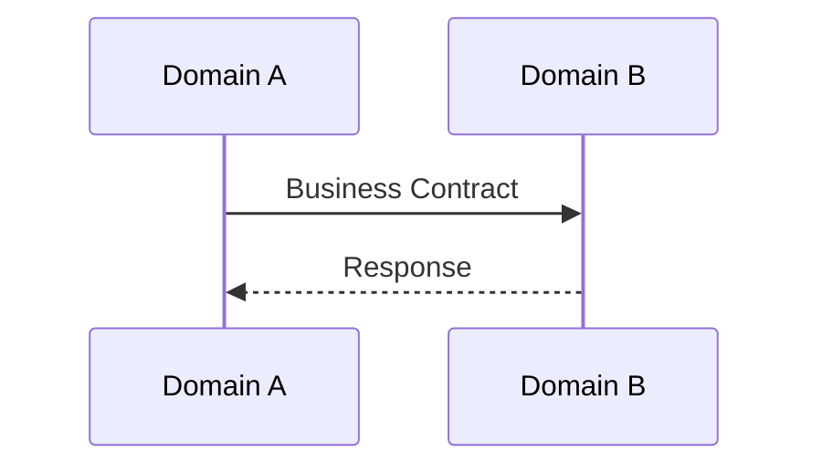

---

## Event Driven

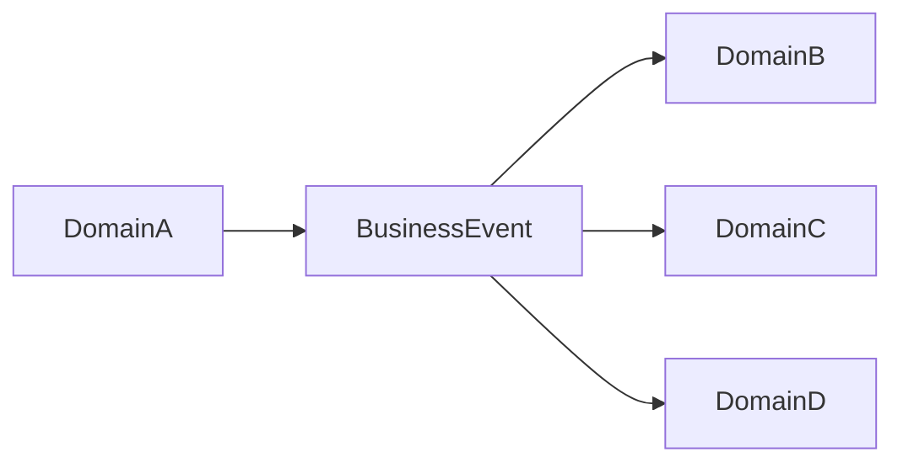

Events never expect responses.

---

# 7. Business Events

Business Events represent completed business facts.

Example

```text
AdmissionApproved

StudentActivated

AttendanceFinalized

ResultPublished

QualificationAwarded
```

Business Events

- Immutable
- Historical
- Versionable
- Publish Only

Events shall never be modified after publication.

---

# 8. Contracts

Business contracts expose capabilities.

Contracts

- validate requests
- return results
- never expose implementation

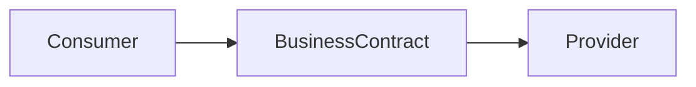

Contracts are synchronous.

Events are asynchronous.

---

# 9. Dependency Rules

Allowed dependency direction

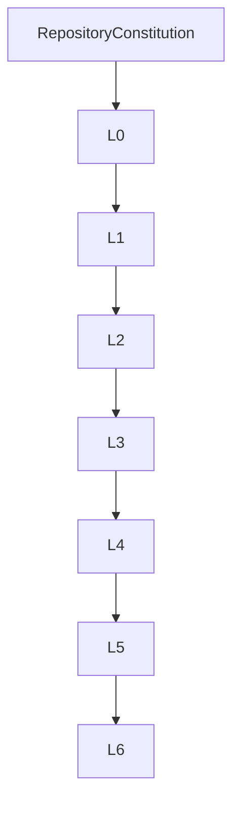

Reverse dependencies are prohibited.

---

# 10. Domain Dependency Rules

Dependencies shall form an acyclic graph.

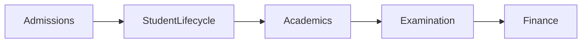

Forbidden

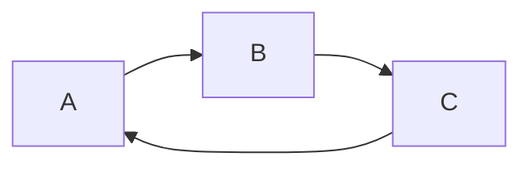

Circular dependencies are prohibited.

---

# 11. State Machines

Business lifecycles shall be represented using state diagrams.

Example

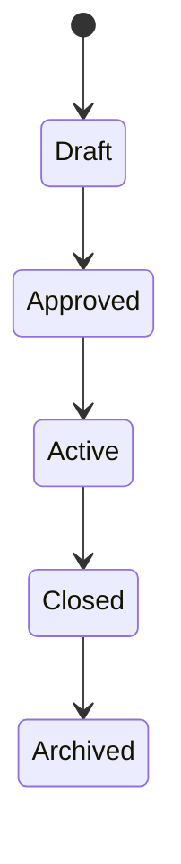

Every lifecycle entity shall define

- Initial State
- Valid Transitions
- Terminal States

---

# 12. Workflow Standards

Every workflow shall define

Inputs

↓

Validation

↓

Business Rules

↓

Processing

↓

Events

↓

Outputs

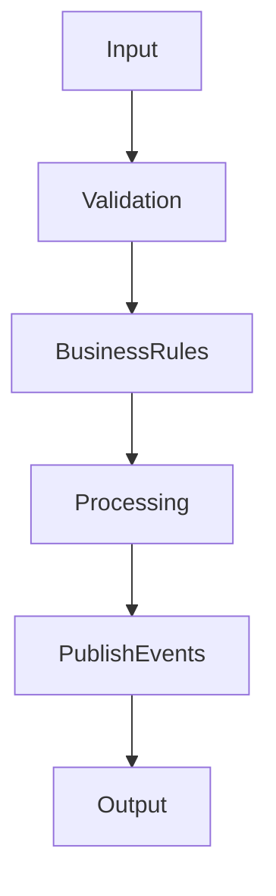

---

# 13. Business Rules

Business Rules belong only to Domains.

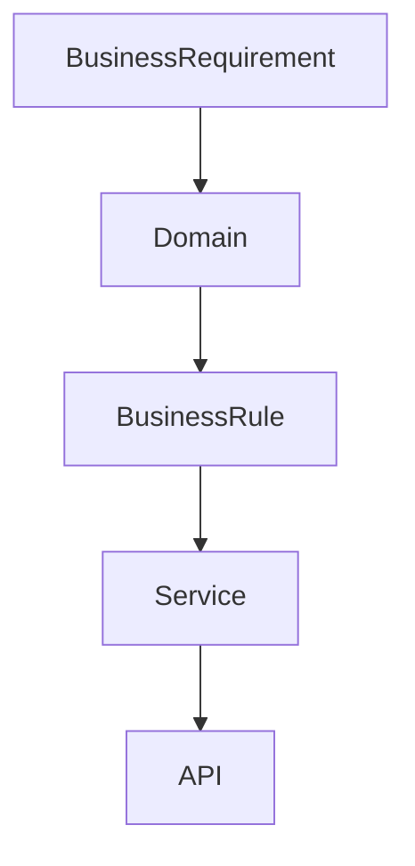

Business Rules shall never exist in

- API
- Database
- UI

---

# 14. Entity Lifecycle

Entities progress through controlled states.

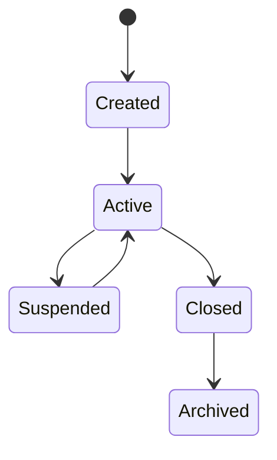

Historical records remain immutable.

---

# 15. Architecture Evolution

Architecture changes occur through controlled evolution.

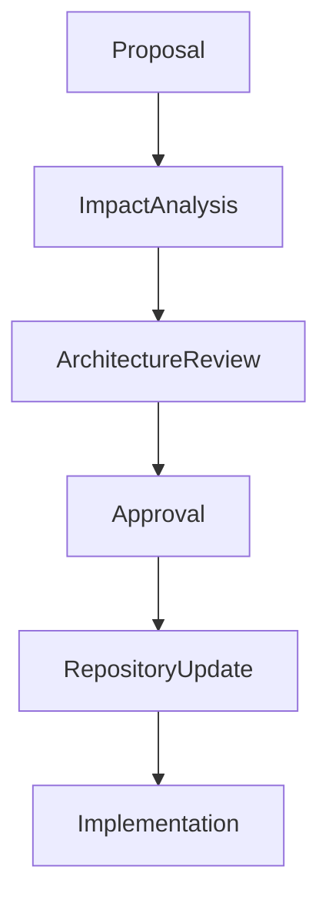

No architecture shall evolve through implementation-first development.

---

# 16. Architectural Constraints

The following constraints are permanent.

- Domain ownership is exclusive.
- Direct database sharing is prohibited.
- Shared business logic is prohibited.
- Duplicate entities are prohibited.
- Circular dependencies are prohibited.
- Historical records are immutable.
- Events are immutable.
- APIs do not own business rules.
- Databases do not own business rules.
- UI does not own business rules.

---

# 17. Domain Design Checklist

Every new domain shall define

- Purpose
- Scope
- Owner
- Canonical Entities
- Business Rules
- Workflows
- Contracts
- Events
- State Machines
- Dependencies
- Integration Points
- Locked Decisions

---

# 18. Domain Architecture Template

```text
Purpose

↓

Scope

↓

Actors

↓

Entities

↓

Business Rules

↓

Workflow

↓

State Machine

↓

Contracts

↓

Events

↓

Dependencies

↓

Locked Decisions
```

Every Level 2 document shall follow this structure.

---

# 19. Architectural Review Gates

Every architecture review shall validate

✓ Domain Ownership

✓ Entity Ownership

✓ Contracts

✓ Events

✓ Workflow

✓ State Machine

✓ Cross Domain Dependencies

✓ Version Compatibility

✓ Constitutional Compliance

---

# 20. Locked Architectural Principles

The following principles are constitutional.

- Domain Driven Design
- Canonical Ownership
- Contract First Integration
- Event Driven Collaboration
- Immutable History
- No Circular Dependencies
- Business Rules Owned By Domains
- Services Implement Business Rules
- APIs Expose Services
- Databases Persist State
- Experience Layer Consumes APIs

These principles may only be modified through a constitutional amendment.

---

Status: LOCKED

Authority Level: Architectural Framework

Next Document

Repository Constitution

Volume 4 — Engineering & Development Standards