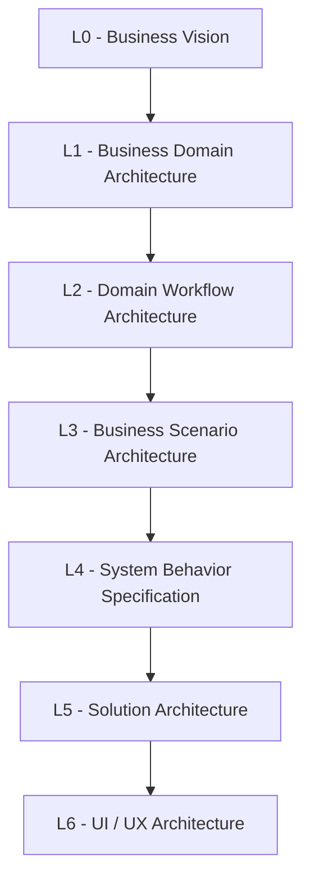
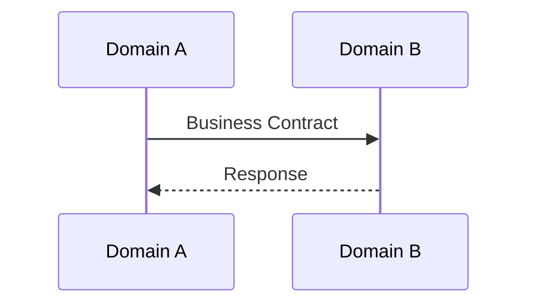
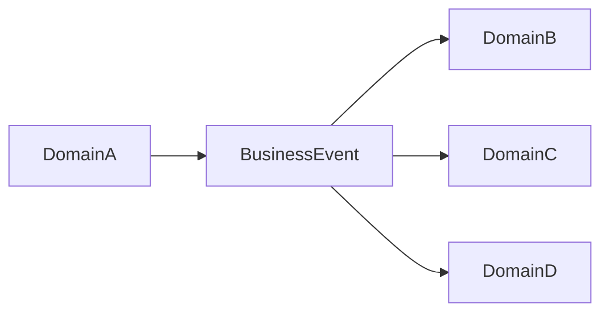
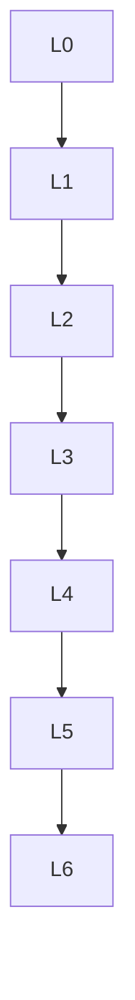

# SutraERP Repository Constitution
## Volume 3 - Architectural Framework

---

Version: 1.0

Status: LOCKED

Authority: Repository Constitution

Owner: Lead Architect

Depends On:

- Repository Constitution Volume 1
- Repository Constitution Volume 2

---

# 1. Purpose

This document defines the architectural framework used throughout the SutraERP platform.

It establishes how business domains are designed, how ownership is assigned, how domains communicate, how dependencies are managed, and how architecture evolves across L0 through L6.

Every architecture document shall conform to this framework.

---

# 2. Canonical Architecture Hierarchy



| Level | Name | Definition |
|-------|------|------------|
| L0 | Business Vision | Defines why SutraERP exists, strategic intent, architectural context, and constraints. |
| L1 | Business Domain Architecture | Defines the canonical business domains, domain boundaries, and ownership. |
| L2 | Domain Workflow Architecture | Defines workflows, lifecycles, rules, and dependencies within an individual business domain. |
| L3 | Business Scenario Architecture | Defines independent end-to-end business scenarios that may derive information from one or many L2 workflow documents; L3 numbering is not dependent on L2 numbering. |
| L4 | System Behavior Specification | Defines expected system behavior for approved business scenarios without implementation design. |
| L5 | Solution Architecture | Defines engineering solution architecture needed to implement L4 behavior without changing business rules. |
| L6 | UI / UX Architecture | Defines user interaction, navigation, screens, and user journeys derived from L5 solution architecture without owning business logic. |

Business intent flows downward.

Downstream design and implementation trace upward.

---

# 3. Domain Driven Architecture

SutraERP follows Domain Driven Design.

Every business capability belongs to one domain.

Every domain owns:

- Business rules
- Business validation
- Business lifecycle
- Canonical entities
- Published events
- Public contracts

No domain owns another domain's data.

---

# 4. Domain Boundaries

Every domain shall remain autonomous.

Domains communicate only through approved contracts and published events.

---

# 5. Canonical Ownership

Every entity has one owner.

Ownership includes:

- Create
- Modify
- Validate
- Delete where applicable
- Lifecycle

No shared ownership exists.

---

# 6. Multi-Domain Communication

Two communication mechanisms exist.

## Request / Response



## Event Driven



Events never expect responses.

---

# 7. Business Events

Business events represent completed business facts.

Examples:

```text
AdmissionApproved
StudentActivated
AttendanceFinalized
ExaminationResultPublished
QualificationAwarded
```

Business events are immutable, historical, versionable, and publish-only.

Events shall never be modified after publication.

---

# 8. Contracts

Business contracts expose capabilities.

Contracts validate requests, return results, and never expose implementation.

Contracts are synchronous. Events are asynchronous.

---

# 9. Dependency Rules

Allowed dependency direction:



Reverse dependencies are prohibited.

L3 Business Scenario Architecture is independent of L2 numbering. An L3 business scenario may derive information from one or many L2 workflow documents, but it shall not redefine L2 domain ownership or workflow logic.

---

# 10. Domain Dependency Rules

Dependencies shall form an acyclic graph.

Circular dependencies are prohibited.

Runtime event consumption does not transfer canonical ownership.

---

# 11. State Machines

Business lifecycles shall be represented using state diagrams.

Every lifecycle entity shall define:

- Initial state
- Valid transitions
- Terminal states

---

# 12. Workflow Standards

Every workflow shall define:

```text
Inputs
Validation
Business Rules
Processing
Events
Outputs
```

---

# 13. Business Rules

Business rules belong only to domains.

Business rules shall never be owned by APIs, databases, or UI.

---

# 14. Entity Lifecycle

Entities progress through controlled states.

Historical records remain immutable.

---

# 15. Architecture Evolution

Architecture changes occur through controlled evolution:

```text
Proposal
Impact Analysis
Architecture Review
Approval
Repository Update
Implementation
```

No architecture shall evolve through implementation-first development.

---

# 16. Architectural Constraints

The following constraints are permanent:

- Domain ownership is exclusive.
- Direct database sharing is prohibited.
- Shared business logic is prohibited.
- Duplicate entities are prohibited.
- Circular dependencies are prohibited.
- Historical records are immutable.
- Events are immutable.
- APIs do not own business rules.
- Databases do not own business rules.
- UI does not own business rules.

---

# 17. Domain Design Checklist

Every domain shall define:

- Purpose
- Scope
- Owner
- Canonical entities
- Business rules
- Workflows
- Contracts
- Events
- State machines
- Dependencies
- Integration points
- Locked decisions

---

# 18. Domain Workflow Architecture Template

Every Level 2 document shall define:

```text
Purpose
Scope
Actors
Entities
Business Rules
Workflow
State Machine
Contracts
Events
Dependencies
Locked Decisions
```

---

# 19. Architectural Review Gates

Every architecture review shall validate:

- Domain ownership
- Entity ownership
- Contracts
- Events
- Workflow
- State machine
- Multi-domain dependencies
- Version compatibility
- Constitutional compliance

---

# 20. Locked Architectural Principles

The following principles are constitutional:

- Domain Driven Design
- Canonical Ownership
- Contract First Integration
- Event Driven Collaboration
- Immutable History
- No Circular Dependencies
- Business Rules Owned By Domains
- Services Implement Business Rules
- APIs Expose Services
- Databases Persist State
- UI / UX Consumes APIs

These principles may only be modified through a constitutional amendment.

---

Status: LOCKED

Authority Level: Architectural Framework

Next Document:

Repository Constitution

Volume 4 - Engineering & Development Standards
