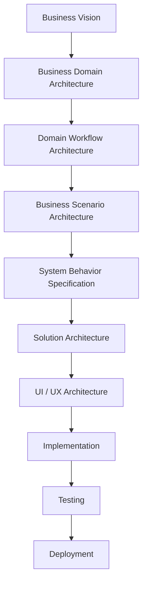
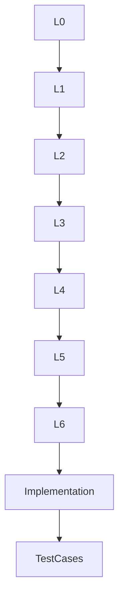

# SutraERP Repository Constitution
## Volume 4 - Engineering Governance

---

Version: 1.0

Status: LOCKED

Authority: Repository Constitution

Owner: Lead Architect

Depends On:

- Repository Constitution Volume 1
- Repository Constitution Volume 2
- Repository Constitution Volume 3

---

# 1. Purpose

This document establishes the engineering governance model for SutraERP.

It defines how architecture is translated into engineering deliverables while preserving consistency, traceability, quality, and maintainability.

This volume governs engineering practices without prescribing specific technologies.

---

# 2. Canonical Architecture Hierarchy

```text
L0 -> L1 -> L2 -> L3 -> L4 -> L5 -> L6
```

| Level | Name | Definition |
|-------|------|------------|
| L0 | Business Vision | Defines why SutraERP exists, strategic intent, architectural context, and constraints. |
| L1 | Business Domain Architecture | Defines the canonical business domains, domain boundaries, and ownership. |
| L2 | Domain Workflow Architecture | Defines workflows, lifecycles, rules, and dependencies within an individual business domain. |
| L3 | Business Scenario Architecture | Defines independent end-to-end business scenarios that may derive information from one or many L2 workflow documents; L3 numbering is not dependent on L2 numbering. |
| L4 | System Behavior Specification | Defines expected system behavior for approved business scenarios without implementation design. |
| L5 | Solution Architecture | Defines engineering solution architecture needed to implement L4 behavior without changing business rules. |
| L6 | UI / UX Architecture | Defines user interaction, navigation, screens, and user journeys derived from L5 solution architecture without owning business logic. |

---

# 3. Engineering Hierarchy



Every engineering activity shall originate from an approved architectural artifact.

---

# 4. Engineering Principles

Engineering within SutraERP shall follow these principles:

- Architecture First
- Implementation Second
- Testability
- Traceability
- Reusability
- Simplicity
- Security by Design
- Performance by Design
- Documentation First
- Automation Wherever Possible

---

# 5. Engineering Lifecycle

```text
Architecture
Design
Implementation
Testing
Review
Deployment
Monitoring
Improvement
```

Implementation shall never bypass architecture.

---

# 6. Traceability Model

Every engineering artifact shall trace back to an architectural source:



No implementation shall exist without architectural traceability.

---

# 7. Engineering Deliverables

Each architectural level produces specific deliverables.

| Level | Deliverable |
|-------|-------------|
| L0 | Business Vision |
| L1 | Business Domain Architecture |
| L2 | Domain Workflow Architecture |
| L3 | Business Scenario Architecture |
| L4 | System Behavior Specification |
| L5 | Solution Architecture |
| L6 | UI / UX Architecture |
| Engineering | Source Code |
| QA | Test Artifacts |

---

# 8. Review Workflow

```text
Developer
Pull Request
Architecture Review
Technical Review
Testing
Approval
Merge
```

No code shall be merged without successful review.

---

# 9. Architecture Compliance

Every implementation shall verify:

- Domain ownership
- Entity ownership
- Service boundaries
- API contracts
- Database consistency
- Event definitions

Implementation shall not redefine architecture.

---

# 10. Dependency Governance

Architecture dependencies shall flow through:

```text
L0 -> L1 -> L2 -> L3 -> L4 -> L5 -> L6
```

Implementation dependencies must preserve the architectural decisions defined by those levels.

Reverse architectural dependencies are prohibited.

---

# 11. Service Isolation

Every service shall own:

- Business logic
- Validation
- Transactions
- Event publication

Business logic shall never exist in the API layer.

---

# 12. API Governance

APIs expose capabilities.

They do not contain business rules.

---

# 13. Database Governance

Databases persist state.

Databases do not define business behavior.

---

# 14. Event Governance

Events represent completed business facts.

Rules:

- Immutable
- Timestamped
- Versioned
- Never edited

---

# 15. Error Handling Strategy

Engineering shall classify errors as validation errors, business errors, infrastructure errors, or unexpected failures.

Each category shall have standardized handling.

---

# 16. Security Governance

Security applies across every engineering layer.

Security shall be designed into the system rather than added later.

---

# 17. Testing Hierarchy

Architecture shall be validated through automated testing wherever practical.

Testing includes unit tests, integration tests, domain tests, end-to-end tests, regression tests, and acceptance tests.

---

# 18. Observability

Engineering shall provide:

- Logging
- Metrics
- Tracing
- Health checks
- Audit logs

---

# 19. Release Governance

Every production release shall be reproducible and traceable.

---

# 20. Quality Gates

Every engineering artifact shall satisfy:

- Architectural compliance
- Code review
- Test coverage
- Security validation
- Documentation updated
- Version updated
- Dependency validation
- No breaking contracts
- Performance validation

---

# 21. Engineering Checklist

Every implementation shall answer:

- Which architectural document does this implement
- Which domain owns it
- Which entities change
- Which contracts change
- Which events change
- Which APIs change
- Which database objects change
- Which documents require updates

---

# 22. Engineering Anti-Patterns

The following practices are prohibited:

- Business logic inside controllers
- Business logic inside UI
- Shared mutable databases across domains
- Circular service dependencies
- Direct database access across domains
- Duplicate business rules
- Undocumented APIs
- Hidden architectural decisions
- Hard-coded institutional behavior

---

# 23. Locked Engineering Principles

The following principles are constitutional:

- Architecture precedes implementation.
- Engineering shall implement architecture.
- Every implementation shall be traceable.
- Business rules belong to domain services.
- APIs expose capabilities only.
- Databases persist state only.
- UI / UX consumes APIs only.
- Every implementation requires review.
- Every implementation requires documentation updates.
- Every release shall be reproducible.

---

Status: LOCKED

Authority Level: Engineering Governance

Next Document:

Repository Constitution

Volume 5 - Contribution, Change Management & Architecture Decision Records
