# SutraERP Repository Constitution
## Volume 4 — Engineering Governance

---

Version: 1.0

Status: LOCKED

Authority: Repository Constitution

Owner: Lead Architect

Depends On:

- Repository Constitution Volume 1
- Repository Constitution Volume 2
- Repository Constitution Volume 3

---

# 1. Purpose

This document establishes the engineering governance model for SutraERP.

It defines how architecture is translated into engineering deliverables while preserving consistency, traceability, quality, and maintainability.

This volume governs engineering practices without prescribing specific technologies.

---

# 2. Engineering Hierarchy

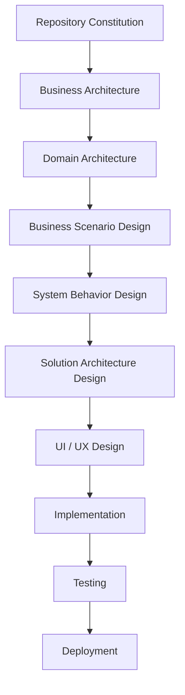

Every engineering activity shall originate from an approved architectural artifact.

---

# 3. Engineering Principles

Engineering within SutraERP shall follow these principles.

- Architecture First
- Implementation Second
- Testability
- Traceability
- Reusability
- Simplicity
- Security by Design
- Performance by Design
- Documentation First
- Automation Wherever Possible

---

# 4. Engineering Lifecycle

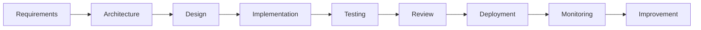

Implementation shall never bypass architecture.

---

# 5. Traceability Model

Every engineering artifact shall trace back to an architectural source.

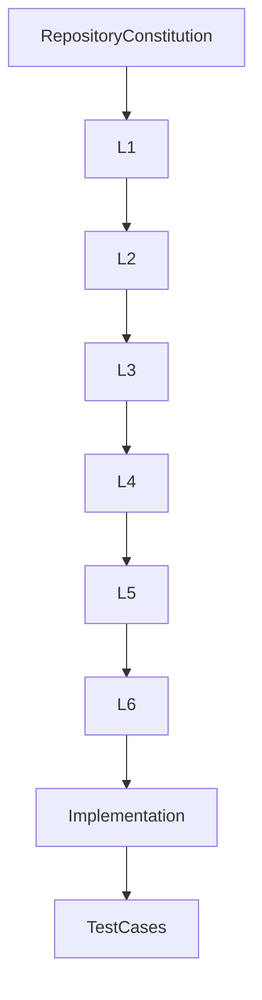

No implementation shall exist without architectural traceability.

---

# 6. Repository Branching Model

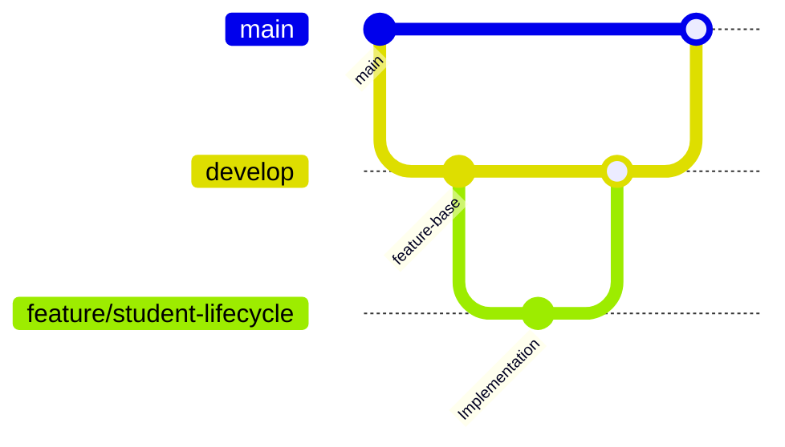

Protected branches

- main
- develop

Feature work shall occur on isolated branches.

---

# 7. Engineering Deliverables

Each architectural level produces specific deliverables.

| Level | Deliverable |
|--------|-------------|
| Constitution | Governance |
| L0 | Vision |
| L1 | Business Architecture |
| L2 | Domain Design |
| L3 | Business Scenarios |
| L4 | System Behavior |
| L5 | Solution Architecture |
| L6 | UI / UX |
| Engineering | Source Code |
| QA | Test Artifacts |

---

# 8. Review Workflow

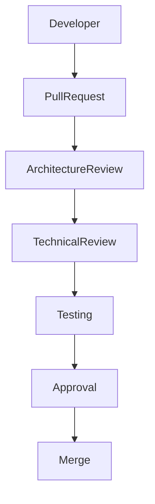

No code shall be merged without successful review.

---

# 9. Architecture Compliance

Every implementation shall verify

- Domain Ownership
- Entity Ownership
- Service Boundaries
- API Contracts
- Database Consistency
- Event Definitions

Implementation shall not redefine architecture.

---

# 10. Dependency Governance

Dependencies shall only flow downward.

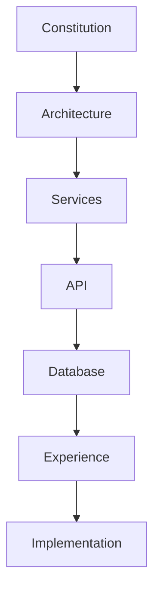

Reverse dependencies are prohibited.

---

# 11. Service Isolation

Every service shall own

- Business Logic
- Validation
- Transactions
- Event Publication

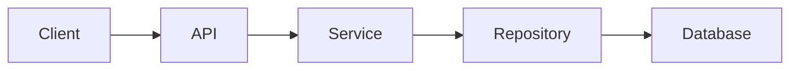

Business logic shall never exist in the API layer.

---

# 12. API Governance

APIs expose capabilities.

They do not contain business rules.

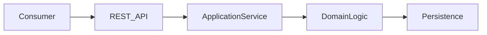

---

# 13. Database Governance

Databases persist state.

Databases do not define business behaviour.

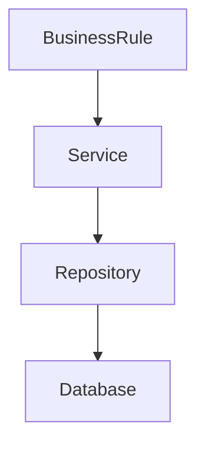

---

# 14. Event Governance

Events represent completed business facts.

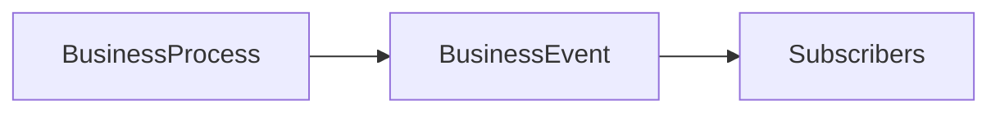

Rules

- Immutable
- Timestamped
- Versioned
- Never Edited

---

# 15. Error Handling Strategy

Engineering shall classify errors.

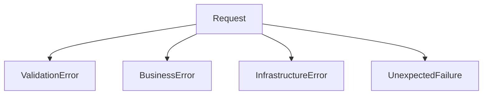

Each category shall have standardized handling.

---

# 16. Security Governance

Security applies across every engineering layer.

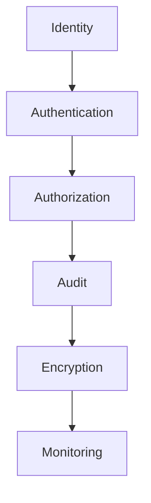

Security shall be designed into the system rather than added later.

---

# 17. Testing Hierarchy

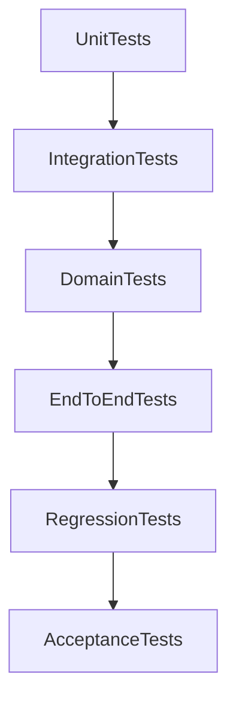

Architecture shall be validated through automated testing wherever practical.

---

# 18. Observability

Engineering shall provide

- Logging
- Metrics
- Tracing
- Health Checks
- Audit Logs

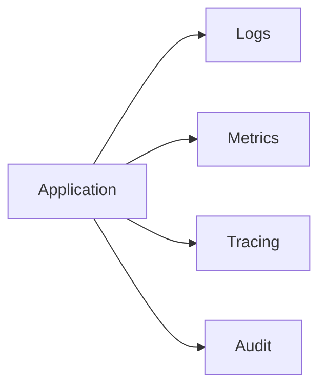

---

# 19. Release Governance

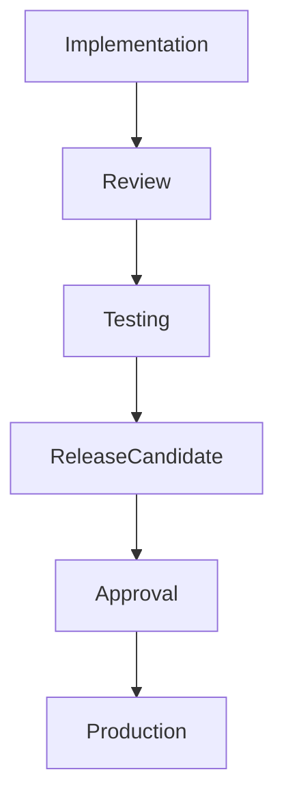

Every production release shall be reproducible and traceable.

---

# 20. Quality Gates

Every engineering artifact shall satisfy

- Architectural Compliance
- Code Review
- Test Coverage
- Security Validation
- Documentation Updated
- Version Updated
- Dependency Validation
- No Breaking Contracts
- Performance Validation

---

# 21. Engineering Checklist

Every implementation shall answer

- Which architectural document does this implement
- Which domain owns it
- Which entities change
- Which contracts change
- Which events change
- Which APIs change
- Which database objects change
- Which documents require updates

---

# 22. Engineering Anti-Patterns

The following practices are prohibited.

- Business logic inside controllers
- Business logic inside UI
- Shared mutable databases across domains
- Circular service dependencies
- Direct database access across domains
- Duplicate business rules
- Undocumented APIs
- Hidden architectural decisions
- Hard-coded institutional behaviour

---

# 23. Engineering Governance Principles

Engineering shall always prioritize

- Maintainability
- Traceability
- Simplicity
- Testability
- Modularity
- Security
- Performance
- Documentation

---

# 24. Locked Engineering Principles

The following principles are constitutional.

- Architecture precedes implementation.
- Engineering shall implement architecture.
- Every implementation shall be traceable.
- Business rules belong to domain services.
- APIs expose capabilities only.
- Databases persist state only.
- Experience consumes APIs only.
- Every implementation requires review.
- Every implementation requires documentation updates.
- Every release shall be reproducible.

---

Status: LOCKED

Authority Level: Engineering Governance

Next Document

Repository Constitution

Volume 5 — Contribution, Change Management & Architecture Decision Records
