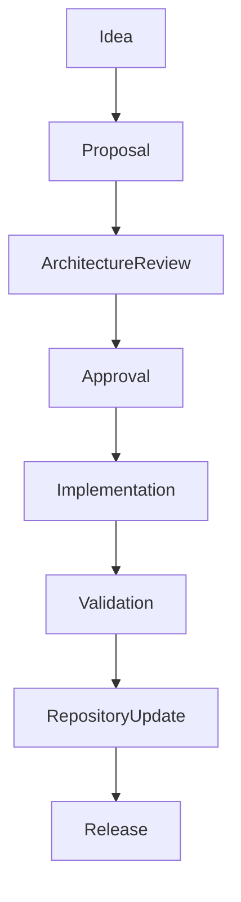
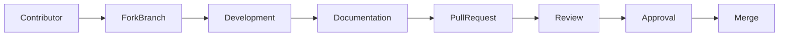
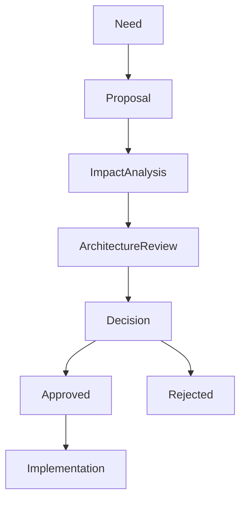
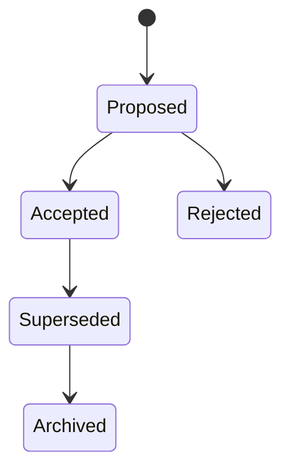
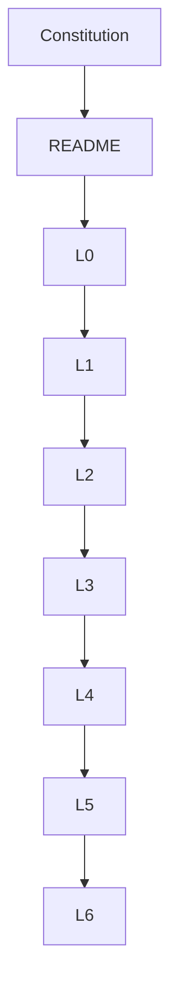
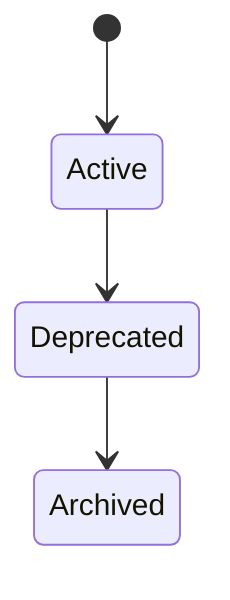
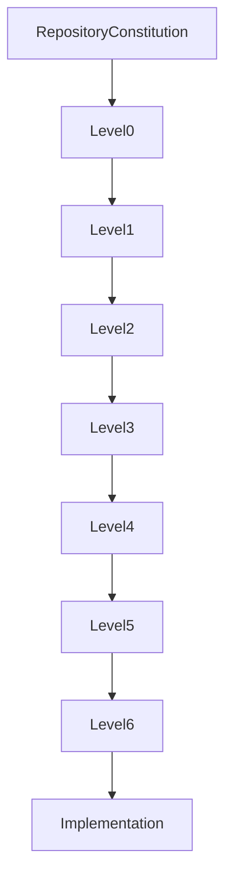
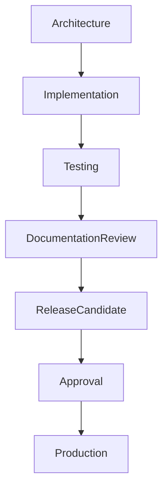
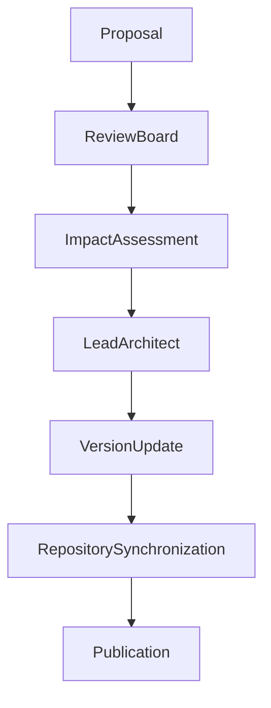

# SutraERP Repository Constitution
## Volume 5 — Change Management & Repository Governance

---

Version: 1.0

Status: LOCKED

Authority: Repository Constitution

Owner: Lead Architect

Depends On:

- Repository Constitution Volume 1
- Repository Constitution Volume 2
- Repository Constitution Volume 3
- Repository Constitution Volume 4

---

# 1. Purpose

This document governs how the SutraERP repository evolves.

It defines architectural change management, review procedures, contribution workflows, decision records, deprecation policies, release governance, AI collaboration, and repository maintenance.

No architectural change shall bypass this governance model.

---

# 2. Repository Governance Model



Every repository modification follows this lifecycle.

---

# 3. Contribution Workflow

Every contribution shall follow the same process.



---

# 4. Repository Roles

| Role | Responsibility |
|-------|----------------|
| Lead Architect | Repository Constitution |
| Domain Architect | Domain Architecture |
| Technical Lead | Service Architecture |
| Developer | Implementation |
| Reviewer | Quality Assurance |
| Maintainer | Repository Health |

Each artifact has exactly one owner.

---

# 5. Architectural Change Process

Every architectural change begins with a proposal.



No implementation shall precede approval.

---

# 6. Change Categories

Changes are classified as

### Major

Breaking architectural changes

Examples

- Domain restructuring
- Ownership transfer
- Repository reorganization

---

### Minor

New architectural capability

Examples

- New module
- New workflow
- New entity

---

### Patch

Corrections

Clarifications

Documentation improvements

Examples

- Typographical corrections
- Diagram improvements
- Better explanations

---

# 7. Architecture Decision Records (ADR)

Every significant architectural decision shall be documented.

Repository Structure

```text
/docs/ADR/

ADR-001

ADR-002

ADR-003

...
```

Example

```text
ADR-001

Title

Canonical Student Ownership

Status

Accepted

Decision

Student Lifecycle owns Student Context.

Consequences

All domains consume Student Context via contracts.
```

---

# 8. ADR Lifecycle



ADR history is immutable.

---

# 9. Repository Review Board

Architecture Review Board consists of

- Lead Architect
- Domain Architects
- Technical Leads

Responsibilities

- Review architecture
- Resolve conflicts
- Approve constitutional changes
- Protect repository consistency

---

# 10. Merge Policy

No merge shall occur without

- Documentation updated
- Architecture reviewed
- Dependencies validated
- Version incremented
- ADR added (if required)

---

# 11. Repository Synchronization

Whenever architecture changes,

the following documents shall be reviewed.



Repository consistency is mandatory.

---

# 12. AI Collaboration Rules

AI assistants shall

- Respect locked decisions.
- Never redefine ownership.
- Search existing documentation first.
- Reuse canonical entities.
- Avoid duplication.
- Preserve traceability.
- Update dependencies.
- Keep diagrams synchronized.
- Never invent conflicting terminology.
- Request clarification if constitutional conflicts exist.

AI-generated architecture always requires human review.

---

# 13. Repository Maintenance

Repository maintenance includes

- Broken links
- Version consistency
- Diagram validation
- Dependency updates
- Archive management
- ADR indexing
- Documentation cleanup

Maintenance is continuous.

---

# 14. Deprecation Policy

Deprecated artifacts remain readable.

They are never immediately removed.

Lifecycle



Deprecation shall include

- Reason
- Replacement
- Effective version
- Migration guidance

---

# 15. Conflict Resolution

When conflicts occur,

priority order applies.



Higher authority always prevails.

---

# 16. Release Governance



Documentation is part of every release.

---

# 17. Repository Audit

Repository audits verify

- Constitutional compliance
- Documentation quality
- Architectural consistency
- Dependency correctness
- Ownership integrity
- Version consistency
- ADR completeness

Audits should occur before major releases.

---

# 18. Repository Metrics

The repository shall monitor

- Documentation coverage
- Architectural debt
- ADR count
- Dependency complexity
- Circular dependency count
- Review completion
- Documentation freshness

Metrics support continuous improvement.

---

# 19. Emergency Changes

Emergency changes may bypass normal implementation timelines but shall not bypass architectural governance.

Requirements

- Document reason
- Record impact
- Create ADR
- Complete post-change review

---

# 20. Constitutional Amendments

Only the Lead Architect may approve amendments to the Repository Constitution.

Process



---

# 21. Repository Evolution

The repository shall evolve through

- Controlled governance
- Incremental improvements
- Backward compatibility where practical
- Documented architectural decisions

Uncontrolled evolution is prohibited.

---

# 22. Locked Governance Principles

The following principles are constitutional.

- Every architectural change requires review.
- Every significant decision requires an ADR.
- Every implementation requires documentation updates.
- Deprecated artifacts shall be archived, not deleted.
- AI-generated architecture requires human approval.
- Repository synchronization is mandatory after architectural change.
- Repository hierarchy shall never be violated.
- Constitutional amendments require Lead Architect approval.

---

Status: LOCKED

Authority Level: Repository Governance

Next Document

Repository Constitution

Volume 6 — Repository Glossary, Canonical Terminology & Appendices