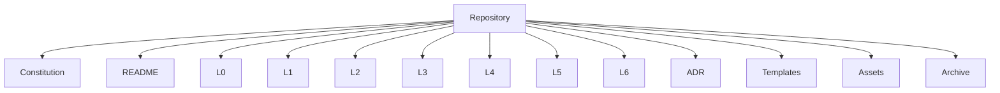
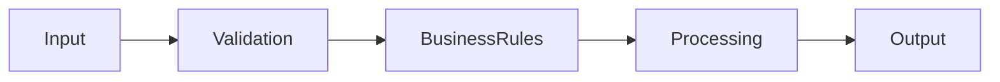
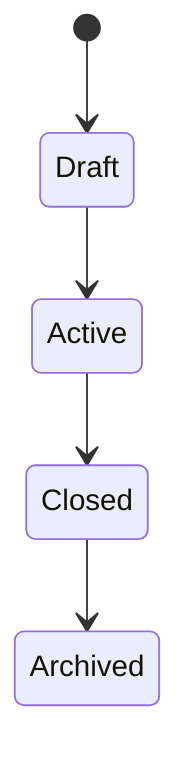
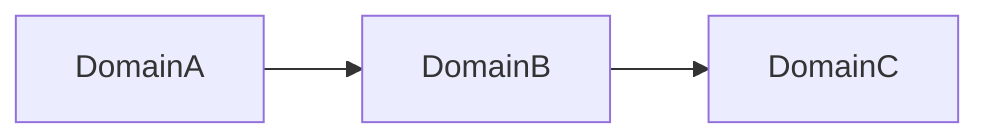
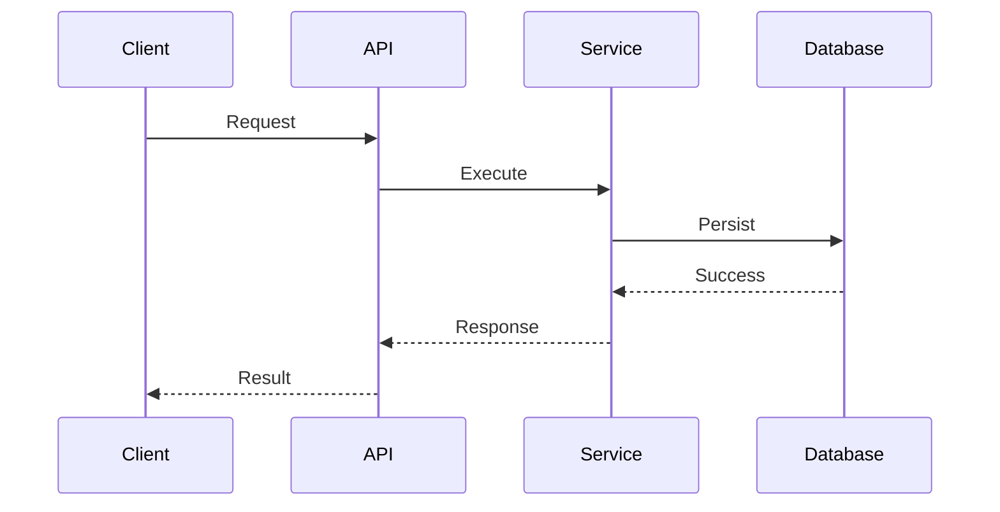
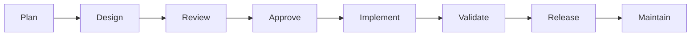
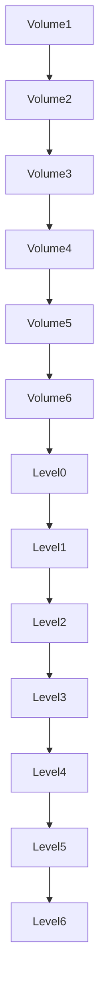

# SutraERP Repository Constitution
## Volume 6 — Repository Reference Manual

---

Version: 1.0

Status: LOCKED

Authority: Repository Constitution

Owner: Lead Architect

Depends On:

- Volume 1
- Volume 2
- Volume 3
- Volume 4
- Volume 5

---

# 1. Purpose

This volume serves as the permanent reference manual for the SutraERP repository.

It standardizes terminology, document templates, repository structure, architectural checklists, naming conventions, and reference material used throughout the project.

This volume is informative but authoritative regarding terminology and templates.

---

# 2. Repository Folder Structure

```text
SutraERP/

│

├── Constitution/

│   ├── Volume1.md

│   ├── Volume2.md

│   ├── Volume3.md

│   ├── Volume4.md

│   ├── Volume5.md

│   └── Volume6.md

│

├── README.md

│

├── L0/

├── L1/

├── L2/

├── L3/

├── L4/

├── L5/

├── L6/

│

├── ADR/

│

├── Assets/

│

├── Templates/

│

└── Archive/
```

---

# 3. Repository Map



---

# 4. Canonical Terminology

| Term | Meaning |
|-------|---------|
| Domain | Independent business capability |
| Entity | Business object with identity |
| Aggregate | Consistent business boundary |
| Contract | Public capability exposed by a domain |
| Event | Completed business fact |
| Workflow | Ordered business process |
| Lifecycle | Valid state transitions |
| Canonical Owner | Single authoritative owner |
| ADR | Architecture Decision Record |
| Context | Logical business boundary |

---

# 5. Standard Abbreviations

| Abbreviation | Meaning |
|-------------|---------|
| L0 | Vision |
| L1 | Business Architecture |
| L2 | Domain Architecture |
| L3 | Service Architecture |
| L4 | API Architecture |
| L5 | Database Architecture |
| L6 | Experience Architecture |
| ADR | Architecture Decision Record |
| API | Application Programming Interface |
| DDD | Domain Driven Design |

---

# 6. Standard Templates

Repository includes templates for

- Level 0
- Level 1
- Level 2
- ADR
- API
- Database
- Workflow
- State Machine

---

# 7. Standard Mermaid Templates

## Business Workflow



---

## State Machine



---

## Domain Dependency



---

## Event Flow


---

## Sequence Diagram



---

# 8. Standard Document Structure

Every architecture document should contain

```text
Purpose

Scope

Actors

Entities

Business Rules

Workflow

State Machine

Contracts

Events

Dependencies

Examples

Locked Decisions
```

---

# 9. Architecture Checklist

Before locking a document verify

☐ Metadata

☐ Version

☐ Dependencies

☐ Mermaid diagrams

☐ Canonical ownership

☐ Events

☐ Contracts

☐ State Machine

☐ Traceability

☐ Cross references

---

# 10. Pull Request Checklist

Before merging

☐ Documentation updated

☐ ADR created (if needed)

☐ Version updated

☐ Diagrams updated

☐ Dependencies updated

☐ README updated

☐ Tests completed

☐ Review approved

---

# 11. Architectural Quality Checklist

Every architecture shall satisfy

- Modular
- Traceable
- Testable
- Extendable
- Technology Independent
- Domain Driven
- Documented
- Reviewable

---

# 12. Repository Health Indicators

Repository health is evaluated through

```mermaid
mindmap

root((Repository))

Documentation

Architecture

Dependencies

Reviews

Versioning

ADRs

Tests

Diagrams
```

---

# 13. Repository Lifecycle



---

# 14. Constitution Hierarchy



---

# 15. Constitutional Summary

The Constitution establishes

- Governance
- Repository Standards
- Architectural Framework
- Engineering Governance
- Change Management
- Repository Reference Standards

Every repository artifact derives from these six constitutional volumes.

---

# 16. Future Expansion

Future constitutional volumes may be added if required.

Examples

- Security Constitution
- Compliance Constitution
- Enterprise Integration Constitution

These shall not replace existing constitutional volumes.

---

# 17. Final Constitutional Declaration

The SutraERP Repository Constitution represents the highest authority governing the repository.

Every document, architectural decision, implementation, review, release, and contribution shall conform to this Constitution.

Conflicts shall always be resolved in favor of the Constitution.

---

Status: LOCKED

Authority Level: Repository Constitution

END OF CONSTITUTION