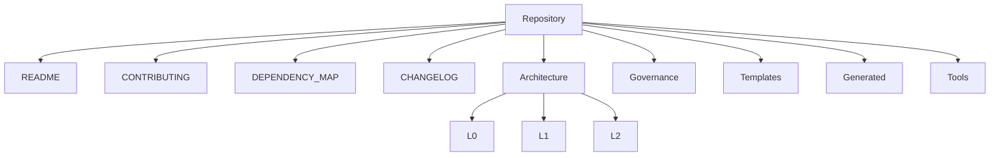
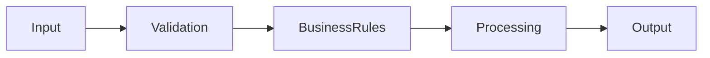
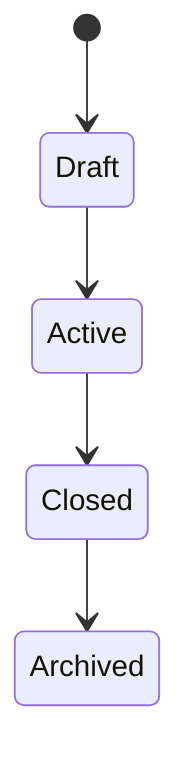
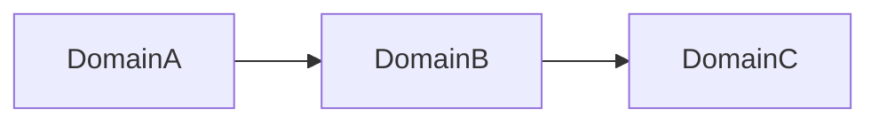
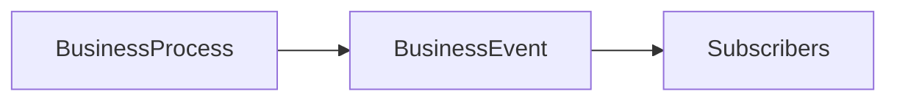
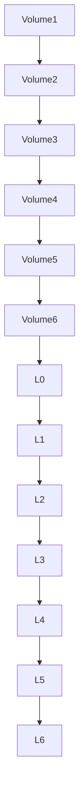

# SutraERP Repository Constitution
## Volume 6 - Repository Reference Manual

---

Version: 1.0

Status: LOCKED

Authority: Repository Constitution

Owner: Lead Architect

Depends On:

- Volume 1
- Volume 2
- Volume 3
- Volume 4
- Volume 5

---

# 1. Purpose

This volume serves as the permanent reference manual for the SutraERP repository.

It standardizes terminology, template references, repository structure, architectural checklists, naming conventions, and other reference material used throughout the project.

This volume is authoritative for terminology and repository reference conventions.

---

# 2. Current Repository Folder Structure

```text
SutraERP/
|
|-- README.md
|-- CONTRIBUTING.md
|-- DEPENDENCY_MAP.md
|-- CHANGELOG.md
|
|-- architecture/
|   |-- ARCHITECTURE_INDEX.md
|   |-- migration_report.md
|   |-- L0_Business_Vision/
|   |-- L1_Business_Domain_Architecture/
|   `-- L2_Domain_Workflow_Architecture/
|
|-- governance/
|   `-- constitution/
|
|-- templates/
|-- generated/
`-- tools/
```

Planned folders such as `ADR/`, `assets/`, and `archive/` are not part of the current repository structure until they are created.

---

# 3. Canonical Architecture Hierarchy

```text
L0 -> L1 -> L2 -> L3 -> L4 -> L5 -> L6
```

| Level | Name | Definition |
|-------|------|------------|
| L0 | Business Vision | Defines why SutraERP exists, strategic intent, architectural context, and constraints. |
| L1 | Business Domain Architecture | Defines the canonical business domains, domain boundaries, and ownership. |
| L2 | Domain Workflow Architecture | Defines workflows, lifecycles, rules, and dependencies within an individual business domain. |
| L3 | Business Scenario Architecture | Defines independent end-to-end business scenarios that may derive information from one or many L2 workflow documents; L3 numbering is not dependent on L2 numbering. |
| L4 | System Behavior Specification | Defines expected system behavior for approved business scenarios without implementation design. |
| L5 | Solution Architecture | Defines engineering solution architecture needed to implement L4 behavior without changing business rules. |
| L6 | UI / UX Architecture | Defines user interaction, navigation, screens, and user journeys derived from L5 solution architecture without owning business logic. |

---

# 4. Repository Map



---

# 5. Canonical Terminology

| Term | Meaning |
|------|---------|
| Domain | Independent business capability |
| Entity | Business object with identity |
| Contract | Public capability exposed by a domain |
| Event | Completed business fact |
| Workflow | Ordered business process within a domain |
| Business Scenario | Independent end-to-end business scenario that may derive from one or many L2 workflow documents |
| Lifecycle | Valid state transitions |
| Canonical Owner | Single authoritative owner |
| Context | Logical business boundary |
| Enterprise Resource Management | Section J domain for vendor, supplier, procurement, inventory, stock, warehouse, asset lifecycle, and resource management |
| Qualification Completion | Canonical term for completion of academic qualification |

---

# 6. Standard Abbreviations

| Abbreviation | Meaning |
|--------------|---------|
| L0 | Business Vision |
| L1 | Business Domain Architecture |
| L2 | Domain Workflow Architecture |
| L3 | Business Scenario Architecture |
| L4 | System Behavior Specification |
| L5 | Solution Architecture |
| L6 | UI / UX Architecture |
| ADR | Architecture Decision Record |
| API | Application Programming Interface |
| DDD | Domain Driven Design |

---

# 7. Standard Templates

The repository currently includes templates for:

- L1 Business Domain Architecture
- L2 Domain Workflow Architecture
- L3 Business Scenario Architecture
- L4 System Behavior Specification
- L5 Solution Architecture
- L6 UI / UX Architecture

No ADR-specific template is present in the current workspace.

---

# 8. Standard Mermaid Templates

## Business Workflow



## State Machine



## Domain Dependency



## Event Flow



---

# 9. Standard Document Structure

Every architecture document should contain:

```text
Purpose
Scope
Actors
Entities
Business Rules
Workflow
State Machine
Contracts
Events
Dependencies
Examples
Locked Decisions
```

---

# 10. Architecture Checklist

Before locking a document verify:

- Metadata or an approved simplified header
- Version
- Dependencies
- Mermaid diagrams
- Canonical ownership
- Events
- Contracts
- State machine
- Traceability
- Cross references

---

# 11. Pull Request Checklist

Before merging:

- Documentation updated
- Version updated
- Diagrams updated
- Dependencies updated
- README updated if repository behavior changed
- Review approved

---

# 12. Architectural Quality Checklist

Every architecture shall satisfy:

- Modular
- Traceable
- Testable
- Extendable
- Technology independent
- Domain driven
- Documented
- Reviewable

---

# 13. Repository Health Indicators

Repository health is evaluated through:

- Documentation
- Architecture
- Dependencies
- Reviews
- Versioning
- Diagrams
- Ownership consistency

---

# 14. Constitution Hierarchy



---

# 15. Future Expansion

Future repository additions may include:

- ADR/
- assets/
- archive/

These additions must be created before other documents reference them as existing paths.

Future L3 Business Scenario Architecture documents are independent of L2 numbering and may derive information from one or many L2 workflow documents.

---

# 16. Final Constitutional Declaration

The SutraERP Repository Constitution represents the highest authority governing the repository.

Every document, architectural decision, review, release, and contribution shall conform to this Constitution.

Conflicts shall always be resolved in favor of the Constitution.

---

Status: LOCKED

Authority Level: Repository Constitution

END OF CONSTITUTION
