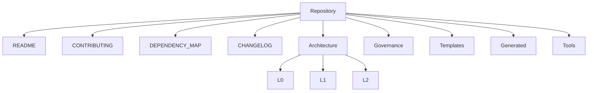
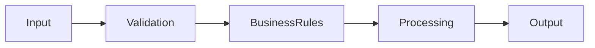
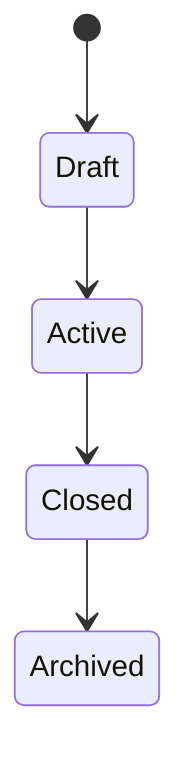
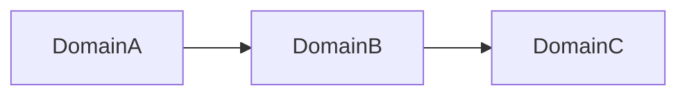
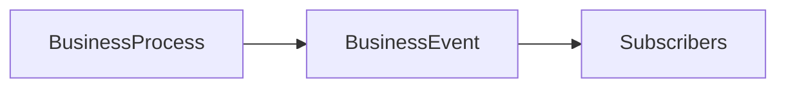
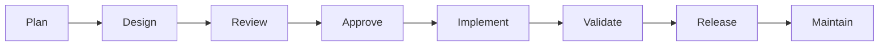
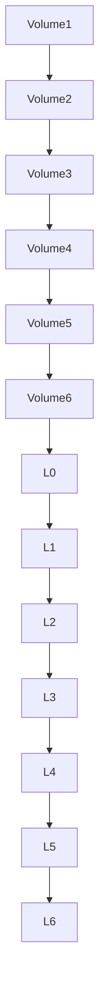

# SutraERP Repository Constitution
## Volume 6 - Repository Reference Manual

---

Version: 1.0

Status: LOCKED

Authority: Repository Constitution

Owner: Lead Architect

Depends On:

- Volume 1
- Volume 2
- Volume 3
- Volume 4
- Volume 5

---

# 1. Purpose

This volume serves as the permanent reference manual for the SutraERP repository.

It standardizes terminology, template references, repository structure, architectural checklists, naming conventions, and other reference material used throughout the project.

This volume is authoritative for terminology and repository reference conventions.

---

# 2. Current Repository Folder Structure

```text
SutraERP/
|
|-- README.md
|-- CONTRIBUTING.md
|-- DEPENDENCY_MAP.md
|-- CHANGELOG.md
|
|-- architecture/
|   |-- ARCHITECTURE_INDEX.md
|   |-- migration_report.md
|   |-- L0_Business_Vision/
|   |-- L1_Business_Domain_Architecture/
|   `-- L2_Domain_Workflow_Architecture/
|
|-- governance/
|   `-- constitution/
|
|-- templates/
|-- generated/
`-- tools/
```

Planned folders such as `ADR/`, `assets/`, and `archive/` are not part of the current repository structure until they are created.

---

# 3. Repository Map



---

# 4. Canonical Terminology

| Term | Meaning |
|------|---------|
| Domain | Independent business capability |
| Entity | Business object with identity |
| Contract | Public capability exposed by a domain |
| Event | Completed business fact |
| Workflow | Ordered business process |
| Lifecycle | Valid state transitions |
| Canonical Owner | Single authoritative owner |
| Context | Logical business boundary |
| Qualification Completion | Canonical replacement for the legacy term Graduation |

---

# 5. Standard Abbreviations

| Abbreviation | Meaning |
|-------------|---------|
| L0 | Business Vision |
| L1 | Business Domain Architecture |
| L2 | Domain Workflow Architecture |
| L3 | Business Scenario Architecture |
| L4 | System Behavior Specification |
| L5 | Solution Architecture |
| L6 | UI / UX Architecture |
| ADR | Architecture Decision Record |
| API | Application Programming Interface |
| DDD | Domain Driven Design |

---

# 6. Standard Templates

The repository currently includes templates for:

- L1
- L2
- L3
- L4
- L5
- L6

No ADR-specific template is present in the current workspace.

---

# 7. Standard Mermaid Templates

## Business Workflow



## State Machine



## Domain Dependency



## Event Flow



---

# 8. Standard Document Structure

Every architecture document should contain:

```text
Purpose
Scope
Actors
Entities
Business Rules
Workflow
State Machine
Contracts
Events
Dependencies
Examples
Locked Decisions
```

---

# 9. Architecture Checklist

Before locking a document verify:

- Metadata or an approved simplified header
- Version
- Dependencies
- Mermaid diagrams
- Canonical ownership
- Events
- Contracts
- State machine
- Traceability
- Cross references

---

# 10. Pull Request Checklist

Before merging:

- Documentation updated
- Version updated
- Diagrams updated
- Dependencies updated
- README updated if repository behavior changed
- Review approved

---

# 11. Architectural Quality Checklist

Every architecture shall satisfy:

- Modular
- Traceable
- Testable
- Extendable
- Technology Independent
- Domain Driven
- Documented
- Reviewable

---

# 12. Repository Health Indicators

Repository health is evaluated through:

- Documentation
- Architecture
- Dependencies
- Reviews
- Versioning
- Diagrams

---

# 13. Repository Lifecycle



---

# 14. Constitution Hierarchy



---

# 15. Constitutional Summary

The Constitution establishes:

- Governance
- Repository Standards
- Architectural Framework
- Engineering Governance
- Change Management
- Repository Reference Standards

Every repository artifact derives from these six constitutional volumes.

---

# 16. Future Expansion

Future repository additions may include:

- ADR/
- assets/
- archive/

These additions must be created before other documents reference them as existing paths.

---

# 17. Final Constitutional Declaration

The SutraERP Repository Constitution represents the highest authority governing the repository.

Every document, architectural decision, review, release, and contribution shall conform to this Constitution.

Conflicts shall always be resolved in favor of the Constitution.

---

Status: LOCKED

Authority Level: Repository Constitution

END OF CONSTITUTION
