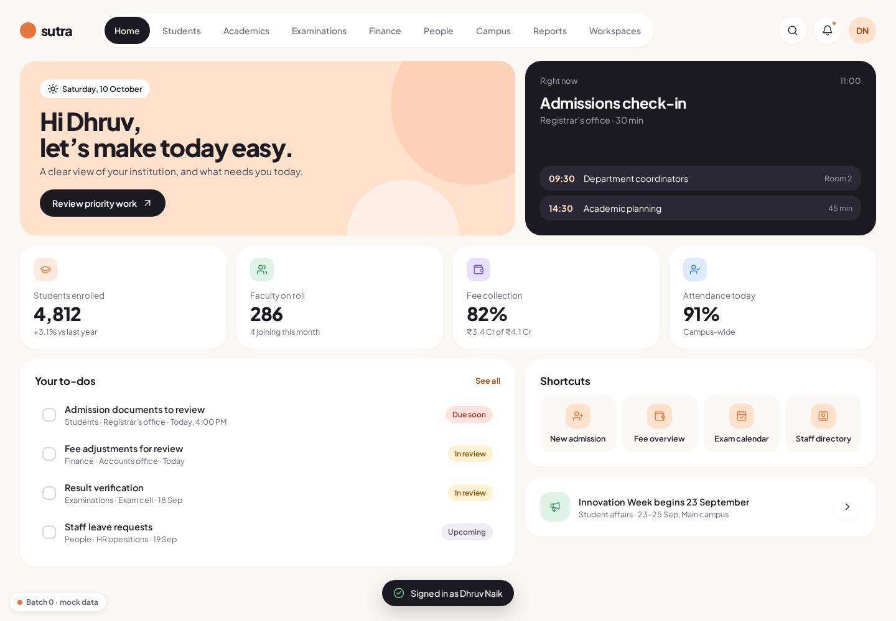

# SutraERP

Production-grade education ERP — **Batch 0: Foundation**.

A Rust modular monolith (Axum + Tokio, PostgreSQL 18 + SQLx) with a React Router SPA in the
**Soft Bento** design language. Architecture authority: the SutraERP L0–L6 architecture repository
(ADRs under `architecture/L5_Solution_Architecture/adr`). See [`docs/adr-map.md`](docs/adr-map.md)
for how each ADR is realised here and [`docs/batches.md`](docs/batches.md) for the delivery plan.



## Architecture map

```
sutraerp/
├── Cargo.toml                 Cargo workspace
├── crates/                    shared, domain-free crates
│   ├── kernel/                UUIDv7 ids · ExecutionScope (tenant/institution) · Money (rust_decimal)
│   │                          · Version (optimistic concurrency) · CloudEvents envelope + EventPublisher
│   │                          · AuditEntry/AuditSink · IdempotencyStore · ReadinessCheck · KernelError
│   ├── contracts/             public inter-module ports + DTOs (the ONLY way modules talk)
│   ├── web/                   Axum layer: RFC 9457 problems · request id · Scope extractor
│   │                          · Idempotency-Key middleware · /health/live|ready
│   └── persistence/           SQLx pool (UTC) · embedded migrations · outbox writer · audit sink
│                              · PostgreSQL idempotency store · DB readiness
├── modules/                   one crate per domain (A–J), each owns one PostgreSQL schema
│   ├── platform/      (A)     auth boundary (login/session/MFA hook, dev stub, Keycloak interface),
│   │                          WorkflowPort no-op adapter, workspace catalog, module registry
│   ├── institution/   (B)     reference aggregate: tx + outbox + audit + version/ETag + Idempotency-Key
│   ├── student/       (C)  academic/ (D)  people/ (E)  finance/ (F, money model seed)
│   └── campus/ (G)  services/ (H)  exams/ (I)  resources/ (J)      ← scaffolds
├── apps/
│   ├── api/                   composition root: config · telemetry · router · OpenAPI · graceful shutdown
│   │   └── tests/             architecture fitness tests + router tests (no DB)
│   └── web/                   React Router framework mode (SPA, ssr:false) + TanStack Query
├── packages/
│   ├── ui/                    Soft Bento component library (tokens, Shell, BentoTile, StatTile, DataTable,
│   │                          Drawer, Modal, Toast, CommandPalette, Badge, Button, Input/Select, EmptyState…)
│   └── api-client/            openapi-typescript types + openapi-fetch client
├── catalog/workspaces.json    99 workspaces / 595 workflows (shared by API and web)
├── migrations/                schemas per domain, audit_log, outbox, idempotency_key, institution
├── openapi/openapi.json       generated OpenAPI 3.1 (committed; CI checks drift)
├── deploy/                    Dockerfiles, nginx, Keycloak dev realm, Postgres init
├── docker-compose.yml         postgres 18 · keycloak 26 · valkey · mailpit (+ api/web profile)
└── .github/workflows/ci.yml   fmt · clippy -D warnings · tests · PG18 integration · web · OpenAPI drift
```

**Boundary rules** (enforced by `cargo test`, see `apps/api/tests/architecture.rs`):

- a module crate depends only on `sutra-kernel`, `sutra-contracts`, `sutra-web`, `sutra-persistence`;
- `kernel` and `contracts` never depend on Axum/SQLx/Tower;
- no module SQL references another module's schema;
- every module crate is registered in the composition root.

## Running locally

Prerequisites: Rust stable (see `rust-toolchain.toml`), Node 22, pnpm (`corepack enable`), Docker.

```sh
make setup        # pnpm install + .env from .env.example
make up           # postgres 18, keycloak 26, valkey, mailpit
make migrate      # apply migrations (separate step, ADR-L5-0008)
make api          # http://localhost:8080   (OpenAPI: /api/openapi.json)
make web          # http://localhost:5173   (proxies /api to :8080)
```

The web app runs without the API by default (`VITE_AUTH_MODE=mock`): pick a role on the sign-in
page. Set `VITE_AUTH_MODE=api` to sign in through `POST /api/v1/auth/login` (dev authenticator,
password `sutra`; set `SUTRA_DEV_MFA=true` to exercise the MFA challenge, code `000000`).

The API also starts with no database at all for UI work:

```sh
SUTRA_IDEMPOTENCY_STORE=memory SUTRA_AUDIT_SINK=memory cargo run -p sutra-api
# /health/ready reports 503 (postgres unreachable) — liveness, auth and catalog still work
```

Whole stack in containers: `docker compose --profile app up --build` (web on :3000).

## Quality gates

```sh
cargo fmt --all -- --check
cargo clippy --workspace --all-targets --all-features -- -D warnings
cargo test --workspace                       # no database needed
make test-db                                 # + live PostgreSQL 18 integration tests (DATABASE_URL)
pnpm install && pnpm -r typecheck && pnpm lint && pnpm -r test && pnpm -r build
make openapi                                 # regenerate spec + TS client after API changes
make ci                                      # everything CI runs, incl. OpenAPI drift
```

## API conventions (ADR-L5-0034)

- `/api/v1/...` URL-major versioning; JSON members are camelCase.
- Errors are `application/problem+json` (RFC 9457) with `errorCode`, `correlationId`
  (= `X-Request-Id`) and `validationErrors`.
- Retry-sensitive commands accept `Idempotency-Key`; same key + different body → 422, in flight → 409,
  replay carries `Idempotency-Replayed: true`.
- Tenant scope: `X-Sutra-Tenant-Id` (+ optional `X-Sutra-Institution-Id`) in dev header mode; missing
  or malformed scope fails closed.
- Mutable aggregates expose `ETag: "<version>"`; updates require `If-Match` (412 on conflict, 428 if absent).

## Batch 0 endpoints

| Method | Path | Notes |
|--------|------|-------|
| GET | `/health/live`, `/health/ready` | readiness checks PostgreSQL, flips to 503 while draining |
| POST | `/api/v1/auth/login` | dev authenticator now, Keycloak delegation in Batch 1 |
| POST | `/api/v1/auth/mfa/verify` | MFA continuation hook |
| GET | `/api/v1/auth/session` | current principal |
| POST | `/api/v1/auth/logout` | revokes the server-side session |
| GET | `/api/v1/platform/workspaces[?role=&group=]`, `/api/v1/platform/workspaces/{key}` | navigation catalog |
| GET | `/api/v1/platform/modules` | module registry |
| POST/GET/PATCH | `/api/v1/institution/institutions[/{id}]` | reference aggregate (needs PostgreSQL) |
| GET | `/api/openapi.json` | generated OpenAPI 3.1 |
