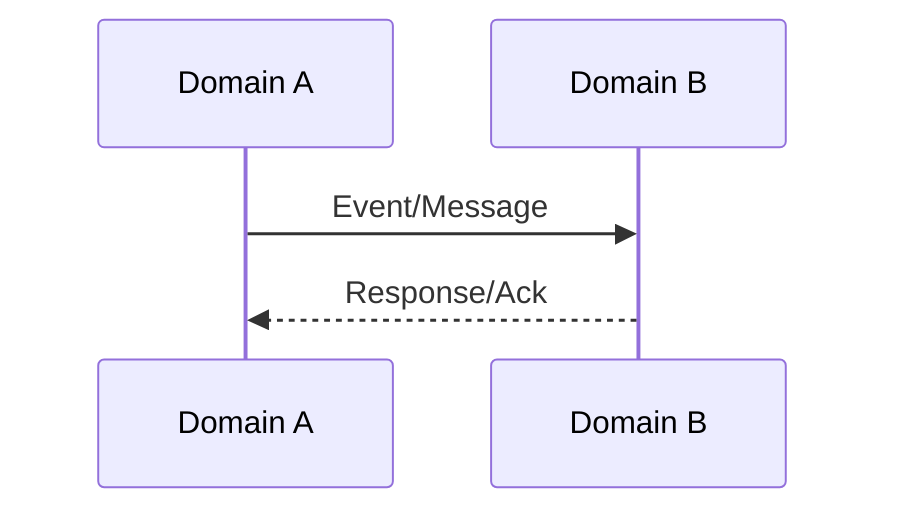

# Level 3 Cross-Domain Integration: [Domain A] & [Domain B]

**Version:** 0.1  
**Status:** Draft / Review / Locked  

---

### 1. Integration Goal
Summarize the business reason why these domains must interact.

### 2. Key Interaction Points
Outline where and how Domain A communicates with Domain B.

### 3. Sequence / Interaction Diagram
*Insert Mermaid or text-based sequence diagram here.*

### 4. Transactional Boundaries
Specify Saga orchestration or local transactions that must be coordinated.

### 5. Data Synchronization & Offsets
Explain how data consistency is achieved (e.g., event sourcing, outbox pattern, scheduled jobs).

### 6. Failure Recovery & Compensating Actions
List the rollback/compensating transactions if a step in the cross-domain workflow fails.

### 7. Performance & Latency SLA
Document latency limits or caching mechanisms required.

### 8. Version History
| Version | Date | Author | Description |
| :--- | :--- | :--- | :--- |
| 0.1 | [Date] | [Author] | Initial draft |
